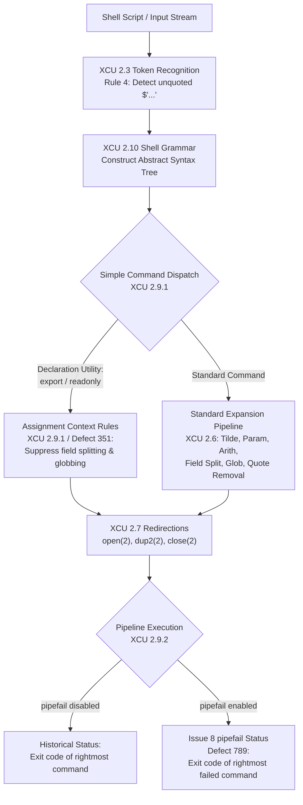

# POSIX.1-2024 Changes

> [!summary] Claim
> POSIX.1-2024 (Issue 8) modernizes the Unix shell execution environment by standardizing critical defensive programming capabilities - notably `set -o pipefail`, ANSI-C quoting (`$'...'`), declaration utility assignment context, custom-delimiter reading, and null-delimited toolchain integration - while rigorously defining execution invariants across pipeline failure propagation and file status inspection.

Part of [The POSIX Shell Language](README.md) in [Shell and Unix Engineering](../README.md).

## TL;DR

- Mechanism: POSIX.1-2024 incorporates `set -o pipefail` into pipeline exit status evaluation, promotes ANSI-C quoting (`$'...'`) to lexical token recognition, establishes assignment contexts for declaration utilities, and standardizes null-delimited stream handling across `find -print0`, `xargs -0`, and `read -d ''`.
- Rule: Under `set -o pipefail`, a pipeline's exit status is the exit code of the rightmost command that failed, or zero if all commands exited successfully, evaluated using the option state active when the pipeline starts.
- Trap: Assuming older installed shells support Issue 8 causes immediate failures: `dash` 0.5.12 rejects `read -d` and treats `$'...'` as literal text, it also rejects `set -o pipefail` unless the distribution backported it (Debian 13 did, Alpine 3.22 did not), and `posh` 0.14.1 still field-splits variable assignments passed to `export`.
- Portability: Mandated by POSIX.1-2024 Issue 8; widely implemented in modern shells, but notable gaps persist across minimal and legacy implementations: dash 0.5.12 and posh 0.14.1 lack $'...' quoting, posh 0.14.1 and unpatched dash 0.5.12 lack pipefail, yash 2.58 lacks read -d (added in yash 2.59), posh 0.14.1 lacks test -ef and field-splits in export, and macOS /bin/sh remains bash 3.2 (as of 2026-11).
- When not to use it: Avoid un-guarded Issue 8 features in `#!/bin/sh` scripts that must execute on legacy Linux distributions, minimal embedded containers, or recovery initramfs environments where `/bin/sh` is an older `dash` or `posh`.

## Mental model



The shell processing architecture begins at token recognition (`POSIX.1-2024 XCU 2.3 Rule 4`), where the lexical analyzer identifies an unquoted `$'` sequence and keeps its text unmodified in the token; the designated backslash escape sequences are then replaced immediately prior to word expansion (`POSIX.1-2024 XCU 2.2.4`).
When the grammar parser identifies a simple command, it evaluates the command name against the catalog of declaration utilities (`export`, `readonly`, and `command` invoking them under `POSIX.1-2024 XCU 2.9.1`).
If a declaration utility is recognized, following words matching `name=value` are processed under assignment context rules, completely suppressing field splitting and pathname expansion while enabling tilde expansion after `=` and unquoted `:`.
Standard commands undergo the full seven-phase expansion pipeline before file descriptor redirections bind input and output streams.
Finally, when commands run in a pipeline (`POSIX.1-2024 XCU 2.9.2`), the shell samples the `pipefail` option state active at pipeline initiation: if enabled via Austin Group Defect 789, the shell records exit codes from all pipeline stages and returns the rightmost non-zero status instead of blindly returning the last command's exit code.

## How it works

### Pipeline Exit Status and pipefail (XCU 2.9.2, XCU 2.15, Austin Group Defect 789)

In historical POSIX specifications (`POSIX.1-2008 XCU 2.9.2`), the exit status of a pipeline `command1 | command2 | ... | commandn` was unconditionally defined as the exit status of `commandn`.
If `command1` failed due to missing files, memory exhaustion, or network aborts, its non-zero exit status was discarded by the shell if `commandn` exited successfully.
This architectural blind spot crippled error detection in scripts executing under `set -e` (`errexit`), where downstream filters like `grep`, `sed`, or `gzip` masked upstream failures.

POSIX.1-2024 formally standardizes `set -o pipefail` via Austin Group Defect 789.
When `pipefail` is enabled, the pipeline exit status conforms to the following formal contract (`POSIX.1-2024 XCU 2.9.2`):
1. If all commands in the pipeline exit with status zero, the pipeline exit status is zero.
2. If one or more commands in the pipeline exit with a non-zero status, the pipeline exit status is the exit status of the rightmost command that exited with a non-zero status.
3. If the pipeline begins with the reserved word `!`, the exit status is the logical NOT of the status determined by the rules above (zero becomes one, non-zero becomes zero).
4. Option sampling occurs at start time: the shell uses the `pipefail` setting at the time it begins execution of the pipeline, so in the specification's own example, `command1 | set -o pipefail`, the exit status of `command1` has no effect on the pipeline's exit status.

In implementation source code, GNU bash evaluates this in `jobs.c` via the function `raw_job_exit_status()`.
When `pipefail_opt` is set as the job is created, `jobs.c` marks the job with `J_PIPEFAIL`, and Bash then walks the job's circular process list, whose statuses were collected from `waitpid(2)` calls (bash 5.3 source):
```c
/* jobs.c, raw_job_exit_status() excerpt */
if (jobs[job]->flags & J_PIPEFAIL)
  {
    fail = 0;
    p = jobs[job]->pipe;
    do
      {
        if (WSTATUS (p->status) != EXECUTION_SUCCESS)
          fail = WSTATUS (p->status);
        p = p->next;
      }
    while (p != jobs[job]->pipe);
    WSTATUS (ret) = fail;
    return ret;
  }
```
In the Debian Almquist Shell (`dash`), support was integrated in upstream commit `6347b9fc52d7` (committed 2024-04-05, first released in 0.5.13) inside `getstatus()` in `src/jobs.c`, which scans the job's process statuses from the last stage backward until it finds a non-zero one.
Debian 13 backports it into its 0.5.12-12 package as `0021-jobs-Implement-pipefail-option.patch`, while Alpine 3.22 `dash` 0.5.12-r3 and the macOS `/bin/dash` reject the option with exit status `2` (measured in the shell matrix, as of 2026-11).
Ubuntu 24.04 `dash` 0.5.12-6ubuntu5 also rejects it, because Debian added the patch in 0.5.12-7, after the 0.5.12-6 that package is based on.
`POSIX.1-2024 XCU 2.8.2` requires only that a command terminated by a signal gets a status greater than 128 that identifies the signal, in an implementation-defined manner.
Most shells use the `128 + N` convention (such as `141` for `SIGPIPE`, which is signal 13).
In `ksh93`, signal status base is `256` (`256 + N`), while in `yash` it is `384` (`384 + N`).
macOS `ksh93u+ 2012` is an exception inside a pipeline: under `pipefail` it reported `13` for a stage killed by `SIGPIPE`, although it reported `271` (`256 + 15`) for a plain command killed by `SIGTERM` (measured on the macOS host).
Furthermore, `ksh93u+m 1.0.10` connects pipeline stages using `socketpair(2)` instead of `pipe(2)` unless running under `set -o posix`.
This socket IPC introduces a timing-dependent race condition upon downstream reader exit: the upstream producer either receives `ECONNRESET` (yielding exit status `1`) or is terminated by `SIGPIPE` (yielding exit status `269`, derived from `256 + 13`), both of which were measured across repeated executions in the shell matrix.

### Lexical ANSI-C Quoting (XCU 2.2.4, XCU 2.3 Rule 4, Austin Group Defect 249)

Scripts targeting POSIX shells historically required external commands like `printf` or multiline literals to assign control characters like tabs and newlines to shell variables (for example, `IFS="$(printf '\n\t')"`).
POSIX.1-2024 standardizes ANSI-C quoting via `$'...'` (`POSIX.1-2024 XCU 2.2.4`) following Austin Group Defect 249.

Token recognition (`POSIX.1-2024 XCU 2.3 Rule 4`) mandates that an unquoted `$` immediately followed by a single-quote (`'`) affects quoting up to the end of the quoted text, with no substitution during token recognition.
The designated backslash escape sequences are replaced with the bytes they yield immediately prior to word expansion of the containing word (`POSIX.1-2024 XCU 2.2.4`):
- Standard C escapes: `\a` (alert), `\b` (backspace), `\e` (escape), `\f` (form-feed), `\n` (newline), `\r` (carriage return), `\t` (horizontal tab), `\v` (vertical tab), `\\` (backslash), `\'` (single-quote), `\"` (double-quote).
  Any other backslash sequence, such as `\?`, is unspecified.
- Octal numbers: `\ddd` (one to three octal digits).
- Hexadecimal numbers: `\xXX` (one or more hexadecimal digits; more than two is unspecified).
- Control characters: `\cX` (the control character listed in the `stty` table, which is `X ^ 0x40` for an ASCII letter), with `\c\\` yielding the `FS` character.

The resulting characters are immediately treated as quoted characters.
Crucially, characters generated by `$'...'` are shielded from parameter expansion, command substitution, arithmetic expansion, field splitting, and pathname expansion (`POSIX.1-2024 XCU 2.6`).
The opening `$'` and closing `'` are stripped during quote removal (`POSIX.1-2024 XCU 2.6.7`).
In GNU bash, parsing occurs in `parse.y` and string translation executes in `lib/sh/strtrans.c` (`ansicstr()`).
Upstream `dash` added support in commit `776424a8f915` (dated 2024-06-10, first released in 0.5.13 in September 2025), but packaged distributions such as Debian 13 (`dash` 0.5.12) treat `$'...'` as literal text.

### Declaration Utilities and Assignment Contexts (XCU 2.9.1, Austin Group Defect 351)

A historical defect in the shell specification concerned variable assignments passed as arguments to declaration builtins (`POSIX.1-2008 XCU 2.9.1`).
In standard shell grammar, a simple command consists of optional variable assignments preceding a command word, followed by arguments.
In a command like `val="foo bar"; export x=$val`, POSIX.1-2008 classified `export` as a standard utility name and `x=$val` as an argument operand.
Consequently, `$val` was subjected to field splitting and pathname expansion, expanding `export x=$val` into two arguments: `x=foo` and `bar`.
To prevent this, programmers were forced to double-quote arguments: `export x="$val"`.

POSIX.1-2024 resolves this via Austin Group Defect 351 by defining **declaration utilities** (`POSIX.1-2024 XCU 2.9.1`).
The utilities `export` and `readonly` (and the `command` utility when its first operand names `export` or `readonly`) are designated as declaration utilities.
When the shell identifies a declaration utility as the simple command word:
1. Every subsequent word that has the form of a variable assignment (`name=value`) is expanded in an **assignment context**.
2. In an assignment context, field splitting (`POSIX.1-2024 XCU 2.6.5`) and pathname expansion (`POSIX.1-2024 XCU 2.6.6`) are completely suppressed on `value`.
3. Tilde expansion (`POSIX.1-2024 XCU 2.6.1`) is performed after the first `=` character and after any subsequent unquoted `:` characters (mirroring the expansion behavior of `PATH`).
4. Any argument that does not have the syntactic format of `name=value` (or options like `-p`) is expanded as a standard utility operand.

In GNU bash, `execute_cmd.c` implements this in `execute_simple_command()` by invoking `fix_assignment_words(simple_command->words)` before word expansion occurs.
While `bash`, `dash`, `zsh`, `ksh93`, `mksh`, `yash`, and `busybox` suppress field splitting in this context, `posh 0.14.1` still field-splits `export x=$val`.
Tilde handling is where `posh` diverges further: for `export a=~/x`, bash (5.2 and 5.3 under `--posix`, and macOS `/bin/sh` 3.2) and `mksh` expand as item 3 above requires, while `posh` keeps the literal `~` (measured in the shell matrix, as of 2026-11).

### Built-in Utilities Enhancements

POSIX.1-2024 updates several core built-in utilities to eliminate long-standing shell scripting hazards:

#### The read Utility (XCU read, Austin Group Defects 243, 367, 854)
- Custom delimiters (`-d delim`): The `read` utility accepts `-d delim` (`POSIX.1-2024 XCU read`).
  If `delim` is a single-byte character, that byte terminates input records instead of `<newline>`.
  If `delim` is the empty string (`-d ''`), input records are terminated by the null byte (`NUL` / `\0`).
  While `bash`, `mksh`, `ksh93`, and `busybox` support `-d`, `dash` 0.5.12 and `yash` 2.58.1 reject `-d` with exit status `2`, and `posh` 0.14.1 rejects it with exit status `1` (measured in the shell matrix, as of 2026-11).
  `yash` added `read -d` in 2.59 (2025-05-13, per its `NEWS` file), and upstream `dash` 0.5.13.5 still parses only `-p` and `-r` in `read` (`src/miscbltin.c`, as of 2026-11).
- Deterministic exit codes on EOF: Austin Group Defect 367 mandates that `read` distinguishes between end-of-file and system call errors.
  When end-of-file is encountered before reaching a delimiter, `read` sets its exit status to `1`.
  When an error occurs (such as `EBADF` or `EIO`), the specification requires an exit status greater than `1`.
  Installed shells lag here: `read x <&-` on a closed standard input returned `2` only in `mksh`, and `1` in `bash` 5.2, `dash`, `zsh`, `ksh93u+m`, `posh`, `busybox`, and `yash` (measured in the shell matrix, as of 2026-11).
- Intrinsic mandate: Austin Group Defect 854 lists `read` among the intrinsic utilities (`POSIX.1-2024 XCU 1.7`), so the shell provides it directly instead of searching for it through `PATH`, which is what lets it set variables in the current execution environment.

#### The test and [ Utilities (XCU test, Austin Group Defect 375)
- Binary file comparison: `test pathname1 -ef pathname2` returns true if both paths resolve to the same device and inode number via `stat(2)` (`st_dev` and `st_ino`).
- File modification timestamp comparison: `pathname1 -nt pathname2` is true if both resolve and `pathname1` has the newer last data modification timestamp (`st_mtim`), and also if `pathname1` resolves and `pathname2` does not; `pathname1 -ot pathname2` evaluates whether it is older.
- String lexical comparisons: `s1 < s2` and `s1 > s2` evaluate lexicographical order based on the current locale's collation sequence.
  While `bash`, `dash`, `mksh`, `yash`, and `busybox` implement `-ef`, `-nt`, and `<` in `test`, `posh` 0.14.1 rejects those three operators while still accepting `=` and `-eq` (`test: -ef: unexpected operator/operand`, exit status `2`), and `zsh` requires conditional expression syntax `[[` for `<` and `>`.
- Removal: Austin Group Defect 1330 removed the obsolescent binary `-a` (AND) and `-o` (OR) primaries and the `(` and `)` operators from the specification, which had been ambiguous in 3- and 4-argument evaluation.
  Engineers must use compound commands: `test "$a" = "$b" && test "$c" = "$d"`.

#### Directory Navigation (XCU cd, Austin Group Defect 253)
- Canonical path failure detection (`cd -P -e`): Under `cd -P`, the shell resolves all symbolic links to reach the physical working directory.
  If the directory change succeeds via `chdir(2)` but the shell cannot determine the canonical absolute path for `PWD` (due to inaccessible parent directory permissions or filesystem lookup failures in `getcwd(3)`), `-e` forces `cd` to exit with status `1`.
  Support for `cd -P -e` is implemented in `bash` 4.2+ (bash `CHANGES`, first listed for bash-4.2-alpha), `ksh93u+m`, `mksh`, and `yash` (which requires `-P` when `-e` is specified); it is absent in `bash 3.2`, legacy `ksh93u+ 2012`, `dash`, `busybox ash`, and `zsh`.
  The lab forces the failure by deleting the current directory and running `cd -P -e .`, which returns `1` in `bash` 4.4 through 5.3, `mksh`, `yash`, and `ksh93u+m`, while `cd -P .` without `-e` returns `0`.
  In `posh 0.14.1`, `cd` suffers from an option-parsing defect where invalid options print a diagnostic to standard error but the built-in still exits with status `0`.

### Toolchain Integration for Safe Pipeline Processing

POSIX.1-2024 modernizes standard external utilities to prevent command injection and filename truncation vulnerabilities:

- Null-delimited streams (`find -print0`, `xargs -0`, `xargs -r`): Austin Group Defect 243 formally standardizes `-print0` in `find` and `-0` and `-r` in `xargs` (`POSIX.1-2024 XCU find`, `xargs`).
  Filenames containing whitespace, double quotes, single quotes, backslashes, or literal newlines are safely transmitted between utilities without corruption.
  The `-r` option (`--no-run-if-empty`) in `xargs` prevents executing the target utility when standard input is empty.
- Extended Regular Expressions in sed (`sed -E`): Austin Group Defect 528 standardizes `sed -E` (`POSIX.1-2024 XCU sed`), providing native Extended Regular Expression (ERE) pattern matching across BSD and GNU implementations without non-portable `-r` flags.
- Unified Diff format (`diff -u`): `diff -u` and `diff -U n` are not new in Issue 8; the change history of `POSIX.1-2024 XCU diff` records them as added in Issue 7 (SD5-XCU-ERN-103 and SD5-XCU-ERN-120), while Issue 8 applies only Austin Group Defect 251 (pathnames with newlines) and Defect 1498 (exit status) to `diff`.
- New standard utilities:
  - `realpath [-e|-E] file`: Resolves canonical absolute pathnames via `realpath(3)` (`POSIX.1-2024 XCU realpath`).
  - `readlink [-n] file`: Prints target of symbolic links via `readlink(2)` without parsing `ls -l` text (`POSIX.1-2024 XCU readlink`).
  - `timeout [-fp] [-k time] [-s signal_name] duration utility [argument...]`: Enforces command execution time limits, returning exit status `124` on timeout unless `-p` is given (`POSIX.1-2024 XCU timeout`, Austin Group Defect 1586).
  - Localization tools: `gettext`, `ngettext`, `msgfmt`, and `xgettext` are added to base specifications.

### What POSIX.1-2024 Explicitly Did NOT Standardize

Understanding what the Austin Group deliberately omitted prevents writing unportable scripts:
1. Arrays: Neither indexed arrays (`arr[0]`) nor associative arrays (`typeset -A`) were adopted; variable expansion remains strictly scalar.
2. Local variable scoping: The `local` and `typeset` keywords inside functions remain non-standard (Austin Group Defect 767 was closed as Rejected after the 2022-08-08 conference call); all variable assignments inside shell functions modify global shell scope.
3. Substring expansion: Syntax such as `${var:offset:length}` remains a non-portable extension.
4. Search and replace: Syntax such as `${var//pattern/replacement}` remains non-standard.
5. Here-strings: Syntax such as `cmd <<< "string"` was not standardized.
6. Double brackets: The `[[ ... ]]` conditional command remains shell-specific.
7. Process substitution: Syntax like `<(command)` or `>(command)` remains an extension outside POSIX.

## Numbers and limits

| Metric / Parameter | Value / Limit | Standard Section / Source | Operational Significance |
|---|---|---|---|
| `pipefail` exit status on all success | `0` | POSIX.1-2024 XCU 2.9.2 | Pipeline succeeds only when every stage exits 0 |
| `pipefail` exit status on single failure | Exit status of failed command | POSIX.1-2024 XCU 2.9.2 | Preserves exact application error codes across pipes |
| `pipefail` exit status on multiple failures | Status of rightmost failing command | POSIX.1-2024 XCU 2.9.2 | Deterministic rightmost stage precedence |
| `read` exit status on EOF | `1` | POSIX.1-2024 XCU read (Defect 367) | Distinguishes EOF from input/read error |
| `read` exit status on read error | `> 1` | POSIX.1-2024 XCU read (Defect 367) | Lets loops differentiate EOF from `EBADF`/`EIO`, but only `mksh` returned `2` for a closed standard input in the shell matrix; the others returned `1` |
| `timeout` exit status on timeout | `124` | POSIX.1-2024 XCU timeout (Defect 1586) | Distinguishes timeout from utility exit codes; BusyBox 1.37 `timeout` returned `143` instead in the shell matrix |
| `timeout` exit status when utility not found | `127` | POSIX.1-2024 XCU timeout | Standard command lookup failure status |
| `timeout` exit status when utility not executable | `126` | POSIX.1-2024 XCU timeout | Standard permission denied execution status |
| ANSI-C hex digits parsed (`\xXX`) | `2` portable; more is unspecified | POSIX.1-2024 XCU 2.2.4 | `\x4142` is `A42` in bash, zsh, yash, and BusyBox, but one code point in mksh and ksh93 (shell matrix) |
| ANSI-C octal digits parsed (`\ddd`) | Max `3` octal digits | POSIX.1-2024 XCU 2.2.4 | `\101` decodes as `A`, while `\0101` is byte `0x08` followed by `1` (shell matrix) |
| Conventional shell signal status base | `128` | Shell matrix measurement; POSIX.1-2024 XCU 2.8.2 requires only a status greater than 128 | Signal `N` produces exit status `128 + N` (`SIGPIPE` = 141) in most shells |
| `ksh93` signal status base | `256` | Shell matrix measurement | Signal `N` produces exit status `256 + N` in `ksh93` |
| `yash` signal status base | `384` | Shell matrix measurement | Signal `N` produces exit status `384 + N` in `yash` |
| `ksh93u+m` pipefail `SIGPIPE` status | `1` or `269` | Measured in the shell matrix | Socket race between `ECONNRESET` (1) and `SIGPIPE` (`256 + 13 = 269`) |
| macOS `ksh93u+ 2012` pipefail `SIGPIPE` status | `13` | Measured in the shell matrix | Raw signal number, not `256 + 13` |
| `yash` 2.58 `read -d` exit status | `2` | Measured in the shell matrix | Option `-d` is rejected as invalid option; added in `yash` 2.59 |
| `posh` 0.14.1 `test -ef` exit status | `2` | Measured in the shell matrix | Operator `-ef` is rejected as unexpected operand |
| `diff -u` default context lines | `3` lines | POSIX.1-2024 XCU diff | Standard unified diff context output |
| `cd -e` failure exit status | `1` | POSIX.1-2024 XCU cd (Defect 253) | Directory changed but physical PWD unresolvable |

## Portability

The table below documents compliance with key POSIX.1-2024 shell additions across major shell families and environments, verified through the shell test matrix (as of 2026-11).
The `dash` column is the Debian package, which backports `pipefail`; Alpine 3.22 `dash` 0.5.12-r3 and macOS `/bin/dash` reject it with exit status `2`.
The `cd -P -e` row is backed by the lab test `cd -P -e fails only when the physical working directory cannot be determined`, which removes the current directory and then runs `cd -P -e .`: the shells marked Supported return `1` there while plain `cd -P .` returns `0`, `posh` returns `0` for both, and the unsupported shells reject the option (`dash` and `busybox ash` with `2`, `zsh` and `bash` 3.2 with `1`).
The last six rows are external utilities, so they vary with the operating system and not with the shell: they were run once on macOS 27.2, Alpine 3.22 (BusyBox), and Debian 13 (GNU coreutils 9.7), not per shell, and the columns inherit those results.

| Feature / Built-in | POSIX.1-2024 sh | macOS bash 3.2 | Current bash 5.3 | zsh 5.9 (native) | zsh (--emulate sh) | dash 0.5.12 (Debian 13) | ksh93 (93u+ / 93u+m) | mksh R59 | yash 2.58 | posh 0.14.1 | BusyBox ash 1.37 |
|---|---|---|---|---|---|---|---|---|---|---|---|
| `set -o pipefail` | Supported | Supported | Supported | Supported | Supported | Supported (Debian patch) | Supported | Supported | Supported | Unsupported (exit 1) | Supported |
| ANSI-C `$'...'` | Supported | Supported | Supported | Supported | Supported | Unsupported (literal) | Supported | Supported | Supported | Unsupported (literal) | Supported |
| Declaration context (`export x=$v`) | Supported | Supported | Supported | Supported | Supported | Supported | Supported | Supported | Supported | Unsupported (field-splits) | Supported |
| `read -d delim` | Supported | Supported | Supported | Supported | Supported | Unsupported (exit 2) | Supported | Supported | Unsupported (exit 2) | Unsupported (exit 1) | Supported |
| `read -d ''` (null delimiter) | Supported | Supported | Supported | Supported | Supported | Unsupported | Unsupported (93u+) / Supported (93u+m) | Supported | Unsupported | Unsupported | Supported |
| `test -ef` and `-nt` | Supported | Supported | Supported | Supported | Supported | Supported | Supported | Supported | Supported | Unsupported (exit 2) | Supported |
| `test s1 < s2` | Supported | Supported | Supported | Unsupported (requires `[[`) | Unsupported (requires `[[`) | Supported | Unsupported (93u+) / Supported (93u+m) | Supported | Supported | Unsupported (exit 2) | Supported |
| `cd -P -e` | Supported | Unsupported | Supported | Unsupported | Unsupported | Unsupported | Unsupported (93u+) / Supported (93u+m) | Supported | Supported | Unsupported (ignores option, exits 0) | Unsupported |
| `find -print0` | Supported | Supported | Supported | Supported | Supported | Supported | Supported | Supported | Supported | Supported | Supported |
| `xargs -0` and `-r` | Supported | Supported | Supported | Supported | Supported | Supported | Supported | Supported | Supported | Supported | Supported |
| `sed -E` | Supported | Supported | Supported | Supported | Supported | Supported | Supported | Supported | Supported | Supported | Supported |
| `diff -u` | Supported | Supported | Supported | Supported | Supported | Supported | Supported | Supported | Supported | Supported | Supported |
| `realpath` utility | Supported | Partial (no `-e`, `-E`) | Supported | Supported | Supported | Partial (no `-E`) | Supported | Supported | Supported | Supported | Partial (no `-e`, `-E`) |
| `readlink` utility | Supported | Supported | Supported | Supported | Supported | Supported | Supported | Supported | Supported | Supported | Supported |
| `timeout` utility | Supported | Supported (`/usr/bin/timeout`) | Supported | Supported | Supported | Supported | Supported | Supported | Supported | Supported | Partial (no `-f`, `-p`; exit 143) |

## Worked example

The script below is the complete probe of the accompanying [lab](../labs/03-posix-2024-changes/) (`labs/03-posix-2024-changes/posix-probe.sh`).
It probes `set -o pipefail`, ANSI-C quoting `$'...'`, declaration utility assignment context, `read -d`, `test` operators, and `cd -e`.

```sh
#!/bin/sh
# posix-probe.sh: probe POSIX.1-2024 shell language and utility modifications.
# Exercises pipefail, $'...' quoting, declaration utilities, read -d,
# test binary operators (-ef, -nt, <), and cd -e across shell families.
# shellcheck disable=SC3003 # $'...' testing intentionally isolated behind eval
# shellcheck disable=SC2016 # Single-quoted probe strings are passed to eval
# shellcheck disable=SC3040 # Probing POSIX.1-2024 set -o pipefail option
# shellcheck disable=SC3045 # Probing POSIX.1-2024 read -d and cd -e options
# shellcheck disable=SC3012 # Probing POSIX.1-2024 test < lexicographical operator
# shellcheck disable=SC2162 # Testing delimiter reading without backslash escaping

set -eu

mode="${1:-help}"
shift || true

case "$mode" in
  pipefail-basic)
    # Tests pipeline status derivation without and with pipefail (POSIX.1-2024 XCU 2.9.2)
    s_default=0
    # Run pipeline in subshell to avoid exit under set -e
    (exit 2) | (exit 0) || s_default=$?

    if (set -o pipefail 2>/dev/null); then
      s_pipefail=0
      eval 'set -o pipefail; (exit 2) | (exit 0)' || s_pipefail=$?
      printf "default=%d pipefail=%d\n" "$s_default" "$s_pipefail"
    else
      printf "default=%d pipefail=unsupported\n" "$s_default"
    fi
    ;;

  pipefail-rightmost)
    # Tests rightmost non-zero status selection under pipefail
    if (set -o pipefail 2>/dev/null); then
      s_rightmost=0
      eval 'set -o pipefail; (exit 2) | (exit 7) | (exit 0)' || s_rightmost=$?
      printf "pipefail_rightmost=%d\n" "$s_rightmost"
    else
      printf "pipefail_rightmost=unsupported\n"
    fi
    ;;

  pipefail-sigpipe)
    # Tests pipeline exit status under pipefail when an upstream stage receives SIGPIPE
    if (set -o pipefail 2>/dev/null); then
      s_sigpipe=0
      eval 'set -o pipefail; yes | head -n 1 >/dev/null' 2>/dev/null || s_sigpipe=$?
      printf "sigpipe_status=%d\n" "$s_sigpipe"
    else
      printf "sigpipe_status=unsupported\n"
    fi
    ;;

  ansi-c-decode)
    # Tests ANSI-C quoting $'...' (POSIX.1-2024 XCU 2.2.4)
    # Uses eval so shells lacking $'...' do not trigger a parse error on script load
    cmd='x=$'"'"'hello\tworld\n'"'"'; printf "data=<%s>\n" "$x"'
    eval "$cmd"
    ;;

  declaration-utility)
    # Tests assignment context in declaration utilities (POSIX.1-2024 XCU 2.9.1)
    val="alpha beta"
    # shellcheck disable=SC2086 # Unquoted expansion verifies assignment context suppresses field splitting
    export x=$val
    printf "result=x=%s\n" "$x"
    ;;

  read-delim)
    # Tests read -d delimiter option (POSIX.1-2024 XCU read, Austin Group Defect 243)
    if (printf "alpha:beta\n" | read -d : item 2>/dev/null); then
      item=$(printf "alpha:beta\n" | {
        read -d : val
        printf "%s" "$val"
      })
      printf "read_delim=%s\n" "$item"
    else
      printf "read_delim=unsupported\n"
    fi
    ;;

  read-eof-status)
    # Tests read exit status on EOF (POSIX.1-2024 Defect 367: EOF must return 1)
    eof_status=0
    # shellcheck disable=SC2034 # item receives EOF
    read -r item </dev/null || eof_status=$?
    printf "eof_status=%d\n" "$eof_status"
    ;;

  test-binary-ops)
    # Tests -ef, -nt, and < in test/[ (POSIX.1-2024 XCU test, Austin Group Defect 375)
    dir="$1"
    f1="$dir/f1"
    f2="$dir/f2"
    f3="$dir/f3"
    printf "content1\n" >"$f1"
    ln -f "$f1" "$f2"
    /bin/sleep 1
    printf "content3\n" >"$f3"

    res_ef="fail"
    if test "$f1" -ef "$f2" 2>/dev/null; then
      res_ef="ok"
    fi

    res_nt="fail"
    if test "$f3" -nt "$f1" 2>/dev/null; then
      res_nt="ok"
    fi

    res_lt="fail"
    if test "apple" "<" "banana" 2>/dev/null; then
      res_lt="ok"
    fi

    printf "ef=%s nt=%s lt=%s\n" "$res_ef" "$res_nt" "$res_lt"
    ;;

  cd-physical-e)
    # Tests cd -P -e (POSIX.1-2024 XCU cd, Austin Group Defect 253).
    # Prints cd_e=ok when the option is accepted on a resolvable directory, else cd_e=unsupported.
    # Then removes the current directory and runs `cd -P .`, which succeeds in chdir(2) but cannot
    # determine the physical working directory: with -e the status must be non-zero (1 in the
    # shells that implement it), without -e it must stay 0.
    target_dir="$1"
    if (cd -P -e "$target_dir" 2>/dev/null); then
      res_cd="ok"
    else
      res_cd="unsupported"
    fi
    gone="$target_dir/gone"
    mkdir "$gone"
    res_with=0
    res_without=0
    (
      cd "$gone"
      rmdir "$gone"
      cd -P -e . 2>/dev/null
    ) || res_with=$?
    mkdir "$gone"
    (
      cd "$gone"
      rmdir "$gone"
      cd -P . 2>/dev/null
    ) || res_without=$?
    printf "cd_e=%s unresolvable_e=%d unresolvable_plain=%d\n" "$res_cd" "$res_with" "$res_without"
    ;;

  *)
    printf "Unknown mode: %s\n" "$mode" >&2
    exit 1
    ;;
esac
```

Executing `posix-probe.sh` across the shell matrix yields the following verified output:

Under modern shells (such as `bash` 5.3; running the file directly would use its `#!/bin/sh` line instead):
```
$ bash ./posix-probe.sh pipefail-basic
default=0 pipefail=2
$ bash ./posix-probe.sh pipefail-rightmost
pipefail_rightmost=7
$ bash ./posix-probe.sh declaration-utility
result=x=alpha beta
$ bash ./posix-probe.sh read-delim
read_delim=alpha
$ bash ./posix-probe.sh test-binary-ops /tmp/scratch
ef=ok nt=ok lt=ok
$ bash ./posix-probe.sh cd-physical-e /tmp/scratch
cd_e=ok unresolvable_e=1 unresolvable_plain=0
```

Under Debian 13 `/bin/sh`, which runs `dash` 0.5.12-12 with the backported `pipefail` patch (on Alpine 3.22 `dash` and macOS `/bin/dash`, both `pipefail` lines print `unsupported` instead):
```
$ dash ./posix-probe.sh pipefail-basic
default=0 pipefail=2
$ dash ./posix-probe.sh pipefail-rightmost
pipefail_rightmost=7
$ dash ./posix-probe.sh declaration-utility
result=x=alpha beta
$ dash ./posix-probe.sh read-delim
read_delim=unsupported
$ dash ./posix-probe.sh test-binary-ops /tmp/scratch
ef=ok nt=ok lt=ok
$ dash ./posix-probe.sh cd-physical-e /tmp/scratch
cd_e=unsupported unresolvable_e=2 unresolvable_plain=0
```

Under strict legacy minimal shells (`posh` 0.14.1):
```
$ posh ./posix-probe.sh pipefail-basic
default=0 pipefail=unsupported
$ posh ./posix-probe.sh declaration-utility
result=x=alpha
$ posh ./posix-probe.sh read-delim
read_delim=unsupported
$ posh ./posix-probe.sh test-binary-ops /tmp/scratch
ef=fail nt=fail lt=fail
$ posh ./posix-probe.sh cd-physical-e /tmp/scratch
cd_e=ok unresolvable_e=0 unresolvable_plain=0
```

Under `yash` 2.58.1, the last release before `read -d` was added:
```
$ yash ./posix-probe.sh read-delim
read_delim=unsupported
$ yash ./posix-probe.sh cd-physical-e /tmp/scratch
cd_e=ok unresolvable_e=1 unresolvable_plain=0
```

The output shows that `pipefail`, `read -d`, and `cd -e` separate installations more finely than version numbers do: the same `dash` 0.5.12 differs on `pipefail` between Debian and Alpine.
It demonstrates `posh` failing to provide declaration assignment contexts or the `-ef`, `-nt`, and `<` test operators while ignoring invalid options in `cd`.
It also confirms that `yash` 2.58.1 lacks `read -d` support while accepting `cd -P -e`, and that the `-e` failure path returns `1` there.
On `yash` 2.61 (Alpine edge) the same `read-delim` probe prints `read_delim=alpha`, which is why the lab asserts `unsupported` only for 2.58.

## Pitfalls

> [!warning] False Sense of Portability in Shebangs
> Trigger: Writing `#!/bin/sh` at the top of a script while invoking `set -o pipefail` or `read -d ''`.
> Symptom: Immediate script abortion where the interpreter is an unpatched `dash`, such as Alpine 3.22 `dash` or macOS `/bin/dash`, with `set: Illegal option -o pipefail` (exit status 2), causing catastrophic CI/CD pipeline termination.
> Debian 13 `dash` accepts `pipefail`, so a script can pass there and fail elsewhere, and it still fails `read -d` with `read: Illegal option -d` (exit status 2).
> Fix: When targeting `#!/bin/sh`, verify shell capability dynamically via `(set -o pipefail 2>/dev/null) && set -o pipefail`, or explicitly target `#!/usr/bin/env bash` when Issue 8 features are non-negotiable.

> [!warning] SIGPIPE Masking and Accidental Build Failures Under pipefail
> Trigger: Executing commands that produce large data streams piped into truncating filters (for example, `yes | head -n 1` or `cat huge.log | grep -m 1 match`) under `set -e` and `set -o pipefail`.
> Symptom: When `head` or `grep` reads sufficient data and exits, the kernel closes the read end of the pipe; the next `write(2)` from the upstream producer triggers `SIGPIPE` (signal 13).
> Under `pipefail`, the upstream producer's termination status becomes the pipeline exit status, triggering `set -e` and terminating the script unexpectedly.
> This termination status is `141` (`128 + 13`) in most shells, `397` (`384 + 13`) in `yash`, `13` in macOS `ksh93u+ 2012`, and `269` (`256 + 13`) in `ksh93u+m 1.0.10`, where socket IPC can instead surface as `ECONNRESET` with exit status `1`.
> Primary source: Shell matrix measurements and the lab's `pipefail-sigpipe` probe.
> Fix: Consume the stream fully, or handle expected termination explicitly across signal bases, accepting that `1` and `13` can also hide a real failure: `{ yes || { s=$?; [ "$s" -eq 141 ] || [ "$s" -eq 397 ] || [ "$s" -eq 269 ] || [ "$s" -eq 13 ] || [ "$s" -eq 1 ]; }; } | head -n 1`.

> [!warning] Missing Options and Silent Built-in Bugs in Minimal Shells
> Trigger: Relying on `read -d` in `yash`, `test -ef` in `posh`, or expecting option validation errors from `posh`'s `cd`.
> Symptom: `yash 2.58.1` fails `read -d` with `` read: `-d' is not a valid option `` (exit status 2); `posh 0.14.1` fails `test -ef` with `test: -ef: unexpected operator/operand` (exit status 2); and `posh`'s `cd -e` silently ignores `-e` and returns exit code 0 despite printing a warning on stderr.
> Primary source: Shell test matrix divergence measurements across Alpine Linux and Debian 13.
> Fix: Dynamically detect `read -d` and test operators via feature probing before execution, and never rely on `posh` built-in return codes to validate command options.

> [!warning] Word Splitting on Declaration Utility Arguments in Legacy Environments
> Trigger: Writing `export target=$unquoted_variable` in `#!/bin/sh` scripts executing under `posh` 0.14.1 or older shells that predate Austin Group Defect 351.
> Symptom: The shell field-splits the value of `$unquoted_variable` on spaces, setting `target` to only the first word and treating subsequent words as separate `export` operands; those names get the export attribute but, being unset, do not reach the environment (`posh` 0.14.1 with `v="a b"` passes only `x=a`, measured in the shell matrix).
> Fix: Maintain the defensive habit of quoting all assignment operands (`export target="$unquoted_variable"`) until legacy shell environments are entirely decommissioned.

> [!warning] Incompatible Escape Decoding Inside Double Quotes
> Trigger: Placing ANSI-C quoting inside double quotes, such as `message="$'line1\nline2'"`.
> Symptom: POSIX.1-2024 Rule 4 explicitly specifies that `$'...'` is recognized only when the `$` is unquoted; inside double quotes, `$'...'` remains literal characters `$` `'` `l` `i` `n` `e` `1` `\` `n` `l` `i` `n` `e` `2` `'`.
> Furthermore, in `mksh`, the sequence `$'\c\\'` fails to escape the trailing backslash, causing an unclosed quote parse error that aborts script execution.
> Fix: Keep `$'...'` outside double quotes: `newline=$'\n'` followed by `message="line1${newline}line2"`.

> [!warning] Subprocess Leakage and Signal Failure in timeout
> Trigger: Invoking `timeout -f 30s make test`, or plain `timeout 30s make test` where the executed utility starts detached workers in a new session.
> Symptom: With `-f`, `timeout` sends `SIGTERM` only to the immediate child process, so descendants keep running, consuming CPU and holding open file locks.
> Without `-f`, `POSIX.1-2024 XCU timeout` requires signalling the process group or all descendants, by an implementation-defined method, and a grandchild died in GNU coreutils 9.7 and macOS `/usr/bin/timeout`, but one started under `setsid` survived coreutils `timeout` (measured in the shell matrix).
> Fix: Omit `-f`, add `-k` so that a target ignoring `SIGTERM` is still killed, and make any worker that leaves the process group responsible for its own lifetime.

## Security and robustness

POSIX.1-2024 addresses fundamental security vulnerabilities that plagued Unix scripting for three decades:

1. Elimination of Filename Injection Attacks:
Historically, scripts iterating over files via `for file in $(find . -type f); do ... done` or `find . | xargs cmd` were critically vulnerable to arbitrary command execution and argument injection.
Filenames containing spaces, quotes, leading hyphens, or newline characters corrupted field splitting and argument parsing.
By officially standardizing `find -print0`, `xargs -0`, and `read -d ''`, POSIX.1-2024 provides a null-delimited processing pipeline in pure standard utilities that removes the delimiter problem, though a leading hyphen remains a separate hazard, handled by the `./` prefix that `find .` emits or by `--`.
Because the ASCII NUL byte (`0x00`) and the slash (`/`) are the only bytes forbidden in a filename (`POSIX.1-2024 XBD 3.146 Filename`), and a pathname (`POSIX.1-2024 XBD 3.254 Pathname`) is filenames joined by slashes, null-delimited byte streams are mathematically incapable of delimiter collision.

2. Deterministic Pipeline Error Detection in High-Assurance Pipelines:
Prior to `set -o pipefail`, security-critical auditing scripts verifying cryptographic signatures or checksums across pipelines:
```sh
gpg --verify package.sig | audit_filter > result.log
```
silently returned exit status `0` if `gpg` failed or exited with an error, provided `audit_filter` succeeded.
Attackers exploiting this flaw could bypass signature verification by injecting malformed payloads that crashed the verification binary.
Enabling `set -o pipefail`, which POSIX.1-2024 standardizes but leaves off by default, ensures that any failure in an upstream verification utility immediately aborts execution under `set -e`.

3. Limits on Symlink Race Conditions:
Standardizing `realpath -e` lets scripts canonicalize a path and fail if it does not resolve, including on a symlink loop, but it does not mitigate TOCTOU (Time-of-Check to Time-of-Use) symlink traversal attacks: the path can change between the `realpath` call and the later use, so the check is not atomic with the operation it guards.

## The principal's view

To a principal engineer, POSIX.1-2024 represents a pragmatic modernization of the base Unix contract rather than a revolution in systems programming.
The Austin Group codified behaviors that engineering teams have relied upon in GNU Bash and KornShell for decades, eliminating the friction where defensive constructs like `pipefail` were treated as non-standard extensions.

However, a staff-plus engineer must evaluate standard conformance through the reality of deployment targets:
- The `/bin/sh` Fallacy: Standardizing a feature in POSIX.1-2024 does not magically update `/bin/sh` on production systems.
  Debian 13 and Alpine 3.22 (the container base images measured here) ship a `dash` and a `busybox ash` that lack parts of Issue 8, and macOS ships `bash` 3.2, so these defaults will stay behind the standard for years.
  Furthermore, packaged alternative shells like `yash` 2.58 lack `read -d`, `posh` lacks the `-ef`, `-nt`, and `<` `test` operators and fails to validate options in `cd`, and `ksh93u+m` exhibits socket-level timing divergences under `pipefail`.
  Targeting `#!/bin/sh` while relying on POSIX.1-2024 features without capability detection is a severe engineering failure that breaks cross-platform automation.
- The Architectural Boundary: The Austin Group explicitly rejected local variable scoping (Defect 767), and Issue 8 also does not include native data structures (arrays, associative tables), structured exception handling, or thread concurrency.
  POSIX shell remains an orchestration DSL designed to sequence external executables and manage process file descriptors.
- The Transition Rule:
  1. For simple system initialization, minimal recovery scripts, or distribution packaging scripts targeting `/bin/sh`, write strictly to the intersection of POSIX.1-2008 and POSIX.1-2024 (quote all variables, avoid `pipefail` without feature detection, use `printf` instead of `echo`).
  2. For complex infrastructure automation requiring pipeline safety and rich text handling across modern servers, explicitly set the shebang to `#!/usr/bin/env bash` and enable `set -euo pipefail`.
  3. When an automation script exceeds 500 lines, requires associative arrays, parses non-trivial JSON/YAML payloads, or performs high-throughput data processing, immediately migrate from shell to a robust compiled or managed systems language (Go, Python, or Rust).

## Interview questions

> [!question] L5: How does `set -o pipefail` alter the exit status of a pipeline compared to the legacy POSIX.1-2008 rule?
>
> > [!success]- Answer
> > Under the legacy POSIX.1-2008 specification, the exit status of a pipeline is always the exit status of the last command in the pipeline, regardless of whether upstream commands failed.
> > Under POSIX.1-2024 `set -o pipefail`, the pipeline returns the exit status of the rightmost command that exited with a non-zero status, or zero if all commands succeeded.
> > This ensures upstream failures in data processing pipelines are not silently ignored by the shell.
> >
> > Follow-up: If multiple commands in a pipeline fail with different exit codes under `pipefail`, which code does the pipeline return?

> [!question] L5: Predict the output: What does `printf "%s\n" $'a\tb'` print under modern POSIX.1-2024 versus legacy `dash` 0.5.12?
>
> > [!success]- Answer
> > Under a POSIX.1-2024 compliant shell, token recognition decodes the escape sequence into a literal tab byte, printing `a	b`.
> > Under `dash` 0.5.12, which lacks `$'...'` support, the shell treats `$` as an ordinary character followed by single quotes, printing the literal string `$a\tb`.
> > The quotation delimiters are removed during quote removal, leaving the backslash and `t` unmodified.
> >
> > Follow-up: Why does wrapping `$'...'` in double quotes (`"$'\t'"`) suppress escape sequence expansion in all shells?

> [!question] L6: Debug this script: `find . -name "*.log" | while read -r file; do rm "$file"; done` fails on filenames with spaces or newlines; rewrite it with POSIX.1-2024 primitives.
>
> > [!success]- Answer
> > The script fails because `find` outputs filenames delimited by newline characters, and standard `read -r` consumes input line by line.
> > If a filename contains an embedded newline, `read` splits the single filename into two separate partial paths, causing `rm` to fail or delete incorrect files.
> > Furthermore, leading or trailing whitespace in filenames is stripped by default field splitting unless `IFS=` is cleared.
> > In POSIX.1-2024, the safe idiom pairs `find -print0` with null-delimited `read -d ''`:
> > `find . -name "*.log" -print0 | while IFS= read -r -d '' file; do rm "$file"; done`
> >
> > Follow-up: How does `xargs -0` achieve equivalent safety, and why is `xargs -r` also required?

> [!question] L6: In POSIX.1-2024, how does argument expansion for `export var=$val` differ from `my_cmd var=$val`, and why was this formalized via Austin Group Defect 351?
>
> > [!success]- Answer
> > POSIX.1-2024 classifies `export` as a declaration utility, whereas `my_cmd` is an ordinary utility.
> > For declaration utilities, following words matching `name=value` are expanded in an assignment context where field splitting and pathname expansion are suppressed.
> > In `my_cmd var=$val`, `var=$val` is an ordinary command operand, so `$val` undergoes full field splitting and globbing.
> > Austin Group Defect 351 standardized this to align the formal specification with user expectations and eliminate unexpected word-splitting bugs in unquoted declaration assignments.
> >
> > Follow-up: Does tilde expansion occur inside the value of `export PATH=~/bin:~other/bin` under POSIX.1-2024 rules?

> [!question] L6: When a pipeline stage is terminated by `SIGPIPE` under `set -o pipefail`, what exit status does the pipeline evaluate to across `bash`, `yash`, and `ksh93u+m`, and what architectural issue causes this divergence?
>
> > [!success]- Answer
> > In GNU bash, the stage returns `141` (`128 + 13`), which becomes the pipeline exit status.
> > In `yash`, the native signal status base is `384`, returning `397` unless an intermediate subshell normalizes the exit code to `141`.
> > In `ksh93u+m 1.0.10`, the signal status base is `256`, returning `269` (`256 + 13`) on `SIGPIPE`.
> > Furthermore, because `ksh93u+m` connects pipeline stages via `socketpair(2)` instead of `pipe(2)` by default, early reader termination can surface as `ECONNRESET` with exit status `1`.
> > The status divergence is permitted because `POSIX.1-2024 XCU 2.8.2` allows any implementation-defined status greater than 128, but the `1` is a transport artifact: `POSIX.1-2024 XCU 2.9.2` connects stages as if by a pipe, and `ksh93u+m` uses a pipe only under `set -o posix`.
> >
> > Follow-up: How can a script author ensure `set -e` does not abort a pipeline when an upstream stage is intentionally closed by `head -n 1`?

> [!question] L7: A distributed deployment script running under `set -e` and `set -o pipefail` executes `generate_stream | head -n 1`; explain the race condition causing intermittent failures and design a robust POSIX-compliant solution.
>
> > [!success]- Answer
> > The race condition occurs because `head -n 1` exits immediately after reading its first line and closing standard input.
> > If `generate_stream` finishes writing before `head` exits, `generate_stream` exits with status `0` and the pipeline succeeds.
> > If `generate_stream` attempts a subsequent `write(2)` after `head` has exited, the kernel delivers `SIGPIPE`, terminating `generate_stream` with status `141`.
> > Under `set -o pipefail`, the `141` status causes the entire pipeline to fail intermittently based on CPU scheduling.
> > In `yash` this status is `397`, in macOS `ksh93u+ 2012` it is `13`, and in `ksh93u+m` it is `269` (or `1` under socket IPC), so cross-platform pipelines check all plausible status values, accepting that `1` and `13` can also hide a real failure:
> > `{ generate_stream || { s=$?; [ "$s" -eq 141 ] || [ "$s" -eq 397 ] || [ "$s" -eq 269 ] || [ "$s" -eq 13 ] || [ "$s" -eq 1 ]; }; } | head -n 1`
> >
> > Follow-up: What happens if `SIGPIPE` is set to `SIG_IGN` prior to executing the upstream command?

> [!question] L7: Why did POSIX.1-2024 standardize `realpath` and `readlink` while explicitly rejecting the widely implemented `-f` option of `readlink`?
>
> > [!success]- Answer
> > The `readlink` utility was standardized solely to provide a clean mechanism to inspect symlink contents without parsing `ls -l` text when filenames contain ` -> `.
> > The `-f` option (canonicalize by following all symlinks) was omitted from `readlink` because, per the rationale in `POSIX.1-2024 XCU readlink`, `realpath` provides equivalent functionality with a choice of behaviors.
> > The rationale in `POSIX.1-2024 XCU realpath` gives the reason for preferring it: the application can specify whether a missing final component is an error (`-e` to fail, `-E` to allow it).
> > Separating direct symlink dereferencing (`readlink`) from recursive path canonicalization (`realpath`) provides clean separation of concerns and deterministic behavior.
> >
> > Follow-up: What is the system call difference between `readlink` and `realpath`?

> [!question] L7+: Explain why POSIX.1-2024 did not standardize function-local variable scoping (`local` / `typeset`), analyze the technical conflicts between dynamic scoping and static scoping across modern shells, and describe the invariant violation that makes global function scoping hazardous in concurrent shell architectures.
>
> > [!success]- Answer
> > Austin Group Defect 767 proposed a `local` built-in and was closed as Rejected after the 2022-08-08 conference call, which recorded clear disagreement about the scope of local variables, so consensus looked unreachable.
> > Shells like `bash`, `dash`, and `busybox` implement dynamic scoping, where a variable declared `local` in an outer function remains visible to all downstream functions called within its stack frame.
> > Conversely, `ksh93` functions defined with `function name { ... }` implement true lexical (static) scoping, where local variables are strictly inaccessible outside the function body.
> > Mandating one model would change the behavior of existing scripts written for the other.
> > In concurrent or trap-driven shell architectures, global scoping violates reentrancy: an asynchronous signal trap (`SIGINT`, `SIGCHLD`) that modifies a shared variable silently corrupts state in the interrupted execution flow, while a background subshell cannot, because it changes only its own copy of the environment.
> >
> > Follow-up: How do distinguished engineers simulate private function scope in portable POSIX shell scripts?

## Related

Prerequisites: [[The-set-Builtin-and-Shell-Options]]
Next: [[Pipelines-and-And-Or-Lists]]
See also: [[Reading-the-POSIX-Standard]], [[Dollar-Single-Quotes]], [[Simple-Commands-and-Assignment-Prefixes]], [[The-read-Builtin]], [[The-test-Builtin]], [[Special-Built-ins-versus-Utilities]], [[Functions-and-Scope]]

## Further reading

- [POSIX.1-2024 Shell Command Language (XCU Chapter 2)](https://pubs.opengroup.org/onlinepubs/9799919799/utilities/V3_chap02.html): The normative specification governing shell token recognition, execution environment, and word expansions.
- [Austin Group Defect 789 (Standardizing pipefail)](https://austingroupbugs.net/view.php?id=789): The historical rationale and consensus text establishing pipeline failure propagation rules.
- [Austin Group Defect 249 (Standardizing $'...')](https://austingroupbugs.net/view.php?id=249): The design consensus defining lexical ANSI-C quoting and escape decoding.
- [Austin Group Defect 351 (Declaration Utilities Assignment Context)](https://austingroupbugs.net/view.php?id=351): The formal resolution classifying declaration builtins and suppressing field splitting on assignments.
- [Austin Group Defect 243 (Null Delimiters in find, xargs, and read)](https://austingroupbugs.net/view.php?id=243): The security-driven initiative standardizing null-byte delimited data processing.
- [Austin Group Defect 375 (test Binary Operators)](https://austingroupbugs.net/view.php?id=375): The formal adoption of `-ef`, `-nt`, `-ot`, and string comparison operators into `test`.
- [The Open Group Base Specifications Issue 8 Rationale (XRAT Annex C)](https://pubs.opengroup.org/onlinepubs/9799919799/xrat/V4_xcu_chap01.html): The detailed architectural rationale explaining design decisions and backward-compatibility trade-offs between Issue 7 and Issue 8.
