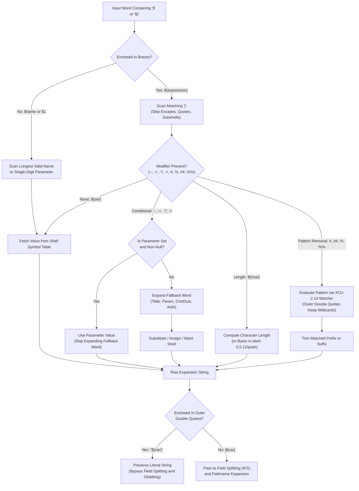

# Parameter Expansion

> [!summary] Claim
> Parameter expansion evaluates parameter references and string expressions entirely in shell memory without process creation, providing conditional fallbacks, runtime assertions, string length measurement, and pattern-based substring removal before field splitting occurs.

Part of [The POSIX Shell Language](README.md) in [Shell and Unix Engineering](../README.md).

## TL;DR

- Mechanism: The shell resolves the parameter name in internal hash tables, lazily evaluates fallback expressions, applies string or pattern operations in heap memory, and yields substituted text without creating a process.
- Rule: Always double-quote parameter expansions as `"${parameter}"` unless field splitting or pathname expansion is deliberately required.
- Trap: Double-quoting the outer expansion (`"${var#*pat}"`) preserves pattern wildcards; literal wildcard matching requires inner quotes (`"${var#"*pat"}"`) or backslash escapes.
- Portability fact: `${#var}` returns character count in multi-byte shells (bash, zsh, ksh93, yash, and BusyBox ash under UTF-8), but returns raw bytes in dash 0.5.12, posh 0.14.1, and mksh R59 2020 prior to `set -U` (measured in the shell matrix, as of 2026-10); dash 0.5.13 (released 2025-09-21) counts characters ([dash commit c0c860df](https://git.kernel.org/pub/scm/utils/dash/dash.git/commit/?h=v0.5.13&id=c0c860df08c96aaa68a0744cc7d60778845f43f1)).
- When not to use it: Avoid nested parameter expansion chains for multi-delimiter string parsing, regular expression matching, or structured data transformations that require awk, Python, or Go.

## Mental model



Parameter expansion begins when token recognition detects an unquoted dollar sign or opening brace sequence.
The shell resolves unbraced variables using the longest valid identifier name, but requires braces for positional parameters above nine or complex modifiers.
For brace-enclosed expansions, the scanner identifies the matching closing brace while skipping characters protected by quotes, backslashes, arithmetic expansions, or command substitutions.
When conditional default, assignment, error, or alternate modifiers are specified, the shell checks the parameter state and expands the fallback word only if required by that condition.
Pattern removal modifiers evaluate their pattern expressions using shell pattern matching notation and trim the matching prefix or suffix from the value in shell heap memory.
Finally, the resulting text bypasses field splitting and pathname expansion if wrapped in outer double quotes, or flows through subsequent expansion stages if left unquoted.

## How it works

Parameter expansion is governed normatively by `(POSIX.1-2024 XCU 2.6.2)` and occurs in step 1 of word expansion, where [[Tilde-Expansion]], parameter expansion, command substitution, and arithmetic expansion are performed together, beginning to end, before [[Field-Splitting-and-IFS]] `(POSIX.1-2024 XCU 2.6)`.
The expansion operates on parameters, which include shell variables denoted by names `(POSIX.1-2024 XBD 3.216)`, positional parameters denoted by decimal integers `(POSIX.1-2024 XCU 2.5.1)`, and special parameters such as `@`, `*`, `#`, `?`, `-`, `$`, `!`, and `0` `(POSIX.1-2024 XCU 2.5.2)`.

### Delimiting and Brace Resolution

The general syntax format is `${expression}`, where `expression` consists of all characters up to the matching closing brace `}` `(POSIX.1-2024 XCU 2.6.2)`.
To determine the matching closing brace, the shell parser scans characters sequentially from the opening `${`.
Any `}` that is escaped by a `<backslash>`, contained within single quotes, contained within double quotes, or embedded inside nested command substitutions `$()`, arithmetic expansions `$(( ))`, or nested variable expansions `${ }` is ignored.
Braces are optional for simple references (`$parameter`), except when referencing positional parameters with more than one digit or when a variable name is immediately followed by a character that could be parsed as part of a name `(POSIX.1-2024 XCU 2.6.2)`.
For unbraced expressions, the shell greedily consumes the longest sequence of characters that forms a valid variable name.
If the character following `$` is not a valid identifier start character, the shell parses only a single-character symbol; if that character is neither a digit nor a special parameter, POSIX marks the behavior as unspecified.
Because digits are single-character symbols, `$10` is strictly parsed as the expansion of `$1` concatenated with the literal character `0` `(POSIX.1-2024 XCU 2.5.1)`.
Accessing the tenth positional parameter unambiguously requires `${10}`.

### Conditional Expansion and State Evaluation

POSIX defines four primary conditional modifiers, each with two variants based on the presence of a leading colon `(POSIX.1-2024 XCU 2.6.2)`:

1. Use Default Values: `${parameter:-[word]}` substitutes the expansion of `word` if `parameter` is unset or null; otherwise, the value of `parameter` is substituted.
Omission of the colon (`${parameter-[word]}`) tests only whether `parameter` is unset, substituting null if `parameter` is set to the empty string.
2. Assign Default Values: `${parameter:=[word]}` assigns the quote-removed expansion of `word` to `parameter` if `parameter` is unset or null, and substitutes the final value.
Omission of the colon (`${parameter=[word]}`) assigns only if `parameter` is unset.
POSIX states that only variables, not positional parameters or special parameters, can be assigned this way `(POSIX.1-2024 XCU 2.6.2)`; it does not name the consequence, but in the shell matrix `${1:=default}` is an expansion error in every shell except zsh, which assigns `$1` even under `--emulate sh` (lab test "assigning default to positional parameter").
3. Indicate Error if Null or Unset: `${parameter:?[word]}` writes the expansion of `word` (or a default diagnostic) to standard error and terminates a non-interactive shell with a non-zero exit status if `parameter` is unset or null.
Omission of the colon (`${parameter?[word]}`) fails only if `parameter` is unset.
An interactive shell writes the diagnostic but need not exit `(POSIX.1-2024 XCU 2.6.2)`.
4. Use Alternative Value: `${parameter:+[word]}` substitutes the expansion of `word` if `parameter` is set and non-null; otherwise, it substitutes null.
Omission of the colon (`${parameter+[word]}`) substitutes `word` if `parameter` is set, even if set to null.

A critical semantic guarantee of POSIX parameter expansion is lazy evaluation: `word` is subjected to tilde expansion, parameter expansion, command substitution, arithmetic expansion, and quote removal if and only if its value is needed `(POSIX.1-2024 XCU 2.6.2)`.
If `parameter` is set and non-null, an expression like `${parameter:-$(dangerous_cmd)}` will never execute `dangerous_cmd`.
Conversely, if an application embeds side effects within `word` (such as `${parameter:-$((count++))}`, in shells that support `++`, which `(POSIX.1-2024 XCU 2.6.4)` does not require), those side effects are bypassed when `parameter` is already set.
When `parameter` is `#` and the colon is omitted (`${#-word}`), POSIX requires that `word` be supplied to resolve the grammatical ambiguity with string length `${#}`.

### String Length Measurement

The format `${#parameter}` evaluates to the shortest decimal representation of the length in characters of the value of `parameter` `(POSIX.1-2024 XCU 2.6.2)`.
In multi-byte locales such as `UTF-8`, POSIX standardizes character counting rather than byte counting.
If `parameter` is unset and the `set -u` option (`nounset`) is active, the expansion fails immediately with a diagnostic and non-zero exit status.
If `parameter` is `*` or `@`, POSIX leaves the result unspecified.

### Substring Processing and Pattern Quoting

POSIX specifies four substring removal operators that evaluate `word` as a pattern matching expression `(POSIX.1-2024 XCU 2.14)` rather than a regular expression:

- `${parameter%[word]}`: Removes the smallest trailing suffix matching the pattern generated by expanding `word`.
- `${parameter%%[word]}`: Removes the largest trailing suffix matching `word`.
- `${parameter#[word]}`: Removes the smallest leading prefix matching `word`.
- `${parameter##[word]}`: Removes the largest leading prefix matching `word`.

If `word` is omitted, an empty pattern is used, removing nothing.
A critical quoting rule defines pattern evaluation inside substring processing `(POSIX.1-2024 XCU 2.2.3 and 2.6.2)`:
Enclosing the entire expansion in double quotes (`"${parameter#pattern}"`) does not quote pattern characters inside `pattern`.
Wildcards such as `*`, `?`, and `[...]` remain active pattern operators even when the outer expression is double-quoted.
To treat pattern characters as literal text, quotes must be placed inside the braces around the pattern (`"${parameter#"pattern"}"`) or escaped individually with backslashes (`"${parameter#\*pattern}"`).
Furthermore, if `parameter` is unset and `set -u` is enabled, prefix and suffix expansions fail and terminate the shell `(POSIX.1-2024 XCU 2.6.2)`.

### Operating System and Kernel Mechanism

Parameter expansion executes entirely within the shell process space and creates no process; the only system calls it can cause are incidental ones, such as `write(2)` for a `:?` diagnostic or `brk`/`mmap` when the allocator grows the heap.
Unlike command substitution pipelines (`$(basename "$path")` or `$(dirname "$path")`), parameter expansion invokes no `fork(2)`, no `execve(2)`, no `pipe(2)`, and no context switching.
In GNU bash, word parsing enters `param_expand` and delegates braced forms to `parameter_brace_expand` in `(bash-5.3 subst.c, parameter_brace_expand)`.
Variable lookup goes through `find_variable` `(bash-5.3 variables.c, find_variable)` into the shell's internal hash tables, which chain colliding keys in per-bucket linked lists `(bash-5.3 hashlib.h, struct bucket_contents)`.
Pattern removal in bash calls its own matcher `strmatch` once per candidate prefix or suffix `(bash-5.3 subst.c, remove_upattern)`; dash calls `pmatch`, which is `fnmatch(3)` when dash is built with it `(dash-0.5.12 expand.c, pmatch)`.
For string length `${#var}`, bash uses `MB_STRLEN`, which in a multi-byte locale calls `mbstrlen`, a loop over `mbrlen(3)` that counts completed characters under the active `LC_CTYPE` locale `(bash-5.3 include/shmbutil.h and lib/sh/shmbchar.c, mbstrlen)`.
In lightweight shells such as dash, variable evaluation enters `evalvar` and `subevalvar` in `(dash-0.5.12 expand.c, evalvar)`.
Dash 0.5.12 takes the `${#var}` result from `varvalue`, whose helper `strtodest` returns the `strlen(3)` byte count, bypassing multi-byte character accounting `(dash-0.5.12 expand.c, strtodest)`; dash 0.5.13 counts multi-byte characters for `${#var}` ([dash commit c0c860df](https://git.kernel.org/pub/scm/utils/dash/dash.git/commit/?h=v0.5.13&id=c0c860df08c96aaa68a0744cc7d60778845f43f1)).

## Numbers and limits

The following table documents empirical performance measurements, structural limits, and algorithmic characteristics; the timings were measured ad hoc on a macOS Apple M3 Pro host `(as of 2026-10)` and are not part of the lab, and the limits are checked against the cited specifications.

| Metric / Property | Value / Bound | Source / Verification | Architectural Implication |
| :--- | :--- | :--- | :--- |
| In-process parameter expansion latency | about 2 to 4 us per `${p##*/}` | Host measurement (M3 Pro; bash 5.3, bash 3.2, dash; 200,000 iterations, empty-loop cost subtracted; 2026-10) | Operates entirely in user-space memory with no process creation or context switch. |
| Subshell fork-exec latency (`basename`) | about 1.6 to 2.1 ms per `$(basename "$p")` | Host measurement (same shells; 2,000 iterations; 2026-10) | External command substitution is roughly 450x to 1,100x slower due to `fork(2)`, `execve(2)`, and pipe setup. |
| Maximum unbraced positional parameter | 9 (`$1` to `$9`) | `(POSIX.1-2024 XCU 2.5.1)` | References beyond nine without braces (`$10`) evaluate as `$1` concatenated with literal `0`. |
| Variable identifier length limit | No limit stated by POSIX (bounded by memory) | `(POSIX.1-2024 XBD 3.216)` | Stored dynamically in shell hash table heap structures; memory exhaustion is the only limit. |
| Parameter value string capacity | No limit stated by POSIX (bounded by host RAM) | `(POSIX.1-2024 XSH exec)` | Values held inside the shell are not subject to `{ARG_MAX}`; once exported or passed as arguments to a new program they count toward its combined argument and environment limit of `{ARG_MAX}` bytes. |
| Multi-byte UTF-8 expansion width | 1 character spans 1 to 4 bytes | [RFC 3629](https://www.rfc-editor.org/rfc/rfc3629) | `${#var}` returns characters in bash, zsh, ksh93, yash, and BusyBox ash (UTF-8), but raw bytes in dash 0.5.12, posh 0.14.1, and mksh R59 2020 without `set -U` (lab test "string length operator"). |
| Substring pattern matching complexity | Quadratic in string length for a failing match | `(bash-5.3 subst.c, remove_upattern)` and host measurement (2026-10) | Shells try the pattern once per candidate prefix or suffix; `${s##*b}` on a 40,000-character string with no `b` took about 0.9 s in bash 5.3 and 4.8 s in macOS `/bin/dash`, four times longer per doubling of length. |
| Positional parameter assignment | Disallowed for `:=` / `=` | `(POSIX.1-2024 XCU 2.6.2)` | `${1:=default}` is an expansion error in every matrix shell except zsh, which assigns `$1` (lab test "assigning default to positional parameter"). |

## Portability

The table below contrasts parameter expansion behaviors across POSIX shells and implementations (as of 2026-10).
The lab asserts every row per shell except the last two, which were measured by hand in the same shell matrix; the POSIX column follows `(POSIX.1-2024 XCU 2.2.3, 2.5.1, 2.6.2)` and the `set -u` description under the `set` special built-in in `(POSIX.1-2024 XCU 2.15)`.

| Feature / Syntax | POSIX.1-2024 sh | macOS bash 3.2 | current bash 5.3 | zsh (native) | zsh (`--emulate sh`) | dash 0.5.12 | ksh93u+m 1.0.10 | mksh R59 | yash 2.58 | posh 0.14.1 | BusyBox 1.37 ash |
| :--- | :--- | :--- | :--- | :--- | :--- | :--- | :--- | :--- | :--- | :--- | :--- |
| Unbraced `$10` expansion | `$1` plus `0` | `$1` plus `0` | `$1` plus `0` | Parameter 10 | `$1` plus `0` | `$1` plus `0` | `$1` plus `0` | `$1` plus `0` | `$1` plus `0` | `$1` plus `0` | `$1` plus `0` |
| Assign default `${1:=val}` | Not allowed (only variables) | Fatal error | Fatal error | Allowed (sets `$1`) | Allowed (sets `$1`) | Fatal error | Fatal error | Fatal error | Fatal error | Fatal error | Fatal error |
| UTF-8 `${#var}` length | Characters | Characters | Characters | Characters | Characters | Bytes (`strlen`; 0.5.13 counts characters) | Characters | Characters (R59 2025; R59 2020 requires `set -U`) | Characters | Bytes (`strlen`) | Characters (Bytes under `LC_ALL=C`) |
| Pattern in variable `${x#$pat}` | Pattern glob | Pattern glob | Pattern glob | Literal string | Pattern glob | Pattern glob | Pattern glob | Pattern glob | Pattern glob | Pattern glob | Pattern glob |
| Quoted segment in pattern `"${x%%"?"*}"` | Matches glob after quote | Matches glob after quote | Matches glob after quote | Matches glob after quote | Matches glob after quote | Matches glob after quote | Matches glob after quote | Matches glob after quote | Matches glob after quote | Literal after quote (bug) | Matches glob after quote |
| Unset `${u#pat}` under `set -u` | Fails (error) | Expands empty | Fails (error) | Fails (error) | Fails (error) | Fails (error) | Fails (error) | Fails (error) | Fails (error) | Fails (error) | Fails (error) |
| Empty `"$@"` under `set -u` | 0 fields | 0 fields | 0 fields | 0 fields | 0 fields | 0 fields | 0 fields | 0 fields | 0 fields | Aborts with error | 0 fields |
| Unquoted `${var}` field splitting | Split on [[Field-Splitting-and-IFS\|IFS]] | Split on [[Field-Splitting-and-IFS\|IFS]] | Split on [[Field-Splitting-and-IFS\|IFS]] | No splitting | Split on [[Field-Splitting-and-IFS\|IFS]] | Split on [[Field-Splitting-and-IFS\|IFS]] | Split on [[Field-Splitting-and-IFS\|IFS]] | Split on [[Field-Splitting-and-IFS\|IFS]] | Split on [[Field-Splitting-and-IFS\|IFS]] | Split on [[Field-Splitting-and-IFS\|IFS]] | Split on [[Field-Splitting-and-IFS\|IFS]] |
| Quoted ANSI-C `"${v:-$'a\nb'}"` | Not dollar-single-quotes inside double quotes (XCU 2.2.3) | Expands newline | Expands newline (Literal in `--posix`) | Literal | Literal | Literal | Literal | Expands newline | Literal | Drops backslash | Literal |

## Worked example

The executable lab script below ([lab](../labs/03-parameter-expansion/)) demonstrates robust URL decomposition implemented entirely through POSIX parameter expansion; the parsing spawns no subshell or utility, and only the final `printf` calls can exec `/usr/bin/printf` in mksh and posh, where `printf` is not a builtin (checked with `command -v printf` in the matrix images, as of 2026-10).

```sh
#!/bin/sh
# parse_url.sh - pure POSIX parameter expansion URL parser
# Parsing spawns no process; only the final printf calls can exec
# /usr/bin/printf, in shells where printf is not a builtin (mksh, posh).

set -eu

url="${1:?usage: parse_url.sh <url>}"

scheme="${url%%://*}"
after_scheme="${url#*://}"

authority_and_path="${after_scheme%%\?*}"
query="${after_scheme#*\?}"
[ "${query}" = "${after_scheme}" ] && query=""

authority="${authority_and_path%%/*}"
raw_path="${authority_and_path#*/}"
if [ "${raw_path}" = "${authority_and_path}" ]; then
  url_path="/"
else
  url_path="/${raw_path}"
fi

case ${authority} in
  *:*)
    host="${authority%:*}"
    port="${authority##*:}"
    ;;
  *)
    host="${authority}"
    port=""
    ;;
esac
port="${port:-80}"

dir="${url_path%/*}"
[ -z "${dir}" ] && dir="/"
file="${url_path##*/}"
case ${file} in
  *.*)
    stem="${file%.*}"
    ext="${file##*.}"
    ;;
  *)
    stem="${file}"
    ext=""
    ;;
esac

path_len="${#url_path}"
has_query="${query:+"yes"}"
has_query="${has_query:-"no"}"

printf "SCHEME=%s\n" "${scheme}"
printf "HOST=%s\n" "${host}"
printf "PORT=%s\n" "${port}"
printf "DIR=%s\n" "${dir}"
printf "FILE=%s\n" "${file}"
printf "STEM=%s\n" "${stem}"
printf "EXT=%s\n" "${ext}"
printf "PATH_LEN=%s\n" "${path_len}"
printf "HAS_QUERY=%s\n" "${has_query}"
```

The parsing itself takes microseconds, and lab test "parse_url decomposes a complete URL" asserts this exact output under every shell in the matrix (as of 2026-10):

```text
$ ./labs/03-parameter-expansion/parse_url.sh "https://api.example.com:8443/v1/auth/tokens.tar.gz?env=prod"
SCHEME=https
HOST=api.example.com
PORT=8443
DIR=/v1/auth
FILE=tokens.tar.gz
STEM=tokens.tar
EXT=gz
PATH_LEN=22
HAS_QUERY=yes
```

## Pitfalls

> [!warning] Outer Double-Quoting Does Not Escape Substring Pattern Characters
> Trigger: Writing `"${filepath#*dir/}"` expecting the asterisk to match a literal `*` character because the expression is wrapped in double quotes.
> Symptom: The pattern matching engine treats `*` as an unquoted wildcard, matching greedily or lazily across unexpected path prefixes and corrupting filename parsing `(POSIX.1-2024 XCU 2.2.3)`.
> Fix: Place quoting characters inside the braces around the pattern (`"${filepath#"*dir/"}"`) or escape wildcards with backslashes (`"${filepath#\*dir/}"`).

> [!warning] Posh Freezes Pattern Wildcards After Inner Quoted Segments
> Trigger: Writing `"${var%%"?"*}"` inside outer double quotes in `posh` 0.14.1 to strip query strings or delimited suffixes.
> Symptom: Once any quoted segment (`"?"` or `'?'`) appears within an outer double-quoted pattern removal expansion, `posh` treats all subsequent pattern characters as literal characters, preventing `*` from matching and leaving variables untrimmed (lab test "quoted segment inside a double-quoted trim pattern"; no entry in the [posh changelog](https://salsa.debian.org/clint/posh/-/raw/master/debian/changelog) through 0.14.6 of 2026-08-10 mentions it, and versions after 0.14.1 were not run, as of 2026-10).
> Fix: Use backslash escapes (`"${var%%\?*}"`) or character classes (`"${var%%[?]*}"`) instead of inner double or single quotes.

> [!warning] Multi-Digit Positional Parameter Splitting Without Braces
> Trigger: Referencing positional parameters past nine as `$10`, `$11`, or `$12` instead of `${10}`, `${11}`, or `${12}`.
> Symptom: The shell tokenizes the digit 1 as the single-character positional parameter `$1` and appends literal string `0`, producing corrupted command arguments `(POSIX.1-2024 XCU 2.5.1)`.
> Fix: Always enclose positional parameters with two or more digits in curly braces (`${10}`).

> [!warning] Heap Buffer Overflow via Non-POSIX Parameter Transformations (CVE-2022-3715)
> Trigger: Running shell code that contains a malformed non-standard GNU bash parameter transformation, an `@` operator with no operator letter after it (the case the bash 5.2 fix rejects; the family of `${var@Q}`, `${var@P}`, and `${var@a}`), on bash before 5.2; the bug was found by fuzzing bash with crafted script input on bash 5.1.16 ([Red Hat bug 2126720](https://bugzilla.redhat.com/show_bug.cgi?id=2126720)), and NVD's configuration lists bash 5.1 before 5.1.8 ([NVD CVE-2022-3715](https://nvd.nist.gov/vuln/detail/CVE-2022-3715)).
> Symptom: A one-byte heap buffer over-read in `valid_parameter_transform`, which reads `xform[1]` of an empty operator string (AddressSanitizer reports a READ of size 1 in the Red Hat report); NVD scores it CVSS 3.1 7.8 (local) under CWE-787 and describes the impact only as "may lead to memory problems" `(CVE-2022-3715)`.
> Fix: Upgrade GNU bash to 5.2 or later, whose `parameter_brace_transform` rejects an empty operator (`xform[0] == 0`) before calling `valid_parameter_transform` (present in the bash 5.2 and 5.3 release sources, absent in 5.1.16), and restrict production scripts to strictly standardized POSIX parameter expansions `(POSIX.1-2024 XCU 2.6.2)`.

> [!warning] String Truncation Bugs from Byte-Oriented Length Counting in Dash and Posh
> Trigger: Executing `${#payload}` on UTF-8 multi-byte strings in dash 0.5.12 and earlier, posh 0.14.1, BusyBox ash under `LC_ALL=C`, or mksh R59 2020 without `set -U` (measured in the shell matrix, as of 2026-10).
> Symptom: The shell returns the raw byte length via `strlen(3)` or unconfigured locale state instead of the character count, causing visual alignment errors, off-by-one substring calculations, and buffer sizing mismatches.
> Fix: In portable shell code targeting minimal dash and posh environments, measure multi-byte character length via `printf '%s' "$payload" | wc -m`, or explicitly enable `set -U` in mksh.

> [!warning] Fatal Runtime Termination Assigning Defaults to Positional Parameters
> Trigger: Attempting to provide positional parameter defaults using assignment syntax such as `${1:=default_val}`.
> Symptom: Every shell in the matrix except zsh terminates non-interactive execution immediately with a diagnostic error, because POSIX allows only variables to be assigned via these operators `(POSIX.1-2024 XCU 2.6.2)`; zsh silently assigns `$1` instead (lab test "assigning default to positional parameter").
> Fix: Use conditional value substitution without assignment (`val="${1:-default_val}"`) or explicitly reassign the positional parameter list using `set -- "${1:-default_val}"`.

> [!warning] Variable Name Collisions with Tied Special Parameters in Zsh
> Trigger: Using lowercase variable names like `path` or `status` in shell scripts executed by zsh.
> Symptom: In native zsh, `path` is an array automatically tied to environment variable `PATH`; assigning a string to `path` alters the system search path and makes `${#path}` report array element count rather than string character length, and `status` is a read-only special parameter, so assigning it fails with `read-only variable: status` (both measured in zsh 5.9 native mode; `zsh --emulate sh` printed the string length, as of 2026-10).
> Fix: Prefix variable identifiers with script-specific namespaces (`url_path` or `req_dir`) and avoid reserved shell symbols.

## Security and robustness

Parameter expansion forms the front line of defense against shell command injection and argument manipulation.
Unlike `eval` or dynamic command generation, parameter expansion operates strictly on data buffers without passing strings back to the shell parser grammar.
However, failure to double-quote expansions remains one of the most prolific security vulnerabilities in systems programming.
When an unquoted parameter expansion `$input` is evaluated, the resulting string undergoes [[Field-Splitting-and-IFS]] and [[Pathname-Expansion]].
If an attacker controls the variable contents, whitespace characters split single arguments into multiple discrete arguments, and characters such as `*` or `?` expand into arbitrary local file paths.
A command such as `rm -rf $cache_dir` expands to `rm -rf /` if `cache_dir` contains leading whitespace followed by `/`.
Wrapping every expansion in double quotes (`"${cache_dir}"`) guarantees that the entire value is treated as a single literal string operand.

For resilient system initialization, production scripts should enforce mandatory environment variables using the `:?` operator.
Writing `export DB_HOST="${DB_HOST:?Fatal: DB_HOST environment variable required}"` guarantees that if `DB_HOST` is unset or empty, the script aborts immediately with a clear error on standard error before performing network connections or database migrations.
Additionally, when processing untrusted filenames, defensive scripts must prevent argument injection against utilities that accept command-line options.
A file named `-rf` passed to `rm "$file"` will be interpreted as a command flag; writing `rm -- "${file}"` ends option parsing and is the primary defense.
For a utility that does not honor `--`, prefix only relative names with `./`, because a blind `"./${file}"` turns `/etc/passwd` into `.//etc/passwd`, which names `./etc/passwd` under the current directory:

```sh
case $file in
  /*) clean_path=$file ;;
  *) clean_path=./$file ;;
esac
```

Finally, developers must guard against algorithmic complexity attacks in pattern removal.
POSIX specifies only the pattern notation `(POSIX.1-2024 XCU 2.14)`, not the algorithm, and real shells try the pattern once per candidate prefix or suffix (`(bash-5.3 subst.c, remove_upattern)` loops over every end position), so a failing removal costs time quadratic in the string length, and multiple unanchored asterisks add backtracking on top; attacker-sized input can therefore cause denial-of-service through CPU exhaustion.
Anchoring to a known delimiter (`${val##*/}`) rather than an ambiguous wildcard pattern (`${val##*.*.*}`) keeps the matcher simple, but it does not remove the quadratic cost: on the macOS host, `${s##*b}` on a 40,000-character string with no `b` took about 0.9 s in bash 5.3 and 4.8 s in `/bin/dash` (as of 2026-10), so bound the length of untrusted input before trimming it.

## The principal's view

Staff-plus engineers evaluate parameter expansion through the lens of execution cost, fault boundaries, and long-term maintainability.
At scale, shell scripts often run within critical boot loops, CI/CD pipelines, container entrypoints, and high-frequency deployment hooks.
Spawning an external utility like `sed`, `awk`, `cut`, `dirname`, or `basename` inside a shell loop incurs a catastrophic penalty: each invocation demands `fork(2)`, dynamic link resolution, process page table setup, and pipeline cleanup.
Replacing external subprocesses with pure POSIX parameter expansion reduces operation latency from milliseconds to microseconds, roughly a 450x to 1,100x improvement in the host measurement under Numbers and limits, without external runtime dependencies.

However, the principal engineer also enforces strict boundaries where shell parameter expansion must stop:
1. Do not simulate regular expression parsing using convoluted chains of prefix and suffix trims.
Shell pattern matching lacks lookahead, non-greedy matching, and capture groups; simulating them produces fragile scripts that break on edge-case inputs.
2. Do not use parameter expansion to manipulate structured data formats like JSON, YAML, or XML.
Parsing structured text via parameter trimming invariably fails on escaped quotes, multi-line strings, or varying whitespace.
3. Migrate to Go, Rust, or Python when string processing requires Unicode normalization, cryptographic hashing, or structured validation.
The shell is an execution harness designed to orchestrate system processes; use parameter expansion to sanitize file paths and enforce environmental invariants, but delegate domain data processing to compiled, type-safe binaries.
4. When authoring cross-platform shell scripts, prefer backslash escapes (`\?`) over inner quotes inside double-quoted pattern removals to prevent parser bugs in minimal shells like posh.

## Interview questions

> [!question] L5: What is the semantic difference between `${VAR:-default}` and `${VAR-default}`?
>
> > [!success]- Answer
> > The colon modifier tests whether the parameter is either unset or set to the empty string (null).
> > The form without the colon tests strictly whether the parameter is unset.
> > If `VAR` is set to `""`, `${VAR:-default}` substitutes `default`, whereas `${VAR-default}` substitutes the empty string `""`.
> >
> > Follow-up: What does `${VAR:=default}` do if `VAR` is unset versus null?

> [!question] L5: Predict the output of the following shell snippet and explain the parsing mechanism:
> ```sh
> set -- a b c d e f g h i j k
> echo $10 vs ${10}
> ```
>
> > [!success]- Answer
> > The command outputs `a0 vs j`.
> > POSIX tokenizes unbraced numeric parameters as a single-character digit symbol followed by literal characters.
> > Therefore, `$10` expands positional parameter `$1` (`a`) and appends the literal character `0`.
> > Curly braces `${10}` are mandatory to instruct the parser to evaluate multi-digit positional parameters.
> >
> > Follow-up: Why does native zsh print `j vs j` for this exact snippet?

> [!question] L6: Explain why `"${path#*dir/}"` does not treat the asterisk as a literal character despite outer double quotes.
>
> > [!success]- Answer
> > POSIX.1-2024 section 2.2.3 explicitly specifies that outer double quotes enclosing a substring parameter expansion have no effect on the handling of special characters between `${` and `}`, and section 2.6.2 repeats that only quoting inside the braces quotes pattern characters.
> > The asterisk remains an active glob wildcard and matches characters greedily or lazily according to the operator.
> > To make the pattern character literal, quotes can be placed inside the curly braces around the pattern, such as `"${path#"*dir/"}"` or escaped with backslashes (`"${path#\*dir/}"`).
> > In practice, backslash escapes are strictly more portable across the shell matrix because shells like `posh` treat subsequent wildcards as literal after an inner quoted segment.
> >
> > Follow-up: How does native zsh handle a variable pattern reference like `${path#$pat}` compared to standard POSIX shells?

> [!question] L6: Identify and fix the two bugs in this configuration loader script:
> ```sh
> #!/bin/sh
> set -eu
> config_file="${1:=/etc/default.cfg}"
> file_ext="${config_file##*.}"
> echo "Loading extension: $file_ext"
> ```
>
> > [!success]- Answer
> > The first bug is `${1:=/etc/default.cfg}`: POSIX allows only variables to be assigned this way, and every shell in the matrix except zsh treats it as a fatal expansion error.
> > The assignment should be replaced with `config_file="${1:-/etc/default.cfg}"` or `set -- "${1:-/etc/default.cfg}"`.
> > The second bug occurs when `config_file` has no extension (e.g., `/etc/hosts`): `${config_file##*.}` evaluates to the full string `/etc/hosts` rather than an empty extension.
> > A proper extension extractor tests for the presence of a dot first: `case "$config_file" in *.*) file_ext="${config_file##*.}" ;; *) file_ext="" ;; esac`.
> >
> > Follow-up: What happens under `set -u` if `$1` is completely omitted when executing this script?

> [!question] L6: How does lazy evaluation operate during parameter expansion, and what subtle bugs can it introduce?
>
> > [!success]- Answer
> > The shell evaluates the replacement word in conditional expansions if and only if the parameter state requires it.
> > In `${VAR:-$(curl -s http://metadata)}`, the command substitution never forks or executes if `VAR` is already populated.
> > A bug arises when developers embed state-mutating expressions inside the fallback word, such as `${PORT:-$((port_counter++))}`.
> > The counter fails to increment whenever `PORT` is pre-set, causing dependent logic relying on sequential state changes to fail silently.
> >
> > Follow-up: Does `${VAR:?error}` evaluate command substitutions inside the error word if `VAR` is set?

> [!question] L6: Why does `${#var}` produce conflicting results across dash and bash on UTF-8 strings, and what C library functions cause this?
>
> > [!success]- Answer
> > POSIX mandates that `${#var}` returns the string length measured in characters.
> > GNU bash iterates across multi-byte character sequences with `mbrlen(3)` (its `mbstrlen` helper behind `MB_STRLEN`) to count completed characters, and other multi-byte aware shells use the same family of C library calls.
> > Dash 0.5.12 is engineered for minimal binary size and takes the length from `strlen(3)` (through `varvalue` and its `strtodest` helper, called from `evalvar`), measuring raw bytes rather than multi-byte characters; dash 0.5.13 (2025-09-21) added multi-byte counting for `${#var}`.
> > Consequently, a 3-character Greek string spanning 6 UTF-8 bytes evaluates to length 3 in bash but length 6 in dash 0.5.12 (lab test "string length operator").
> > BusyBox ash follows the active locale dynamically (reporting 3 under UTF-8 and 6 under `LC_ALL=C`), while mksh R59 2020 defaults to byte mode until `set -U` is executed.
> >
> > Follow-up: How can a portable POSIX shell script reliably count multi-byte characters regardless of the host shell?

> [!question] L7+: Describe how the shell scanner locates the matching closing brace `}` in `${...}` without confusing nested syntax.
>
> > [!success]- Answer
> > The shell lexical analyzer maintains a nesting state machine while scanning between `${` and the terminating `}`.
> > Any closing brace preceded by an odd number of backslashes is treated as a literal character.
> > Any closing brace enclosed within single quotes, double quotes, or dollar-single quotes is treated as literal quoted content.
> > When the scanner encounters embedded `$()`, `$(( ))`, or `${ }` constructs, it recursively invokes token parsing rules for those sub-expressions.
> > The outer scan resumes only after the inner construct terminates, ensuring that braces inside subshells or arithmetic blocks cannot prematurely close the parameter expansion.
> >
> > Follow-up: Why does POSIX leave unescaped double quotes unspecified inside a double-quoted `"${var:-word}"`, yet define inner quotes inside a double-quoted `"${var#pattern}"`?

> [!question] L7+: Analyze the architectural trade-offs between implementing string manipulation in shell parameter expansion versus delegating to an external toolchain.
>
> > [!success]- Answer
> > Parameter expansion runs strictly in user-space process memory without creating a process, eliminating `fork(2)`, `execve(2)`, dynamic linking, and IPC pipe latency.
> > This makes parameter expansion optimal for high-frequency path sanitation, default resolution, and prefix stripping in boot-critical code.
> > However, parameter expansion lacks support for arbitrary regular expressions, non-greedy quantifiers, character encodings, and structured memory formats.
> > Attempting complex parsing in shell creates brittle, non-portable code prone to glob backtracking stalls and injection bugs.
> > The architectural rule is to use parameter expansion for path and variable sanitation, and hand off domain data manipulation to compiled binaries or dedicated runtimes.
> >
> > Follow-up: How does parameter expansion avoid operating system `ARG_MAX` execution limits?

## Related

Prerequisites: [[Tilde-Expansion]]

Next: [[Null-versus-Unset]]

See also: [[Reading-the-POSIX-Standard]], [[Token-Recognition]], [[Shell-Grammar]], [[Quoting-Backslash-Single-and-Double]], [[Dollar-Single-Quotes]], [[Expansion-Order]], [[Special-Parameters]], [[Command-Substitution]], [[Arithmetic-Expansion]], [[Field-Splitting-and-IFS]], [[Pathname-Expansion]], [[Quote-Removal]], [[The-set-Builtin-and-Shell-Options]], [[POSIX-2024-Changes]]

## Further reading

- POSIX.1-2024 Shell Command Language Section 2.6.2 (The normative standard defining parameter expansion syntax, operators, brace matching, and quoting invariants).
- GNU Bash Source Code subst.c (The reference implementation of `parameter_brace_expand` and word transformation routines in GNU bash).
- Dash Source Code src/expand.c (The Almquist shell implementation detailing `evalvar` and `subevalvar` memory structures).
- Zsh Source Code Src/subst.c (The implementation of `paramsubst` showing parameter flag parsing and emulation branching).
- BusyBox Source Code shell/ash.c (The embedded shell implementation showing compact parameter evaluation and unicode configuration toggles).
- Posh Source Code (The Policy-compliant Ordinary SHell implementation showing parameter expansion parsing and pdksh heritage).
- NIST NVD CVE-2022-3715 Detail (The security vulnerability record detailing the heap buffer overflow vulnerability in bash parameter transformations).
