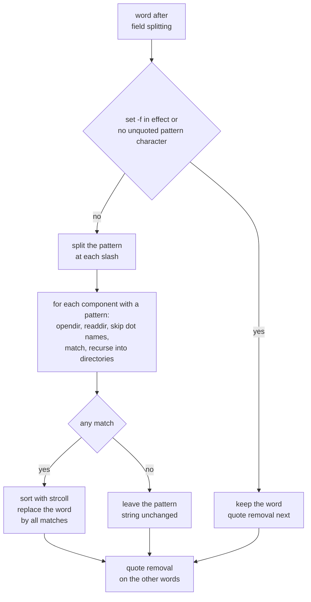

# Pathname Expansion

> [!summary] Claim
> Pathname expansion turns each unquoted word that contains `*`, `?`, or `[` into the sorted list of existing directory entries that match it, one directory component at a time, and leaves the word untouched when nothing matches.

Part of [The POSIX Shell Language](README.md) in [Shell and Unix Engineering](../README.md).

## TL;DR

- Mechanism: after field splitting, the shell splits each word at `/`, reads every directory that a pattern component needs with `opendir` and `readdir`, filters names with the pattern matcher, sorts the result with the locale collation, and replaces the word with it (POSIX.1-2024 XCU 2.6.6 and 2.14.3).
- Rule: `*`, `?`, and `[` never match a `/`, and never match a leading `.` of a name; a pattern with no match is passed on unchanged, so the command sees the pattern text itself.
- Trap: the unchanged pattern, a name that starts with `-`, a name that contains a space after `$(ls)`, and an expansion larger than the exec argument limit all turn an innocent `*` into a bug.
- Portability: the specification leaves `[^a]`, `.*` matching `.` and `..`, `**`, and the no-match error to the implementation; dash, mksh, and posh read `^` literally, bash before 5.2 lists `.` and `..`, and native zsh aborts on no match (measured in the shell matrix).
- When not to use it: for untrusted or unbounded sets of names, use `find` with `-exec ... {} +` or a loop that guards with `[ -e "$f" ]`, because a glob is a snapshot that can be empty, huge, or option-shaped.

## Mental model



Each word that survives field splitting is tested for an unquoted `*`, `?`, or `[`; with `set -f` or without such a character it skips straight to quote removal (the yes branch).
Otherwise the pattern is cut at slashes, and every component that holds a pattern character forces the shell to read one directory and test each name against that component, descending only into matching directories.
Matches are sorted by the collating sequence of the current locale and replace the single word with zero-or-more words, which is why the argument count of a command can change here and nowhere else after field splitting.
If the directory scan yields nothing, the original pattern text becomes the word, which downstream code cannot tell from a file that is really named that way.

## How it works

**Where it sits.**
POSIX.1-2024 XCU 2.6 fixes the order: tilde expansion, parameter expansion, command substitution, and arithmetic expansion; then field splitting (2.6.5); then pathname expansion "unless set -f is in effect" (2.6.6); and quote removal last (2.6.7).
See [[Expansion-Order]] for the full pipeline and [[Field-Splitting-and-IFS]] for the step before this one.
Two consequences follow from that order.
A `*` that arrives through a variable or a command substitution is a pattern, because the shell cannot tell it from a typed `*` once the text is a field, which is why `"$v"` must be quoted to stay literal (see [[Quoting-Backslash-Single-and-Double]]).
A name that a pattern produces is never split again, because splitting already ran; the spec's note on quote removal says the shell still remembers which characters were quoted, which is the state that decides whether a `*` is special.

**The pattern language.**
2.6.6 delegates everything to 2.14 and qualifies it with 2.14.3.
2.14.1 defines `?` (any one character), `*` (any string, including the null string), and `[` which starts a bracket expression following the regular-expression rules of XBD 9.3.5 "except that the exclamation-mark character shall replace the circumflex character in its role in a non-matching list".
A bracket expression that starts with an unquoted `^` has unspecified results, which is the portability hole behind `[^a]*`.
A `[` that does not open a valid bracket expression matches itself.
A backslash escapes the next character, inside brackets too.

**The three filename rules (2.14.3).**
First, a slash in a pathname is matched only by a slash in the pattern; "slash characters in the pattern shall be identified before bracket expressions", so `dir[/]x.c` is not a bracket expression and matches only a pathname literally spelled `dir[/]x.c`.
Second, a leading period of a filename, whether at the start or right after a slash, must be matched by an explicit period in the pattern; `*`, `?`, and non-matching or range or class brackets such as `[!a]` never match it, and whether an explicit `[.abc]` does is unspecified.
Third, results are sorted by the current locale's collating sequence, with a byte-wise tie break for names that collate equally, and "if the pattern does not match any existing filenames or pathnames, the pattern string shall be left unchanged".
Directory entries `.` and `..` "may be ignored", and the standard carries a note that a future version may require ignoring them, so today they are an implementation choice.

**Errors are not errors.**
If a directory cannot be opened, searched, or read for a reason related to file system contents, "this shall not be considered an error and pathname expansion shall continue as if the pathname had named an existing directory which had been successfully opened and read ... and no matching directory entries had been found in it".
That is why an unreadable directory yields the unchanged pattern and no diagnostic.
Native zsh is the exception measured in the shell matrix: `NOMATCH` turns that empty result into status 1 and the diagnostic "no matches found".
Permissions needed follow the pattern: read permission on each directory whose entries are matched and search permission on directories only traversed.

**The implementations.**
GNU bash 5.3 decides in `glob_expand_word_list` (`subst.c`) whether to glob: a word without the `W_NOGLOB` flag whose text passes `unquoted_glob_pattern_p` goes to `shell_glob_filename`.
An empty result then takes one of three paths: `failglob` reports "no match" and aborts the command, `nullglob` (`allow_null_glob_expansion`) drops the word, and the default keeps the word (bash-5.3 subst.c, glob_expand_word_list).
The directory walk is `glob_vector` in `lib/glob/glob.c`, which calls `opendir` and then `readdir` on the directory and filters each name with `skipname` (bash-5.3 lib/glob/glob.c, glob_vector).
`skipname` encodes the period rule: when `noglob_dot_filenames` is set (the default) a name beginning with `.` is skipped unless the pattern begins with `.` or `\.`; and since 5.2 the flag `glob_always_skip_dot_and_dotdot` (the `globskipdots` option, on by default, initialised to 1 in the 5.3 source) drops `.` and `..` even for patterns that start with a period (bash-5.3 lib/glob/glob.c, skipname).
The bash 5.3 manual states the same: with `globskipdots` "the filenames `.` and `..` never match, even if the pattern begins with a `.`" (bash-5.3 doc/bash.1).

dash implements the walk itself in `expmeta` (dash git `src/expand.c`): it opens the directory with `opendir`, computes `matchdot` from whether the pattern component begins with a period (after an optional escape), loops over `readdir64`, skips names starting with `.` when `matchdot` is zero, and runs `pmatch` on the rest, recursing for the remaining components.
The gate for trying at all is `strpbrk(str->text, "*?]")` in `expandmeta`, so a lone `[` without a `]` is not a pattern; the sort is a merge sort `msort` that compares with `strcoll` (dash expand.c, expandmeta, expmeta, msort).
The same file also contains a second path, `expandmeta_glob`, that hands the pattern to `glob64` with `GLOB_NOMAGIC` when `GLOB_IS_ENABLED`; which path a given dash binary uses depends on a build-time macro defined outside the file read, so for the Debian dash 0.5.12 in the matrix the note relies on measured behavior, not on this source (UNVERIFIED: which path 0.5.12 compiles).
BusyBox ash has the same `expmeta`, `matchdot`, and merge-sort structure, with `strcoll` when locale support is built in and `strcmp` otherwise (busybox master shell/ash.c, expmeta, expsort; UNVERIFIED that the 1.37.0 tag is identical to master).

**Down to the system call.**
All of this is user space: `opendir` and `readdir` are libc calls that end in an `open` of the directory and `getdents`-style reads on Linux, and a pattern component without metacharacters needs only a path lookup (search permission), not a read.
These calls were not traced on a live system (UNVERIFIED: no `strace` in the matrix images).
The only kernel limit that matters appears later, at `execve`: the expanded words become one argument vector.
On Linux 2.6.23 and later the total of `argv` and `envp` strings is capped at 1/4 of the soft stack limit (and at 3/4 of 8 MiB), each string at 32 pages, and an excess fails with `E2BIG` (execve(2), "Limits on size of arguments and environment").

**Shell extensions.**
Because the no-match and dot behavior is unspecified or fixed, each shell added a switch with its own spelling: bash has `shopt -s nullglob`, `failglob`, `dotglob`, `nocaseglob`, and the `GLOBIGNORE` variable (which also turns on `dotglob`), zsh has `setopt nullglob` and recursive `**/`, and ksh93 has the `~(N)` pattern prefix (measured in the shell matrix).
None of these exists in POSIX sh, so a script that must run under `/bin/sh` cannot use them.

## Numbers and limits

| Quantity | Value | Source |
|---|---|---|
| `getconf ARG_MAX` on the macOS host | 1048576 | measured by hand on the host (as of October 2026) |
| `getconf ARG_MAX` in the Debian image (glibc, 8192 KiB stack) | 2097152 | measured by hand in the matrix image (as of October 2026) |
| `getconf ARG_MAX` in the Alpine image (musl) | 131072, although the kernel limit is the stack-derived one | measured by hand (as of October 2026); kernel rule from execve(2) |
| Linux limit on all `argv` and `envp` strings | 1/4 of the soft stack limit, capped at 3/4 of 8 MiB (6 MiB) | execve(2) |
| Linux limit on one argument string | 32 pages (128 KiB with 4 KiB pages) | execve(2) |
| Fixture for the overflow test | 13000 names, 200 bytes each, about 2.6 MB of strings | the lab, `many-files.sh` |
| A builtin counts all 13000 expanded names | 13000 | the lab, test 25 |
| `/bin/echo *` over the same names | fails in every shell, with a diagnostic that the argument list is too long; status 126 in bash, dash, ksh93, mksh, yash, and BusyBox ash, status 127 in native zsh and `zsh --emulate sh`, status 1 in posh | the lab, test 25 |
| `xargs` hands the same 13000 names to `/bin/echo` in batches | 13000 words in total | the lab, test 25 |
| Order of the lab fixture under `LC_ALL=C` | `-n B1 [x] ^c a.c a1 a[b b.c b.h dangling dir sp ace.c` | the lab, test 1 |
| Order of the same names in bash 5.3 on the macOS host with `en_US.UTF-8` | `-n [x] ^c a.c a[b a1 b.c b.h B1 dangling dir sp ace.c` | measured by hand on the host |

The last two rows show why a script must pin `LC_ALL=C` when the order matters: the collating sequence of the locale decides it, and one host locale put `B1` after `b.h`.

## Portability

Rows are shells; every cell was measured in the shell matrix (the lab asserts it per family) unless a source is named.

| Shell | `.*` lists `.` and `..` | `[^a]` negates | `[[:lower:]]` | No match | `**/` recurses | Empty-result option | `set -f` disables |
|---|---|---|---|---|---|---|---|
| POSIX sh (spec) | may be ignored (XCU 2.14.3) | unspecified (XCU 2.14.1) | yes | pattern unchanged | no, `**` is two stars | none | yes (XCU 2.6) |
| macOS `/bin/sh` and `/bin/bash` 3.2.57 | yes | yes | yes | unchanged | no | `shopt -s nullglob` | yes |
| bash 4.4 and 5.1 | yes | yes | yes | unchanged | no | `shopt -s nullglob` | yes |
| bash 5.2 and 5.3 | no (`globskipdots`) | yes | yes | unchanged | no | `shopt -s nullglob` | yes |
| zsh native 5.9 | no | yes | yes | error "no matches found" | yes | `setopt nullglob` | no, `-f` is `NO_RCS`; use `set -o noglob` |
| `zsh --emulate sh` | no | yes | yes | unchanged | yes | `setopt nullglob` | yes |
| dash 0.5.12 | yes | no, `^` is a literal member | yes | unchanged | no | none | yes |
| ksh93u+m 1.0.10 | no | yes | yes | unchanged | no | `~(N)` prefix | yes |
| ksh93u+ 2012 (macOS `/bin/ksh`) | yes | yes | yes | unchanged | no | `~(N)` prefix | yes |
| mksh R59 | no | no, `^` is a literal member | yes | unchanged | no | none | yes |
| yash 2.58.1 | yes | yes | yes | unchanged | no | none | yes |
| posh 0.14.1 | no | no, `^` is a literal member | no, the class stays literal | unchanged | no | none | yes |
| BusyBox ash 1.37.0 | yes | yes | yes | unchanged | no | none | yes |

Utility facts the lab depends on: `cat` treats a leading `-n` argument as an option (it numbers lines) in the `cat` of the macOS host, Debian, and Alpine images, including Alpine mksh's builtin `cat`, so the dash-prefixed name test works in all of them.
`[ -f *.c ]` with several matches returns status 2 everywhere except ksh93, which returns 0 (u+m 1.0.10 and u+ 2012).
An expansion past the exec limit makes `/bin/echo` fail with status 126 in bash, dash, ksh93, mksh, yash, and BusyBox ash, with status 127 in native zsh and `zsh --emulate sh`, and with status 1 in posh.

## Worked example

The lab is at [lab](../labs/03-pathname-expansion/).
Its probe runs a string of shell code inside a fixture tree and prints exactly what the expansion produced; this is the whole file `expand.sh`.

```sh
#!/bin/sh
# expand: run CODE inside DIR under the shell that runs this script, with `show` available.
# `show` prints the argument count and each argument between angle brackets, so the output is
# exactly what the shell's expansions produced for the command line.
# Usage: expand.sh DIR CODE
# Example: expand.sh /tmp/fx 'show *.c'  ->  3 args: <a.c> <b.c> <sp ace.c>
cd "$1" || exit 9
show() {
  printf '%d args:' "$#"
  if [ "$#" -gt 0 ]; then
    printf ' <%s>' "$@"
  fi
  printf '\n'
}
eval "$2"
```

The fixture (`make-fixture.sh`) holds `.hidden`, `a.c`, `b.c`, `b.h`, `-n`, `sp ace.c`, `B1`, `a1`, `[x]`, `^c`, a dangling symlink `dangling`, and the directories `dir` (with `x.c`, `.dot`, and `sub/y.c`) and `a[b`.
A simplified excerpt of the test file shows the shape of the assertions; the real tests branch on `lab_shell_family` wherever shells differ.

```sh
@test "a pattern is replaced by the matching names in byte order, hidden names excluded" {
  expand 'show *'
  [ "$status" -eq 0 ]
  [ "$output" = "$ALL" ]
}

@test "a slash is matched only by a slash: star and a bracket expression cannot cross a directory" {
  expand 'show d*/x.c'
  [ "$output" = "1 args: <dir/x.c>" ]
  unchanged 'd*x.c'
  unchanged 'dir[/]x.c'
}
```

Expected output of a few probes, as captured with bash 5.3 under `LC_ALL=C`:

```text
show *            12 args: <-n> <B1> <[x]> <^c> <a.c> <a1> <a[b> <b.c> <b.h> <dangling> <dir> <sp ace.c>
show .[!.]*       1 args: <.hidden>
show *.zzz        1 args: <*.zzz>
show d*x.c        1 args: <d*x.c>
show d*/x.c       1 args: <dir/x.c>
v="*.c"; show $v  3 args: <a.c> <b.c> <sp ace.c>
show "$v"         1 args: <*.c>
show $(printf "%s\n" *.c)   4 args: <a.c> <b.c> <sp> <ace.c>
```

The lab passed all 25 tests in the macOS host shells (`/bin/sh`, `/bin/bash`, bash 5.3, dash, `/bin/ksh`, zsh, `zsh --emulate sh`), in the Debian image (`sh`, dash, bash, posh, ksh93u+m, mksh, BusyBox ash, zsh, `zsh --emulate sh`), and in the Alpine image (`sh`, BusyBox ash, mksh, yash, dash, zsh, `zsh --emulate sh`, and bash 3.2, 4.4, 5.1, 5.2, and 5.3).

## Pitfalls

> [!warning] The unmatched pattern is a word
> Trigger: `for f in *.log; do gzip "$f"; done` in a directory with no `.log` file.
> Symptom: the loop runs once with `f` set to the literal `*.log`, and `gzip` reports that it cannot open it; native zsh instead aborts with "no matches found".
> Fix: guard with `[ -e "$f" ] || continue` inside the loop (the lab proves the loop body does not run), or use `find`; in bash `shopt -s nullglob` removes the word but is not POSIX.
> Wheeler documents the same trap: "this will cause the loop to execute once, but with the pattern instead of a pathname!" (Wheeler, "Filenames and Pathnames in Shell").

> [!warning] A matched name that starts with a dash is an option
> Trigger: `cat *` or `rm *` in a directory that contains a file named `-n` or `-rf`.
> Symptom: the command consumes the name as an option; in the lab `cat *` numbers its lines and skips the file, while `cat ./*` reads both.
> Fix: prefix the glob with `./` or put `--` before it; Wheeler's rule is "always prepend globs with something like `./`" and he does not treat `--` as a sufficient defense.

> [!warning] `.*` is not "the hidden files"
> Trigger: `rm -r .*` or `chown -R u .*` in bash before 5.2, dash, yash, BusyBox ash, and macOS ksh93.
> Symptom: the expansion contains `.` and `..`, so the command reaches the parent directory (measured in the shell matrix).
> Fix: write `.[!.]* ..?*`, which never matches `.` or `..`, and remember that an unmatched `..?*` stays literal.

> [!warning] `$(ls)` and unquoted variables re-split names
> Trigger: `for f in $(ls *.c)` or `files=$(ls); cmd $files`.
> Symptom: `sp ace.c` becomes `sp` and `ace.c` (the lab prints `4 args: <a.c> <b.c> <sp> <ace.c>`), and a name containing `*` is globbed a second time.
> Fix: let the shell expand the pattern directly in the `for` word list, because names produced by pathname expansion are not split again; keep lists in positional parameters, not strings.

> [!warning] The expansion is one argument vector
> Trigger: `rm *`, `grep foo *`, or `ls *` in a directory with tens of thousands of entries.
> Symptom: the external command's `execve` fails after the shell has already expanded the pattern, while a builtin is unaffected because it never calls `execve`.
> bash, dash, ksh93, mksh, yash, and BusyBox ash return status 126; native zsh and `zsh --emulate sh` return 127; posh returns 1.
> Each diagnostic says the argument list is too long (zsh spells that phrase in lower case, and ksh93 wraps it as "cannot execute").
> Fix: `find dir -exec cmd {} +`, or `for f in *; do echo "$f"; done | xargs cmd`, which batches under the limit; the lab shows 13000 names that overflow `/bin/echo` yet pass through `xargs` intact.

> [!warning] `[^a]` and `[[:class:]]` are not portable
> Trigger: `[^0-9]*` in a script run by dash, mksh, or posh.
> Symptom: the caret is a literal set member, so the pattern matches names that start with `^` or `0-9` characters instead of excluding them; posh also leaves `[[:lower:]]` literal.
> Fix: write `[!0-9]*`, which POSIX defines, and use ranges where posh matters.

> [!warning] zsh is different by default
> Trigger: a script with a `#!/bin/zsh` or a zsh interactive habit applied to POSIX code.
> Symptom: an unmatched pattern is a fatal error, a pattern held in an unquoted variable is not expanded, `set -f` does not disable globbing, and `**/` recurses (all measured in the shell matrix).
> Fix: write POSIX scripts for `sh`, and in zsh use `setopt noglob` or `set -o noglob` and the `(N)` qualifier deliberately.

> [!warning] Collation changes the order
> Trigger: a script that relies on `*` returning `B1` before `a1` or the reverse.
> Symptom: the order differs between machines because it follows `LC_COLLATE` (measured: bash 5.3 on the macOS host with `en_US.UTF-8` put `B1` after `b.h`).
> Fix: set `LC_ALL=C` for the script when order matters, and do not parse the order of a glob as a contract.

## Security and robustness

- Treat a glob as a snapshot of names, not of files: between the expansion and the command, a file can be removed, replaced, or swapped for a symlink, and a dangling symlink is listed because expansion reads names without opening them (the lab shows `[ -e dangling ]` failing while `d*` matches it).
- Treat every name as hostile data: it may start with `-` (option injection), contain spaces, newlines, and glob characters, or be the literal text of a pattern; quote every expansion of it and prefix paths with `./`.
- A pattern assembled from data is an injection: if `name` comes from outside, `rm $name` can delete far more than one file; quote it, and use `set -f` around code that must treat words as literal text.
- The standard's rule that unreadable directories yield no match is a silent failure: a script that globs a directory it cannot read sees an unchanged pattern and status 0, so check readability explicitly when absence matters.
- Native zsh reports status 1 and "no matches found" instead (measured in the shell matrix).
- Bound the work: an unmatched `**`-style habit from zsh or bash `globstar` can walk a huge tree, and a plain `*` over a million-entry directory builds all the names in memory before any command runs.
- No CVE record for pathname expansion itself was verified for this note, and none is cited.
- The practical hazards above are documented by Wheeler's essay and follow from the specification's text.

## The principal's view

A glob is the right tool for a small, known, trusted directory in an interactive session or a short script, because it is built into the language and costs no process.
It is the wrong tool when the set of names is untrusted, unbounded, or must be processed exactly once per file.
The trade-off is convenience against three silent failure modes: zero matches pass the pattern through, one match can look like an option, and many matches overflow the exec limit.
Choose a POSIX-only spelling (`[!x]`, `./*`, a `-e` guard) when the script may meet dash, BusyBox, or an old bash; accept bash's `nullglob` or zsh's `(N)` only when the interpreter is pinned.
For anything that walks a tree, selects by type or age, or handles names with newlines, use `find` with `-exec ... {} +` or a program in a language with real lists, and keep the shell for gluing.
Pin `LC_ALL=C` in scripts whose output order is read by something else.

## Interview questions

> [!question] L5: In which order are field splitting, pathname expansion, and quote removal performed, and what does that imply for `v='*.c'; ls $v`?
>
> > [!success]- Answer
> > Field splitting comes first, then pathname expansion, and quote removal is last (POSIX.1-2024 XCU 2.6).
> > The unquoted `$v` expands to the text `*.c`, which is one field containing an unquoted `*`, so it is treated as a pattern and replaced by the matching names.
> > `ls "$v"` keeps it literal because quoting marks the `*` as not special.
> >
> > Follow-up: What does native zsh do with `ls $v`, and why?

> [!question] L5: What does `echo *.zzz` print when nothing matches, and how does that differ in native zsh?
>
> > [!success]- Answer
> > POSIX requires the pattern string to be left unchanged, so it prints `*.zzz`.
> > Native zsh has `NOMATCH` set and aborts the command with "no matches found".
> > `zsh --emulate sh` follows POSIX.
> >
> > Follow-up: How would you write a loop over `*.log` that is correct in both?

> [!question] L5: Why does `*` not list `.profile`, and which pattern lists hidden files without `.` and `..`?
>
> > [!success]- Answer
> > A leading period must be matched by an explicit period in the pattern (XCU 2.14.3).
> > `.[!.]*` matches names that start with one period followed by a non-period, and `..?*` covers names that start with two periods and have more characters.
> > `.*` also yields `.` and `..` in dash, yash, BusyBox ash, bash before 5.2, and macOS ksh93.
> >
> > Follow-up: Which part of the POSIX text makes `.*` shell-dependent today?

> [!question] L6: Predict the output in the lab fixture under `LC_ALL=C`: `show d*x.c; show d*/x.c; show dir[/]x.c`.
>
> > [!success]- Answer
> > The output is `1 args: <d*x.c>`, then `1 args: <dir/x.c>`, then `1 args: <dir[/]x.c>`.
> > A `*` cannot match the slash in `dir/x.c`, so the first pattern matches nothing and survives, while the explicit slash in `d*/x.c` works.
> > The slash is split off before bracket expressions are parsed, so `[/]` is not a bracket expression and matches nothing here.
> >
> > Follow-up: What would the first line print in native zsh, and what would the status be?

> [!question] L6: Debug this script: `for f in $(ls /var/log/app/*.log); do gzip -9 $f; done` fails on `my app.log` and on an empty directory.
>
> > [!success]- Answer
> > The `$(ls ...)` text is field split, so `my app.log` becomes two words, and an unquoted `$f` splits again; with no match, `ls` fails and the pattern text is passed on.
> > Write `for f in /var/log/app/*.log; do [ -e "$f" ] || continue; gzip -9 -- "$f"; done`.
> > The glob is expanded directly in the word list, so names are not re-split, the `-e` guard handles the unmatched pattern, and `--` plus quotes protect the command.
> >
> > Follow-up: Why does `[ -e "$f" ]` also reject a dangling symlink, and when is that wrong?

> [!question] L6: Why does `[ -f *.c ]` print an error, and what does ksh93 do differently?
>
> > [!success]- Answer
> > With several matches the command line becomes `[ -f a.c b.c ... ]`, which is too many operands, so `test` reports an error with status 2 in the shells of the matrix.
> > ksh93 returns status 0 for the same line (measured in u+m 1.0.10 and u+ 2012), so the bug hides there.
> > Expand into positional parameters and test the count and each name instead.
> >
> > Follow-up: How would you test "at least one file matches" portably?

> [!question] L7+: Why does `rm *` fail with "Argument list too long" while the builtin `echo *` works?
>
> > [!success]- Answer
> > The shell expands the pattern in user space, so building the list never fails; the failure happens at `execve` when the kernel checks the total size of the argument and environment strings.
> > On Linux that limit is 1/4 of the soft stack limit, capped at 6 MiB, with at most 128 KiB per string (execve(2)); macOS reports `ARG_MAX` of 1048576 on the host used here.
> > A builtin never calls `execve`, so the same list passes.
> > Use `find dir -type f -exec rm {} +` or `... | xargs rm`, which batch the names under the limit.
> >
> > Follow-up: Alpine's `getconf ARG_MAX` prints 131072 although the kernel limit follows the stack size; which of the two does the lab's 2.6 MB of names exceed, and how would you tell?

> [!question] L7+: A security review finds `rm -f $UPLOAD_DIR/$name` where `name` comes from a user: how does unquoted expansion make it worse than a quoted version?
>
> > [!success]- Answer
> > Unquoted, `name` is field split on whitespace, so extra operands appear, and any `*`, `?`, or `[` makes it a pattern that can match many files in the directory.
> > A name beginning with `-` after an empty `UPLOAD_DIR` becomes an option, and a name with `..` segments traverses upward.
> > The fix is `rm -f -- "$UPLOAD_DIR/$name"` after validating that `name` has no slash, and running with `set -f` if patterns must never expand.
> > Even then the check and the removal are not atomic, so a symlink race is possible.
> >
> > Follow-up: Which of these does `set -f` alone fix, and which does it not?

> [!question] L7+: Why can two machines print the same glob in different orders, and how do you make a script deterministic?
>
> > [!success]- Answer
> > POSIX sorts matches "according to the collating sequence in effect in the current locale", with a byte-wise tie break only for names that collate equally.
> > dash and BusyBox merge-sort with `strcoll` (the sources read for this note), and bash and others follow the locale too; measured on the macOS host, `en_US.UTF-8` put `B1` after `b.h`, while `LC_ALL=C` puts it first.
> > Export `LC_ALL=C` at the top of the script, or sort explicitly with a tool whose locale you pin.
> >
> > Follow-up: What does the specification say about names that are not valid characters in the locale?

## Related

Prerequisites: [[Field-Splitting-and-IFS]]

Next: [[Quote-Removal]]

See also: [[Shell-Parsing-Tokenization-and-Expansion-Order]]

Siblings: [[Expansion-Order]], [[Parameter-Expansion]], [[Command-Substitution]], [[Quoting-Backslash-Single-and-Double]], [[The-set-Builtin-and-Shell-Options]], [[errexit-Semantics-and-Exceptions]]

## Further reading

- POSIX.1-2024 XCU 2.6.6 Pathname Expansion and 2.14 Pattern Matching Notation (https://pubs.opengroup.org/onlinepubs/9799919799/utilities/V3_chap02.html): the normative rules for slash, period, sorting, and the unchanged pattern.
- GNU bash 5.3 source, `lib/glob/glob.c` and `subst.c` (https://mirrors.kernel.org/gnu/bash/bash-5.3.tar.gz): `glob_vector`, `skipname`, and `glob_expand_word_list` show the dot rule and the three no-match paths.
- dash `src/expand.c` (https://git.kernel.org/pub/scm/utils/dash/dash.git/plain/src/expand.c): a compact `expmeta` with `matchdot`, `readdir64`, `pmatch`, and a `strcoll` merge sort.
- BusyBox `shell/ash.c` (https://raw.githubusercontent.com/mirror/busybox/master/shell/ash.c): the same structure with a build-time choice between `strcoll` and `strcmp`.
- execve(2), "Limits on size of arguments and environment" (https://man7.org/linux/man-pages/man2/execve.2.html): where the 1/4-of-stack limit and `E2BIG` come from.
- David A. Wheeler, "Filenames and Pathnames in Shell: How to do it Correctly" (https://dwheeler.com/essays/filenames-in-shell.html): the standard catalogue of dash-prefixed names, unmatched globs, and `./` prefixes.
