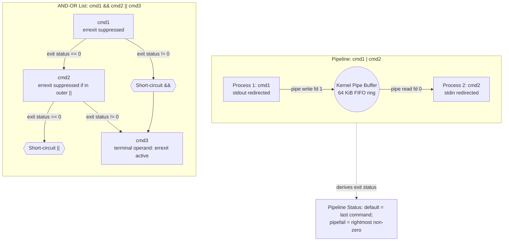

# Pipelines and And Or Lists

> [!summary] Claim
> Pipelines stream unbuffered byte sequences concurrently across anonymous kernel pipes while and-or lists evaluate commands sequentially under short-circuit logic with equal left-associative precedence, governing descriptor inheritance, process isolation, and the suppression of errexit across non-terminal operands.

Part of [The POSIX Shell Language](README.md) in [Shell and Unix Engineering](../README.md).

## TL;DR

- Mechanism: the shell constructs an anonymous kernel pipe via `pipe(2)`, forks child processes concurrently with standard streams redirected via `dup2(2)`, and evaluates `&&` and `||` lists sequentially from left to right using short-circuit control flow (POSIX.1-2024 XCU 2.9.2, 2.9.3).
- Rule: never use `cmd1 && cmd2 || cmd3` as a ternary branch; if `cmd2` fails, the shell executes `cmd3` regardless of `cmd1` success.
- Trap: `set -e` is suppressed for every command in an and-or list except the last, so any function called on the left-hand side of `&&` or `||` will continue executing even if internal commands fail.
- Portability: POSIX.1-2024 standardized `set -o pipefail` (Austin Group Defect 789), supported in bash, zsh, ksh93, mksh, yash, and dash from upstream 0.5.13 or a distribution patch (Debian `0.5.12-7`+, Ubuntu 26.04), while dash 0.5.12 on Alpine 3.22, macOS, and Ubuntu 24.04, and posh reject it (as of 2026-11).
- When not to use it: avoid shell pipelines when streaming high-cardinality structured records or when partial failures require transactional recovery; use Go or Rust where types, backpressure telemetry, and granular error propagation are first-class.

## Mental model



A pipeline connects adjacent commands through anonymous kernel pipe buffers, binding the stdout of the upstream command to the stdin of the downstream command before executing them concurrently in separate process environments.
An and-or list evaluates commands sequentially with equal precedence and strict left-associativity, short-circuiting downstream execution whenever the exit status satisfies the terminal condition of the logical operator.
The shell derives the pipeline status from the rightmost command by default, or from the rightmost failing stage under `pipefail`, while and-or lists pass their status directly to surrounding execution contexts while selectively disabling `set -e` on non-terminal stages.

## How it works

### The specification

POSIX.1-2024 specifies pipelines in section 2.9.2 `(POSIX.1-2024 XCU 2.9.2)`.
A pipeline is a sequence of one or more commands separated by the control operator `|`:
```
[ ! ] command1 [ | command2 ... ]
```
For each command except the last, the shell connects the standard output of the command to the standard input of the next command as if by creating an anonymous pipe.
The standard input and standard output assignments performed by the pipeline occur before any explicit redirections specified within the commands themselves `(POSIX.1-2024 XCU 2.9.2)`.
If a command redirects its output explicitly (`cmd1 >file | cmd2`), the explicit redirection overrides the pipeline descriptor assignment, directing `cmd1` output to `file` and leaving `cmd2` to read an immediate end-of-file.
If the pipeline is not executed asynchronously, the shell waits for the last command specified in the pipeline to complete, and may also wait for all commands to complete.

The exit status of a pipeline without `set -o pipefail` is the exit status of the last (rightmost) command.
If the pipeline begins with the reserved word `!`, the exit status is inverted: zero if the pipeline returned non-zero, and 1 if the pipeline returned zero.
POSIX.1-2024 officially standardized `set -o pipefail` (Austin Group Defect 789).
Under `pipefail`, the pipeline status is zero if all commands returned zero; otherwise, it is the exit status of the rightmost command that returned a non-zero exit status.
The shell captures the `pipefail` setting at the moment pipeline execution begins; subsequent option alterations inside the pipeline stages have no retroactive effect.
While modern shells (bash, zsh, ksh93, mksh, yash, BusyBox ash) implement `pipefail`, older shells and minimalist implementations diverge.
The dash 0.5.12 release rejects `set -o pipefail` as an illegal option (measured with Alpine 3.22 `0.5.12-r3`, macOS `/bin/dash`, and Ubuntu 24.04 `0.5.12-6ubuntu5`).
Upstream dash added the option in commit `6347b9fc52d742f36a0276cdea06cd9ad1f02c77`, committed on 2024-04-05 and first released in 0.5.13.
Debian applied that patch in `0.5.12-7`, and Ubuntu 26.04 `0.5.12-12ubuntu3` accepts the option (as of 2026-11).
Posh rejects `pipefail` unconditionally.

POSIX.1-2024 specifies and-or lists in section 2.9.3 `(POSIX.1-2024 XCU 2.9.3)`.
An and-or list is a sequence of one or more pipelines separated by the control operators `&&` and `||`.
The operators `&&` and `||` have identical precedence and evaluate strictly with left associativity `(POSIX.1-2024 XCU 2.9.3)`.
The command `false && echo foo || echo bar` and the command `true || echo foo && echo bar` both output solely `bar`.
Commands within an and-or list are expanded and evaluated lazily: the right operand of `&&` executes if and only if the left operand returns zero, while the right operand of `||` executes if and only if the left operand returns non-zero.
The exit status of an and-or list is the exit status of the last command executed in the list.

Section 2.10 defines the formal grammar rules for pipelines and lists `(POSIX.1-2024 XCU 2.10.2)`:
```
and_or           : pipeline
                 | and_or AND_IF linebreak pipeline
                 | and_or OR_IF linebreak pipeline ;
pipeline         : pipe_sequence
                 | Bang pipe_sequence ;
pipe_sequence    : command
                 | pipe_sequence '|' linebreak command ;
```
Because `pipe_sequence` cannot begin with the reserved word `Bang` (`!`), standard POSIX grammar allows only a single pipeline inverter.
Chained negation like `! ! true` is syntactically invalid under POSIX.1-2024 and is rejected by strict parsers like dash, BusyBox ash, yash, zsh, and bash 3.2 (lab test 15, which also shows that a single `!` parses in each of them).
Furthermore, `!` is a reserved word, not an operator; it requires separating whitespace (lab test 14: `!true` is an ordinary command word that is not found).
When `!` precedes a subshell grouping command, the application must separate them (`! (cmd)`), and the behavior of `!(` is unspecified `(POSIX.1-2024 XCU 2.9.2)`; the rationale's reason is that `!(` introduces a negated pathname expansion in the Korn shell.
In an empty directory, dash, bash, BusyBox ash, yash, posh, and `zsh --emulate sh` run `!(exit 0)` as a negated subshell, ksh93 and mksh report it as not found (127), and native zsh rejects it (lab test 24).

Section 2.13 governs execution environments `(POSIX.1-2024 XCU 2.13)`.
Each command of a multi-command pipeline executes in a subshell environment.
As an explicit implementation extension, POSIX allows any or all commands in a pipeline to execute in the current shell environment.
When a pipeline is executed asynchronously (`pipeline &`), section 2.9.3.1 dictates that the entire and-or list executes asynchronously in a subshell environment.
The special parameter `$!` expands to the process ID associated with the most recent asynchronous and-or list `(POSIX.1-2024 XCU 2.5.2)`.
For a background pipeline, `$!` was the process ID of the last stage and `wait "$!"` reported that stage's status in dash, bash, zsh, ksh93, mksh, posh, yash, and BusyBox ash, as measured by lab test 19, in which each stage records its own process ID and the two stages exit 3 and 4.

Section 2.15 defines the interaction with `errexit` (`set -e`) `(POSIX.1-2024 XCU 2.15)`.
The `-e` setting is ignored for any command in an and-or list other than the last.
In a multi-command pipeline, the failure of individual upstream commands does not trigger shell termination under `set -e`; only the exit status of the pipeline as a whole is evaluated against `errexit`.
In conforming implementations, if the last command of an and-or list fails (for example, `true && false`), `set -e` triggers immediately and terminates the shell.
However, in `posh 0.14.1`, `execute()` in `exec.c` passes the internal error-suppression flag `XERROK` to both operands of `&&` and `||`, causing `posh` to erroneously suppress `errexit` across all commands in an and-or list, including the terminal operand.
The sources of OpenBSD ksh and mksh, also pdksh descendants, pass `flags & XERROK` to the right operand, and mksh exits correctly in the shell matrix, so this is not a trait of the pdksh family.

### Kernel mechanisms and system calls

When the shell executes a pipeline of N commands, it invokes the `pipe(2)` or `pipe2(2)` system call N-1 times.
On modern Linux kernels, `pipe2(fds, O_CLOEXEC)` atomically sets the close-on-exec flag on both descriptor ends, preventing descriptor leaks across concurrent threads and unrelated child executions.
The operating system allocates an anonymous pipe backed by a circular ring buffer of kernel memory pages (`fs/pipe.c`).
The writer process connects its standard output (file descriptor 1) to the write end of the pipe via `dup2(pip[1], 1)` and immediately closes `pip[1]`.
The reader process connects its standard input (file descriptor 0) to the read end of the pipe via `dup2(prevfd, 0)` and immediately closes `prevfd`.

Descriptor closing hygiene is critical to kernel pipe semantics.
The shell parent process and the upstream child process MUST close the pipe write descriptor (`pip[1]`).
If any process in the system retains an open copy of the write descriptor, a reading process waiting on the read end will never receive an end-of-file condition (`read(2)` returning 0), resulting in an infinite deadlock.
Conversely, the child process executing the upstream command MUST close the read end of the pipe (`pip[0]`).
If the upstream process retains an open read descriptor pointing to the same pipe buffer it writes to, the kernel sees at least one active reader and will not generate a `SIGPIPE` signal if downstream readers close their descriptors, suppressing broken-pipe error detection.

When all downstream reading descriptors are closed, any subsequent `write(2)` call to the pipe triggers two kernel actions:
- The kernel generates the `SIGPIPE` signal (signal 13 on Linux and macOS) and delivers it to the writing thread (`send_sig(SIGPIPE, current, 0)` in Linux `fs/pipe.c`).
- If the writing process catches or ignores `SIGPIPE`, the `write(2)` system call returns `-1` with `errno` set to `EPIPE`.
If the default signal disposition is active, `SIGPIPE` terminates the process abnormally without producing a core dump.
Process wait status encoding diverges across shell architectures.
Standard Unix shells translate termination by signal 13 to exit status 128 + 13 = 141.
Yash specifies a base of 384 for signal termination statuses (yash manual, "Command execution"), reporting 384 + 13 = 397 for direct child processes (lab tests 17 and 21).
However, when a pipeline stage carries a redirection (measured with `yes 2>/dev/null`), yash executes the stage within an intermediate subshell process; a brace group or subshell stage without a redirection still reports 397 in the shell matrix.
Because the kernel `waitpid(2)` status byte masks exit codes to an 8-bit unsigned integer (`status & 0377`), the intermediate subshell's termination is truncated across the process boundary to `397 & 255 = 141`.
Ksh93 specifies a base of 256 for signals, returning 256 + 13 = 269 when a child terminates via `SIGPIPE` under standard pipes.
However, by default `ksh93u+m 1.0.10` connects pipeline stages using bidirectional Unix domain sockets via `socketpair(2)` instead of unidirectional pipes via `pipe(2)`; the ksh `NEWS` file records that the dev branch removed the socketpair method on 2026-10-30, which no release in the matrix includes (as of 2026-11).
When a downstream stage exits early and closes the socket with unread data queued, Linux sets `ECONNRESET` on the peer (`unix_release_sock` in `net/unix/af_unix.c`), so an upstream writer (such as GNU coreutils `yes`) encounters `ECONNRESET` rather than `EPIPE`.
The utility writes an error message to standard error and terminates normally with exit status 1 rather than by signal delivery, yielding pipeline exit status 1 under `pipefail`.
The outcome is a race, because a writer that finds no such pending error takes `SIGPIPE` instead: 100 fresh runs of `set -o pipefail; yes 2>/dev/null | head -n 1 >/dev/null` under ksh93u+m 1.0.10 in the shell matrix gave status 1 in 79 runs and 269 in 21, and lab test 22 confirms that no other value appears.
Enabling `set -o posix` instructs ksh93 to allocate standard `pipe(2)` descriptors (ksh `NEWS`, 2022-06-09), restoring deterministic `EPIPE` and signal 13 delivery (269 in 60 of 60 runs in the shell matrix; lab test 17 relies on it).
The macOS `/bin/ksh` 93u+ 2012 rejects `set -o posix` as a bad option, and it reported 13 in 100 of 100 runs of the same pipeline.

In and-or lists, the kernel executes no inter-process communication channels.
The shell maintains an internal abstract syntax tree node with binary connectors (`AND_AND` or `OR_OR`).
Execution proceeds sequentially within the current process environment unless individual commands themselves invoke subshells or external binaries.
Short-circuit evaluation is implemented directly in user-space shell logic: before invoking the right child node, the shell evaluates the integer exit status of the left child node.

### Implementation walkthrough

In GNU bash 5.3, pipelines are handled by `execute_pipeline` in `execute_cmd.c` `(bash-5.3 execute_cmd.c, execute_pipeline)`.
The function iterates across the connection list:
```c
while (cmd && cmd->type == cm_connection &&
       cmd->value.Connection && cmd->value.Connection->connector == '|')
```
For each stage, bash calls `pipe(fildes)`.
To eliminate descriptor leaks in the child, bash allocates a file descriptor bitmap structure `fd_bitmap` and marks `fildes[0]` to be closed upon child creation in `execute_simple_command`.
Bash executes the first command via `execute_command_internal(..., prev, fildes[1], fd_bitmap)`.
In the parent shell, bash closes `prev` and `fildes[1]`, updates `prev = fildes[0]`, and advances to the next command.
For the rightmost command, bash checks the `lastpipe` optimization:
```c
if (lastpipe_opt && job_control == 0 && asynchronous == 0 && pipe_out == NO_PIPE && prev >= 0)
```
If `shopt -s lastpipe` is enabled and job control is disabled, bash saves the current stdin descriptor via `move_to_high_fd(0, 1, -1)`, connects `prev` to stdin, and executes the final command in the current shell environment; a builtin or compound command then runs without `fork(2)`, while an external command still forks so the shell can continue (lab test 13 shows the variable surviving with the option on and lost once `set -m` enables job control).
Otherwise, bash forks the final command in a subshell.

In dash, pipelines are handled by `evalpipe` in `src/eval.c` `(dash eval.c, evalpipe)`.
Dash calculates the pipeline length, allocates a job structure via `makejob(pipelen)`, and iterates through the command list (simplified excerpt; `prehash`, `INTON`, and error cleanup are omitted):
```c
for (lp = n->npipe.cmdlist ; lp ; lp = lp->next) {
  if (lp->next && pipe(pip) < 0) sh_error("Pipe call failed");
  if (forkshell(jp, lp->n, n->npipe.backgnd) == 0) {
    if (pip[1] >= 0) close(pip[0]);
    if (prevfd > 0) { dup2(prevfd, 0); close(prevfd); }
    if (pip[1] > 1) { dup2(pip[1], 1); close(pip[1]); }
    evaltreenr(lp->n, flags);
  }
  if (prevfd >= 0) close(prevfd);
  prevfd = pip[0];
  close(pip[1]);
}
```
Dash forks every single stage in a pipeline, including the last command.
Dash maintains no `lastpipe` optimization and no `PIPESTATUS` array.
The 0.5.12 release lacks `set -o pipefail`; commit `6347b9fc52d742f36a0276cdea06cd9ad1f02c77` added it upstream by changing the option table and `getstatus` in `src/jobs.c`, leaving `evalpipe` untouched, and Debian carries the same patch on 0.5.12 from `0.5.12-7`.

In zsh, pipelines are handled by `execpline` and `execpline2` in `Src/exec.c` `(zsh Src/exec.c, execpline2)`.
In native zsh, the last command of a pipeline is executed in the parent shell process by default, allowing variable assignments to persist.
However, in sh emulation mode (`zsh --emulate sh`), zsh explicitly forces a fork.
In `execcmd_exec` `(zsh Src/exec.c, execcmd_exec)` (the condition is verbatim; the comment is paraphrased):
```c
if ((how & Z_ASYNC) || output ||
    (last1 == 2 && input && EMULATION(EMULATE_SH))) {
    /* fork immediately in sh mode */
```
When `EMULATION(EMULATE_SH)` is active, zsh detects that the command is the terminal stage receiving pipeline input and forks a subshell to conform with POSIX standard expectations.

And-or lists in bash are processed by `execute_connection` in `execute_cmd.c` `(bash-5.3 execute_cmd.c, execute_connection)`.
For `AND_AND` and `OR_OR`, bash marks the first command with `CMD_IGNORE_RETURN` (simplified excerpt; bookkeeping and `QUIT` are omitted):
```c
if (command->value.Connection->first)
  command->value.Connection->first->flags |= CMD_IGNORE_RETURN;
exec_result = execute_command (command->value.Connection->first);
if (((command->value.Connection->connector == AND_AND) && (exec_result == EXECUTION_SUCCESS)) ||
    ((command->value.Connection->connector == OR_OR) && (exec_result != EXECUTION_SUCCESS)))
{
  second = command->value.Connection->second;
  if (ignore_return && second)
    second->flags |= CMD_IGNORE_RETURN;
  exec_result = execute_command (second);
}
```
The flag `CMD_IGNORE_RETURN` suppresses `errexit` (`set -e`) during execution of the first command.
The second command inherits `CMD_IGNORE_RETURN` only if the parent and-or node itself had `ignore_return` set (for example, when nested as the non-terminal operand of another logical operator).
If the second command is the terminal operand of a top-level statement, `CMD_IGNORE_RETURN` is omitted, and any non-zero exit status immediately triggers shell exit under `set -e`.

## Numbers and limits

| Property | Value | Origin / Reference |
|---|---|---|
| Linux default pipe buffer capacity | 65,536 bytes (16 kernel pages) | Linux kernel `fs/pipe.c`, measured by lab test 20 with `pipe-capacity.c` on 4 KiB pages (as of 2026-11) |
| macOS pipe buffer capacity | 16,384 bytes initial, dynamic to 65,536 bytes | XNU `bsd/sys/pipe.h` (`PIPE_SIZE`, `BIG_PIPE_SIZE`), 65,536 measured by lab test 20 with `pipe-capacity.c` (as of 2026-11) |
| Linux `PIPE_BUF` write atomicity | 4,096 bytes | Linux `include/uapi/linux/limits.h` |
| macOS `PIPE_BUF` write atomicity | 512 bytes | macOS `sys/syslimits.h` `(POSIX.1-2024 _POSIX_PIPE_BUF)` |
| `&&` and `||` precedence delta | 0 (equal precedence, left-associative) | `(POSIX.1-2024 XCU 2.9.3)` |
| Standard Unix `SIGPIPE` exit status | 141 (base 128 + signal 13) | Shell convention, measured in shell matrix; POSIX requires only a value above 128 that identifies the signal in an implementation-defined manner `(POSIX.1-2024 XCU 2.8.2)` |
| ksh93 `SIGPIPE` exit status (`posix` mode) | 269 (base 256 + signal 13) | ksh93 signal status architecture under `pipe(2)`, measured by lab test 17 |
| ksh93u+m default pipeline writer exit status | 1 (GNU userland `ECONNRESET`) or 269 (`SIGPIPE`), a race | ksh93 default `socketpair(2)` reader closure, 79 and 21 of 100 runs in shell matrix, only these values in lab test 22 |
| yash direct `SIGPIPE` exit status | 397 (base 384 + signal 13) | yash manual, measured by lab tests 17 and 21 |
| yash redirected pipeline `SIGPIPE` exit status | 141 (`397 & 255`) | `wait` status keeps only 8 bits of an exit code across the intermediate subshell, measured by lab test 17 |
| POSIX minimum `CHILD_MAX` | 25 processes | `{_POSIX_CHILD_MAX}` in `<limits.h>` `(POSIX.1-2024 XBD 14)`, portable minimum simultaneous processes per real user ID |
| Linux unprivileged pipe size cap | 1,048,576 bytes (`/proc/sys/fs/pipe-max-size`) | `pipe_max_size` in Linux `fs/pipe.c`, read in the Debian container of the shell matrix |
| File descriptors consumed per pipe | 2 descriptors (`pip[0]`, `pip[1]`), transient | The shell closes each end after forking, so `RLIMIT_NOFILE / 2` is not a length bound: 60 stages under `ulimit -n 32` succeeded in dash, bash, ksh93, mksh, yash, and BusyBox ash, while zsh failed with `EBADF` errors (lab test 25; posh has no `ulimit` builtin) |

## Portability

| Shell | `set -o pipefail` | Last Stage in Current Shell | Chained `! ! cmd` | Pipeline Status Array | Redirection `>file \| cmd` | `SIGPIPE` Status | Terminal Errexit (`true && false`) | Function `fn && ok` Errexit |
|---|---|---|---|---|---|---|---|---|
| POSIX.1-2024 sh | Supported `(XCU 2.15)` | Optional extension `(XCU 2.13)` | Syntax error `(XCU 2.10)` | Unspecified | Overrides pipe `(XCU 2.9.2)` | Above 128, implementation-defined `(XCU 2.8.2)` | Active (exits) `(XCU 2.15)` | Suppressed inside `fn` `(XCU 2.15)` |
| macOS bash 3.2 | Supported | Subshell (`lastpipe` absent) | Syntax error | `PIPESTATUS` | Overrides pipe | 141 | Active (exits) | Suppressed inside `fn` |
| Current bash 5.3 | Supported | Subshell (Current via `lastpipe`) | Accepted | `PIPESTATUS` | Overrides pipe | 141 | Active (exits) | Suppressed inside `fn` |
| zsh (native) | Supported | Current shell | Syntax error | `pipestatus` | Duplicates (`MULTIOS`) | 141 | Active (exits) | Suppressed inside `fn` |
| zsh (`--emulate sh`) | Supported | Subshell | Syntax error | Unset | Overrides pipe | 141 | Active (exits) | Suppressed inside `fn` |
| dash (Debian 13) | Supported (`0.5.12-7`+) | Subshell | Syntax error | Unset | Overrides pipe | 141 | Active (exits) | Suppressed inside `fn` |
| dash 0.5.12 (Alpine, macOS, Ubuntu 24.04) | Unsupported | Subshell | Syntax error | Unset | Overrides pipe | 141 (seen via `$?`, not `pipefail`) | Active (exits) | Suppressed inside `fn` |
| ksh93u+m 1.0.10 | Supported | Current shell | Accepted | Unset | Overrides pipe | 1 or 269, a race (socketpair) / 269 (`posix`) | Active (exits) | Suppressed inside `fn` |
| mksh R59 | Supported | Subshell | Accepted | `PIPESTATUS` | Overrides pipe | 141 | Active (exits) | Suppressed inside `fn` |
| yash 2.58.1 | Supported | Subshell | Syntax error | Unset | Overrides pipe | 397 / 141 (redirected stage) | Active (exits) | Suppressed inside `fn` |
| BusyBox 1.37.0 ash | Supported (`ASH_BASH_COMPAT`) | Subshell | Syntax error | Unset | Overrides pipe | 141 | Active (exits) | Suppressed inside `fn` |
| posh 0.14.1 | Unsupported | Subshell | Accepted | Unset | Overrides pipe | 141 (seen via `$?`, not `pipefail`) | Suppressed (survives, bug) | Suppressed inside `fn` |

Lab tests prove these cells on the matrix shells, whose dash builds are Alpine, macOS, and Debian (the Ubuntu dash cells were run by hand): `pipefail` from tests 3, 16, and 23; last stage from tests 2, 12, and 13; chained `!` from test 15; status arrays from test 18; redirection from test 5; `SIGPIPE` from tests 17, 21, and 22; terminal errexit from test 4; and function errexit from test 10.
In native zsh, the `MULTIOS` option is enabled by default, causing a command with both an output redirection and a pipeline (`cmd >file | next`) to duplicate output to both destinations simultaneously via internal descriptor teeing.
Under `zsh --emulate sh` and all standard POSIX shells, redirection evaluates after the pipeline assignment and overrides standard output, sending data to `file` and transmitting zero bytes across the pipe.
In dash, support for `set -o pipefail` is version-dependent and distribution-dependent: upstream commit `6347b9fc52d742f36a0276cdea06cd9ad1f02c77` first shipped in 0.5.13, Debian has patched it in since `0.5.12-7` (Debian 13 ships `0.5.12-12`), and Ubuntu 26.04 `0.5.12-12ubuntu3` accepts it, whereas Alpine Linux (`dash 0.5.12-r3`), macOS `/bin/dash`, and Ubuntu 24.04 `0.5.12-6ubuntu5` reject `pipefail` as an illegal option.
In posh 0.14.1, `execute()` in `exec.c` propagates the `XERROK` flag to both operands of `&&` and `||`, erroneously disabling `set -e` on terminal operands so that `true && false` survives instead of aborting.
In ksh93u+m 1.0.10, default pipelines connect via bidirectional `socketpair(2)` rather than `pipe(2)`.
When the reader closes prematurely, upstream writers like GNU coreutils `yes` encounter `ECONNRESET` rather than `EPIPE`, exiting normally with status 1 rather than signal 13 in a race with plain `SIGPIPE` delivery (status 269), unless `set -o posix` forces standard `pipe(2)` usage (always status 269), while legacy ksh93u+ 2012 on macOS, which has no `posix` option, reports raw signal 13 under `pipefail`.
In yash 2.58.1, direct child processes terminated by `SIGPIPE` report exit status 397 (base 384 + 13), but pipeline stages carrying a redirection run in an intermediate subshell whose exit code is masked across the process boundary to 8 bits (`397 & 255 = 141`).
In shells lacking `pipefail` (such as Alpine dash and posh), attempting to execute `set -o pipefail` triggers an immediate fatal error because `set` is a special built-in utility; detecting support safely requires running the command inside an isolating subshell `(set -o pipefail 2>/dev/null)` (lab test 23).

## Worked example

The lab is [lab](../labs/03-pipelines-and-and-or-lists/); it contains 25 tests, a mechanism probe script `pipeline-probe.sh`, and a C helper `pipe-capacity.c`.
Tests 3, 16, 17, 22, and 23 take the expected `pipefail` result from the shell family and, for dash, from the installed package version, so a shell that loses or gains the option fails them.
Test 17 runs ksh93u+m under `set -o posix` so that its status is deterministic, and test 22 alone accepts either side of that shell's documented default race.
This is a verbatim excerpt of the probe script `pipeline-probe.sh`:

```sh
#!/bin/sh
# pipeline-probe: mechanism probes for pipelines and and-or lists.
# Usage: pipeline-probe.sh assoc
#        pipeline-probe.sh subshell
#        pipeline-probe.sh pipefail
#        pipeline-probe.sh errexit
#        pipeline-probe.sh redir DIR

mode=${1:?mode}

case $mode in
  assoc)
    # Probe 1: Left-associativity of && and || (equal precedence).
    # In C, && binds tighter than ||, so (true || (false && true)) would print nothing.
    # In POSIX shell, equal precedence and left associativity evaluate ((true || false) && echo r1).
    res1=$(true || echo "skip1" && echo "run1")

    # Probe 2: Short-circuiting and the fake ternary trap.
    # In a ternary condition ? true_branch : false_branch, if condition is true,
    # the false_branch must never execute.
    # In shell A && B || C, if B returns non-zero, C executes even though A succeeded.
    res2=$([ "$mode" = "assoc" ] && false || echo "fallback")

    printf 'assoc=%s ternary=%s\n' "$res1" "$res2"
    ;;

  subshell)
    # Test whether the last pipeline stage executes in the current shell environment
    # or in a subshell environment (POSIX.1-2024 XCU 2.13).
    val="initial"
    # shellcheck disable=SC2030 # val is intentionally modified inside pipeline stage
    printf 'data\n' | { val="modified"; }
    # shellcheck disable=SC2031 # intentional probe whether pipeline subshell modified parent val
    printf 'val=%s\n' "$val"
    ;;

  pipefail)
    # Test pipeline exit status derivation with and without pipefail.
    # Without pipefail, exit status is always the last command (POSIX.1-2024 XCU 2.9.2).
    # shellcheck disable=SC2312 # intentional probe of exit status
    false | true
    st_default=$?

    # Feature-detect set -o pipefail (standardized in POSIX.1-2024, extension in older shells)
    # shellcheck disable=SC3040 # pipefail is feature-detected
    if (set -o pipefail 2>/dev/null); then
      # Under pipefail, exit status is the rightmost non-zero command
      # shellcheck disable=SC2312,SC3040 # intentional probe of pipefail status
      st_pipefail=$(
        set -o pipefail
        false | true
        printf '%d' "$?"
      )
    else
      st_pipefail="unsupported"
    fi

    printf 'default=%d pipefail=%s\n' "$st_default" "$st_pipefail"
    ;;

  errexit)
    # Test set -e suppression rules in AND-OR lists (POSIX.1-2024 XCU 2.15).
    # In false && true, -e is ignored for false (not the last command), and true is skipped.
    # The shell must survive.
    # shellcheck disable=SC2015 # intentional test of set -e on and-or list
    surv_first=$(
      set -e
      false && true
      printf 'survived'
    )

    # In true && false, false IS the last command, so -e is NOT ignored.
    # The subshell must exit immediately on false without reaching the printf.
    # shellcheck disable=SC2015 # intentional test of set -e on and-or list
    surv_last=$(
      set -e
      true && false
      printf 'survived'
    )
    [ -z "$surv_last" ] && surv_last="exited"

    printf 'first_operand=%s last_operand=%s\n' "$surv_first" "$surv_last"
    ;;

  redir)
    # Test pipeline redirection binding order (POSIX.1-2024 XCU 2.9.2).
    # Pipeline connects stdout to pipe BEFORE command redirections are processed.
    # Thus >file redirects stdout away from the pipe into the file,
    # and the downstream command receives EOF (0 bytes).
    dir=${2:?dir}
    outfile="$dir/pipeline.out"
    # shellcheck disable=SC2260 # intentional test that redirection overrides the pipeline stdout
    read_bytes=$(
      printf 'payload\n' >"$outfile" | wc -c
    )
    # Strip any whitespace from wc output
    read_bytes=$(printf '%d' "$read_bytes")
    file_bytes=$(wc -c <"$outfile")
    file_bytes=$(printf '%d' "$file_bytes")
    printf 'downstream_bytes=%d file_bytes=%d\n' "$read_bytes" "$file_bytes"
    ;;

  *)
    exit 2
    ;;
esac
```

Output of `pipeline-probe.sh` across all probe modes under Alpine's `dash` 0.5.12 (no `pipefail`), captured from the lab:

```text
assoc=run1 ternary=fallback
val=initial
default=0 pipefail=unsupported
first_operand=survived last_operand=exited
downstream_bytes=0 file_bytes=8
```

On systems where `dash` has `pipefail` (such as Debian 13 and Ubuntu 26.04), `pipefail` prints `default=0 pipefail=1`.
Under `posh 0.14.1`, `errexit` prints `first_operand=survived last_operand=survived` due to its `XERROK` operand flag propagation.

TAP report from `bats` under Alpine's `dash` 0.5.12, captured from the lab (25 tests):

```text
1..25
ok 1 probe assoc verifies left associativity and fake ternary trap
ok 2 probe subshell checks whether last pipeline stage runs in a subshell
ok 3 probe pipefail verifies pipeline status derivation
ok 4 probe errexit verifies set -e suppression on non-last operands
ok 5 probe redir verifies redirection binding order against output pipe
ok 6 && and || have equal precedence and group strictly left to right
ok 7 short-circuit evaluation skips unreached commands and expansions
ok 8 exit status of an AND-OR list is the status of the last command executed
ok 9 cmd1 && cmd2 || true idiom guarantees zero status and script survival under set -e
ok 10 functions called before && or || have set -e suppressed across all commands
ok 11 pipeline returns exit status of the last command without pipefail
ok 12 variable assignments in pipeline stages do not affect parent shell in POSIX mode
ok 13 bash lastpipe runs the last stage in the current shell only when job control is off
ok 14 pipeline negation with ! inverts status and requires separating whitespace
ok 15 double negation ! ! cmd is a syntax error or a double inversion, by shell
ok 16 set -o pipefail propagates rightmost failure status
ok 17 SIGPIPE in pipeline under pipefail yields signal termination status
ok 18 PIPESTATUS in bash and mksh and pipestatus in native zsh expose per-stage statuses, and no other shell sets them
ok 19 asynchronous pipeline sets $! to the last stage and wait reports that stage's status
ok 20 pipe capacity measures 16 pages on Linux and 65536 bytes on macOS
ok 21 a writer stage sees its own SIGPIPE status through $? without pipefail
ok 22 default SIGPIPE status under pipefail across 20 fresh shells
ok 23 set -o pipefail aborts a shell without it, and a subshell probe survives
ok 24 !( with no space is a negated subshell, a failed lookup, or a parse error, by shell
ok 25 60 pipeline stages run under ulimit -n 32 except in zsh
```

## Pitfalls

> [!warning] The fake ternary trap (`A && B || C`)
> Trigger: using `[ -f "$file" ] && rm "$file" || log_error` as a replacement for an `if/then/else` construct.
> Symptom: if `A` succeeds but `B` fails (for example, `rm` encounters an I/O error or permission failure), the left-hand side returns non-zero, triggering execution of `C` despite `A` being true.
> Fix: use an explicit `if ...; then ...; else ...; fi` compound statement; ShellCheck flags this anti-pattern under SC2015 ("Note that A && B || C is not if-then-else").

> [!warning] Upstream pipeline failure masking without pipefail
> Trigger: running a pipeline where an upstream generator fails, such as `generate-config | apply-config`, without `set -o pipefail`.
> Symptom: `generate-config` exits non-zero and outputs an empty stream, but `apply-config` succeeds on empty input and exits 0; the script considers the step successful and continues execution.
> Fix: enable `set -o pipefail` in environments that support it, or avoid pipelines by staging intermediate output through temporary files; this exact mechanism caused Cloudflare's incident of 2021-12-16, in which `dos-make-addr-conf` failed in a Kubernetes cron job, its empty output was still piped into `dosctl` and written to a Quicksilver key, `dosd` panicked on the empty data, and web requests were delayed by up to five seconds for about 30 minutes (Cloudflare postmortem, 2022-04-05).

> [!warning] Premature pipeline termination on `SIGPIPE` under `pipefail`
> Trigger: executing a pipeline under `set -e -o pipefail` where a downstream filter exits early, such as `cat large_file | grep -q pattern` or `seq 1000000 | head -n 1`.
> Symptom: `head` or `grep -q` closes its standard input upon finding the match; the upstream writer receives `SIGPIPE` on its next write and terminates with exit code 141, causing the entire script to abort under `pipefail` and `errexit`.
> Fix: avoid upstream generators with early-exiting filters (`grep -q pattern large_file` instead of `cat | grep -q`), or temporarily disable `pipefail` around the command: `{ set +o pipefail; seq 1000000 | head -n 1; set -o pipefail; }`.

> [!warning] Vanishing pipeline variable mutations
> Trigger: mutating shell variables inside a loop that is fed by a pipeline: `count=0; cat names.txt | while read -r name; do count=$((count + 1)); done; echo "$count"`.
> Symptom: `$count` prints 0 because the `while` loop executed in a forked subshell environment whose variables were discarded upon termination.
> Fix: redirect input into the loop instead of piping (`while read -r name; do ...; done < names.txt`), use a command substitution or here-document, or enable `shopt -s lastpipe` in bash with job control disabled; ShellCheck warns of this bug via SC2030 and SC2031.

> [!warning] Suppression of `errexit` inside functions called before `&&` or `||`
> Trigger: invoking a maintenance function on the left side of a logical connector: `cleanup_and_deploy && notify_slack`.
> Symptom: inside `cleanup_and_deploy`, `set -e` is completely disabled for every command; if a critical backup or removal command fails, execution blunders forward into subsequent commands without aborting.
> Fix: never invoke multi-command functions as the non-terminal operand of `&&` or `||`; invoke the function on its own line under `set -e` and execute the notification as a subsequent step; ShellCheck warns of this vulnerability via optional check `check-set-e-suppressed`.

> [!warning] Redirection overriding the output pipeline
> Trigger: specifying an output redirection on an upstream pipeline stage: `command >output.log | filter`.
> Symptom: in POSIX shells, `>output.log` overrides the stdout pipeline descriptor, directing output to the file while `filter` receives an immediate empty end-of-file; in native zsh, `MULTIOS` duplicates the stream to both targets.
> Fix: use `tee` to direct output to both a file and a pipeline stage (`command | tee output.log | filter`); ShellCheck detects this error under SC2260 ("This redirection overrides the output pipe").

> [!warning] ksh93 socketpair pipelines and ECONNRESET masking
> Trigger: relying on `SIGPIPE` or standard `pipe(2)` error semantics in ksh93 or ksh93u+m without `set -o posix`.
> Symptom: ksh93 connects pipeline stages using bidirectional Unix domain sockets via `socketpair(2)`; when a downstream filter exits early, upstream writers like GNU coreutils `yes` can encounter `ECONNRESET` instead of `EPIPE`, writing an error to standard error and exiting normally with status 1 rather than signal 13, and the status varies between 1 and 269 from run to run, which corrupts status-based error handling under `pipefail`.
> Fix: enable `set -o posix` at script initialization under ksh93u+m to mandate standard unidirectional `pipe(2)` creation and restore deterministic `SIGPIPE` delivery; feature-detect it in a subshell, because ksh93u+ 2012 rejects the option.

> [!warning] posh suppression of errexit on terminal operands
> Trigger: chaining critical sequential commands using `&&` under `set -e` in scripts executed by posh (`cmd1 && cmd2`).
> Symptom: in posh 0.14.1, `execute()` passes the `XERROK` flag to both left and right AST child nodes in `exec.c`; if `cmd2` fails, `set -e` is erroneously suppressed, and the script blunders forward into subsequent commands without aborting.
> Fix: write explicit `if cmd1; then cmd2; fi` compound statements instead of `&&` chaining whenever the right-hand command must trigger `errexit` upon failure.

> [!warning] Distro-dependent dash pipefail availability
> Trigger: executing `set -o pipefail` inside scripts with a `#!/bin/sh` shebang on heterogeneous systems (such as Alpine containers running alongside Debian or Ubuntu hosts).
> Symptom: Debian 13 (`dash 0.5.12-12`) and Ubuntu 26.04 (`0.5.12-12ubuntu3`) carry commit `6347b9fc52d742f36a0276cdea06cd9ad1f02c77` to support `pipefail`, but Alpine Linux (`dash 0.5.12-r3`), macOS `/bin/dash`, and Ubuntu 24.04 (`0.5.12-6ubuntu5`) reject the option with exit status 2, causing script initialization to abort fatally because `set` is a special built-in utility.
> Fix: feature-detect `pipefail` inside an isolated subshell before enabling it: `if (set -o pipefail 2>/dev/null); then set -o pipefail; fi`.

## Security and robustness

Pipelines and and-or lists form the operational backbone of automated infrastructure, making their error semantics a frequent source of security vulnerabilities.
In CI/CD automation and container image creation, pipelines that omit `set -o pipefail` silently bypass security gates.
A build step such as `trivy fs --exit-code 1 / | tee scan.log` or `curl -sSf https://internal/patch.sh | sh` will return exit code 0 even when the security scanner detects critical vulnerabilities or the HTTP download yields a 404 error.
Because `tee` succeeds on its stream and `sh` succeeds on empty input, the deployment pipeline promotes compromised or unpatched software directly to production; `tar -xz` is not an example of this failure, since it exits 2 on empty or non-gzip input (measured in the shell matrix).

In multi-stage pipelines, unbounded buffers can induce system-wide denial-of-service or pipeline deadlocks.
When an upstream process writes data faster than a downstream process consumes it, the kernel pipe buffer fills to capacity (64 KiB), blocking the writer in `write(2)`.
If two processes in a complex pipeline attempt bidirectional communication across circular pipes or inherited FIFOs, both processes can block simultaneously waiting on the other to read, producing an unrecoverable deadlock.
Always set bounded timeouts around pipeline stages that consume external network streams, and ensure circular inter-process communication uses explicit non-blocking socket architectures rather than shell pipelines.

Descriptor leaks across pipelines can also compromise process isolation.
When executing background pipelines (`cmd1 | cmd2 &`), standard input is redirected from `/dev/null` only if job control is disabled and no explicit redirection exists.
However, file descriptors opened via `exec 3>file` prior to the pipeline are inherited by all child subshells unless explicitly closed or marked with close-on-exec.
In security-sensitive wrappers that drop privileges or handle cryptographic material, ensure sensitive file descriptors are closed before launching pipelines to prevent untrusted child binaries from inspecting inherited channels.

## The principal's view

At staff-plus engineering levels, the decision to use shell pipelines versus structured programming languages represents an architectural trade-off between composable streaming velocity and reliable error handling.
Shell pipelines are unmatched for linear, high-throughput stream processing on Unix systems.
The Unix pipeline architecture enforces loose coupling: utilities communicate via linear byte streams without sharing memory or process address spaces.

However, shell pipelines become an active architectural hazard when applied to complex operational workflows with branchy error handling, non-linear dependencies, or structured records.
Standard shell pipelines lack native backpressure telemetry, cannot handle structured JSON or protobuf schemas without brittle serialization tools like `jq`, and exhibit subtle edge-case failures across shell implementations (such as `SIGPIPE` aborts under `pipefail`, subshell variable isolation, and `errexit` suppression).

When designing mission-critical deployment scripts, database migration runners, or infrastructure orchestrators, apply the following staff-level guidelines:
- Always set `set -eu` and feature-detect `set -o pipefail` inside an isolating subshell `(set -o pipefail 2>/dev/null)` at the entry point of non-interactive automation scripts to avoid fatal syntax errors in Alpine dash or posh.
- Replace inline `&&` and `||` chains with explicit `if/then/else/fi` blocks whenever the conditional action performs state mutations or requires `set -e` enforcement on the second command, insulating scripts against the posh errexit suppression bug.
- Mandate `set -o posix` under ksh93u+m (ksh93u+ 2012 lacks the option) to force the allocation of standard `pipe(2)` descriptors rather than bidirectional `socketpair(2)` channels, preventing premature reader termination from masquerading as application-level errors.
- If an operational script requires processing structured records, inspecting intermediate pipeline stage statuses independently, or recovering from partial network failures, migrate the task out of shell scripting into Go or Rust.

## Interview questions

> [!question] L5: What does the command `true || echo foo && echo bar` output, and why?
>
> > [!success]- Answer
> > It outputs solely `bar`.
> > In the POSIX shell language, `&&` and `||` have identical precedence and evaluate with strict left-to-right associativity (POSIX.1-2024 XCU 2.9.3).
> > The command evaluates as `((true || echo foo) && echo bar)`.
> > The first expression `true || echo foo` evaluates `true` and short-circuits `echo foo`, yielding an exit status of 0.
> > Because the left operand of `&&` evaluated to 0, the shell executes the right operand `echo bar`.
> >
> > Follow-up: How would this command evaluate in C or Python?
> > In C and Python, logical AND has higher precedence than logical OR, evaluating as `true || (foo && bar)`, which short-circuits completely and produces no output.

> [!question] L5: Why does `count=0; printf "a\nb\n" | while read -r line; do count=$((count + 1)); done; echo "$count"` print 0 in standard POSIX shells?
>
> > [!success]- Answer
> > In POSIX shells, each command in a multi-command pipeline executes in a separate subshell environment (POSIX.1-2024 XCU 2.13).
> > The `while` loop runs inside a child subshell that inherits a copy of `count`, increments its local copy, and terminates.
> > The parent shell process never receives the variable mutation and prints its original value of 0.
> >
> > Follow-up: Name two portable methods to preserve the mutated variable in the parent shell.
> > Redirect the input stream directly into the loop from a here-document (`while ...; done <<EOF`) or from a temporary file (`while ...; done <file`).
> > Process substitution (`done < <(printf ...)`) is not POSIX, and dash, mksh, posh, and yash rejected it in the shell matrix.

> [!question] L6: Debug this script: under `set -euo pipefail`, why does `cat large_file.txt | grep -q "target_string"` crash the script with exit status 141, and how do you resolve it?
>
> > [!success]- Answer
> > When `grep -q` locates the target string, it exits immediately with status 0 and closes its standard input.
> > `cat` attempts to write subsequent bytes to the closed pipe, prompting the kernel to deliver a `SIGPIPE` signal (signal 13).
> > `cat` terminates abnormally on signal 13, producing an exit status of 141 (128 + 13).
> > Under `set -o pipefail`, the pipeline derives its exit status from the rightmost non-zero exit code (141 from `cat`), causing `set -e` to abort the script.
> > The issue is resolved by removing the useless `cat` and running `grep -q "target_string" large_file.txt` directly, or by wrapping the pipeline in `{ set +o pipefail; cat large_file.txt | grep -q "target_string"; set -o pipefail; }`.
> >
> > Follow-up: Does `PIPESTATUS` in bash allow you to distinguish a `SIGPIPE` upstream termination from a legitimate grep failure?
> > Yes, in bash `${PIPESTATUS[0]}` reflects 141 for `cat` while `${PIPESTATUS[1]}` reflects 0 for `grep`, allowing explicit acceptance of status 141.
> > Across shell families, signal exit codes diverge: standard shells report 141 (base 128 + 13), ksh93 reports 269 (base 256 + 13) under `set -o posix`, and yash reports 397 (base 384 + 13), while intermediate subshells truncate yash status to 141 and default ksh93u+m socketpair pipelines yield status 1 or 269 with GNU coreutils, depending on a race.

> [!question] L6: Explain the exact mechanism by which `cmd1 && cmd2 || true` acts as an errexit guard, and why `true` guarantees shell survival under `set -e`.
>
> > [!success]- Answer
> > The and-or list parses as `(cmd1 && cmd2) || true` due to left-associativity.
> > Under POSIX rules (POSIX.1-2024 XCU 2.15), the `-e` setting is ignored for any command in an and-or list other than the last.
> > Because `(cmd1 && cmd2)` is the non-terminal operand of `||`, `errexit` is suppressed across both `cmd1` and `cmd2`.
> > If `cmd1` fails, `cmd2` is skipped, `cmd1 && cmd2` returns non-zero, and the `||` branch executes `true`.
> > If `cmd1` succeeds and `cmd2` fails, `cmd2` fails safely without triggering `errexit`, and the `||` branch executes `true`.
> > Because `true` is the final command and exits with 0, the entire statement completes with exit status 0, ensuring script survival.
> >
> > Follow-up: What happens if `true` is replaced with `(exit 5)`?
> > Because `(exit 5)` is the terminal command of the list, `-e` is active in conforming POSIX shells, and the non-zero status immediately triggers shell exit.
> > As an implementation divergence, `posh 0.14.1` buggily suppresses `errexit` across all operands of an and-or list due to its `XERROK` flag propagation, surviving non-zero terminal exits.
> > Upstream bash 3.2.57 built in the shell matrix also survives `true && (exit 5)`, while Apple's `/bin/bash` 3.2.57 exits with status 5.

> [!question] L6: What critical security hazard occurs when a function containing multiple commands is called as the left operand of `&&` under `set -e`?
>
> > [!success]- Answer
> > When a function is called on the left side of `&&` (`fn && echo ok`), `set -e` is suppressed for the function call because it is not the last command in the and-or list.
> > In accordance with POSIX rules, this suppression propagates into the function execution environment, disabling `set -e` across every command inside the function.
> > If an internal command like a backup or security validation fails, the function does not abort; it continues executing subsequent commands, potentially executing destructive operations without prerequisites.
> >
> > Follow-up: Which static analysis tool detects this condition?
> > ShellCheck flags this condition using the optional check `check-set-e-suppressed`.

> [!question] L6: Predict the output: What does the following script print across dash, bash 5.3, and native zsh?
> ```sh
> printf "data\n" >out.txt | wc -c
> wc -c <out.txt
> ```
>
> > [!success]- Answer
> > In dash and bash 5.3, the first command prints 0 and the second command prints 5.
> > In native zsh, the first command prints 5 and the second command prints 5.
> > In POSIX shells (dash and bash), the redirection `>out.txt` overrides the stdout descriptor assigned by the pipeline, sending data to `out.txt` and leaving `wc` to receive an empty pipe.
> > In native zsh, the `MULTIOS` option is enabled by default, causing zsh to tee the stream to both `out.txt` and the downstream pipeline stage.
> >
> > Follow-up: How do you force zsh to adhere to POSIX pipeline redirection behavior?
> > Run `setopt NO_MULTIOS` or execute the script under `zsh --emulate sh`.

> [!question] L7: Trace the exact system calls executed by a POSIX shell when evaluating `cmd1 | cmd2`, detailing file descriptor inheritance, descriptor cleanup, and signal implications.
>
> > [!success]- Answer
> > The parent shell calls `pipe(pip)` to allocate an anonymous kernel pipe buffer, receiving read descriptor `pip[0]` and write descriptor `pip[1]`.
> > The shell calls `fork()` to spawn child 1 (`cmd1`); inside child 1, it closes `pip[0]`, calls `dup2(pip[1], 1)` to attach stdout to the pipe, closes `pip[1]`, and calls `execve()` to run `cmd1`.
> > The parent shell calls `fork()` to spawn child 2 (`cmd2`); inside child 2, it closes `pip[1]`, calls `dup2(pip[0], 0)` to attach stdin to the pipe, closes `pip[0]`, and calls `execve()` to run `cmd2`.
> > In the parent shell, it immediately closes both `pip[0]` and `pip[1]`; if the parent failed to close `pip[1]`, child 2 would never receive EOF on stdin.
> > If child 1 failed to close `pip[0]`, it would hold a reference to its own reading end, suppressing kernel generation of `SIGPIPE` if child 2 terminated early.
> > The parent invokes `waitpid()` to wait for child 2, and in foreground pipelines, reaps child 1 to prevent zombie process accumulation.
> >
> > Follow-up: How does bash `shopt -s lastpipe` modify this system call sequence?
> > When `lastpipe` is active without job control, bash duplicates the shell's original stdin to a high descriptor via `move_to_high_fd(0, 1, -1)`, which calls `dup2`, connects the pipe read end to descriptor 0 through `do_piping`, executes `cmd2` in the current shell environment (without `fork()` for a builtin or compound command), and restores original stdin afterwards.

> [!question] L7: Why does standard POSIX grammar reject `! ! true` as a syntax error while bash 5.3 and ksh93 accept it, and what grammatical rule enforces this?
>
> > [!success]- Answer
> > The POSIX shell grammar defines `pipeline` as either `pipe_sequence` or `Bang pipe_sequence` (POSIX.1-2024 XCU 2.10.2).
> > The production `pipe_sequence` consists of `command`, optionally followed by `|` and subsequent commands.
> > The symbol `command` expands to simple commands, compound commands, or function definitions, but crucially does not expand recursively to `pipeline`.
> > Because `pipe_sequence` cannot begin with `Bang`, standard grammar allows at most one `!` at the beginning of a pipeline.
> > Bash (from 4.2-alpha per its `CHANGES` file; lab test 15 shows 3.2 rejecting it and 4.4 accepting it), ksh93, mksh, and posh extend the grammar to allow recursive pipeline inversions.
> >
> > Follow-up: Why does POSIX classify `!` as a reserved word rather than an operator?
> > Classifying `!` as a reserved word means it is recognized only as a complete token in positions where a command name can begin (POSIX.1-2024 XCU 2.4), so `!true` is an ordinary command word rather than a negation.

## Related

Prerequisites: [[Command-Search-and-PATH]]

Next: [[Compound-Commands]]

See also: [[Pipelines-Subshells-Redirection-and-Process-Substitution]]

## Further reading

- [POSIX.1-2024 Shell Command Language (XCU Chapter 2)](https://pubs.opengroup.org/onlinepubs/9799919799/utilities/V3_chap02.html): The authoritative specification of pipeline redirection, and-or lists, and execution environment rules.
- [Austin Group Defect 789: Addition of pipefail](https://www.austingroupbugs.net/view.php?id=789): The standard committee rationale for standardizing `set -o pipefail` in POSIX.1-2024.
- [Austin Group Defect 1150: exit status of command substitution](https://www.austingroupbugs.net/view.php?id=1150): The accepted specification of command substitution status, whose discussion touches how `set -e` interacts with it.
- [dash.git commit 6347b9f: pipefail support](https://git.kernel.org/pub/scm/utils/dash/dash.git/commit/?id=6347b9fc52d742f36a0276cdea06cd9ad1f02c77): Upstream dash commit implementing `set -o pipefail`, first released in 0.5.13 and patched into Debian's 0.5.12 packages.
- [posh 0.14.1 `exec.c` on Debian Sources](https://sources.debian.org/data/main/p/posh/0.14.1/exec.c): Source implementation exhibiting `XERROK` flag propagation across and-or list branches.
- [ksh93u+m repository](https://github.com/ksh93/ksh): Implementation repository whose `NEWS` file records POSIX mode's move to `pipe(2)` (2022-06-09) and the removal of socketpair pipelines from the dev branch (2026-10-30).
- [GNU Bash Source: `execute_cmd.c`](https://git.savannah.gnu.org/cgit/bash.git/tree/execute_cmd.c): Implementation reference for `execute_pipeline`, `execute_connection`, and the `lastpipe` optimization.
- [Cloudflare Outage Postmortem: PIPEFAIL](https://blog.cloudflare.com/pipefail-how-a-missing-shell-option-slowed-cloudflare-down/): Real-world postmortem of a 2021 global slowdown traced to a missing `pipefail` in a configuration cron job.
- [Linux Kernel: `fs/pipe.c`](https://git.kernel.org/pub/scm/linux/kernel/git/torvalds/linux.git/tree/fs/pipe.c): Kernel implementation of anonymous circular pipe buffers, atomic write guarantees, and `SIGPIPE` generation.
