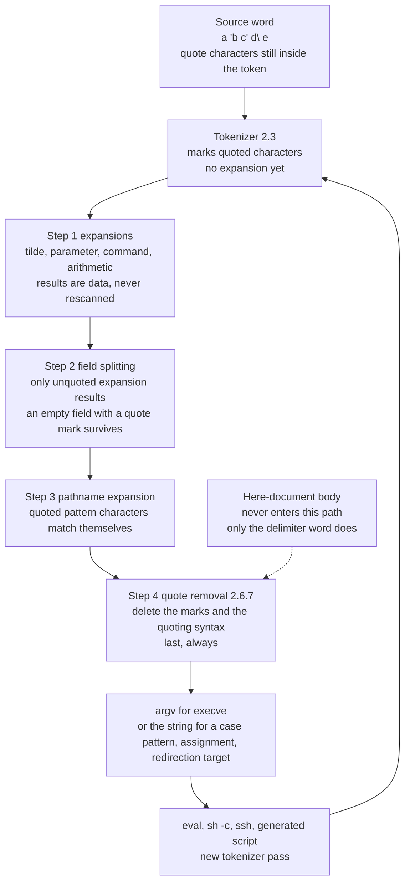

# Quote Removal

> [!summary] Claim
> Quote removal is the last step of word expansion: it deletes exactly the backslash, single-quote, double-quote and dollar-single-quote characters that the shell treated as quoting syntax in the original word, never touches a character that came out of an expansion, and runs only after field splitting and pathname expansion have used the quoting information.

Part of [The POSIX Shell Language](README.md) in [Shell and Unix Engineering](../README.md).

## TL;DR

- Mechanism: the tokenizer keeps quote characters inside the word, every expansion and the pattern matcher consume the "was this character quoted" mark, and quote removal finally deletes the marks and the quoting syntax so that `execve(2)` sees plain bytes `(POSIX.1-2024 XCU 2.6.7)`.
- Rule: a quote character is removed if it was special in the original word and kept if it was itself quoted (the "golden rule" of `(POSIX.1-2024 XCU C.2.6.7)`); characters that arrive through `$x`, `$(...)` or `$((...))` are data and are never rescanned.
- Trap: quote removal happens once per parse, so a value pasted into `eval`, `sh -c`, `ssh host cmd` or a generated script is parsed again and its quotes are live again; this is the mechanism behind injection through `eval` and generated command lines, for example `(CVE-2021-42740)`.
- Portability fact: the core behavior is identical in every shell measured in the matrix, but `${u:=a\ b}` and `"${bar-\}}"` differ in bash 3.2, `$'abc'` is the literal text `$abc` in dash and posh, and `xargs` runs its own, different quote removal on its input.
- When not to use it: never build a command line by concatenating data and hoping the quotes work; pass data as separate arguments, as positional parameters, or through `sh_quote` (single quotes with `'\''`) when one more parse is unavoidable.

## Mental model



The source word reaches the tokenizer with its quote characters intact, because `(POSIX.1-2024 XCU 2.3)` says the token consists of exactly the input characters "including any quoting characters" and that no substitution happens during token recognition.
The expansions of step 1 insert their results into the word as data, so a `'` or `"` that came out of `$x` has no syntactic meaning later.
Field splitting then looks only at the parts that came from unquoted expansions, and pathname expansion treats a quoted `?` or `*` as a literal character, which is why quote removal cannot run earlier: the shell still needs to know which characters were quoted.
Quote removal then deletes the quoting syntax and the marks, and the result becomes an argument vector, a `case` pattern string, an assignment value or a redirection target.
Anything that feeds that string back into a parser (the `eval` arrow) starts the loop again, and that second pass is where injection lives.
The dashed arrow is the here-document body: only its delimiter word is subjected to quote removal, never its text `(POSIX.1-2024 XCU 2.7.4)`.

## How it works

### The specification

`(POSIX.1-2024 XCU 2.6)` fixes the order: tilde expansion, parameter expansion, command substitution and arithmetic expansion; then field splitting; then pathname expansion; then "Quote removal (see 2.6.7 Quote Removal), if performed, shall always be performed last".
`(POSIX.1-2024 XCU 2.6.7)` defines it in one sentence.
The quote character sequence `$'` and the single-character quote characters backslash, single-quote and double-quote "that were present in the original word shall be removed unless they have themselves been quoted", and the single-quote that terminates a `$'...'` sequence is itself a quote character.
Its note adds that "after quote removal the shell still remembers which characters were quoted", needed for pattern matching in `case`.
The rationale `(POSIX.1-2024 XCU C.2.6.7)` states the rule behind it: if a quote character was treated as special in the original word it is removed, and if it was treated as a literal character it is not.

The words that go through it are listed where each construct is defined.
Command words and arguments and variable assignments `(POSIX.1-2024 XCU 2.9.1.1)`, the word after a redirection operator other than `<<` and `<<-` `(POSIX.1-2024 XCU 2.7)`, the subject word of `case` `(POSIX.1-2024 XCU 2.9.4.3)`, and the `word` of `${parameter:-word}` and its siblings when that word is used `(POSIX.1-2024 XCU 2.6.2)` all get it.
For `${parameter:=word}` quote removal is applied before the value is stored, "in order that a subsequent expansion of the same parameter produces the same value as the original expansion" `(POSIX.1-2024 XCU C.2.6.2)`.
A here-document delimiter word is subjected to it to find the delimiter, and the body is not `(POSIX.1-2024 XCU 2.7.4)`.
The history is visible in the Austin Group tracker: defect 985 recorded that the standard did not say quote removal applies to `case` patterns and to the word of `${var:-word}` although bash, ksh and dash already did it, and defect 221 reworded the double-quote rules around `${...}`; defect 249 added `$'...'` and therefore the first clause of 2.6.7.

Inside double quotes the backslash is itself removed only before `$`, a backquote, `"`, `\` and newline `(POSIX.1-2024 XCU 2.2.3)`; anywhere else it stays with the following character, which the rationale illustrates with `"\$"` giving `$` and `"\a"` giving `\a` `(POSIX.1-2024 XCU C.2.2.3)`.
A backslash followed by newline is not quote removal at all: it is deleted "before splitting the input into tokens" `(POSIX.1-2024 XCU 2.2.1)`, which is why it vanishes inside double quotes and outside any quotes but survives inside single quotes.

One empty-field rule matters for the arithmetic of arguments.
Field splitting with an empty `IFS` removes input fields that are entirely empty, and the standard stresses that "this occurs before quote removal; any input field that contains any quoting characters can never be empty at this point" `(POSIX.1-2024 XCU 2.6.5)`.
That is the reason `''` and `"$empty"` give one empty argument while an unquoted `$empty` gives none.

### Where the system call is

Quote removal is pure user-space string work.
The only kernel-visible result is the `argv` array handed to `execve(2)`, and the kernel limits are applied to what survives: on Linux the limit on one argument string is 32 pages (the kernel constant `MAX_ARG_STRLEN`), and the total is a quarter of the stack limit `(execve(2), man7.org, as of 2026-10)`.
The lab shows the consequence with a real payload: a single shell word of 160,000 source bytes, made of 20,000 repetitions of `'a'"a"\a`, runs fine because only 60,000 bytes reach `execve`.

### How real shells implement the memory of "was quoted"

Both implementations read for this note keep quotedness in-band, as marker bytes inside the word string, and remove the markers at the end.

GNU bash 5.3 scans the word in `(bash-5.3 subst.c, expand_word_internal)`.
For a single-quoted span it calls `string_extract_single_quoted` and takes the quote characters out as it goes; for a backslash it emits `CTLESC` followed by the character, and for a quoted empty string it emits a `CTLNUL` "quoted null" byte so that an empty quoted word survives splitting.
`CTLESC` is `'\001'` and `CTLNUL` is `'\177'` `(bash-5.3 shell.h)`.
`(bash-5.3 subst.c, quote_string)` shows the cost: a string being quoted is rebuilt with a `CTLESC` before every byte and allocated as `slen * 2 + 1`.
The marks are removed at the end by `(bash-5.3 subst.c, dequote_string)`, which skips each `CTLESC` and keeps the byte after it, and returns an empty string for a lone quoted null.
Near its end `(bash-5.3 subst.c, expand_word_list_internal)` calls `glob_expand_word_list` when globbing is enabled and `dequote_list` when it is not, with the comment "Dequote the words, because we're not performing globbing".
`(bash-5.3 subst.c, glob_expand_word_list)` calls `dequote_string` on a word that has no unquoted pattern character, and on a pattern word only if the glob returned nothing, so the pattern matcher sees the marks and the final argument does not.
The bash reference manual states the user-visible rule in one sentence: "After the preceding expansions, all unquoted occurrences of the characters `\`, `'`, and `"` that did not result from one of the above expansions are removed" `(bash-5.3 doc/bashref.texi, Quote Removal)`.

dash does the same with different bytes.
`(dash v0.5.12 src/parser.c, readtoken1)` writes `CTLESC` before the character that follows a backslash and writes a `CTLQUOTEMARK` at every opening and closing `'` or `"`; the constants are `CTLESC` (-127) and `CTLQUOTEMARK` (-120) `(dash v0.5.12 src/parser.h)`.
`(dash v0.5.12 src/expand.c, _rmescapes)` is documented as "Remove any CTLESC characters from a string", and it also drops every `CTLQUOTEMARK`.
With the `RMESCAPE_GLOB` flag, used by `(dash v0.5.12 src/expand.c, preglob)`, it instead turns each protected character into a backslash-escaped one for the pattern matcher, so `a"*"` becomes the pattern `a\*`.
`(dash v0.5.12 src/expand.c, expandarg)` runs `argstr`, then `ifsbreakup`, then `expandmeta`, and `expandmeta` calls `rmescapes` on a field that matched no file.
The source read here is the `v0.5.12` tag, the release the Debian matrix image runs; every function and constant cited here exists there as described.

The practical lesson of both designs is the same: the shell does not "remove quotes early and remember"; it keeps the quotedness as data until the very end.

## Numbers and limits

| Quantity | Value | Source |
| :--- | :--- | :--- |
| Quote characters from the original word left in `argv` | 0 (`'a'"b"\c` arrives as 3 bytes, `quotes=0`) | lab: `argv-inspect`, test "the program receives the bytes left after quote removal" |
| Bytes of one source word versus bytes delivered | 160,000 source bytes become 60,000 argument bytes (8 to 3) | lab: 20,000 repetitions of `'a'"a"\a` |
| Linux limit for one argument string | 32 pages, so 131,072 bytes with 4 KiB pages | `(execve(2), man7.org, as of 2026-10)`; the lab word is larger than this in source form and still runs |
| `sh_quote` overhead | 2 bytes for the outer quotes, plus 3 bytes for each embedded single quote (`'` becomes `'\''`) | lab: `levels` |
| Length after n levels of quoting one `'` | 1, 6, 23, 76, 237 bytes for n = 0 to 4 | lab: `levels` |
| Quote characters after n levels | 1, 5, 17, 53, 161, which is 2 x 3^n - 1 | lab: `levels`, checked against the formula in the test |
| `eval` passes needed to recover the original | n for n levels, one level per pass | lab: `levels`, "peel to level" lines |
| bash internal size of quoted text | 2 x length + 1 bytes (a `CTLESC` per byte) | `(bash-5.3 subst.c, quote_string)` |
| Shell runs of the lab that pass all 30 tests | 30 (host 8, Debian image 9, Alpine image 13) | lab, run 2026-10-27 |

The growth by a factor of three in quote characters per level is why quoting by hand for a remote command that is itself quoted for another shell gets unreadable after two levels, and why the right fix is to avoid the second parse.

## Portability

All shells in the matrix pass the same lab for the core rules: removal of original quote characters, no rescan of expansion results, literal quoted pattern characters in `case`, `${y##...}` and pathname expansion, the here-document delimiter rule, the quoted-null empty argument, and the one-pass-per-`eval` rule.
These cells differ (every cell is asserted by the lab, per family or version).

| Shell | `$'abc'` | `${u:=a\ b}` field count | `"${bar-\}}"` | `eval "set -- 'it's'"` | `"${y##'a'*}"` |
| :--- | :--- | :--- | :--- | :--- | :--- |
| POSIX.1-2024 | `abc` `(XCU 2.2.4, 2.6.7)` | 2 `(XCU C.2.6.2)` | `}` `(XCU C.2.2.3)` | n/a | pattern is quoted |
| macOS `/bin/sh` and `/bin/bash` (bash 3.2.57) | `abc` | 1 | `\}` | syntax error | strips all |
| bash 4.4 to 5.3 | `abc` | 2 | `}` | syntax error | strips all |
| zsh (native) | `abc` | 1 (no field splitting of `$u`) | `}` | syntax error | strips all |
| zsh `--emulate sh` | `abc` | 2 | `}` | syntax error | strips all |
| dash 0.5.12 | `$abc` | 2 | `}` | syntax error | strips all |
| ksh93u+m 1.0.10 | `abc` | 2 | `}` | syntax error | strips all |
| ksh93u+ 2012-08-01 (macOS `/bin/ksh`) | `abc` | 2 | `}` | parsed, argument `its` | strips all |
| mksh R59 (Alpine 2020, Debian 2025) | `abc` | 2 | `}` | syntax error | strips all |
| yash 2.58.1 | `abc` | 2 | `}` | syntax error | strips all |
| posh 0.14.1 | `$abc` | 2 | `}` | syntax error | strips nothing (`abc` stays) |
| BusyBox ash 1.37.0 | `abc` | 2 | `}` | syntax error | strips all |

Everything else was identical in all of them in the matrix: for example `'a'"b"\c'd e'` is one field `abcd e`, `"\a"` stays `\a`, `''` is one empty field, `a"?"` matches only a file literally named `a?`, and a here-document with the plain delimiter `E` expands its body while the delimiters `'E'`, `"E"`, `\E` and `E""` do not.
Native zsh leaves an unquoted parameter unsplit and unglobbed, so the lab's `split` lines and the `a$x` glob line stay one field there.
An unquoted parameter used as a `case` pattern is literal in native zsh: `a*` taken from a variable does not match `abc`, while every other shell in the matrix reports a match (lab `case`).
Native zsh does split an unquoted command substitution, and quote removal itself matches the other shells.
For bash, the 3.2 behavior was measured in the Alpine image (`/opt/shells/bash-3.2`) and on the macOS host (`/bin/bash` and `/bin/sh`).
bash 4.4, 5.1, 5.2 and 5.3 agree with each other, and `bash --posix` follows the same version split (macOS `/bin/bash --posix` matches 3.2, and bash 5.3 `--posix` matches 5.3).
Releases between 3.2 and 4.4 were not run (UNVERIFIED: the exact release that changed `${u:=a\ b}` and `"${bar-\}}"`).

Utilities have their own quote removal when they read quoted text, and these are not the shell's:

| Utility | Single quotes, double quotes, `\ ` | `"say \"hi\""` | Newline inside quotes |
| :--- | :--- | :--- | :--- |
| `xargs`, GNU findutils 4.10.0 | processed | exit 1, `xargs: unmatched double quote; by default quotes are special to xargs unless you use the -0 option` | exit 1, stdout `<x>`, stderr `xargs: unmatched single quote; by default quotes are special to xargs unless you use the -0 option` |
| `xargs`, macOS (BSD) | processed | exit 1, `xargs: unterminated quote` | exit 1, `xargs: unterminated quote`, stdout empty |
| `xargs`, BusyBox 1.37.0 | processed | exit 1, `xargs: unmatched double quote` | exit 0, `<x><a` newline `b><y>` |
| `xargs`, uutils | not measured | not measured | not measured |

POSIX says it plainly: "the quoting rules used by xargs are not the same as in the shell" and existing applications depend on them `(POSIX.1-2024 XCU xargs, Application Usage)`.
A quoted string may not contain a newline `(POSIX.1-2024 XCU xargs, Description)`.
The lab measured that a backslash inside xargs quotes is kept as it is, and that GNU findutils writes a completed field on stdout and the unmatched-quote diagnostic on stderr.

## Worked example

The lab is [lab](../labs/03-quote-removal/).
It has one probe script with 23 modes, a `sh_quote` function, a tiny C program that prints the bytes `execve` delivers, and a bats file with 30 tests that run under any shell through `LAB_SHELL`.

The core experiment is "quoted metacharacters survive globbing, because quote removal runs after it".
Here `mode_glob` from `quote-removal-probe.sh`, with three files `ab`, `ac` and `a*` in a scratch directory:

```sh
mode_glob() {
  # Pathname expansion runs before quote removal, so a quoted metacharacter matches only itself.
  in_tmpdir
  : >ab
  : >ac
  : >'a*'
  show a?
  show a"?"
  show a\?
  show 'a'?
  x='?'
  show a$x
  show a"$x"
  show a*
  show a"*"
  leave_tmpdir
}
```

Output captured from `bash` 5.3 (the lab asserts it in every shell, with native zsh printing `1:<a?>` for the `a$x` line because it does not glob unquoted parameters):

```text
3:<a*><ab><ac>
1:<a?>
1:<a?>
3:<a*><ab><ac>
3:<a*><ab><ac>
1:<a?>
3:<a*><ab><ac>
1:<a*>
```

If quote removal ran before pathname expansion, the second and third lines would also match three files.
The last line shows the other half: `a"*"` matches exactly the one file whose name contains a literal star.

The second experiment is the safe way to run one more parse.
The function in `sh-quote.sh`, verbatim from the lab:

```sh
sh_quote() {
  _sq_in=$1
  _sq_out=\'
  while :; do
    case $_sq_in in
      *\'*)
        _sq_out=$_sq_out${_sq_in%%\'*}"'\\''"
        _sq_in=${_sq_in#*\'}
        ;;
      *) break ;;
    esac
  done
  printf '%s\n' "$_sq_out$_sq_in'"
}
```

`mode_levels` quotes the string `'` five times and then peels it with `eval`, and the bats test checks the numbers against the recurrence `quotes' = 3 x quotes + 2`, `len' = len + 3 x quotes + 2`:

```text
level=0 len=1 quotes=1
level=1 len=6 quotes=5
level=2 len=23 quotes=17
level=3 len=76 quotes=53
level=4 len=237 quotes=161
peel to level=4 len=237
peel to level=3 len=76
peel to level=2 len=23
peel to level=1 len=6
peel to level=0 len=1
last=<'>
```

The third experiment shows the injection and its fix in the same probe (`mode_inject`): a value `'; echo INJECTED; echo '` pasted between single quotes inside `eval` runs the `echo`, while the same value passed through `sh_quote` is delivered as one argument:

```text
-- value pasted between single quotes
1:<>
INJECTED

-- value passed through sh_quote
1:<'; echo INJECTED; echo '>
```

Run it with `bats labs/03-quote-removal/quote-removal.bats`, or `LAB_SHELL="dash" bats ...` for another shell.

## Pitfalls

> [!warning] Quote characters in a variable are data
> Trigger: `cmd="grep 'a b' file"; $cmd`, or `args="--name 'John Smith'"; tool $args`.
> Symptom: the program receives `'a` and `b'` as two arguments, because the quotes in the value are never rescanned `(POSIX.1-2024 XCU 2.6.7)`; the lab's `norescan` mode shows `3:<"a"><'b'><\c>` for `$x` and one field for `"$x"`.
> Fix: keep arguments separate (a function with `"$@"`, or positional parameters via `set --`), or, when one more parse is truly required, build the line with `sh_quote` and `eval` it.

> [!warning] The second parse revives the quotes (injection)
> Trigger: `eval "rm -- '$name'"`, `sh -c "cmd '$name'"`, or any remote command line built from user data.
> Symptom: a value with a single quote ends the quoted span and the rest runs as shell code; in the lab `'; echo INJECTED; echo '` prints `INJECTED`.
> Real incident: the npm package `shell-quote` before 1.7.3 used a Windows drive-letter regular expression whose character class was `A-z` instead of `A-Za-z`, so shell metacharacters between `Z` and `a`, such as the backtick, were left unescaped in output that callers passed to a real shell (CVE-2021-42740, published 2021-10-21).
> Fix: use single quotes with the `'\''` idiom for the whole string, never a hand-picked list of escapes, and prefer not to make a second parse (pass data through the environment or as separate arguments).

> [!warning] Different quote rules in `xargs`
> Trigger: `find . -name '*.txt' | xargs rm` with a file named `it's.txt`, or `"say \"hi\""` written for a shell but read by `xargs`.
> Symptom: an unmatched quote in the input, such as the apostrophe of `it's.txt` or the lab's `'a\'b'`, makes `xargs` exit 1, and each implementation prints its own diagnostic (measured by the lab).
> GNU findutils 4.10.0 prints `xargs: unmatched single quote; by default quotes are special to xargs unless you use the -0 option`, and for a quoted newline it writes `<x>` on stdout and that diagnostic on stderr.
> BusyBox 1.37.0 prints `xargs: unmatched single quote`.
> macOS `xargs` prints `xargs: unterminated quote` and leaves stdout empty.
> The shell spelling `"say \"hi\""` is the same failure, with `double` in place of `single` on GNU and BusyBox, and the same `unterminated quote` text on macOS.
> The quoting rules "are not the same as in the shell" `(POSIX.1-2024 XCU xargs, Application Usage)`.
> Fix: `find ... -print0 | xargs -0 ...`, or `find ... -exec cmd {} +`, which skip the text format altogether.

> [!warning] `${u:=a\ b}` and `"${bar-\}}"` in bash 3.2
> Trigger: scripts that run on macOS `/bin/bash` (3.2.57) or `/bin/sh` and rely on the 2008 text of the standard.
> Symptom: `${u:=a\ b}` gives one field `a b` where the rationale says two, and `"${bar-\}}"` keeps the backslash (`\}`), while bash 4.4 and later give two fields and `}` (measured in the matrix).
> Fix: do not rely on `:=` with a word that must split, and keep a `}` out of a default word inside `"${...}"` by putting the word in a variable first.

> [!warning] `$'...'` is not portable to dash and posh
> Trigger: `$'abc'` or `$'a\'b'` under dash or posh, including a `#!/bin/sh` script on Debian.
> Symptom: dash and posh parse `$'abc'` as a literal dollar sign beside a single-quoted word, and quote removal leaves the literal text `$abc` (lab `dollar-single`).
> `$'a\'b'` is a syntax error: dash exits 2 and the message ends with `eval: Syntax error: Unterminated quoted string`, and posh exits 1 and the message ends with `: no closing quote` (lab `dollar-single-escape`).
> Fix: use `printf` with a format for control characters, or declare `#!/bin/bash`; note that `printf %q` and `${v@Q}` are bash features and `%q` may itself emit `$'...'` `(bash-5.3 doc/bashref.texi, printf)`.

> [!warning] Quoting only part of a glob
> Trigger: `ls "$dir/*.c"` instead of `ls "$dir"/*.c`.
> Symptom: the star is quoted, so it matches nothing but a file literally named `*.c`; quote removal runs after pathname expansion, so the quoted star is passed to the matcher as a literal.
> Fix: quote the variable part and leave the pattern part bare.

> [!warning] Two shell-specific quote bugs
> Trigger: relying on a syntax error for an unbalanced quote in `eval` under ksh93u+ 2012, or writing `"${y##'a'*}"` for posh.
> Symptom: ksh93u+ 2012 (macOS `/bin/ksh`) accepts `eval "set -- 'it's'"` and sets the argument to `its`, where every other measured shell reports a syntax error.
> posh 0.14.1 treats the rest of a pattern after a quoted segment inside `"${...}"` as literal text, so `"${y##'a'*}"` and `"${y##"a"*}"` both stay `abc` (both measured in the matrix).
> Fix: validate input instead of relying on the parse error, and write the pattern in an unquoted assignment (`r=${y##'a'*}`) on the portable subset.

## Security and robustness

Treat every site where text is parsed a second time as an injection surface: `eval`, `sh -c`, `ssh host "..."`, `su -c`, `find -exec sh -c`, `xargs sh -c`, generated crontab or systemd lines, and the argument of `trap`.
The invariant to preserve is "data never becomes syntax"; quote removal gives you that for one parse only, so each extra parse needs a quoting function that is correct for the language of that parse.
In POSIX shells that function is `sh_quote`: wrap in single quotes and replace each single quote with `'\''`; single quotes are the only form with no special characters except the closing quote `(POSIX.1-2024 XCU 2.2.2)`, so the function has exactly one case to get right, unlike double quotes where `$`, the backquote and the backslash stay active `(POSIX.1-2024 XCU 2.2.3)`.
The lab round-trips 18 hostile values (empty string, `'`, `''`, `$HOME`, a backquote command, a lone backslash, `*`, `-n`, a value with an embedded newline, and a value with a trailing newline) through `sh_quote` and one `eval` and compares byte for byte.
Known limits: a NUL byte cannot appear in an argument at all, `sh_quote` output is meant for POSIX-style shells (csh and fish have other quoting rules and were not measured, UNVERIFIED), and when the second parse runs in a different program, such as a remote login shell, you must know which shell it is.
Prefer designs without a second parse: positional parameters (`set -- "$a" "$b"`), `"$@"`, `exec` with an argument list, `env` assignments, and `xargs -0`.
If you must generate shell, test the generator with the same hostile values the lab uses and run the result under `sh -n` or ShellCheck in the pipeline.
One robustness note: an unterminated quote at the end of an `eval` string is a syntax error in every shell measured except macOS ksh93u+ 2012, which accepts it and sets the argument to `its` (lab `eval`), so do not use that parse error as validation.

## The principal's view

The decision is not "how to quote" but "where may a second parse exist at all".
Each extra parse multiplies the quoting by a factor of three in the worst case (the lab's 1, 5, 17, 53, 161 quote characters), costs review attention, and creates an injection surface whose correctness depends on a function nobody tests; removing the parse is nearly always cheaper than perfecting the quoting.
The trade-off is flexibility: `eval` and `sh -c` let a script build a program at run time, and sometimes that is the product (a task runner, a CI step definition, a remote deployment hook), in which case the correct design is a tested `sh_quote` in one place, a documented rule that data never enters a command string unquoted, and a test suite like this lab that runs the hostile values through every shell the code supports.
Use a different language when the quoting depth is at least two or the data is untrusted: Python `subprocess` with an argument list, C `execve`, or `posix_spawn` never involve a shell parse, and `shlex.quote` or `printf %q` are the standard library answers when a string is unavoidable (their behavior was not measured in this lab, UNVERIFIED for `shlex.quote`).
For portability decide the baseline once: if the script must run under dash or on macOS bash 3.2, ban `$'...'`, `${v@Q}` and reliance on `${u:=word}` splitting; if it runs only under a controlled bash 5, say so in the shebang and use `printf %q` or `${v@Q}`.
Review checklist: every `eval` has a quoted-by-function argument; every `$var` that is meant as one argument is double-quoted; every pattern that must be literal has its metacharacters quoted; `xargs` is fed with `-0`.

## Interview questions

> [!question] L5: Predict the output of `printf '<%s>' 'a'"b"\c'd e' ''`.
>
> > [!success]- Answer
> > It prints `<abcd e><>`.
> > The first word is four quoting forms glued together, so it is one field with all the quote characters removed.
> > The second word is a quoted null word, which survives as one empty field.
> >
> > Follow-up: what does `e=; printf '<%s>' $e ''` print, and why does the first word vanish?

> [!question] L5: `cmd="grep 'a b' file"; $cmd` complains about a file named `b'`, so why does it fail and how do you fix it?
>
> > [!success]- Answer
> > The quotes in the value of `cmd` came out of a parameter expansion, so they are data and were never rescanned `(POSIX.1-2024 XCU 2.6.7)`.
> > Field splitting cut the value into `grep`, `'a`, `b'` and `file`.
> > Fix it with a function or positional parameters (`set -- grep 'a b' file; "$@"`), or with `eval` plus `sh_quote` if a string is unavoidable.
> >
> > Follow-up: what does the same line do in native zsh, which does not split `$cmd`?

> [!question] L5: Debug this script, which is called as `./del "it's here"` and either fails or does something unintended.
>
> ```sh
> #!/bin/sh
> name=$1
> eval "rm -- '$name'"
> ```
>
> > [!success]- Answer
> > The value is pasted between single quotes and then parsed a second time by `eval`.
> > The `'` in `it's here` ends the quoted span, so the rest is parsed as shell syntax; with `x'; touch pwned; '` it runs `touch pwned`.
> > The fix is to remove the `eval` (`rm -- "$1"`), or, if a string is required, `eval "rm -- $(sh_quote "$name")"`.
> >
> > Follow-up: would double quotes around `$name` be safer? (No: `$`, the backquote and `"` stay active inside double quotes.)

> [!question] L6: In what order do field splitting, pathname expansion and quote removal run, and how does `a"*"` survive globbing?
>
> > [!success]- Answer
> > Splitting, then pathname expansion, then quote removal last `(POSIX.1-2024 XCU 2.6)`.
> > The shell keeps the quotedness of each character as a mark (bash prefixes `CTLESC`, dash uses `CTLESC` and `CTLQUOTEMARK`) so the matcher treats the quoted star as a literal and only then are the marks deleted.
> > With files `ab`, `ac` and `a*`, `a"*"` gives only `a*` and `a*` gives all three (lab `glob`).
> >
> > Follow-up: what happens to the mark if the glob matches nothing?

> [!question] L6: With `u` unset, how many fields do `${u:-a\ b}` and `${u:=a\ b}` produce, and why do they differ?
>
> > [!success]- Answer
> > The first gives one field `a b`; the second gives two, `a` and `b`, in a POSIX shell.
> > In the `:=` form quote removal is applied before the value is stored, so the variable holds `a b` with no backslash and the substituted value is split like any unquoted expansion `(POSIX.1-2024 XCU C.2.6.2)`.
> > Bash 3.2 gives one field for both, and native zsh gives one because it does not split.
> >
> > Follow-up: what does `foo=${parameter:=word}; bar=${parameter}` guarantee about `foo` and `bar`?

> [!question] L6: Name three places where a quote character in the source is not removed by quote removal.
>
> > [!success]- Answer
> > Inside a here-document body, which is not subjected to quote removal (only its delimiter is) `(POSIX.1-2024 XCU 2.7.4)`.
> > In any character that arrived through an expansion, such as the quotes in `x='"a"'` when `$x` is used.
> > When the quote character is itself quoted, such as `\'` or `"'"` `(POSIX.1-2024 XCU C.2.6.7)`.
> >
> > Follow-up: why does `read` without `-r` appear to remove backslashes? (It is `read`, not quote removal; see [[The-read-Builtin]].)

> [!question] L7: Write `sh_quote` for POSIX sh, justify the design, and predict the size after three nested applications to a string that contains one single quote.
>
> > [!success]- Answer
> > Wrap in single quotes and replace each `'` with `'\''` (close, escaped quote, reopen).
> > Single quotes are the only form with exactly one special character, so one rule suffices; double quotes would need escapes for `$`, the backquote, `\` and `"`.
> > Each level maps (quotes, length) to (3q + 2, len + 3q + 2), so 1 quote and 1 byte become 5 and 6, then 17 and 23, then 53 and 76 (lab `levels`).
> >
> > Follow-up: what can `sh_quote` never carry, and what changes if the receiving shell is fish or csh?

> [!question] L7: Why does `find . | xargs cmd` break on a file called `it's.txt`, and what are the right alternatives?
>
> > [!success]- Answer
> > `xargs` runs its own quote removal on its input: single quotes, double quotes and backslash, with rules that are not the shell's, and an unmatched quote is an error `(POSIX.1-2024 XCU xargs)`.
> > The text format cannot represent every file name safely.
> > Use `-print0` with `xargs -0`, or `find -exec cmd {} +`, or a `while IFS= read -r` loop over `find -print0` in a shell that supports it.
> >
> > Follow-up: GNU, macOS and BusyBox `xargs` disagree about one input; which one, and does it matter for safety?

> [!question] L7: Explain how a shell remembers that a character was quoted when the same word later reaches field splitting and globbing, and what that costs.
>
> > [!success]- Answer
> > The knowledge is carried in-band as marker bytes; bash uses `CTLESC` (0x01) before a quoted byte and `CTLNUL` (0x7f) for a quoted empty string, dash uses `CTLESC` and `CTLQUOTEMARK`.
> > `(bash-5.3 subst.c, quote_string)` allocates `2 x length + 1`, so quoted text is twice the size during expansion.
> > Quote removal at the end (`dequote_string`, `_rmescapes`) deletes the markers; the pattern matcher sees them until then.
> >
> > Follow-up: what does the bash glob path do with a word that contains no unquoted pattern character?

> [!question] L7: `$'abc'` prints `abc` in bash and `$abc` in dash, so why, and what does POSIX.1-2024 require?
>
> > [!success]- Answer
> > Dash has no dollar-single-quote form, so it parses a literal `$` and then the single-quoted word `abc`.
> > Quote removal strips those quotes and the field is the literal text `$abc`, which is what the lab prints.
> > POSIX.1-2024 added the form (Austin Group defect 249) and 2.6.7 now lists the `$'` sequence as something quote removal deletes `(POSIX.1-2024 XCU 2.2.4, 2.6.7)`.
> > A portable script avoids it and uses `printf` for control characters.
> >
> > Follow-up: how would you detect support at run time without a syntax error killing the script? (Use `eval` on a string.)

## Related

Prerequisites: [[Pathname-Expansion]]

Next: [[Redirection-Order-and-Semantics]]

See also: [[Quoting-Backslash-Single-and-Double]], [[Dollar-Single-Quotes]], [[Expansion-Order]], [[Field-Splitting-and-IFS]], [[Parameter-Expansion]], [[Here-Documents]], [[The-eval-Builtin]], [[Token-Recognition]], [[Command-Substitution]], [[Simple-Commands-and-Assignment-Prefixes]], [[POSIX-2024-Changes]]

## Further reading

- POSIX.1-2024 XCU chapter 2 (https://pubs.opengroup.org/onlinepubs/9799919799/utilities/V3_chap02.html): sections 2.2 Quoting, 2.3 Token Recognition, 2.6 Word Expansions and 2.6.7 Quote Removal are the normative text.
- POSIX.1-2024 XCU rationale, C.2.2 and C.2.6 (https://pubs.opengroup.org/onlinepubs/9799919799/xrat/V4_xcu_chap01.html): the golden rule of quote removal and the `${parameter:=word}` example.
- POSIX.1-2024 `xargs` (https://pubs.opengroup.org/onlinepubs/9799919799/utilities/xargs.html): the separate quoting rules and the warning about file names with quoting characters.
- Austin Group defects 221, 985 and 249 (https://www.austingroupbugs.net/view.php?id=985): how the standard's wording on quote removal and `$'...'` was corrected.
- GNU bash 5.3 source, `subst.c` and `shell.h` (https://ftpmirror.gnu.org/bash/bash-5.3.tar.gz): `expand_word_internal`, `quote_string`, `dequote_string`, `glob_expand_word_list`.
- dash source, `src/parser.c`, `src/expand.c` and `src/parser.h` (https://git.kernel.org/pub/scm/utils/dash/dash.git/tree/src?h=v0.5.12, tag v0.5.12): `readtoken1`, `_rmescapes` and the control-character markers.
- Linux `execve(2)` (https://man7.org/linux/man-pages/man2/execve.2.html): what the kernel limits after the shell has finished quote removal.
- CVE-2021-42740 (https://nvd.nist.gov/vuln/detail/CVE-2021-42740): a quoting function that missed the backtick.
