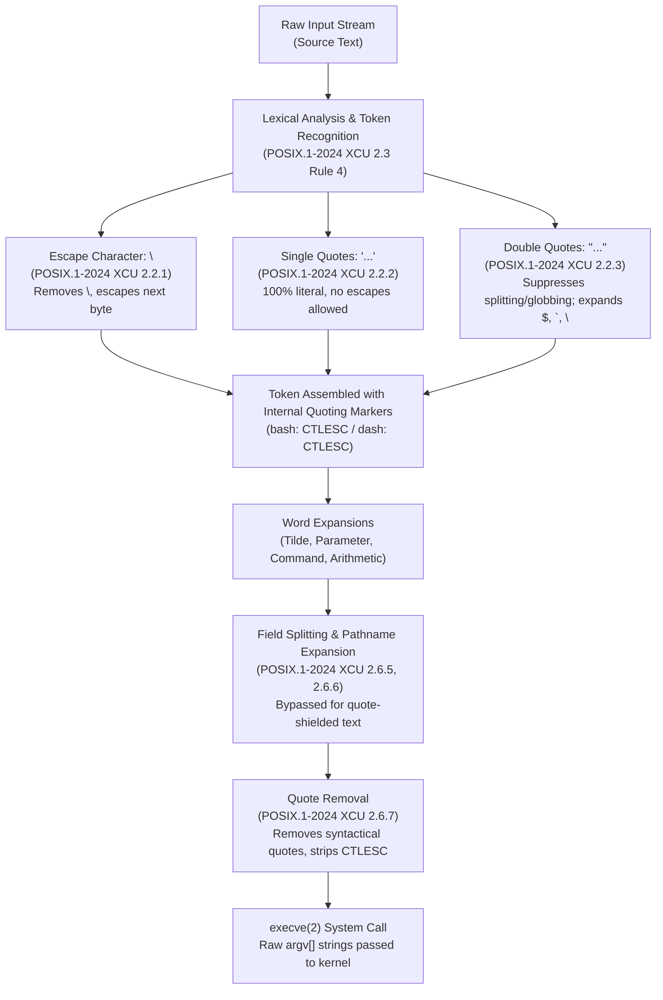

# Quoting: Backslash, Single, and Double Quotes

> [!summary] Claim
> Shell quoting controls lexical analysis and word expansion by selectively suppressing metacharacter interpretation, isolating literal byte strings until quote removal executes prior to the `execve(2)` system call.

Part of [The POSIX Shell Language](README.md) in [Shell and Unix Engineering](../README.md).

## TL;DR

- Mechanism: Quoting instructs the shell lexical analyzer to shield metacharacters from operator classification and word splitting using internal escape markers that persist until quote removal strips the syntax before `execve(2)`.
- Rule: Single quotes `'...'` preserve every character literally with no escape mechanism possible, double quotes `"..."` preserve literal strings while permitting parameter, command, and arithmetic substitutions, and backslashes `\` escape the following byte or join lines.
- Trap: Unquoted parameter expansions like `$var` undergo field splitting and pathname globbing, whereas double-quoted expansions `"$var"` retain exact byte values and prevent argument injection.
- Portability fact: POSIX.1-2024 leaves `$"string"` unspecified (XCU 2.6: an unquoted `$` followed by a character outside the listed set), and the shell matrix splits on it: dash, posh, yash, BusyBox ash, and zsh keep a literal `$` before `string`, GNU bash and AT&T ksh93 treat `$"string"` as a translatable double-quoted string, and MirBSD mksh simply ignores the `$` (`mksh(1)`).
- When not to use it: Do not quote word boundaries when field splitting or pathname globbing is intentionally required, and avoid string concatenation when passing untrusted inputs across process boundaries.

## Mental model



During lexical analysis, the shell reads the raw character stream and applies token recognition rules to classify characters into operators and words.
When the lexer encounters an unquoted backslash, single quote, or double quote, Rule 4 of token recognition suppresses delimiter interpretation and tags the enclosed characters with internal quote markers.
Single quotes preserve the absolute literal byte sequence up to the next single quote without exception.
Double quotes preserve literal spaces and glob characters while allowing parameter, command, and arithmetic substitutions to execute.
The resulting expanded words undergo field splitting and pathname expansion, which skip all quote-protected text.
Finally, quote removal strips the original syntactical quote characters and internal escape flags, leaving bare, unescaped string payloads that are packed into the null-terminated `argv[]` array passed directly to `execve(2)`.

## How it works

### 1. Lexical Analysis and Token Recognition

The POSIX shell parses input lines into tokens according to POSIX.1-2024 XCU 2.3.
When the parser processes a character, it applies the first applicable rule out of ten numbered rules, checked in order.
Under Rule 4, if the current character is an unquoted `<backslash>`, single-quote, or double-quote (or the first character of an unquoted `$'` sequence), it alters the quoting state for subsequent characters until the matching quote terminates.
During this lexical phase, the shell performs no substitutions.
The tokens retain their quoting characters intact so downstream expansion stages know precisely which characters were protected.
Under Rule 7, an unquoted `<blank>` (`<space>` or `<tab>`) delimits the current word token and is discarded.
Enclosing blanks within quotes prevents Rule 7 from triggering, allowing arguments containing whitespace to remain a single token.
Under Rule 8, characters following an unquoted word are appended to that word.
This allows adjacent quoted and unquoted strings to concatenate directly into one word without whitespace separators.

### 2. Escape Character Mechanics (Backslash)

According to POSIX.1-2024 XCU 2.2.1, an unquoted backslash `\` preserves the literal value of the following character, with the sole exception of `<newline>`.
When `<newline>` immediately follows an unquoted backslash, the shell treats it as line continuation.
The shell discards both the backslash and the newline before splitting input into tokens.
Because the line continuation sequence is removed entirely without inserting whitespace, it cannot serve as a token separator.
For example, the input `com\<newline>mand` forms the single token `command`.
When an unquoted backslash precedes any other character outside quotes, the backslash protects that single character from being treated as an operator, glob wildcard, or field delimiter.
During the subsequent quote removal stage, the shell discards the escaping backslash and retains the literal character.

Inside double quotes, POSIX.1-2024 XCU 2.2.3 strictly limits the escaping power of the backslash.
Outside `$(...)` and `${...}`, the backslash retains its special escape meaning only when immediately followed by one of five characters:
`$`, `` ` ``, `\`, `<newline>`, or a `"` that would otherwise be special (the specification lists the first four and adds the double-quote as a separate case).
When followed by `<newline>`, the shell removes both characters as line continuation.
When followed by `$`, `` ` ``, `\`, or `"`, the backslash is removed and the following character is treated literally.
When a backslash inside double quotes is followed by any other character, POSIX requires that the backslash retain its literal value.
Consequently, `"\*"` produces the literal two-character string `\*`, and `"\a"` produces `\a`.
This contrasts sharply with C string literals, where `\n` denotes a newline byte; in shell double quotes, `"\n"` produces the two-byte literal sequence `\` and `n`.

### 3. Single-Quote Mechanics

POSIX.1-2024 XCU 2.2.2 establishes the single-quote rule:
Enclosing characters in single-quotes `''` preserves the literal value of every character within the quotes.
A single-quote cannot occur within single-quotes under any circumstances.
Backslashes inside single quotes have no special escaping properties and are preserved literally.
Even a backslash followed immediately by a newline inside single quotes does not act as line continuation; both bytes are preserved literally in the token.
Because a single quote cannot be escaped inside single quotes, passing a literal single quote within a single-quoted structure requires leaving the quote context.
Engineers use the juxtaposition idiom: `'foo'\''bar'`.
This sequence consists of three adjacent lexical elements:
First, the single-quoted string `'foo'`.
Second, the unquoted escaped single-quote `\'`, which evaluates to a literal single-quote byte.
Third, the single-quoted string `'bar'`.
Because no whitespace separates these elements, Rule 8 concatenates them into the single word `foo'bar`.

### 4. Double-Quote Mechanics and Expansions

POSIX.1-2024 XCU 2.2.3 defines double-quoting as selective quoting.
Double quotes preserve the literal value of all characters within them, except for `$`, `` ` ``, and `\`.
The `<dollar-sign>` retains its special meaning for introducing parameter expansion (`$var`, `${var}`), command substitution (`$(cmd)`), and arithmetic expansion (`$((expr))`).
Crucially, POSIX.1-2024 specifies that `$` inside double quotes does not retain its meaning for introducing dollar-single-quotes (`$'...'`).
Within double quotes, `"$'\t'"` is parsed as literal characters `$'\t'`, rather than evaluating to an ASCII horizontal tab.

Command substitution inside double quotes exhibits a major structural advantage when using `$()` compared to legacy backticks `` `...` ``.
Under POSIX.1-2024 XCU 2.2.3, characters enclosed between `"$("` and the matching `')'` are parsed by applying token recognition recursively.
Enclosing double quotes have no effect on syntax inside `"$()"`.
Double quotes may be nested cleanly inside the inner command without backslash escaping: `"$(echo "inner")"` produces `inner`.
Because the inner command string is parsed recursively as an independent program, writing an escaped quote `\"` inside `"$()"` evaluates to an unquoted backslash-quote, producing a literal double quote in the command payload: `"$(echo \"inner\")"` evaluates to `"inner"`.
Conversely, legacy backtick substitution `` `...` `` does not parse recursively.
Within legacy backticks, POSIX.1-2024 XCU 2.2.3 and 2.6.3 specify that backslashes retain escape meaning only when followed by `$`, `` ` ``, or `\`.
Nesting backticks requires preceding the inner backticks with backslashes, such as the lab's ```eval 'res_backtick="nested `printf %s \`printf %s inner\``"'```, and every further level doubles the escaping: a backtick nested `k` levels inside the outermost one needs `2^k - 1` backslashes (1, 3, 7), as the lab's ```eval 'res_backtick3=`echo 1 \`echo 2 \\\`echo 3\\\`\``'``` shows for `k = 2`.

Double-quoting parameter expansions suppresses field splitting and pathname expansion on the expanded value.
Under POSIX.1-2024 XCU 2.6.5, field splitting applies only to the results of parameter expansions, command substitutions, and arithmetic expansions that did not occur within double-quotes.
When double-quoted, expansions preserve all internal whitespace, tabs, and newlines exactly as stored in memory.

### 5. Special Parameters: `"$@"` versus `"$*"`

The interaction between double quotes and positional parameters is specified in POSIX.1-2024 XCU 2.5.2.
When the special parameter `@` appears within double quotes, `"$@"` expands to separate fields, one for each positional parameter: `"$1"` `"$2"` `...` `"$n"`.
Each positional parameter is passed as an individual, intact argument to the target command, completely immune to field splitting and pathname globbing.
If there are no positional parameters, `"$@"` expands to zero fields.
Under the `set -u` description in POSIX.1-2024 (XCU 2.15 Special Built-In Utilities, `set`), special parameters `@` and `*` are exempt from `-u` (`nounset`) errors when positional parameters are empty.
However, in `posh` 0.14.1, an engine bug (Debian Bug #913718, reported in 2018 against posh 0.13.2 and still reproduced in 0.14.1 in the shell matrix) causes expanding `"$@"` or `"$*"` with zero positional parameters under `set -u` to abort with `@: parameter not set` or `*: parameter not set`.
Portable shell scripts defensively guard positional parameters with `${1+"$@"}` to avoid this failure mode.
Conversely, `"$*"` expands to a single field consisting of all positional parameters joined together.
The parameters are separated by the first character of the `IFS` variable.
If `IFS` is unset, POSIX specifies that the parameters are separated by `<space>`.
If `IFS` is set to the empty string (`IFS=""`), the parameters are concatenated with no separator characters whatsoever.
In AT&T `ksh93u+m` 1.0.10, expanding `"$*"` under null `IFS` when a positional parameter is empty erroneously inserts a literal backslash `0x5c` (`a\b`), a defect introduced on 2022-07-28 and fixed upstream on 2025-03-21 (ksh93u+m `NEWS`).

### 6. Engine Implementation Details

In GNU bash, lexical analysis occurs in `parse.y` via `read_token()` and `read_token_word()`.
When bash scans quoting characters, it invokes `parse_matched_pair()` to collect the quoted span.
During word expansion in `subst.c`, bash handles quoting using internal escape byte markers defined in `syntax.h`:
`CTLESC` (ASCII value `0x01`) and `CTLNUL` (ASCII value `0x7F`).
When a character was protected by quotes, `expand_word_internal()` prefixes the byte with `CTLESC`.
If an expansion results in an empty quoted string (such as `""` or `''`), bash inserts a `CTLNUL` marker so that downstream processing recognizes the argument as an existing, non-empty field descriptor rather than discarding it.
During quote removal in `subst.c`, `string_quote_removal()` and `dequote_string()` strip all `CTLESC` prefixes and `CTLNUL` markers.

In the Debian Almquist Shell (`dash`), the lexical analyzer in `parser.c` uses `readtoken()` and `readtoken1()`, reading characters through `pgetc()` from `input.c`.
When dash scans double quotes, it marks the segment using internal control tokens like `CTLQUOTEMARK` and escapes characters using `CTLESC`.
During expansion in `expand.c`, `argstr()` processes expansions and preserves quoted markers.
Finally, `rmescapes()` (a macro in `expand.h` for `_rmescapes()` in `expand.c`) scans the string, strips `CTLESC` and `CTLQUOTEMARK` bytes, and compresses the string in place using `memmove(3)`.

### 7. Quote Removal and Kernel Invocation

Quote removal is the final step in shell word expansion, defined in POSIX.1-2024 XCU 2.6.7.
Quote removal deletes all unquoted single-character quote characters (`\`, `'`, `"`) and `$'` sequences that were present in the original input word.
Quote removal does not touch quote characters that were produced by variable expansion or command substitution.
For example, if `var='"foo"'`, running `echo $var` prints `"foo"` with literal quotation marks, because those quotation marks were not present in the original command word.
After quote removal completes, the shell prepares the null-terminated array of pointers (`char *const argv[]`).
The shell invokes the `execve(2)` system call, passing `argv[]` directly into kernel space.
The kernel receives raw byte sequences without any knowledge of shell quotation syntax.

## Numbers and limits

| Metric / Parameter | Value | Standard / Source | Verification Source |
|---|---|---|---|
| Unconditionally special metacharacters requiring quoting | 15 characters (`\|`, `&`, `;`, `<`, `>`, `(`, `)`, `$`, `` ` ``, `\`, `"`, `'`, `<space>`, `<tab>`, `<newline>`) | POSIX.1-2024 XCU 2.2 | POSIX standard specification |
| Conditionally special characters requiring situational quoting | 14 characters (`*`, `?`, `[`, `]`, `^`, `-`, `!`, `#`, `~`, `=`, `%`, `{`, `,`, `}`) | POSIX.1-2024 XCU 2.2 | POSIX standard specification |
| Characters retaining escape meaning after backslash in `""` | 5 characters (`$`, `` ` ``, `\`, `<newline>`, and `"` where it would otherwise be special) | POSIX.1-2024 XCU 2.2.3 | `$`, `"`, and `<newline>` measured in lab (`quote-probe.bats`); `` ` `` and `\` from the specification |
| Line continuation byte reduction | 2 bytes removed (`0x5c 0x0a`), 0 bytes inserted | POSIX.1-2024 XCU 2.2.1 | Measured in lab (`quote-probe.bats`) |
| Linux per-argument string limit (`MAX_ARG_STRLEN`) | 131,072 bytes (128 KiB; 32 pages on 4 KiB page size) | Linux 2.6.23 and later (as of 2026-10) | `include/uapi/linux/binfmts.h` / `man 2 execve` |
| macOS total argument space (`NCARGS` / `_SC_ARG_MAX`) | 1,048,576 bytes (1 MiB) | macOS Darwin 27.2 arm64 (as of 2026-10) | `getconf ARG_MAX` and `sysctl kern.argmax` measured on the matrix host (as of 2026-10) |
| Linux POSIX default total argument limit (`ARG_MAX`) | 2,097,152 bytes (2 MiB; 1/4 of the default 8 MiB stack limit) | Linux kernel (as of 2026-10) | `getconf ARG_MAX` with `ulimit -s` 8192 measured in the Debian 13 matrix image (as of 2026-10) |
| Nested backtick backslash scaling factor | `2^k - 1` backslashes before a backtick nested `k` levels inside the outermost one (1, 3, 7, ...) | POSIX.1-2024 XCU 2.6.3 (each level removes one layer of `\\` and `` \` `` escapes) | `k = 1` and `k = 2` measured in lab; `k = 3` (7 backslashes) measured by hand in every matrix shell |
| Quoted empty string argument retention count | 1 field for `"$empty"` versus 0 fields for `$empty` | POSIX.1-2024 XCU 2.6.5 | Measured in lab (`quote-probe.bats`) |
| Bash internal quote-protection memory overhead | 1 byte (`CTLESC` = `0x01`) per escaped byte (up to 2x memory) | `bash-5.3 syntax.h` defines `CTLESC`; `subst.c` inserts it (as of 2026-10) | GNU bash source code verification |

## Portability

The table below contrasts quoting behaviors and divergences across shells and environments verified in the shell matrix.
Every row except `'foo\'bar'` and the exact error texts is asserted by the lab; the `'foo\'bar'` row and the arithmetic error messages were measured by hand in the same matrix shells (as of 2026-10), and the POSIX sh column cites the specification.

| Quoting Construct | POSIX sh | macOS bash 3.2 | Current bash 5.3 | zsh (native) | zsh (`--emulate sh`) | dash | ksh93 | mksh | yash | posh | BusyBox ash |
|---|---|---|---|---|---|---|---|---|---|---|---|
| `\<newline>` inside `""` | Stripped | Stripped | Stripped | Stripped | Stripped | Stripped | Stripped | Stripped | Stripped | Stripped | Stripped |
| `\<newline>` inside `''` | Preserved | Preserved | Preserved | Preserved | Preserved | Preserved | Preserved | Preserved | Preserved | Preserved | Preserved |
| `"\*"` inside `""` | Literal `\*` | Literal `\*` | Literal `\*` | Literal `\*` | Literal `\*` | Literal `\*` | Literal `\*` | Literal `\*` | Literal `\*` | Literal `\*` | Literal `\*` |
| `'foo\'bar'` | Syntax error | Syntax error | Syntax error | Syntax error | Syntax error | Syntax error | Syntax error | Syntax error | Syntax error | Syntax error | Syntax error |
| `$"hello"` translation | Unspecified (XCU 2.6) | Translated `hello` | Translated `hello` | Literal `$hello` | Literal `$hello` | Literal `$hello` | Translated `hello` | `$` ignored: `hello` | Literal `$hello` | Literal `$hello` | Literal `$hello` |
| `x=""; set -- $x` count | 0 fields | 0 fields | 0 fields | 0 fields | 0 fields | 0 fields | 0 fields | 0 fields | 0 fields | 0 fields | 0 fields |
| `set -u; set --; echo "$@"` | 0 fields | 0 fields | 0 fields | 0 fields | 0 fields | 0 fields | 0 fields | 0 fields | 0 fields | Error: `@: parameter not set` | 0 fields |
| `IFS=""; set -- a "" b; echo "$*"` | `ab` | `ab` | `ab` | `ab` | `ab` | `ab` | `a\b` in ksh93u+m 1.0.10 | `ab` | `ab` | `ab` | `ab` |
| `$(( "1 + 2" ))` quotes | `"` not special inside the expression (XCU 2.6.4), so not a valid expression | Error: `operand expected` | Evaluates 3 | Evaluates 3 | Evaluates 3 | Error: `expecting primary` | Evaluates 3 | Error: `unexpected '"'` | Error: `arithmetic: '"' is not a valid number or operator` | Error: `unexpected '"'` | Error: `arithmetic syntax error` |
| `$(echo "inner")` nested quotes | Valid | Valid | Valid | Valid | Valid | Valid | Valid | Valid | Valid | Valid | Valid |

## Worked example

The following script is a simplified excerpt of `quote-probe.sh` from the [lab](../labs/03-quoting-backslash-single-and-double/), demonstrating quoting mechanics, backslash retention, and argument array preservation down to `execve(2)`:

```sh
#!/bin/sh
# quote-probe.sh: probe shell quoting semantics across backslash, single, and double quotes.
set -eu

mode="${1:-help}"
shift || true

case "$mode" in
  count-args)
    printf 'count=%d\n' "$#"
    printf 'args:'
    for arg in "$@"; do
      printf ' <%s>' "$arg"
    done
    printf '\n'
    ;;

  backslash-escapes)
    u_star=\*
    dq_star="\*"
    dq_dollar="\$"
    dq_a="\a"
    dq_quote="\""
    dq_n="\n"

    printf 'unquoted_star: <%s>\n' "$u_star"
    printf 'dq_star: <%s>\n' "$dq_star"
    printf 'dq_dollar: <%s>\n' "$dq_dollar"
    printf 'dq_a: <%s>\n' "$dq_a"
    printf 'dq_quote: <%s>\n' "$dq_quote"
    printf 'dq_n: <%s>\n' "$dq_n"
    ;;

  line-continuation)
    # Line continuation: unquoted, double-quoted, single-quoted.
    # The unquoted case is an eval string because shfmt joins an unquoted continuation.
    val_unquoted=''
    eval 'val_unquoted=first\
second'

    val_dq="first\
second"

    val_sq='first\
second'

    printf 'unquoted: <%s>\n' "$val_unquoted"
    printf 'double_quoted: <%s>\n' "$val_dq"
    printf 'single_quoted: <%s>\n' "$val_sq"
    ;;

  empty-retention)
    empty_var=""
    # shellcheck disable=SC2086 # SC2086 intentionally unquoted to test field splitting
    set -- $empty_var
    unquoted_cnt="$#"

    # shellcheck disable=SC2248 # Explicitly testing quoted expansion
    set -- "$empty_var"
    quoted_cnt="$#"

    printf 'unquoted_count=%d\n' "$unquoted_cnt"
    printf 'quoted_count=%d\n' "$quoted_cnt"
    ;;

  subst-nesting)
    # Nested quotes inside $() vs backticks
    res_dollar="$(printf '%s' "nested $(printf '%s' "inner")")"
    res_dollar_escaped="$(printf '%s' "nested $(printf '%s' \"inner\")")"
    # Real nested backticks: depth 2 needs 1 backslash, depth 3 needs 3.
    # The backticks live in eval strings because shfmt rewrites backticks as $(...).
    res_backtick='' res_backtick3=''
    # shellcheck disable=SC2016 # backticks are expanded by eval, not here
    eval 'res_backtick="nested `printf %s \`printf %s inner\``"'
    # shellcheck disable=SC2016 # backticks are expanded by eval, not here
    eval 'res_backtick3=`echo 1 \`echo 2 \\\`echo 3\\\`\``'

    printf 'dollar_subst: <%s>\n' "$res_dollar"
    printf 'dollar_escaped: <%s>\n' "$res_dollar_escaped"
    printf 'backtick_subst: <%s>\n' "$res_backtick"
    printf 'backtick_depth3: <%s>\n' "$res_backtick3"
    ;;

  *)
    printf 'Usage: quote-probe.sh <mode> [args...]\n' >&2
    exit 1
    ;;
esac
```

Executing `quote-probe.sh` with the lab harness produces the following captured outputs:

```console
$ ./quote-probe.sh count-args "first item" "" "*"
count=3
args: <first item> <> <*>

$ ./quote-probe.sh backslash-escapes
unquoted_star: <*>
dq_star: <\*>
dq_dollar: <$>
dq_a: <\a>
dq_quote: <">
dq_n: <\n>

$ ./quote-probe.sh line-continuation
unquoted: <firstsecond>
double_quoted: <firstsecond>
single_quoted: <first\
second>

$ ./quote-probe.sh empty-retention
unquoted_count=0
quoted_count=1

$ ./quote-probe.sh subst-nesting
dollar_subst: <nested inner>
dollar_escaped: <nested "inner">
backtick_subst: <nested inner>
backtick_depth3: <1 2 3>
```

Executing the lab's C probe binary `argv-dump` proves that quote removal occurs entirely inside the shell process prior to the `execve(2)` system call:

```console
$ ./argv-dump "hello world" 'single' "empty:" "" "has space"
argc=6
argv[1]: len=11 data=<hello world>
argv[2]: len=6 data=<single>
argv[3]: len=6 data=<empty:>
argv[4]: len=0 data=<>
argv[5]: len=9 data=<has space>
```

## Pitfalls

> [!warning] Accidental literal backslashes inside double quotes
> Trigger: Writing Windows-style directory paths like `"C:\work\notes"` or regex patterns like `"grep \"\*.txt\""` inside double quotes.
> Symptom: The shell preserves the backslash literally before characters other than `$`, `` ` ``, `\`, `"`, or `<newline>`, resulting in strings like `C:\work\notes` and `\*.txt` being passed to utilities.
> Fix: Use single quotes `'C:\work\notes'` for raw strings, or escape each backslash explicitly as `"C:\\work\\notes"`.

> [!warning] Lexical parser state corruption via escaped line terminators (CVE-2014-7169)
> Trigger: Passing malformed function definitions with trailing backslashes and redirection operators, such as `() { (a)=>\` in environment variables.
> Symptom: In GNU Bash versions vulnerable to CVE-2014-7169 (the incomplete fix for Shellshock CVE-2014-6271), `reset_parser()` failed to clear the static `eol_ungetc_lookahead` buffer in `parse.y`.
> The unconsumed redirection operator was injected into the subsequent command line, redirecting command output into arbitrary files named after command binaries.
> Fix: Upgrade to Bash 4.3 patch 26 (`bash43-026`) or higher, which adds `eol_ungetc_lookahead = 0` to `reset_parser()` so a saved lookahead character cannot leak into the next line.

> [!warning] Option injection through an argument that starts with a hyphen (CVE-2017-1000117)
> Trigger: Passing attacker-controlled text as an operand to a utility that parses options, as Git did when it handed the host part of a crafted `ssh://-oProxyCommand=.../` URL to `ssh`.
> Symptom: The client reads the value as an option such as `-oProxyCommand=...` rather than as a host operand, and NVD records that visiting the URL (for example through `git clone --recurse-submodules` on a malicious `.gitmodules`) can run any program on the victim's machine.
> Quoting does not help here: `"$host"` is still a single argument that begins with `-`.
> Fix: Double-quote the expansion to keep it one argument, put the end-of-options delimiter `--` before operands where the utility supports it (`-- "$host"`), and reject values that begin with `-` when it does not.

> [!warning] Regex-based quoting filters that miss a metacharacter (CVE-2016-10541 and CVE-2021-42740)
> Trigger: Relying on an application-layer escaping library built from regular expressions, such as the npm `shell-quote` package, to sanitize arguments before shell concatenation.
> Symptom: Any metacharacter the regex misses reaches the shell unescaped: `shell-quote` 1.6.0 and earlier did not escape `<` and `>` (CVE-2016-10541), and versions before 1.7.3 used the class `[A-z]`, which also matches the backtick and other characters between `Z` and `a` (CVE-2021-42740).
> The same holds for a raw newline that slips through a filter: the parser treats an unquoted newline as a command terminator and runs whatever follows it.
> Fix: Bypass the shell string evaluator entirely by invoking binaries directly with structured argument arrays using `execve(2)` wrapper APIs like `subprocess.run(["cmd", arg])`.

> [!warning] Exponential escaping escalation in legacy backtick substitutions
> Trigger: Nesting command substitutions inside legacy backticks, such as ```res=`echo 1 \`echo 2 \\\`echo 3\\\`\`` ```.
> Symptom: Each backtick level removes one layer of `\\` and `` \` `` escapes before the inner text is parsed, so a backtick nested `k` levels deep needs `2^k - 1` backslashes; the shell matrix gave identical results in every shell for `k` up to 3, so the failure is human, not a shell divergence: one miscounted backslash silently changes which backtick closes which substitution.
> Fix: Replace all legacy backticks with standard POSIX `$()` command substitution, which tokenizes nested blocks recursively without requiring backslash escapes.

> [!warning] Script abortion under set -u with empty positional parameters in posh (Debian Bug #913718)
> Trigger: Evaluating `"$@"` or `"$*"` under `set -u` (or `set -o nounset`) when no positional parameters are set (`$# == 0`).
> Symptom: In `posh` 0.14.1, execution terminates abnormally with exit code 1 and `@: parameter not set` or `*: parameter not set`, violating the `set -u` exemption for `@` and `*` in POSIX.1-2024 (XCU 2.15, `set`).
> Fix: Guard positional parameter expansion with the historical parameter default idiom `${1+"$@"}` when scripts must run under `posh`.
> `${@:-}` also avoids the abort in posh 0.14.1 (measured in the shell matrix), but it is unquoted, so it re-splits and globs every argument; prefer `${1+"$@"}`.

> [!warning] Non-portable locale translation syntax ($"...")
> Trigger: Using `$"..."` for localized string literals in scripts executed across diverse shell implementations.
> Symptom: In GNU Bash and AT&T ksh93, `$"string"` expands as `"string"` (or translated text), and MirBSD mksh ignores the `$` (`mksh(1)`), whereas in dash, posh, yash, BusyBox ash, and zsh, it expands to literal `$string` (measured in the shell matrix); POSIX.1-2024 leaves the form unspecified (XCU 2.6).
> Fix: Use standard `gettext` or `eval_gettext` utilities instead of relying on the non-standard `$"..."` shell syntax.

> [!warning] Null IFS parameter joining corruption in ksh93u+m 1.0.10
> Trigger: Expanding `"$*"` under `IFS=""` when any positional parameter is empty in ksh93u+m 1.0.10.
> Symptom: The shell erroneously inserts an escaped backslash byte (`0x5c`) into the result string (`a\b` instead of `ab`).
> Fix: Avoid relying on `"$*"` with null `IFS` when empty arguments may occur; loop over `"$@"` or concatenate explicit parameter variables.

## Security and robustness

The core invariant of secure shell engineering states:
Untrusted data must never undergo shell parsing or word expansion without quoting.
When a variable expansion like `$input` is left unquoted, the shell executes Field Splitting (POSIX.1-2024 XCU 2.6.5) and Pathname Expansion (POSIX.1-2024 XCU 2.6.6) on the resulting text.
If `$input` contains whitespace, the text splinters into multiple discrete command arguments.
If `$input` contains glob characters (`*`, `?`, `[`), the shell queries the local filesystem and replaces the string with matching pathnames.
If no files match and `nullglob` is disabled, the literal pattern remains, producing non-deterministic runtime behavior depending on current working directory contents.

To construct robust production shell code:
1. Double-quote every variable expansion by default: `"$var"`.
2. Forward positional parameter arrays strictly with `"$@"`.
Never use `"$*"` for argument delegation, as `"$*"` flattens distinct arguments into a single joined string.
3. Protect default values inside parameter expansions: `"${var:-"default"}"`.
4. Disarm option parsing on utilities: always place `--` before positional arguments (`rm -- "$file"`, `grep -- "$pattern" "$file"`).
Without `--`, a filename like `-rf` is interpreted by `rm` as flags rather than a target path.
5. In case statements, quote pattern variables to force exact string matching:
```sh
case "$input" in
  "$expected") echo "exact match" ;;
  *) echo "mismatch" ;;
esac
```
Unquoted `$expected` would be compiled as a wildcard pattern, allowing an input of `*` to match any string.

## The principal's view

A staff-plus engineer treats shell quoting not as a set of syntactic conventions, but as the boundary between a structured execution model and a string-interpolation macro processor.
The Unix shell is fundamentally a command language designed for interactive job control and pipeline execution.
Because its core syntax operates via iterative text substitution rather than typed abstract syntax trees, string quoting is the sole mechanism that prevents data from being re-interpreted as code.

The architectural decision framework:
1. Enforce automated static analysis: Mandate `shellcheck` in CI with optional rules `quote-safe-variables` (SC2248) and `check-extra-masked-returns` (SC2312) enabled.
Treat any unquoted parameter expansion as a critical build failure unless accompanied by an explicit inline disable justifying intentional word splitting.
2. The 100-line threshold: When a shell script exceeds 100 lines, requires complex array manipulation, or processes untrusted inputs from network APIs, deprecate the shell script.
Rewrite the utility in Python, Go, or Rust.
3. Eliminate shell interpolation in process orchestration: In orchestration engines, CI/CD pipelines, and web backend wrappers, never construct shell commands via string concatenation.
Invoke kernel process execution APIs directly (`posix_spawnp`, `execve`, Go `exec.Command(binary, arg1, arg2)`, or Python `subprocess.run([binary, arg1, arg2], shell=False)`).
Eliminating the shell interpreter eliminates quoting bugs entirely.
4. Defensively guard shell matrix edge cases: In scripts targeting minimal base images, policy linters, or container entrypoints, defensively guard against implementation defects such as `posh` failing on empty `"$@"` under `set -u` by using `${1+"$@"}`.

## Interview questions

> [!question] L5: Predict the output
> What does the following POSIX script print, and why?
> ```sh
> x="a  b"
> set -- $x "$x"
> printf '%d: <%s> <%s> <%s>\n' "$#" "$1" "$2" "$3"
> ```
>
> > [!success]- Answer
> > The script outputs `3: <a> <b> <a  b>`.
> > The unquoted expansion `$x` undergoes field splitting under the default `IFS` space delimiter, producing two separate positional arguments `a` and `b`.
> > The double-quoted expansion `"$x"` suppresses field splitting and preserves the internal double space, producing the single third argument `a  b`.
> > The parameter count `$#` equals 3, and `printf` formats all three arguments into their respective angle brackets.
> >
> > Follow-up: What would native zsh output if `SH_WORD_SPLIT` is not set?

> [!question] L5: Single-quote escaping
> Why does `'foo\'bar'` trigger a shell syntax error, and how must a portable POSIX script represent a literal single quote within a single-quoted word?
>
> > [!success]- Answer
> > POSIX.1-2024 XCU 2.2.2 dictates that single quotes preserve the literal value of all characters and that a single-quote cannot occur within single-quotes.
> > The backslash inside single quotes has no special escaping meaning, so `'foo\'` is parsed as a closed single-quoted string `foo\`, followed by the unquoted characters `bar` and then a final single quote that opens a new quoted string which is never closed.
> > A script therefore fails with an unterminated-quote syntax error at end of input in every matrix shell (for example dash prints `Syntax error: Unterminated quoted string`), while an interactive shell waits for a continuation line.
> > To portably include a single quote, the script must exit single quotes, emit an escaped single quote, and resume single quotes: `'foo'\''bar'`.
> > Alternatively, POSIX.1-2024 permits dollar-single-quote syntax `$'foo\'bar'` or double-quoted single quotes `"foo'bar"`.
> >
> > Follow-up: What does a backslash followed by a newline produce inside single quotes?

> [!question] L6: Backslash retention in double quotes
> Explain why `"\*"` evaluates to `\*` while `"\$"` evaluates to `$` inside double quotes, citing POSIX.1-2024 rules.
>
> > [!success]- Answer
> > POSIX.1-2024 XCU 2.2.3 states that inside double quotes, the backslash retains its special meaning as an escape character only when followed by `$`, `` ` ``, `\`, `"`, or `<newline>`.
> > Because `$` is in this designated escape set, `"\$"` strips the backslash during quote removal and produces the literal character `$`.
> > Because `*` is not in this designated escape set, the backslash retains its literal value and is not removed during quote removal, producing `\*`.
> > Outside double quotes, POSIX.1-2024 XCU 2.2.1 applies, where an unquoted backslash escapes any character, causing unquoted `\*` to produce `*`.
> >
> > Follow-up: What does `"\n"` evaluate to inside double quotes in a POSIX shell?

> [!question] L6: Quote removal timing
> How does quote removal handle quote characters generated by parameter expansion compared to quotes present in the original command line?
>
> > [!success]- Answer
> > POSIX.1-2024 XCU 2.6.7 specifies that quote removal removes only quote characters that were present in the original word.
> > Quote characters resulting from the expansion of parameters or command substitutions are never removed by quote removal.
> > For example, if variable `v` contains `"hello"`, executing `echo $v` prints `"hello"` with the literal quotes intact.
> > The shell tracks quote provenance using internal control markers so that expanded data cannot generate syntactical quotes without explicit `eval`.
> >
> > Follow-up: Why is this distinction vital for shell security when processing untrusted inputs?

> [!question] L6: Debug this script
> Identify the quoting and security vulnerabilities in the following script and provide the corrected POSIX-compliant implementation:
> ```sh
> pattern=$1
> shift
> for file in "$@"; do
>   grep "$pattern" $file
> done
> ```
>
> > [!success]- Answer
> > The parameter `$file` is unquoted in `grep "$pattern" $file`, causing field splitting and glob expansion on filenames containing spaces or wildcards.
> > If a filename or pattern begins with a hyphen `-`, `grep` will interpret it as an option flag rather than an operand.
> > If the script is called with no arguments at all, `shift` fails: `shift` is a special built-in, so POSIX.1-2024 (XCU 2.8.1) makes its error fatal in a non-interactive shell, and in the shell matrix dash, posh, ksh93, and mksh exit there, while bash (even in POSIX mode), BusyBox ash, yash, and zsh return a nonzero status and continue with an empty pattern.
> > The corrected POSIX script is:
> > ```sh
> > [ "$#" -ge 1 ] || exit 1
> > pattern=$1
> > shift
> > for file in "$@"; do
> >   grep -e "$pattern" -- "$file"
> > done
> > ```
> >
> > Follow-up: How would you optimize this loop to avoid spawning a separate `grep` process for each file?

> [!question] L6: Parameter joining mechanics
> Describe the exact expansion differences between `"$*"` and `"$@"` under default `IFS`, a custom colon `IFS`, and null `IFS`.
>
> > [!success]- Answer
> > Under default `IFS` (`<space><tab><newline>`), `"$*"` joins all positional parameters into a single string separated by spaces, whereas `"$@"` expands to distinct positional arguments.
> > Under `IFS=":"`, `"$*"` joins the positional parameters separated by colons into one argument, while `"$@"` still produces individual, unjoined arguments.
> > Under null `IFS` (`IFS=""`), `"$*"` concatenates all positional parameters with no separator into a single argument, while `"$@"` remains completely unaffected and yields distinct fields.
> > When there are zero positional parameters, `"$*"` produces a single empty field in any context (`set --; set -- "$*"` leaves `$#` at 1 in every matrix shell), but `"$@"` expands to zero fields.
> > Under `set -u`, POSIX specifies (in the `set` utility) that expanding an empty `"$@"` or `"$*"` succeeds without error, but `posh` 0.14.1 aborts with an unbound variable error (Debian Bug #913718).
> >
> > Follow-up: What known divergence occurs in ksh93u+m 1.0.10 when expanding `"$*"` under null `IFS` with an empty positional parameter?

> [!question] L7+: Internal engine representation
> How do GNU Bash and Almquist Shell (`dash`) internally represent quoted strings during word expansion to ensure proper field splitting and quote removal?
>
> > [!success]- Answer
> > GNU Bash uses byte-level escape injection in `subst.c`, prefixing quote-shielded characters with `CTLESC` (`0x01`).
> > Bash inserts `CTLNUL` (`0x7F`) to represent empty quoted strings so that empty fields survive field splitting without being discarded as empty unquoted tokens.
> > In `dash`, `parser.c` inserts control characters like `CTLQUOTEMARK` and `CTLESC` into the string being built on dash's own stack allocator.
> > During field splitting, bash's `string_extract_verbatim()` in `subst.c` skips the byte that follows each `CTLESC`, so a quoted `IFS` character never splits; dash instead records only the byte ranges produced by unquoted expansions (`recordregion()` in `expand.c`), and `ifsbreakup()` splits only inside those ranges.
> > Quote removal in both shells performs a linear scan over the string buffer, removing the markers in place (`CTLESC` and `CTLNUL` in bash, `CTLESC` and `CTLQUOTEMARK` in dash) before building the final `argv[]` array.
> >
> > Follow-up: How do these internal byte markers avoid colliding with valid binary data in variables containing arbitrary bytes?

> [!question] L7+: Parser lookahead vulnerability (CVE-2014-7169)
> Detail the root cause of CVE-2014-7169 in GNU Bash, explaining how quoting, line continuation, and lexical lookahead buffers interacted to permit arbitrary file redirection.
>
> > [!success]- Answer
> > CVE-2014-7169 occurred because the initial Shellshock patch for CVE-2014-6271 failed to cleanly reset parser state upon encountering a syntax error in an exported function definition.
> > An attacker supplied an environment variable containing an invalid function declaration ending with a trailing backslash and redirection operator: `() { (a)=>\`.
> > In `parse.y`, the lexical analyzer stored the lookahead character `>` in the static variable `eol_ungetc_lookahead`.
> > When the parser threw a syntax error, `reset_parser()` failed to reset `eol_ungetc_lookahead` to zero; the `bash43-026` patch adds exactly that reset ("bash can incorrectly save a lookahead character and return it on a subsequent call, even when reading a new line").
> > When Bash subsequently parsed the next legitimate command from an argument or script, the leftover `>` was read from the buffer, prepending redirection to the command and overwriting files.
> >
> > Follow-up: What architectural changes did modern shells make to separate environment variable importing from the command parser?

## Related

Prerequisites: [[Aliases]]

Next: [[Dollar-Single-Quotes]]

See also: [[Shell-Parsing-Tokenization-and-Expansion-Order]]

## Further reading

- [POSIX.1-2024 Shell and Utilities (XCU) Chapter 2](https://pubs.opengroup.org/onlinepubs/9799919799/utilities/V3_chap02.html): The authoritative specification defining quoting, token recognition, word expansions, and quote removal.
- [GNU Bash Source Code (`parse.y` and `subst.c`)](https://git.savannah.gnu.org/cgit/bash.git/): Definitive source code demonstrating parser matched-pair tokenization, `CTLESC` shielding, and quote removal.
- [Debian Almquist Shell (`dash`) Source Code (`parser.c` and `expand.c`)](https://git.kernel.org/pub/scm/utils/dash/dash.git/): High-performance POSIX shell implementation illustrating minimal lexical scanning and `rmescapes` memory compaction.
- [Linux `execve(2)` manual page](https://man7.org/linux/man-pages/man2/execve.2.html): The man-pages description of argument and environment size limits, including `MAX_ARG_STRLEN` (defined in the kernel's `include/uapi/linux/binfmts.h`) and the 1/4-of-stack rule.
- [Debian Bug Report #913718 (`posh`)](https://bugs.debian.org/cgi-bin/bugreport.cgi?bug=913718): Primary report tracking the `posh` shell engine defect that causes `"$@"` and `"$*"` to fail under `set -u` when empty.
- [MirBSD Korn Shell (`mksh`) Manual](https://www.mirbsd.org/htman/i386/man1/mksh.htm): Primary reference documenting `mksh` lexical parsing, quoting behavior, and `$"..."` string handling.
- [National Vulnerability Database: CVE-2014-7169](https://nvd.nist.gov/vuln/detail/CVE-2014-7169): Detailed vulnerability record documenting parser lookahead buffer corruption in GNU Bash.
- [National Vulnerability Database: CVE-2014-6271](https://nvd.nist.gov/vuln/detail/CVE-2014-6271): Analysis of the Shellshock vulnerability in environment variable parsing and trailing command execution.
