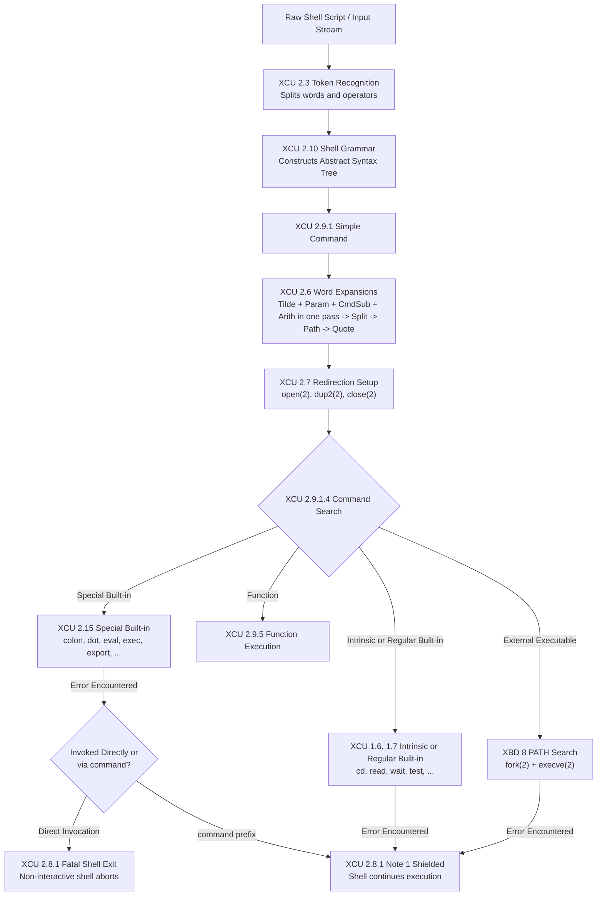

# Reading the POSIX Standard

> [!summary] Claim
> POSIX.1-2024 defines the normative execution contract of the Unix shell through precise terminology, deterministic word-expansion pipelines, rigid error consequences, and a layered command-lookup hierarchy that distinguishes special built-ins from ordinary utilities.

Part of [The POSIX Shell Language](README.md) in [Shell and Unix Engineering](../README.md).

## TL;DR

- The standard specifies shell behavior across four formal volumes: Base Definitions (`XBD`), System Interfaces (`XSH`), Shell and Utilities (`XCU`), and Rationale (`XRAT`).
- Normative keywords govern implementation requirements: `shall` mandates behavior, `may` permits implementation variation, `unspecified` denotes allowable variation without documentation, and `undefined` marks the result of an invalid construct or invalid data, which no application may rely on `(POSIX.1-2024 XBD 1.6)`.
- Special built-in utilities differ fundamentally from regular built-ins: preceding variable assignments persist in the current execution environment, and uncaught execution or redirection errors abort a non-interactive shell.
- Prefixing any special built-in with the `command` utility strips both special properties (abort on error and persistent prefix assignments) while retaining its in-process execution, so the shell survives that utility's own errors and its redirection errors.
Syntax, variable assignment, and expansion errors still abort a non-interactive shell, `command` or not `(POSIX.1-2024 XCU 2.8.1, command)`.
- Do not target strict POSIX shell conformance when writing complex systems software requiring native arrays, structured exception handling, fine-grained thread synchronization, or high-performance data processing.

## Mental model



Input text enters the lexical analyzer (`XCU 2.3`), which separates characters into operators and words according to quoting rules before handing them to the grammar parser (`XCU 2.10`).
The parser builds simple and compound commands, routing simple commands to the four-step word expansion order (`XCU 2.6`), where tilde, parameter, command, and arithmetic expansions run together in one beginning-to-end pass before field splitting, pathname expansion, and quote removal.
Redirections (`XCU 2.7`) evaluate next, binding file descriptors via `open(2)` and `dup2(2)` before command search (`XCU 2.9.1.4`) dispatches the resolved command name.
In the standard specification, command lookup evaluates special built-ins (`XCU 2.15`) first, completely bypassing shell functions; functions take precedence over intrinsic utilities (`XCU 1.7`), regular built-ins (`XCU 1.6`), and external utilities found by the PATH search (`XBD 8`).
A name in the table of common shell extensions (such as `local`, `source`, or `typeset`) gives unspecified results before functions are even considered (`XCU 2.9.1.4`, step 1b).
When a command encounters a redirection or execution error, special built-ins trigger a mandatory fatal exit of non-interactive shells (`XCU 2.8.1`) unless shielded by the `command` wrapper (`XCU 2.8.1 Note 1` and the `command` utility description), whereas regular built-ins and external binaries set a non-zero exit status (`$?`) and permit execution to proceed.

## How it works

### 1. The Structure of IEEE Std 1003.1-2024

The POSIX standard is developed by the Austin Common Standards Revision Group, a joint technical working group whose single specification carries the IEEE Std 1003.1, The Open Group Base Specifications, and ISO/IEC 9945 designations ([Austin Group](https://www.opengroup.org/austin/)).
The Austin Group page lists ISO/IEC/IEEE 9945:2026 as published in March 2026 (as of 2026-10).
The specification is divided into four interdependent volumes:
1. `Base Definitions (XBD)`: Defines common definitions, conformance rules, utility syntax conventions, and system headers (`<limits.h>`, `<unistd.h>`).
2. `System Interfaces (XSH)`: Defines the standard C library and kernel interfaces (`fork`, `execve`, `dup2`, `waitpid`, `pipe`).
3. `Shell and Utilities (XCU)`: Defines the shell command language interpreter (Chapter 2) and individual utilities (Chapter 3, Utilities, in Issue 8).
4. `Rationale (XRAT)`: Non-normative historical background and justification for design trade-offs and compromises between System V, BSD, and historical Korn shell behaviors.

Section numbering is hierarchical: `(POSIX.1-2024 XCU 2.6.5)` refers directly to Volume 3 (XCU), Chapter 2, Section 6, Subsection 5 (Field Splitting).

### 2. Normative Terminology and the Three Divergence Regimes

POSIX uses specific keywords to establish technical requirements `(POSIX.1-2024 XBD 1.6)`:
- `shall`: Mandatory requirement for a conforming implementation.
An application may unconditionally rely on this behavior.
- `shall not`: Absolute prohibition for a conforming implementation.
- `should`: Strong recommendation.
Implementations may deviate for valid architectural reasons, so applications should not rely on the recommended behavior.
- `may`: Optional feature or behavior.
An application cannot assume the feature exists.
- `can`: Describes an optional feature or capability available to an application that a conforming implementation is required to support.

When implementations diverge, the standard classifies the behavior into three formal regimes `(POSIX.1-2024 XBD 1.6)`:
- `implementation-defined`: The standard permits implementation variation, but the implementor `shall` document the exact choice in its conformance document (such as limits in `<limits.h>` or signal exit status ranges).
- `unspecified`: A valid construct or input where the standard imposes no requirements and the implementation is not required to document its choice (such as whether the expansions in a prefix assignment or redirection run in the current shell environment or in the environment of the command about to run, `POSIX.1-2024 XCU 2.6`).
- `undefined`: An invalid program construct or erroneous input data where the standard imposes no requirements.
XBD 1.6 says only that the value or behavior may vary and that an application should not rely on its existence or validity, so in practice anything from a crash to apparent success is possible.

Application conformance is classified into two primary POSIX tiers `(POSIX.1-2024 XBD 2.2)`, plus `Conforming POSIX Application Using Extensions` (`XBD 2.2.3`) and the XSI variants (`XBD 2.2.4`, `XBD 2.2.5`):
1. `Strictly Conforming POSIX Application` `(XBD 2.2.1)`: Requires only facilities defined in POSIX.1-2024, accepts any implementation-defined or unspecified behavior instead of relying on one, performs no action with undefined results, relies on no symbolic constant exceeding its listed minimum, and for C defines `_POSIX_C_SOURCE` as `202405L` before including any header.
2. `Conforming POSIX Application` `(XBD 2.2.2)`: Uses only POSIX.1-2024 facilities and approved language bindings, and includes a statement of conformance documenting all options and limit dependencies.

### 3. The Execution Lifecycle of a Shell Command

Every simple command processed by a POSIX-compliant shell (`sh`) executes through a rigid, sequential pipeline `(POSIX.1-2024 XCU 2.9.1.1)`:

```
[Token Recognition] -> [Grammar AST] -> [Word Expansions] -> [Redirections] -> [Command Lookup] -> [Execution]
```

1. `Token Recognition` `(POSIX.1-2024 XCU 2.3)`: The shell converts UTF-8/ASCII bytes into words and operators, handling aliases `(POSIX.1-2024 XCU 2.3.1)` and quoting `(POSIX.1-2024 XCU 2.2)`.
2. `Grammar Parsing` `(POSIX.1-2024 XCU 2.10)`: Tokens form command structures (simple commands, pipelines, compound lists).
3. `Word Expansions` `(POSIX.1-2024 XCU 2.6)`: Performed in four steps; the first four expansions below run together in a single beginning-to-end pass over the word, and the last three follow in order:
   - Tilde expansion `(POSIX.1-2024 XCU 2.6.1)`
   - Parameter expansion `(POSIX.1-2024 XCU 2.6.2)`
   - Command substitution `(POSIX.1-2024 XCU 2.6.3)`
   - Arithmetic expansion `(POSIX.1-2024 XCU 2.6.4)`
   - Field splitting via `$IFS` `(POSIX.1-2024 XCU 2.6.5)`
   - Pathname expansion / globbing `(POSIX.1-2024 XCU 2.6.6)`
   - Quote removal `(POSIX.1-2024 XCU 2.6.7)`
4. `Redirection Processing` `(POSIX.1-2024 XCU 2.7)`: Descriptors are opened, duplicated, or closed left-to-right via `open(2)` and `dup2(2)`.
5. `Command Search and Execution` `(POSIX.1-2024 XCU 2.9.1.4)`: Command names are resolved and dispatched according to strict precedence rules.

### 4. Special Built-ins versus Regular Built-ins and Utilities

POSIX divides commands into distinct execution categories:
- `Special Built-in Utilities` `(POSIX.1-2024 XCU 2.15)`: Exactly 15 utilities, each built into the shell: `break`, `:`, `continue`, `.`, `eval`, `exec`, `exit`, `export`, `readonly`, `return`, `set`, `shift`, `times`, `trap`, and `unset`.
- `Regular Built-in Utilities` `(POSIX.1-2024 XCU 1.6)`: Standard utilities that may be built into the shell for performance or environment manipulation (such as `cd`, `pwd`, `test`, `echo`, `printf`, `wait`), but adhere to normal utility rules.
The 16 intrinsic utilities of `XCU 1.7` (`alias`, `bg`, `cd`, `command`, `fc`, `fg`, `getopts`, `hash`, `jobs`, `kill`, `read`, `type`, `ulimit`, `umask`, `unalias`, `wait`) are found without a PATH search, while any other regular built-in runs only when the PATH search reaches its directory (`XCU 2.9.1.4`).
- `External Utilities` `(POSIX.1-2024 XCU Chapter 3)`: Standalone executables located via `$PATH`.

The distinctions between special built-ins and regular utilities dictate runtime behavior:
1. `Environment Assignment Persistence` `(POSIX.1-2024 XCU 2.9.1.2)`: Variable assignment prefixes preceding a special built-in persist in the shell environment after completion (`X=1 :` leaves `X=1`).
Preceding assignments on regular built-ins and external utilities affect only that command's execution environment (`X=1 true` leaves `X` unset in the caller).
In GNU Bash, preceding assignments persist only when executing in POSIX mode (`set -o posix` or invoked as `sh`); in native mode, assignments do not persist (measured in the shell matrix for bash 3.2 through 5.3).
2. `Consequences of Errors` `(POSIX.1-2024 XCU 2.8.1)`: An error in a special built-in, or a redirection error on one, `shall` cause a non-interactive shell to exit, and the redirection case also requires a shell diagnostic on standard error.
An identical error on a regular utility `shall not` cause the shell to exit.
Syntax errors, variable assignment errors, and expansion errors abort a non-interactive shell whatever the command, so they are not special built-in properties.
GNU Bash in native mode and `yash` in default mode do not exit on special built-in redirection errors; they require POSIX mode (`set -o posix` or `--posixly-correct`) to enforce fatal termination (measured in the shell matrix, as of 2026-10).
3. `The Command Wrapper Shield` `(POSIX.1-2024 XCU 2.8.1 Note 1)`: If a special built-in is invoked via the `command` utility (`command : < /bad` or `command . /missing`), the shell `shall not` exit if the special built-in fails.
The `command` description extends this to both special properties: when its operand names a special built-in, neither the abort on error nor the persistence of prefix assignments occurs ([command](https://pubs.opengroup.org/onlinepubs/9799919799/utilities/command.html)).
4. `Lookup Precedence and Function Shadowing` `(POSIX.1-2024 XCU 2.9.1.4, XCU 2.9.5)`: When a command name lacks slashes, the standard specifies that the shell resolves special built-ins first.
Furthermore, `POSIX.1-2024 XCU 2.9.5` dictates that applications shall ensure a function is not named after any special built-in utility.
That is a requirement on the application, not on the shell, so the standard does not oblige an implementation to reject such a definition.
Across real implementations in the shell matrix, handling of functions named after special built-ins diverges into three distinct behaviors:
- Syntax rejection: `dash`, `posh`, `ksh93`, `yash`, and `bash` in POSIX mode reject defining a function named `:` with an immediate error: dash reports `Bad function name`, posh, ksh93, and yash report `invalid function name`, and bash reports that `:` is not a valid identifier (measured in the shell matrix, as of 2026-10).
- Special built-in precedence: `mksh` allows the function definition to succeed, but during lookup the special built-in executes and the function is completely ignored.
- Function override divergence: Native `bash`, native `zsh`, `zsh --emulate sh`, and BusyBox `ash` allow the function definition and execute the function in place of the special built-in.

### 5. Declaration Utilities in POSIX.1-2024

POSIX.1-2024 formalizes the concept of `Declaration Utilities` via Austin Group Defect 351 `(POSIX.1-2024 XCU 2.9.1.1)`.
The utilities `export` and `readonly`, and `command` under certain conditions, are designated declaration utilities `(POSIX.1-2024 XBD 3.100)`.
When the shell recognizes a declaration utility as the command word:
- Any subsequent argument matching `name=value` is evaluated in an `assignment context`.
- In an assignment context, tilde expansion occurs after `=` and unquoted colons, but field splitting `(POSIX.1-2024 XCU 2.6.5)` and pathname expansion `(POSIX.1-2024 XCU 2.6.6)` are suppressed.
- As a consequence, `export var=$val` does not require double-quoting around `$val` in POSIX.1-2024 even if `$val` contains spaces or wildcards.
- However, if the command name is generated dynamically (`cmd=export; $cmd var=$val`), the standard specifies that assignment context recognition is `unspecified` because implementations are permitted to use only static lexical analysis `(POSIX.1-2024 XCU 2.9.1.1)`.

### 6. Exit Status Architecture

Section 2.8.2 `(POSIX.1-2024 XCU 2.8.2)` standardizes command exit statuses:
- Exit status `0`: Command completed successfully.
- Exit status `1-125`: Conventionally, the command completed with an error; XCU 2.8.2 does not reserve this range, and each standard utility documents its own statuses in its EXIT STATUS section.
- Exit status `126`: Command name was located, but could not be invoked as an executable utility (such as a file lacking execute permissions, returning `EACCES`).
- Exit status `127`: Command name could not be found via `$PATH` resolution (`ENOENT`).
- Exit status `> 128`: Command was terminated by a signal.
Historically, shells reported `128 + N` where `N` is the signal number.
Issue 8 applied Austin Group Defect 51 to clarify this case, and `XCU 2.8.2` now says the status identifies the signal in an implementation-defined manner and that shells are permitted to assign values greater than 255: `ksh93` reports `256 + N`, and `yash` reports `384 + N` (both measured by the lab).
The rationale (`XRAT C.2.8.2`) adds that a shell assigning such a status must pass it on to its own parent by sending itself the same signal, because `exit` would otherwise truncate it to 8 bits.
When a command exits normally, its status is the equivalent of `WEXITSTATUS` applied to the status from `wait()`, which for C programs equals the value passed to `exit()` or `_exit()` modulo 256 `(POSIX.1-2024 XCU 2.8.2)`.

### 7. Implementation Analysis: GNU Bash and Dash

In GNU Bash (`execute_cmd.c`), command lookup and execution occur inside `execute_simple_command` (simplified excerpt from the bash master branch, as of 2026-10; comments shortened and debug code removed):
```c
/* GNU bash execute_cmd.c: execute_simple_command */
if ((cmdflags & CMD_NO_FUNCTIONS) == 0)
  {
    /* Posix.2 says special builtins are found before functions. */
    if (posixly_correct)
      {
        builtin = find_special_builtin (words->word->word);
        if (builtin)
          builtin_is_special = 1;
      }
    if (builtin == 0)
      func = (posixly_correct == 0 || absolute_program (words->word->word) == 0) ? find_function (words->word->word) : 0;
  }

if (posixly_correct && tempenv_assign_error)
  {
    last_command_exit_value = EXECUTION_FAILURE;
#if defined (STRICT_POSIX)
    jump_to_top_level ((interactive_shell == 0) ? FORCE_EOF : DISCARD);
#else
    if (interactive_shell == 0 && builtin_is_special)
      jump_to_top_level (FORCE_EOF);
    else
      jump_to_top_level (DISCARD);
#endif
  }
```
When `posixly_correct` is enabled (`set -o posix`), bash queries `find_special_builtin` before checking `find_function`, enforcing POSIX lookup precedence; in that mode a command name containing a slash also skips function lookup.
In function definition registration (`execute_intern_function` in `execute_cmd.c`), bash rejects function names matching special built-ins in POSIX mode by passing a "no special builtins" flag to `valid_function_word()` (simplified excerpt):
```c
/* GNU bash execute_cmd.c: execute_intern_function */
if (posixly_correct)
  pflags |= 4;  /* no special builtins */

if (valid_function_word (name, pflags) == 0)
  {
    if (posixly_correct)
      {
        last_command_exit_value = EX_BADUSAGE;
        jump_to_top_level (interactive_shell ? DISCARD : ERREXIT);
      }
    return (EXECUTION_FAILURE);
  }
```
When `posixly_correct` is 0 (native mode), `find_special_builtin` is bypassed during lookup and `find_function` succeeds first, allowing functions to override built-ins.
In POSIX mode, a rejected function name ends a non-interactive shell through `jump_to_top_level (ERREXIT)`, and a prefix assignment error on a special built-in ends it through `jump_to_top_level (FORCE_EOF)`; the comment above that block says it should agree with `do_assignment_statements()`, where the error is normally caught.

In Dash (`src/eval.c`), command dispatch occurs inside `evalcommand`:
```c
/* dash src/eval.c: evalcommand */
status = redirectsafe(cmd->ncmd.redirect, REDIR_PUSH|REDIR_SAVEFD2);
if (unlikely(status)) {
bail:
    exitstatus = status;
    /* We have a redirection error. */
    if (spclbltin > 0)
        exraise(EXERROR);
    goto out;
}
```
Dash evaluates `spclbltin > 0`.
If a redirection error occurs on a special built-in, it invokes `exraise(EXERROR)`, which unwinds to the top-level error handler and ends a non-interactive shell.
If the command is an ordinary utility, `spclbltin` is 0, so Dash bypasses `exraise` and jumps to `goto out`, allowing the script to handle the failure.
Dash also enforces function naming in `src/parser.c`: a name fails if `goodname()` rejects it (punctuation such as `:`) or if `find_builtin()` returns a built-in flagged `BUILTIN_SPECIAL` (so `eval` is rejected too), and either case raises `Syntax error: Bad function name`.

## Numbers and limits

| Metric / Constant | Specification Value | Linux 6.x / Glibc | macOS Darwin 26/27 | Source / Verification |
|---|---|---|---|---|
| `_POSIX_VERSION` | `202405L` | `200809L` (glibc 2.41; musl on Alpine 3.22 also `200809L`) | `200112L` | `(POSIX.1-2024 XBD 2.1.3.1)`, `getconf _POSIX_VERSION` measured on the matrix images and macOS host (as of 2026-10) |
| `_POSIX_C_SOURCE` | `202405L` | User-defined macro | User-defined macro | `(POSIX.1-2024 XBD 2.2.1)`, standard header contract |
| Special built-in utilities count | Exactly `15` | Shell-dependent (bash also reports `source` as a special builtin) | Shell-dependent (bash also reports `source` as a special builtin) | `(POSIX.1-2024 XCU 2.15)`, specification enumeration; bash measured with `type source` in POSIX mode |
| Shell reserved words count | Exactly `16` | `16` required; shells may also reserve `[[`, `]]`, `function`, `namespace`, `select`, `time` | Same as Linux | `(POSIX.1-2024 XCU 2.4)`, lexical grammar rules |
| Command not found exit status | `127` | `127` | `127` | `(POSIX.1-2024 XCU 2.8.2)`, verified by lab |
| Non-executable utility exit status | `126` | `126` | `126` | `(POSIX.1-2024 XCU 2.8.2)`, verified by lab |
| Signal termination exit status (`SIGTERM=15`) | `> 128` | `143` (most), `271` (`ksh93`), `399` (`yash`) | `143` (bash/zsh), `271` (`ksh93`) | `(POSIX.1-2024 XCU 2.8.2)`, verified by lab |
| `_POSIX_PIPE_BUF` atomic minimum | `512` bytes | `512` bytes | `512` bytes | `(POSIX.1-2024 XBD limits.h)`, kernel pipe interface |
| Runtime `PIPE_BUF` | `>= 512` bytes | `4096` bytes | `512` bytes | `getconf PIPE_BUF /`, measured in matrix |
| Max positional parameters unbraced | `$0` to `$9` (1 digit) | 1 digit (native zsh reads `$10` as `${10}`) | 1 digit (native zsh reads `$10` as `${10}`) | `(POSIX.1-2024 XCU 2.5.1)`, `${10}` required for multi-digit; zsh 5.9 measured on the host, where `zsh --emulate sh` prints `$1` followed by `0` |
| Utility syntax guidelines count | Exactly `14` | 14 guidelines | 14 guidelines | `(POSIX.1-2024 XBD 12.2)`, command-line argument conventions |

## Portability

The matrix below reflects behaviors confirmed across real implementations in the shell testing matrix (as of 2026-10).
The lab asserts every cell, including bash's POSIX mode when reached as macOS `/bin/sh` or as `sh` on the host; the `--posix` and `--posixly-correct` flags themselves, and the quoted error messages, were measured by hand on the same images and host.

| Feature / Behavior | POSIX.1-2024 sh | macOS bash 3.2 | Current bash 5.3 | zsh (native) | zsh (`--emulate sh`) | dash | ksh93 | mksh | yash | posh | BusyBox ash |
|---|---|---|---|---|---|---|---|---|---|---|---|
| `X=1 :` persists `X` in caller | Yes | No (Yes as `/bin/sh`) | No (Yes in `--posix`) | No | Yes | Yes | Yes | Yes | Yes | Yes | Yes |
| `X=1 true` persists `X` in caller | No | No | No | No | No | No | No | No | No | No | No |
| Direct `: < /bad` aborts shell | Yes | No (Yes as `/bin/sh`) | No (Yes in `--posix`) | No | Yes | Yes | Yes | Yes | No (Yes in `--posixly-correct`) | Yes | Yes |
| `command : < /bad` prevents abort | Yes | Yes | Yes | Yes | Yes | Yes | Yes | Yes | Yes | Yes | Yes |
| `export v=$val` suppresses splitting | Yes | Yes | Yes | Yes | Yes | Yes | Yes | Yes | Yes | No (`posh` splits) | Yes |
| Dynamic `$cmd v=$val` suppresses splitting | Unspecified | No (splits) | No (splits) | Yes (no split) | No (splits) | Yes (no split) | No (splits) | No (splits) | No (splits) | No (splits) | Yes (no split) |
| Function overrides `true` utility | Yes | Yes | Yes | Yes | Yes | Yes | Yes | Yes | Yes | Yes | Yes |
| Function definition over `:` rejected | Not required (XCU 2.9.5 binds the application) | No (allows; rejects as `/bin/sh`) | No (allows; rejects in `--posix`) | No (allows) | No (allows) | Yes (syntax error) | Yes (invalid name) | No (allows) | Yes (invalid name) | Yes (invalid name) | No (allows) |
| Function `:` overrides special built-in | No (special built-ins are searched first) | Yes (No as `/bin/sh`) | Yes (No in `--posix`) | Yes | Yes | N/A (rejected) | N/A (rejected) | No (built-in wins) | N/A (rejected) | N/A (rejected) | Yes (function wins) |
| Command not found exit code | `127` | `127` | `127` | `127` | `127` | `127` | `127` | `127` | `127` | `127` | `127` |
| Non-executable file exit code | `126` | `126` | `126` | `126` | `126` | `126` | `126` | `126` | `126` | `126` | `126` |
| `SIGTERM` exit status | `> 128` | `143` | `143` | `143` | `143` | `143` | `271` | `143` | `399` | `143` | `143` |

## Worked example

The test script below from the [lab](../labs/03-reading-the-posix-standard/) probes environment assignment persistence, error abort shielding, declaration contexts, command search precedence, and standard exit status codes.

```sh
#!/bin/sh
# posix_rules.sh: Probe script verifying POSIX.1-2024 shell language rules.
# Exercises environment persistence, error abort consequences, declaration
# utilities, command search precedence, and standard exit statuses.

set -u

mode="${1:-}"
shift || true

case "${mode}" in
  assign-persist)
    unset PERSIST_VAL
    PERSIST_VAL=active :
    colon_result="${PERSIST_VAL:-unset}"
    unset PERSIST_VAL
    PERSIST_VAL=active true
    true_result="${PERSIST_VAL:-unset}"
    printf 'colon:%s true:%s\n' "${colon_result}" "${true_result}"
    ;;

  error-abort)
    submode="${1:-}"
    file="${2:-}"
    case "${submode}" in
      --direct)
        # Redirection error directly on special built-in (XCU 2.8.1)
        # Put 2>/dev/null first so diagnostic is silenced under left-to-right evaluation
        : 2>/dev/null <"${file}"
        printf 'direct-survived\n'
        ;;
      --shielded)
        # Redirection error shielded by command utility (XCU 2.8.1 Note 1)
        command : 2>/dev/null <"${file}"
        printf 'shielded-survived\n'
        ;;
      *)
        printf 'Unknown error-abort submode: %s\n' "${submode}" >&2
        exit 2
        ;;
    esac
    ;;

  declaration-context)
    submode="${1:-}"
    val="alpha beta gamma"
    case "${submode}" in
      --literal)
        # Literal declaration utility: assignment context suppresses field splitting (XCU 2.9.1.1)
        # shellcheck disable=SC2086,SC2248 # intentional unquoted expansion to verify assignment context
        export DECL_VAR=${val}
        printf '<%s>\n' "${DECL_VAR}"
        ;;
      --dynamic)
        # Dynamic expansion: lexical parsing does not see export (XCU 2.9.1.1)
        cmd='export'
        # shellcheck disable=SC2086,SC2248 # intentional dynamic command word expansion
        ${cmd} DECL_VAR=${val}
        printf '<%s>\n' "${DECL_VAR}"
        ;;
      *)
        printf 'Unknown declaration-context submode: %s\n' "${submode}" >&2
        exit 2
        ;;
    esac
    ;;

  function-precedence)
    submode="${1:-}"
    case "${submode}" in
      --regular)
        # Functions shadow regular built-ins and external utilities (XCU 2.9.1.4)
        true() {
          printf 'shadowed-true\n'
        }
        true
        ;;
      --special)
        # Function definition with special built-in name (XCU 2.9.5, XCU 2.9.1.4).
        # Run inside eval within a subshell so that syntax errors during definition
        # on strict POSIX shells (dash, posh, ksh93, yash, bash posix) do not abort the script.
        res=$(eval '(:() { printf "func-colon\n"; }; :)' 2>/dev/null)
        rc=$?
        if [ "${rc}" -ne 0 ]; then
          printf 'rejected\n'
        elif [ "${res}" = "func-colon" ]; then
          printf 'function-ran\n'
        else
          printf 'builtin-ran\n'
        fi
        ;;
      *)
        printf 'Unknown function-precedence submode: %s\n' "${submode}" >&2
        exit 2
        ;;
    esac
    ;;

  lookup-status)
    target="${1:-}"
    if [ -z "${target}" ]; then
      printf 'lookup-status requires target operand\n' >&2
      exit 2
    fi
    exit_code=0
    "${target}" 2>/dev/null || exit_code="$?"
    printf '%d\n' "${exit_code}"
    ;;

  *)
    printf 'Usage: %s {assign-persist|error-abort|declaration-context|function-precedence|lookup-status} [args...]\n' "$0" >&2
    exit 2
    ;;
esac
```

Run under dash and native bash on the Debian 13 matrix image (as of 2026-10), the script produces the following outputs; the direct case prints nothing because `2>/dev/null` is applied before the failing `<` redirection:

```console
$ dash posix_rules.sh assign-persist
colon:active true:unset

$ dash posix_rules.sh error-abort --direct /nonexistent_file
[Exit status 2]

$ dash posix_rules.sh error-abort --shielded /nonexistent_file
shielded-survived
[Exit status 0]

$ dash posix_rules.sh declaration-context --literal
<alpha beta gamma>

$ bash posix_rules.sh declaration-context --dynamic
<alpha>

$ dash posix_rules.sh function-precedence --regular
shadowed-true

$ dash posix_rules.sh function-precedence --special
rejected

$ bash posix_rules.sh function-precedence --special
function-ran

$ dash posix_rules.sh lookup-status /nonexistent_tool
127
```

## Pitfalls

> [!warning] Silent script termination from unshielded special built-in errors
> **Trigger:** Calling a special built-in utility directly (`. /path/to/optional.env` or `readonly VAR=1; readonly VAR=2`) when the target file is missing or a variable is already locked.
> **Symptom:** Non-interactive scripts terminate immediately with no stack trace or recovery, skipping every subsequent command and any cleanup written inline after the failing line.
> An `EXIT` trap still runs in dash, bash in POSIX mode, ksh93, mksh, and BusyBox ash, but posh 0.14.1 exited without running it (measured in the shell matrix with a missing `.` file, as of 2026-10).
> **Fix:** Prefix the invocation with `command` (`command . /path/to/optional.env 2>/dev/null || true`) as mandated by `POSIX.1-2024 XCU 2.8.1 Note 1`, which strips the mandatory abort behavior.

> [!warning] Leaking prefix assignments across pipeline iterations
> **Trigger:** Using a special built-in like `:` or `eval` with a prefix variable assignment (`TIMEOUT=30 :`) under standard `sh` (dash, ksh93, busybox ash).
> **Symptom:** `TIMEOUT` remains set in the current execution environment, leaking into subsequent loop iterations or command executions that assumed `TIMEOUT` was transient.
> **Fix:** Clear the variable explicitly after invocation (`unset TIMEOUT`), use a subshell `(TIMEOUT=30; :)`, or avoid prefix assignments on special built-ins.

> [!warning] Function shadowing of special built-ins across shell families
> **Trigger:** Defining a function whose name matches a special built-in utility (`:()`, `eval()`, `exec()`) in scripts developed under native `bash` or BusyBox `ash`.
> **Symptom:** The script runs as intended under native `bash`, `zsh`, and BusyBox `ash` where functions override built-ins, but fails immediately with fatal definition errors (`Bad function name`, `invalid function name`, or bash's not-a-valid-identifier error) under `dash`, `posh`, `ksh93`, `yash`, and `bash` in POSIX mode (`/bin/sh`).
> **Fix:** Never name a shell function after any of the 15 special built-in utilities specified in `POSIX.1-2024 XCU 2.15`, adhering to the normative requirement in `POSIX.1-2024 XCU 2.9.5`.

> [!warning] Splitting bugs during dynamic declaration utility dispatch
> **Trigger:** Dynamically invoking declaration utilities via variables or command substitution (`CMD=export; $CMD VAR=$UNQUOTED_VALUE`).
> **Symptom:** Value assignment undergoes unexpected field splitting and pathname expansion, truncating the variable value at the first whitespace character.
> **Fix:** Always double-quote variable values when invoking commands dynamically (`$CMD VAR="$UNQUOTED_VALUE"`), or declare variables using static utility syntax `export VAR=$UNQUOTED_VALUE`.

> [!warning] Misclassifying signal exit statuses as application errors
> **Trigger:** Comparing exit status `$?` against hard-coded values assuming `128 + N` when scripts run across diverse shells including `ksh93` and `yash`.
> **Symptom:** A process killed by `SIGTERM` (15) returns `271` in `ksh93` and `399` in `yash`, failing checks like `[ "$?" -eq 143 ]`.
> **Fix:** Check whether status is strictly greater than 128 `[ "$?" -gt 128 ]`, or normalize via bitmasking/subtraction according to the detected shell family `(Austin Group Defect 51)`.

## Security and robustness

### 1. Environment Variable Sanitization
POSIX specifies that a shell inherits its execution environment from its parent process via `execve(2)`.
The standard resets only `IFS`: POSIX.1-2024 requires the shell to set `IFS` to space, tab, newline when it is invoked `(POSIX.1-2024 XCU 2.5.3)`, and it reads `ENV` only for interactive shells.
It does not mandate sanitization of other dangerous environment variables such as `CDPATH`, or implementation-specific variables like `BASH_ENV`.
In untrusted execution boundaries (such as CGI handlers, setuid wrappers, or SSH forced commands):
- An inherited `IFS` can still modify word splitting in unquoted expansions in a nonconforming shell: posh 0.14.1 keeps `IFS` from the environment instead of resetting it (measured in the shell matrix, as of 2026-10).
- An inherited `CDPATH` causes `cd` to change into arbitrary parent directories and print output to stdout, breaking scripts that consume `cd` output.
- GNU Bash CVE-2014-6271 (Shellshock) exploited bash's trailing code parsing when importing exported functions via environment variables; [NVD](https://nvd.nist.gov/vuln/detail/CVE-2014-6271) lists GNU Bash through 4.3 as affected.

Robust scripts running across security boundaries must explicitly sanitize their environment at startup:
```sh
#!/bin/sh
set -eu
unset -v IFS CDPATH ENV BASH_ENV
PATH="$(getconf PATH)"
export PATH
umask 027
```

### 2. Evaluating Untrusted Strings with `eval`
The `eval` utility `(POSIX.1-2024 XCU 2.15)` constructs a command by concatenating its arguments with space delimiters and passing the resulting string back into the parser.
Because this initiates a second pass through token recognition, word expansion, and command execution, passing unsanitized user input into `eval` results in arbitrary remote code execution.
If dynamic evaluation is required, validate input against a strict alphanumeric allowlist before evaluation:
```sh
# Reject any character outside POSIX portable filename characters
case "$user_input" in
  *[!A-Za-z0-9_.-]*)
    printf 'Security error: invalid input\n' >&2
    exit 1
    ;;
esac
```

### 3. Defensive Invocation with `command`
In security-sensitive infrastructure scripts, malicious or untrusted third-party code might define functions that shadow standard utilities (e.g., `rm() { /tmp/evil; }`).
Because `XCU 2.9.1.4` dictates that user-defined functions take precedence over regular utilities and PATH binaries, calling bare `rm` executes the hijacked function.
To guarantee that the standard utility is invoked, prefix calls with `command`:
```sh
command rm -f -- "$target_file"
```
The `command` utility bypasses function lookup, dispatching directly to the built-in or PATH binary.

## The principal's view

A staff-plus engineer views the POSIX standard not as an expressive development framework, but as a universal lowest-common-denominator interoperability contract.
The shell is the glue of operating systems; it orchestrates processes, manages pipelines, and initializes execution environments across diverse kernels (Linux, FreeBSD, macOS Darwin, Illumos).
Targeting standard POSIX `sh` eliminates dependencies on heavy interpreters (Python, Node) and removes runtime drift across minimal container base images (Alpine with BusyBox, Debian slim with Dash).

However, rigorous engineering demands recognizing where POSIX shell reaches its architectural limit:
- `Maintainability boundary`: Once a shell script exceeds 100 to 200 lines, lacks deterministic unit testing, or requires nested data structures, associative arrays, or floating-point arithmetic, rewrite it in Go, Rust, or Python.
- `Safety boundary`: POSIX shell lacks memory boundaries, type systems, and structured exception handling.
Relying on `set -e` (`errexit`) provides a false sense of safety because POSIX ignores it in the condition of `if`, `elif`, `while`, and `until`, in a pipeline beginning with `!`, in every command of an AND-OR list except the last, and for every stage of a multi-command pipeline except the pipeline's own status `(POSIX.1-2024 XCU 2.15, set)`.
- `Performance boundary`: Shell scripts execute through multiple `fork(2)` and `execve(2)` system calls.
Spawning 10,000 subprocesses inside a shell loop incurs massive kernel scheduling and context-switching overhead compared to a single binary compiled with thread pools and asynchronous I/O.
- `Portability boundary`: Engineers frequently conflate macOS `/bin/sh` with Linux distributions.
On macOS Darwin, `/bin/sh` is GNU Bash 3.2 running in POSIX mode (`set -o posix`), which enforces special built-in error aborts and assignment persistence, whereas `/bin/bash` on the same machine runs in native mode where special built-in errors do not abort.
On Debian and Ubuntu, `/bin/sh` links to `dash`, whereas on Alpine Linux it links to BusyBox `ash`.
Never assume interactive developer shell semantics mirror containerized production entrypoints.

When writing infrastructure entrypoints, CI pipeline definitions, and container startup scripts:
1. Target POSIX.1-2024 `sh` with `#!/bin/sh`.
2. Enforce clean verification through `shellcheck -s sh`.
3. Test against `dash`, BusyBox `ash`, and `bash --posix` in automated CI testing matrixes.
4. Graduate complex business logic into statically linked compiled binaries.

## Interview questions

> [!question] L5: What is the semantic difference between `shall`, `should`, and `may` in the POSIX standard?
>
> > [!success]- Answer
> > `shall` indicates a mandatory requirement that every conforming implementation must satisfy and every portable application can rely upon.
> > `should` indicates a recommendation where deviation is permitted for implementation reasons, meaning applications cannot rely on its presence.
> > `may` indicates an optional behavior where implementations are entirely free to provide or omit the facility without restriction.
> >
> > Follow-up: What is the difference between an `unspecified` behavior and an `undefined` behavior?

> [!question] L5: What are the standardized exit status codes for a command that is not found versus a file that cannot be executed?
>
> > [!success]- Answer
> > POSIX.1-2024 XCU 2.8.2 specifies exit code 127 when a command cannot be found on PATH.
> > The standard specifies exit code 126 when a command is located but is not executable (such as permissions failure or EACCES).
> > Both codes are reserved above normal utility exit codes 0-125 to permit unambiguous caller handling.
> >
> > Follow-up: What exit code does POSIX require when a command is terminated by an unhandled signal?

> [!question] L6: Predict the output of the following script executed under `dash` versus native `bash`:
> ```sh
> unset X
> X=value :
> echo "X=$X"
> ```
>
> > [!success]- Answer
> > Under `dash`, the script outputs `X=value`.
> > Under native `bash`, the script outputs `X=`.
> > The colon `:` is a POSIX special built-in utility under XCU 2.15.
> > Under POSIX XCU 2.9.1.2, variable assignments preceding a special built-in persist in the shell environment.
> > Dash conforms to POSIX and retains the assignment, whereas native bash retains prefix assignments only when in POSIX mode (`set -o posix` or invoked as `sh`).
> >
> > Follow-up: How would the behavior change if `:` were replaced with `true`?

> [!question] L6: Why does the following script abort before step 2 under both `dash` and `/bin/sh` on macOS, but print `Step 2: completed` when invoked under native `/bin/bash`?
> ```sh
> #!/bin/sh
> echo "Step 1: starting"
> . /etc/optional-config.env
> echo "Step 2: completed"
> ```
>
> > [!success]- Answer
> > The dot `.` utility is a special built-in utility under POSIX XCU 2.15.
> > Under POSIX XCU 2.8.1, an execution error in a special built-in mandates that a non-interactive shell must exit immediately.
> > Both `dash` and macOS `/bin/sh` (which executes GNU Bash in POSIX mode) implement this requirement and exit when `/etc/optional-config.env` is missing (measured in the shell matrix: dash exits 2 after its `cannot open` diagnostic, `bash --posix` exits 1).
> > Native `/bin/bash` (invoked as `bash`) operates in non-POSIX mode by default, logging an error message but permitting script execution to proceed.
> > The fix is to shield the special built-in using `command . /etc/optional-config.env 2>/dev/null || true` or test `[ -f /etc/optional-config.env ]` first.
> >
> > Follow-up: What other errors cause an unconditional fatal exit of a non-interactive shell under XCU 2.8.1?

> [!question] L6: Why did POSIX.1-2024 introduce the concept of `Declaration Utilities` via Austin Group Defect 351?
>
> > [!success]- Answer
> > In historical POSIX editions, `export var=$val` was treated as an ordinary simple command, requiring `$val` to undergo field splitting and pathname expansion.
> > Real-world programmers consistently omitted double-quotes (`export var=$val`), which worked in Korn shell and Bash but broke portably when `$val` contained spaces.
> > Austin Group Defect 351 designated `export` and `readonly` as declaration utilities whose operands are parsed in an assignment context.
> > In assignment context, field splitting and pathname expansion are suppressed, aligning the standard with developer expectations and widespread implementation practice.
> >
> > Follow-up: Why does `CMD=export; $CMD var=$val` still split `$val` in most shells?

> [!question] L7: Predict the behavior of attempting to define and execute a function named after a special built-in (`:() { echo func; }; :`) across `dash`, `bash` (native), `bash --posix`, and `mksh`.
>
> > [!success]- Answer
> > POSIX XCU 2.9.5 mandates that applications shall ensure a function is not named after any special built-in utility.
> > In `dash` and `bash --posix`, the function definition is rejected outright (dash reports `Bad function name`; bash reports that `:` is not a valid identifier), terminating the script.
> > In `mksh`, the function definition is accepted, but command lookup (`XCU 2.9.1.4`) prioritizes the special built-in, so invoking `:` executes the null built-in and ignores the function.
> > In native `bash`, the function definition is accepted and command lookup prioritizes user-defined functions over built-ins, printing `func`.
> >
> > Follow-up: How does the `command` utility interact with user-defined functions versus special built-ins?

> [!question] L7: Under POSIX XCU 2.8.2, what are the constraints on exit codes for commands terminated by signals, and why do `ksh93` and `yash` return values above 255?
>
> > [!success]- Answer
> > POSIX mandates that if a command terminates due to receipt of a signal, the shell shall assign it an exit status greater than 128.
> > Historically, shells used `128 + N`, but a program that calls `exit(129)` through `exit(255)` produces the same values, so a caller cannot tell a signal death from a normal exit (`XRAT C.2.8.2`).
> > Issue 8 applied Austin Group Defect 51 to clarify this case, and XCU 2.8.2 now says the status identifies the signal in an implementation-defined manner and may exceed 255 within the shell.
> > ksh93 assigns `256 + N` (returning 271 for SIGTERM), while yash assigns `384 + N` (returning 399 for SIGTERM), as the lab measures.
> > Because `exit` truncates to 8 bits, the rationale requires such a shell to pass the status on to its own parent by sending itself the same signal.
> > Real shells differ here (measured with `waitpid` in the shell matrix, as of 2026-10): macOS ksh93u+ 2012 re-raises SIGTERM, while Debian's ksh93u+m 1.0.10 exits normally with 15 (271 modulo 256) and Alpine's yash 2.58.1 exits normally with 143 (399 modulo 256).
> >
> > Follow-up: How does POSIX.1-2024, which standardizes `set -o pipefail` (`XCU 2.9.2`), define the exit status of a pipeline with and without that option?

> [!question] L7+: Analyze the architectural trade-offs between implementing `dash` as a minimal recursive descent interpreter versus `bash` as a Bison-generated parser, specifically regarding POSIX conformance, memory footprint, and startup latency.
>
> > [!success]- Answer
> > Dash descends directly from Almquist Shell (ash), utilizing a hand-written recursive descent parser with compact internal node representations.
> > This architecture minimizes binary size (199,256 bytes, about 195 KiB, for Debian 13's aarch64 `/usr/bin/dash`) and startup time (about 0.23 ms per `dash -c :` against about 0.34 ms for bash, timed over 500 runs on the Debian 13 matrix image, as of 2026-10), making it ideal for Linux init scripts and high-frequency process spawning.
> > However, strict POSIX compliance in dash requires complex manual error unwinding via `setjmp`/`longjmp` (`exraise`), making extensibility difficult.
> > Bash uses a Bison LALR(1) grammar generator (`parse.y`), yielding an extensive AST engine with deep state machines for interactive line editing, job control, and bashisms.
> > The trade-off is a binary roughly seven times larger (1,412,096 bytes, about 1.35 MiB, for Debian 13's aarch64 `/usr/bin/bash`) with higher memory allocation overhead per fork, but significantly greater support for diagnostic introspection and POSIX mode flags (`set -o posix`).
> >
> > Follow-up: How does memory layout during `fork(2)` affect high-concurrency container runtimes executing millions of shell tasks per second?

## Related

Prerequisites: None.

Next: [[Token-Recognition]]

See also: [[Special-Built-ins-versus-Utilities]], [[Simple-Commands-and-Assignment-Prefixes]], [[Command-Search-and-PATH]], [[errexit-Semantics-and-Exceptions]], [[POSIX-2024-Changes]]

## Further reading

- [POSIX.1-2024 Base Definitions (XBD Chapter 1: Introduction and Terminology)](https://pubs.opengroup.org/onlinepubs/9799919799/basedefs/V1_chap01.html): The normative definitions of `shall`, `should`, `may`, `unspecified`, and `undefined`.
- [POSIX.1-2024 Base Definitions (XBD Chapter 2: Conformance)](https://pubs.opengroup.org/onlinepubs/9799919799/basedefs/V1_chap02.html): The formal requirements for strictly conforming POSIX applications and conformance documents.
- [POSIX.1-2024 Base Definitions (XBD Chapter 12: Utility Conventions)](https://pubs.opengroup.org/onlinepubs/9799919799/basedefs/V1_chap12.html): The normative rules governing command-line options, option-arguments, and operands.
- [POSIX.1-2024 Shell and Utilities (XCU Chapter 2: Shell Command Language)](https://pubs.opengroup.org/onlinepubs/9799919799/utilities/V3_chap02.html): The complete specification of shell execution, expansions, redirections, and special built-ins.
- [Austin Group Defect 351: certain shell special built-ins should expand arguments in assignment context](https://austingroupbugs.net/view.php?id=351): The formal rationale establishing assignment context parsing for `export` and `readonly`.
- [Austin Group Defect 51: sh exit status not clear for built-in terminated by a signal](https://austingroupbugs.net/view.php?id=51): The amendment that permits signal exit statuses above 255, as in `ksh93` and `yash`, and requires such shells to re-raise the signal on exit.
- [GNU Bash Source: execute_cmd.c](https://git.savannah.gnu.org/cgit/bash.git/plain/execute_cmd.c): Implementation reference for POSIX mode command lookup and special built-in error handling.
- [Dash Source: src/eval.c](https://git.kernel.org/pub/scm/utils/dash/dash.git/plain/src/eval.c): Implementation reference for minimal POSIX command evaluation and `exraise` error aborts.
