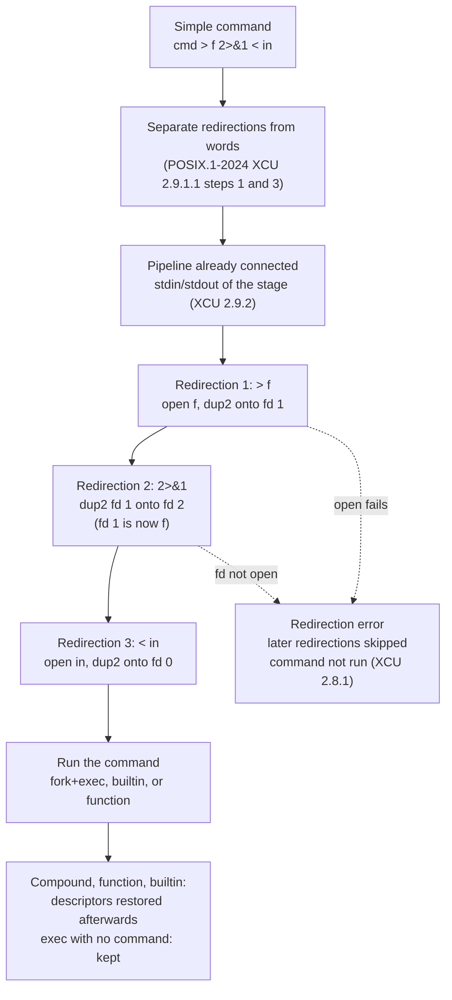

# Redirection Order and Semantics

> [!summary] Claim
> A shell applies the redirections of one command strictly left to right as a sequence of `open` and `dup2` calls on its own descriptor table, so the meaning of `2>&1` depends on what descriptor 1 refers to at the moment it runs, not on what it will refer to later.

Part of [The POSIX Shell Language](README.md) in [Shell and Unix Engineering](../README.md).

## TL;DR

- Mechanism: each redirection is one `open(2)` (for files) or `dup2(2)` (for `>&n` and `<&n`) executed on the shell's descriptor table, in source order, before the command starts (POSIX.1-2024 XCU 2.7).
- Rule: `>&n` copies descriptor `n` as it is right now, so `cmd >file 2>&1` sends both streams to the file and `cmd 2>&1 >file` sends only stdout there, while stderr still reaches the old stdout.
- Trap: a duplicate shares one open file description (one offset), but a second `open` of the same path makes a new one, so `cmd >f 2>f` lets stderr overwrite stdout from offset 0.
- Portability: the left-to-right core is identical in every shell measured in the shell matrix; the edges differ - `&>`, `{var}>`, multi-digit descriptors, globbing and splitting of the target word, whether a special built-in redirection error exits the script, and zsh `MULTIOS`.
- When not to use it: do not let a script depend on a redirection error being fatal (it is only in some shells), and use `mktemp`, `flock`, or `mkdir` instead of `set -C` when the file name is attacker-influenced.

## Mental model



The shell first pulls the redirection operators and their words out of the command, because they are not arguments.
The pipeline has already wired each stage's stdin and stdout, so a redirection can override the pipe but never the other way round.
Redirections then run one at a time, left to right; each is an `open` that lands on the requested number, or a `dup2` that copies one number onto another.
The "Redirection 2" box is where the famous order effect lives: at that moment descriptor 1 already points at the file, so descriptor 2 is made a copy of the file.
If any step fails, the rest are skipped and the command is not executed, but files already created stay created.
After the command, a builtin, compound command, or function gets its descriptors put back; `exec` with no command name keeps them for the rest of the shell's life.

## How it works

**The specification.**
`[n]redir-op word` is the general form (POSIX.1-2024 XCU 2.7).
The number `n` must be adjacent to the operator and unquoted, otherwise it is an ordinary word; `echo \2>a` writes the character 2 into `a`, and `echo 2\>a` prints `2>a`.
Only descriptors 0 to 9 are guaranteed; larger numbers and the `{location}redir-op` form are implementation-defined (XCU 2.7).
If more than one redirection is given, "the order of evaluation is from beginning to end" (XCU 2.7), and the rationale spells out the consequence: `ls > foo 2>&1` sends both streams to `foo`, while `ls 2>&1 > foo` sends only stdout there (XRAT C.2.7).
The word after the operator undergoes tilde expansion, parameter expansion, command substitution, arithmetic expansion, and quote removal, but not field splitting, and not pathname expansion in a non-interactive shell (XCU 2.7).
Within a simple command, redirections are performed in step 3 of the order of processing, after the command word and arguments are expanded and before the variable assignments of step 4 (XCU 2.9.1.1).
The same section lets steps 3 and 4 be swapped when there is no command name or the command is a special built-in, which is why ksh93 seeing the new value in `v=new : >"$v"` (Portability, below) is conforming rather than a bug (XCU 2.9.1.1).

**The operators and the system call each one becomes.**

| Operator | Open flags or call | Source |
|---|---|---|
| `[n]<f` | `open(f, O_RDONLY)` then `dup2` onto `n` | dash `openredirect`, `NFROM` |
| `[n]>f` | `open(f, O_WRONLY\|O_CREAT\|O_TRUNC)` | dash `openredirect`, `NTO` |
| `[n]>\|f` | same as `>` even under `set -C` | dash `openredirect`, `NCLOBBER` |
| `[n]>>f` | `open(f, O_WRONLY\|O_CREAT\|O_APPEND)` | dash `openredirect`, `NAPPEND` |
| `[n]<>f` | `open(f, O_RDWR\|O_CREAT)`, no truncation | dash `openredirect`, `NFROMTO` |
| `[n]>&m`, `[n]<&m` | `dup2(m, n)`; fails if `m` is not open | dash `dupredirect`; `sh_dup2` |
| `[n]>&-`, `[n]<&-` | `close(n)`; not an error if closed already | dash `dupredirect` |

(dash `src/redir.c`, functions `openredirect` and `dupredirect`, read 2026-10-27; the flags above are the literal `flags =` assignments in that file.)
Per `dup2(2)`, "the file descriptor newfd is adjusted so that it now refers to the same open file description as oldfd", the close of the old `newfd` is silent, and the close-and-reuse is atomic (man7 `dup(2)`, read 2026-10-27).
Two descriptors that refer to the same open file description share the file offset and status flags; they do not share the close-on-exec flag (man7 `dup(2)`).
That one sentence explains the whole `>f 2>&1` versus `>f 2>f` difference below.

**Implementations.**
dash walks the list in `redirect()`: for each node it calls `openredirect()` and then `dupredirect()`, and for builtins and compound commands, between those two calls, it saves the old descriptor above 9 with `fcntl(F_DUPFD_CLOEXEC, 10)` in `savefd()` so `popredir()` can restore it (dash `src/redir.c`, `redirect`, `savefd`, `popredir`, rechecked 2026-10-28).
Before that, dash's `evalcommand` calls `expredir()` on the whole list, so every redirection word is expanded before any file is opened (dash `src/eval.c`, `evalcommand`, `expredir` then `redirectsafe`).
bash instead expands each word inside `do_redirection_internal()` through `redirection_expand()`, so a later word can observe a file created by an earlier redirection; bash undoes redirections for builtins and compound commands with `add_undo_redirect()`, saving the old descriptor at 10 or higher (`SHELL_FD_BASE`) (bash-5.3 `redir.c`, `do_redirection_internal`, `redirection_expand`, `add_undo_redirect`).
The lab shows the difference: `: >f1 >"$(test -e f1 ...)"` sees `f1` in bash, zsh, ksh93, mksh, yash and posh, but not in dash or BusyBox ash.
Both are consistent with "from beginning to end"; whether the standard requires interleaving the expansion with the open is not stated: XCU 2.7 says only that "the order of evaluation is from beginning to end" and XCU 2.9.1.1 that redirections are "performed from the beginning of the command text to the end", neither says whether a word's expansion is part of its redirection's turn, and no Austin Group defect found (as of 2026-10) settles it for ordinary words.
The nearest text is for here-documents: Austin Group Defect 1036 made XCU 2.7.4 say their lines are expanded "when the redirection operator is evaluated", which ties that one expansion to its own turn in the sequence (POSIX.1-2024 XCU 2.7.4; austingroupbugs.net bug 1036).

**`set -C` (noclobber).**
`>` fails if the target exists and is a regular file, or a symbolic link to one (POSIX.1-2024 XCU 2.7.2); `>|` overrides, `>>` is unaffected, and `/dev/null` is fine because it is not a regular file.
dash implements the "stat first" method of the rationale: `stat64`, refuse if regular, else `open(O_WRONLY|O_CREAT|O_EXCL)` when absent (dash `src/redir.c`, `openredirect`, `NTO` with `Cflag`).
bash does the same in `noclobber_open()` and adds an `fstat` plus `same_file` check after the open to catch a swap between the two calls (bash-5.3 `redir.c`, `noclobber_open`).
The standard asks for the check, create, and open to be atomic like `O_CREAT|O_EXCL`, and notes that an `O_NOCLOBBER` flag would be the ideal fix (XRAT C.2.7.2).

**Scope.**
A redirection on a compound command applies to every command inside it unless the inner command overrides it (XCU 2.9.4).
A redirection on a function definition is performed on each call, not at definition time (XCU 2.9.5).
A command with no command name performs its redirections in a subshell environment, so `3>f` alone leaves nothing behind; `exec 3>f` is the form that changes the current shell (XCU 2.9.1.3 and the `exec` special built-in).
If `exec` has no operands, its redirections are made in the current shell; whether descriptors above 2 stay open in children is unspecified (XCU `exec`).

**Errors.**
A failure to open or create a file makes the redirection fail (XCU 2.7).
A redirection error with a special built-in makes a non-interactive shell exit; with a compound command, a function, or another utility it must not (XCU 2.8.1).
Those two rows already existed in POSIX.1-2017 with "may exit" for a non-interactive shell; Austin Group Defect 914 changed them to "shall not exit", and defect 1427 accounted for `command` running a special built-in (XRAT C.2.8.1; POSIX.1-2017 XCU 2.8.1 table).
`exec` is a special built-in, so a failed `exec >/nonexistent/log` is fatal in a conforming shell.
The lab asserts exit statuses too: a failed redirection on a simple command returns 1 in every shell measured except dash and yash, which return 2, and a fatal special built-in redirection error exits with 1 except in dash, which exits with 2 (measured in the shell matrix).

## Numbers and limits

| Quantity | Value | Source |
|---|---|---|
| Descriptors guaranteed in redirections | 0 to 9 | POSIX.1-2024 XCU 2.7 |
| Descriptors dash uses to save originals | 10 and up, close-on-exec | dash `src/redir.c`, `savefd` (read 2026-10-27) |
| Descriptors bash uses to save originals | `SHELL_FD_BASE` = 10 | bash-5.3 `redir.c` |
| `{var}>` descriptor chosen at the top level of a script | bash 4.4 to 5.3 10, ksh93 (both releases) 10, native zsh 11; ksh93 gives 12 inside a subshell (cause not investigated) | the lab asserts these exact numbers per family (2026-10-27); details in [[Descriptor-Duplication-and-Closing]] |
| Soft `RLIMIT_NOFILE` in the Debian matrix container | 20480 (hard 1048576) | measured by hand 2026-10-27, rechecked with `ulimit -n` and `ulimit -Hn` in the container 2026-10-28 |
| Bytes of `out 0\n` then `err\n` in `>f 2>f` | file ends as `err\n0\n` (6 bytes) | the lab, `order.sh` line `four.open` |
| Redirections `order.sh` asserts per shell | 8 report lines | the lab |
| Tests in the lab | 38, all passing in the 30 shell configurations listed under Worked example | the lab, run 2026-10-27 |

Syscall cost is two calls per file redirection (`open`, `dup2`) plus one `close` of the temporary; I did not measure it, so no timing is claimed.

## Portability

The core ordering is universal in the matrix: `order.sh` and the discriminating tests pass unchanged in bash 3.2, 4.4, 5.1, 5.2, 5.3, zsh, `zsh --emulate sh`, dash, ksh93u+ 2012, ksh93u+m 1.0.10, mksh, yash, posh, and BusyBox ash.
The rows below are the places where they diverge; each cell is asserted by a test in the lab (as of 2026-10).

| Behavior | bash 3.2, 4.4 to 5.3 (default mode) | bash in POSIX mode (`sh`, `--posix`) | zsh native | `zsh --emulate sh` |
|---|---|---|---|---|
| Special built-in redirection error exits a script | no | yes | no | yes |
| `&>file` redirects both streams | yes | yes | yes | yes |
| Multi-digit descriptor `22>f` | one redirection | one redirection | an argument | an argument |
| `{var}>f` | 4.4 to 5.3 yes, 3.2 no | same | yes | no |
| Pathname expansion of the target word | yes | no | yes | no |
| Unquoted `$v` with a space in the target | "ambiguous redirect" | creates `a b` | creates `a b` | creates `a b` |
| Two `>` on one descriptor | last wins | last wins | tee to both (`MULTIOS`) | last wins |
| Diagnostic honors an earlier `2>/dev/null` | yes | yes | no (reports first) | no (reports first) |
| Redirection words all expanded before the first open | no | no | no | no |

| Behavior | dash | ksh93 | mksh | yash | posh | BusyBox ash |
|---|---|---|---|---|---|---|
| Special built-in redirection error exits a script | yes | yes | yes | no | yes | yes |
| `&>file` redirects both streams | no (background job) | 1.0.10 yes, 2012 no | yes | no | no | yes |
| Multi-digit descriptor `22>f` | an argument | an argument | an argument | one redirection | an argument | one redirection |
| `{var}>f` | no | yes | no | no | no | no |
| Pathname expansion of the target word | no | no | no | no | no | no |
| Unquoted `$v` with a space in the target | creates `a b` | creates `a b` | creates `a b` | creates `a b` | creates `a b` | creates `a b` |
| Redirection words all expanded before the first open | yes | no | no | no | no | yes |
| Diagnostic honors an earlier `2>/dev/null` | yes | yes | yes | yes | yes | yes |
| `exec 3>f` leaves fd 3 open in children | yes | no | no | yes | yes | yes |
| `v=new : >"$v"` sees the new value | no | yes | no | no | no | no |

Redirection is performed by the shell, not by a utility, so GNU, BSD and macOS, BusyBox, and uutils implementations of `cat`, `tee`, or `ls` do not change any cell above.
Native zsh `MULTIOS` is documented: opening a descriptor for writing more than once makes the shell copy the output to all targets, as `tee` would, and "a pipe is an implicit redirection", so `date >foo | cat` writes to both (zsh manual, section 7.2 Multios).
macOS `/bin/sh` is bash 3.2 in POSIX mode, so it follows the second column of the first table; Debian `sh` is dash and Alpine `sh` is BusyBox ash.

## Worked example

The [lab](../labs/03-redirection-order-and-semantics/) holds `emit.sh`, `order.sh`, and `redirection-order.bats`.
`emit.sh` is a real script, so the shell must fork and exec it with the descriptors the redirections left behind.

```sh
#!/bin/sh
# emit.sh [ARG...]: write "out N" to standard output (N is the argument count) and "err" to standard error.
# It is a separate script so the shell under test must fork and exec it, with the file descriptors
# exactly as the redirections left them.
echo "out $#"
echo err >&2
```

`order.sh` runs it under four orderings and prints what each sink received, with a newline shown as `|`.

```sh
#!/bin/sh
# order.sh DIR: run emit.sh under four redirection orders, with DIR (created by the caller) as the
# working directory, and print what each sink received. A newline inside a sink is shown as "|".
here=$(cd "$(dirname "$0")" && pwd) || exit 1
emit=$here/emit.sh
cd "${1:?usage: order.sh DIR}" || exit 1

# sink NAME FILE: print the contents of FILE on one line, "-" for a missing file.
sink() {
  if [ -f "$2" ]; then
    flat=$(tr '\n' '|' <"$2")
    printf '%s=[%s]\n' "$1" "$flat"
  else
    printf '%s=-\n' "$1"
  fi
}

# 1. stdout goes to the file first, then stderr becomes a copy of stdout: both land in the file.
"$emit" >one.file 2>&1
sink one one.file

# 2. stderr becomes a copy of the *old* stdout (the outer sink), then stdout goes to the file.
# shellcheck disable=SC2069 # the order is the point of this line: 2>&1 deliberately comes before >file
{ "$emit" 2>&1 >two.file; } >two.outer
sink two.file two.file
sink two.outer two.outer

# 3. the classic swap through a spare descriptor: stdout and stderr exchange destinations.
{ "$emit" 3>&1 1>&2 2>&3 3>&-; } >three.out 2>three.err
sink three.stdout three.out
sink three.stderr three.err

# 4. two separate opens of one file have two offsets; a duplicate shares one.
"$emit" >four.dup 2>&1
"$emit" >four.open 2>four.open
"$emit" >>four.append 2>>four.append
sink four.dup four.dup
sink four.open four.open
sink four.append four.append
```

Expected output, identical in every shell the lab was run in (the lab asserts these eight lines exactly):

```text
one=[out 0|err|]
two.file=[out 0|]
two.outer=[err|]
three.stdout=[err|]
three.stderr=[out 0|]
four.dup=[out 0|err|]
four.open=[err|0|]
four.append=[out 0|err|]
```

Reading it: line `one` is the fix (`>file 2>&1`); `two.file` and `two.outer` show the order trap, because `err` went to the outer sink; `three.*` is the swap; `four.dup` shares an offset, `four.open` does not (`err\n` overwrote the first four bytes of `out 0\n`), and `four.append` repairs it with `O_APPEND`.

A simplified excerpt of a test that proves the zsh-only behavior (`MULTIOS`) with a family branch rather than a skip:

```bash
@test "two output redirections on one descriptor open and truncate both files, the last one wins except zsh MULTIOS" {
  run_lab_c 'cd "$1" || exit 9; echo old >a; echo old >b; echo hi >a >b; echo "a=[$(cat a)] b=[$(cat b)]"' lab "$D"
  case $(lab_shell_family) in
    zsh) [ "$output" = "a=[hi] b=[hi]" ] ;;
    bash | zsh-sh | yash | busybox | posh | mksh | ksh93 | dash) [ "$output" = "a=[] b=[hi]" ] ;;
    *) false ;;
  esac
}
```

The lab was run on 2026-10-27 under: macOS host `/bin/sh` (bash 3.2.57 POSIX mode), `/bin/bash`, bash 5.3, dash, `/bin/ksh` (ksh93u+ 2012), zsh, `zsh --emulate sh`, `bash --posix`; Alpine `sh` (BusyBox ash), `busybox ash`, bash, dash, mksh, yash, zsh, `zsh --emulate sh`, bash 3.2, 4.4, 5.1, 5.2, 5.3; Debian `sh` (dash), bash, dash, mksh, zsh, `zsh --emulate sh`, posh, ksh93u+m 1.0.10, BusyBox ash.
All 38 tests passed in each of the 30 configurations.

## Pitfalls

> [!warning] Reversed order of `2>&1` and the file
> Trigger: writing `cmd 2>&1 >log` to capture everything.
> Symptom: errors still go to the terminal, cron mail, or the pipe, and only stdout lands in `log`.
> Fix: put the file first, `cmd >log 2>&1`; the rationale uses exactly this pair as its example (XRAT C.2.7), and the lab's `two.outer` line proves it.
> Inverse use: `x=$(cmd 2>&1 >/dev/null)` deliberately captures only stderr.

> [!warning] Two opens of one file clobber each other
> Trigger: `cmd >f 2>f`, thinking it is the same as `>f 2>&1`.
> Symptom: the output of the two streams overwrites itself from offset 0 (`err|0|` in the lab) because each `open` made its own open file description with its own offset (man7 `dup(2)`, `open(2)`).
> Fix: duplicate with `2>&1`, or use `>>f 2>>f` so every write seeks to the end.

> [!warning] A redirection error is fatal in some shells and silent in others
> Trigger: `exec >/var/log/app.log` or `. ./file` with an unwritable target in a script.
> Symptom: dash, ksh93, mksh, posh, BusyBox ash, and bash in POSIX mode exit, as XCU 2.8.1 requires for special built-ins; bash by default, native zsh, and yash print a diagnostic and keep running, now writing to the old stdout.
> Fix: test explicitly, `exec >"$log" || exit 1`, or use a group `{ ...; } >"$log"`, where a failure is required not to exit and so must be checked by status.
> History: Austin Group Defect 914 had to be applied to require that compound commands and functions do not exit the shell (XRAT C.2.8.1).

> [!warning] `&>` is not POSIX
> Trigger: `cmd &>file` in a `#!/bin/sh` script.
> Symptom: dash, yash, posh, and ksh93u+ 2012 parse it as `cmd &` followed by an empty `>file`, so the command runs in the background and `file` is truncated; the lab proves the output lands on stdout instead.
> Fix: write `cmd >file 2>&1`.

> [!warning] `3>f` is not `exec 3>f`
> Trigger: opening a log descriptor with a bare redirection and writing to it later.
> Symptom: the later `echo >&3` fails with "Bad file descriptor", because a command with no command name performs its redirections in a subshell (XCU 2.9.1.3).
> Fix: `exec 3>f`, and close it with `exec 3>&-`.

> [!warning] The target word is globbed or rejected depending on the shell
> Trigger: `echo hi > $dir/*.log`, `> $file` with spaces, or a target that expands to nothing.
> Symptom: bash outside POSIX mode and native zsh glob it (bash reports "ambiguous redirect" for several matches or a split word, while native zsh with several matches writes to every one of them); dash and ksh write to a file literally named `*.log` or `a b`.
> Fix: quote the target, `> "$file"`, and never use a pattern there (XCU 2.7 forbids pathname expansion in a non-interactive shell, and the rationale says no reasonable script would write `cat foo > a*`).

> [!warning] zsh `MULTIOS` changes pipelines
> Trigger: `{ cmd; } 2>&1 >/dev/null | next` or `cmd >f | next` in native zsh.
> Symptom: stdout is copied into the pipe as well as the file, so `next` sees data that every POSIX shell withholds; the lab shows `ERR` plus `OUT` in zsh and only `ERR` elsewhere.
> Fix: run scripts under `zsh --emulate sh` or `unsetopt MULTIOS`, or write `#!/bin/sh` scripts.

> [!warning] Closing 0, 1, or 2 instead of reopening them
> Trigger: `cmd >&-` or `cmd <&-` to "silence" a program.
> Symptom: the next `open` in the child returns the lowest free number (man7 `open(2)`), which can be 1 or 2, so a log file or socket silently becomes its stdout or stderr.
> Fix: reopen on `/dev/null`, as the rationale advises (XRAT C.2.7).

## Security and robustness

- Lock files with `set -C` are atomic only while neither non-regular files nor symlinks to them can appear in the directory; the rationale warns that another process can create a FIFO with the lock's name in a shared directory such as `/tmp`, after which many processes open it at once (XRAT C.2.7.2).
  Use a private directory from `mktemp -d`, or `mkdir`, `ln`, or `flock`.
- `set -C` refuses a dangling symlink (the lab asserts this in every shell measured), which closes the classic "write through a planted symlink" hole but only for `>`; `>|` and `>>` still follow symlinks.
- A descriptor opened with `exec N>file` is inherited by every child in bash, dash, zsh, yash, posh and BusyBox ash; the standard leaves this unspecified (XCU `exec`).
  A long-lived daemon started later keeps the file or lock alive.
  Close it for the child, `cmd 3>&-`, or open it inside the group that needs it.
- Redirect stderr away deliberately, not with `2>/dev/null` over a whole script: the lab shows a redirection written before a failing one hides its diagnostic in most shells and not in zsh, which makes failures invisible only sometimes.
- Never build the redirection target from untrusted input: bash, when built with network redirections, treats `/dev/tcp/host/port` and `/dev/udp/host/port` as sockets rather than files (bash-5.3 `redir.c`, `_redir_special_filenames` and `redir_special_open`), so an attacker-chosen name can turn a file write into a network connection.

## The principal's view

The decision is how much of the behavior you let a script depend on.
The portable core (left to right, `>f 2>&1`, `exec N>`, `>|`, `<>`) is small and identical everywhere, so write to it and review for it.
Everything that varies across the matrix is an extension or an unspecified corner: `&>`, `{var}>`, multi-digit descriptors, globbing of the target, and whether a failed `exec >log` is fatal.
For those, either target one shell explicitly (a `#!/usr/bin/env bash` script) or avoid them and check statuses by hand.
The trade-off is verbosity: `cmd >log 2>&1 || exit 1` is longer than `&>` and `set -e`, but it behaves the same in dash, BusyBox ash, and bash.
Past a few dozen lines of descriptor juggling (three or more `exec N>` plus swaps), move to a language with explicit file objects, or to a supervisor that owns logging (systemd, `logger`, a log shipper), and keep the shell script to one `exec >>"$log" 2>&1` at the top.

## Interview questions

> [!question] L5: What is the difference between `cmd > out 2>&1` and `cmd 2>&1 > out`?
>
> > [!success]- Answer
> > Redirections run left to right.
> > In the first, descriptor 1 is pointed at `out` and then descriptor 2 becomes a copy of that, so both streams go to `out`.
> > In the second, descriptor 2 becomes a copy of the old stdout (terminal or pipe) first, and only then does descriptor 1 move to `out`, so stderr stays on the old stdout.
> >
> > Follow-up: How do you capture only stderr in `x=$(cmd ...)`?
> > Answer: `2>&1 >/dev/null`.

> [!question] L5: Why does `echo hi 3>f` followed by `echo x >&3` fail, but `exec 3>f` works?
>
> > [!success]- Answer
> > In a simple command the redirection belongs to that command and is undone afterwards.
> > A command with no command name performs its redirections in a subshell, so nothing persists.
> > `exec` with no command applies them to the current shell (POSIX.1-2024 XCU 2.9.1.3 and `exec`).
> >
> > Follow-up: Does a child process see descriptor 3?
> > Answer: unspecified; bash and dash pass it on, ksh93 and mksh close it on exec.

> [!question] L5: Predict the output in dash, bash, and native zsh.
>
> ```sh
> { echo out; echo err >&2; } 2>&1 >/dev/null | tr a-z A-Z | sort
> ```
>
> > [!success]- Answer
> > dash and bash print `ERR`.
> > The group's stderr is made a copy of the pipe, then its stdout goes to `/dev/null`.
> > Native zsh prints `ERR` and `OUT`, because `MULTIOS` sends stdout to the pipe and to `/dev/null` (the lab proves this).
> >
> > Follow-up: How do you get the POSIX answer in zsh?
> > Answer: `emulate sh` or `unsetopt MULTIOS`.

> [!question] L6: Why does `cmd >f 2>f` lose output but `cmd >f 2>&1` does not?
>
> > [!success]- Answer
> > `2>&1` is `dup2(1, 2)`, so both descriptors share one open file description and one offset, and the writes append in order.
> > `2>f` is a second `open` with `O_TRUNC`, which makes a new description at offset 0, so the next write overwrites from the start (the lab ends with `err|0|`).
> >
> > Follow-up: What makes the two-open form safe?
> > Answer: `>>f 2>>f`, because `O_APPEND` seeks to the end before every write.

> [!question] L6: When is a failed redirection fatal to a script?
>
> > [!success]- Answer
> > For a special built-in (`:`, `exec`, `.`, `set`, and so on) in a non-interactive shell the standard says the shell exits.
> > For a compound command, function, regular built-in, or external utility it says the shell does not.
> > bash outside POSIX mode, native zsh, and yash keep running even after a failed `exec` or `:` redirection.
> >
> > Follow-up: How do you make it fatal everywhere?
> > Answer: `exec >"$log" || exit 1`.

> [!question] L6: Debug this script.
>
> ```sh
> #!/bin/sh
> exec 3>/var/run/nightly.lock
> flock -n 3 || exit 0
> run_job 2>&1 >>/var/log/nightly.log
> ```
>
> > [!success]- Answer
> > The order of the last line is wrong: stderr is copied from the old stdout (cron's mail or the terminal) before stdout moves to the log, so failures never reach the log.
> > The fix is `run_job >>/var/log/nightly.log 2>&1`.
> > Second bug: descriptor 3 is inherited by `run_job` and anything it daemonizes, so the lock outlives the script; write `run_job 3>&- >>... 2>&1`.
> > In ksh93 and mksh descriptor 3 is closed in children (the lab proves this for a child shell), so `flock -n 3` would see a closed descriptor there.
> >
> > Follow-up: What does `flock -n 3` need from the shell?
> > Answer: that descriptor 3 stays open across the `fork` and `exec` of `flock`.

> [!question] L6: What does `set -C` protect, and when does it not?
>
> > [!success]- Answer
> > It makes `>` fail if the target is an existing regular file or a symlink to one, and it creates files with `O_EXCL`, so two writers cannot both create the same name.
> > It does not protect `>>`, `>|`, or non-regular files; the rationale warns that a FIFO planted with the lock's name defeats a lock file in a shared directory.
> > A dangling symlink is refused in every shell the lab ran.
> >
> > Follow-up: What is the clean fix?
> > Answer: a private directory (`mktemp -d`) or `mkdir`/`flock`.

> [!question] L7+: Explain at the system-call level why `dup2` makes the offset shared and what that implies for a log writer.
>
> > [!success]- Answer
> > A descriptor is an index into the process table; the table entry points at an open file description holding the offset and status flags.
> > `dup2(old, new)` closes `new` silently and atomically and makes both entries point at the same description, so a write through either advances one offset (man7 `dup(2)`).
> > With `O_APPEND` the kernel positions at end-of-file before each write, which is why concurrent writers appending to one log do not overwrite each other, while two plain `O_TRUNC` opens do.
> >
> > Follow-up: Which flag does not travel with the duplicate?
> > Answer: the close-on-exec flag (`FD_CLOEXEC`).

> [!question] L7+: Write a portable wrapper that runs a command with stdout and stderr swapped, and say what breaks in each shell family.
>
> > [!success]- Answer
> > `{ cmd 3>&1 1>&2 2>&3 3>&-; }` or `cmd 3>&1 1>&2 2>&3 3>&-` directly; the lab proves the swap (`three.stdout=[err|]`).
> > It needs a spare descriptor below 10, which every shell guarantees; do not use `{fd}>` (bash 4.4 and later in the matrix, a form bash added in 4.1 per its `CHANGES` file, plus ksh93 and native zsh only) or `/dev/fd` paths.
> > In native zsh, `MULTIOS` can duplicate output if a later redirection reuses a descriptor that is already redirected, so wrap the group in `emulate -L sh` or run it under `sh`.
> >
> > Follow-up: What happens if descriptor 3 is already open in the caller?
> > Answer: it is overwritten for the duration of the command and restored for builtins and groups, and closed by `3>&-` for an external program.

> [!question] L7+: dash expands every redirection word before opening any file and bash expands each as it goes, so which is right and where does it bite?
>
> > [!success]- Answer
> > The lab shows both behaviors; POSIX.1-2024 XCU 2.7 says only that redirections are evaluated from beginning to end, and neither that text nor any Austin Group defect found settles the interleaving for ordinary words, so neither can be called wrong from the text (only here-documents are tied to "when the redirection operator is evaluated", XCU 2.7.4).
> > It bites in `: >f >"$(test -e f && echo seen || echo unseen)"`, in a target that depends on a file an earlier redirection created, and in side effects of command substitutions inside redirection words.
> > Avoid any redirection word whose value depends on another redirection in the same command; compute the name into a variable first.
> >
> > Follow-up: How does zsh differ again?
> > Answer: it expands in order but, with `MULTIOS`, opens all targets and tees to them.

## Related

Prerequisites: [[Quote-Removal]]

Next: [[Here-Documents]]

See also: [[Descriptor-Duplication-and-Closing]], [[The-exec-Builtin]], [[Simple-Commands-and-Assignment-Prefixes]], [[Special-Built-ins-versus-Utilities]], [[Pipelines-and-And-Or-Lists]], [[Compound-Commands]], [[Functions-and-Scope]], [[Subshells-and-the-Execution-Environment]], [[The-set-Builtin-and-Shell-Options]], [[Expansion-Order]], [[Pathname-Expansion]], [[Field-Splitting-and-IFS]], [[File-Descriptors-and-Open-File-Descriptions]], [[Pipes-and-FIFOs]]

## Further reading

- https://pubs.opengroup.org/onlinepubs/9799919799/utilities/V3_chap02.html - POSIX.1-2024 XCU 2.7 (redirection), 2.8.1 (consequences of shell errors), 2.9.1.1 (order of processing), 2.9.1.3 (no command name), and the `exec` and `set -C` entries; the normative text.
- https://pubs.opengroup.org/onlinepubs/9799919799/xrat/V4_xcu_chap01.html - rationale C.2.7 and C.2.7.2: the `ls > foo 2>&1` example, the `<>` and `{location}` history, and the noclobber race and FIFO caveat.
- https://git.kernel.org/pub/scm/utils/dash/dash.git/tree/src/redir.c - dash `redirect`, `openredirect`, `dupredirect`, `savefd`: the shortest complete implementation of the model.
- https://git.kernel.org/pub/scm/utils/dash/dash.git/tree/src/eval.c - dash `evalcommand`: why dash expands all redirection words first.
- https://mirrors.kernel.org/gnu/bash/bash-5.3.tar.gz - bash-5.3 `redir.c`: `do_redirection_internal`, `noclobber_open`, `redirection_expand`, and the undo list.
- https://man7.org/linux/man-pages/man2/dup.2.html - `dup2` semantics: same open file description, silent atomic close, no shared close-on-exec flag.
- https://man7.org/linux/man-pages/man2/open.2.html - `O_APPEND`, `O_EXCL`, `O_TRUNC`, and the lowest-numbered-descriptor rule.
- https://zsh.sourceforge.io/Doc/Release/Redirection.html - zsh `MULTIOS`, the one documented departure from the POSIX model.
