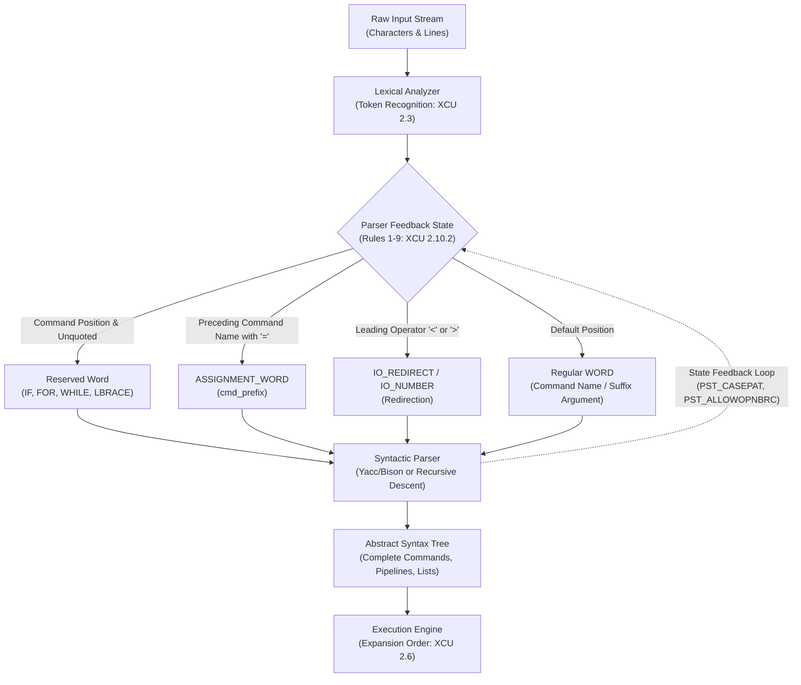

# Shell Grammar

> [!summary] Claim
> POSIX shell execution is governed by a formal context-dependent LALR(1) grammar whose productions rely on a stateful lexer feedback loop to classify ambiguous tokens into reserved words, assignment prefixes, and redirection operators.

Part of [The POSIX Shell Language](README.md) in [Shell and Unix Engineering](../README.md).

## TL;DR

The shell parser transforms character tokens into an abstract syntax tree using nine formal context-disambiguation rules that feed parser state back into the lexical analyzer.
Reserved words like `if`, `for`, `{`, and `}` are recognized only when unquoted and in command position or keyword-delimited positions.
Omitting the terminating semicolon or newline before `}` in a brace group causes a syntax error because `{` and `}` are reserved words rather than operator delimiters.
Modern shells support the POSIX.1-2024 `;&` fall-through operator for `case`, but legacy shells like dash 0.5.12, BusyBox ash, posh, and macOS bash 3.2 abort with a syntax error.
Never construct dynamic commands via string concatenation without strict grammar boundaries, as unconstrained input crosses command boundaries and executes arbitrary shell syntax trees.

## Mental model



The diagram illustrates the feedback loop between the shell lexical analyzer and the syntactic parser.
Raw character input enters the lexical analyzer where initial tokens, operators, and linebreaks are recognized per [[Token-Recognition]].
Before returning a token to the parser, the lexer consults nine context-disambiguation rules parameterized by the current parser state.
If the token matches a reserved keyword and the parser is in a valid command position, it yields a reserved word token identifier.
Tokens preceding the command name that contain an unquoted equals sign are classified as assignment words in the command prefix.
Once the command name is reduced, subsequent tokens containing equals signs are classified as ordinary argument words in the command suffix.
The parser constructs an abstract syntax tree representing complete commands, pipelines, and compound lists, while updating state flags that alter future token recognition.
Finally, the completed abstract syntax tree is delivered to the execution engine where parameter expansion, command substitution, and redirection occur at runtime.

## How it works

### The grammar hierarchy and specification

The POSIX shell language is formally specified as a context-free grammar with lexical feedback in section 2.10 of the standard `(POSIX.1-2024 XCU 2.10)`.
Unlike standard compiler frontends where a tokenizer runs independently of the parser, a shell parser cannot tokenize input without knowing the parser current grammatical state.
The root of the shell grammar is the `program` symbol, which resolves recursively down to individual pipelines and simple commands:

```
program          : linebreak complete_commands linebreak
                 | linebreak ;
complete_commands: complete_commands newline_list complete_command
                 | complete_command ;
complete_command : list separator_op
                 | list ;
list             : list separator_op and_or
                 | and_or ;
and_or           : pipeline
                 | and_or AND_IF linebreak pipeline
                 | and_or OR_IF linebreak pipeline ;
pipeline         : pipe_sequence
                 | Bang pipe_sequence ;
pipe_sequence    : command
                 | pipe_sequence '|' linebreak command ;
command          : simple_command
                 | compound_command
                 | compound_command redirect_list
                 | function_definition ;
```

Every command is either a `simple_command`, a `compound_command` (such as an `if` clause, `for` loop, `while` loop, `case` block, subshell, or brace group), or a `function_definition` `(POSIX.1-2024 XCU 2.10.2)`.
Notice that `pipeline` allows an optional leading `Bang` (`!`), but the right-hand side is `pipe_sequence` rather than `pipeline`.
Because `pipe_sequence` cannot begin with a `Bang`, standard POSIX grammar permits only a single pipeline inverter.
Chained negation like `! ! true` is rejected as a syntax error by strictly conforming parsers like dash, BusyBox ash, yash, zsh, and legacy bash 3.2, whereas bash 4.4+, ksh93, mksh, and posh implement recursive pipeline rules as an extension (measured in the shell matrix; bash 4.0 to 4.3 were not measured).

### The nine context-disambiguation rules

When the lexical analyzer identifies a generic `TOKEN`, it must apply nine formal rules in sequence to determine whether the token is a reserved word, a variable assignment, a name, or a regular word `(POSIX.1-2024 XCU 2.10.2)`:

1. **Rule 1 (Command Name & Reserved Words):** If the token is unquoted and exactly matches a reserved word in a position where a reserved word is syntactically permitted, the reserved word token identifier results.
Quoted characters prevent reserved word recognition.
2. **Rule 2 (Redirection Filename):** Filename tokens following `<` or `>` undergo parameter expansion, command substitution, arithmetic expansion, and quote removal, and should expand to exactly one field (otherwise the result is unspecified).
3. **Rule 3 (Here-Document Delimiter):** Quote removal is applied immediately to the delimiter token following `<<` or `<<-` to establish whether the here-document body undergoes expansion.
The actual body is deferred until after the next unquoted newline.
4. **Rule 4 (Case Statement Termination):** When the token is unquoted `esac` in the pattern position of a `case` clause, it is recognized as the reserved word `Esac` terminating the statement, unless preceded by an open parenthesis `(`.
The grammar annotates `pattern_list : '(' WORD` with `Do not apply rule 4`, but not every shell honors that exception (see Portability).
5. **Rule 5 (NAME in for):** The word following the reserved word `for` must meet the lexical requirements of a variable name (`[a-zA-Z_][a-zA-Z0-9_]*`), yielding token identifier `NAME`.
6. **Rule 6 (Third Word of for and case):** In `case`, the third word must be the reserved word `in`.
In `for`, the third word may be `in` or `do`, or `in` may be omitted entirely.
7. **Rule 7 (Assignment Preceding Command Name):** If a token containing an unquoted equals sign appears before the command name, characters preceding the first `=` are checked.
If they form a valid variable name, it yields `ASSIGNMENT_WORD` in `cmd_prefix`.
Tokens containing `=` appearing after the command name yield ordinary `WORD` tokens in `cmd_suffix`.
8. **Rule 8 (NAME in Function):** In `fname ()`, the token preceding `()` must be a valid name.
If it matches a reserved word, the reserved word token results, triggering a syntax error.
9. **Rule 9 (Body of Function):** Word expansions and assignments must never occur while parsing a function body.
Tokens are stored verbatim in the syntax tree for runtime evaluation.

### The lexer-parser feedback loop

In a classical LALR(1) parser generated by Yacc or Bison, lexical analysis precedes syntactic reduction by exactly one lookahead token.
The shell grammar violates strict context-free separation because lexical tokenization depends on the parser state.
In GNU Bash, the grammar is defined in `parse.y` and compiled via GNU Bison; the shipped `y.tab.c` says it was made by GNU Bison 3.8.2 `(bash parse.y and y.tab.c, as of 2026-10)`.
Bash maintains parser state flags including `PST_CASEPAT` (`in a case pattern list`), `PST_ALLOWOPNBRC` (`allow open brace for function def`), both defined in `parser.h`, and the counter `esacs_needed_count`.
In `parse.y`, the function `special_case_tokens()` inspects `last_read_token` and `token_before_that`.
The simplified excerpt below omits the `SELECT_COMMAND` branches, a second rule 6 clause driven by `expecting_in_token`, and the `do` handling:

```c
/* Simplified excerpt from GNU Bash parse.y: POSIX Rule 6, plus "case word in esac" */
static int
special_case_tokens (const char *tokstr)
{
  /* Posix grammar rule 6 */
  if ((last_read_token == WORD) &&
      (token_before_that == FOR || token_before_that == CASE) &&
      (tokstr[0] == 'i' && tokstr[1] == 'n' && tokstr[2] == 0))
    {
      if (expecting_in_command == CASE)
        {
          parser_state |= PST_CASEPAT;
          esacs_needed_count++;
        }
      if (expecting_in_token)
        expecting_in_token--;
      expecting_in_command = 0;
      return (IN);
    }
  /* ... */
  if (esacs_needed_count)
    {
      if (last_read_token == IN && STREQ (tokstr, "esac"))
        {
          esacs_needed_count--;
          parser_state &= ~PST_CASEPAT;
          return (ESAC);
        }
    }
  /* ... */
}
```

Rule 4 itself lives in the reserved-word lookup macro `CHECK_FOR_RESERVED_WORD`: while `PST_CASEPAT` is set, every reserved word except `esac` is returned as a plain word, and `esac` after `|` or `(` is also left as a word (the source comments call these "Posix grammar rule 4" and "phantom Posix grammar rule 4").

In Dash and BusyBox ash, the shell eschews Yacc in favor of a hand-written recursive descent parser, in `src/parser.c` for dash and `shell/ash.c` for BusyBox `(dash src/parser.c, parsecmd)`.
Dash implements the feedback loop by setting a global bitmask before the parser calls `readtoken()`:
The global `int checkkwd` combines flags `CHKKWD` (check keywords), `CHKNL` (skip newlines before the token), `CHKALIAS` (expand aliases), and `CHKEOFMARK`, defined in `src/parser.h`.
In `dash/src/parser.c`, `readtoken()` checks:

```c
/* Excerpt from Dash src/parser.c showing keyword gating */
if (t != TWORD || quoteflag)
  goto out;

if (kwd & CHKKWD) {
  const char *const *pp;
  if ((pp = findkwd(wordtext))) {
    lasttoken = t = pp - parsekwd + KWDOFFSET;
    goto out;
  }
}
```

If `quoteflag` is non-zero, Dash immediately bypasses keyword lookup.
This directly realizes POSIX Rule 1: quoting characters suppress keyword recognition.

### Reserved words versus operators

POSIX recognizes sixteen reserved words:
`if`, `then`, `else`, `elif`, `fi`, `do`, `done`, `case`, `esac`, `while`, `until`, `for`, `{`, `}`, `!`, and `in` `(POSIX.1-2024 XCU 2.4 and the %token list in XCU 2.10.2)`.
Notice that `{` (`Lbrace`), `}` (`Rbrace`), and `!` (`Bang`) are reserved words, not operator tokens.
By contrast, `(`, `)`, `|`, `&`, `;`, `<`, and `>` are operators.
Because operators contain punctuation characters recognized during character classification, they serve as self-delimiting token boundaries [[Token-Recognition]].
Parentheses can enclose commands without any surrounding whitespace: `(echo hi)` parses successfully.
Because `{` and `}` are reserved words, they require surrounding lexical delimiters (spaces, tabs, semicolons, or newlines).
The command `{echo hi;}` attempts to execute the unknown utility `{echo`.
Furthermore, inside `{ echo hi }`, the token `}` appears in `cmd_suffix` as an argument to `echo`.
A semicolon or newline is mandatory before `}` so the parser reduces the `simple_command` before the lexer encounters `}` in command position.
Because the group is still open, `sh -c '{ echo hi }'` runs nothing and fails at end of input (bash, dash, and ksh93 measured: status 2, 2, and 3); only if a later line supplies a `}` does the group close and `echo` print `hi }`.
Native zsh is the exception: it prints `hi`, while `zsh --emulate sh` rejects it (lab test `subshell allows omitted semicolon`).

### Linebreaks and grammar separators

The POSIX grammar distinguishes between mandatory separators and optional linebreaks.
A `linebreak` is defined as zero or more `<newline>` characters:

```
linebreak   : newline_list | /* empty */ ;
newline_list: NEWLINE | newline_list NEWLINE ;
```

Because `linebreak` is explicitly written into the productions for `and_or` (`&&`, `||`) and `pipe_sequence` (`|`), literal newlines can follow these operators without a trailing backslash:
`cmd1 && \n cmd2` and `cmd1 | \n cmd2` are syntactically complete.
Linebreaks are also permitted after `then`, `else`, `elif`, and `do`, because each opens a `compound_list` that begins with `linebreak`, and after `in` in a `case` clause (`Case WORD linebreak in linebreak case_list Esac`); in a `for` clause the `linebreak` comes before `in`, not after it `(POSIX.1-2024 XCU 2.10.2)`.
However, the production for file redirection does not contain `linebreak` (abridged below; the full `io_file` also lists `LESSAND`, `GREATAND`, `DGREAT`, `LESSGREAT`, and `CLOBBER`):

```
io_file : '<' filename
        | '>' filename ;
filename: WORD ;
```

Placing a bare newline immediately after `<` or `>` results in an immediate syntax error in every shell of the matrix (lab test `newline immediately following redirection operator`).
Similarly, the production for `compound_list` requires at least one command term:

```
compound_list : linebreak term
              | linebreak term separator ;
term          : term separator and_or
              | and_or ;
```

Writing `if true; then fi` violates the grammar because `compound_list` cannot be empty.
The shell parser encounters `fi` when expecting `and_or`, triggering an unexpected token syntax error.
However, zsh and yash permit an empty compound list between `then` and `fi` as an extension, treating it as a null command.

### Simple command prefix and suffix scoping

A simple command is parsed into prefixes, a command name, and suffixes:

```
simple_command : cmd_prefix cmd_word cmd_suffix
               | cmd_prefix cmd_word
               | cmd_prefix
               | cmd_name cmd_suffix
               | cmd_name ;
cmd_prefix     : io_redirect | cmd_prefix io_redirect
               | ASSIGNMENT_WORD | cmd_prefix ASSIGNMENT_WORD ;
cmd_suffix     : io_redirect | cmd_suffix io_redirect
               | WORD | cmd_suffix WORD ;
```

This production encodes variable assignment scoping rules:
Every assignment before the command name is an `ASSIGNMENT_WORD` in `cmd_prefix`.
If no command name is present (`cmd_prefix` alone), the assignments are performed in the current shell execution environment [[Simple-Commands-and-Assignment-Prefixes]].
If a command name is present, prefix assignments are exported to the child process environment without mutating the parent shell variables (except for special built-in utilities; for a function call they affect the shell while the function runs, and whether they persist afterwards is unspecified) `(POSIX.1-2024 XCU 2.9.1.2)`.
Every assignment appearing after the command name is reduced as a plain `WORD` in `cmd_suffix`.
In `echo var=1`, `var=1` is an argument passed in `argv`, never an environment assignment.

### Syntax error handling and recovery

POSIX defines distinct error recovery rules for interactive and non-interactive shells in section 2.8.1 `(POSIX.1-2024 XCU 2.8.1)`.
In an interactive shell, a syntax error requires a diagnostic on standard error, the shell shall not exit, and it shall not perform any further processing of the command in which the error occurred; in practice the shell then prompts again with `PS1`.
If an input line contains an incomplete grammatical production (such as an unclosed quote, an unclosed `if`, or a trailing `|`), the shell displays secondary prompt `PS2` and continues reading.
In a non-interactive shell executing a script, a syntax error is fatal: the shell must write a diagnostic to standard error and exit immediately with a non-zero exit status.
A critical divergence occurs when a syntax error arises inside the `eval` special built-in utility:
Dash, BusyBox ash, mksh, posh, and yash treat an `eval` syntax error as a fatal shell language syntax error that terminates the non-interactive process immediately, as `(POSIX.1-2024 XCU 2.8.1)` requires (measured in the shell matrix, lab test `non-interactive eval syntax error`).
Bash 4.4 and later in POSIX mode also terminate the non-interactive shell process on `eval` syntax errors (measured on 4.4, 5.1, 5.2, and 5.3; 4.0 to 4.3 were not measured).
In native Bash, legacy Bash 3.2 (including macOS `/bin/sh` in POSIX mode), Zsh, and Ksh93, an `eval` syntax error is treated as a recoverable command failure that sets `$?` to non-zero (1, 2, or 3 depending on shell and version) and continues script execution.

## Numbers and limits

| Metric / Parameter | Value | Standard / Source | Notes |
|:---|:---|:---|:---|
| POSIX Reserved Words | 16 keywords | POSIX.1-2024 XCU 2.4, XCU 2.10.2 | `if`, `then`, `else`, `elif`, `fi`, `do`, `done`, `case`, `esac`, `while`, `until`, `for`, `{`, `}`, `!`, `in` |
| POSIX Multi-character Operators | 11 operators | POSIX.1-2024 XCU 2.10.2 | `&&`, `\|\|`, `;;`, `;&`, `<<`, `>>`, `<&`, `>&`, `<>`, `<<-`, `>\|` |
| POSIX Single-character Operators | 7 operators | POSIX.1-2024 XBD 3.243, 3.85, 3.304 | `&`, `;`, `(`, `)`, `\|` (control operators, XBD 3.85, which also counts newline), `<`, `>` (redirection operators, XBD 3.304) |
| Context Disambiguation Rules | 9 formal rules | POSIX.1-2024 XCU 2.10.2 | Rules 1 through 9 for token resolution |
| Bison Default Parser Max Depth | 10,000 entries | GNU Bison skeleton; bash `y.tab.c` (Bison 3.8.2) | `YYMAXDEPTH` 10000 caps the parser state stack, which starts at `YYINITDEPTH` 200; bash does not override either (as of 2026-10) |
| Max Nested Subshell Depth (Bash) | 4,998 levels | Measured in the shell matrix (by hand, not a lab test) | Depth 4,999 fails with `syntax error near unexpected token` and status 2 (1 in bash 4.4) in bash 3.2, 4.4, 5.1, and 5.3; consistent with about 2 stack entries per level against `YYMAXDEPTH` (inferred) |
| Max Nested Subshell Depth (Dash) | >= 21,000 levels | Measured in the shell matrix (by hand) | Deepest depth measured; a deeper `-c` string exceeds the container's single-argument limit; bounded by the C call stack in recursive descent (as of 2026-10) |
| Parser Segfault Threshold (Zsh) | 1,000 to 2,000 levels | Measured in the shell matrix (by hand) | Linux zsh 5.9 segfaults (status 139) between 1,000 and 2,000; macOS zsh 5.9.2 survives 6,000 and segfaults by 10,000 |
| Parser Segfault Threshold (Ksh93) | 6,000 to 10,000 levels | Measured in the shell matrix (by hand) | ksh93u+ and ksh93u+m segfault on C stack overflow (status 139) |
| Parser Segfault Threshold (Other) | 10,000 to 20,000 levels | Measured in the shell matrix (by hand) | mksh, yash, posh, and BusyBox ash segfault on deep subshell nesting |
| Syntax Error Exit Code (Bash/Dash/Ash/Yash) | 2 | Measured in the shell matrix | Bash 3.2/5.x, Dash, BusyBox, and Yash return 2 (Bash 4.4 returns 1 for -c) |
| Syntax Error Exit Code (Ksh93) | 3 | Measured in the shell matrix | ksh93 returns 3 for parse-time syntax errors (including inside `eval`), 1 for an arithmetic-expansion syntax error found at run time such as `$((1+))` |
| Syntax Error Exit Code (Zsh/Mksh/Posh) | 1 | Measured in the shell matrix | Returned on fatal syntax or parse errors |
| Secondary Prompt Variable | `PS2` (default `> `) | POSIX.1-2024 XCU 2.5.3 | Written to standard error when an interactive user enters a newline before the command is complete; part of the User Portability Utilities option |

## Portability

The table below contrasts grammar support and parser behavior across all major shell implementations, verified in the lab matrix `(as of 2026-10)`.
Every row except the named FD row is asserted by a lab test; the named FD row was measured by hand in the same matrix images with `exec {fd}>/dev/null; echo fd=$fd`.

| Feature / Behavior | POSIX sh | macOS bash 3.2 | current bash 5.3 | zsh (native) | zsh (`--emulate sh`) | dash 0.5.12 | ksh93u+m 1.0.10 | mksh R59 | yash 2.58 | posh 0.14 | BusyBox ash |
|:---|:---|:---|:---|:---|:---|:---|:---|:---|:---|:---|:---|
| Case fall-through `;&` | Yes (2024) | No (syntax error) | Yes (since 4.0) | Yes | Yes | No (syntax error) | Yes | Yes (R59 measured) | Yes (since 2.58) | No (syntax error) | No (syntax error) |
| Double negation `! ! true` | No (grammar error) | No (syntax error) | Yes | No (syntax error) | No (syntax error) | No (syntax error) | Yes | Yes | No (syntax error) | Yes | No (syntax error) |
| Named FD `{var}>file` | Optional (`IO_LOCATION`) | No (treated as cmd) | Yes (since 4.1, allocates 10) | Yes (allocates 11) | No (treated as cmd) | No (treated as cmd) | Yes (allocates 10) | No (treated as cmd) | No (treated as cmd) | No (treated as cmd) | No (treated as cmd) |
| Bare `esac)` pattern match | Syntax error | Syntax error | Syntax error | Syntax error | Syntax error | Syntax error | Syntax error (status 3) | Syntax error | Syntax error | Syntax error | Syntax error |
| Unquoted `(esac)` pattern match | Matches (rule 4 not applied) | Matches (Apple build; upstream 3.2 syntax error) | Matches (since 5.2; 4.4 and 5.1 syntax error) | Matches | Syntax error | Matches | Matches | Matches | Matches | Matches | Matches |
| Non-compound function body | Syntax error | Syntax error | Syntax error | Permitted | Permitted | Permitted | Permitted | Permitted | Syntax error | Syntax error | Permitted |
| Empty `if true; then fi` | Syntax error | Syntax error | Syntax error | Permitted | Permitted | Syntax error | Syntax error | Syntax error | Permitted | Syntax error | Syntax error |
| Brace without `;` (`{ echo }`) | Syntax error | Syntax error | Syntax error | Permitted | Syntax error | Syntax error | Syntax error | Syntax error | Syntax error | Syntax error | Syntax error |
| Non-interactive `eval` syntax abort | Shall exit | Survives (status 1) | Aborts (POSIX) / Survives (2) | Survives (status 1) | Survives (status 1) | Aborts process (2) | Survives (status 3) | Aborts process (1) | Aborts process (2) | Aborts process (1) | Aborts process (2) |

## Worked example

The test script below demonstrates the shell grammar rules; it is the lab's `grammar-probe.sh` verbatim, run by the test harness in [lab](../labs/03-shell-grammar/).
The probe executes cleanly under every shell in the matrix:

```sh
#!/bin/sh
# grammar-probe.sh: probe POSIX.1-2024 XCU 2.10 Shell Grammar mechanisms.
# Designed to be ShellCheck clean, strictly POSIX-conforming, and runnable
# under dash, bash, zsh, ksh93, mksh, yash, posh, and BusyBox ash.
set -eu

fmt_args() {
  printf 'argc=%d' "$#"
  for arg in "$@"; do
    printf ' <%s>' "${arg}"
  done
  printf '\n'
}

probe_mode="${1:-all}"

# token_class CODE: run CODE through eval in a subshell and print how its first token parsed:
# word (status 127, looked up as a command name), keyword (a syntax error), or ran (status 0).
token_class() {
  rc=0
  (eval "$1") >/dev/null 2>&1 || rc=$?
  case "${rc}" in
    0) printf 'ran' ;;
    127) printf 'word' ;;
    *) printf 'keyword' ;;
  esac
}

probe_reserved_words() {
  # POSIX Rule 1: reserved words are recognized only unquoted in command position.
  # Unquoted if opens an if clause, so "if true" alone is a syntax error;
  # escaped \if or quoted 'if' is a command name (WORD) that no command search finds.
  unquoted=$(token_class 'if true')
  escaped=$(token_class '\if true')
  quoted=$(token_class "'if' true")
  printf '1_reserved_words: unquoted=%s escaped=%s quoted=%s\n' "${unquoted}" "${escaped}" "${quoted}"
}

probe_esac_pattern() {
  # POSIX Rule 4: esac is recognized as Esac terminating case unless parenthesized or quoted.
  # Both patterns are quoted: an unquoted (esac) is rejected by bash 5.1 and older upstream
  # builds and by zsh --emulate sh (see test.bats), so only quoting is portable.
  # The parenthesized case is an eval string because shfmt drops the optional '('.
  target="esac"
  p_match="none"
  # shellcheck disable=SC2016 # expanded by eval
  eval 'case "${target}" in ("esac") p_match="parenthesized" ;; *) p_match="wildcard" ;; esac'

  q_match="none"
  case "${target}" in
    'esac') q_match="quoted" ;;
    *) q_match="wildcard" ;;
  esac
  printf '2_esac_pattern: paren=%s quoted=%s\n' "${p_match}" "${q_match}"
}

probe_prefix_suffix() {
  # POSIX Rule 7: assignments before command name belong to cmd_prefix (ASSIGNMENT_WORD);
  # assignments after command name belong to cmd_suffix (WORD argument).
  # 1. Assignment prefix on external utility (env)
  # shellcheck disable=SC2097,SC2098 # intentional demonstration of prefix assignment export
  PREFIX_TEST=outer
  # shellcheck disable=SC2097,SC2098 # prefix assignment to env utility
  env_seen=$(PREFIX_TEST=prefix_val env | grep '^PREFIX_TEST=' | cut -d= -f2)
  printf '3_prefix_export: env_seen=%s outer_retained=%s\n' "${env_seen}" "${PREFIX_TEST}"

  # 2. Assignment prefix without command name persists in current shell environment
  STANDALONE_VAR=persisted_val </dev/null
  printf '4_prefix_standalone: var=%s\n' "${STANDALONE_VAR}"

  # 3. Assignment in suffix is parsed as WORD operand, not assignment
  # Use fmt_args to display arguments received
  fmt_args SUFFIX_VAR=assigned_in_suffix regular_arg
}

probe_function_bodies() {
  # POSIX Rule 8 & 9: function bodies execute compound commands; word expansion deferred.
  # Brace group as body: executes in current environment.
  fn_var="initial_parent"
  fn_brace() {
    fn_var="mutated_parent"
  }
  fn_brace
  printf '5_fn_brace: caller_var=%s\n' "${fn_var}"

  # Rule 9: word expansion deferred until invocation, not when parsed
  def_val="first"
  fn_deferred() {
    printf '6_fn_deferred: val=%s\n' "${def_val}"
  }
  def_val="second"
  fn_deferred
}

probe_linebreaks() {
  # POSIX grammar allows linebreaks after &&, ||, |, and in compound_list.
  # No backslashes: each newline below follows an operator, so only the grammar's
  # linebreak productions make these commands complete.
  # The code is in eval strings because shfmt moves the operators to the next line
  # and joins the lines with backslash-newline, which is removed before tokenization.
  and_or=$(eval 'false &&
printf skipped ||
printf ran')
  pipe=$(eval 'printf pipe_line |
tr _ -')
  printf '7_linebreaks: and_or=%s pipe=%s\n' "${and_or}" "${pipe}"
}

probe_negation() {
  # POSIX grammar: pipeline : pipe_sequence | Bang pipe_sequence.
  # Single ! inverts pipeline status.
  # shellcheck disable=SC2015 # intentional grammar pipeline status test
  if ! false; then
    printf '8_negation: inverted\n'
  fi
}

case "${probe_mode}" in
  reserved-words) probe_reserved_words ;;
  esac-pattern) probe_esac_pattern ;;
  prefix-suffix) probe_prefix_suffix ;;
  function-bodies) probe_function_bodies ;;
  linebreaks) probe_linebreaks ;;
  negation) probe_negation ;;
  all)
    probe_reserved_words
    probe_esac_pattern
    probe_prefix_suffix
    probe_function_bodies
    probe_linebreaks
    probe_negation
    ;;
  *)
    printf 'Unknown mode: %s\n' "${probe_mode}" >&2
    exit 1
    ;;
esac
```

Executing `grammar-probe.sh all` in the test suite yields the exact output:

```
1_reserved_words: unquoted=keyword escaped=word quoted=word
2_esac_pattern: paren=parenthesized quoted=quoted
3_prefix_export: env_seen=prefix_val outer_retained=outer
4_prefix_standalone: var=persisted_val
argc=2 <SUFFIX_VAR=assigned_in_suffix> <regular_arg>
5_fn_brace: caller_var=mutated_parent
6_fn_deferred: val=second
7_linebreaks: and_or=ran pipe=pipe-line
8_negation: inverted
```

## Pitfalls

> [!warning] Unquoted esac in case pattern position
> Trigger: Writing `case "$token" in esac) ... ;; esac` without parentheses around the pattern.
> Symptom: The parser aborts with `syntax error near unexpected token ')'`.
> Mechanism: POSIX Grammar Rule 4 dictates that an unquoted `esac` appearing in pattern position without a leading `(` is classified as the reserved word `Esac` closing the statement.
> Historical AT&T ksh93u+ 2012-08-01 (macOS `/bin/ksh`) accepts bare `esac)` and matches it, but ksh93u+m 1.0.10 and all other shells in the matrix reject it with a syntax error (lab test `unquoted esac in pattern position`).
> Fix: Quote the pattern: `'esac')` or `("esac")` works in every shell in the matrix.
> The unquoted parenthesized form `(esac)` is what the grammar allows (`'(' WORD /* Do not apply rule 4 */`), but upstream bash 3.2, 4.4, and 5.1 and `zsh --emulate sh` still reject it; bash 5.2 and later, Apple's bash 3.2.57, and the other shells accept it (lab test `unquoted esac after an opening parenthesis`).

> [!warning] Semicolon omission in brace group compound command
> Trigger: Writing `{ command }` on a single physical line without a terminating `;` or newline before `}`.
> Symptom: Nothing runs: the group never closes, so the shell reports a syntax error at end of input (bash: `unexpected end of file`, status 2); if a later line supplies a `}`, the command instead runs with `}` as its final argument.
> Mechanism: Braces are reserved words, not lexical operators.
> The shell grammar requires a command separator (`sequential_sep`) before `}` so the parser reduces the simple command before checking for reserved word `Rbrace`.
> Fix: Always terminate the enclosed command list with `;` or a newline: `{ command; }`.

> [!warning] Shellshock grammar boundary execution failure (CVE-2014-6271)
> Trigger: Exporting function definitions via environment variables in Bash through 4.3 before patch `bash43-025` (NVD: "GNU Bash through 4.3").
> Symptom: Arbitrary commands appended after a function definition body execute automatically upon child shell initialization.
> Mechanism: Bash imported functions formatted as `() { :; }; /bin/malicious` by invoking `parse_and_execute()`.
> The grammar production `complete_commands` continued parsing subsequent commands beyond the single function definition AST.
> Fix: Update Bash to version 4.3.30+: `bash43-025` stopped executing trailing commands during function import, `bash43-027` moved exported functions into variables named `BASH_FUNC_name%%` (its `BASHFUNC_PREFIX` and `BASHFUNC_SUFFIX`), and `bash43-030` closed the last 2014 follow-up, CVE-2014-6278 `(NVD CVE-2014-6271; bash-4.3-patches)`.

> [!warning] Redirection stack overflow in Bison parser (CVE-2014-7186)
> Trigger: Supplying a script that attaches many here-documents to a single command.
> Symptom: Bash crashes (out-of-bounds array access) while parsing, before the command runs.
> Mechanism: In `parse.y`, Bash recorded each pending here-document in a fixed-size array `static REDIRECT *redir_stack[10]` and pushed onto it with no bounds check.
> More than ten pending here-documents wrote past the array during grammar reduction.
> Fix: Update to Bash 4.3 with patch `bash43-028` or later (NVD lists Bash "through 4.3 bash43-026" as affected): the patch enlarged the array to `HEREDOC_MAX` (16) and added `push_heredoc()`, which reports `maximum here-document count exceeded` and exits instead of overflowing; the same patch fixed the nested-loop overflow tracked as CVE-2014-7187 `(NVD CVE-2014-7186; bash43-028)`.

> [!warning] Non-interactive process abortion on eval syntax error
> Trigger: Calling `eval "$untrusted_string"` inside a non-interactive shell script.
> Symptom: A syntax error inside the evaluated string terminates the entire shell process immediately, skipping subsequent error handling logic.
> Mechanism: POSIX.1-2024 section 2.8.1 mandates that shell language syntax errors in non-interactive shells "shall exit".
> Dash, BusyBox ash, Mksh, Posh, Yash, and Bash 4.4+ in POSIX mode strictly enforce this rule and abort the process (measured in the shell matrix).
> In contrast, native Bash, legacy Bash 3.2 (including macOS `/bin/sh` in POSIX mode), Zsh, and Ksh93 catch the error and continue execution with a non-zero exit status (`$?` set to 1, 2, or 3).
> Fix: Validate grammar and input sanitization before calling `eval`, or isolate `eval` inside a subshell: `( eval "$str" )`, since a "shall exit" error in a subshell exits only that subshell with a non-zero status `(POSIX.1-2024 XCU 2.8.1)`.

> [!warning] Case fallthrough ;& parsing failure on legacy or minimal shells
> Trigger: Using POSIX.1-2024 case fallthrough operator `;&` in scripts executed by Dash, BusyBox ash, Posh, or macOS `/bin/sh` (Bash 3.2).
> Symptom: The shell aborts at parse time with a fatal syntax error before executing any command in the script.
> Mechanism: Although standardized in POSIX.1-2024 and implemented in modern Bash (4.0+), Zsh, Ksh93, Mksh, and Yash, minimal and legacy shells reject the `;&` token.
> Fix: Refactor multi-clause logic into shared helper functions or sequential conditional checks when targeting portable `/bin/sh`.

> [!warning] Non-compound function body syntax error in strict POSIX parsers
> Trigger: Defining a function with a simple command body (`fname() cmd`) instead of a compound command body (`fname() { cmd; }`).
> Symptom: The script runs cleanly under Dash, BusyBox ash, Mksh, Ksh93, and Zsh, but immediately aborts with a syntax error under Bash, Posh, or Yash.
> Mechanism: POSIX.1-2024 XCU 2.10.2 formally specifies that a function body must be a compound command.
> Dash, BusyBox ash, Mksh, Ksh93, and Zsh implement an extension permitting simple commands, whereas Bash, Posh, and Yash strictly enforce compound commands.
> Fix: Always wrap function bodies in a brace group `{ ...; }` or subshell `( ... )`.

## Security and robustness

Parsing untrusted input as shell grammar is inherently vulnerable to abstract syntax tree injection.
When an application constructs a command via string interpolation (`sh -c "grep $USER /etc/passwd"`), metacharacters like `;`, `&`, `|`, `(`, and `)` terminate the intended simple command and inject new nodes into the parser grammar tree.
The resulting syntax tree executes with the full privileges of the shell process.
Never use `eval` or `sh -c` to parse dynamic strings without passing variables as separate arguments through `argv` [[Command-Injection]].
Use positional parameters to safely separate the grammar from dynamic data:

```sh
# INSECURE: user_input alters the grammar syntax tree
eval "process_data ${user_input}"

# SECURE: grammar is fixed; user_input is passed as an unparsed positional argument
sh -c 'process_data "$1"' sh "${user_input}"
```

A second critical robustness boundary is parser recursion exhaustion.
Because table-driven parsers like GNU Bison allocate finite state stacks (`YYMAXDEPTH = 10000`), deeply nested subshells or control clauses crash the parser with syntax errors or stack overflow.
In high-assurance daemons and parsers, enforce strict length and depth limits on user-supplied configuration scripts before passing them to the shell interpreter.

## The principal's view

A distinguished engineer approaches the shell language not as a general-purpose programming language, but as an execution harness for system calls and external utilities.
The shell grammar is inherently unhygienic: its context-sensitive lexical feedback loop, dynamic keyword recognition, and runtime word expansions make static analysis notoriously difficult.
Staff-plus engineers enforce three strict architectural rules across enterprise codebases:

1. **Constrain scripts to the POSIX grammar intersection:** Never allow non-standard grammar keywords such as `function foo()`, `[[ ... ]]`, or `select` in infrastructure scripts intended for `/bin/sh`.
The moment a script requires non-POSIX extensions, set the shebang explicitly to `#!/usr/bin/env bash` and enforce the exact major version in CI.
2. **Treat syntax errors as fatal process boundaries:** Do not rely on `eval` error handling across heterogeneous environments.
Because Dash, BusyBox ash, Mksh, Posh, Yash, and Bash 4.4+ in POSIX mode terminate the process on syntax errors while native Bash, macOS `/bin/sh` (Bash 3.2), Zsh, and Ksh93 survive, any script relying on `eval` error recovery will experience production outages across heterogeneous deployment targets.
3. **Graduate to compiled languages when grammar complexity escalates:** The shell grammar lacks namespaces, formal data structures, and type safety.
When a shell script exceeds 500 lines, requires complex nested parsing, or handles untrusted structured data (JSON, XML), migrate the tool immediately to Go, Rust, or Python.

## Interview questions

> [!question] L5: Why does `(echo hi)` execute successfully while `{echo hi}` fails with a command not found error?
>
> > [!success]- Answer
> > Parentheses `(` and `)` are single-character operator tokens defined in POSIX XBD 3.243, which serve as self-delimiting token boundaries during lexical analysis.
> > Braces `{` and `}` are reserved words defined in POSIX XCU 2.10.2, which require surrounding whitespace or delimiters to be recognized as tokens.
> > In `{echo hi}`, the lexer cannot split `{` from `echo`, so the first word `{echo` becomes the utility name (with `hi}` as its argument).
> > Strictly, `(` and `)` are control operators (XBD 3.85), one of the two kinds of operator that XBD 3.243 defines.
> >
> > Follow-up: Why is a semicolon or newline mandatory before the closing brace in `{ echo hi; }`?

> [!question] L6: In the command `FOO=bar cmd BAZ=qux`, how does the shell grammar classify the two assignments, and what is their execution lifecycle?
>
> > [!success]- Answer
> > POSIX Grammar Rule 7 classifies `FOO=bar` as an `ASSIGNMENT_WORD` because it precedes the command name, placing it into `cmd_prefix`.
> > Prefix assignments are exported to the environment of `cmd` for the duration of its execution, but do not mutate the parent shell environment unless `cmd` is a special built-in.
> > Once the parser reduces the command name `cmd`, all subsequent tokens belong to `cmd_suffix`.
> > Therefore, `BAZ=qux` is classified as a regular `WORD` operand and passed to `cmd` in `argv`, having no effect on environment variables.
> >
> > Follow-up: What happens to `FOO=bar` if `cmd` is omitted entirely (`FOO=bar < /dev/null`)?

> [!question] L6: Predict the output: What happens when executing the script below under Dash versus Bash?
>
> ```sh
> eval "fi"
> echo "survived: $?"
> ```
>
> > [!success]- Answer
> > Under Dash, BusyBox ash, Mksh, Posh, Yash, and Bash 4.4+ in POSIX mode, the script prints an error diagnostic to stderr and aborts immediately without printing `survived`.
> > POSIX.1-2024 section 2.8.1 specifies that a shell language syntax error in a non-interactive shell shall cause the process to exit immediately.
> > Under native Bash, `eval` syntax errors are treated as non-fatal command failures; Bash prints a diagnostic, continues execution, and outputs `survived: 2` (or `survived: 1` in Bash 3.2 and 4.4).
> > Crucially, macOS `/bin/sh` (legacy Bash 3.2 in POSIX mode) retains historical behavior and survives, printing `survived: 1`.
> > Under Zsh and Ksh93, the script also survives, setting `$?` to 1 in Zsh and 3 in Ksh93.
> >
> > Follow-up: How can an engineer portably run dynamic code that might contain syntax errors without risking process termination?

> [!question] L6: Debug this script: Why does the case statement below fail with a syntax error, and how is it corrected?
>
> ```sh
> read -r token
> case "$token" in
>   esac) echo "Token was esac" ;;
>   *)    echo "Token was something else" ;;
> esac
> ```
>
> > [!success]- Answer
> > The script fails with `syntax error near unexpected token ')'` because the parser encounters the reserved word `esac` where a pattern is expected.
> > Under POSIX Grammar Rule 4, an unquoted `esac` in pattern position is recognized as the reserved word `Esac` terminating the statement.
> > Because `esac` is treated as the closing keyword, the subsequent `)` is an unexpected syntax token.
> > While historical AT&T ksh93u+ 2012-08-01 accepts and matches bare `esac)`, ksh93u+m 1.0.10 and all other shells in the matrix reject it with a syntax error.
> > The portable fix is quoting the pattern, `'esac')`, which no shell treats as a reserved word.
> > The grammar also exempts `(esac)` from Rule 4, but upstream bash 3.2 to 5.1 and `zsh --emulate sh` still reject that form (measured in the shell matrix), so do not rely on the parenthesis alone.
> >
> > Follow-up: Does the leading parenthesis before patterns serve any syntactic purpose other than disambiguating `esac`?

> [!question] L7: Why can a POSIX shell grammar not be parsed using a standard LALR(1) parser generator without a stateful lexer feedback loop?
>
> > [!success]- Answer
> > Shell tokens are heavily overloaded and their classification depends entirely on the current position within the grammar.
> > For example, the string `for` can be a reserved keyword, an argument to an external command, or a function name.
> > A context-free LALR(1) lexer cannot determine whether `for` should return token `FOR` or token `WORD` without knowing if the parser is in command position.
> > Furthermore, recognizing `in` and `do` as keywords is only valid when preceding parser states record that a `case` or `for` loop is actively being reduced.
> > This grammatical ambiguity requires the parser to expose internal state flags (such as `PST_CASEPAT` and `last_read_token`) back to the lexical analyzer during tokenization.
> >
> > Follow-up: How does the Almquist shell (Dash) implement this feedback loop in its hand-written recursive descent parser?

> [!question] L7: How did an architectural flaw in Bash abstract syntax tree parsing lead to the Shellshock vulnerability (CVE-2014-6271)?
>
> > [!success]- Answer
> > Bash supported exporting function definitions to child shells by encoding them into environment variables starting with `() {`.
> > Upon initialization, Bash scanned its environment and passed variables matching this prefix directly to `parse_and_execute()`.
> > The parser grammar production for complete commands allowed multiple sequential commands separated by semicolons or newlines.
> > Because `parse_and_execute()` did not terminate after parsing the single `function_definition` AST node, trailing commands appended after the closing brace were compiled into subsequent syntax trees and executed immediately.
> >
> > Follow-up: How did maintainers redesign function importing to eliminate grammar injection while preserving export capability?

> [!question] L7: Under what circumstances can a newline `<newline>` appear in a shell script without being preceded by a backslash or semicolon?
>
> > [!success]- Answer
> > A newline is syntactically permitted without a backslash whenever the formal grammar defines a `linebreak` or `newline_list` production.
> > Specifically, linebreaks are permitted immediately after pipeline operators (`|`), logical operators (`&&`, `||`), and control flow keywords (`then`, `else`, `elif`, `do`, and the `in` of a `case` clause; in a `for` clause the `linebreak` precedes `in`).
> > Linebreaks are also permitted within `compound_list` constructs between individual command lists.
> > Conversely, a newline is forbidden immediately after redirection operators (`<`, `>`) because the `io_file` production requires an immediate `filename` token on the same logical line.
> >
> > Follow-up: What is the grammatical distinction between a separator (`separator`) and a sequential separator (`sequential_sep`)?

> [!question] L7: What is the POSIX.1-2024 `;&` (`SEMI_AND`) operator, and why does using it create major portability hazards in production environments?
>
> > [!success]- Answer
> > The `;&` operator is a case clause terminator standardized in POSIX.1-2024 that enables unconditional fall-through to the next case clause.
> > When a pattern matches and its compound list terminates with `;&`, the shell executes the command list of the subsequent pattern without evaluating that pattern.
> > While modern Bash (4.0+), Zsh, Ksh93, Mksh (R59 measured), and Yash (since 2.58, released 2025-02-02) implement `;&`, minimal and legacy shells including Dash 0.5.12, BusyBox ash 1.37.0, Posh 0.14.1, and macOS default `/bin/sh` (Bash 3.2) lack this token.
> > In those environments, the parser fails at compile time with a fatal syntax error near `&`, preventing the script from running at all.
> >
> > Follow-up: How does `;&` differ from Bash non-standard `;;&` operator?

## Related

Prerequisites: [[Token-Recognition]]

Next: [[Aliases]]

See also: [[Reading-the-POSIX-Standard]], [[Simple-Commands-and-Assignment-Prefixes]], [[Compound-Commands]], [[Pipelines-and-And-Or-Lists]], [[Functions-and-Scope]], [[Redirection-Order-and-Semantics]], [[Here-Documents]], [[POSIX-2024-Changes]]

## Further reading

- IEEE Std 1003.1-2024 XCU Section 2.10 Shell Grammar: https://pubs.opengroup.org/onlinepubs/9799919799/utilities/V3_chap02.html - The authoritative formal specification of the POSIX shell grammar and context rules.
- IEEE Std 1003.1-2024 XBD Section 3.243 Operator: https://pubs.opengroup.org/onlinepubs/9799919799/basedefs/V1_chap03.html - Definitions and token rules for control operators and redirection operators.
- GNU Bash source `parse.y`: https://git.savannah.gnu.org/cgit/bash.git/tree/parse.y - The production Bison grammar and stateful lexer implementation used by GNU Bash.
- Dash source `src/parser.c`: https://git.kernel.org/pub/scm/utils/dash/dash.git/tree/src/parser.c - The reference recursive descent shell parser powering Debian and Ubuntu `/bin/sh`.
- BusyBox source `ash.c`: https://git.busybox.net/busybox/tree/shell/ash.c - Hand-crafted recursive descent parser powering Alpine Linux and embedded systems.
- KornShell 93 source repository: https://github.com/ksh93/ksh - The actively maintained community fork fixing legacy parser bugs in ksh93u+m.
- Yash documentation: https://magicant.github.io/yash/doc/ - Authoritative specification of Yet Another Shell syntax extensions and POSIX conformance.
- MirBSD Korn Shell manual: http://www.mirbsd.org/mksh.htm - Reference manual detailing mksh grammar extensions, function body syntax, and parser limits.
- NIST NVD CVE-2014-6271 (Shellshock): https://nvd.nist.gov/vuln/detail/CVE-2014-6271 - The postmortem and vulnerability record detailing grammar boundary injection in Bash.
- NIST NVD CVE-2014-7186 (Redirection Stack Overflow): https://nvd.nist.gov/vuln/detail/CVE-2014-7186 - The CVE record documenting parser stack exhaustion in `parse.y`.
