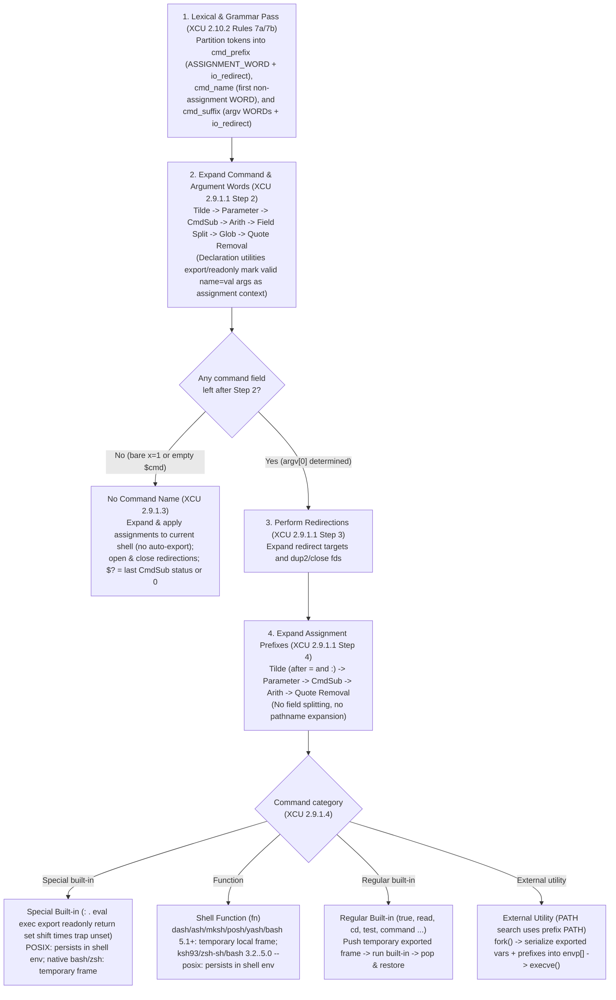

# Simple Commands and Assignment Prefixes

> [!summary] Claim
> A POSIX simple command classifies assignment prefixes lexically before any expansion (`XCU 2.10.2`), expands command and argument words before evaluating those prefixes (`XCU 2.9.1.1`), and binds prefix variables to either the current shell, a temporary local frame, or the child `execve(2)` `envp[]` array depending on whether a command word survives expansion and which category of command it names.

Part of [The POSIX Shell Language](README.md) in [Shell and Unix Engineering](../README.md).

## TL;DR

- Mechanism: The parser partitions a simple command into `cmd_prefix` (`ASSIGNMENT_WORD` and redirection tokens), `cmd_word`, and `cmd_suffix` before any expansion runs (`POSIX.1-2024 XCU 2.10.2`), then executes a four-step pipeline that expands command and argument words in Step 2 and assignment prefixes in Step 4 (`POSIX.1-2024 XCU 2.9.1.1`).
- Rule: Assignment prefixes expand without field splitting or pathname expansion, perform tilde expansion after `=` and after every unquoted `:`, and export to the invoked command's environment only when a command word remains after Step 2 (`POSIX.1-2024 XCU 2.6.1`, `2.9.1.2`, `2.9.1.3`).
- Trap: Because Step 2 expands arguments before Step 4 evaluates assignment prefixes, `x=before; x=after cmd "$x"` passes `before` in `argv` while exporting `x=after` in `envp`, and `v=secret $empty` with an unquoted empty variable degenerates into a command-less assignment that mutates the caller's shell environment (`POSIX.1-2024 XCU 2.9.1.1`, `2.9.1.3`).
- Portability fact: Prefix assignments before special built-ins (`s=1 :`) persist in the current shell in POSIX shells (`dash`, BusyBox `ash`, `ksh93`, `mksh`, `posh`, `yash`, `bash --posix`, `zsh --emulate sh`) but revert in native `bash` and native `zsh`, while prefixes before POSIX functions (`f=1 fn`) persist in `ksh93`, `zsh --emulate sh`, and `bash 3.2..5.0 --posix` (`POSIX.1-2024 XCU 2.9.1.2` requires the first and leaves the second unspecified).
- When not to use it: Do not use shell assignment prefixes when setting environment variables whose names are not valid shell identifiers, when passing large secrets that must not cross the `ARG_MAX` `execve(2)` boundary, or when you need guaranteed per-call cleanup across functions and special built-ins; use `env(1)` for external utilities, an explicit subshell `( ... )`, or an `execve(2)` wrapper in C or Python.

## Mental model



The shell processes a simple command in two distinct phases: a compile-time lexical partitioning phase and a four-step run-time evaluation pipeline.
During parsing, grammar Rule 7 (`POSIX.1-2024 XCU 2.10.2`) examines each token before the command word and returns `ASSIGNMENT_WORD` if it contains an unquoted `=` preceded by a valid shell `name` (`XBD 3.216`).
As soon as the parser encounters the first ordinary `WORD`, that token becomes `cmd_name` or `cmd_word`, and every subsequent token falls under `cmd_suffix`, whose grammar accepts only an argument `WORD` or a redirection, regardless of whether it contains `=`.
At run time (`POSIX.1-2024 XCU 2.9.1.1`), Step 1 sets aside the saved `ASSIGNMENT_WORD` and redirection lists, and Step 2 expands only the command and argument words.
If Step 2 produces zero fields (either because there was no command word in the source or because an unquoted variable expanded to nothing), execution branches to the command-less path (`POSIX.1-2024 XCU 2.9.1.3`), where assignments mutate the current shell environment without exporting.
If at least one field survives Step 2, Step 3 performs redirections and Step 4 expands the assignment prefixes in assignment context (no field splitting or globbing, tilde expansion after `=` and unquoted `:`), binding the results with export attributes to the target command's execution environment according to its category in `POSIX.1-2024 XCU 2.9.1.4`.

## How it works

### Lexical recognition of `ASSIGNMENT_WORD` (`XCU 2.10.2` Rules 7a and 7b)

In the POSIX shell grammar (`POSIX.1-2024 XCU 2.10.2`), a `simple_command` is constructed from three syntactic regions:

```
simple_command : cmd_prefix cmd_word cmd_suffix
               | cmd_prefix cmd_word
               | cmd_prefix
               | cmd_name cmd_suffix
               | cmd_name
```

Whether a `TOKEN` becomes an `ASSIGNMENT_WORD` or a plain `WORD` depends strictly on parser state and lexical structure before any expansion occurs:
- **Rule 7a (the first word, `cmd_name`)**: If the token is exactly a reserved word, that reserved word's token results; otherwise Rule 7b is applied.
- **Rule 7b (not the first word, `cmd_word`, and the fall-through from 7a)**: A token with no unquoted `=` (outside any embedded expansion) is a `WORD`; a token beginning with `=` is a `WORD`; a token whose characters before the first such `=` form a valid shell `name` (`POSIX.1-2024 XBD 3.216`: an underscore or ASCII letter followed by zero or more underscores, ASCII letters, or ASCII digits) is an `ASSIGNMENT_WORD`; and any other token is implementation-defined (every shell in the matrix ran `1a=2` and `a-b=3` as command names, status `127`, as of 2026-11).
- **After the command word (`cmd_suffix`)**: Rule 7 is not applied at all, so every subsequent `FOO=bar` token is a regular `WORD` passed in `argv[]`; a recognized declaration utility changes only how such a word is expanded (`POSIX.1-2024 XCU 2.9.1.1` Step 2), not its token class.

Two immediate consequences follow from Rule 7a and Rule 7b:
- **Quoting any character of the variable name or `=` defeats `ASSIGNMENT_WORD` recognition**: `x\=1 cmd` has no unquoted `=` (a `WORD` under Rule 7b), and `\x=1 cmd` or `"x"=1 cmd` has no valid `name` before the `=` (implementation-defined under Rule 7b; every shell in the matrix took it as `cmd_name`, as of 2026-11), so the shell searches `PATH` for a binary literally named `x=1`.
- **Parameter expansion cannot synthesize an `ASSIGNMENT_WORD`**: In `w="x=1"; $w cmd`, the token `$w` contains no literal `=` at parse time, so Rule 7b returns `WORD`, `$w` becomes `cmd_name`, and Step 2 executes `"x=1"` as `argv[0]` (`exit status 127` if no `x=1` executable exists on `PATH`).

### The four-step processing order (`XCU 2.9.1.1`)

When a simple command is executed, `POSIX.1-2024 XCU 2.9.1.1` specifies four ordered steps:
- **Step 1 (Save prefix/suffix lists)**: The words recognized by the grammar as variable assignments (`ASSIGNMENT_WORD` in `cmd_prefix`) and redirections (`io_redirect` in `cmd_prefix` and `cmd_suffix`) are saved for processing in Steps 3 and 4.
- **Step 2 (Expand command and argument words)**: The words that are not variable assignments or redirections are expanded via the full pipeline ([[Tilde-Expansion]] -> [[Parameter-Expansion]], [[Command-Substitution]], and [[Arithmetic-Expansion]] -> [[Field-Splitting-and-IFS]] -> [[Pathname-Expansion]] -> [[Quote-Removal]]), where the first resulting field becomes the command name and subsequent fields become its arguments.
- **Step 3 (Perform redirections)**: Redirections saved in Step 1 are performed from left to right (see [[Redirection-Order-and-Semantics]] and [[Descriptor-Duplication-and-Closing]]).
- **Step 4 (Expand and apply variable assignments)**: Each `ASSIGNMENT_WORD` saved in Step 1 has the text after its first `=` expanded in assignment context (tilde expansion after `=` and after any unquoted `:`, parameter expansion, command substitution, arithmetic expansion, and quote removal, with no field splitting and no pathname expansion per `POSIX.1-2024 XCU 2.9.1.1` Step 4 and `2.6.1`).

Because Step 2 runs to completion before Step 4 begins, a command argument cannot observe the value assigned by a prefix on the same simple command:

```sh
x=before
x=after printf 'arg=%s\n' "$x"
```

In Step 2, `"$x"` expands against the existing shell environment (`before`).
Only in Step 4 does the shell evaluate `x=after` and place it into the environment of `printf` (which already received `"before"` in `argv[2]`, a bug flagged by ShellCheck as `SC2097` and `SC2098`).

Inside Step 4 itself, multiple assignment prefixes are expanded from the beginning of the command text to the end (`POSIX.1-2024 XCU 2.9.1.1`).
In `a=old; a=first x=$a cmd`, `POSIX.1-2024 XCU 2.9.1.2` leaves it unspecified, for a command that is neither a special built-in nor a function, whether an assignment is visible to later expansions in Step 4, so `x` may conformingly receive `first` or `old`.
Most shells (`dash`, BusyBox `ash`, `ksh93`, `posh`, `yash`, `zsh`, and `bash 4.1+`) give `first` (measured on `bash` 4.1, 4.2, 4.4, 5.1, 5.2, and 5.3, as of 2026-11).
In `bash-5.3`, `do_assignment_statements` (`subst.c`) sets `assigning_in_environment = is_nullcmd == 0`, which causes `find_variable` (`variables.c`) to pass `FV_FORCETEMPENV` and look up `a` in `temporary_env` before searching the global `shell_variables` table; that flag is already in the `bash-4.0` source and absent from `bash-3.2`.
In `bash 3.2` (including macOS `/bin/sh` and `/bin/bash`) and in `mksh` (`exec.c`, `comexec`), `x=$a` looks up `a` in the outer variable table while building the temporary environment frame, yielding `old` instead of `first`.

### Declaration utilities and assignment-context arguments (`XBD 3.100`, `XCU 2.9.1.1`)

Historically, `export a=$val` where `val="1 b=2"` was a portability landmine: in the grammar, `a=$val` follows the command name `export` in `cmd_suffix`, so in POSIX.1-2008 it was an ordinary argument word subject to Step 2 field splitting and globbing, causing `export` to see two arguments (`a=1` and `b=2`) and export an attacker-controlled variable `b=2` (`POSIX.1-2024 XRAT C.2.9.1`).

POSIX.1-2024 resolved this by introducing **declaration utilities** (`POSIX.1-2024 XBD 3.100`, `XCU 2.9.1.1` Step 2):
- The standard declaration utilities are `export` and `readonly`, plus `command` when its first argument is recognized as a declaration utility (`command export a=$val`, `POSIX.1-2024 XCU command`; native `bash`, `bash 3.2 --posix`, `posh`, and `zsh --emulate sh` still split that form, measured as of 2026-11), and shells also include `local`, `typeset`, and `declare` in this class.
- When the command word is a recognized declaration utility, any subsequent argument word that would be recognized as an `ASSIGNMENT_WORD` in isolation (an unquoted valid shell `name` followed by an unquoted `=`) bypasses field splitting and pathname expansion during Step 2, and undergoes tilde expansion after `=` and after every unquoted `:`.
- This protection is strictly lexical (`POSIX.1-2024 XRAT C.2.9.1`):
  - If any part of the variable name or `=` is quoted (`export \q=$val` or `export "q=$val"`) or produced by expansion (`var=q; export $var=$val`), the argument is not a lexical assignment word and undergoes normal Step 2 field splitting and globbing (except in native `zsh`, where `SH_WORD_SPLIT` is off by default).
  - If the declaration utility name itself is produced by expansion (`cmd=export; $cmd a=$val`), `POSIX.1-2024 XCU 2.9.1.1` leaves assignment context unspecified, and `bash-5.3` (`execute_cmd.c`, `fix_assignment_words`), `ksh93`, `mksh`, `yash`, and `zsh --emulate sh` do not recognize `$cmd` as a declaration utility at parse time and split `a=$val`, whereas `dash` (`src/eval.c`, `evalcommand`) and BusyBox `ash` (`shell/ash.c`, `evalcommand`) check the `BUILTIN_ASSIGN` flag after expanding the command word and still suppress splitting on `a=$val` (native `zsh` does not split either, because `SH_WORD_SPLIT` is off).
  - `posh` (0.14.1) does not implement POSIX.1-2024 declaration utility rules at all; `export a=$val` with `val="1 b=2"` splits into `a=1` and `b=2`.

### Commands with no command name (`XCU 2.9.1.3`)

A simple command has no command name either when the source contains only assignment words and/or redirections (`x=1 y=2 >/dev/null`), or when every non-assignment, non-redirection word expands to zero fields in Step 2 (`empty=""; v=leaked $empty`).

When no command name results (`POSIX.1-2024 XCU 2.9.1.2`, `2.9.1.3`):
- **Scope and export attribute**: Variable assignments modify the **current shell execution environment** permanently, and unlike prefixes on a command, they do **not** give the variable the `export` attribute unless `set -a` (`allexport`) is enabled or the variable already had the `export` attribute.
- **Unquoted empty command word hazard**: In `v=leaked $empty`, `$empty` is unquoted and empty, so Step 2 field splitting elides it completely (even in native `zsh`, which elides unquoted empty scalar expansions when used as command arguments), causing what looked like a per-command environment prefix to silently mutate `v` in the current shell.
- **Step 3 vs Step 4 reversal**: `POSIX.1-2024 XCU 2.9.1.1` explicitly permits implementations to reverse Steps 3 and 4 when there is no command name or when the command is a special built-in:
  - In `x=old; x=new >"$d/$x"`, `bash` (`subst.c`, `do_assignment_statements` with `is_nullcmd` set, before `execute_null_command` in `execute_cmd.c` opens the redirections), `ksh93` (`sh/xec.c`, `sh_exec`), and `yash` (`exec.c`, `exec_simple_command_without_words`) execute Step 4 (`x=new`) **before** Step 3 (redirection target expansion), creating `$d/new` and leaving `x=new` even if a redirection fails (`x=new </nonexistent`).
  - In the same command, `dash` (`src/eval.c`, `evalcommand`), BusyBox `ash` (`shell/ash.c`, `evalcommand`), `mksh` (`exec.c`, `execute` -> `iosetup` before `comexec`), `posh` (`exec.c`, `execute`), and `zsh` (`Src/exec.c`, `execcmd_exec` calling `fixfds` before `addvars`) execute Step 3 **before** Step 4, creating `$d/old` and leaving `x=old` if the redirection fails.
- **Exit status (`$?`)**: If no command substitutions were evaluated during the expansions, the command exits with status `0`; if one or more command substitutions were performed, the exit status is that of the **last** command substitution executed (`a=$(exit 3) b=$(exit 0)` yields `$? = 0`, whereas `a=$(exit 0) b=$(exit 7)` yields `$? = 7`), whereas `export c=$(exit 7)` has a command name (`export`) whose `0` return value masks the failure of `$(exit 7)` (ShellCheck `SC2155`).

### Assignment prefix scope across the four command categories (`XCU 2.9.1.2`, `2.9.1.4`)

When Step 2 produces a command name, `POSIX.1-2024 XCU 2.9.1.2` and `2.9.1.4` govern both the lifetime and the export attribute of the prefix assignments:

- **External utilities (`POSIX.1-2024 XCU 2.9.1.6`)**:
  - The shell forks a child process and passes the prefix assignments, merged with the shell's currently exported variables, in the `envp[]` array to `execve(2)`, leaving the parent shell's variable values and export attributes unchanged after the command completes.
  - **Prefix `PATH` and command search (`POSIX.1-2024 XCU 2.9.1.4`, `XRAT C.2.9.1`)**: Because Step 4 precedes command search and execution (`2.9.1.4`), `PATH=/custom/bin my_tool` searches `/custom/bin` to locate `my_tool` and passes `PATH=/custom/bin` in `my_tool`'s `envp[]`, while leaving the calling shell's `PATH` intact after `my_tool` exits.
  - **Parent vs child evaluation of prefix side effects**: In `x=old; a=$((x=1)) /usr/bin/true`, `POSIX.1-2024 XCU 2.9.1.2` leaves unspecified whether assignments made as side effects of Step 4 expansions are visible in the current shell execution environment, and `XCU 2.6` leaves unspecified whether such expansions are carried out in the current execution environment or in the environment of the command about to be executed.
    Shells that evaluate Step 4 in the parent process before forking or spawning (`bash`, `dash`, BusyBox `ash`, `mksh`, `posh`, `yash`, and `ksh93u+m 1.0.10` via `sh_ntfork` and `sh_scope` under `SHOPT_SPAWN` in `sh/xec.c`) mutate `x=1` in the parent shell.
    By contrast, `zsh` (`Src/exec.c`, `execcmd_exec` forking through `execcmd_fork` before `addvars`) and `ksh93u+ 2012-08-01` as shipped in macOS `/bin/ksh` evaluate assignment prefixes in the child process, so `x=1` occurs inside the child process and the parent retains `x=old` (measured as of 2026-11).
    For the macOS shell the cause is a build flag: Apple's published `Makefile` (tag `ksh-42`) passes `-DSHOPT_SPAWN=0`, so `case TFORK:` in `sh/xec.c` calls `sh_fork` rather than `sh_ntfork`, and the child's `path_exec` (`sh/path.c`) applies the prefixes with `nv_setlist`.
  - **Exit status on `execve(2)` failure**: `POSIX.1-2024 XCU 2.8.2` assigns `127` to a command that is not found and `126` to a command that is found but is not an executable utility, and `XCU 2.9.1.6` adds `126` for a file rejected by the script heuristic; neither names `E2BIG`, so `126` here is the prevailing convention rather than an explicit requirement.
    If a large prefix assignment exceeds system limits (such as Linux `MAX_ARG_STRLEN` = 128 KiB or macOS `ARG_MAX` = 1 MiB), `execve(2)` fails with `E2BIG`.
    Most shells (`bash`, `dash`, BusyBox `ash`, `ksh93`, `mksh`, `yash`) report exit status `126`.
    However, `zsh` (`Src/exec.c`, `execute`) only maps `EACCES` and `ENOEXEC` to `126` and returns `127` for `E2BIG`, while `posh 0.14.1` (`exec.c`, `case TEXEC:`) routes the error to `errorf()` (`io.c`), which unconditionally sets `exstat = 1` and exits with `1` instead of `126` (measured with `posh` 0.14.1 as of 2026-11).
- **Regular built-in utilities (`true`, `false`, `read`, `cd`, `test`, `printf`, `pwd`, `command`, `getopts`, `umask`, `wait`, `kill`)**:
  - Because regular built-ins run inside the current shell process without `fork(2)`, the shell pushes a temporary local variable frame (for example `mklocal` in `dash`, `temporary_env` in `bash`, `newblock()` in `mksh`/`posh`, `save_params` in `zsh`), marks the prefix variables as exported while the built-in runs, and pops/restores the original variable state when the built-in returns.
- **Special built-in utilities (`:` `.` `break` `continue` `eval` `exec` `exit` `export` `readonly` `return` `set` `shift` `times` `trap` `unset`, `POSIX.1-2024 XCU 2.15`)**:
  - `POSIX.1-2024 XCU 2.9.1.2` states that variable assignments specified with special built-in utilities remain in effect after the built-in completes.
  - In `dash`, BusyBox `ash`, `ksh93`, `mksh`, `posh`, `yash`, `bash --posix`, and `zsh --emulate sh` (`POSIX_BUILTINS` on), `s=during :` permanently sets `s=during` in the current shell.
  - In native `bash` (without `set -o posix`) and native `zsh` (without `POSIX_BUILTINS`), `s=during :` reverts `s` to its prior value after `:` returns.
  - **Stripping special built-in persistence with `command`**: Under `POSIX.1-2024 XCU command`, prefixing a special built-in with `command` (`s=during command :`) executes the regular built-in `command`, so `s` reverts after `command :` finishes (measured in every shell in the matrix except macOS `/bin/ksh` 93u+ 2012-08-01, which keeps `s=during`; note that in native `zsh` without `POSIX_BUILTINS`, `command` only searches external utilities on `PATH` and cannot invoke special built-ins).
  - **Export attribute after a special built-in**: `POSIX.1-2024 XCU 2.9.1.2` leaves unspecified both whether the variable gains the `export` attribute during a special built-in and whether that attribute persists afterward, and implementations diverge on whether a newly created variable `u` in `unset u; u=val :` remains exported to subsequent external commands after `:` finishes: `bash --posix` (`variables.c`, `push_posix_tempvar_internal` copying the temporary variable's attributes, including `att_exported`) and `yash` (`variable.c`, `do_assignments(..., true)`) export `u`, whereas `dash` (`src/eval.c`, `evalcommand` passing `vflags`, which is `0` unless the command is `exec` with arguments, to `setvareq`), BusyBox `ash`, `ksh93`, `mksh`, `posh`, and `zsh --emulate sh` leave `u` unexported in the shell (unless the special built-in is `exec` replacing the process).
- **Shell functions (`POSIX.1-2024 XCU 2.9.5`)**:
  - Whether a prefix assignment on a function call (`f=during fn`) persists after `fn` returns is unspecified in `POSIX.1-2024 XCU 2.9.1.2`, as it already was in the 2018 edition; earlier editions required persistence until Austin Group interpretation 654 removed that requirement (`bash-5.3` `COMPAT` item 62 and the comment in `push_posix_tempvar_internal`).
  - In `dash` (`src/eval.c`, `evalcommand` calling `pushlocalvars`, `mklocal`, and `unwindlocalvars`), BusyBox `ash`, `mksh`, `posh`, `yash`, native `bash`, `bash 5.1+ --posix`, and native `zsh`, `f=during fn` exports `f=during` during the execution of `fn` (and any children `fn` spawns) and restores `f` when `fn` returns.
  - In `bash 3.2..5.0 --posix` (including macOS `/bin/sh`), `zsh --emulate sh` (`POSIX_BUILTINS`), and `ksh93` (for POSIX `fn() { ... }` functions), `f=during fn` persists `f=during` in the caller's environment after `fn` returns.
  - In `bash-5.3`, `push_posix_tempvar_internal` (`variables.c`) explicitly checks `posix_var_behavior = posixly_correct && isbltin`: for special built-ins `isbltin` is `1` (persisting the assignment into `shell_variables`), whereas for shell functions `isbltin` is `0`, so the assignment stays in the function's temporary scope and is discarded when the function returns.
  - In `ksh93`, `include/name.h` defines `NV_FPOSIX` and `BLT_SPC` as the same bit (`NV_LJUST`, `1 << 6` in the current `include/nval.h`), so `sh_exec` (`sh/xec.c`) gives a POSIX `fn() { ... }` function the non-scoped assignment behavior of special built-ins, and `sh_funct` calls `sh_funscope`, which calls `sh_scope(envlist,1)` to create a local variable scope that restores prefix assignments on return only when `posix_fun` is false, that is for KornShell `function fn { ... }` functions.

### Inside the shell engines (`bash`, `dash`, `mksh`, `yash`, `zsh`, `ksh93`)

Tracing how six production shell engines implement simple commands explains every edge case in the matrix:
- **`dash` (`src/eval.c`: `evalcommand`, `src/var.c`: `setvareq`, `mklocal`)**:
  - `evalcommand` walks `cmd->ncmd.args`, calling `expandarg` into `arglist` (Step 2), and if the first expanded word resolves to a built-in with `BUILTIN_ASSIGN` (`export`, `readonly`, `local`, the `-a` entries in `src/builtins.def.in`), it sets `pseudovarflag` so subsequent `name=value` arguments that pass `isassignment` expand with `EXP_VARTILDE`, without splitting.
  - Next, `pushlocalvars(vlocal)` opens a variable frame unless the command is a special built-in, and `expredir(cmd->ncmd.redirect)` plus `redirectsafe` evaluate and perform the redirections (Step 3).
  - Next, `evalcommand` walks `cmd->ncmd.assign` and expands each prefix into `varlist` using `EXP_VARTILDE` (Step 4), applying it at once, which is why a later prefix sees an earlier one.
  - Each prefix goes to `mklocal(text, VEXPORT)` when `vlocal` is set (regular built-ins, functions, and external commands) or to `setvareq(text, vflags)` on `vartab` (`VTABSIZE = 39` buckets in `src/var.c`) for special built-ins, where `vflags` is `VEXPORT` only for `exec` with arguments.
  - For external commands, `evalcommand` forks via `forkshell` and calls `shellexec`, which takes `envp` from `environment()` (`listvars(VEXPORT, VUNSET, ...)` in `src/var.c`) and reaches `execve(2)` through `tryexec` (`src/exec.c`).
- **`bash-5.3` (`execute_cmd.c`: `execute_simple_command`, `execute_null_command`, `fix_assignment_words`; `subst.c`: `expand_word_list_internal`, `separate_out_assignments`; `variables.c`: `assign_in_env`, `push_var_context`)**:
  - `execute_simple_command` first calls `fix_assignment_words` to mark `W_ASSNBLTIN` arguments on declaration built-ins.
  - `expand_word_list_internal` (`subst.c`) calls `separate_out_assignments` to move leading `W_ASSIGNMENT` words to `subst_assign_varlist`.
  - If no words result, it calls `do_assignment_statements` with `is_nullcmd` set, which uses `do_word_assignment` **before** `execute_null_command` (`execute_cmd.c`) calls `do_redirections`.
  - Otherwise, it expands the remaining words into the command word list (Step 2) and then calls `do_assignment_statements`, which uses `assign_in_env` to insert prefixes into `temporary_env`, a 4-bucket hash table (`TEMPENV_HASH_BUCKETS = 4` in `variables.c`).
- **`mksh` (`exec.c`: `execute`, `comexec`; `var.c`: `typeset`, `global`) and `posh` (`exec.c`, `io.c`)**:
  - In `mksh` and `posh`, `execute()` sets up redirections via `iosetup()` first, then calls `comexec()`.
  - If a command word exists and is not a special built-in, `comexec()` calls `newblock()` to push a new `struct block` onto `e->loc`.
  - `mksh` then temporarily restores `e->loc = l_expand` (the outer block) while calling `evalstr(t->vars[i], DOASNTILDE | DOSCALAR)` so that in `a=first x=$a cmd` `$a` resolves against the outer block rather than `first`, and switches back to the new block to call `typeset(cp, type_flags, 0, 0, 0)`; `posh` has no `l_expand` switch, and `x` receives `first` there (measured as of 2026-11).
  - When `ksh_execve()` fails in `posh` (`exec.c`, `case TEXEC:`) with an error other than `ENOEXEC`, it calls `errorf("%s: %s", s, strerror(errno))` (`io.c`), which unconditionally sets `exstat = 1` rather than mapping execution failures to `126`, causing `posh` to exit with status `1` on `E2BIG`.
- **`yash` (`exec.c`: `exec_simple_command`, `exec_simple_command_without_words`, `exec_simple_command_with_words`; `variable.c`: `do_assignments`)**:
  - `exec_simple_command` expands command words first; if `argc == 0`, `exec_simple_command_without_words` runs `do_assignments(c->c_assigns, false, false)` before `open_redirections`, whereas if `argc > 0`, `exec_simple_command_with_words` opens redirections first, opens a new variable frame for functions and regular built-ins, and calls `do_assignments(..., true, ...)` to export the prefix values.
- **`zsh` (`Src/exec.c`: `execcmd_exec`, `addvars`, `execute`)**:
  - For an external command, `execcmd_exec` forks the child process through `execcmd_fork` before calling `addvars` with `ADDVAR_EXPORT` so side effects inside assignment prefixes happen in the forked child, whereas for built-ins and functions when `POSIX_BUILTINS` is off, `save_params` saves any parameter named in `varspc` onto `restorelist` before `addvars` modifies it and `restore_params` restores it afterward.
- **`ksh93` (`sh/xec.c`: `sh_exec`, `sh_funct`, `sh_ntfork`)**:
  - For external commands, `ksh93u+ 2012-08-01` as shipped in macOS `/bin/ksh` runs assignment prefix side effects in the child process and leaves the parent shell unchanged (measured as of 2026-11).
    Apple's published `Makefile` (tag `ksh-42`) passes `-DSHOPT_SPAWN=0`, so `case TFORK:` in `sh/xec.c` calls `sh_fork`, and the child's `path_exec` (`sh/path.c`) calls `nv_setlist` on `t->com.comset`.
  - In `ksh93u+m 1.0.10`, `SHOPT_SPAWN` enables `sh_ntfork`, which calls `sh_scope(t->com.comset, 0)` in the parent shell process before spawning the external executable via libast `spawnveg(3)`, which uses `posix_spawn(3)` or an equivalent, leaving prefix expansion side effects in the parent shell.
  - For special built-ins (`BLT_SPC`) and POSIX functions (`NV_FPOSIX`), which share one attribute bit, `sh_exec` applies `nv_setlist` directly to the shell's current variable tree.

## Numbers and limits

| Metric or Limit | Value | Scope / Condition | Source |
|---|---|---|---|
| `_POSIX_ARG_MAX` | `4096` bytes | Minimum portable combined size of `argv[]` + `envp[]` guaranteed by POSIX for the `exec` functions; whether NUL terminators, pointers, and alignment bytes count is implementation-defined | `POSIX.1-2024 XBD <limits.h>`, `XSH exec` |
| Linux `MAX_ARG_STRLEN` | `131072` bytes (`32 * PAGE_SIZE` on 4 KiB pages) | Maximum length of a **single** string (`name=value` or `argv[i]`) passed across `execve(2)` on Linux; exceeding it returns `E2BIG` even when total `ARG_MAX` has headroom (measured with a 4 KiB page: `x=` plus 130000 bytes runs, `x=` plus 131071 bytes gives `126` in `bash`) | Linux kernel `include/uapi/linux/binfmts.h` (`execve(2)` man page, as of 2026-11) |
| Linux `MAX_ARG_STRINGS` | `0x7FFFFFFF` (`2147483647`) | Maximum count of strings in `argv[]` or `envp[]` on Linux `execve(2)` | Linux kernel `include/uapi/linux/binfmts.h` (as of 2026-11) |
| macOS `ARG_MAX` | `1048576` bytes (1 MiB) | Maximum total bytes of `argv[]` + `envp[]` passed across `execve(2)` on macOS | Measured in lab environment via `getconf ARG_MAX` (as of 2026-11) |
| 1.1 MB bare assignment (`x=$big`) vs prefix (`x=$big /usr/bin/true`; Alpine has only `/bin/true`, macOS only `/usr/bin/true`) | `1100000` bytes: bare status `0`; external prefix status `126` (`127` in `zsh`, `1` in `posh`) | Bare assignment stays in shell user-space heap (`status 0`); prefix on external utility serializes `x=...` into `envp[]`, failing `execve(2)` with `E2BIG` (`126` in most shells, `127` in `zsh`/`zsh-sh`, `1` in `posh` due to `errorf`) | Measured in [lab](../labs/03-simple-commands-and-assignment-prefixes/) (`simple-cmd-probe.bats` test 11, as of 2026-11) |
| `bash-5.3` `VARIABLES_HASH_BUCKETS` | `1024` buckets | Default hash table size for global `shell_variables` per variable context | `bash-5.3 variables.c` (`VARIABLES_HASH_BUCKETS`) |
| `bash-5.3` `TEMPENV_HASH_BUCKETS` | `4` buckets | Hash table size for `temporary_env` storing per-command assignment prefixes (lookups scan longer chains as prefixes outnumber buckets) | `bash-5.3 variables.c` (`TEMPENV_HASH_BUCKETS`) |
| `dash` `VTABSIZE` | `39` buckets | Fixed hash table bucket count for `vartab` in `dash` | `dash src/var.c` (`VTABSIZE`) |

## Portability

| Behavior / Probe | POSIX.1-2024 (`XCU 2.9.1`) | macOS `bash` 3.2 | `bash` 5.3 (native / `--posix`) | `zsh` (native / `--emulate sh`) | `dash` & BusyBox `ash` | `ksh93` | `mksh` | `yash` | `posh` |
|---|---|---|---|---|---|---|---|---|---|
| Step 2 before Step 4 (`x=before; x=after cmd "$x"` passes `before`) | Required (`XCU 2.9.1.1`) | `before` | `before` / `before` | `before` / `before` | `before` | `before` | `before` | `before` | `before` |
| Unquoted empty command word (`v=leaked $empty`) mutates shell | Required (`XCU 2.9.1.3`) | Persists (`leaked`) | Persists / Persists | Persists / Persists | Persists | Persists | Persists | Persists | Persists |
| Prefix on special built-in (`s=during :`) persists in shell | Required (`XCU 2.9.1.2`) | Reverts (`--posix`: persists) | Reverts / Persists | Reverts / Persists | Persists | Persists | Persists | Persists | Persists |
| Prefix on special built-in (`unset u; u=1 :`) exports `u` to later commands | Unspecified after built-in returns | No (`--posix`: Yes) | No / Yes | No / No | No | No | No | Yes | No |
| Prefix on POSIX function (`f=during fn`) persists after return | Unspecified (`XCU 2.9.1.2`) | Reverts (`--posix`: persists) | Reverts / Reverts | Reverts / Persists | Reverts | Persists (`function fn`: reverts) | Reverts | Reverts | Reverts |
| Declaration utility (`val="1 b=2"; export a=$val`) suppresses field splitting | Required (`XBD 3.100`, `XCU 2.9.1.1`) | Yes (`a="1 b=2"`) | Yes / Yes | Yes / Yes | Yes | Yes | Yes | Yes | **No** (splits and exports `b=2`) |
| Multiple prefixes (`a=old; a=first x=$a cmd`) value of `x` | Unspecified (`XCU 2.9.1.2`) | **`old`** | `first` / `first` | `first` / `first` | `first` | `first` | **`old`** | `first` | `first` |
| Side effect in prefix on external cmd (`x=old; a=$((x=1)) /usr/bin/true`) | Unspecified whether parent or child evaluates (`XCU 2.6`, `2.9.1.2`) | Parent (`x=1`) | Parent (`x=1`) | **Child (`x=old`)** | Parent (`x=1`) | macOS 93u+: **Child (`x=old`)**; 93u+m: Parent (`x=1`) | Parent (`x=1`) | Parent (`x=1`) | Parent (`x=1`) |
| Command-less Step 3 vs Step 4 (`x=old; x=new >"$d/$x"`) target file | Either order permitted (`XCU 2.9.1.1`) | `new` (Step 4 first) | `new` / `new` | `old` / `old` (Step 3 first) | `old` (Step 3 first) | `new` (Step 4 first) | `old` (Step 3 first) | `new` (Step 4 first) | `old` (Step 3 first) |
| Readonly prefix failure (`readonly r=1; r=2 /bin/echo hi`) | Assignment error, non-interactive shell shall exit (`XCU 2.8.1`, `2.9.1.2`) | Prints error, **runs `/bin/echo`** (`$?=0`) | Native: **runs `/bin/echo`** (`$?=0`); `--posix`: aborts non-interactive shell (status `1`; `--posix` 3.2..5.1 runs `/bin/echo` instead) | Skips cmd, parent continues (`$?=1`) | Aborts non-interactive shell (`$?!=0`) | Skips cmd, parent continues (`$?=1`) | Aborts non-interactive shell (`$?!=0`) | Aborts non-interactive shell (`$?!=0`) | Aborts non-interactive shell (`$?!=0`) |
| External prefix exceeding the `execve(2)` limit (`E2BIG` exit status) | Not named; `126` by convention (`XCU 2.8.2`, `2.9.1.6`) | `126` | `126` / `126` | **`127`** / **`127`** | `126` | `126` | `126` | `126` | **`1`** (`errorf`) |

The lab asserts every row: `simple-cmd-probe.bats` test 13 covers the export-after-special-built-in row, test 14 the readonly row, and test 15 the `function fn` cell (as of 2026-11).
The `--posix` cells come from running the suite with `LAB_SHELL="bash --posix"`.

For external utility execution when variable names are not valid shell identifiers (for example `FOO.BAR=1` or `123=a`) or when you must bypass shell function/built-in scoping rules, `env(1)` (across GNU coreutils, BSD/macOS, BusyBox, and uutils, the last run as `uutils` 0.2.2 on Alpine and `rust-coreutils` 0.0.30 on Debian as of 2026-11) accepts `NAME=VALUE` operands after options (`-i` to clear the environment as standardized in `POSIX.1-2024 XCU env`, and `-u NAME` to unset as a non-POSIX extension, measured in GNU coreutils, macOS, BusyBox, and uutils) and invokes `execvp(3)` directly without shell grammar restrictions (see [[Command-Search-and-PATH]] and [[Special-Built-ins-versus-Utilities]]).

## Worked example

The [lab](../labs/03-simple-commands-and-assignment-prefixes/) script `simple-cmd-probe.sh` tests four core mechanisms: Step 2 vs Step 4 evaluation order and `cmd_suffix` arguments (`order`), command-less exit status vs `export` masking (`no-cmd-status`), assignment persistence across bare commands, unquoted empty command words, regular built-ins, special built-ins, and functions (`scope`), and declaration-utility word splitting (`decl-split`).

```sh
#!/bin/sh
# simple-cmd-probe.sh: probe POSIX simple-command evaluation order, assignment
# prefix scope, command-less exit status, and declaration-utility splitting.
set -u

mode=${1:-order}
if [ "$#" -gt 0 ]; then
  shift
fi

case ${mode} in
  dump-env)
    printf 'arg1=%s arg2=%s child_env=%s ' "${1-}" "${2-}" "${x-}"
    ;;
  order)
    x=before
    # shellcheck disable=SC2097,SC2098 # intentional: Step 2 argument expansion precedes Step 4 prefix assignment
    x=after "$0" dump-env "${x}" trailing=word
    printf 'parent_after=%s\n' "${x}"
    ;;
  no-cmd-status)
    # shellcheck disable=SC2312 # intentional: testing exit status of bare assignment command substitutions
    a=$(exit 3) b=$(exit 0)
    s1=$?
    # shellcheck disable=SC2312 # intentional: second command substitution determines status
    a=$(exit 0) b=$(exit 7)
    s2=$?
    # shellcheck disable=SC2155,SC2312 # intentional: export return value masks command substitution status
    export c="$(exit 7)"
    s3=$?
    printf 'last_zero=%d last_seven=%d export_masked=%d a=%s b=%s c=%s\n' \
      "${s1}" "${s2}" "${s3}" "${a}" "${b}" "${c}"
    ;;
  scope)
    v=before
    v=bare
    bare_res=${v}
    empty=""
    # shellcheck disable=SC2086,SC2248,SC2250 # intentional: unquoted empty command word leaves no command name
    v=leaked $empty
    empty_res=${v}
    r=before
    r=during true
    reg_res=${r}
    s=before
    s=during :
    spcl_res=${s}
    fn() { :; }
    f=before
    f=during fn
    fn_res=${f}
    printf 'bare=%s empty_cmd=%s regular=%s special=%s func=%s\n' \
      "${bare_res}" "${empty_res}" "${reg_res}" "${spcl_res}" "${fn_res}"
    ;;
  decl-split)
    val="1 b=2"
    b=keep
    q=""
    # shellcheck disable=SC2086,SC2248,SC2250 # intentional: testing declaration-utility assignment context on unquoted $val
    export a=$val
    decl_a=${a}
    decl_b=${b}
    b=keep
    # shellcheck disable=SC1001,SC2086,SC2248,SC2250 # intentional: quoting variable name disables assignment context
    export \q=$val
    printf 'decl_a=%s decl_b=%s quoted_q=%s quoted_b=%s\n' \
      "${decl_a}" "${decl_b}" "${q}" "${b}"
    ;;
  *)
    printf 'usage: %s [order|dump-env|no-cmd-status|scope|decl-split]\n' "$0" >&2
    exit 2
    ;;
esac
```

Expected output across modes (showing `dash` and the `scope` / `decl-split` matrix differences verified by `simple-cmd-probe.bats`):

```text
$ /bin/dash labs/03-simple-commands-and-assignment-prefixes/simple-cmd-probe.sh order
arg1=before arg2=trailing=word child_env=after parent_after=before

$ /bin/dash labs/03-simple-commands-and-assignment-prefixes/simple-cmd-probe.sh no-cmd-status
last_zero=0 last_seven=7 export_masked=0 a= b= c=

$ /bin/dash labs/03-simple-commands-and-assignment-prefixes/simple-cmd-probe.sh scope
bare=bare empty_cmd=leaked regular=before special=during func=before

$ /bin/ksh labs/03-simple-commands-and-assignment-prefixes/simple-cmd-probe.sh scope
bare=bare empty_cmd=leaked regular=before special=during func=during

$ zsh labs/03-simple-commands-and-assignment-prefixes/simple-cmd-probe.sh scope
bare=bare empty_cmd=leaked regular=before special=before func=before

$ /bin/dash labs/03-simple-commands-and-assignment-prefixes/simple-cmd-probe.sh decl-split
decl_a=1 b=2 decl_b=keep quoted_q=1 quoted_b=2
```

## Pitfalls

> [!warning] Referencing a prefix variable in the same command's arguments (`SC2097` / `SC2098`)
> - **Trigger**: Writing `FOO=bar cmd "$FOO"` expecting `cmd` to receive `"bar"` as `argv[1]`.
> - **Symptom**: `cmd` receives the previous value of `$FOO` (or an empty string if unset) in `argv[1]`, while seeing `FOO=bar` in `envp[]`.
> - **Fix**: Because `POSIX.1-2024 XCU 2.9.1.1` expands arguments in Step 2 and assignment prefixes in Step 4, either assign the variable in a subshell `(export FOO=bar; exec cmd "$FOO")` or pass the value via a separate local variable (`val=bar; FOO=$val cmd "$val"`).

> [!warning] Masking command substitution exit status with `export` or `local` (`SC2155`)
> - **Trigger**: Combining a declaration utility with a command substitution, such as `export token="$(fetch_token)"` or `local out=$( failing_cmd )` under `set -e` (see [[errexit-Semantics-and-Exceptions]]).
> - **Symptom**: When `fetch_token` exits non-zero, `$(fetch_token)` fails during Step 2 argument expansion, but the simple command's command word is `export` (or `local`), which succeeds and overwrites `$?` with `0`, preventing `set -e` from triggering.
> - **Fix**: Separate the command-less assignment (`token=$(fetch_token)`, whose exit status in `POSIX.1-2024 XCU 2.9.1.3` is that of the last command substitution) from the declaration utility (`export token`).

> [!warning] Unquoted empty command word turns a temporary prefix into a permanent shell mutation
> - **Trigger**: Writing `SECRET_KEY=$key $runner` where `$runner` is unquoted and expands to empty or whitespace (`IFS`).
> - **Symptom**: Step 2 field splitting removes `$runner`, leaving a command with no command name (`POSIX.1-2024 XCU 2.9.1.3`) that silently assigns `SECRET_KEY` into the current shell process with exit status `0` instead of running a child process.
> - **Fix**: Always double-quote command variables (`SECRET_KEY=$key "$runner"`, which fails cleanly on an empty string with `127`, or `126` in `ksh93`, `mksh`, `posh`, and `zsh`, measured as of 2026-11) or validate `${runner:?missing runner}` before execution.

> [!warning] Prefix assignments on shell functions or special built-ins leaking into caller scope
> - **Trigger**: Calling `IFS=: read_fields` (where `read_fields` is a shell function) or `IFS=: eval "$code"`.
> - **Symptom**: For special built-ins (`:` `.` `eval` `exec` `export` `readonly` `return` `set` `shift` `times` `trap` `unset`), `POSIX.1-2024 XCU 2.9.1.2` requires prefix assignments to persist in the current shell, and for POSIX functions (`fn() { ... }`), `ksh93`, `zsh --emulate sh`, and `bash 3.2..5.0 --posix` (macOS `/bin/sh`) also persist `IFS=:` in the caller after `read_fields` returns, corrupting field splitting for the rest of the script.
> - **Fix**: Prefix special built-ins with `command` (`IFS=: command eval "$code"`, `POSIX.1-2024 XCU command`) when supported (it fails in native `zsh`, and macOS `/bin/ksh` 93u+ 2012-08-01 still persists `IFS`), or wrap function calls that need modified environment variables in a subshell `(IFS=:; read_fields)` or save/restore explicitly inside the function.

> [!warning] Non-fatal readonly assignment prefix in `bash` executes the command with the stale value
> - **Trigger**: Running `readonly MODE=prod; MODE=test ./deploy.sh` in `bash` (native mode on every version in the matrix, or `bash 3.2..5.1 --posix`, including macOS `/bin/sh`).
> - **Symptom**: While `dash`, BusyBox `ash`, `mksh`, `posh`, `yash`, and `bash 5.2+ --posix` abort the non-interactive shell (`POSIX.1-2024 XCU 2.8.1`), and `ksh93` and `zsh` skip the simple command without running `./deploy.sh` and continue with `$?=1`, native `bash` and `bash 3.2..5.1 --posix` print `MODE: readonly variable` to stderr and **still execute `./deploy.sh`, with `MODE=prod` if `MODE` is exported and with no `MODE` at all otherwise** (returning exit status `0` if `./deploy.sh` succeeds).
> - **Fix**: Never rely on a prefix assignment to override a potentially `readonly` variable; check or assign variables in a dedicated step where errors can be gated before invoking external side effects.

> [!warning] Non-portable exit status on execve failure (E2BIG) in posh and zsh
> - **Trigger**: Inspecting `$?` for exit status `126` (the convention behind `POSIX.1-2024 XCU 2.8.2`, which does not name `E2BIG`) when an external utility invocation fails `execve(2)` due to `E2BIG` (for example, when large environment prefixes exceed Linux `MAX_ARG_STRLEN` or macOS `ARG_MAX`).
> - **Symptom**: While `bash`, `dash`, BusyBox `ash`, `ksh93`, `mksh`, and `yash` return status `126`, `zsh` returns `127` (mapping only `EACCES` and `ENOEXEC` to `126`), and `posh 0.14.1` returns `1` (because `errorf()` in `io.c` unconditionally sets `exstat = 1`, measured as of 2026-11).
> - **Fix**: Never assume `126` is universally returned across all shells for `execve` failures; check for non-zero or status `>= 126` in portable code, and avoid passing oversized environment strings across `execve(2)`.

> [!warning] Relying on prefix assignment side effects on external utilities
> - **Trigger**: Embedding side-effecting expressions into an external utility assignment prefix, such as `x=old; a=$((x=1)) /usr/bin/true` or `LOG=$((counter++)) /usr/bin/logger "$msg"`.
> - **Symptom**: `POSIX.1-2024 XCU 2.9.1.2` and `2.6` leave unspecified whether side effects of these expansions reach the current shell or stay in the environment of the command about to be executed.
> In `bash`, `dash`, BusyBox `ash`, `mksh`, `posh`, `yash`, and `ksh93u+m 1.0.10` (under `SHOPT_SPAWN`), the side effect mutates the caller shell (`x=1`), whereas in `zsh` and macOS `/bin/ksh` 93u+ 2012-08-01, prefixes are evaluated in the child process, discarding the mutation (`x=old`).
> - **Fix**: Do not embed assignments or arithmetic mutations inside prefix assignments; perform variable increments and state changes on dedicated lines prior to the command invocation.

## Security and robustness

### Environment import vulnerabilities at shell startup (`CVE-2014-6271`, `CVE-2016-7543`, `CVE-2019-14868`)

Every prefix assignment on an external utility becomes an entry in the `envp[]` string array passed to `execve(2)`.
When the target executable is itself a shell (or invokes `system(3)` / `popen(3)` / a `#! /bin/sh` script), the child shell's startup routine imports `envp[]` entries into its internal variable table:
- **Shellshock (`CVE-2014-6271`, NVD / MITRE)**: Up through `bash 4.3`, `initialize_shell_variables` (`variables.c`) imported exported function definitions by checking whether an `envp[]` value began with `() {` and passing `"name () { ... }"` to `parse_and_execute`, which executed trailing commands after the closing `}` whenever an attacker-controlled environment variable (`HTTP_*` in CGI, `TERM` or `SSH_ORIGINAL_COMMAND` in OpenSSH, or DHCP client options) contained `() { :;}; /bin/id`.
- **Unrestricted `SHELLOPTS` + `PS4` import (`CVE-2016-7543`, NVD / MITRE)**: Prior to `bash 4.4`, a local attacker could pass `SHELLOPTS=xtrace` and `PS4='$(malicious_cmd)'` in the environment of a privileged program that ran `bash` with effective uid `0`; `bash` imported both and expanded `PS4`, command substitution included, in its trace output, and the `bash-4.4` fix is that shells running as root no longer inherit `PS4` (`CHANGES`; `current_user.euid == 0` in `variables.c`).
- **Arithmetic evaluation during environment import in `ksh93` (`CVE-2019-14868`, NVD / MITRE)**: In `ksh` version `20120801`, startup initialization evaluated imported numeric environment variables as arithmetic expressions (see [[Arithmetic-Expansion]]; Red Hat bug summary and `ksh93u+m` `NEWS`), so the input in the upstream regression test, `env SHLVL='2#11+x[$(cmd >&2)0]' ksh -c ...`, executed arbitrary command substitutions during shell startup before the script began; that input no longer fires on macOS `/bin/ksh` 93u+ 2012-08-01 or `ksh93u+m` 1.0.10 (measured as of 2026-11).

### Argument injection in declaration utilities (`POSIX.1-2024 XRAT C.2.9.1`)

As documented in the POSIX rationale (`POSIX.1-2024 XRAT C.2.9.1`), if a script writes:

```sh
export var=$untrusted
```

and either (a) runs under a pre-POSIX.1-2024 shell such as `posh` that lacks declaration-utility assignment context, or (b) quotes or expands the variable name (`export "$name"=$untrusted` or `export \var=$untrusted`), `$untrusted` undergoes Step 2 field splitting (`IFS`) and pathname expansion.
An attacker supplying `untrusted="1 LD_PRELOAD=/path/to/evil.so PATH=/evil"` injects `LD_PRELOAD` and `PATH` directly into the exported environment of every subsequent child process.
Always double-quote the entire operand of `export`, `readonly`, and `local`:

```sh
export "var=${untrusted}"
```

Quoting the whole argument `"var=${untrusted}"` guarantees a single word in `argv[]` across every shell regardless of whether declaration-utility grammar rules apply.

### Invalid environment names and pass-through (`env(1)` vs shell `envp[]`)

POSIX `XBD 8.1` notes that applications may place strings in `environ` whose names are not valid shell `name` identifiers (such as `foo.bar=1`, `a-b=2`, or empty names).
`POSIX.1-2024 XCU 2.9.1.6` leaves it unspecified whether such entries reach the `envp[]` array for child processes, and shells split (measured as of 2026-11): `dash`, `mksh`, `posh`, BusyBox `ash` on Debian, and macOS `/bin/zsh` drop them, while `bash`, `ksh93`, `yash`, `zsh` 5.9 on Debian, and BusyBox `ash` on Alpine (upstream `shell/ash.c`; Debian's build patches the filter back in) pass them straight through to child `execve(2)` calls.
In a pass-through shell, `unset` cannot remove a non-identifier environment variable (`unset a-b` is an error in BusyBox `ash`, and in `bash` it leaves the entry exported); only `env -i` or `env -u` clears it.

## The principal's view

A staff-plus engineer treats simple-command assignment prefixes as a **single-command `envp[]` builder for external executables**, not as a general scoping mechanism for shell code:
1. **Reserve `VAR=val cmd` for external utilities and `read`**: Using `IFS= read -r line` (see [[The-read-Builtin]]) or `LC_ALL=C sort` (see [[Command-Search-and-PATH]]) is idiomatic, zero-fork (for `read`), and portable across every POSIX shell because `read` is a regular built-in and `sort` is an external utility.
2. **Never use prefix assignments on shell functions or special built-ins**: Because `s=1 :` and `s=1 eval ...` permanently mutate the shell in POSIX mode, and `f=1 my_func` permanently mutates the shell in `ksh93`, `zsh --emulate sh`, and macOS `/bin/sh` (`bash 3.2 --posix`), if a function needs a modified variable or `IFS`, pass it as a positional parameter (`"$1"`), use `local` where supported (`bash`, `dash`, BusyBox `ash`, `mksh`, `posh`, `yash`, `zsh`), or isolate the call in an explicit subshell `(export VAR=val; my_func)` (see [[Functions-and-Scope]] and [[Subshells-and-the-Execution-Environment]]).
3. **Never pass secrets or large payloads via environment prefixes**: Every prefix on an external command is copied into the child's stack/environment pages (`ARG_MAX` / `MAX_ARG_STRLEN = 128 KiB` per string on Linux), where it can trigger `E2BIG` (reporting `126` in standard shells, but `127` in `zsh` and `1` in `posh`) and is readable on many systems via `/proc/<pid>/environ` or `ps e` until the child scrubs it, so pass secrets and large payloads over a pipe, an anonymous file descriptor, or a mode `0600` credential file instead.
4. **Never rely on prefix expansion side effects on external utilities**: Because `POSIX.1-2024 XCU 2.9.1.2` and `2.6` leave side-effect persistence unspecified, state mutations like `$((i++))` in `VAR=$((i++)) ext_cmd` persist in the parent shell in `bash`, `dash`, `ksh93u+m`, `mksh`, `posh`, and `yash`, but discard the mutation in `zsh` and macOS `/bin/ksh` 93u+ 2012-08-01.
5. **Know when to leave the shell**: When a launcher must construct a clean, deterministic `envp[]` (stripping inherited variables, setting non-identifier keys, or handling untrusted values without expansion passes), invoke `env -i KEY=VAL ... /path/to/bin` (a `--` after the operands is run as the utility name, measured in GNU coreutils, macOS, BusyBox, and uutils) or move to Python/Go/Rust/C where `execve(2)` takes an explicit dictionary/slice with zero lexical re-parsing.

## Interview questions

> [!question] L5: What does `x=before; x=after sh -c 'printf "%s %s\n" "$1" "$x"' sh "$x"; printf "%s\n" "$x"` print, and why does each value appear?
>
> > [!success]- Answer
> > The command prints `before after` on the first line and `before` on the second line.
> > Under `POSIX.1-2024 XCU 2.9.1.1`, Step 2 expands the command and argument words (`"$x"`) before Step 4 expands and applies the assignment prefix (`x=after`), so `argv[4]` (`$1` inside `sh -c`) receives `before`.
> > Step 4 then exports `x=after` into the child `sh`'s `envp[]`, so `$x` inside the child expands to `after`, while the parent shell's `x` reverts to `before` after the external utility finishes (`POSIX.1-2024 XCU 2.9.1.2`).
> >
> > Follow-up: How would you rewrite this one-liner so that both `"$1"` and `"$x"` inside the child see `after` without mutating `x` in the parent shell?

> [!question] L5: In a script running with `set -e`, why does `export TOKEN="$(get_token)"` fail to abort the script when `get_token` exits with status `1`, and what is the POSIX-compliant fix?
>
> > [!success]- Answer
> > In `export TOKEN="$(get_token)"`, the simple command's command word is the declaration built-in `export`, not a command-less assignment.
> > During Step 2 (`POSIX.1-2024 XCU 2.9.1.1`), `$(get_token)` runs and fails with exit status `1`, producing an empty string, after which `export` executes `export TOKEN=""` and returns its own exit status `0`, masking the failure from `set -e` (ShellCheck `SC2155`).
> > Splitting the statement into `TOKEN=$(get_token)` followed by `export TOKEN` turns the first line into a command with no command name (`POSIX.1-2024 XCU 2.9.1.3`), whose exit status is defined as the exit status of the last command substitution (`1`), triggering `set -e` immediately.
> >
> > Follow-up: What is the exit status `$?` of the bare assignment line `a=$(exit 3) b=$(exit 0)` versus `a=$(exit 0) b=$(exit 7)`?

> [!question] L6: In the wrapper `runner=$(which_runner); API_KEY=$secret $runner "$@"`, why does `API_KEY` leak into the rest of the shell script with exit status `0` when `which_runner` outputs nothing and `"$@"` is empty?
>
> > [!success]- Answer
> > Because `API_KEY=$secret` precedes `$runner`, grammar Rule 7 (`POSIX.1-2024 XCU 2.10.2`) classifies `API_KEY=$secret` as an `ASSIGNMENT_WORD` in `cmd_prefix` and `$runner` as `cmd_word`.
> > When `$runner` is unquoted and empty (and `"$@"` is empty), Step 2 expansion (`POSIX.1-2024 XCU 2.9.1.1`) elides `$runner` completely, leaving zero command fields.
> > The simple command therefore executes as a command with no command name (`POSIX.1-2024 XCU 2.9.1.3`), which permanently assigns `API_KEY=$secret` in the current shell environment and exits with status `0`.
> > Double-quoting `"$runner"` preserves a single null field in Step 2, causing command search to fail with exit status `127` (`126` in `ksh93`, `mksh`, `posh`, and `zsh`, measured as of 2026-11) and preventing `API_KEY` from mutating the parent shell.
> >
> > Follow-up: Does `API_KEY` gain the `export` attribute when `API_KEY=$secret $runner` degenerates into a command with no command name?

> [!question] L6: Why does `w="FOO=1"; $w env` fail to set `FOO` with exit status `127` whereas `export "FOO=1"` succeeds?
>
> > [!success]- Answer
> > In `w="FOO=1"; $w env`, lexical classification (`POSIX.1-2024 XCU 2.10.2` Rule 7) runs before parameter expansion: the token `$w` has no literal `=` preceded by a valid shell `name`, so the parser classifies `$w` as `cmd_name` and `env` as `argv[1]`.
> > In Step 2, `$w` expands to `"FOO=1"`, and the shell searches `PATH` for an executable file named `FOO=1`, failing with exit status `127`.
> > In `export "FOO=1"`, `export` is the command word (`cmd_name`) and `"FOO=1"` is an ordinary `cmd_suffix` argument passed in `argv[1]` to the `export` built-in, which parses `NAME=VALUE` at run time when executing the built-in.
> >
> > Follow-up: What is the security difference between `export a=$val` and `export \a=$val` when `val="1 LD_PRELOAD=/evil.so"` in `dash`?

> [!question] L6: How do `s=during :`, `s=during true`, and `f=during my_func` behave across `dash`, macOS `/bin/sh` (`bash 3.2 --posix`), `bash 5.3 --posix`, and `ksh93`, and why do they diverge?
>
> > [!success]- Answer
> > `:` is a special built-in (`POSIX.1-2024 XCU 2.15`), so `POSIX.1-2024 XCU 2.9.1.2` requires `s=during :` to persist `s=during` in the current shell across `dash`, `bash 3.2 --posix`, `bash 5.3 --posix`, and `ksh93` (it reverts only in non-POSIX native `bash` and native `zsh`).
> > `true` is a regular built-in, so `s=during true` binds `s=during` in a temporary exported frame and restores `s=before` in every shell.
> > For a POSIX function `my_func() { :; }`, `dash` and `bash 5.1+ --posix` (`push_posix_tempvar_internal` checking `posixly_correct && isbltin`) restore `f=before` when `my_func` returns, whereas `bash 3.2..5.0 --posix` and `ksh93` (where `NV_FPOSIX` and `BLT_SPC` are both defined as `NV_LJUST` in `include/name.h`) leave `f=during` in the caller's environment.
> >
> > Follow-up: How does `ksh93` behave if `my_func` is defined as `function my_func { :; }` instead of `my_func() { :; }`, and why?

> [!question] L7+: What is the state of the filesystem and `$x` after running `x=old; x=new >"$dir/$x"` and `x=old; x=new </nonexistent` in `bash` versus `dash`, and what in `POSIX.1-2024` and each shell's C implementation explains the difference?
>
> > [!success]- Answer
> > In `bash` (and `ksh93` and `yash`), `x=old; x=new >"$dir/$x"` creates `$dir/new`, and after `x=old; x=new </nonexistent` fails, `$x` is `new`.
> > In `dash` (and BusyBox `ash`, `mksh`, `posh`, and `zsh`), `x=old; x=new >"$dir/$x"` creates `$dir/old`, and after `x=old; x=new </nonexistent` fails, `$x` remains `old`.
> > `POSIX.1-2024 XCU 2.9.1.1` states that Steps 3 (redirections) and 4 (variable assignments) may be reversed when there is no command name: `bash`'s `do_assignment_statements` (`subst.c`) runs `do_word_assignment` before `execute_null_command` (`execute_cmd.c`) calls `do_redirections`, whereas `dash`'s `evalcommand` (`src/eval.c`) calls `expredir` before expanding the assignments and applying them with `setvareq`.
> >
> > Follow-up: Why does `x=old; x=new /usr/bin/true >"$dir/$x"` create `$dir/old` in both `bash` and `dash`?

> [!question] L7+: When `big` holds a 1.1 MB string (1100000 bytes), why does `x=$big` succeed with `$? = 0` while `x=$big /usr/bin/true` fails with `$? = 126` (`127` in `zsh`, `1` in `posh`) even on a host with 64 GiB of RAM?
>
> > [!success]- Answer
> > The bare assignment `x=$big` executes entirely in user space inside the shell process (`setvareq` in `dash`, `bind_variable` in `bash`), allocating 1.1 MB on the process heap via `malloc(3)` without making an `execve(2)` system call.
> > By contrast, `x=$big /usr/bin/true` is an external utility invocation (`POSIX.1-2024 XCU 2.9.1.6`), which must serialize `x=<1.1 MB>` into the `envp[]` array passed to `execve(2)`.
> > Inside the kernel, `execve(2)` rejects the call with `E2BIG` because on macOS total `argv[] + envp[]` exceeds `ARG_MAX` (1 MiB), and on Linux a single `envp[]` string exceeds `MAX_ARG_STRLEN` (`32 * PAGE_SIZE` = 128 KiB on 4 KiB pages, defined in `include/uapi/linux/binfmts.h`).
> > Most shells map `execve` failure other than `ENOENT` to exit status `126` (the convention behind `POSIX.1-2024 XCU 2.8.2`, which does not name `E2BIG`), whereas `zsh` (`Src/exec.c`, `execute`) maps only `EACCES` and `ENOEXEC` to `126` and returns `127` for `E2BIG`, and `posh 0.14.1` (`exec.c`, `case TEXEC:`) routes the error to `errorf()` (`io.c`), which unconditionally sets `exstat = 1` and exits with `1` instead of `126` (measured as of 2026-11).
> >
> > Follow-up: If you instead run `x=$big true` where `true` is the regular shell built-in, does it succeed or fail with `E2BIG`, and what happens if that built-in or function subsequently spawns `/bin/uname`?

> [!question] L7+: What does `a=old; x=old; a=first b=$x c=$a d=$((x=1)) /usr/bin/true` do to the child's `$b` and `$c` and to the parent shell's `$x` across `dash`, `bash 5.3`, `mksh`, and `zsh`, and which internal data structures explain each result?
>
> > [!success]- Answer
> > In `dash` and `bash 5.3`, `b` is `old`, `c` is `first`, and the parent's `x` becomes `1`: both shells evaluate assignment prefixes left to right in the parent process before `fork(2)`, and `bash 5.3` sets `assigning_in_environment` in `do_assignment_statements` (`subst.c`) so `find_variable` searches `temporary_env` (`FV_FORCETEMPENV`) and finds `a=first`.
> > In `mksh`, `b` is `old`, `c` is `old`, and the parent's `x` becomes `1`: `comexec` (`exec.c`) creates a new `struct block` via `newblock()` for the command's environment, but switches `e->loc` back to `l_expand` (the outer variable block) while expanding each prefix's right-hand side, so `$a` resolves to the outer `a` (`old`) rather than `first`.
> > In `zsh`, `b` is `old`, `c` is `first`, and the parent's `x` remains `old`: for an external command, `execcmd_exec` (`Src/exec.c`) forks the child process before calling `addvars`, so `d=$((x=1))` mutates `x` only in the forked child's address space.
> > `POSIX.1-2024 XCU 2.9.1.2` leaves unspecified both whether a prefix is visible to later Step 4 expansions and whether side effects reach the current shell, and `XCU 2.6` leaves the expansion environment unspecified, so all of these behaviors conform.
> >
> > Follow-up: Why does macOS `/bin/ksh` 93u+ 2012-08-01 leave `$x` as `old` while `ksh93u+m 1.0.10` leaves `$x` as `1` on this exact command?
> > Apple's published `Makefile` (tag `ksh-42`) builds with `-DSHOPT_SPAWN=0`, so `case TFORK:` in `sh/xec.c` calls `sh_fork` and the child applies the prefixes in `path_exec` (`sh/path.c`).
> > With `SHOPT_SPAWN` enabled, as measured in `ksh93u+m 1.0.10`, the same `case` calls `sh_ntfork`, which runs `sh_scope` on `t->com.comset` in the parent before spawning.

## Related

- Prerequisites: [[Descriptor-Duplication-and-Closing]]
- Next: [[Special-Built-ins-versus-Utilities]]
- See also: [[Token-Recognition]], [[Shell-Grammar]], [[Expansion-Order]], [[Tilde-Expansion]], [[Parameter-Expansion]], [[Command-Substitution]], [[Field-Splitting-and-IFS]], [[Quote-Removal]], [[Redirection-Order-and-Semantics]], [[Command-Search-and-PATH]], [[Functions-and-Scope]], [[errexit-Semantics-and-Exceptions]], [[Subshells-and-the-Execution-Environment]], [[POSIX-2024-Changes]]

## Further reading

- [POSIX.1-2024 XCU Section 2.9.1: Simple Commands](https://pubs.opengroup.org/onlinepubs/9799919799/utilities/V3_chap02.html#tag_19_09_01) - The normative specification for the four-step simple-command processing order, declaration utilities, assignment prefixes, and commands with no command name.
- [POSIX.1-2024 XRAT Section C.2.9.1: Simple Commands Rationale](https://pubs.opengroup.org/onlinepubs/9799919799/xrat/V4_xcu_chap01.html) - Explains how Issue 8 declaration utilities (`export`, `readonly`) change expansion, with `export a=$1` versus `export \a=$1`, and how `PATH=... cmd` affects command search for `cmd`.
- [GNU Bash 5.3 Source (`execute_cmd.c`, `subst.c`, `variables.c`)](https://ftp.gnu.org/gnu/bash/bash-5.3.tar.gz) - Reference implementation of `execute_simple_command`, `fix_assignment_words`, `do_assignment_statements`, `assign_in_env`, `temporary_env`, and `push_posix_tempvar_internal`.
- [Almquist Shell (`dash`) Source (`src/eval.c`, `src/var.c`, `src/exec.c`)](https://git.kernel.org/pub/scm/utils/dash/dash.git/plain/src/eval.c) - Concise C implementation of `evalcommand`, `BUILTIN_ASSIGN` pseudo-variable expansion, `mklocal` stack frames, and `setvareq`.
- [Linux `execve(2)` Manual Page and `binfmts.h`](https://man7.org/linux/man-pages/man2/execve.2.html) - Documents the kernel `ARG_MAX`, `MAX_ARG_STRLEN` (`32 * PAGE_SIZE`), and `MAX_ARG_STRINGS` limits on `argv[]` and `envp[]`.
