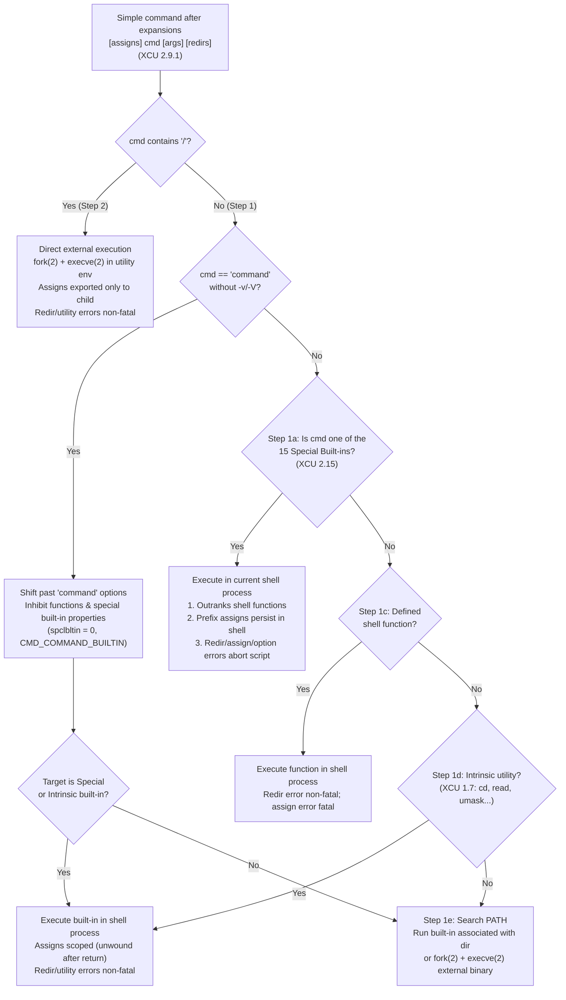

# Special Built ins versus Utilities

> [!summary] Claim
> POSIX partitions commands into 15 special built-in utilities (`break`, `:`, `continue`, `.`, `eval`, `exec`, `exit`, `export`, `readonly`, `return`, `set`, `shift`, `times`, `trap`, `unset`), 16 intrinsic built-in utilities, and standard utilities, assigning special built-ins three semantic differentiators inside the shell process: lookup before functions, permanent variable-assignment prefixes, and fatal non-interactive shell termination on redirection or utility errors unless suppressed by `command` `(POSIX.1-2024 XCU 2.15, XCU 2.8.1, XCU 2.9.1.4, XCU 1.7)`.

Part of [The POSIX Shell Language](README.md) in [Shell and Unix Engineering](../README.md).

## TL;DR

- **Mechanism**: Special built-ins execute inside the current shell process at Step 1a of command search before functions (Step 1c), intrinsic utilities (Step 1d), and `PATH` lookup plus `fork(2)`/`execve(2)` (Step 1e-2), mutating the shell's own symbol table, file descriptors, and control stack directly `(POSIX.1-2024 XCU 2.9.1.4, XCU 2.15)`.
- **Rule**: Prefixing a special built-in with `command` (for example `V=temp command :` or `command . ./cfg.sh`) strips all three special properties: functions are bypassed, preceding variable assignments stop persisting in the current shell environment, and redirection or utility errors return a non-zero status instead of aborting a non-interactive script `(POSIX.1-2024 XCU 2.9.1.4, XCU command)`.
- **Trap**: In a conforming POSIX shell, `IFS=: read -r a b` scopes `IFS` to `read` (an intrinsic regular built-in), whereas `IFS=: set -- $x` or `PATH=/custom . ./lib.sh` permanently mutates `IFS` or `PATH` for the rest of the script because `set` and `.` are special built-ins `(POSIX.1-2024 XCU 2.9.1.2, XCU 2.15)`.
- **Portability fact**: Native `bash` (when `posix` mode is off) disables special built-in assignment persistence, non-interactive fatal errors, and function-lookup priority, native `zsh` (when `POSIX_BUILTINS` is off) disables assignment persistence and fatal redirection errors but still aborts on `set -Z`, and `zsh` lets functions outrank special built-ins in every mode, while `posh` 0.14.1 fails to mask `POSH_BUILTIN_POSIX_SPECIAL` in `call_builtin` so `command set -Z` still aborts the shell, and regular built-in `printf` requires `PATH` search in `yash`, `mksh`, and `posh` (measured in the shell matrix; `(bash-5.3 execute_cmd.c, execute_simple_command)`; `(zsh Src/exec.c, execcmd_exec)`; `(posh exec.c, call_builtin)`; `(yash exec.c, get_command_path)`).
- **When not to use it**: Never rely on `V=val special_builtin` for temporary environment scoping or on bare `set`/`eval`/`.` against untrusted inputs without `command` when a non-interactive script must survive missing files or invalid flags.

## Mental model



When the shell evaluates a simple command whose command name contains no slash, `POSIX.1-2024 XCU 2.9.1.4` resolves the name through a strict hierarchy before consulting `PATH`.
At Step 1a, the shell checks whether the command word names one of the 15 special built-in utilities (`break`, `:`, `continue`, `.`, `eval`, `exec`, `exit`, `export`, `readonly`, `return`, `set`, `shift`, `times`, `trap`, `unset`).
If it matches, the shell executes the built-in directly in its own process image without searching functions or `PATH`, merges any preceding variable assignments permanently into the current shell variable table, and treats redirection errors or utility syntax/option errors as fatal to a non-interactive shell (a variable assignment error is fatal for every command, not only special built-ins) `(POSIX.1-2024 XCU 2.8.1, XCU 2.15)`.
If Step 1a does not match, the shell checks defined shell functions at Step 1c, intrinsic built-in utilities (`alias`, `bg`, `cd`, `command`, `fc`, `fg`, `getopts`, `hash`, `jobs`, `kill`, `read`, `type`, `ulimit`, `umask`, `unalias`, `wait`) at Step 1d, and finally searches `PATH` at Step 1e to invoke either a directory-bound built-in or a forked child via `execve(2)` `(POSIX.1-2024 XCU 1.7, XCU 2.9.1.4)`.
When the command is prefixed by `command` (without `-v` or `-V`), the shell bypasses function lookup and strips the special built-in attributes from the wrapped command, routing even `:` or `set` through the regular built-in execution path where assignments are unwound and errors return a status code instead of exiting `(POSIX.1-2024 XCU command)`.

## How it works

### The four-tier utility taxonomy in POSIX.1-2024

POSIX.1-2024 classifies utilities by how the shell locates, expands, and executes them `(POSIX.1-2024 XBD 3.54, 3.100, 3.178, 3.349; XCU 1.6, 1.7, 2.15)`:

1. **Special built-in utilities (`XBD 3.349`, `XCU 2.15`)**: Exactly 15 utilities (`break`, `:`, `continue`, `.`, `eval`, `exec`, `exit`, `export`, `readonly`, `return`, `set`, `shift`, `times`, `trap`, `unset`) specified on the reference pages that follow `XCU 2.15` (the standard prints no section numbers for those pages; their HTML anchors are `tag_19_16` through `tag_19_30`).
   Because their purpose is to mutate internal shell state (the variable table, positional parameters, open file descriptors, signal traps, loop control stack, or process image), they must execute inside the current shell process without `fork(2)` and do not require an `exec`-able binary in the file system `(POSIX.1-2024 XCU 1.6, XCU 2.15)`.
2. **Declaration utilities (`XBD 3.100`, `XCU 2.9.1.1`)**: A syntactic subset consisting of `export`, `readonly`, and `command` when wrapping another declaration utility (plus shell extensions such as `local`, `typeset`, and `declare`).
   When a command word is recognized as a declaration utility during tokenization and expansion (`XCU 2.9.1.1`), any subsequent argument that has the lexical form of a variable assignment (`name=word`) is expanded using assignment rules: tilde expansion occurs after `=` and after any unquoted `:`, while field splitting ([[Field-Splitting-and-IFS]]) and pathname expansion ([[Pathname-Expansion]]) are suppressed `(POSIX.1-2024 XCU 2.9.1.1)`.
3. **Intrinsic utilities (`XBD 3.178`, `XCU 1.7`)**: Introduced in POSIX.1-2024 (Austin Group Defect 854, replacing the POSIX.1-2017 "Regular Built-In Utilities" table), the 16 intrinsic utilities (`alias`, `bg`, `cd`, `command`, `fc`, `fg`, `getopts`, `hash`, `jobs`, `kill`, `read`, `type`, `ulimit`, `umask`, `unalias`, `wait`) are resolved at `XCU 2.9.1.4` Step 1d prior to `PATH` search; POSIX does not require them to be built-ins, though they usually are because most of them read or modify the shell execution environment `(POSIX.1-2024 XRAT C.1.7)`.
   Under `XCU 1.6` (Austin Group Defect 1600), 15 of the 16 intrinsic utilities (all except `kill`, which `env`, `find`, `nice`, `nohup`, `time`, and `xargs` must be able to `execve(2)`) are exempt from needing an external executable binary on disk.
4. **Standard regular utilities (`XBD 3.307`, `XCU 2.9.1.4` Step 1e and Step 2)**: Utilities such as `printf`, `test`, `true`, `false`, `echo`, `pwd`, `awk`, and `cat`.
   A shell may implement stateless regular utilities such as `printf`, `test`, `true`, `echo`, and `pwd` as in-process built-ins for performance, or execute them in a separate utility environment via `fork(2)` (or `vfork(2)`/`posix_spawn(3)`) and `execve(2)` `(POSIX.1-2024 XCU 2.9.1.6, XCU 2.13)`.
   Crucially, `POSIX.1-2024 XCU 2.9.1.4` Step 1e and `XRAT C.1.7` subject all regular built-ins to `PATH` search, requiring that a matching utility exist on `PATH` before invoking the built-in version ("With the exception of the intrinsic utilities, all regular built-in utilities are subject to the PATH search and can be overridden by a specially crafted PATH environment variable") `(POSIX.1-2024 XRAT C.1.7)`.
   `XRAT C.1.8` also lists `[`, `echo`, `false`, `newgrp`, `printf`, `pwd`, `test`, and `true` as frequently implemented as intrinsic, warns that future versions might not allow that, and encourages implementations to make them non-intrinsic.

### The three runtime rules of special built-ins

`POSIX.1-2024 XCU 2.15` defines two explicit properties for special built-ins, and `XCU 2.9.1.4` defines a third:

- **Rule 1 - Command search precedence (`XCU 2.9.1.4` Step 1a and `XCU 2.9.5`)**: In a simple command without slashes, special built-ins are matched at Step 1a before shell functions (Step 1c), intrinsic utilities (Step 1d), and `PATH` search (Step 1e).
  Furthermore, `XCU 2.9.5` (Function Definition Command) places the constraint on the application, which shall ensure that `fname` is not the name of a special built-in utility, so a conforming shell may reject the definition or accept it and still resolve the built-in first.
  Measured in the shell matrix, `dash`, `ksh93`, and `bash` 5.3 in POSIX mode reject the definition, while `mksh`, `posh`, `yash` (both modes), and `bash` 3.2 in POSIX mode accept it and run the built-in at call time.
- **Rule 2 - Variable assignment persistence (`XCU 2.15` item 2 and `XCU 2.9.1.2`)**: Variable assignments specified before the command name in a simple command (`V=val cmd`) affect the current shell execution environment permanently after the command completes if there is no command name (`V=val`) or if `cmd` is a special built-in utility.
  For functions and regular utilities (intrinsic or external), `XCU 2.9.1.2` leaves variable persistence in the current shell environment unspecified for functions in general, and requires that for standard utilities the assignment is exported only into the utility's execution environment without modifying the current shell's variable after completion.
- **Rule 3 - Fatal non-interactive shell errors (`XCU 2.15` item 1 and `XCU 2.8.1`)**: In the Consequences of Shell Errors table (`XCU 2.8.1`), a special built-in utility error and a redirection error with a special built-in require a non-interactive shell to exit, and note 1 of that table lifts the exit when the utility runs through `command`.
  A variable assignment error and an expansion error also shall exit, but for every command, so they do not distinguish special built-ins (measured exception: `ksh93` 93u+m continues after `R=2 true` when `R` is `readonly`).
  The shell must write its own diagnostic for the redirection case; for a special built-in utility error the table requires no shell diagnostic (note 2).
  For regular built-ins, functions, and external utilities, a redirection error or utility option/runtime error does not exit a non-interactive shell (unless `set -e` applies to a non-zero exit status; see [[errexit-Semantics-and-Exceptions]]).
  Note that individual special built-in specifications soften this: the `shift` page (`XCU 2.15`, `shift`, EXIT STATUS) says that if the `n` operand is invalid or greater than `$#`, this may be treated as an error and a non-interactive shell may exit, and if the shell does not exit it shall return a non-zero status and write a warning.

### Option syntax (`--`) across the 15 special built-ins

Although `POSIX.1-2024 XCU 1.4` requires utilities to conform to the XBD 12.2 Utility Syntax Guidelines (including recognizing `--` as the end-of-options delimiter) unless stated otherwise, `XCU 2.15` splits the 15 special built-ins into three distinct groups:

- **7 recognize `--` under XBD 12.2**: `.` (conforms to XBD 12.2 except Guidelines 1 and 2; `XCU 2.15 dot`), `exec` (`XCU 2.15 exec`), `export` (`XCU 2.15 export`), `readonly` (`XCU 2.15 readonly`), `set` (`XCU 2.15 set`), `trap` (`XCU 2.15 trap`), and `unset` (`XCU 2.15 unset`).
- **1 explicitly forbids `--`**: `:` (`XCU 2.15 colon`) states in its OPTIONS section that the utility shall not recognize `--` and that implementations shall not support any options; every argument passed to `:` undergoes normal expansion and is then ignored, returning `0`.
- **7 specify `OPTIONS: None` without XBD 12.2**: `break` (`XCU 2.15 break`), `continue` (`XCU 2.15 continue`), `eval` (`XCU 2.15 eval`), `exit` (`XCU 2.15 exit`), `return` (`XCU 2.15 return`), `shift` (`XCU 2.15 shift`), and `times` (`XCU 2.15 times`).
  Because `XCU 2.15` lifts the `XCU 1.4` `--` requirement for every special built-in not described as conforming to XBD 12.2 and says a conforming application shall not use that argument, portable scripts can rely on `. --`, `set --`, `exec --`, `export --`, `readonly --`, `trap --`, and `unset --`, but must not pass `--` to `eval`, `shift`, `break`, `continue`, `exit`, `return`, or `times`.
  `eval` is the sharpest case: its RATIONALE says the standard allows but does not require it to recognize `--`, its APPLICATION USAGE recommends `eval " $commands"` instead, and in the shell matrix `dash` and BusyBox `ash` run `eval -- ...` as a command named `--` (status `127`) while `bash`, `ksh93`, `mksh`, and `posh` discard it.
  `shift -- 1` splits the same way: `dash` and BusyBox `ash` reject it with `Illegal number: --`, while `bash`, `ksh93`, `mksh`, and `posh` accept it (measured in the shell matrix; `(dash src/options.c, shiftcmd)`).

### Inside the C implementations: `dash`, `bash`, `ksh93`, `zsh`, `mksh`, `yash`, `posh`, and BusyBox `ash`

Inspecting the shell source trees reveals how each engine encodes and switches special built-in semantics:

- **`dash` (`src/builtins.def.in`, `src/eval.c`, `src/exec.c`, `src/parser.c`)**:
  `src/builtins.def.in` tags 16 built-ins with `-s` (`BUILTIN_SPECIAL` = `0x1` in `src/mkbuiltins`): the 15 POSIX special built-ins plus `local` (`-as`).
  At parse time, `simplecmd` in `src/parser.c` checks `(bcmd = find_builtin(name)) && bcmd->flags & BUILTIN_SPECIAL` when seeing `()` and calls `synerror("Bad function name")` (exit status `2`).
  At execution time in `evalcommand` (`src/eval.c`), the first lookup sets `spclbltin = cmdentry.u.cmd->flags & BUILTIN_SPECIAL` and `vlocal = spclbltin ^ BUILTIN_SPECIAL`.
  If the command is `command` (without `-v`/`-V`), that first lookup has already left `spclbltin = 0` and `vlocal = BUILTIN_SPECIAL` because `command` is not special, and the `spclbltin < 0` guard stops the wrapped command from recomputing them while `parse_command_args` advances to it.
  After redirections, `evalcommand` iterates over the assignment list: if `vlocal != 0`, it calls `mklocal((*spp)->text, VEXPORT)` to push a temporary frame unwound by `unwindlocalvars()` when the command finishes; if `vlocal == 0` (an unwrapped special built-in), it calls `setvareq((*spp)->text, vflags)` to mutate the global variable table permanently (`vflags` is `VEXPORT` only for `exec` with arguments).
  On redirection failure, `if (spclbltin > 0) exraise(EXERROR)` aborts the shell; inside `evalbltin`, an `EXERROR` exception is suppressed when `spclbltin <= 0` (`!(exception == EXERROR && spclbltin <= 0)`).
- **BusyBox `ash` (`shell/ash.c`)**:
  `builtintab` encodes flags in the leading character of each entry (`BUILTIN_SPEC_REG` = `"3"`, `BUILTIN_SPEC_ASSG` = `"5"`, `BUILTIN_SPEC_REG_ASSG` = `"7"`) and tests `IS_BUILTIN_SPECIAL(b)` as `((b)->name[0] & 1)`, marking the 15 POSIX special built-ins plus `local` and `source`.
  `evalcommand` in `shell/ash.c` uses the same `spclbltin` and `vlocal` state machine as `dash`, except in `simplecmd` (`shell/ash.c` lines 12174-12180) the `IS_BUILTIN_SPECIAL(bcmd)` check on function definitions is commented out, and `find_command` checks `cmdlookup(name, 0)` (functions) before `find_builtin(name)`.
  Consequently, BusyBox `ash` allows a shell function to be defined with a special built-in's name and overrides the special built-in at call time.
- **GNU `bash` (`builtins.h`, `builtins/mkbuiltins.c`, `execute_cmd.c`, `variables.c`)**:
  `builtins/mkbuiltins.c` populates `special_builtins` with the 15 POSIX special built-ins plus `source`, setting `SPECIAL_BUILTIN` (`0x08` in `builtins.h`), and marks `alias`, `declare`, `export`, `local`, `readonly`, and `typeset` with `ASSIGNMENT_BUILTIN` (`0x10`) through `assignment_builtins`.
  In `execute_simple_command` (`execute_cmd.c`), `bash` checks `if (posixly_correct)` before calling `find_special_builtin`.
  When `posix` mode is off (native `bash`), `builtin_is_special` stays `0`: functions can shadow special built-ins, prefix assignments go to `temporary_env` and are discarded by `dispose_used_env_vars` / `pop_scope` after the command returns, and neither redirection failures nor `EX_USAGE` built-in errors call `jump_to_top_level(ERREXIT)`.
  Even in `posix` mode (`set -o posix` or invoked as `/bin/sh`), `bash` 5.3 treats the two error classes differently.
  Redirection, assignment, and expansion failures from a special built-in jump straight out of `execute_simple_command`, with no conditional-context check:
  ```c
  case EX_REDIRFAIL:
  case EX_BADASSIGN:
  case EX_EXPFAIL:
    /* These errors cause non-interactive posix mode shells to exit */
    if (posixly_correct && builtin_is_special && interactive_shell == 0)
      {
        last_command_exit_value = EXECUTION_FAILURE;
        jump_to_top_level (ERREXIT);
      }
  ```
  Usage errors such as `set -Z` only set `special_builtin_failed`, and `execute_command_internal` acts on that flag only when `ignore_return == 0`:
  ```c
  if (ignore_return == 0 && invert == 0 &&
      ((posixly_correct && interactive == 0 && special_builtin_failed) ||
       (exit_immediately_on_error && pipe_in == NO_PIPE && pipe_out == NO_PIPE && exec_result != EXECUTION_SUCCESS)))
  ```
  Because `CMD_IGNORE_RETURN` covers `if`, `while`, `until`, and the left side of `&&` and `||`, and reaches into subshells, brace groups, and functions there, `( set -Z; echo after ) && echo ok` under `bash --posix` prints `after` and `ok` (measured in the shell matrix), while the same construct with `: </nonexistent` aborts the subshell.
- **AT&T `ksh93` (`src/cmd/ksh93/data/builtins.c`, `src/cmd/ksh93/sh/xec.c`)**:
  `shtab_builtins` marks the 15 POSIX special built-ins plus `typeset` with `BLT_SPC`, and marks `typeset`, `compound`, `float`, `integer`, `nameref`, `export`, `enum`, and `readonly` with `BLT_DCL`.
  In `sh_exec` (`xec.c`), `case TFUN:` checks `nv_isattr(mp, BLT_SPC)` and fails with `ERROR_exit(1)` (`invalid function name`).
  In `case TCOM:`, `ksh93u+m` 1.0.10 checks `if (argn==0 || (np && (nv_isattr(np,BLT_DCL) || (!command && nv_isattr(np,BLT_SPC)))))` to decide whether prefix assignments are applied permanently via `nv_setlist` or scoped via `sh_scope(argp, 0)` and `sh_unscope()`.
  In older `ksh93u+` 2012-08-01 (still shipped as macOS `/bin/ksh`), the `!command &&` guard before `nv_isattr(np, BLT_SPC)` was absent, so `V=1 command :` permanently mutates `V` in `ksh93u+` 2012-08-01 while `ksh93u+m` 1.0.10 scopes and restores `V`.
- **`zsh` (`Src/zsh.h`, `Src/builtin.c`, `Src/exec.c`)**:
  `Src/builtin.c` tags 14 of the 15 POSIX special built-ins (all but `exec`, a precommand modifier declared with `BIN_PREFIX` and `BINF_EXEC`) plus `declare`, `float`, `integer`, `local`, `source`, and `typeset` with `BINF_PSPECIAL` (`1<<11` in `Src/zsh.h`).
  In `execcmd_exec` (`Src/exec.c`), special built-in assignment persistence and redirection error fatality are controlled by `isset(POSIXBUILTINS)` (off in native `zsh`, on under `zsh --emulate sh`).
  In native `zsh`, `command` is a precommand modifier that bypasses all built-ins when `POSIX_BUILTINS` is unset (`if ((cflags & BINF_COMMAND) && unset(POSIXBUILTINS)) break;`), so `command :` searches `PATH` and fails with exit status `127`.
  In both native `zsh` and `zsh --emulate sh`, `execcmd_exec` looks up `shfunctab->getnode` (line 3491) before `builtintab->getnode` (line 3495), so a defined function overrides a special built-in unless it is disabled (`disable -f`) or bypassed with `builtin` (or with `command` under `POSIX_BUILTINS`).
- **`mksh`, `yash`, and `posh`**:
  `mksh` (`sh.h`, `funcs.c`, `exec.c`) marks the 15 POSIX special built-ins with `SPEC_BI` (`*`) and `KEEPASN` (`=`), plus `source` and `typeset` with `KEEPASN`; `comexec` sets `resetspec = Ja` under `command`, clearing both flags.
  By default, `mksh` leaves `MKSH_PRINTF_BUILTIN` disabled in distribution packages (such as Alpine and Debian), so `printf` is not built in and requires an executable binary on `PATH` `(mksh funcs.c)`.
  `yash` (`builtin.h`, `builtin.c`, `exec.c`) classifies built-ins into `BI_SPECIAL` (the 15 POSIX special built-ins), `BI_MANDATORY` (the 16 intrinsic utilities), `BI_ELECTIVE`, `BI_EXTENSION`, and `BI_SUBSTITUTIVE`; `exec_simple_command_with_words` always persists assignments before `CT_SPECIALBUILTIN`, but gates fatal redirection and built-in errors (`special_builtin_error`) on `posixly_correct` (`set -o posix`).
  For substitutive regular built-ins (`printf`, `echo`, `test`), `yash` strictly enforces `POSIX.1-2024 XCU 2.9.1.4` Step 1e in `exec.c` (`get_command_path`): if the command name is not found on `PATH` (such as `PATH=/nonexistent`), `yash` refuses to invoke the built-in and exits with status `127` (`no such command`) `(yash exec.c, get_command_path; builtin.c)`.
  `posh` (`src/builtins.c`, `exec.c`, `io.c`) marks 14 of the 15 POSIX special built-ins with `POSH_BUILTIN_POSIX_SPECIAL | POSH_BUILTIN_KEEPASN` (omitting `POSH_BUILTIN_POSIX_SPECIAL` on `times`).
  In `posh`, `printf` is omitted entirely from `posh_builtins[]`, so invoking `printf` always requires a successful `PATH` search and fails with status `127` when `PATH` is nonexistent `(posh src/builtins.c)`.
  In `posh`'s `comexec` (`exec.c`), `command` clears `keepasn_ok` and prevents redirection failure in `execute()` from seeing `SPEC_BI`, but `call_builtin` (`exec.c` line 955) unconditionally sets `builtin_flag = tp->flag`, so when `command set -Z` calls `bi_errorf` (`io.c` line 74), the test `(builtin_flag & SPEC_BI) || (builtin_flag & KEEPASN)` is still true and `posh` fatally unwinds and exits the script.

## Numbers and limits

| Quantity / Limit | Value | Source / Measurement |
|---|---|---|
| POSIX special built-in utilities (`break`, `:`, `continue`, `.`, `eval`, `exec`, `exit`, `export`, `readonly`, `return`, `set`, `shift`, `times`, `trap`, `unset`) | `15` | `POSIX.1-2024 XCU 2.15` (reference pages `break` through `unset`, as of 2026-11) |
| Special built-ins conforming to XBD 12.2 option syntax (`--` recognized: `.`, `exec`, `export`, `readonly`, `set`, `trap`, `unset`) | `7` | `POSIX.1-2024 XCU 2.15` (as of 2026-11) |
| Special built-ins explicitly forbidding `--` or any options (`:`) | `1` | `POSIX.1-2024 XCU 2.15 colon` (as of 2026-11) |
| Special built-ins specifying `OPTIONS: None` without XBD 12.2 (`break`, `continue`, `eval`, `exit`, `return`, `shift`, `times`) | `7` | `POSIX.1-2024 XCU 2.15`, OPTIONS section of each page (as of 2026-11) |
| POSIX intrinsic utilities (`alias`, `bg`, `cd`, `command`, `fc`, `fg`, `getopts`, `hash`, `jobs`, `kill`, `read`, `type`, `ulimit`, `umask`, `unalias`, `wait`) | `16` | `POSIX.1-2024 XCU 1.7` (Austin Group Defect 854, as of 2026-11) |
| Built-in utilities exempt from requiring an `exec`-able binary on disk (`15` special + `15` intrinsic, all except `kill`) | `30` | `POSIX.1-2024 XCU 1.6` (Austin Group Defect 1600, as of 2026-11) |
| Standard declaration utilities (`export`, `readonly`, plus `command` wrapping a declaration utility) | `2` (+ `command`) | `POSIX.1-2024 XBD 3.100`, `XCU 2.9.1.1` (as of 2026-11) |
| Built-ins tagged `BUILTIN_SPECIAL` (`0x01`) in `dash` (`15` POSIX + `local`) | `16` | `(dash src/builtins.def.in, src/mkbuiltins)` (as of 2026-11) |
| Built-ins tagged `SPECIAL_BUILTIN` (`0x08`) in GNU `bash` (`15` POSIX + `source`) | `16` | `(bash-5.3 builtins.h, builtins/mkbuiltins.c)` (as of 2026-11) |
| Built-ins tagged `BLT_SPC` in `ksh93u+m` (`15` POSIX + `typeset`) | `16` | `(ksh93 v1.0.10 src/cmd/ksh93/data/builtins.c)` (as of 2026-11) |
| Built-ins tagged `BINF_PSPECIAL` in `zsh` (`14` POSIX, all but `exec`, + `declare`, `float`, `integer`, `local`, `source`, `typeset`) | `20` | `(zsh Src/builtin.c, Src/zsh.h)` (as of 2026-11) |
| Exit status when external command is not found during `PATH` search (`XCU 2.9.1.4` Step 1e) | `127` | `POSIX.1-2024 XCU 2.8.2`, verified by lab `command search` test |
| Exit status when regular utility printf is invoked under `PATH=/nonexistent` in `mksh`, `posh`, and `yash` | `127` | `POSIX.1-2024 XCU 2.9.1.4` Step 1e, `XRAT C.1.7`, verified by lab `command search` test |
| Process creations (`fork(2)`) required to run a special/intrinsic built-in or `exec` in the current shell vs an external utility | `0` vs `1` | `POSIX.1-2024 XCU 2.9.1.6`, `XCU 2.13`; the lab `exec-pid` test proves the `exec` and external cases only, the built-in `0` rests on the specification |

## Portability

| Behavior / Probe | POSIX.1-2024 (`XCU 2.15`, `2.9.1`) | macOS `bash` 3.2 (`/bin/sh` vs `/bin/bash`) | GNU `bash` 5.3 (native vs `-o posix`) | `zsh` 5.9 (native vs `--emulate sh`) | `dash` 0.5.12 | `ksh93` (`93u+` 2012 vs `93u+m` 1.0.10) | `mksh` R59 | `yash` 2.58.1 (native vs `-o posix`) | `posh` 0.14.1 | BusyBox `ash` 1.37.0 |
|---|---|---|---|---|---|---|---|---|---|---|
| `V=persisted :` persists `V` in current shell | Required | `/bin/sh`: Yes; `/bin/bash`: No | Native: No; `-o posix`: Yes | Native: No; `--emulate sh`: Yes (`POSIX_BUILTINS`) | Yes | Yes (both) | Yes | Yes (both) | Yes | Yes |
| `V=suppressed command :` suppresses `V` persistence | Required | Yes (`V` restored) | Yes (`V` restored) | Native: `command :` exits `127`, `V` restored; `--emulate sh`: Yes | Yes | `93u+` 2012: No (`V` persists); `93u+m` 1.0.10: Yes (`V` restored) | Yes | Yes | Yes | Yes |
| `: </nonexistent` aborts non-interactive shell | Required | `/bin/sh`: Yes (status `1`, unless on the left side of an AND-OR list, including inside a subshell there); `/bin/bash`: No | Native: No; `-o posix`: Yes (status `1`) | Native: No; `--emulate sh`: Yes (status `1`) | Yes (status `2`) | Yes (status `1`) | Yes (status `1`) | Native: No; `-o posix`: Yes (status `2`) | Yes (status `1`) | Yes (status `1`) |
| `command : </nonexistent` suppresses fatal exit | Required | Yes (returns `1`) | Yes (returns `1`) | Native: returns `1` without abort; `--emulate sh`: Yes (returns `1`) | Yes (returns `2`) | Yes (returns `1`) | Yes (returns `1`) | Yes (returns `2`) | Yes (returns `1`) | Yes (returns `1`) |
| `set -Z` aborts non-interactive shell | Required | `/bin/sh`: Yes (status `2`, unless on the left side of an AND-OR list); `/bin/bash`: No | Native: No; `-o posix`: Yes (status `2`, unless on the left side of an AND-OR list) | Yes in both (status `1`) | Yes (status `2`) | Yes (status `2`) | Yes (status `1`) | Native: No; `-o posix`: Yes | Yes (status `1`) | Yes (status `2`) |
| `command set -Z` suppresses fatal exit | Required | Yes | Yes | Native: exits `127` (not found), non-fatal; `--emulate sh`: Yes (returns `1`) | Yes (returns `2`) | Yes (returns `2`) | Yes (returns `2`) | Yes (returns `2`) | No - `call_builtin` leaves `SPEC_BI` set, aborts script | Yes (returns `2`) |
| Special built-in `eval` outranks function `eval()` | Required (`XCU 2.9.1.4` Step 1a, `2.9.5`) | `/bin/sh`: Yes (lookup wins); `/bin/bash`: No (function wins) | Native: No (function wins); `-o posix`: Yes (definition rejected, status `2`) | No in both (`shfunctab` checked before `builtintab`) | Yes (parse error, status `2`) | Yes (`invalid function name`, status `1`) | Yes (definition accepted, built-in runs) | Yes in both (definition accepted, built-in runs) | Yes (definition accepted, built-in runs) | No (`IS_BUILTIN_SPECIAL` check commented out in `simplecmd`) |
| `export d_var=$v` (`v='two words'`) suppresses field splitting | Required (`XBD 3.100`, `XCU 2.9.1.1`) | Yes (`d_var="two words"`) | Yes (`d_var="two words"`) | Yes in both (`d_var="two words"`) | Yes (`d_var="two words"`) | Yes (`d_var="two words"`) | Yes (`d_var="two words"`) | Yes (`d_var="two words"`) | No - splits into `d_var=two` and exports `words` | Yes (`d_var="two words"`) |
| Regular built-in `printf` resolves without `PATH` (`PATH=/nonexistent`) | Not guaranteed (subject to `PATH` search under `XCU 2.9.1.4` Step 1e and `XRAT C.1.7`; status `127` if missing) | Yes (status `0`) | Yes in both (status `0`) | Yes in both (status `0`) | Yes (status `0`) | Yes in both (status `0`) | No - not built in by default, `PATH` search exits `127` | No in both - `BI_SUBSTITUTIVE` requires `PATH` search, exits `127` | No - no built-in `printf`, `PATH` search exits `127` | Yes (status `0`) |

This table's exit statuses and outcomes are asserted per shell (as of 2026-11): the `table rows` test covers the error, AND-OR, assignment, and `PATH` rows including the `-o posix` columns, the `eval definition` test covers the `eval` row, and the `decl` test covers the `export` row outside `-o posix`; the parenthetical source-code reasons come from each implementation's source tree.

Note on utilities (`GNU coreutils`, `BSD`/macOS, `BusyBox`, `uutils`): `POSIX.1-2024 XCU 1.6` requires external executable implementations on disk for standard utilities (including `true`, `false`, `echo`, `printf`, `test`, `pwd`, and `kill`) so `env`, `find`, `nice`, `nohup`, `time`, and `xargs` can `execve(2)` them, whereas the 15 special built-ins and 15 of the 16 intrinsic utilities (`cd`, `read`, `umask`, `ulimit`, `wait`, `getopts`, `command`, `type`, `hash`, `alias`, `unalias`, `bg`, `fg`, `jobs`, `fc`) are exempt and are omitted from standalone coreutils suites such as GNU coreutils and `uutils` (even though macOS ships `/usr/bin/cd` and `/usr/bin/umask` as small wrapper scripts, measured on the host) `(POSIX.1-2024 XCU 1.6, XRAT C.1.7, C.1.8)`.

## Worked example

The verification [lab](../labs/03-special-built-ins-versus-utilities/) runs [`special-vs-util.sh`](../labs/03-special-built-ins-versus-utilities/special-vs-util.sh) across every shell in the matrix to test variable-assignment persistence (`assign`), redirection error fatality (`redir-err`), option error fatality (`util-err`), function lookup precedence (`precedence`), declaration-utility expansion (`decl`), and in-process `exec` versus forked external execution (`exec-pid`).
One limit of this probe: the `regular_*` fields use `set`, which is a non-declaration utility but a special built-in, not a regular utility.

```sh
#!/bin/sh
# Probe POSIX.1-2024 special built-in semantics versus regular utilities.
# Usage: special-vs-util.sh <assign|redir-err|util-err|precedence|decl|exec-pid> [args...]
set -u

mode=${1:-assign}

case ${mode} in
  assign)
    V=init
    V=persisted :
    after_special=${V}

    V=init
    V=ephemeral true
    after_regular=${V}

    V=init
    V=suppressed command : 2>/dev/null || :
    after_command=${V}

    printf 'special=%s regular=%s command=%s\n' \
      "${after_special}" "${after_regular}" "${after_command}"
    ;;

  redir-err)
    r_special=$(
      exec 2>/dev/null
      : </nonexistent/no_such_file
      printf 'survived\n'
    )
    r_special=${r_special:-aborted}

    r_regular=$(
      exec 2>/dev/null
      true </nonexistent/no_such_file
      printf 'survived\n'
    )
    r_regular=${r_regular:-aborted}

    r_command=$(
      exec 2>/dev/null
      command : </nonexistent/no_such_file
      printf 'survived\n'
    )
    r_command=${r_command:-aborted}

    printf 'special=%s regular=%s command=%s\n' \
      "${r_special}" "${r_regular}" "${r_command}"
    ;;

  util-err)
    u_special=$(
      exec 2>/dev/null
      # shellcheck disable=SC3041 # intentional invalid option to trigger special built-in error
      set -Z
      printf 'survived\n'
    )
    u_special=${u_special:-aborted}

    u_command=$(
      exec 2>/dev/null
      command set -Z
      printf 'survived\n'
    )
    u_command=${u_command:-aborted}

    printf 'special=%s command=%s\n' "${u_special}" "${u_command}"
    ;;

  precedence)
    f_reg=$(
      true() { printf 'func\n'; }
      true
    )
    f_cmd=failed
    if (
      true() { return 7; }
      command true
    ) >/dev/null 2>&1; then
      f_cmd=bypassed
    fi
    f_spec=$(
      exec 2>/dev/null
      eval 'eval() { printf "func\n"; }' >/dev/null
      eval 'printf "builtin\n"'
    ) || f_spec=builtin

    printf 'regular=%s command_true=%s special=%s\n' \
      "${f_reg}" "${f_cmd}" "${f_spec}"
    ;;

  decl)
    v='two words'
    # shellcheck disable=SC2086,SC2248 # intentional unquoted declaration-utility argument
    export d_var=$v
    # shellcheck disable=SC2086,SC2248 # intentional unquoted regular-utility argument
    set -- d_var=$v
    printf 'export=<%s> regular_argc=%d regular_arg1=<%s>\n' \
      "${d_var}" "$#" "$1"
    ;;

  exec-pid)
    bin=$2
    pidfile=$3
    "${bin}" >"${pidfile}"
    read -r ext_pid <"${pidfile}"
    if [ "${ext_pid}" != "$$" ]; then
      ext_rel=forked
    else
      ext_rel=same
    fi
    printf 'external=%s shell_pid=%s\n' "${ext_rel}" "$$"
    exec "${bin}"
    ;;

  *)
    printf 'unknown mode: %s\n' "${mode}" >&2
    exit 2
    ;;
esac
```

Output measured on the Debian image, under a conforming POSIX shell (`dash` 0.5.12) versus native GNU `bash` (5.2.37):

```text
$ dash special-vs-util.sh assign
special=persisted regular=init command=init
$ dash special-vs-util.sh redir-err
special=aborted regular=survived command=survived
$ dash special-vs-util.sh util-err
special=aborted command=survived
$ dash special-vs-util.sh precedence
regular=func command_true=bypassed special=builtin
$ dash special-vs-util.sh decl
export=<two words> regular_argc=2 regular_arg1=<d_var=two>

$ bash special-vs-util.sh assign
special=init regular=init command=init
$ bash special-vs-util.sh redir-err
special=survived regular=survived command=survived
$ bash special-vs-util.sh util-err
special=survived command=survived
$ bash special-vs-util.sh precedence
regular=func command_true=bypassed special=func
$ bash special-vs-util.sh decl
export=<two words> regular_argc=2 regular_arg1=<d_var=two>
```

## Pitfalls

> [!warning] Permanent environment corruption from prefix assignments before special built-ins
> - **Trigger**: Writing `IFS=: set -- $PATH` or `LC_ALL=C . ./parse.sh` assuming `IFS` or `LC_ALL` is temporarily scoped to that single command the way `IFS=: read -r a b` scopes `IFS` to `read`.
> - **Symptom**: Under `/bin/sh` (`dash`, `busybox ash`, `ksh93`, `mksh`, `yash`, `posh`, or `bash` in POSIX mode), `IFS` remains `:` or `LC_ALL` remains `C` for every subsequent command in the script, breaking word splitting and locale behavior downstream `(POSIX.1-2024 XCU 2.9.1.2, XCU 2.15)`.
> - **Fix**: Never place a temporary variable assignment prefix on a special built-in; either run it inside a subshell `(IFS=:; set -- $PATH; ...)` or save and restore the variable explicitly around `command`.

> [!warning] Fatal script termination on optional `.` (`dot`), `exec`, or redirection failure
> - **Trigger**: Running `. /etc/default/optional-app 2>/dev/null || true` or `: >/var/run/lock/probe 2>/dev/null || fallback` in a non-interactive `/bin/sh` script when the target file is missing or unopenable.
> - **Symptom**: Even with `|| true` or `set +e`, `.` (file not found in `XCU 2.15 dot`) and `:` (redirection error in `XCU 2.8.1` and `XCU 2.15`) are special built-ins whose errors immediately terminate a non-interactive POSIX shell before the right-hand side of `||` can execute (measured exceptions: macOS `/bin/sh`, `bash` 3.2, runs the right-hand side after a failed `:` redirection, and native `bash`, native `zsh`, and native `yash` never abort on it).
> - **Fix**: Prefix the special built-in with `command` (`command . /etc/default/optional-app 2>/dev/null || true` or `command : >/var/run/lock/probe 2>/dev/null || fallback`) and test `[ -r /etc/default/optional-app ]` before sourcing, because `posh` 0.14.1 still aborts on `command . /missing` (measured in the shell matrix) `(POSIX.1-2024 XCU command)`.

> [!warning] Shellshock-class function-import and special built-in shadowing in non-POSIX modes (`CVE-2014-6271`, `CVE-2014-7169`)
> - **Trigger**: Invoking GNU `bash` (in native mode), `zsh` (even under `--emulate sh`), or BusyBox `ash` where defined shell functions are permitted to share names with or outrank special built-ins (`eval`, `exit`, `export`, `readonly`, `unset`, `set`), or, in `bash`, importing exported function definitions from untrusted environment variables (`BASH_FUNC_<name>%%`).
> - **Symptom**: In `CVE-2014-6271`, `initialize_shell_variables` in `bash` (`variables.c`) passed environment values starting with `() {` to `parse_and_execute`, executing trailing commands at startup (`bash43-025` added `SEVAL_FUNCDEF | SEVAL_ONECMD`); `CVE-2014-7169` got past that fix through malformed definitions and saved parser lookahead (`bash43-026`).
>   Function import itself remains by design under `BASH_FUNC_<name>%%` (`bash43-027`): in native `bash` without `-p`, an attacker-controlled `BASH_FUNC_eval%%` defines a function that intercepts `eval` because `find_special_builtin` is skipped when `posixly_correct == 0` (measured on Debian `bash` 5.2 and macOS `/bin/bash`) `(bash-5.3 variables.c, initialize_shell_variables; execute_cmd.c, execute_simple_command)`.
> - **Fix**: Sanitize the environment with `env -i` across trust boundaries, and use `bash -p` only to stop function import, knowing that `-p` keeps a differing effective user ID instead of dropping it (`CVE-2019-18276` covers `bash` through 5.0 patch 11, where the default privilege drop left the saved UID in place; `bash` 5.3 `disable_priv_mode` calls `setresuid`).
>   Enable `set -o posix` when POSIX special built-in lookup priority is required.

> [!warning] Native `zsh` `command` precommand modifier exits `127` on special built-ins
> - **Trigger**: Using `command :`, `command set`, or `command export` in a script run by native `zsh` (without `emulate -L sh` or `setopt POSIX_BUILTINS`).
> - **Symptom**: Native `zsh` treats `command` as a precommand modifier that bypasses all built-ins (`if ((cflags & BINF_COMMAND) && unset(POSIXBUILTINS)) break;` in `Src/exec.c`), searches `PATH` for an external binary named `:` or `set`, and fails with `zsh: command not found: :` (exit status `127`).
> - **Fix**: Enable `emulate -L sh` (or `setopt POSIX_BUILTINS`) at the start of any `zsh` code that shares POSIX `command <special-builtin>` idioms, or use `builtin` when native `zsh` must bypass functions to reach a built-in `(zsh Src/exec.c, execcmd_exec)`.

> [!warning] `posh` declaration-utility field splitting and `command` fatal error leak
> - **Trigger**: Running `export x=$v` (where `v` contains whitespace) or `command set -Z 2>/dev/null || :` under Debian's `posh` 0.14.1.
> - **Symptom**: `posh` 0.14.1 does not implement `POSIX.1-2024 XCU 2.9.1.1` declaration-utility expansion rules (so `export x=$v` with `v="two words"` splits on `IFS` and exports `x=two` and `words`), and `call_builtin` in `posh` `exec.c` overwrites `builtin_flag = tp->flag` without masking out `POSH_BUILTIN_POSIX_SPECIAL`, causing `command set -Z` to abort a non-interactive script via `bi_errorf` `(posh exec.c, call_builtin; io.c, bi_errorf)`.
> - **Fix**: Always double-quote assignments inside declaration utilities (`export x="${v}"`, `readonly x="${v}"`) even though POSIX.1-2024 suppresses field splitting there, and validate options before passing dynamic flags to `set`.

> [!warning] Regular built-ins (`printf`, `echo`, `test`) failing under restricted or cleared `PATH` (`mksh`, `posh`, `yash`)
> - **Trigger**: Clearing `PATH` (`PATH=""` or `PATH=/nonexistent`) for security isolation or sandboxing and invoking regular utilities like `printf` or `test` assuming they are built-ins that resolve without `PATH` like special built-ins (`set`, `:`) or intrinsic utilities (`cd`, `read`).
> - **Symptom**: Under `yash` (which classifies regular built-ins as `BI_SUBSTITUTIVE` and enforces `POSIX.1-2024 XCU 2.9.1.4` Step 1e `PATH` lookup), `mksh` (which leaves `MKSH_PRINTF_BUILTIN` disabled by default), and `posh` (which provides no built-in `printf`), the shell fails to locate `printf` and exits with status `127` (`command not found`), causing scripts under `set -e` to terminate unexpectedly `(POSIX.1-2024 XCU 2.9.1.4, XRAT C.1.7; yash exec.c, get_command_path; mksh funcs.c; posh src/builtins.c)`.
> - **Fix**: Initialize `PATH` to a trusted system directory (such as `PATH=$(/usr/bin/getconf PATH)`) before calling regular utilities, or restrict commands executed under an empty or untrusted `PATH` strictly to the 15 special built-ins (`XCU 2.15`) and 16 intrinsic utilities (`XCU 1.7`).

## Security and robustness

- **Command hijacking and `PATH` immunity (`XCU 2.9.1.4` Step 1a)**: Because special built-ins (`export`, `readonly`, `unset`, `set`, `eval`, `exec`, `trap`, `.`, `return`, `exit`) are resolved at Step 1a before functions (Step 1c) and before `PATH` search (Step 1e), a conforming POSIX shell guarantees that neither a trojan binary in an untrusted `PATH` directory nor a user-defined function can intercept `export`, `unset`, `set`, or `exit`.
  However, three shells in common production use violate Step 1a function priority in their default or POSIX-emulation modes: native `bash` (`posixly_correct == 0`), `zsh` (both native and `--emulate sh`, because `execcmd_exec` queries `shfunctab` before `builtintab`), and BusyBox `ash` (where the `IS_BUILTIN_SPECIAL` guard in `simplecmd` is commented out).
- **Environment function import (`BASH_FUNC_...%%`) and `privmode` (`CVE-2014-6271`, `CVE-2014-7169`, `CVE-2019-18276`)**: When `bash` starts without `-p` (`privmode == 0`), `initialize_shell_variables` (`variables.c`) imports `BASH_FUNC_<name>%%=() { ... }` from `environ` in every mode; POSIX mode only adds a filter on the name.
  Because native `bash` skips `find_special_builtin` and checks `find_function` first when `posixly_correct == 0`, an imported function named `eval`, `exit`, `unset`, or `export` can hijack those special built-ins inside any child `bash` script.
  When invoked as `/bin/sh`, `bash` runs in POSIX mode and `eval` resolves to the built-in (measured: `real`, not the imported function), while `bash --posix` with `BASH_FUNC_eval%%` in the environment fails at startup with `` `eval': is a special builtin `` (status `2`, measured on Debian `bash` 5.2).
  When `euid != uid` or `egid != gid` without `-p`, `bash` drops privileges via `disable_priv_mode`; `CVE-2019-18276` records that through 5.0 patch 11 this left the saved UID in place on systems with saved-UID support, so loading a builtin with `enable -f` could regain privileges.
- **Hardening variable initialization and `PATH` reset**: To establish a clean execution environment at the top of a security-sensitive `/bin/sh` script, use the special built-in `unset` and `export` (resolved before `PATH` at Step 1a) to clear dangerous variables (`IFS`, `CDPATH`, `ENV`, `BASH_ENV`, `LD_PRELOAD`) and lock `PATH`:
  ```sh
  \unset -f command unset export readonly set PATH IFS CDPATH ENV BASH_ENV 2>/dev/null || :
  unset IFS CDPATH ENV BASH_ENV LD_PRELOAD
  PATH=$(/usr/bin/getconf PATH)
  export PATH
  ```
  Leading `\unset` bypasses any alias ([[Aliases]]), and `unset -f` removes any function definitions in shells (`zsh`, BusyBox `ash`, native `bash`) that allow functions to shadow built-ins.
  In-band scrubbing has a hole in those same shells: if `unset` itself is shadowed, neither line reaches the built-in (measured with `BASH_FUNC_unset%%` under native `bash`, which intercepted both lines and stayed defined), so across a real trust boundary clean the environment with `env -i` before the shell starts.
- **Fault isolation with `command`**: Whenever a script must probe a redirection target (`command : >"${lockfile}"`) or source a user-supplied configuration file (`command . "${config_file}"`) and handle failure gracefully, prefix the special built-in with `command` so a permission error or missing file returns a non-zero exit code instead of terminating the shell process, except in `posh` 0.14.1, which still aborts on `command . /missing` (measured in the shell matrix) `(POSIX.1-2024 XCU command)`.

## The principal's view

The two built-in tiers in POSIX (`XCU 2.15` Special Built-Ins and `XCU 1.7` Intrinsic Utilities) grew out of older shell internals, though the standard's own rationale for `XCU 2.15` says only "See the RATIONALE sections on the individual reference pages" `(POSIX.1-2024 XRAT C.2.15)`.
In the Seventh Edition Bourne shell, assignments preceding any internal command were applied directly to the shell's symbol table (`IF (internal=syslook(com[0],commands)) ORF argn==0 THEN setlist(t->comset, 0)`), and `failed()` reached `exitsh()`, which called `done()` or `longjmp(errshell,1)`, aborting a non-interactive script `(V7 sh xec.c, error.c)`.
That `commands` table had no `unset` or `return` and also held `cd`, `read`, `wait`, and `umask`, so the 15-name set is a later standardization choice rather than a V7 list `(V7 sh msg.c)`.
Neither `XRAT C.2.15` nor the special built-ins' RATIONALE sections give a motive for keeping these properties; on the search order, the rationale says only that it "acknowledges that special built-ins cannot be overridden" and "provides a means of suppressing function lookup (via the command utility)" `(POSIX.1-2024 XRAT C.2.9.1)`.
The `command` page states the effect on special built-ins (the special properties shall not occur), and its RATIONALE compares `command` to the Eighth Edition `builtin` command `(POSIX.1-2024 XCU command)`.
Later revisions refined the rest of the taxonomy: Austin Group Defect 351 (POSIX.1-2024 `XBD 3.100`, `XCU 2.9.1.1`) codified declaration utilities (`export`, `readonly`) so `export var=$val` would not unexpectedly field-split in conforming shells, and Austin Group Defects 854 and 1600 (POSIX.1-2024 `XCU 1.6`, `XCU 1.7`) replaced the 20-entry "Regular Built-In" table with the 16 intrinsic utilities that never search `PATH` and, `kill` excepted, need no disk binary.

For a staff or principal engineer designing production automation, container entrypoints, or build systems, three architectural rules govern this boundary:

1. **Treat special built-ins as statements, not ordinary commands**: Never attach temporary environment prefixes (`VAR=val`) or unchecked redirections to `:`, `.`, `eval`, `exec`, `export`, `readonly`, `return`, `set`, `shift`, `trap`, or `unset`.
   If you need `command`'s suppression of fatal errors (such as `command . "${optional_file}"` or `command : >"${probe}"`), use it deliberately and document why; if you need quote-free assignment expansion (`export x="$y"`), still quote `"${y}"` defensively because minimal shells like `posh` do not implement `XCU 2.9.1.1` declaration-utility parsing.
   Furthermore, recognize the strict boundary between intrinsic utilities (`XCU 1.7`) and regular built-in utilities (`printf`, `test`, `echo`): while `cd` and `read` are guaranteed by `XCU 2.9.1.4` Step 1d to resolve without `PATH`, regular built-ins are subject to `PATH` search under Step 1e and `XRAT C.1.7`, failing with status `127` under stripped `PATH` in `yash`, `mksh`, and `posh`.
2. **Know when in-process execution is a latency win versus a state hazard**: Measured as a whole `while` loop iteration (`[`, `:`, arithmetic), a built-in pass costs about `0.9-2.3 us` on the Debian image and `2.4-3.3 us` on the macOS host, whereas an iteration that also spawns `/bin/true` costs about `196-288 us` on Debian and `2.4-2.6 ms` on the macOS host (as of 2026-11).
   Inside a tight loop running 10,000 iterations, replacing an external utility with built-in parameter expansion or `read`/`printf` eliminates 10,000 process creations (about `2-3 s` saved on that Debian image, about `25 s` on that macOS host), but any mutation performed by a special or intrinsic built-in (`cd`, `umask`, `set`, `IFS=... :`) contaminates the caller unless isolated in a subshell, since a function shares the caller's working directory, `umask`, and variables.
3. **Switch to a real programming language when state isolation and structured error handling matter**: When an orchestration script grows past simple process supervision and requires fine-grained exception handling around file opening, dynamic code loading, and scoped environment manipulation without global side effects, move the logic from POSIX `sh` to Python, Go, or Rust where lexical scopes and explicit error returns do not depend on whether a verb happens to be on a historical 15-word list.

## Interview questions

> [!question] L5: What are the three behavioral differences between a POSIX special built-in utility (such as `:` or `set`) and a regular utility (such as `true` or `read`) in a non-interactive POSIX shell?
>
> > [!success]- Answer
> > First, in command search (`POSIX.1-2024 XCU 2.9.1.4`), special built-ins are resolved at Step 1a before shell functions (Step 1c), intrinsic utilities (Step 1d), and `PATH` search (Step 1e), so a function cannot override a special built-in in a conforming shell.
> > Second, variable assignments preceding a special built-in (`V=1 :`) persist in the current shell environment after the command finishes, whereas assignments preceding a regular utility (`V=1 true` or `IFS=: read -r x`) do not persist for subsequent commands (`POSIX.1-2024 XCU 2.9.1.2`, `XCU 2.15`).
> > Third, a redirection error or option/usage error on a special built-in causes a non-interactive POSIX shell to exit immediately with a non-zero status, whereas the same error on a regular utility only causes that command to return a non-zero status (`POSIX.1-2024 XCU 2.8.1`, `XCU 2.15`).
> >
> > Follow-up: How can you invoke a special built-in so that it behaves like a regular built-in with respect to variable assignments and error fatality?

> [!question] L5: Predict the output of the following script when executed under a strict POSIX shell (`dash`) versus native `bash` (`bash script.sh` without `--posix`):
> ```sh
> X=before
> X=after :
> printf '1:%s ' "$X"
> (
>   : </nonexistent/path 2>/dev/null
>   printf '2:survived '
> )
> printf '3:done\n'
> ```
>
> > [!success]- Answer
> > Under `dash` (and any shell enforcing `POSIX.1-2024 XCU 2.15`), the script prints `1:after 3:done`.
> > Because `:` is a special built-in (`XCU 2.15 colon`), `X=after :` permanently updates `X` to `after` in the current shell environment, and `: </nonexistent/path` triggers a fatal redirection error that immediately terminates the `( ... )` subshell before `printf '2:survived '` can run, after which the parent shell prints `3:done`.
> > Under native `bash` (`posixly_correct == 0`), the script prints `1:before 2:survived 3:done`.
> > Native `bash` disables special built-in variable persistence and fatal redirection errors unless `set -o posix` (or invocation as `/bin/sh`) is active (`bash-5.3 execute_cmd.c, execute_simple_command`).
> >
> > Follow-up: What would change in `dash` if `: </nonexistent/path` were replaced by `command : </nonexistent/path`?

> [!question] L6: Debug this production script: an engineer writes the following helper in `/bin/sh` to split a colon-delimited string into positional parameters and then run a command stored in a string:
> ```sh
> #!/bin/sh
> parse_fields() {
>   IFS=: set -- $1
>   printf 'first=%s count=%d\n' "$1" "$#"
> }
> parse_fields "alpha:beta:gamma"
> cmd="printf '%s\n' hello:world"
> $cmd
> ```
> Why does `parse_fields` print `first=alpha:beta:gamma count=1`, and why does `$cmd` fail with `printf '%s\n' hello: not found` (status `127`) instead of printing `hello:world`?
>
> > [!success]- Answer
> > In `parse_fields`, `set` is a POSIX special built-in (`POSIX.1-2024 XCU 2.15 set`).
> > By `POSIX.1-2024 XCU 2.9.1.2` and `XCU 2.15`, a variable assignment preceding a special built-in (`IFS=: set -- $1`) persists in the current shell execution environment after `set` completes, and because POSIX functions share the global variable namespace with the caller, `IFS` remains `:` after `parse_fields` returns.
> > When `$cmd` is later expanded unquoted, field splitting uses the corrupted `IFS=:` instead of default whitespace, so the fields are `printf '%s\n' hello` and `world`, and the first field, spaces included, is looked up as a command name and not found.
> > `parse_fields` itself never split anything, because `$1` is expanded and split under the old `IFS` before the prefix assignment takes effect (`XCU 2.9.1.1`), which leaves one field, `alpha:beta:gamma` (measured under `dash`).
> > To fix both bugs, assign `IFS` as a separate statement and restore it: `old=$IFS; IFS=:; set -- $1; IFS=$old` prints `first=alpha count=3`, whereas `IFS=: command set -- $1` only stops the leak in shells that honor `command` assignment scoping (not `ksh93u+` 2012-08-01) and still yields `count=1`.
> > Even with default `IFS`, `$cmd` would not print a clean line, because quote characters produced by expansion are literal: the format is `'%s\n'`, including the quotes.
> >
> > Follow-up: Why did `$1` in `IFS=: set -- $1` get split by the old `IFS` or the new `IFS=:`, and in what order do prefix variable assignments and argument expansions occur in `POSIX.1-2024 XCU 2.9.1.1`?

> [!question] L6: Why did POSIX.1-2024 replace the POSIX.1-2017 "Regular Built-In Utilities" table with "Intrinsic Utilities" (`XCU 1.7`), and why is `kill` the lone exception in `XCU 1.6` among the 16 intrinsic utilities?
>
> > [!success]- Answer
> > In POSIX.1-2017, `XCU 1.6` had a 20-entry Regular Built-In Utilities table (these 16 plus `false`, `newgrp`, `pwd`, and `true`), step 1d of command search (`XCU 2.9.1.1` in that edition) resolved listed utilities before `PATH`, and `XCU 1.6` still required all of them to be `exec`-able so `env`, `find`, `nice`, `nohup`, `time`, and `xargs` could invoke them (POSIX.1-2017 `XCU 1.6`, `XCU 2.9.1.1`).
> > Because utilities like `cd`, `umask`, `read`, `wait`, and `ulimit` only mutate the process state of the shell that runs them, executing an external `/usr/bin/cd` in a forked child process is useless and immediately discards the directory change upon child exit.
> > Austin Group Defects 854 and 1600 introduced the term "intrinsic utility" (`XBD 3.178`, `XCU 1.7`) for these 16 built-ins and exempted the 15 special built-ins plus 15 of the 16 intrinsic utilities from needing an external binary on disk (`XCU 1.6`).
> > `kill` is the sole intrinsic utility that must still exist as an external `exec`-able utility on disk: `XRAT C.1.8` keeps it intrinsic because its `%1` job control notation is extremely difficult to provide outside the shell, and `XRAT C.1.7` keeps it `exec`-able because it is still genuinely useful that way, only lacking `%` job ID support, as in `find ... -exec kill {} +` and `xargs kill`.
> > In contrast, stateless regular utilities like `printf` and `test` do not manipulate shell process state and are therefore not intrinsic utilities; under `POSIX.1-2024 XCU 2.9.1.4` Step 1e and `XRAT C.1.7`, regular built-in utilities are subject to `PATH` search and can be overridden by `PATH`, which is why shells like `yash`, `mksh`, and `posh` exit `127` when `printf` is called with `PATH=/nonexistent` (measured in the shell matrix).
> >
> > Follow-up: If `printf` and `test` are almost always implemented as shell built-ins for speed, why are they not in the `XCU 1.7` intrinsic utilities table?

> [!question] L6: What is a "declaration utility" in `POSIX.1-2024` (`XBD 3.100`, `XCU 2.9.1.1`), why does `export x=$v` behave differently from `echo x=$v` when `v="a b"`, and when does this guarantee break?
>
> > [!success]- Answer
> > A declaration utility (`POSIX.1-2024 XBD 3.100`) is a utility whose arguments of the form `name=word` are expanded using variable-assignment expansion rules rather than ordinary argument expansion rules: tilde expansion is performed after the first `=` and after any unquoted `:`, while field splitting and pathname expansion are bypassed (`POSIX.1-2024 XCU 2.9.1.1`).
> > The standard declaration utilities are `export`, `readonly`, and `command` when directly wrapping a declaration utility (for example `command export x=$v`), alongside common extensions `local`, `typeset`, and `declare`.
> > Therefore, when `v="a b"`, `export x=$v` assigns the single string `"a b"` to `x` without splitting on `IFS`, whereas `echo x=$v` is not a declaration utility and splits `x=$v` into two arguments `x=a` and `b`.
> > This guarantee breaks in two places: first, if the utility name or the variable name before `=` is produced dynamically by an expansion (`cmd=export; $cmd x=$v` or `export "$name"=$v`), `XCU 2.9.1.1` leaves assignment context unspecified when the command name is recognized only after word expansion, and `"$name"=$v` is not a variable assignment in isolation; second, Debian's `posh` 0.14.1 does not implement `XCU 2.9.1.1` declaration-utility expansion and field-splits `export x=$v` into `x=a` and `b` (measured in the shell matrix).
> >
> > Follow-up: Does `command -p export x=$v` still preserve declaration-utility expansion in `POSIX.1-2024 XCU 2.9.1.1`?

> [!question] L7: Walk through how `dash` (`src/eval.c`) and GNU `bash` (`execute_cmd.c`) implement the `command` built-in when wrapping a special built-in (`V=1 command set -Z`), and explain the bug in `posh` (`exec.c`) and older `ksh93u+` (`xec.c`) on this code path.
>
> > [!success]- Answer
> > In `dash`'s `evalcommand` (`src/eval.c`), initial command resolution sets `spclbltin = cmdentry.u.cmd->flags & BUILTIN_SPECIAL` and `vlocal = spclbltin ^ BUILTIN_SPECIAL`.
> > When the first word is `command` (without `-v` or `-V`), that first lookup has left `spclbltin = 0` and `vlocal = BUILTIN_SPECIAL` because `command` is not special, the `spclbltin < 0` guard stops any recomputation, and `parse_command_args` advances to the wrapped command (`set`).
> > Because `vlocal` is non-zero, `evalcommand` calls `mklocal((*spp)->text, VEXPORT)` for `V=1` so `unwindlocalvars()` restores `V` upon completion; because `spclbltin` is `0`, redirection failures and `EXERROR` exceptions from `set -Z` inside `evalbltin` return exit status `2` instead of raising a fatal top-level `EXERROR`.
> > In GNU `bash`, `execute_simple_command` (`execute_cmd.c`) unwraps `command` in place (the `while (builtin == command_builtin)` loop calling `check_command_builtin`, which sets `CMD_COMMAND_BUILTIN | CMD_NO_FUNCTIONS`), and `builtin_is_special` is set only on the path taken when `command` is not used, so `merge_temporary_env`, `jump_to_top_level(ERREXIT)`, and `special_builtin_failed` never fire; `builtins/command.def` keeps its own execution path with a comment that it is no longer executed.
> > In `posh` 0.14.1 (`exec.c`), `comexec` clears `keepasn_ok = 0` when `command` is used (so `V=1 command :` does not persist `V`), but `call_builtin` (line 955) unconditionally sets the global `builtin_flag = tp->flag`, re-enabling `POSH_BUILTIN_POSIX_SPECIAL` (`SPEC_BI`); when `set -Z` calls `bi_errorf` (`io.c` line 74), `posh` checks `builtin_flag & SPEC_BI` and fatally exits the shell.
> > Conversely, in AT&T `ksh93u+` 2012-08-01 (`xec.c`), `case TCOM:` guarded the fatal error jump with `!nv_isattr(np, BLT_SPC) || command` (so `command set -Z` was non-fatal), but guarded permanent assignment application (`nv_setlist`) with `nv_isattr(np, BLT_SPC)` without checking `!command` (fixed in `ksh93u+m` 1.0.10 line 969 as `(!command && nv_isattr(np, BLT_SPC))`), causing `V=1 command :` to persist `V=1` in `ksh93u+` 2012-08-01.
> >
> > Follow-up: What happens in native `zsh` (`POSIX_BUILTINS` unset) when `command :` is executed, and which line in `Src/exec.c` causes it?

> [!question] L7: How does GNU `bash` in POSIX mode (`set -o posix`) interact with compound commands on the left-hand side of `&&`, `||`, or `if` when a special built-in encounters an option error (for example `( set -Z; echo after ) && echo ok`)?
>
> > [!success]- Answer
> > According to `POSIX.1-2024 XCU 2.8.1` and `XCU 2.15`, a special built-in utility error (`set -Z`) in a non-interactive shell must immediately terminate the executing shell environment (here, the `( ... )` subshell), regardless of whether that subshell is tested by `&&`, `||`, or `if`; unlike `set -e` (`XCU 2.15 set`), `XCU 2.8.1` grants no conditional-context exemption to special built-in errors.
> > However, in GNU `bash` the two classes take different paths: a usage error (`EX_USAGE`, `EX_BADUSAGE`) sets `special_builtin_failed` in `execute_simple_command`, and `execute_command_internal` exits only `if (ignore_return == 0 && invert == 0 && ((posixly_correct && interactive == 0 && special_builtin_failed) || ...))`.
> > When a subshell `( ... )`, brace group `{ ...; }`, or shell function is executed on the left-hand side of `&&` or `||` or as the condition of `if`/`while`/`until`, `bash` propagates `CMD_IGNORE_RETURN` into that subtree, so `ignore_return` is non-zero (measured in all three forms under Debian `bash` 5.2 in POSIX mode).
> > As a result, inside `( set -Z; echo after ) && echo ok` under `bash --posix`, `set -Z` does not exit, so `echo after` executes, the subshell exits `0`, and `echo ok` runs (`bash-5.3 execute_cmd.c, execute_simple_command, execute_command_internal`).
> > Redirection failures differ by version: `bash` 3.2 (macOS `/bin/sh`) also survives `( : </nonexistent; echo after ) && ...` and `: </nonexistent || ...`, whereas `bash` 4.4 and 5.3 abort there (measured in the shell matrix), because the `EX_REDIRFAIL` branch in `execute_simple_command` jumps to `ERREXIT` with no `ignore_return` check.
> >
> > Follow-up: How can you test special built-in error fatality inside a subshell in `bash --posix` without triggering `CMD_IGNORE_RETURN`?

> [!question] L7+: In the wake of Shellshock (`CVE-2014-6271`, `CVE-2014-7169`) and `CVE-2019-18276`, how do special built-in lookup rules (`XCU 2.9.1.4` Step 1a) and `privmode` (`-p`) interact when hardening a `/bin/sh` wrapper invoked across a privilege boundary?
>
> > [!success]- Answer
> > Shellshock (`CVE-2014-6271`, `CVE-2014-7169`) exploited `initialize_shell_variables` in GNU `bash` (`variables.c`), which imported exported function definitions from the environment by passing strings beginning with `() {` directly to `parse_and_execute`.
> > `bash43-025` restricted `parse_and_execute` with `SEVAL_FUNCDEF | SEVAL_ONECMD`, `bash43-026` fixed the saved parser lookahead behind `CVE-2014-7169`, and `bash43-027` moved exported functions into the `BASH_FUNC_<name>%%` namespace, preventing trailing commands from executing during startup.
> > However, when `privmode == 0`, `initialize_shell_variables` still imports any valid function definition from `BASH_FUNC_<name>%%`, and because native `bash` (`posixly_correct == 0`) skips `find_special_builtin` before `find_function`, an attacker who controls the environment can export `BASH_FUNC_eval%%`, `BASH_FUNC_unset%%`, `BASH_FUNC_export%%`, or `BASH_FUNC_exit%%` to hijack special built-ins inside a `#!/bin/bash` script.
> > Invoking `bash` as `/bin/sh` puts it in POSIX mode, so the 16 `SPECIAL_BUILTIN` commands outrank imported functions (measured: `eval` runs the built-in), though non-special commands like `echo`, `printf`, or `test` remain overridable by `BASH_FUNC_*%%` (measured with `printf` under `bash --posix`).
> > Running with `euid != uid` triggers `disable_priv_mode` unless `-p` is given (`CVE-2019-18276` records that through `bash` 5.0 patch 11 this did not drop the saved UID), and `-p` (`privmode = 1`) blocks importing `BASH_FUNC_*%%` and processing `ENV`/`BASH_ENV` but also keeps the elevated effective UID, so it is not a privilege-dropping switch.
> > Furthermore, if `/bin/sh` is `zsh` (`--emulate sh`) or BusyBox `ash`, function lookup still precedes special built-in lookup at runtime (`Src/exec.c` `execcmd_exec`; `shell/ash.c` `find_command`), so a hardened wrapper must never trust environment state and should scrub functions and environment variables before executing privileged work.
> >
> > Follow-up: Why is `setuid` on `#!` shell scripts disabled in the kernel (`execve(2)`) on Linux and modern BSDs, and where do privilege boundaries for shell scripts still occur in production?

## Related

Prerequisites: [[Simple-Commands-and-Assignment-Prefixes]]

Next: [[Command-Search-and-PATH]]

See also: [[Reading-the-POSIX-Standard]], [[Aliases]], [[Expansion-Order]], [[Field-Splitting-and-IFS]], [[Pathname-Expansion]], [[Redirection-Order-and-Semantics]], [[Functions-and-Scope]], [[errexit-Semantics-and-Exceptions]], [[Subshells-and-the-Execution-Environment]], [[The-eval-Builtin]], [[The-exec-Builtin]], [[The-set-Builtin-and-Shell-Options]], [[POSIX-2024-Changes]]

## Further reading

- [POSIX.1-2024 XCU Section 2.15: Special Built-In Utilities](https://pubs.opengroup.org/onlinepubs/9799919799/utilities/V3_chap02.html#tag_19_15) - The normative specification of the 15 special built-ins, their fatal error semantics, variable assignment persistence, and the individual utility reference pages.
- [POSIX.1-2024 XCU Section 1.6 and 1.7: Built-In Utilities and Intrinsic Utilities](https://pubs.opengroup.org/onlinepubs/9799919799/utilities/V3_chap01.html#tag_18_06) - Defines the 16 intrinsic utilities resolved without `PATH` search and the 30 built-ins exempt from needing an external binary on disk.
- [POSIX.1-2024 XCU `command` Utility](https://pubs.opengroup.org/onlinepubs/9799919799/utilities/command.html) - Specifies how `command` suppresses function lookup and strips special built-in properties (`XCU 2.15`) from wrapped utilities.
- [POSIX.1-2024 XRAT Sections C.1.7 and C.1.8: Rationale for Built-In and Intrinsic Utilities](https://pubs.opengroup.org/onlinepubs/9799919799/xrat/V4_xcu_chap01.html) - Explains why regular built-ins stay subject to `PATH`, why `kill` alone stays `exec`-able, and which utilities were made intrinsic; `C.2.15` itself defers to the individual reference pages.
- [Dash `src/eval.c` and `src/builtins.def.in`](https://git.kernel.org/pub/scm/utils/dash/dash.git/plain/src/eval.c) - Compact reference C implementation showing `BUILTIN_SPECIAL`, `spclbltin`, and `vlocal` state transitions in `evalcommand`.
