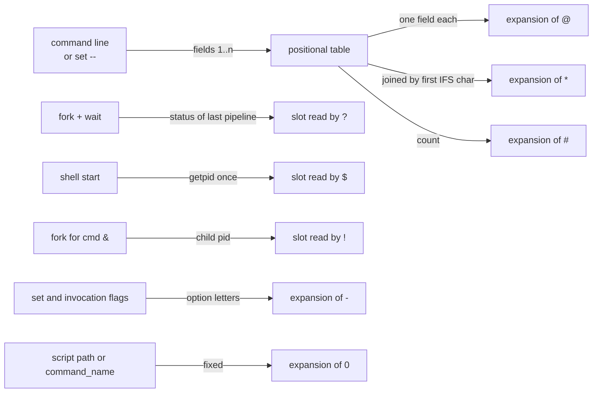

# Special Parameters

> [!summary] Claim
> POSIX defines exactly eight special parameters (`@ * # ? - $ ! 0`), each a read-only view of one piece of shell state, and a script is portable only if it uses each one inside the narrow contract the standard gives it.

Part of [The POSIX Shell Language](README.md) in [Shell and Unix Engineering](../README.md).

## TL;DR

- Mechanism: the shell keeps one positional-parameter table, one "last pipeline status" slot, one invoked-shell pid, one "last asynchronous pid" slot, one option set and one `$0` string, and expansion of `$@ $* $# $? $- $$ $! $0` reads those slots (POSIX.1-2024 XCU 2.5.2).
- Rule: use `"$@"` to forward arguments, `"$*"` only to build one string, and capture `$?` and `$!` into a variable on the line that follows the command, because the next command overwrites them.
- Trap: unquoted `$@` and `$*` are field split and lose empty parameters, `$?` after a pipeline is the last stage only, and `$$` does not change in a subshell.
- Portability: the core eight behave the same across dash, bash, mksh, ksh93, yash, posh and BusyBox ash, but native zsh differs for unquoted `$@`, `$10` and `$0` in a function, the status of a signalled child is 143, 271 or 399 depending on the shell, and posh aborts on an empty `"$@"` under `set -u` (measured in the shell matrix).
- When not to use it: do not use `$$` for temporary file names (use `mktemp`), do not use `$!` to find a daemon after the launcher exits, and do not parse `$-` for anything but a single option letter.

## Mental model



Arguments from the command line or from `set --` fill the positional table, and `@`, `*` and `#` are three different readings of that one table.
Every `fork` followed by a `wait` stores a status in a single slot that `?` reads, so the next completed pipeline overwrites it.
The shell stores its own pid once at start, which is why `$` is the same in a subshell, and it stores the pid of each asynchronous child as it forks, which is what `!` reads.
The option set and the script name are separate state that `-` and `0` render on demand.

## How it works

POSIX.1-2024 XCU 2.5.2 lists the eight parameters and the value each one expands to.
A parameter is set if it has a value, and null is a valid value (XCU 2.5).
The special parameters are read-only in the sense that no assignment syntax reaches them; `set --` and `shift` change the positional table that `@`, `*` and `#` read.

`@` and `*` both expand to the positional parameters starting from one, and the standard defines them by context.
Where field splitting is performed, each parameter becomes a field, empty fields may be discarded, and the remaining fields are split on `IFS`.
Inside double quotes, `"$@"` keeps the initial fields separate, joined only to the text immediately before the first and after the last field, and `"$*"` produces one field.
That one field is joined with the first character of `IFS`, with a space if `IFS` is unset, and with nothing if `IFS` is null (XCU 2.5.2).
With no positional parameters `"$@"` generates zero fields, which is the property that makes `exec "$@"` and `for x do` safe on an empty list.

`#` is the decimal count of positional parameters and does not count `$0`.
`$10` is `$1` followed by a literal `0`, and `${10}` is the tenth parameter (XCU 2.5.1).

`?` is the exit status of the most recent pipeline run from the current shell environment.
The status is the exit status of the last command in the pipeline unless the pipeline is negated with `!`, and a command that dies from a signal gets a value above 128 whose exact encoding is implementation-defined (XCU 2.8.2; the standard explicitly allows values above 255).
A subshell starts with the invoking shell's `?`.
An assignment with a command substitution and no command word takes the status of that substitution, as the note under `?` in XCU 2.5.2 says.

`$` is the process id of the invoked shell.
In a subshell it "shall expand to the same value as that of the current shell" (XCU 2.5.2), so a subshell cannot find its own pid this way.
dash implements this directly: `varvalue` in `expand.c` reads the global `rootpid` for `$` (dash-0.5.12 expand.c, `varvalue`).

`!` is the pid of the most recent asynchronous AND-OR list started from this shell environment, or of the last command of a job-control background job most recently resumed with `bg`, whichever came later (XCU 2.5.2).
In dash the value is stored when the shell forks the child for a background list: `forkparent` assigns `backgndpid = pid` with the comment "set $!" (dash-0.5.12 jobs.c, `forkparent`), and `varvalue` returns "no value" while it is zero (dash-0.5.12 expand.c, `varvalue`).
The standard keeps pids of asynchronous lists for `wait`, but an implementation need not retain more than `{CHILD_MAX}` entries (XCU 2.9.3.1).

`-` expands to the single-letter option flags currently in force.
The standard says it is unspecified whether `-c` and `-s` appear, and that `i` shall appear for an interactive shell (XCU 2.5.2).
dash builds the string by walking its option table and emitting the letter of each enabled option (dash-0.5.12 expand.c, `varvalue`).

`0` is the name of the shell or script.
For `sh -c command_string [command_name [argument...]]` the `command_name` operand becomes `$0` (the `sh` page, POSIX.1-2024 XCU `sh`, OPERANDS).
Every other shell in the matrix leaves `$0` alone in a function; native zsh changes it, because its `FUNCTION_ARGZERO` option is on by default and sets `$0` to the function name while a function runs, whereas zsh in `sh` emulation turns it off (zsh Options manual, `FUNCTION_ARGZERO`; confirmed by the lab).

Two errors are tied to the special parameters.
Under `set -u`, expanding an unset parameter fails, except for `@` and `*` (XCU 2.15, `set`, option `-u`, and the rationale of `set`: the developers considered applying `-u` to `$@` and `$*` "a misfeature").
`shift n` with `n` greater than `$#` "may be treated as an error and a non-interactive shell may exit" (XCU 2.15, `shift`), so dash, mksh, ksh93 and posh end the shell and bash, zsh, yash and BusyBox ash return 1 and continue (lab, mode `shift-too-many`).

## Numbers and limits

| Quantity | Value | Source |
| --- | --- | --- |
| Special parameters defined | 8 (`@ * # ? - $ ! 0`) | POSIX.1-2024 XCU 2.5.2, counted from the list |
| Status of a child killed by `SIGTERM` (15) | 143 in bash, zsh, dash, mksh, posh and BusyBox ash; 271 in ksh93; 399 in yash | lab, test "after a command killed by SIGTERM" |
| Smallest `$?` the standard guarantees for a signal death | greater than 128 | POSIX.1-2024 XCU 2.8.2 |
| Status of `x=$(exit 7)` | 7 | lab, mode `status` |
| Fields from `"$@"` with 3 parameters (one empty) | 3 | lab, mode `at-star` |
| Fields from unquoted `$@` with the same 3 parameters | 3 split fields in POSIX-style shells, 2 in native zsh | lab, mode `at-star` |
| Seconds the first background `/bin/sleep` runs (the poll's margin to see it alive) | 2 | lab, mode `bang` |
| Entries of asynchronous pids an implementation must retain | need not retain more than the `{CHILD_MAX}` most recent | POSIX.1-2024 XCU 2.9.3.1 |

## Portability

Every cell is what the lab asserts in that shell, except the first row, which cites the standard.
Rows list the shell family and the version the matrix ran (as of 2026-10).

| Shell | unquoted `$@` with `'a b' '' c` | `$10` with ten parameters | `$0` inside a function | `$?` after a child dies of `SIGTERM` | `set -u` with `"$@"` empty | `shift 3` with 2 parameters |
| --- | --- | --- | --- | --- | --- | --- |
| POSIX sh | split, empty dropped | `$1` then `0` | unchanged | above 128 | not an error | non-zero, may exit |
| macOS bash 3.2.57 (`/bin/sh`) | 3 fields | `one0` | script name | 143 | ok | continues |
| bash 4.4.23, 5.1.16, 5.2.37, 5.3.15 (host) and 5.3.20 | 3 fields | `one0` | script name | 143 | ok | continues |
| zsh 5.9 and 5.9.2, native | 2 fields, no split on spaces | `ten` | function name | 143 | ok | continues |
| zsh 5.9 and 5.9.2, `--emulate sh` | 3 fields | `one0` | script name | 143 | ok | continues |
| dash 0.5.12 | 3 fields | `one0` | script name | 143 | ok | shell exits, status 2 |
| ksh93u+m 1.0.10 | 3 fields | `one0` | script name | 271 | ok | shell exits, status 1 |
| ksh93u+ 2012 (macOS `/bin/ksh`) | 3 fields | `one0` | script name | 271 | ok | shell exits, status 1 |
| mksh R59 (2020 and 2025 builds) | 3 fields | `one0` | script name | 143 | ok | shell exits, status 1 |
| yash 2.58.1 | 3 fields | `one0` | script name | 399 | ok | continues |
| posh 0.14.1 | 3 fields | `one0` | script name | 143 | aborts: "@: parameter not set" | shell exits, status 1 |
| BusyBox ash 1.37.0 | 3 fields | `one0` | script name | 143 | ok | continues |

Two more facts the lab asserts separately.
Under `set -u`, an unset numbered parameter such as `"$1"` ends the shell in every shell above except ksh93u+ 2012, which prints an empty string and continues.
`$-` shows `u` after `set -u` and `f` after `set -f` in every shell above, and none shows `i` in a script.

Utilities do not matter for these eight parameters.
The lab uses `/bin/sleep`, `cat` and `sed` only to observe the shell, and `ps` only when `/proc` is absent (macOS).

## Worked example

The [lab](../labs/03-special-parameters/) has one script, `probe.sh`, whose modes print what a special parameter expands to, and a `.bats` file that asserts each mode per shell family.
Simplified excerpt of the `at-star` mode (the real file also silences ShellCheck for the deliberately unquoted lines):

```sh
fields() {
  printf '%d:' "$#"
  if [ "$#" -gt 0 ]; then
    printf ' <%s>' "$@"
  fi
  printf '\n'
}

set -- 'a b' '' c
fields "$@"
fields "$*"
fields $@
fields $*
```

Output expected under bash, dash, mksh, ksh93, yash, posh, BusyBox ash and zsh in sh emulation:

```text
3: <a b> <> <c>
1: <a b  c>
3: <a> <b> <c>
3: <a> <b> <c>
```

Native zsh prints `2: <a b> <c>` for the last two lines, because it does not split an unquoted parameter on `IFS` but still drops the empty one.
The `status` mode shows `$?` after each kind of pipeline:

```text
init 0
after-false 1
negated 1
negated-false 0
pipe-last 1
pipe-last-ok 0
assign-subst 7
prefix-assign 0
subshell 5
preserved 1
1 1
```

The last line is `echo "$?" "$?"`: both expansions happen before `echo` runs, so both show the status of the `false` before it.
The `bang` mode runs a background `/bin/sleep 2`, polls until the process named by `$!` has the executable name `sleep` (so `$!` is the child, not the shell), checks that a later foreground external command (`/bin/sleep 0`) leaves `$!` alone, and that a second background job replaces it.

Run it with `LAB_SHELL=dash bats special-parameters.bats` from the lab directory.

## Pitfalls

> [!warning] Unquoted `$@` or `$*`
> Trigger: `cmd $@` or `cmd $*` with an argument that has a space or is empty.
> Symptom: `'a b'` becomes two arguments and `''` disappears, so `rm $*` removes the wrong files; the lab mode `at-star` prints 3 fields for 3 parameters of which one is empty.
> Fix: write `"$@"` to forward and `"$*"` to join.
> The standard allows the unquoted forms to split further on `IFS` (XCU 2.5.2), and native zsh does not split at all.

> [!warning] `$?` is overwritten by the next command
> Trigger: `cmd; echo "failed: $?"; case $? in 0) ... esac`.
> Symptom: the second `$?` is the status of `echo`, not of `cmd`, and `[ $? -ne 0 ] && echo "$?"` prints 0.
> Fix: `cmd; rc=$?` and test `rc`.
> Related: `$?` after a pipeline is the last stage, so `false | true` is 0 unless the shell supports `pipefail`; see [[Pipelines-and-And-Or-Lists]].

> [!warning] `$$` does not follow a subshell
> Trigger: using `$$` inside `( ... )` or `$( ... )` to name the subshell, for example in a temporary file name.
> Symptom: the parent and the subshell share one file; the lab mode `pid` shows the value is identical in `$(echo "$$")` and in a nested subshell.
> Fix: use `mktemp` for temporary files, and a shell-specific variable (`$BASHPID`) only where the script is bash-only.

> [!warning] `$!` after the job is gone
> Trigger: `cmd & pid=$!` and later `kill "$pid"` after the job exited.
> Symptom: the pid may belong to another process once the kernel reuses it; `wait "$pid"` is the safe way to collect the status, and the standard lets the shell forget all but the `{CHILD_MAX}` most recent known pids ("need not retain more than", XCU 2.9.3.1).
> Fix: `wait` for the job before the pid can be recycled, or manage the process with a supervisor, and never `kill` a pid you have already waited on.

> [!warning] `$10` is `$1` and a zero
> Trigger: `echo "$10"` meaning the tenth argument.
> Symptom: prints the first argument followed by `0` in every shell except native zsh, where it prints the tenth; the lab mode `tenth` shows both.
> Fix: always write `${10}` (XCU 2.5.1).

> [!warning] `set -u` and `"$@"` in posh
> Trigger: a script with `set -u` that expands `"$@"` with no arguments, run under posh.
> Symptom: `@: parameter not set`, although POSIX exempts `@` and `*` (the `set` rationale quoted above).
> Fix: pass `${1+"$@"}`, which expands the same everywhere.

> [!warning] Reading a status above 255
> Trigger: `exit "$?"` after a child that was killed by a signal, in ksh93 or yash.
> Symptom: `$?` is 271 or 399, and a parent sees only the low 8 bits of an exit value (XCU 2.8.2: the value passed to `exit()` modulo 256), so the outcome depends on the shell (measured in the shell matrix).
> ksh93u+m 1.0.10 exits 15 and loses the "killed by signal" meaning; yash's 399 happens to reduce to 143; macOS ksh93u+ 2012 instead re-raises the encoded signal on itself (`exit 271` kills it with `SIGTERM`), so its parent sees a signal death.
> Fix: treat any status above 128 as "signal", name it with `kill -l "$rc"` (posh 0.14.1 rejects `kill -l 143` with "unknown signal name", measured in the shell matrix), and do not assume 128 plus the signal number.

## Security and robustness

- Quote every expansion of a special parameter that reaches a command line: `"$@"` is the only form that cannot inject a word split or a glob from an attacker-controlled argument.
- A script that uses `$$` in a path under a world-writable directory is open to symlink races; `mktemp` creates the file atomically.
- `$!` and `$$` are numbers from a shared pid namespace; a stored pid is a hint, not an identity, so authentication or signalling decisions must not rest on it alone.
- `$0` is attacker-influenced when a script is reached through a symlink or invoked with a chosen `argv[0]`; never use it to build a trusted path.
- Under `set -u` a typo in a variable name aborts instead of expanding to the empty string, which is the main reason the standard exempts `@` and `*` only.

## The principal's view

A staff-plus engineer treats the special parameters as a small, fully specified interface and writes scripts that touch only the portable part of it.
The decisions are few: always quote `"$@"`, capture `$?` immediately, and never build identity or security on `$$`, `$!` or `$0`.
The trade-off is verbosity (`rc=$?`, `${10}`, `${1+"$@"}`) in exchange for scripts that behave the same in dash, bash and BusyBox.
When a script needs the pid of its own subshell, a reliable background job table, structured argument lists, or typed exit codes, the shell is the wrong tool; move that logic to a language with real data structures (Python, Go, or C) and keep the shell for process plumbing.

## Interview questions

> [!question] L5: What is the difference between `"$@"` and `"$*"`?
>
> > [!success]- Answer
> > `"$@"` expands to one field per positional parameter, so it preserves the original argument boundaries, including empty ones.
> > `"$*"` expands to a single field made by joining the parameters with the first character of `IFS`.
> > With no parameters `"$@"` is zero fields and `"$*"` is one empty field.
> >
> > Follow-up: What does `"$*"` give when `IFS` is null?

> [!question] L5: Why does `echo $?` print 0 after `false | true`?
>
> > [!success]- Answer
> > `$?` is the status of the last command of the most recent pipeline, which is `true`.
> > Unless `pipefail` is available and set, the status of earlier stages is not visible.
> >
> > Follow-up: How would you get the status of the first stage portably?

> [!question] L5: What does `echo "$10"` print when the script has ten arguments?
>
> > [!success]- Answer
> > In POSIX shells it prints the value of `$1` followed by the character `0`, because only a single digit follows `$`.
> > `${10}` is the tenth parameter.
> > Native zsh is the exception and prints the tenth, because its manual defines "the parameter n, where n is a number" as the nth positional parameter (zsh manual 15.3, Positional Parameters).
> >
> > Follow-up: Why does the standard require braces above nine?

> [!question] L6: Predict the output.
> ```sh
> set -- 'a b' '' c
> printf '<%s>' $@; echo
> printf '<%s>' "$@"; echo
> printf '<%s>' "$*"; echo
> ```
>
> > [!success]- Answer
> > The first line is `<a><b><c>`: the unquoted `$@` is split on `IFS` and the empty field is dropped.
> > The second is `<a b><><c>`, one field per parameter.
> > The third is `<a b  c>`, one field joined with spaces (two spaces where the empty parameter was).
> > Native zsh prints `<a b><c>` for the first line.
> >
> > Follow-up: Which of the three lines changes if `IFS=:` is set first?

> [!question] L6: Debug this script that sometimes overwrites a file it does not own.
> ```sh
> #!/bin/sh
> tmp=/tmp/work.$$
> ( cd /var/data && ls > "$tmp" )
> rm -f $tmp
> ```
>
> > [!success]- Answer
> > The pid is predictable, so another user can create `/tmp/work.<pid>` as a symlink before the script runs.
> > `$$` also does not change in the subshell, so it cannot separate concurrent subshells.
> > The unquoted `$tmp` is split and globbed.
> > Use `tmp=$(mktemp)` and `rm -f -- "$tmp"`.
> >
> > Follow-up: Why does `mktemp` close the symlink race?

> [!question] L6: Why is `$!` empty before any background job, and what is it after `a & b`?
>
> > [!success]- Answer
> > `!` reads the pid of the most recent asynchronous AND-OR list, and until one is forked there is no value; dash returns "no value" while its `backgndpid` is zero (dash-0.5.12 expand.c, `varvalue`).
> > After `a & b`, `$!` is the pid of `a`, because `b` is a foreground command and does not update it.
> >
> > Follow-up: What is `$!` after `a | b &`?

> [!question] L7+: What is portable when a script must exit with the status of a child killed by a signal?
>
> > [!success]- Answer
> > Only "greater than 128" is guaranteed (XCU 2.8.2).
> > The matrix shows 143 for `SIGTERM` in most shells, 271 in ksh93 and 399 in yash, and the kernel keeps only the low 8 bits of an `exit` argument.
> > The portable pattern is to test `[ "$rc" -gt 128 ]`, name the signal with `kill -l "$rc"` (posh 0.14.1 rejects that form), and re-raise it with `kill -s NAME $$` after resetting the trap.
> >
> > Follow-up: Why does re-raising the signal matter to a calling shell?

> [!question] L7+: Why does `shift 3` with two parameters end dash but not bash?
>
> > [!success]- Answer
> > The standard says an invalid or too-large `n` "may be treated as an error and a non-interactive shell may exit" (XCU 2.15, `shift`), because `shift` is a special built-in and special built-in errors can abort a non-interactive shell (XCU 2.8.1).
> > dash, mksh, ksh93 and posh exit; bash, zsh, yash and BusyBox ash return 1 and continue (lab, mode `shift-too-many`).
> > The standard then also requires a warning on standard error (XCU 2.15, `shift`, EXIT STATUS): zsh, yash and bash 5.2 in POSIX mode print one, but bash outside POSIX mode, macOS `/bin/sh` (bash 3.2.57) and BusyBox ash 1.37.0 stay silent (measured in the shell matrix), because bash prints it only when `print_shift_error` is set, which its POSIX mode or `shopt -s shift_verbose` turns on (bash-5.3 `builtins/shift.def`, `shift_builtin`; `general.c`, `posix_initialize`).
> > A portable script guards with `[ "$#" -ge 3 ] && shift 3` or checks `$#` first.
> >
> > Follow-up: What changes if the `shift` runs inside `( ... )`?

> [!question] L7+: Why is `${1+"$@"}` still seen in portable scripts?
>
> > [!success]- Answer
> > Historically some shells applied `-u` to `$@` and `$*` (the rationale of `set` says so).
> > The standard now specifies zero fields and exempts `@` and `*` from `-u`, but posh 0.14.1 still aborts with "@: parameter not set" (measured in the shell matrix).
> > `${1+"$@"}` expands to nothing when `$1` is unset and to `"$@"` otherwise, so it is correct in every shell.
> >
> > Follow-up: What does `${1+"$@"}` do when `$1` is set to the empty string?

## Related

Prerequisites: [[Null-versus-Unset]]

Next: [[Command-Substitution]]

See also: [[Parameter-Expansion]], [[Field-Splitting-and-IFS]], [[Functions-and-Scope]], [[The-set-Builtin-and-Shell-Options]], [[Subshells-and-the-Execution-Environment]], [[Pipelines-and-And-Or-Lists]], [[Simple-Commands-and-Assignment-Prefixes]], [[Special-Built-ins-versus-Utilities]], [[POSIX-2024-Changes]]

## Further reading

- POSIX.1-2024 XCU 2.5.2 Special Parameters, https://pubs.opengroup.org/onlinepubs/9799919799/utilities/V3_chap02.html - the normative definition of all eight parameters.
- POSIX.1-2024 XCU 2.8.1 and 2.8.2 (same page) - which errors end a non-interactive shell and how a signal death is reported.
- POSIX.1-2024 XCU 2.15, `shift` and `set` (same page) - the wording "may exit" and the rationale for exempting `@` and `*` from `-u`.
- POSIX.1-2024 `wait`, https://pubs.opengroup.org/onlinepubs/9799919799/utilities/wait.html - how `$!` pids are consumed.
- dash 0.5.12 `expand.c` and `jobs.c`, https://git.kernel.org/pub/scm/utils/dash/dash.git/tree/src?h=v0.5.12 - the smallest complete implementation of these expansions.
- zsh manual, Options (`FUNCTION_ARGZERO`, `SH_WORD_SPLIT`), https://zsh.sourceforge.io/Doc/Release/Options.html - why native zsh differs.
