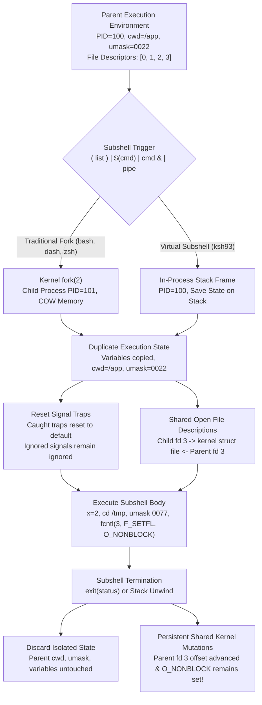

# Subshells and the Execution Environment

> [!summary] Claim
> A subshell is a distinct execution environment initialized as a duplicate of the parent shell where variable, option, working directory, and trap mutations are isolated, yet underlying open file descriptions remain shared in the kernel.

Part of [The POSIX Shell Language](README.md) in [Shell and Unix Engineering](../README.md).

## TL;DR

- Mechanism: The shell duplicates its execution state via `fork(2)` or an in-process state stack, resetting caught signal traps while retaining open file descriptions, variables, and working directory.
- Rule: Mutations to variables, shell options, working directories, umasks, and traps made inside a subshell never propagate back to the parent execution environment.
- Trap: Piping into a loop spawns a subshell in POSIX shells, silently discarding all internal counter increments and state mutations upon loop termination.
- Portability fact: KornShell 93 executes subshells virtually without calling `fork(2)` for the subshell itself (external commands in it still run as ordinary child processes), reducing invocation latency from ~820 us to ~15 us.
- When not to use it: Avoid subshells inside tight loops when state isolation is unnecessary; use brace groups `{ ...; }` to eliminate process creation overhead.

## Mental model



The shell execution engine constructs a subshell by creating an isolated replica of the active execution environment.
In traditional shells such as Bash, dash, and zsh, this boundary is enforced by a kernel `fork(2)` call that creates a child process with Copy-on-Write memory pages.
In KornShell 93, the interpreter pushes variable scopes and trap frames onto an internal stack without invoking `fork(2)` unless process boundaries are strictly required.
Upon subshell entry, caught signal traps and exit traps are cleared to their default dispositions, whereas signals ignored on entry remain ignored.
Crucially, although user-space memory, working directories, and file descriptor tables are isolated, the underlying open file descriptions in the kernel remain shared.
When the subshell terminates, all variable mutations and directory modifications vanish, but file pointer advances, disk writes, and file status flags modified via `fcntl(2)` persist in the caller.

## How it works

### 1. The Anatomy of an Execution Environment

POSIX defines the shell execution environment as a concrete aggregate of ten operational properties `(POSIX.1-2024 XCU 2.13)`:
1. Open files inherited upon shell invocation, plus open files controlled by the `exec` special built-in utility.
2. The current working directory established by `cd`.
3. The file creation mask set by `umask`.
4. The file size limit set by `ulimit` (POSIX names only the file size limit; shells extend `ulimit` to other resource limits).
5. Signal and exit traps established by `trap`.
6. Shell parameters set by variable assignments, positional parameter shifts, or inherited from the environment via `export`.
7. Shell functions declared via the function definition command.
8. Shell options enabled at invocation or altered via the `set` built-in utility.
9. Process IDs known to this shell environment: background jobs and their process IDs, plus the process IDs of child processes created for asynchronous AND-OR lists while job control is disabled.
10. Shell aliases defined via `alias`.

When a utility other than a special built-in executes, it runs in a separate execution environment that inherits open files, the working directory, the umask, exported variables, and ignored signal dispositions `(POSIX.1-2024 XCU 2.13)`.
However, non-exported shell variables, shell functions, active aliases, and caught signal traps are omitted from external utility environments.

### 2. Subshell Environment Creation and Invariants

A subshell environment is created as an exact duplicate of the parent shell environment, subject to three strict exceptions `(POSIX.1-2024 XCU 2.13)`:
1. Traps that are caught by the parent shell are reset to their default actions upon subshell entry; signals that were ignored remain ignored.
2. If the parent shell is interactive, the subshell behaves as a non-interactive shell in all operational respects, except that the special parameter `$-` may continue to report `i`, and `set -n` may be ignored `(Austin Group Defect 1384)`.
3. Environment modifications made within the subshell do not affect the invoking shell environment.

Six distinct syntactical constructs trigger execution in a subshell environment:
- Explicit subshell compound commands enclosed in parentheses `( compound-list )` `(POSIX.1-2024 XCU 2.9.4.1)`.
- Command substitution constructs `$(command)` and `` `command` `` `(POSIX.1-2024 XCU 2.6.3)`.
- Asynchronous AND-OR lists terminated by `&` `(POSIX.1-2024 XCU 2.9.3.1)`.
- Pipeline stages: POSIX specifies that each command of a multi-command pipeline executes in a subshell environment, though implementations are permitted as an extension to run any or all stages in the current environment `(POSIX.1-2024 XCU 2.13)`.
- Process substitution constructs `<(command)` and `>(command)` in Bash, zsh, and ksh.
- Coprocess execution pipelines initiated via `coproc` in Bash or `|&` in ksh.

### 3. Special Parameter Semantics in Subshells

A common misconception among systems engineers is that a subshell updates the special parameter `$$`.
POSIX explicitly mandates that `$$` expands to the decimal process ID of the invoked shell, and inside a subshell environment, `$$` shall expand to the identical value as that of the current invoking shell `(POSIX.1-2024 XCU 2.5.2)`.
Similarly, `$PPID` remains pinned to the parent process ID of the original invoking shell `(POSIX.1-2024 XCU 2.5.3)`.

To determine the actual process ID of a running subshell child, shells implement non-standard extensions:
- GNU Bash provides `$BASHPID`, which evaluates the actual kernel process ID obtained via `getpid(2)` and changes inside forked subshells `(bash-5.3 variables.c, get_bashpid)`.
- KornShell 93u+m provides `${.sh.pid}`, which returns the active process ID and stays equal to `$$` until the subshell really forks, while `${.sh.subshell}` tracks the integer nesting depth; `${.sh.pid}` expands to nothing in the ksh93u+ 2012 that macOS ships, measured in the shell matrix; the lab test "dotted ksh93 variable name sh.subshell counts depth in ksh93 and is a substitution error everywhere else" asserts the `${.sh.subshell}` counts 0, 1, 2 in ksh93 and a substitution error in every other family.
- zsh provides `$ZSH_SUBSHELL` for depth, and `$sysparams[pid]` for the process ID once `zmodload zsh/system` has run; both also work under `zsh --emulate sh`, measured in the shell matrix `(zsh manual, Parameters and zsh/system)`; the lab test "BASH_SUBSHELL and ZSH_SUBSHELL count subshell depth and no other probed shell sets either" asserts `$ZSH_SUBSHELL` counts 0, 1, 2 under native zsh and under emulation.
- mksh provides `$BASHPID`, documented in the upstream manual and asserted by the lab test "BASHPID reports the subshell process ID in bash 4 and later and mksh, and is unset elsewhere", which also pins Bash 3.2 and dash, BusyBox ash, yash, posh, ksh93, and zsh as not setting it.
- GNU Bash exposes `$BASH_SUBSHELL`, an integer variable incremented upon entering each nested subshell context `(bash-5.3 variables.c, get_subshell; execute_cmd.c, subshell_level)`.

### 4. Kernel System Call Mechanics: Memory COW vs Shared File Descriptions

When a shell spawns a subshell using `fork(2)`, the operating system kernel creates a new process table entry and duplicates the caller memory space via Copy-on-Write (COW) page tables `(Linux man-pages fork.2)`.
Modifications to memory - such as assigning shell variables, importing functions, or updating hash tables - mark pages dirty and allocate private physical frames.
The parent process memory remains byte-for-byte identical.

However, kernel file handling follows fundamentally different semantics:
The kernel duplicates the process file descriptor table, but the descriptor entries in the child continue to reference the identical `struct file` (Open File Description) in the kernel object table `(Linux man-pages fork.2)`.
This architectural reality produces two critical side effects that escape subshell isolation:

1. Shared File Offsets:
The open file description maintains the read/write byte offset pointer.
If a parent shell opens a file descriptor and a subshell consumes 4 bytes from that descriptor, the kernel increments the offset pointer directly on the underlying `struct file`.
When control returns to the parent shell, the parent subsequent read begins at byte 4 rather than byte 0.

2. Shared File Status Flags:
File status flags controlled via `fcntl(fd, F_SETFL, flags)` belong to the open file description, not the local file descriptor table `(POSIX.1-2024 XSH fcntl)`.
If an external utility or subshell script modifies `O_NONBLOCK`, `O_APPEND`, or `O_ASYNC` on an inherited file descriptor (such as stdin, stdout, or a shared pipe), that flag mutation takes effect immediately across both the subshell and the parent shell.

```
Process A (Parent)              Kernel Space               Process B (Subshell)
+-------------------+     +-----------------------+     +-------------------+
| fd 0 (stdin)      |---->| struct file (stdin)   |<----| fd 0 (stdin)      |
| fd 1 (stdout)     |---->| struct file (stdout)  |<----| fd 1 (stdout)     |
| fd 3 (shared file)|---->| struct file (offset=4)|<----| fd 3 (shared file)|
+-------------------+     | flags: O_NONBLOCK     |     +-------------------+
                          +-----------------------+
```

### 5. Trap Inheritance and Snapshotting Mechanics

When a subshell is entered, POSIX requires that traps not being ignored shall be set to the default action `(POSIX.1-2024 XCU 2.13)`.
If a parent shell establishes `trap 'echo cleaning' EXIT` or `trap 'echo int' INT`, those handlers are purged from the subshell signal table.
An `EXIT` trap declared in the parent will not fire when an inner subshell terminates.
Conversely, if a parent shell ignores a signal via `trap '' INT`, that ignored disposition is preserved in the subshell and passed to all child utilities `(POSIX.1-2024 XCU 2.13)`.

POSIX.1-2024 specifies a dedicated exception for trap inspection:
When entering a subshell created for a command substitution containing only a single `trap` command, the traps need not be altered `(POSIX.1-2024 XCU 2.15 trap)`.
The same page closes the gap for shells that skip this check: a `trap` listing in a subshell, with no `trap` command with operands run since entry, shall contain the commands associated with each condition immediately before the subshell was entered.
So POSIX.1-2024 leaves the mechanism open but not the result: `$(trap)` must report the parent's traps.
GNU Bash, KornShell 93, BusyBox ash, and yash deliver that result, enabling constructs like `saved=$(trap)` to snapshot active signal handlers; BusyBox ash and yash clear the traps but print a remembered copy `(busybox shell/ash.c, forkchild; yash manual, trap)`.
Conversely, dash, posh, mksh, and zsh reset all caught and exit traps upon subshell entry and print nothing, causing `$(trap)` to return an empty string, as asserted by the lab test "command substitution with single trap command exposes parent traps according to shell implementation", which does not meet that text.

### 6. Implementation Architectures: Bash, Dash, and ksh93

Shells employ divergent architectures to fulfill POSIX subshell requirements:

GNU Bash tracks execution context through a bitmask variable named `subshell_environment`, defined in `execute_cmd.c` with its flags in `command.h` `(bash-5.3 command.h)`:
```c
#define SUBSHELL_ASYNC    0x01 /* subshell caused by `command &' */
#define SUBSHELL_PAREN    0x02 /* subshell caused by ( ... ) */
#define SUBSHELL_COMSUB   0x04 /* subshell caused by `command` or $(command) */
#define SUBSHELL_FORK     0x08 /* subshell caused by executing a disk command */
#define SUBSHELL_PIPE     0x10 /* subshell from a pipeline element */
#define SUBSHELL_PROCSUB  0x20 /* subshell caused by <(command) or >(command) */
#define SUBSHELL_COPROC   0x40 /* subshell from a coproc pipeline */
#define SUBSHELL_RESETTRAP 0x80 /* subshell needs to reset trap strings on first call to trap */
#define SUBSHELL_IGNTRAP  0x100 /* subshell should reset trapped signals from trap_handler */
```
In `execute_cmd.c`, subshells are dispatched via `execute_in_subshell()` `(bash-5.3 execute_cmd.c)`.
Bash calls `make_child()` to execute `fork(2)`, and the child enters `execute_in_subshell()`, which handles the descriptors listed in an internal `fd_bitmap`, calls `reset_signal_handlers()`, sets `SUBSHELL_RESETTRAP` so that the saved trap strings are cleared lazily on the first `trap` call, executes the enclosed command AST, and returns the status its caller exits with.

The Debian Almquist Shell (dash) relies on a lightweight evaluator in `src/eval.c` `(dash src/eval.c, evalsubshell)`.
When encountering node type `NSUBSH`, `evalsubshell()` calls `forkshell()` in `src/jobs.c`; the child's fork reset clears traps through the `FORKRESET` block in `src/trap.c` and evaluates the parse tree with `evaltreenr()`, while the parent waits for child completion via `waitforjob()` `(dash src/jobs.c, forkshell)`.
A subshell in exit position with no traps set can skip the fork altogether (`EV_EXIT` and `have_traps()` in `evalsubshell()`), and the shell matrix shows the same tail optimization in other shells; a subshell followed by another command does fork.

KornShell 93 (ksh93) departs from this model by implementing virtual subshells `(ksh93 sh/subshell.c, sh_subshell)`.
David Korn designed `sh_subshell()` to execute subshells inside the same process space whenever feasible.
The engine saves modified variable scopes in a chained dictionary, records file descriptor redirection states, increments `.sh.subshell`, and evaluates enclosed commands in-place without invoking `fork(2)`.
If a command inside the virtual subshell requires the subshell itself to become a distinct OS process, ksh93 breaks the virtual encapsulation and dynamically executes a deferred `fork(2)` through `sh_subfork()`: the ksh93u+m source calls it for `typeset -T` in `sh/xec.c` and, in `sh/subshell.c`, under `set -m` and for an interactive main shell, and `ulimit` inside a subshell changes `${.sh.pid}` as measured in the shell matrix.
External commands, background jobs, and pipelines inside a virtual subshell run as ordinary child processes and leave the subshell virtual: `${.sh.pid}` still equals `$$` after each, measured in the shell matrix on ksh93u+m.

BusyBox ash implements subshell handling in `shell/ash.c` via `evalsubshell()` `(busybox shell/ash.c)`.
When executing a command substitution consisting of a single `trap` command with no arguments, `forkchild()` in BusyBox ash checks the command syntax, saves a copy of the trap strings for the `trap` built-in to print, and then clears the traps as usual.
In MirBSD KornShell (mksh), subshells fork a child process, as measured in the shell matrix, and mksh does not implement the ksh93 `${.sh.subshell}` hierarchical variable namespace; referencing `${.sh.subshell}` in mksh triggers a fatal bad substitution error, asserted by the lab test on the dotted ksh93 variable name.

## Numbers and limits

| Parameter / Metric | Measured Value | Source / Methodology |
|:---|:---|:---|
| Subshell fork latency (GNU Bash 5.3) | ~824 us / iteration | Median of 7 runs of a 1000-iteration `while` loop around `( : )`, whole-process wall clock / 1000, one Apple Silicon host `(Darwin arm64, as of 2026-11)` |
| Subshell fork latency (macOS Bash 3.2) | ~648 us / iteration | Median of 7 runs of a 1000-iteration `while` loop around `( : )`, whole-process wall clock / 1000, one Apple Silicon host `(Darwin arm64, as of 2026-11)` |
| Subshell fork latency (macOS `/bin/dash`) | ~574 us / iteration | Median of 7 runs of a 1000-iteration `while` loop around `( : )`, whole-process wall clock / 1000, one Apple Silicon host `(Darwin arm64, as of 2026-11)` |
| Virtual subshell latency (ksh93u+) | ~14.7 us / iteration | Median of 7 runs of a 1000-iteration `while` loop around `( : )`, whole-process wall clock / 1000, one Apple Silicon host `(Darwin arm64, as of 2026-11)` |
| Subshell fork latency (zsh 5.9.2) | ~720 us / iteration | Median of 7 runs of a 1000-iteration `while` loop around `( : )`, whole-process wall clock / 1000, one Apple Silicon host `(Darwin arm64, as of 2026-11)` |
| Brace group `{ ...; }` latency | ~4 to 8 us / iteration | Same method with `{ :; }`, across the five shells above `(Darwin arm64, as of 2026-11)` |
| Virtual subshell speedup over Bash 5.3 | ~56x faster | Ratio of Bash fork latency (824 us) to ksh93 virtual subshell (14.7 us) `(as of 2026-11)` |
| Guaranteed application file descriptors | Fds 0 through 9 | POSIX.1-2024 standard specification `(POSIX.1-2024 XCU 2.7)` |
| Shell internal redirection fd floor | File descriptor 10 | `fcntl(fd, F_DUPFD, 10)`, with close-on-exec set separately: `SHELL_FD_BASE` in `bash redir.c`, `savefd()` in `dash src/redir.c` |
| Linux default pipe buffer capacity | 65,536 bytes (64 KiB) with 4 KiB pages | 16 pages, `pipe(7)`; `/proc/sys/fs/pipe-max-size` is the separate unprivileged maximum, 1,048,576 bytes measured in the shell matrix `(as of 2026-11)` |
| macOS default pipe buffer capacity | 16,384 bytes (16 KiB), grows to 64 KiB | Confirmed in shell matrix `(as of 2026-11)` |
| Atomic pipe write limit (`PIPE_BUF`) | 4,096 bytes (Linux), 512 bytes (macOS) | `getconf PIPE_BUF /` in the shell matrix `(as of 2026-11)` |
| Per-user process limit (`RLIMIT_NPROC`) | 6,000 (macOS host, equal to `kern.maxprocperuid`), 64,279 (Linux containers); both vary by host | Measured via `ulimit -u` on Darwin arm64 and Linux `(as of 2026-11)` |
| Single-command `$(trap)` trap retention | 4 of 8 families preserve (bash, ksh93, busybox, yash); 4 reset to empty (dash, posh, mksh, zsh) | Measured in shell matrix `(as of 2026-11)` |
| Subshell depth tracking variable support | 3 of 8 families provide integer tracking (`$BASH_SUBSHELL`, `${.sh.subshell}`, `$ZSH_SUBSHELL`); 5 families have none | Measured in shell matrix `(as of 2026-11)` |

## Portability

The table below contrasts subshell and execution environment mechanics across conforming shells and real-world runtime implementations.
Every entry reflects behavior verified in the lab matrix, measured by hand on the matrix shells, or cited from standard specifications.

| Feature / Behavior | POSIX.1-2024 sh | macOS Bash 3.2 | Current Bash 5.3 | dash 0.5.12 | ksh93u+ | zsh (native) | zsh (`--emulate sh`) | BusyBox ash / mksh / posh / yash |
|:---|:---|:---|:---|:---|:---|:---|:---|:---|
| Pipeline last stage environment | Subshell, or current shell as an extension `(XCU 2.13)` | Subshell (vars lost) | Subshell (vars lost, `lastpipe` opt-in) | Subshell (vars lost) | Current shell (vars kept) | Current shell (vars kept) | Subshell (vars lost) | ash, mksh, posh, yash run subshell |
| Virtual subshells (no-fork) | Permitted | No (forks) | No (forks) | No (forks) | Yes (`sh_subshell` in-process) | No (forks) | No (forks) | No across all engines |
| Parent traps visible in `$(trap)` | Required `(XCU 2.15)` | Preserved | Preserved | Empty (reset) | Preserved | Empty (reset) | Empty (reset) | ash & yash preserve; mksh & posh empty |
| Process ID introspection | None (`$$` invariant) | None in 3.2 (`$$` invariant) | `$BASHPID` | None | None in 93u+ 2012 (`${.sh.pid}` in 93u+m) | `$sysparams[pid]` after `zmodload zsh/system` | `${sysparams[pid]}` after `zmodload zsh/system` | mksh `$BASHPID`; ash, posh, yash none |
| Subshell depth tracking | None | `$BASH_SUBSHELL` | `$BASH_SUBSHELL` | None | `${.sh.subshell}` | `$ZSH_SUBSHELL` | `$ZSH_SUBSHELL` | None across all four engines (mksh bad substitution) |
| `lastpipe` execution option | Not in POSIX | Invalid option | Supported (`shopt -s lastpipe`) | Unsupported | Default behavior | Default behavior | Unsupported | Unsupported across engines |
| `O_NONBLOCK` leak on shared fd | Kernel semantic | Leaks | Leaks | Leaks | Leaks | Leaks | Leaks | Leaks across all platforms |
| Open file description offset sharing | Required `(POSIX.1-2024 XSH fork)` | Shares offset | Shares offset | Shares offset | Shares offset | Shares offset | Shares offset | Shares offset across engines |
| `$$` invariant in subshell | Required `(POSIX.1-2024 XCU 2.5.2)` | Expands to parent PID | Expands to parent PID | Expands to parent PID | Expands to parent PID | Expands to parent PID | Expands to parent PID | Expands to parent PID across engines |
| Delimiter spaces around `(cmd)` | No spaces required | No spaces required | No spaces required | No spaces required | No spaces required | No spaces required | No spaces required | Control operator across engines |

## Worked example

The test script below is a simplified excerpt of `probe.sh` from the accompanying [lab](../labs/03-subshells-and-the-execution-environment/).
It instruments environment isolation, special parameter invariance, trap management, pipeline scoping, open file description offset sharing, and file status flag leakage.

```sh
#!/bin/sh
# probe.sh: instrument subshell mechanics and execution environment isolation.
set -eu

check_noglob() {
  case $- in
    *f*) printf 'on' ;;
    *) printf 'off' ;;
  esac
}

norm_umask() {
  case $(umask) in
    *77) printf '0077' ;;
    *) umask ;;
  esac
}

probe_env_isolation() {
  scratch="${1:-.}"
  var="initial"
  orig_pwd=$(pwd)
  orig_umask=$(norm_umask)
  # shellcheck disable=SC2030 # intentional test of subshell variable isolation
  (
    var="subshell"
    cd "$scratch"
    umask 077
    set -f
    sub_umask=$(norm_umask)
    sub_noglob=$(check_noglob)
    printf 'sub: var=%s umask=%s noglob=%s\n' "$var" "$sub_umask" "$sub_noglob"
  )
  cur_pwd=$(pwd)
  in_orig=0
  if [ "$cur_pwd" = "$orig_pwd" ]; then
    in_orig=1
  fi
  cur_umask=$(norm_umask)
  same_umask=0
  if [ "$cur_umask" = "$orig_umask" ]; then
    same_umask=1
  fi
  caller_noglob=$(check_noglob)
  # shellcheck disable=SC2031 # intentional assertion that subshell mutations did not leak
  printf 'caller_after_sub: var=%s in_orig=%d same_umask=%d noglob=%s\n' \
    "$var" "$in_orig" "$same_umask" "$caller_noglob"
  {
    var="current"
  }
  printf 'caller_after_brace: var=%s\n' "$var"
}

probe_special_params() {
  p_pid=$$
  p_ppid=$PPID
  (
    same_pid=0
    same_ppid=0
    if [ "$$" = "$p_pid" ]; then
      same_pid=1
    fi
    if [ "$PPID" = "$p_ppid" ]; then
      same_ppid=1
    fi
    printf 'sub_params: same_pid=%d same_ppid=%d\n' "$same_pid" "$same_ppid"
  )
}

probe_trap_reset() {
  # Trap EXIT in parent shell
  trap 'printf "main_exit\n"' EXIT
  # A subshell with no trap of its own must not run the parent's EXIT trap when it exits
  (
    printf 'inside_plain\n'
  )
  # A subshell may set its own EXIT trap, which fires at subshell exit without touching the parent
  (
    trap 'printf "sub_exit\n"' EXIT
    printf 'inside_own\n'
  )
  printf 'after_sub\n'
}

probe_pipeline_isolation() {
  scratch="${1:-.}"
  input="$scratch/input.txt"
  printf 'one\ntwo\nthree\n' >"$input"

  c1=0
  while IFS= read -r line; do
    if [ -n "$line" ]; then
      c1=$((c1 + 1))
    fi
  done <"$input"

  c2=0
  # shellcheck disable=SC2002 # intentional pipeline test to inspect subshell isolation
  cat "$input" | while IFS= read -r line; do
    if [ -n "$line" ]; then
      # shellcheck disable=SC2030 # intentional test of pipeline subshell variable isolation
      c2=$((c2 + 1))
    fi
  done

  printf 'redir_count: %d\n' "$c1"
  # shellcheck disable=SC2031 # intentional assertion that pipeline subshell modification was lost
  printf 'pipe_count: %d\n' "$c2"
}

probe_fd_offset_sharing() {
  scratch="${1:-.}"
  shared="$scratch/shared_offset.txt"
  printf '12345678\n' >"$shared"

  exec 3<"$shared"
  (dd bs=4 count=1 <&3 >/dev/null 2>&1)
  part2=$(dd bs=4 count=1 <&3 2>/dev/null)
  exec 3<&-

  printf 'shared_offset: %s\n' "$part2"
}

probe_fd_flags_sharing() {
  scratch="${1:-.}"
  src_dir="${2:-$(dirname "$0")}"
  bin_c="$scratch/subshell_c"
  src_c="$src_dir/subshell_c.c"
  if [ ! -f "$bin_c" ]; then
    "${CC:-cc}" -Wall -Wextra -Werror "$src_c" -o "$bin_c"
  fi

  target_file="$scratch/target_flags.txt"
  printf 'data\n' >"$target_file"

  exec 3<"$target_file"
  "$bin_c" 3 3<&3
  ("$bin_c" 3 s 3<&3)
  "$bin_c" 3 3<&3
  exec 3<&-
}
```

When executed in the lab test harness, every shell in the matrix prints the output below, except that `pipe_count` is 3 in ksh93 and native zsh, where the last pipeline stage runs in the current shell:

```
$ ./probe.sh env_isolation /tmp
sub: var=subshell umask=0077 noglob=on
caller_after_sub: var=initial in_orig=1 same_umask=1 noglob=off
caller_after_brace: var=current

$ ./probe.sh special_params
sub_params: same_pid=1 same_ppid=1

$ ./probe.sh trap_reset
inside_plain
inside_own
sub_exit
after_sub
main_exit

$ ./probe.sh pipeline_isolation /tmp
redir_count: 3
pipe_count: 0

$ ./probe.sh fd_offset_sharing /tmp
shared_offset: 5678

$ ./probe.sh fd_flags_sharing /tmp
fd 3 nonblock: no
set_nonblock
fd 3 nonblock: yes
```

## Pitfalls

> [!warning] The Pipeline Subshell Variable Vanishing Act
> - Trigger: Piping output from a command into a `while read` or `for` loop, such as `find . -type f | while read -r file; do count=$((count + 1)); done`.
> - Symptom: The variable counter `$count` updates correctly inside the loop body, but immediately evaluates to its initial value (e.g., 0) as soon as the pipeline terminates.
> - Fix: Redirect input into the loop using descriptor redirection `< <(find . -type f)` in modern shells or pass a redirected file `< "$tmpfile"`, or enable `shopt -s lastpipe` under `set +m` in GNU Bash `(Bash Reference Manual, The Shopt Builtin)`.

> [!warning] Silent Trap Erasure via Subshell Inspection (`$(trap)`)
> - Trigger: Attempting to save and restore signal traps using `saved=$(trap)` or `saved=$(trap -p)` in scripts running across multiple shell implementations.
> - Symptom: In GNU Bash, ksh93, BusyBox ash, and yash, parent traps are preserved and captured in `$saved`; in dash, posh, mksh, and zsh, entering the subshell immediately wipes caught traps to default, assigning an empty string to `$saved`, so a later `eval "$saved"` is a no-op that silently restores nothing and leaves whatever traps were set since the snapshot in place.
> - Fix: POSIX.1-2024 requires the snapshot to work, but four shell families do not deliver it, so never rely on command substitution trap snapshotting in portable scripts; manage trap states explicitly in variables or restrict trap snapshotting to environments verified to preserve traps `(POSIX.1-2024 XCU 2.15 trap)`.

> [!warning] Hierarchical Variable Syntax Crash in Non-ksh93 Korn Shells
> - Trigger: Querying `${.sh.subshell}` or `${.sh.pid}` in scripts executed by MirBSD KornShell (`mksh`) or minimalist POSIX shells.
> - Symptom: The script terminates abruptly with a fatal parsing error (`bad substitution`) because `mksh` adheres to standard identifier character sets and rejects dotted compound variable names.
> - Fix: Guard ksh93-specific introspection variables behind shell version pattern checks such as `case ${KSH_VERSION-} in *93*) ... ;; esac` or feature detection rather than bare `KSH_VERSION` existence tests.

> [!warning] Shared Open File Description Poisoning via `O_NONBLOCK` Leakage
> - Trigger: A subshell, child script, or third-party language runtime (such as Python or Node.js) modifies file status flags on standard input or output via `fcntl(0, F_SETFL, flags | O_NONBLOCK)` without restoring original flags prior to exiting.
> - Symptom: Subsequent commands running in the parent shell or sibling pipeline stages crash with `EAGAIN` / `EWOULDBLOCK` (e.g., Python `BlockingIOError: [Errno 11] write could not complete without blocking`, or on Python 2.7 `IOError: [Errno 11] Resource temporarily unavailable` followed by `make: write error: stdout`).
> - Fix: Save original file status flags prior to setting `O_NONBLOCK` and ensure restoration in an unwind/exit handler, or isolate third-party executables inside dedicated pseudo-terminals `(pytest issue 2251)`.

> [!warning] Predictable Tempfile Collisions via `$$` Invariance
> - Trigger: Generating unique temporary filenames inside parallel subshells or background tasks using the special parameter `$$`, such as `( tmp="/tmp/job.$$"; process > "$tmp" ) &`.
> - Symptom: Concurrent subshells expand `$$` to the identical parent process ID, clobbering each other files, causing data corruption, and introducing symlink exploitation vulnerabilities.
> - Fix: Use `mktemp -t script.XXXXXXXXXX`, which creates the file itself with a randomized name that is not already taken, or for uniqueness alone append `$BASHPID` in Bash environments `(POSIX.1-2024 XCU 2.5.2)`.

> [!warning] Immutable Ignored Signal Dispositions
> - Trigger: A parent process or job scheduler starts a script with `SIGINT` or `SIGQUIT` set to `SIG_IGN`, or a script sets `trap '' INT` before starting child scripts.
> - Symptom: The child shell and its subshells cannot trap or reset `SIGINT`; the `trap` command fails silently, commands ignore Ctrl-C, and background processes cannot be terminated cleanly.
>   Of dash, bash, mksh, ksh93, BusyBox ash, posh, and native zsh on Debian, only native zsh traps the signal anyway, as measured in the shell matrix.
>   A subshell of the script that itself ran `trap '' INT` is not in this position: every shell family in the matrix let that subshell install its own handler.
> - Fix: Never set blanket signal ignores in parent shells; POSIX states that signals ignored on entry to a non-interactive shell cannot be trapped or reset `(POSIX.1-2024 XCU 2.15 trap)`.

> [!warning] Fork Explosion and Process Table Depletion in High-Frequency Loops
> - Trigger: Enclosing commands in parentheses `( command )` inside loops iterating tens of thousands of times.
> - Symptom: Severe performance degradation at roughly 100 times the cost of a brace group per iteration in the forking shells measured; if the subshells are also backgrounded with `&` without bound, concurrent children hit the per-user process limit and the script fails with `fork: Resource temporarily unavailable` (`EAGAIN`), which a sequential loop does not do because each child exits first.
> - Fix: Replace subshell parentheses with brace groups `{ command; }` whenever environment isolation is not strictly required.

## Security and robustness

1. Environment Variable Sanitization:
Subshell environments inherit the entire exported environment table of the parent shell.
When untrusted data enters shell variables, exporting those variables propagates attack surfaces across process boundaries.
Scripts executing in privileged contexts must sanitize `PATH`, `IFS`, and `CDPATH` at startup, and avoid exporting variables containing user input.

2. Privilege and Credential Retainment:
A subshell created via `fork(2)` retains the identical Effective User ID (EUID), Effective Group ID (EGID), and supplementary groups as the parent shell.
Running a command in a subshell does not provide sandboxing or security privilege isolation.
Privilege separation requires dropping capabilities via `setuid(2)` / `setgid(2)`, or executing inside containerized namespaces (`unshare(2)`).

3. Concurrent File Access and Descriptor Leaks:
When backgrounding asynchronous subshells `( list ) &`, the child inherits every open file descriptor except any marked with the POSIX.1-2024 `FD_CLOFORK` flag `(POSIX.1-2024 XSH fork)`, because `FD_CLOEXEC` takes effect only at `execve(2)`, and an exec-ed utility inherits those not marked with it.
If the parent shell opens sensitive network sockets, database connections, or log pipes without `O_CLOEXEC`, asynchronous subshells retain active references, keeping sockets alive and preventing clean file closing.
Always close auxiliary descriptors explicitly in the subshell, and open them with `FD_CLOEXEC` to protect exec-ed utilities.

4. File System and Working Directory Race Conditions:
Executing `( cd /path; rm -rf ./* )` in a subshell safely prevents the parent shell from shifting directories.
However, if `/path` does not exist and `set -e` is not asserted, `cd` fails and, because `;` ignores that status, the destructive command executes in the inherited directory.
Always verify directory transitions defensively: `( cd -- "$dir" && exec rm -rf -- ./* )`.

## The principal's view

Staff-plus engineers view the subshell not as an arbitrary syntactical grouping, but as a deliberate transactional boundary.
Subshells provide hermetic fault isolation: directory transitions, umask adjustments, transient environment variables, and temporary file descriptor redirections execute safely within a boundary that guarantees zero side effects on the caller shell state, though not on shared open file descriptions or the filesystem.
This transactional property makes subshells invaluable for idempotent operational scripts, build harnesses, and robust CLI utilities.

However, the architectural trade-off is latency and memory isolation.
On modern multi-core operating systems, a forked subshell costs substantial latency (~570 us to ~820 us per fork, exit, and wait cycle, measured on one Apple Silicon host), due in part to page table duplication and Copy-on-Write tracking.
More importantly, subshells enforce one-way data flow: child state cannot communicate back to the parent without out-of-band IPC (pipes, files, or FIFOs).
When a workload requires shared mutable state, high-frequency synchronization, bidirectional stream multiplexing, or structured data transformations across thousands of records, shell execution environment semantics become a structural bottleneck.
Distinguished engineers also account for subshell divergence across production images: trap snapshotting via `$(trap)` functions in GNU Bash, ksh93, BusyBox ash, and yash, but clears handlers in dash, posh, mksh, and zsh; subshell depth tracking lacks a POSIX interface; and pipeline stages isolate variables in most interpreters while executing in the current shell in ksh93 and native zsh.
To build robust cross-platform infrastructure, senior practitioners avoid non-standard introspection variables, never depend on `$(trap)` handler restoration in portable scripts, and steer clear of pipeline loops when caller variables must be updated.
At that threshold, distinguished engineers migrate the pipeline to Go, Rust, or Python, where shared memory concurrency, explicit goroutine/thread pools, and structured error handling eliminate process boundary overhead.

## Interview questions

> [!question] L5: Why does a variable incremented inside a pipeline while-loop fail to retain its value after the loop finishes in Bash, and how do you resolve it?
>
> > [!success]- Answer
> > POSIX specifies that each stage of a multi-command pipeline executes in a subshell environment `(POSIX.1-2024 XCU 2.13)`.
> > In GNU Bash, dash, and standard shells, the while-loop runs inside a forked child process where variable modifications occur only in Copy-on-Write memory pages.
> > When the pipeline terminates, the subshell process exits and its address space is discarded by the kernel.
> > To preserve variable mutations in the parent shell, redirect input directly into the loop using descriptor redirection `< "$file"` or process substitution `< <(command)`.
> > In modern GNU Bash scripts with job control disabled, enabling `shopt -s lastpipe` forces the final pipeline stage to run directly in the parent shell environment.
> >
> > Follow-up: Why does `shopt -s lastpipe` have no effect when interactive job control `set -m` is enabled?

> [!question] L5: What is the exact difference in execution environment between `{ list; }` and `( list )`?
>
> > [!success]- Answer
> > A brace group `{ list; }` executes directly within the current shell execution environment without spawning a new process.
> > Mutations made to variables, working directory, file creation mask, and options inside a brace group persist permanently in the caller shell.
> > Conversely, parentheses `( list )` execute within an isolated subshell environment created as a duplicate of the shell environment.
> > All variable assignments, `cd` movements, umask alterations, and trap handlers defined inside parentheses vanish when the subshell terminates.
> > Lexically, braces are reserved words requiring whitespace delimiters and a trailing semicolon, whereas parentheses are self-delimiting control operators requiring no whitespace.
> >
> > Follow-up: Why does POSIX require whitespace around braces but not around parentheses?

> [!question] L6: Predict the output of this script across GNU Bash 5.3, dash, and KornShell 93:
> ```sh
> count=0
> printf 'a\nb\n' | while read -r line; do count=$((count + 1)); done
> echo "count=$count"
> ```
>
> > [!success]- Answer
> > In GNU Bash 5.3 and dash, the script outputs `count=0`.
> > Both Bash and dash execute the right-hand side of a pipeline inside a forked child subshell, isolating variable mutations from the main process.
> > In KornShell 93 (ksh93u+), the script outputs `count=2`.
> > David Korn designed ksh93 to execute the last stage of a pipeline directly within the parent execution environment, permitting variable side effects to survive pipeline completion.
> >
> > Follow-up: What would native zsh output for this script, and what does `zsh --emulate sh` output?

> [!question] L6: Debug this script: explain why the background workers corrupt each other's temporary files and describe the fix.
> ```sh
> for item in alpha beta gamma; do
>   (
>     tmp="/tmp/work.$$"
>     printf 'processing %s\n' "$item" > "$tmp"
>     cat "$tmp" >> /tmp/combined.log
>     rm -f "$tmp"
>   ) &
> done
> wait
> ```
>
> > [!success]- Answer
> > The bug stems from relying on the special parameter `$$` inside a subshell to generate unique temporary filenames.
> > POSIX explicitly mandates in XCU 2.5.2 that `$$` expands to the process ID of the invoked shell, remaining completely invariant across all subshells and background forks.
> > Because all three background subshells share the exact same parent process, `$$` evaluates to the identical integer in every worker.
> > The concurrent subshells write to, read from, and delete the identical `/tmp/work.$$` file simultaneously, creating severe race conditions and data corruption.
> > The production fix is to invoke `mktemp`, which creates each file itself under a randomized, collision-free temporary path: `tmp=$(mktemp)`.
> >
> > Follow-up: In a Bash-specific codebase, what internal variable evaluates to the actual child process ID rather than the parent process ID?

> [!question] L6: If a subshell executes in an isolated address space, explain the mechanism by which setting `O_NONBLOCK` inside a subshell can break the parent shell standard input.
>
> > [!success]- Answer
> > When a shell spawns a subshell via `fork(2)`, the operating system kernel duplicates the file descriptor table, but does not duplicate the underlying open file descriptions.
> > Each duplicated file descriptor points to the identical `struct file` entry in the kernel object table.
> > File status flags, including `O_NONBLOCK`, `O_APPEND`, and `O_ASYNC`, reside directly on the kernel open file description rather than the process file descriptor table.
> > When a program inside the subshell executes `fcntl(0, F_SETFL, flags | O_NONBLOCK)`, it modifies the shared kernel `struct file`.
> > Because standard input in the parent shell references this exact same open file description, the parent shell subsequently experiences non-blocking reads, causing subsequent read operations on a pipe, socket, or terminal with no data ready to abort with `EAGAIN`; regular file reads never block, so the flag has no visible effect there.
> >
> > Follow-up: How does this mechanism differ from the `FD_CLOEXEC` flag modified via `fcntl(fd, F_SETFD, ...)`?

> [!question] L7: How does KornShell 93 achieve subshell execution latency of ~15 microseconds compared to ~820 microseconds in GNU Bash?
>
> > [!success]- Answer
> > KornShell 93 avoids the `fork(2)` system call by implementing virtual subshells managed in-process via `sh_subshell()`.
> > When ksh93 enters a subshell construct, it pushes lexical variable scopes, trap states, and file descriptor redirection structures onto an internal memory stack.
> > Commands within the subshell execute directly on the main thread, incrementing the internal `.sh.subshell` nesting counter without creating a new kernel process.
> > Upon subshell exit, ksh93 unwinds the stack frames and restores previous variable values and descriptors in user space.
> > External commands in the virtual subshell run as ordinary child processes without ending it.
> > If an operation requires the subshell itself to be a separate operating system process - such as `ulimit` or `typeset -T` - ksh93 dynamically breaks the virtual subshell and invokes a deferred `fork(2)` through `sh_subfork()`.
> >
> > Follow-up: What potential edge cases or bugs can arise when an interpreter virtualizes process boundaries in user space?

> [!question] L7: Explain POSIX signal trap inheritance rules in subshells, and describe how implementations diverge when inspecting traps via `$(trap)`.
>
> > [!success]- Answer
> > POSIX XCU 2.13 mandates that when a subshell environment is entered, all signal traps and exit traps caught by the parent shell are reset to default actions.
> > Signals ignored by the parent (`trap '' SIGNAME`) remain ignored in the subshell; the separate rule that signals ignored on entry to a non-interactive shell cannot be caught or reset applies to a newly invoked shell, and in the shell matrix a subshell could still trap a signal its own parent script had ignored with `trap ''`.
> > Parent trap handlers are purged so that an inner subshell exit or child signal delivery does not inadvertently fire caller cleanup routines.
> > However, POSIX XCU 2.15 establishes a dedicated permission for trap inspection: when a command substitution consists solely of a single `trap` command, the traps need not be altered.
> > A shell that does not make that check must still list the commands in place immediately before the subshell was entered, if no `trap` command with operands has run since entry, so either way `$(trap)` must report the parent's traps.
> > GNU Bash, KornShell 93, BusyBox ash, and yash report active parent traps inside `$(trap)`, allowing scripts to snapshot handlers.
> > Conversely, dash, posh, mksh, and zsh reset caught traps to default immediately upon entering any subshell and print nothing, causing `$(trap)` to evaluate to an empty string, which does not meet the POSIX.1-2024 text.
> >
> > Follow-up: Which two mechanisms does POSIX.1-2024 allow a shell to use to make `$(trap)` report the parent's traps?

> [!question] L7: What happens to open file offsets when a subshell performs read operations on an inherited file descriptor, and how can this be exploited to implement concurrent stream parsing?
>
> > [!success]- Answer
> > File offsets are maintained inside the kernel open file description (`struct file`) shared by both parent and child processes after `fork(2)`.
> > When a subshell reads bytes from an inherited descriptor, the kernel advances the shared file offset pointer atomically.
> > Subsequent reads performed by the parent shell or sibling subshells immediately observe the updated offset position.
> > Systems engineers exploit this semantic to implement concurrent, lockless stream parsing: a parent shell opens a descriptor on a regular file, and multiple worker subshells read fixed-size records from that descriptor concurrently.
> > Because `read(2)` on a regular file updates the shared offset atomically, as Linux has done since 3.14 `(Linux man-pages read.2, BUGS)`, each worker process consumes a non-overlapping segment of the file, provided each record arrives in one `read(2)` call.
> >
> > Follow-up: What does the `PIPE_BUF` limit make atomic on a pipe or FIFO, and why does it not extend this technique to reads from a pipe?

## Related

Prerequisites: [[Traps-and-EXIT]]

Next: [[The-read-Builtin]]

See also: [[Pipelines-Subshells-Redirection-and-Process-Substitution]]

## Further reading

- [POSIX.1-2024 Shell Execution Environment (XCU 2.13)](https://pubs.opengroup.org/onlinepubs/9799919799/utilities/V3_chap02.html): The authoritative specification defining the components of shell environments, subshell duplication rules, and trap reset mechanics.
- [POSIX.1-2024 XRAT Execution Environment Rationale](https://pubs.opengroup.org/onlinepubs/9799919799/xrat/V4_xcu_chap01.html): The Austin Group rationale covering pipeline subshells and recording Defect 1247 (EXIT and other non-signal traps reset in subshells) and Defect 1384 (subshells of interactive shells).
- [GNU Bash Source Code: execute_cmd.c](https://git.savannah.gnu.org/cgit/bash.git/tree/execute_cmd.c): Implementation of `execute_in_subshell()` and process management across subshell forks.
- [GNU Bash Source Code: command.h](https://git.savannah.gnu.org/cgit/bash.git/tree/command.h): Primary definition of the `subshell_environment` bitmask tracking asynchronous, pipeline, and parenthetical subshells.
- [The Debian Almquist Shell Source: eval.c and jobs.c](https://git.kernel.org/pub/scm/utils/dash/dash.git/tree/src/eval.c): Source implementation of `evalsubshell()` and `forkshell()` in the minimalist POSIX shell.
- [KornShell 93 Source Code: sh/subshell.c](https://github.com/ksh93/ksh/blob/dev/src/cmd/ksh93/sh/subshell.c): Implementation of David Korn virtual in-process subshell optimization mechanism (`sh_subshell`).
- [Linux Programmer Manual: fork(2)](https://man7.org/linux/man-pages/man2/fork.2.html): Kernel documentation detailing address space duplication, Copy-on-Write semantics, and file descriptor inheritance.
- [Linux Programmer Manual: fcntl(2)](https://man7.org/linux/man-pages/man2/fcntl.2.html): System interface documentation detailing open file description flags (`F_SETFL`) versus file descriptor flags (`FD_CLOEXEC`).
- [BusyBox Almquist Shell Source: ash.c](https://git.busybox.net/busybox/tree/shell/ash.c): Source implementation of `evalsubshell()` and single-command `$(trap)` handling.
- [mksh manual page source (mksh.1)](https://raw.githubusercontent.com/MirBSD/mksh/master/mksh.1): The manual in the upstream repository; its Parameters section defines a parameter name as a letter followed by letters, digits, or underscores, which excludes dotted names such as `.sh.subshell`, and it documents `BASHPID` as the PID of the shell or subshell.
- [Yash Built-in Utilities: trap](https://magicant.github.io/yash/doc/_trap.html): Documentation detailing how `$(trap)` keeps reporting parent traps after the subshell resets them.
- [pytest Issue 2251: Ensure stdin and stdout are in blocking mode before writing test summary](https://github.com/pytest-dev/pytest/issues/2251): Real-world report of `[Errno 11]` and `make: write error: stdout` on a standard stream found in non-blocking mode.
- [Linux Programmer Manual: read(2)](https://man7.org/linux/man-pages/man2/read.2.html): The BUGS section records atomic offset updates for processes sharing an open file description, fixed in Linux 3.14.
