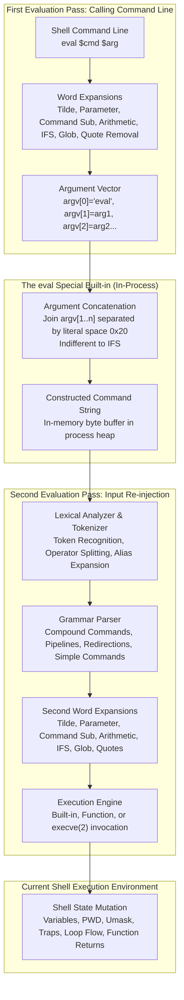

# The eval Builtin

> [!summary] Claim
> `eval` is the POSIX shell second-pass evaluation primitive, concatenating its argument words with literal spaces and re-submitting the resulting string to the lexical analyzer, grammar parser, and expansion engine within the current execution environment as a special built-in utility.

Part of [The POSIX Shell Language](README.md) in [Shell and Unix Engineering](../README.md).

## TL;DR

- Mechanism: `eval` joins its argument words with ASCII space characters (`0x20`) regardless of `$IFS` and submits the resulting string to an immediate second pass of token recognition, grammar parsing, word expansions, and command execution in the calling shell process.
- Rule: sanitize every variable interpolated into an `eval` string by enclosing it in single quotes and replacing internal single quotes with the four-character escape sequence `'\''`, or eliminate `eval` entirely using modern shell arrays, functions, or namerefs.
- Trap: `eval` executes directly within the current shell execution environment; unquoted or double-quoted untrusted input containing command separators (`;`, `&`), pipelines (`|`), redirections (`>`), or command substitutions (`$(...)`) triggers arbitrary code execution with the full privileges of the shell.
- Portability: eval is classified by POSIX.1-2024 as a special built-in utility; preceding variable assignments persist across the calling shell in POSIX mode (`v=1 eval :` leaves `v=1`), redirection errors abort non-interactive scripts unless neutralized via `command eval`, dash and BusyBox ash reject a leading `--` operand as an unrecognized command name (whereas mksh, posh, bash, zsh, ksh93, and yash strip it), and posh 0.14.1 fails to break enclosing loops from eval.
- When not to use it: never use `eval` for array simulation, dictionary lookups, or option parsing when writing for shells supporting modern data structures; replace dynamic evaluations with `getopts`, array indexing, or compiled utilities in Python, Go, or Rust.

## Mental model



The diagram traces how code flows through the two evaluation passes of `eval`.
In the first pass, the shell lexer and parser read the command line containing `eval` and its operands, performing standard word expansions and quote removal to populate an argument vector `argv`.
Upon entering the `eval` built-in, the C implementation bypasses `$IFS` entirely, concatenating all operand words into a single string delimited strictly by ASCII space characters (`0x20`); dash and BusyBox ash skip the copy when there is only one operand.
This constructed string is fed directly back into the shell input subsystem, where the lexical analyzer tokenizes the characters afresh.
During this second pass, metacharacters that were previously inert data characters inside variables (such as pipe symbols, redirection arrows, semicolons, and parentheses) are recognized by the parser as structural grammar tokens.
The resulting command tree undergoes a second full sequence of word expansions, field splitting, and pathname generation before the shell execution engine runs the commands.
Because `eval` is an intrinsic built-in that does not fork, all variable mutations, function returns, loop breaks, and environment alterations take effect directly within the calling shell execution environment.

## How it works

The formal specification for `eval` is defined in POSIX.1-2024 under the `eval` utility entry `(POSIX.1-2024 XCU eval)` and section 2.15 `(POSIX.1-2024 XCU 2.15)`.
The standard specifies: "The eval utility shall construct a command string by concatenating arguments together, separating each with a `<space>` character.
The constructed command string shall be tokenized (see 2.3 Token Recognition), parsed (see 2.10 Shell Grammar), and executed by the shell in the current environment.
It is unspecified whether the commands are parsed and executed as a program (as for a shell script) or are parsed as a single compound_list that is executed after the entire constructed command string has been parsed."

The lifecycle of an `eval` command proceeds through five distinct mechanical stages:

1. **First-pass evaluation and argument assembly.**
When the shell encounters `eval $arg1 "$arg2"`, it treats `eval` as the command word of a simple command.
The shell executes word expansions according to POSIX.1-2024 XCU 2.6: tilde expansion, parameter expansion, command substitution, and arithmetic expansion (performed together, beginning to end), then field splitting (governed by `$IFS`), pathname expansion, and quote removal.
Quotes present on the original command line are stripped away during this pass.
The calling shell collects the expanded results into an argument list `argv`, where `argv[0]` is `"eval"` and `argv[1..argc-1]` contain the expanded operands.

2. **In-process string concatenation.**
Inside the built-in implementation, the shell checks the operand count.
If no operands or only null operands are passed (`eval` or `eval ""`), POSIX specifies that `eval` returns exit status 0 `(POSIX.1-2024 XCU eval, EXIT STATUS)`.
posh 0.14.1 departs from this: lab test 7 asserts that `false; eval`, `false; eval ""`, and `false; eval "" ""` leave status 1 there and give 0 in every other shell tested.
When more than one operand exists, the shell iterates through `argv[1..argc-1]`, building one continuous string in memory, either by measuring the total length first or by growing a buffer as it copies.
It copies each operand into the buffer, inserting an ASCII space character (`0x20`) between adjacent operands.
Crucially, the field separator variable `$IFS` plays no role in this concatenation; `eval` always joins with literal spaces.
In GNU bash, this logic is implemented in `builtins/eval.def` via `string_list(list)` and `evalstring()`, after `no_options(list)` has handled option syntax `(bash-5.3 eval.def, eval_builtin)`.
In dash, `src/eval.c` implements `evalcmd()` by growing a stack string with `stputs()` and `STPUTC(' ', concat)`, without computing a size first, before calling `evalstring()` `(dash git eval.c, evalcmd)`.
In zsh, `Src/builtin.c` implements `bin_eval()` by delegating to the helper `eval()`, which joins the arguments with `zjoin(argv, ' ', 1)`, parses the result with `parse_string()`, and runs it with `execode()` `(zsh-5.9 builtin.c, bin_eval and eval)`.
In ksh93, `src/cmd/ksh93/bltins/misc.c` implements `b_eval()`, which parses options with `optget()` and then calls `sh_eval(sh_sfeval(argv),0)` `(ksh93u+m bltins/misc.c, b_eval)`.

3. **Re-injection into the lexical analyzer.**
Rather than executing a system call, the shell re-opens the synthesized string as a virtual character stream.
The shell parser reads from this memory buffer exactly as if the bytes arrived from an open script file descriptor or interactive terminal line discipline.
Lexical analysis breaks the character stream into words and operators.
Because this is a completely new lexical pass, characters that were protected inside strings during the first pass are now parsed as syntax operators.
A vertical bar `|` that was stored inside a variable `$cmd` is now recognized as the pipeline operator `(POSIX.1-2024 XCU 2.10)`.
A greater-than sign `>` is recognized as a redirection operator.
Semicolons and ampersands become command delimiters and asynchronous operators.
If alias expansion is enabled in the current shell environment, the leading token undergoes alias substitution.

4. **Second-pass expansion and command execution.**
Once the parser validates the syntax and constructs the abstract syntax tree (AST), of the whole string in zsh and ksh93 or of one complete command at a time in the incremental shells listed under Portability, the execution engine executes the command tree.
Before running simple commands, the shell performs a second full pass of word expansions on the tokens: tilde expansion, parameter expansion, command substitution, arithmetic expansion, field splitting using the current value of `$IFS`, pathname expansion (globbing), and quote removal.
If the command is a shell built-in or shell function, it executes directly within the current process memory.
If the command resolves to an external executable, the shell starts a child process and calls `execve(2)` in the standard manner; the process-creation call differs by shell: dash calls `vfork(2)` (`vforkexec` in `jobs.c`), yash calls `fork(2)` (`fork_and_reset` in `exec.c`), and ksh93u+m prefers `spawnveg`, which uses `posix_spawn(3)` or an equivalent and falls back to `fork(2)` (`sh_ntfork` in `xec.c`).

5. **Special built-in semantics and error consequences.**
POSIX classifies `eval` as one of the 15 special built-in utilities `(POSIX.1-2024 XCU 2.15)`.
This classification grants `eval` distinct execution properties:
First, preceding variable assignments persist in the current execution environment.
In POSIX-conforming mode, `VAR=val eval :` causes `VAR` to remain set after `eval` completes, whereas preceding assignments on regular utilities and regular builtins vanish after command execution.
Second, under POSIX.1-2024 XCU 2.8.1, an error in a special built-in utility or a redirection associated with a special built-in causes a non-interactive shell to abort immediately with a non-zero exit status.
If a redirection associated with `eval` fails (such as `eval : < /nonexistent`), a non-interactive POSIX shell terminates script execution.
Third, POSIX mandates that prefixing a special built-in with the `command` utility (`command eval ...`) removes these special properties: preceding variable assignments no longer persist in the calling shell, and redirection errors no longer cause non-interactive shells to abort `(POSIX.1-2024 XCU command, XCU 2.8.1 notes)`.

From a system call perspective, joining and parsing the operands needs no kernel service beyond what the allocator requests, but `eval` is not free of system calls in every shell.
Measured with `strace -c` on Alpine over 10,000 iterations of `eval v=1` against the same loop without `eval`, dash added zero system calls, bash 5.2 added about one per `eval` (`rt_sigprocmask`), and yash 2.58.1 added about two.

## Numbers and limits

The execution characteristics, constraints, and operational bounds of `eval` are summarized below:

| Property / Constraint | Value / Limit | Enforcing Layer | Sourced / Lab Proven |
| :--- | :--- | :--- | :--- |
| Concatenation Delimiter | Exactly 1 byte (`0x20` ASCII space) | Shell parser specification | `(POSIX.1-2024 XCU eval)` |
| Parameter Count Limit | 200,000 operands accepted (dash, posh, ksh93u+m, mksh, bash 5.2, BusyBox ash, yash); `zsh --emulate sh` accepts 20,000 and dies with `SIGSEGV` at 200,000 | Shell memory allocator and stack | Measured in the shell matrix (as of 2026-11) |
| Kernel `ARG_MAX` Limit | Not applicable (in-process evaluation); `getconf ARG_MAX` is 1,048,576 on macOS and 2,097,152 in the Debian container | Linux/macOS kernel `execve(2)` | Lab proven (test 14): a payload of `ARG_MAX` plus 65,536 bytes is evaluated by `eval` in every shell, and `env` given the same string fails with `Argument list too long` (status 126; 127 in zsh, 1 in posh and bash 3.2) |
| Special Built-in Count | Exactly 15 utilities | POSIX specification | `(POSIX.1-2024 XCU 2.15)` |
| Minimum Operands | 0 operands (returns status 0; posh 0.14.1 leaves the previous `$?`) | Shell built-in logic | `(POSIX.1-2024 XCU eval)`; lab test 7 asserts 0 everywhere and 1 for posh |
| Concatenation IFS Influence | None (`$IFS` is completely ignored) | Shell built-in logic | Lab proven (`IFS=:` test) |
| `eval :` Latency Overhead (dash) | ~1.0 us per invocation (Apple M3 Pro, macOS `/bin/dash`) | Shell parser engine | Measured by hand: 300,000 iterations, 3 runs, loop baseline subtracted (as of 2026-11) |
| `eval :` Latency Overhead (bash) | ~1.6 us per invocation (Apple M3 Pro, bash 3.2 and 5.3) | Shell parser engine | Measured by hand: 300,000 iterations, 3 runs, loop baseline subtracted (as of 2026-11) |
| Nested Recursion Depth | 1,000 chained evaluations succeed except in zsh, which stops at 500 (`recursion limit exceeded`); 10,000 kills dash, posh, ksh93u+m, mksh, bash, BusyBox ash, and yash with `SIGSEGV` (status 139) | Process call stack | Measured in the shell matrix (as of 2026-11) |
| Syntax Error Exit Status (dash, BusyBox ash, yash) | Status 2, and the non-interactive shell exits | Shell parser exit code | Lab proven (test 17) |
| Syntax Error Exit Status (mksh, posh) | Status 1, and the non-interactive shell exits | Shell parser exit code | Lab proven (test 17) |
| Syntax Error Exit Status (bash) | 5.x: status 2 (native, shell continues; POSIX mode, shell exits) / 3.2: status 1 (native and POSIX mode, shell continues) | Shell parser exit code | Lab proven (test 17) |
| Syntax Error Exit Status (zsh) | Status 1 (native and `--emulate sh`, shell continues) | Shell parser exit code | Lab proven (test 17) |
| Syntax Error Exit Status (ksh93) | Status 3 (shell continues) | Shell parser exit code | Lab proven (test 17) |
| Loop Break Support (posh 0.14.1) | 0 enclosing loops recognized | Shell loop frame manager | Lab proven (matrix measured) |
| Payload String Doubling (awk) | Dynamic %*s unsupported (BusyBox awk) | AWK formatting engine | Measured in the shell matrix (`%*x formats are not supported`); the lab doubles a string instead |

## Portability

The table below documents how `eval` behaves across POSIX sh, macOS bash 3.2, current bash, native zsh, zsh in POSIX emulation mode, dash, ksh93, mksh, yash, posh, and BusyBox ash:

| Feature / Behavior | POSIX.1-2024 sh | macOS bash 3.2 | Current bash (5.3) | Native zsh (5.9) | zsh (`--emulate sh`) | dash (0.5.12) | ksh93 (u+ / u+m) | mksh (R59) | yash (2.58.1) | posh (0.14.1) | BusyBox ash (1.37) |
| :--- | :--- | :--- | :--- | :--- | :--- | :--- | :--- | :--- | :--- | :--- | :--- |
| Special Built-in Status | Special built-in | Special in POSIX mode only* | Special in POSIX mode only* | Regular unless `POSIX_BUILTINS` is set | Special built-in | Special built-in | Special built-in | Special built-in | Special built-in | Special built-in | Special built-in |
| `v=1 eval :` Persistence | Persists (`v=1`) | Reverts (`v=0`)* | Reverts (`v=0`)* | Reverts (`v=0`) | Persists (`v=1`) | Persists (`v=1`) | Persists (`v=1`) | Persists (`v=1`) | Persists (`v=1`) | Persists (`v=1`) | Persists (`v=1`) |
| Leading `--` Operand | Not required; conforming applications must not use it | Strips `--` | Strips `--` | Strips `--` | Strips `--` | Rejects (status 127) | Strips `--` | Strips `--` | Strips `--` | Strips `--` | Rejects (status 127) |
| Redir Error Aborts Shell | Aborts non-interactive | Survives (aborts in POSIX mode)* | Survives (aborts in POSIX mode)* | Survives | Aborts (status 1) | Aborts (status 2) | Aborts (status 1) | Aborts (status 1) | Survives (aborts in POSIX)**** | Aborts (status 1) | Aborts (status 1) |
| `command eval` Strips Prefix | Strips persistence | Strips persistence | Strips persistence | Fails (status 127)** | Strips persistence | Strips persistence | Strips (u+m) / Persists (u+)*** | Strips persistence | Strips persistence | Strips persistence | Strips persistence |
| `command eval` Clears Abort | Suppresses abort | Suppresses abort | Suppresses abort | Survives (`eval` never runs)** | Suppresses abort | Suppresses abort | Suppresses abort | Suppresses abort | Suppresses abort | Suppresses abort | Suppresses abort |
| Loop Break (`eval break`) | Breaks enclosing loop | Breaks enclosing loop | Breaks enclosing loop | Breaks enclosing loop | Breaks enclosing loop | Breaks enclosing loop | Breaks enclosing loop | Breaks enclosing loop | Breaks enclosing loop | Fails (`cannot break`) | Breaks enclosing loop |
| Evaluation Granularity | Unspecified | Incremental | Incremental | Whole-string | Whole-string | Incremental | Whole-string | Incremental | Incremental | Incremental | Incremental |

`*` In GNU bash (both 3.2 and 5.3), invoking the shell as `sh` or launching with `--posix` enables POSIX mode, causing preceding assignments (`v=1 eval :`) to persist and redirection errors to abort the script.
`**` In native zsh, the `command` built-in bypasses all built-in commands and searches `PATH` exclusively for an external binary; because `eval` exists only as a built-in without a filesystem executable, `command eval` fails with status 127 unless the `POSIX_BUILTINS` option is set ([zsh manual, Precommand Modifiers](https://zsh.sourceforge.io/Doc/Release/Shell-Grammar.html)).
A failed redirection on `command eval` in native zsh therefore survives only because no special built-in ever runs.
`***` In legacy ksh93 (such as ksh93u+ 2012 on macOS), variable assignments preceding built-in utilities persist even under `command`; the modern ksh93u+m fork fixed this as `BUG_CMDSPASGN` ([NEWS entry dated 2020-06-16](https://raw.githubusercontent.com/ksh93/ksh/dev/NEWS)) and strips persistence as POSIX requires (measured on 1.0.10).
`****` In yash (2.58.1), native mode survives redirection errors on special built-ins; enabling strict POSIX compliance via `set -o posixly-correct` or invoking as `sh` causes redirection errors on special built-ins to abort the non-interactive script with status 2.
Lab test 16 asserts the granularity row for every shell in the table by running `eval "$(printf '%s\n%s\n' 'echo FIRST' 'if')"`, and lab test 9 asserts every status number in the redirection row; the `command -V` results behind the first row were measured in the shell matrix directly.

## Worked example

The test probe script below from the [lab](../labs/03-the-eval-builtin/) exercises argument concatenation, dynamic pipeline construction, redirection parsing, execution scope mutation, loop breaks, function returns, prefix assignment persistence, redirection error termination, `command` utility neutralization, leading option handling, the space-prefix idiom, null operands, syntax error status, the `ARG_MAX` bypass, and single-quote sanitization:

```sh
#!/bin/sh
# eval-probes.sh: exercise eval builtin mechanisms across shell implementations.

set -e

mode=${1:-}
shift || true

case "$mode" in
  concat-space)
    # Demonstrate that eval joins multiple arguments with space characters regardless of IFS.
    IFS=:
    # shellcheck disable=SC2294 # intentionally testing eval concatenation with multiple arguments
    eval "printf '[%s]'" "$@"
    printf '\n'
    ;;
  dynamic-pipeline)
    # Demonstrate second-pass parsing of pipeline operators.
    # shellcheck disable=SC2089 # intentionally testing unquoted pipeline command string
    cmd='echo alpha | tr a-z A-Z'
    submode=${1:-eval}
    if [ "$submode" = "eval" ]; then
      eval "$cmd"
    else
      # shellcheck disable=SC2086,SC2090,SC2248 # intentionally unquoted to demonstrate absence of pipeline parsing
      $cmd
    fi
    ;;
  dynamic-redir)
    # Demonstrate second-pass parsing of redirection operators.
    target=$1
    submode=${2:-eval}
    # shellcheck disable=SC2089 # intentionally testing unquoted redirection command string
    cmd="echo payload > $target"
    if [ "$submode" = "eval" ]; then
      eval "$cmd"
    else
      # shellcheck disable=SC2086,SC2090,SC2248 # intentionally unquoted to demonstrate absence of redirection parsing
      $cmd
    fi
    ;;
  env-mutation)
    # Demonstrate that eval modifies the caller environment in the current shell.
    var_x=initial
    var_y=initial
    eval "var_x=modified; var_y=updated"
    printf 'var_x=%s var_y=%s\n' "$var_x" "$var_y"
    ;;
  flow-break)
    # Demonstrate that eval can break caller loop structures.
    idx=0
    for i in 1 2 3 4 5; do
      idx=$i
      if [ "$i" -eq 3 ]; then
        eval "break"
      fi
    done
    printf 'loop_idx=%d\n' "$idx"
    ;;
  flow-return)
    # Demonstrate that eval executes return in the caller function scope.
    code=${1:-7}
    probe_func() {
      eval "return $1"
      printf 'UNREACHED\n'
    }
    set +e
    probe_func "$code"
    st=$?
    set -e
    printf 'func_ret=%d\n' "$st"
    ;;
  prefix-assign)
    # Demonstrate special built-in variable assignment prefix persistence.
    pvar=initial
    pvar=modified eval :
    printf 'pvar=%s\n' "$pvar"
    ;;
  redir-abort)
    # Demonstrate special built-in redirection error causing non-interactive shell to abort.
    set +e
    { eval : </nonexistent_file_for_eval_abort; } 2>/dev/null
    printf 'SURVIVED\n'
    ;;
  cmd-eval-prefix)
    # Demonstrate that the command utility removes special built-in prefix persistence.
    cvar=initial
    cvar=modified command eval :
    printf 'cvar=%s\n' "$cvar"
    ;;
  cmd-redir-abort)
    # Demonstrate that the command utility suppresses non-interactive abort on redirection error.
    set +e
    { command eval : </nonexistent_file_for_eval_abort; } 2>/dev/null
    printf 'SURVIVED\n'
    ;;
  dash-dash)
    # Demonstrate divergence on leading '--' operand vs option handling.
    eval -- echo "'[$1]'"
    ;;
  space-prefix)
    # Demonstrate the XCU eval Application Usage idiom: a leading space keeps a dash-leading operand from being read as an option.
    eval " $1"
    ;;
  bare-operand)
    # Demonstrate the same operand without the leading space, which option-aware shells parse as an eval option.
    eval "$1"
    ;;
  quote-safe)
    # Demonstrate safe single-quote escaping for untrusted data interpolated into eval.
    sq="'"
    raw_payload=$1
    rem=$raw_payload
    out=""
    while case "$rem" in *"$sq"*) true ;; *) false ;; esac do
      prefix=${rem%%"$sq"*}
      out="${out}${prefix}'\\''"
      rem=${rem#*"$sq"}
    done
    escaped="'${out}${rem}'"
    evaluated_safe=""
    eval "evaluated_safe=$escaped"
    printf 'evaluated_safe=[%s]\n' "$evaluated_safe"
    ;;
  incremental)
    # Demonstrate incremental line-by-line vs whole-string evaluation on syntax error.
    eval "$(printf '%s\n%s\n' 'echo FIRST' 'if')"
    printf 'FINISHED\n'
    ;;
  no-operands)
    # Demonstrate that eval with no operands, or only null operands, returns status 0 even after a failure.
    set +e
    false
    eval
    a=$?
    false
    eval ""
    b=$?
    false
    eval "" ""
    c=$?
    printf '%s %s %s\n' "$a" "$b" "$c"
    ;;
  syntax-status)
    # Demonstrate the status of a syntax error in the eval string, and whether the shell survives it.
    set +e
    eval 'if' 2>/dev/null
    printf 'CONTINUED=%s\n' "$?"
    ;;
  arg-max-payload)
    # Demonstrate that an operand larger than ARG_MAX stays inside the shell: eval accepts it, execve(2) rejects it.
    payload=$(awk -v n="$1" 'BEGIN { s = "x"; while (length(s) < n) s = s s; printf "%s", substr(s, 1, n) }')
    actual=""
    eval "actual=$payload"
    printf 'len=%d\n' "${#actual}"
    env_bin=$(command -v env)
    "$env_bin" true "$payload"
    ;;
  *)
    # shellcheck disable=SC2248 # mode in diagnostic message
    printf 'eval-probes: unknown mode: %s\n' "$mode" >&2
    exit 64
    ;;
esac
```

When evaluated under the lab harness across the shell matrix, the Bats test suite asserts these exact outputs:

```text
1..18
ok 1 eval concatenates arguments with spaces ignoring IFS
ok 2 eval parses dynamic pipelines on second evaluation pass unlike bare expansion
ok 3 eval parses dynamic redirections on second evaluation pass unlike bare expansion
ok 4 eval executes in current shell environment and mutates caller variables
ok 5 eval executes loop break in caller execution scope
ok 6 eval executes return in caller function scope with specified exit status
ok 7 eval with no arguments or only null arguments returns exit status 0
ok 8 variable assignment prefix persistence on eval adheres to shell family standard
ok 9 redirection error on special built-in eval aborts non-interactive POSIX shells
ok 10 command utility strips special built-in prefix persistence on eval
ok 11 command utility suppresses non-interactive abort on eval redirection error
ok 12 eval leading dash-dash handling diverges between option-aware and operand-only shells
ok 13 leading space keeps a dash-leading eval operand from being parsed as an option
ok 14 in-process eval evaluates payload exceeding system ARG_MAX while execve rejects it with E2BIG
ok 15 single-quote escaping neutralizes command injection payloads in eval
ok 16 incremental vs whole-string parsing of multiline eval with syntax error
ok 17 syntax error in an eval string yields a shell-specific status and may end the shell
ok 18 eval-probes returns status 64 on unknown mode
```

Every test asserts the value measured for its shell family, and each assertion was checked against a mutation of the probe that makes it fail.
Test 14 passes the whole oversized payload through `eval` and checks that `env` rejects the same string, test 15 uses a payload with single quotes, double quotes, a command substitution, and backticks, and test 13 compares the space-prefixed operand against the bare one.

## Pitfalls

> [!warning] Remote code execution via unquoted parameter evaluation
> Trigger: interpolating untrusted input directly into an `eval` string, such as `eval "config_$key=$value"`.
> Symptom: an attacker supplies a key or value containing command separators, backticks, or command substitutions (e.g. `val; reboot #`), breaking out of the variable assignment and executing arbitrary commands with the privileges of the script runner.
> Fix: quote every variable operand strictly using single-quote wrapping and `'\''` escaping, or eliminate `eval` in favor of associative arrays or POSIX function parameter passing.
> Primary Source: CVE-2019-9891 in the *Advanced Bash-Scripting Guide* `getopt_simple()` function, where `eval $parameter=$value` allows privilege escalation and command execution when the function is used in a script called, for example, via `sudo` ([RT-SA-2019-007](https://www.redteam-pentesting.de/advisories/rt-sa-2019-007)).

> [!warning] Command injection in startup scripts via environment variable evaluation
> Trigger: concatenating dynamic options or environment variables into startup scripts via `eval set -- $DEFAULT_JVM_OPTS $JAVA_OPTS $GRADLE_OPTS ...` ([gradlew at v7.1.1](https://raw.githubusercontent.com/gradle/gradle/v7.1.1/gradlew), line 183).
> Symptom: unescaped command substitutions or semicolon delimiters in environment variables (`JAVA_OPTS='-Xmx512m $(touch /tmp/pwned)'`) are executed during application launch.
> Fix: replace string concatenation and `eval` with shell array parameters (`set -- "${JVM_OPTS[@]}" "$@"`) or pass options directly without invoking the shell interpreter.
> Primary Source: CVE-2021-32751 in the Gradle `gradlew` and `application` plugin start scripts before 7.2, which allow arbitrary code execution when an attacker can change environment variables for the user running the script (a local precondition, not a remote one).
NVD records the patch as removing `eval` and requiring `bash`, yet the [v7.2.0 `gradlew`](https://raw.githubusercontent.com/gradle/gradle/v7.2.0/gradlew) still calls `eval`, after escaping the options through `xargs` and `sed`.

> [!warning] Non-portable script crashes via leading dash-dash operand
> Trigger: invoking `eval -- "$cmd"` under operand-only shells such as dash or BusyBox ash.
> Symptom: dash and BusyBox ash do not implement `--` option stripping for `eval`; the shell treats `--` as an executable command name and attempts to invoke it, printing `--: not found` and returning status 127, which ends the script only under `set -e` or an equivalent check (whereas bash, zsh, ksh93, yash, mksh, and posh strip `--`).
> Fix: adhere to the POSIX.1-2024 XCU eval Application Usage guidance by prefixing the evaluated expression with a leading space character: `eval " $cmd"`.

> [!warning] Broken loop flow control across eval in posh
> Trigger: executing `eval "break"` or `eval "continue"` inside a loop under posh 0.14.1.
> Symptom: posh does not recognize the enclosing caller loop from inside `eval`, although variable changes and `return` do take effect in the caller; it emits `break: cannot break` or `continue: cannot continue` and carries on with the rest of the loop body.
> Fix: avoid embedding loop control keywords inside `eval`; return an exit status from `eval` and execute `break` directly in the caller loop (`eval "$check_cmd" || break`).

> [!warning] Silent environment poisoning via special built-in assignment prefixes
> Trigger: running `VAR=value eval "$cmd"` with the intention of scoping `VAR` as a temporary environment variable for `$cmd`.
> Symptom: in POSIX-conforming shells (dash, ksh93, mksh, yash, posh, BusyBox ash, and bash in POSIX mode), `eval` is a special built-in utility; prefix assignments persist in the calling shell environment after `eval` terminates, permanently modifying `VAR` across subsequent commands.
> Fix: execute the temporary assignment within a subshell `( VAR=value; eval "$cmd" )` or neutralize special built-in properties using `VAR=value command eval "$cmd"`, which shows `VAR` to `$cmd` and then discards it; note that legacy ksh93u+ 2012 still persists assignments under `command eval` due to a historical engine bug (fixed in `ksh93u+m`, NEWS 2020-06-16), and native zsh rejects `command eval` with status 127.

> [!warning] Abrupt script termination on redirection failure
> Trigger: executing `eval "$cmd" < "$input_file"` in a non-interactive script where `$input_file` does not exist or permissions are denied.
> Symptom: under POSIX.1-2024 XCU 2.8.1, redirection errors on special built-in utilities cause non-interactive shells to abort immediately, terminating the script without executing subsequent lines or error-handling branches.
> Fix: prefix `eval` with `command` (`command eval "$cmd" < "$input_file"`) to strip special built-in error propagation semantics, allowing normal `||` error handling (native zsh needs `POSIX_BUILTINS` for this form, as Portability shows).

> [!warning] Whitespace destruction and argument mangling via eval "$@"
> Trigger: writing `eval "$@"` in wrapper scripts or container entrypoints to execute forwarded parameters.
> Symptom: `eval` joins all arguments with spaces and performs a second lexical pass; arguments containing spaces, tabs, quotes, or globbing patterns are split into separate words or expanded against the filesystem, corrupting filenames and breaking option groupings.
> Fix: invoke arguments directly without `eval` using `"$@"` or `exec "$@"`.

## Security and robustness

**The dual-pass attack surface.**
The architectural vulnerability of `eval` stems directly from its core mechanism: converting inert string data into executable code tokens.
In compiled languages, code and data reside in segregated spaces.
In a shell script, the boundary between syntax and data exists solely through the lexical analyzer quote-state tracking during the first evaluation pass.
When `eval` runs, it obliterates that boundary.
Any string that passes through `eval` undergoes token recognition afresh.
Characters that represent data in the caller (such as semicolons in a SQL query, pipes in a regex pattern, or quotes in a user name) are promoted to structural syntax tokens.
Because the shell language contains dozens of execution operators (`;`, `&`, `|`, `&&`, `||`, `>`, `<`, `(`, `)`, `` `...` ``, `$(...)`, `$((...))`), sanitizing input for `eval` via blocklists is impossible.

**The mathematics of single-quote escaping.**
The only mathematically sound sanitization mechanism for dynamic `eval` interpolation in POSIX shell is single-quote encapsulation.
Under POSIX.1-2024 XCU 2.2.2 (Single-Quotes), every character enclosed within single quotes preserves its literal meaning without exception.
No escape character exists inside single quotes; even backslashes are completely literal.
To safely embed an arbitrary string `$val` inside an `eval` command, the string must be enclosed in single quotes, and every internal single quote must be closed, escaped, and reopened:
```sh
sq="'"
rem=$val
escaped=""
while case "$rem" in *"$sq"*) true ;; *) false ;; esac do
  prefix=${rem%%"$sq"*}
  escaped="${escaped}${prefix}'\\''"
  rem=${rem#*"$sq"}
done
eval "target='${escaped}${rem}'"
```
This transformation ensures that the second-pass lexer encounters only string literals, preventing any injected characters from being recognized as syntax operators.
Lab proven (test 15), a value containing a single quote, a semicolon, a command substitution, and backticks round-trips unchanged through this loop in dash, posh, ksh93u+m, mksh, bash, zsh, BusyBox ash, and yash, without running the injected command.

**Denial of service via unbounded memory consumption.**
Unlike external utilities executed via `execve(2)`, `eval` is an intrinsic shell routine executing in-process.
It is completely unaffected by the operating system `ARG_MAX` buffer ceiling.
While this permits processing strings larger than system execution limits, it exposes the shell to unconstrained memory consumption.
If untrusted external streams or large files are ingested into shell variables and evaluated, the shell process dynamically allocates continuous buffers on the heap.
Under recursive evaluation loops (`eval "$nested_eval"`), the shell can exhaust its stack, which measured in the shell matrix as `SIGSEGV` (status 139) at a depth of 10,000 in every shell except zsh, while unbounded heap growth can end in kernel out-of-memory termination.
Robust scripts must enforce size constraints on variables before evaluation.

## The principal's view

Staff and principal engineers view `eval` as an architectural liability that should be systematically eliminated from modern systems.
Historically, Stephen Bourne's shell shipped `eval` in 1979 Seventh Edition Unix ([V7 `sh(1)`](https://raw.githubusercontent.com/dspinellis/unix-history-repo/Research-V7/usr/man/man1/sh.1)), and the language lacked essential primitives: there were no arrays, no associative maps, no namerefs, no indirect parameter expansions, and no dynamic redirection mechanisms.
In that era, `eval` was the only mechanism available to implement dynamic dispatch, access variables by computed names, or construct complex pipelines at runtime.

In contemporary software engineering (as of 2026-11), these limitations no longer exist.
Modern shells provide native constructs that eliminate most of the need for `eval`:
- In GNU bash 4.3+ (`declare -n ref=$target_var`, per bash NEWS) and in ksh93 and mksh (`typeset -n`, since neither has `declare`), namerefs provide variable indirection without an `eval` string.
- In GNU bash and zsh, indirect expansion (`${!var}` or `${(P)var}`) allows reading variables by name.
Neither indirection is safe on an untrusted name: measured on bash 5.2, a target of `a[$(cmd)0]` runs `cmd` through both `${!x}` and `declare -n`, so validate the name first.
- In bash and zsh, native indexed and associative arrays preserve argument whitespace and record boundaries without lexical re-evaluation.
- In bash 4.4+, the `${var@Q}` parameter expansion safely quotes strings for shell evaluation.

When an engineering team encounters `eval` in a codebase, distinguished engineers apply a strict triage hierarchy:
1. **If `eval` is used for argument forwarding:** replace `eval "$@"` with `"$@"` or `exec "$@"`.
2. **If `eval` is used for variable indirection:** replace it with POSIX function parameters or modern shell namerefs.
3. **If `eval` is used for dynamic pipelines or redirections:** evaluate whether the task belongs in shell at all.
If complex pipelines must be dynamically assembled based on user requests, the problem has outgrown shell scripting and must be rewritten in Python, Go, or Rust where processes are launched via explicit `execve` argument vectors rather than string interpretation.
4. **If `eval` is strictly mandatory (e.g. bootstrapping environment managers like `ssh-agent`, `direnv`, or `opam`):** restrict evaluation strictly to trusted generator binaries, isolate the invocation from external user parameters, and prefix with `command` to prevent catastrophic special built-in error propagation, except in native zsh, where `command eval` fails unless `POSIX_BUILTINS` is set.
The `eval` form is the documented usage for all three: the [ssh-agent(1) manual](https://man.openbsd.org/ssh-agent) shows ``eval `ssh-agent` ``, the [direnv(1) manual](https://direnv.net/man/direnv.1.html) shows `eval "$(direnv hook bash)"`, and the [opam env manual](https://opam.ocaml.org/doc/man/opam-env.html) says the output is meant to be used as `eval $(opam env)`.
Subtle semantic divergences across implementations (such as posh failing to break loops across `eval` boundaries, dash and BusyBox ash rejecting leading option delimiters, and release-dependent variable scoping under `command eval` in ksh93) reinforce why production engineering standards deprecate dynamic evaluation in favor of explicit primitives.

## Interview questions

> [!question] L5: Why does `cmd="echo alpha | tr a-z A-Z"; $cmd` print `alpha | tr a-z A-Z` instead of `ALPHA`?
>
> > [!success]- Answer
> > Token recognition and grammar parsing occur before parameter expansion in the POSIX shell execution lifecycle.
> > When `$cmd` is expanded, the shell has already parsed the command grammar and will not re-scan the generated words for pipeline operators.
> > The vertical bar `|` and subsequent words are treated as plain positional arguments passed directly to the `echo` utility.
> > To force the shell to re-parse the string and recognize `|` as a pipeline token, `eval "$cmd"` must be invoked.
> >
> > Follow-up: What does native zsh print when executing `$cmd` without `eval`, and why?

> [!question] L5: Predict the output: what does `pvar=orig; pvar=temp eval :; echo "$pvar"` output in dash versus native GNU bash?
>
> > [!success]- Answer
> > In dash, the output is `temp`.
> > In native GNU bash, the output is `orig`.
> > POSIX.1-2024 classifies `eval` as a special built-in utility, mandating that preceding variable assignments persist in the execution environment.
> > Dash strictly implements POSIX semantics, leaving `pvar=temp`.
> > Native GNU bash implements regular command scoping for built-in variable prefixes unless `--posix` mode is explicitly enabled.
> >
> > Follow-up: How can you write this command so that `pvar` reverts to `orig` across all POSIX-compliant shells?

> [!question] L6: Debug this script: identify the vulnerability in `load_param() { eval "CONFIG_$1='$2'"; }` and provide a secure fix.
>
> > [!success]- Answer
> > If an attacker passes an argument containing a single quote, such as `$2="test'; reboot; echo '"`, the evaluated string becomes `CONFIG_key='test'; reboot; echo ''`.
> > The closing single quote terminates the string literal, and the semicolon triggers execution of the injected `reboot` command.
> > Furthermore, if `$1` is not validated, an attacker can inject arbitrary shell code directly through the variable name operand.
> > The fix requires validating `$1` against a strict alphanumeric identifier regex and escaping all single quotes within `$2` using a dedicated single-quote escaping routine.
> >
> > Follow-up: Why is `CONFIG_${1@Q}` insufficient when writing portable POSIX shell scripts?

> [!question] L6: Why does `eval -- echo hello` succeed in GNU bash but fail with exit status 127 in dash and BusyBox ash?
>
> > [!success]- Answer
> > POSIX does not require `eval` to support the standard `--` end-of-options delimiter.
> > GNU bash, zsh, ksh93, yash, mksh, and posh apply option syntax to `eval` and strip a leading `--` operand.
> > Dash and BusyBox ash do not parse options on `eval`, treating `--` as the first word of the command string to be executed.
> > Because no utility named `--` exists in the filesystem or built-in table, dash and ash report `--: not found` and `eval` returns status 127.
> > POSIX.1-2024 XCU eval (Application Usage) recommends prefixing arguments with a space (`eval " $cmd"`) to avoid hyphen option collisions.
> >
> > Follow-up: Why do Korn-derived shells like mksh and posh strip `--` even though POSIX specifies no options for `eval`?

> [!question] L6: Explain how `command eval` modifies the execution behavior and error handling of `eval` in a non-interactive POSIX shell.
>
> > [!success]- Answer
> > In POSIX.1-2024 XCU command, invoking a special built-in utility through the `command` utility strips the special properties listed in XCU 2.15.
> > Preceding variable assignments (`v=1 command eval :`) no longer persist in the calling shell environment upon completion (except in legacy ksh93u+ 2012, resolved in ksh93u+m, NEWS 2020-06-16).
> > Redirection errors and built-in execution failures no longer cause a non-interactive shell script to abort immediately.
> > Instead, the command returns a non-zero exit status, allowing standard shell error handling (`|| handle_error`) to execute.
> >
> > Follow-up: Why does `command eval` fail with exit status 127 in native zsh?

> [!question] L7: Why can `eval` evaluate strings whose size exceeds the operating system `ARG_MAX` limit, whereas external commands fail with `E2BIG`?
>
> > [!success]- Answer
> > The `ARG_MAX` limit is enforced by the operating system kernel inside the `execve(2)` system call when copying arguments into a new process address space.
> > Because `eval` is an intrinsic shell built-in, it executes entirely within the user-space address space of the existing shell process.
> > Concatenation and expansion allocate memory directly from the process heap via `malloc` or internal stack allocators.
> > No kernel `execve(2)` transition occurs unless an external binary is invoked inside the evaluated string.
> > Consequently, string sizes are bounded only by available virtual memory and shell allocator limits.
> >
> > Follow-up: What operational vulnerability does this bypass create in server environments processing untrusted input?

> [!question] L7: Contrast incremental execution versus whole-string parsing in `eval "$(printf 'echo FIRST\nif')"`, identifying which shell families implement each model.
>
> > [!success]- Answer
> > Under incremental execution, the shell parses and executes multi-line input line-by-line as a script stream.
> > In dash, BusyBox ash, GNU bash (native and POSIX mode), mksh, posh, and yash, `echo FIRST` executes and prints `FIRST` before the parser encounters the syntax error on line 2 and terminates.
> > Under whole-string parsing, the shell parses the entire concatenated payload into a complete syntax tree before executing any commands.
> > In zsh and ksh93, the syntax error on line 2 prevents execution entirely, so `FIRST` is never printed.
> > POSIX.1-2024 XCU eval explicitly leaves this behavioral difference unspecified.
> >
> > Follow-up: How does this behavioral divergence affect transactional rollback logic in deployment scripts?

> [!question] L7+: Design a provably safe POSIX-compliant dynamic variable assignment function that works across all POSIX shells without bashisms.
>
> > [!success]- Answer
> > The function must validate that the variable name matches a strict POSIX identifier regex (`^[a-zA-Z_][a-zA-Z0-9_]*$`) using `case` pattern matching to prevent syntax injection.
> > It must disassemble the value into single-quote-delimited segments, replacing every internal single quote `'` with the safe boundary escape `'\''`.
> > It must construct the final expression as `eval "$var_name='$escaped_value'"`, prefixing the expression with a space if needed to prevent leading-dash collisions.
> > It must execute in the current shell context while avoiding variable assignment prefixes that could poison special built-in state.
> >
> > Follow-up: What is the algorithmic time complexity of this sanitization loop, and when should the architecture transition to a compiled binary?

## Related

Prerequisites: [[The-getopts-Builtin]]

Next: [[The-exec-Builtin]]

See also: [[Token-Recognition]], [[Shell-Grammar]], [[Quoting-Backslash-Single-and-Double]], [[Expansion-Order]], [[Parameter-Expansion]], [[Field-Splitting-and-IFS]], [[Quote-Removal]], [[Redirection-Order-and-Semantics]], [[Simple-Commands-and-Assignment-Prefixes]], [[Special-Built-ins-versus-Utilities]], [[Command-Search-and-PATH]], [[Pipelines-and-And-Or-Lists]], [[Functions-and-Scope]], [[errexit-Semantics-and-Exceptions]], [[Subshells-and-the-Execution-Environment]], [[POSIX-2024-Changes]]

## Further reading

- [POSIX.1-2024 XCU eval](https://pubs.opengroup.org/onlinepubs/9799919799/utilities/eval.html): the normative standard specification defining operand concatenation, execution environment, and exit status requirements.
- [POSIX.1-2024 XCU 2.15 Special Built-In Utilities](https://pubs.opengroup.org/onlinepubs/9799919799/utilities/V3_chap02.html): the standard rules governing variable assignment persistence and fatal error propagation for special built-ins.
- [POSIX.1-2024 XCU break](https://pubs.opengroup.org/onlinepubs/9799919799/utilities/break.html): normative specification for loop termination semantics and loop scoping in POSIX shell.
- [POSIX.1-2024 XCU command](https://pubs.opengroup.org/onlinepubs/9799919799/utilities/command.html): normative specification for executing commands while suppressing special built-in properties.
- [GNU bash 5.3 source tarball](https://ftp.gnu.org/gnu/bash/bash-5.3.tar.gz), `builtins/eval.def`: implementation source code documenting `eval_builtin`, `no_options` option handling, and `evalstring` dispatch.
- [dash eval.c](https://git.kernel.org/pub/scm/utils/dash/dash.git/plain/src/eval.c): source implementation of `evalcmd` in the Debian Almquist shell demonstrating operand joining and stack string management.
- [zsh builtin.c](https://raw.githubusercontent.com/zsh-users/zsh/master/Src/builtin.c): source implementation of `bin_eval` showing builtin registration with `BINF_PSPECIAL` and string execution.
- [ksh93 bltins/misc.c](https://raw.githubusercontent.com/ksh93/ksh/dev/src/cmd/ksh93/bltins/misc.c): source implementation of `b_eval` detailing KornShell option parsing and `sh_eval` of `sh_sfeval` input.
- [KornShell ksh93 repository](https://github.com/ksh93/ksh): source repository for ksh93u+m detailing bug fixes for special built-in variable prefix scoping under command.
- [mksh funcs.c](https://raw.githubusercontent.com/MirBSD/mksh/master/funcs.c): source implementation of `c_eval` in the MirBSD Korn Shell illustrating word pointer processing.
- [Yash documentation](https://magicant.github.io/yash/doc/): reference manual for Yet Another Shell detailing built-in categorization and POSIXly-correct mode redirection error abort semantics.
- [Debian posh package](https://sources.debian.org/src/posh/): source archive for the Policy-compliant Ordinary Shell.
- [National Vulnerability Database CVE-2021-32751](https://nvd.nist.gov/vuln/detail/CVE-2021-32751): official vulnerability record detailing code execution via `eval` and attacker-controlled environment variables in Gradle start scripts before 7.2.
- [National Vulnerability Database CVE-2019-9891](https://nvd.nist.gov/vuln/detail/CVE-2019-9891): official vulnerability record detailing arbitrary code execution via dynamic `eval` variable assignment in `getopt_simple`.
- [RedTeam Pentesting Advisory RT-SA-2019-007](https://www.redteam-pentesting.de/advisories/rt-sa-2019-007): technical postmortem analyzing the mechanics of unescaped `eval` parameter evaluation in shell scripts.
- [Linux execve(2) Man Page](https://man7.org/linux/man-pages/man2/execve.2.html): kernel interface specification detailing argument vector constraints, memory limits, and the `E2BIG` error condition.
