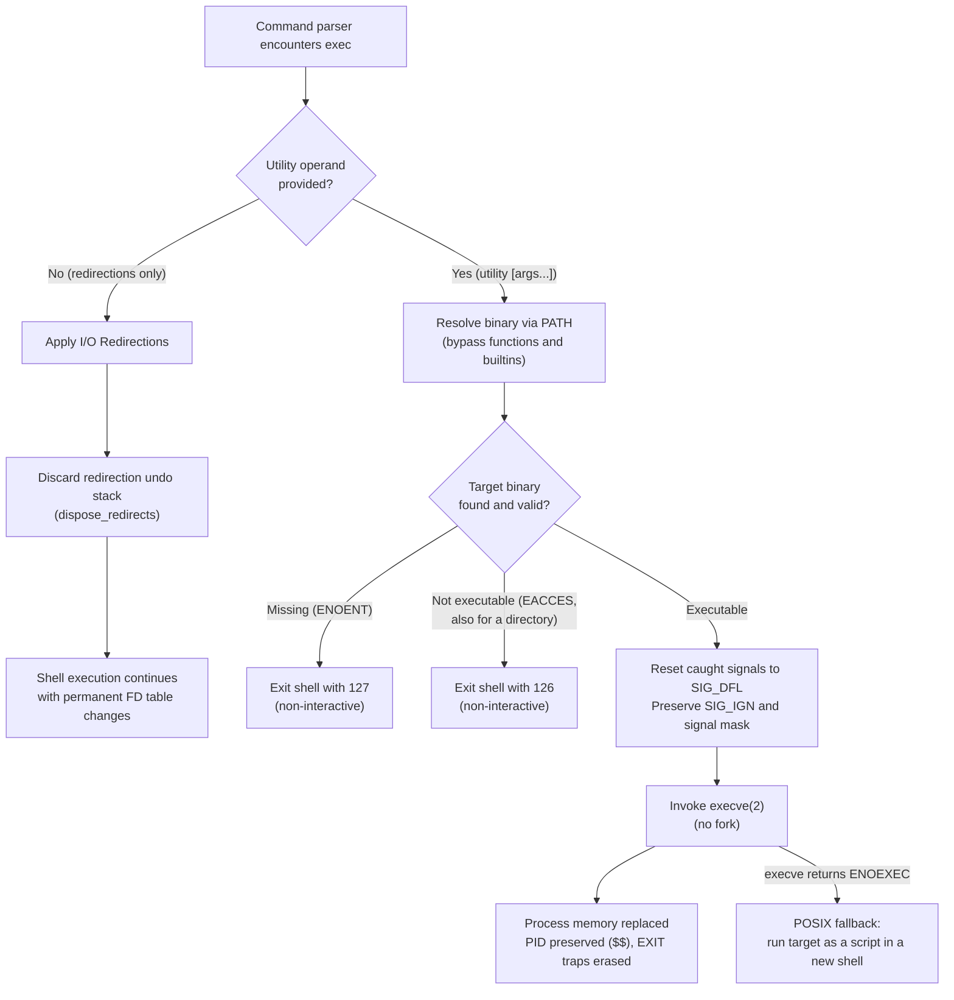

# The exec Builtin

> [!summary] Claim
> The `exec` special built-in utility modifies the file descriptor table of the current shell execution environment or permanently replaces the shell process image with a specified non-built-in utility via `execve()`, preserving the process ID, open non-cloexec file descriptors, signal masks, and real user and group IDs while wiping process memory, shell variables, and exit traps.

Part of [The POSIX Shell Language](README.md) in [Shell and Unix Engineering](../README.md).

## TL;DR

- Mechanism: Invoking `exec` with only redirections permanently mutates file descriptors in the running shell process, whereas invoking `exec` with a utility operand executes `execve(2)` without `fork(2)`.
- Rule: Because `exec` is a special built-in utility `(POSIX.1-2024 XCU 2.15)`, POSIX requires any execution or redirection failure in a non-interactive shell to abort the shell immediately with status 1-125 for redirection errors, 126 for non-executable targets, or 127 for missing commands (with GNU Bash 3.2 returning 126 for missing pathnames containing a slash), but native `bash`, native `zsh`, and `yash` outside POSIX mode survive a failed bare `exec 3</missing`, as measured in the shell matrix (as of 2026-11).
- Trap: Process replacement overwrites the process image in place, which means registered `EXIT` traps never execute and shell functions or builtins are bypassed in favor of external binaries in `PATH` (except in `mksh` outside POSIX mode, `posh`, and native `zsh`, which execute functions directly under `exec`).
- Portability fact: File descriptors above 2 opened via `exec` have `FD_CLOEXEC` set automatically in `ksh93` and `mksh` outside POSIX mode, but remain open and inherited by children in `bash`, `dash`, `busybox`, `yash`, `posh`, and `zsh`.
- When not to use it: Never use bare `exec <&-` or close standard streams 0, 1, or 2 without reopening them to `/dev/null`, because subsequent `open(2)` calls reallocate standard descriptors and corrupt file data through standard library stream writes.

## Mental model



When the shell evaluates an `exec` command, it checks whether a utility operand follows the redirection list.
If no utility operand is supplied, the shell performs any specified redirections and immediately discards its internal redirection undo stack, making all file descriptor mutations permanent across subsequent commands in the current execution environment.
If a utility operand is present, the shell bypasses functions and builtins under POSIX semantics, performs `PATH` resolution, and prepares the process for image replacement.
Signals caught by shell traps are reset to default kernel dispositions (`SIG_DFL`), while ignored signals (`SIG_IGN`), the process ID (`$$`), parent process ID, credentials, and unflagged file descriptors are preserved.
The shell then issues the `execve(2)` system call directly without calling `fork(2)`, entirely replacing virtual memory and the thread image with the new executable.
If `execve(2)` fails due to missing files or denied permissions in a non-interactive shell, the shell terminates immediately; if `execve(2)` fails with `ENOEXEC`, POSIX requires a command equivalent to a new shell invoked with the script as its first operand, while allowing a heuristic that rejects files that cannot be scripts with status 126.

## How it works

### System call mechanics

In standard shell command execution, the shell calls `fork(2)` or `clone(2)` to create a child process.
The child process applies redirections and invokes `execve(2)`, while the parent shell suspends execution via `waitpid(2)` or records the background process ID.
The `exec` built-in utility bypasses process creation entirely.
When `exec` is executed with a command operand, the shell configures file descriptors and calls `execve(2)` directly within the calling process.

Under the Linux kernel `(Linux kernel fs/exec.c, do_execveat_common and begin_new_exec; fs/binfmt_elf.c, load_elf_binary)`, `execve(2)` performs the following steps; steps 2 to 4 are listed in the order `begin_new_exec` calls them in the master branch read on 2026-11-01 (`unshare_fd` and `close_cloexec_files` at lines 1178 and 1196, `exec_mmap` at 1216, `flush_signal_handlers` at 1298, `commit_creds` at 1309):
1. Locates the executable binary and validates execute permission (`EACCES`); read permission is not required, because `fs/exec.c` opens the file with `.acc_mode = MAY_EXEC`, and a mode 111 binary ran as uid 1000 while a mode 111 script failed when its interpreter tried to read it, as measured in the shell matrix (as of 2026-11).
2. Gives the process a private file descriptor table (`unshare_fd`), then closes every file descriptor that has the close-on-exec flag (`FD_CLOEXEC` / `O_CLOEXEC`) enabled (`close_cloexec_files`); this happens before the memory image is replaced.
3. Allocates a new virtual memory descriptor (`mm_struct`) with `exec_mmap`, unmapping all existing code, data, heap, and thread stacks.
4. Resets the disposition of all signals caught by user-space handler routines to `SIG_DFL` (`flush_signal_handlers`), after the memory switch and before `commit_creds`.
Signals set to `SIG_IGN` remain ignored across `execve(2)`.
The signal mask of blocked signals is preserved unchanged.
5. Preserves process attributes: the process ID (`PID`), parent process ID (`PPID`), process group ID, session ID, real user ID, real group ID, supplementary groups, working directory, resource limits (`rlimit`), and file creation mask (`umask`).
6. Maps the new program binary into memory (in `load_elf_binary`, after `begin_new_exec` returns), constructs the initial stack containing `argc`, `argv`, and `envp`, and starts at the program entry point (`_start` in a static binary, the dynamic linker's entry point when the binary names an ELF interpreter).

Because the original process image is destroyed, `execve(2)` never returns to the caller on success.
Execution resumes only if `execve(2)` encounters a kernel error such as `ENOENT`, `EACCES`, `EISDIR`, `E2BIG`, or `ENOEXEC`.
A directory target fails with `EACCES` on Linux, as measured with a direct `execv` call in the shell matrix, and on macOS (Darwin 27.2.0), as measured with `os.execv` from Python (as of 2026-11); `EISDIR` means that an ELF interpreter was a directory ([execve(2)](https://man7.org/linux/man-pages/man2/execve.2.html)).

### The POSIX specification

POSIX.1-2024 defines `exec` in Chapter 2 under Section 2.15:
- Definition: `(POSIX.1-2024 XCU 2.15 exec)` specifies that if `exec` is invoked with no operands, redirections are made in the current shell execution environment.
If file descriptors greater than 2 are opened by those redirections, POSIX leaves it unspecified whether they remain open when invoking another utility.
- Non-built-in resolution: `(POSIX.1-2024 XCU 2.15 exec)`: "If exec is specified with a utility operand, the shell shall execute a non-built-in utility as described in 2.9.1.6 Non-built-in Utility Execution with utility as the command name and the argument operands (if any) as the command arguments."
The shell explicitly bypasses user-defined functions and built-in utilities during command search; `exec` searches only for an external executable in `PATH` or by path reference.
- Script fallback: `(POSIX.1-2024 XCU 2.9.1.6 Non-built-in Utility Execution)`: If the exec call fails with an error equivalent to `ENOEXEC` (indicating a file that lacks an ELF header or valid `#!` interpreter line), the shell shall execute a command equivalent to having a shell invoked with the pathname as its first operand and the remaining arguments passed along; it may apply a heuristic that rejects files that cannot be scripts, in which case the command fails with status 126.
- Mandatory exit on failure: `(POSIX.1-2024 XCU 2.8.1 Consequences of Shell Errors)`: In a non-interactive shell, an error in a special built-in utility or a redirection error associated with a special built-in utility causes the shell to exit immediately.
Exit status is 127 if the command is not found and 126 if found but not executable `(POSIX.1-2024 XCU 2.8.2 and 2.9.1.6)`, or 1-125 for redirection failures `(POSIX.1-2024 XCU 2.15 exec, EXIT STATUS)`.
Implementations diverge on the redirection case: native `bash`, native `zsh`, and `yash` print a diagnostic and continue with `$?` set to 1, 1, and 2, while `bash --posix`, `zsh --emulate sh`, `yash -o posixly-correct`, `dash`, `ksh93`, `mksh`, `posh`, and BusyBox ash exit, as measured in the shell matrix (as of 2026-11).
- Standard file descriptor safety: `(POSIX.1-2024 XCU 2.15 exec)`: If the result of the redirections would be that file descriptor 0, 1, or 2 is closed, implementations may open it to an unspecified file; `(POSIX.1-2024 XCU 2.9.1.5 Standard File Descriptors)` gives the same latitude when a utility would be executed with one closed, and deems the environment non-conforming when a standard utility or conforming application runs that way, so it might not behave as described.

### Implementation internals

#### GNU Bash

In GNU Bash `(bash-5.3 builtins/exec.def, exec_builtin)`, the builtin handles options, redirections, and process handoff:
1. Option parsing: Bash parses `-c` (execute with an empty environment), `-l` (prepend dash to `argv[0]` to emulate a login shell), and `-a name` (override `argv[0]` with `name`).
2. Redirection persistence: When Bash runs a command, redirections are tracked in `redirection_undo_list`.
In `exec_builtin`, Bash executes `dispose_redirects(redirection_undo_list); redirection_undo_list = (REDIRECT *)NULL;`.
Discarding the undo stack ensures the file descriptor mutations remain in effect after `exec_builtin` returns.
If no command arguments remain (`list == 0`), `exec_builtin` returns `EXECUTION_SUCCESS` (0).
3. Level adjustment: When replacing the shell with an external utility, unless `-c` was given or the shell is a parenthesized subshell, Bash calls `adjust_shell_level(-1)` to decrement `SHLVL` in the exported environment, ensuring that if the replaced command is another shell, the reported shell nesting level remains consistent.
4. Signal and job restoration: Bash calls `reset_signal_handlers()` to reset caught signal handlers while leaving trap strings in place, calls `end_job_control()` outside subshells, and calls `default_tty_job_signals()` to restore terminal job control signals in interactive or job-control shells.
5. Invocation and error recovery: In `(bash-5.3 execute_cmd.c, shell_execve)`, Bash executes `execve(command, args, env)`.
If `execve` returns `ENOEXEC`, Bash checks for a binary file heuristic (`check_binary_file`, status 126 with "cannot execute binary file"); if it appears to be a script, Bash does not start `/bin/sh` but runs the file itself, calling `initialize_subshell()` and jumping with `sh_longjmp(subshell_top_level, 1)`, so `BASH_VERSION` is set inside it and `$$` is unchanged, as measured in the shell matrix (as of 2026-11).
If `execve` fails with `ENOENT` or `EACCES`, control transfers to `failed_exec`.
In a non-interactive shell (unless `shopt -s execfail` is set), Bash invokes `exit_shell(exit_value)`.
In GNU Bash 3.2 `(bash-3.2 builtins/exec.def, exec_builtin)`, when `execve` returns `ENOENT` on a command containing a slash, `exec_builtin` ignores the return value of `shell_execve`, finds that `executable_file(command)` is false, and sets `EX_NOEXEC` (126) instead of `EX_NOTFOUND` (127), reporting "cannot execute: No such file or directory".
Non-interactive scripts executing non-existent relative or absolute paths under Bash 3.2 exit with status 126 instead of 127.
The source of 4.0 and 4.1 still has this code; `exec.def` in GNU Bash 4.2 is the first to assign `exit_value = shell_execve(...)`, and `shell_execve` maps `ENOENT` to 127, which the shell matrix measured on Bash 4.4 and later (as of 2026-11).
In an interactive shell, Bash re-initializes signals, traps, and job control, leaving any previously established redirections active.

#### Dash

In Dash `(dash-0.5.12 src/eval.c, execcmd)`, the execution mechanism is streamlined:
1. Dash accepts no options for `exec`.
Passing options such as `-a` causes Dash to treat `-a` as the binary command name to execute.
2. In `(dash-0.5.12 src/eval.c, evalcommand)`, the parser flags `execcmd = cmdentry.u.cmd == EXECCMD;`.
Upon command completion, Dash calls `popredir(execcmd)`.
Inside `(dash-0.5.12 src/redir.c, popredir)`, passing `drop = 1` bypasses the `dup2` calls that would restore saved file descriptors, permanently retaining the new redirections in the running shell process.
3. For command replacement, `execcmd` disables interactive and monitor flags (`iflag = 0; mflag = 0; optschanged();`) and calls `shellexec(argv + 1, pathval(), 0)` `(dash-0.5.12 src/exec.c, shellexec)`.
Inside `tryexec()`, Dash calls `execve()`.
If `execve()` fails with `ENOEXEC`, Dash prepends `_PATH_BSHELL` (`/bin/sh`) to `argv` and loops back to retry `execve()` in place.
If execution fails, Dash maps `errno` to POSIX error codes (127 for `ENOENT`/`ENOTDIR`/`ELOOP`/`ENAMETOOLONG`, 126 otherwise) and calls `exerror(EXEND, ...)` to terminate the shell.

#### Zsh

In Zsh `(zsh-5.9 Src/exec.c, execcmd_exec)`, `exec` is represented by the internal prefix flag `BINF_EXEC`:
1. In native Zsh, `exec` acts as a precommand modifier.
Native Zsh allows `exec` to execute shell functions and shell builtins before exiting.
2. When POSIX mode is active (`zsh --emulate sh` or `setopt POSIX_BUILTINS`), Zsh checks `isset(POSIXBUILTINS) && (cflags & BINF_EXEC)`.
Under this branch, Zsh enforces POSIX compliance: it ignores functions and builtins, resolving only external binaries in `PATH`.

#### Korn shells (ksh93 and mksh)

In AT&T `ksh93` `(ksh93u+m src/cmd/ksh93/sh/io.c, sh_redirect)` and MirBSD Korn Shell `(mksh funcs.c, c_exec; exec.c, comexec)`, file descriptor handling and command execution follow distinct Korn shell semantics:
1. Automatic close-on-exec: Both `ksh93` and `mksh` automatically set `FD_CLOEXEC` on file descriptors greater than 2 opened via `exec`, which POSIX explicitly permits as unspecified behavior `(POSIX.1-2024 XCU 2.15)`.
Both skip this under `set -o posix` (`!sh_isoption(SH_POSIX)` in `sh_redirect`; `!Flag(FPOSIX) && !Flag(FSH)` in `c_exec`, so `mksh` also skips it under `set -o sh`), and the descriptor then reaches children, as measured in the shell matrix (as of 2026-11).
When an external binary is invoked, descriptors greater than 2 are automatically closed by the operating system kernel and are not leaked to child processes.
2. Function execution in default mode: In `mksh` `(mksh exec.c, comexec)`, the command lookup flags default to `fcflags = FC_BI | FC_FUNC | FC_PATH`.
Unless POSIX mode is active (`set -o posix`), `mksh` executes shell functions directly under `exec` and exits when the function completes.
Under `set -o posix`, `mksh` restricts `fcflags = FC_PATH` to bypass functions and search only external utilities in `PATH`.
3. Environment clearance: Both `ksh93` and `mksh` support `exec -c` to clear the environment before executing a command.
However, `mksh` and AT&T `ksh93u+` retain `_` (1 variable) in the exported environment, while `ksh93u+m 1.0.10` retains `_` plus any inherited entry whose name is not a valid identifier (`bad-ident=x` or an exported Bash function such as `BASH_FUNC_f%%`); an inherited `SHLVL` does not survive, as measured in the shell matrix (as of 2026-11).

#### Posh

In `posh 0.14.1`, which is derived from pdksh, `exec` executes shell functions and builtins rather than bypassing them, terminating the shell upon function completion, as measured in the shell matrix and read in `(posh 0.14.1 exec.c, comexec)`, where the `exec` prefix sets `XEXEC` and the following word is resolved by `findcom` with builtins and functions enabled, so a function or builtin runs in process and the shell then leaves; the lab asserts both halves in tests 5 and 6 (as of 2026-11).

## Numbers and limits

| Metric / Limit | Value | Scope / Standard | Verification / Source |
|---|---|---|---|
| `_POSIX_ARG_MAX` | 4096 bytes | POSIX minimum | `(POSIX.1-2024 XBD 14 <limits.h>)` |
| `ARG_MAX` (macOS 27.2, Darwin 27.2.0) | 1,048,576 bytes (1 MiB) | Host macOS | Measured via `getconf ARG_MAX` and `sysctl kern.argmax`, not by the lab (as of 2026-11) |
| `ARG_MAX` (Linux default) | 2,097,152 bytes (2 MiB) | Linux kernel 2.6.23+ | Measured via `getconf ARG_MAX` with `ulimit -s` 8192; 1/4 of the stack limit per [execve(2)](https://man7.org/linux/man-pages/man2/execve.2.html) (as of 2026-11) |
| `MAX_ARG_STRLEN` (Linux) | 131,072 bytes (128 KiB) with 4 KiB pages (`PAGE_SIZE * 32`) | Linux kernel per-arg cap | Sourced `(Linux kernel include/uapi/linux/binfmts.h)` |
| `_POSIX_OPEN_MAX` | 20 descriptors | POSIX minimum | `(POSIX.1-2024 XBD 14 <limits.h>)` |
| `OPEN_MAX` (macOS 27.2, Darwin 27.2.0) | 1,048,576 descriptors in the measured session | Host macOS, follows `ulimit -n` | Measured via `getconf OPEN_MAX` and `ulimit -n`, not by the lab; `kern.maxfilesperproc` read 138,240 (as of 2026-11) |
| `OPEN_MAX` (Linux soft limit) | 1024 descriptors | Linux kernel initial value; the runtime can raise it (20,480 measured in the matrix containers) | `INR_OPEN_CUR` in `(Linux kernel include/uapi/linux/fs.h)`; `getconf OPEN_MAX` and `ulimit -n` (as of 2026-11) |
| Exit status: Utility not found | 127 | POSIX standard | `(POSIX.1-2024 XCU 2.9.1.6)` / Lab proven (test 16) |
| Exit status: Utility not found (path with slash) | 127 (126 in bash 3.2) | POSIX standard / Bash 3.2 bug | `(POSIX.1-2024 XCU 2.9.1.6)`; Bash 3.2 `exec_builtin` sets `EX_NOEXEC`, lab proven (as of 2026-11) |
| Exit status: Utility not executable | 126 | POSIX standard | `(POSIX.1-2024 XCU 2.9.1.6)` / Lab proven for a directory and a mode 644 file (tests 17 and 18) |
| Exit status: Redirection error | 1-125 | POSIX standard | `(POSIX.1-2024 XCU 2.15 exec)`; lab proven per shell in test 19: 1 in most shells, 2 in dash and yash (as of 2026-11) |
| Environment variables surviving `exec -c` | 0 (bash, zsh, yash), 1 (mksh, ksh93u+, ksh93u+m), plus each inherited invalid-name entry in ksh93u+m | Implementation extensions | Lab proven in test 14, which starts the shell under `env -i` with one invalid-name entry and lists the names the target sees (as of 2026-11) |
| Process replacement PID delta | 0 (PID unchanged) | Unix kernel invariant | Lab proven across all shells via `probe pid` (test 1) |
| Process memory overhead post-exec | 0 bytes shell RSS | Unix kernel invariant | Process address space completely overwritten |

## Portability

The table below summarizes empirical behaviors verified across the shell matrix and primary implementation sources.
The lab at [lab](../labs/03-the-exec-builtin/) asserts these rows in 19 tests, each run under every shell of the matrix: function and builtin resolution (tests 5 and 6), the `EXIT` trap (7 and 8), assignment prefixes (9 and 10), descriptor inheritance (11 and 12), the `-a`, `-c`, and `-l` options (13 to 15), and failed exec and failed redirection (16 to 19).

| Feature / Behavior | POSIX sh | macOS bash 3.2 | Current bash 5.3 | zsh (native) | zsh (`--emulate sh`) | dash | ksh93 | mksh | yash | posh | BusyBox ash |
|---|---|---|---|---|---|---|---|---|---|---|---|
| Resolves functions / builtins | No (external only) | No (external only) | No (external only) | Yes (runs and exits) | No (external only) | No (external only) | No (external only) | Yes (No in POSIX mode) | No (external only) | Yes (runs and exits) | No (external only) |
| `VAR=val exec` (no args) persists | Yes [[Special-Built-ins-versus-Utilities\|POSIX]] | No (Yes in POSIX mode) | No (Yes in POSIX mode) | Yes | Yes | Yes | Yes | Yes | Yes | Yes | Yes |
| Descriptors > 2 `FD_CLOEXEC` | Unspecified | Open (`cloexec=0`) | Open (`cloexec=0`) | Open (`cloexec=0`) | Open (`cloexec=0`) | Open (`cloexec=0`) | Closed (`FD_CLOEXEC`; open in POSIX mode) | Closed (`FD_CLOEXEC`; open in POSIX mode) | Open (`cloexec=0`) | Open (`cloexec=0`) | Open (`cloexec=0`) |
| Option `-a <name>` (`argv[0]`) | Unspecified (none) | Supported | Supported | Supported | Supported | Rejected (status 127) | Supported | Supported | Supported | Rejected (status 127) | Supported |
| Option `-c` (empty env) | Unspecified (none) | Supported (0 vars) | Supported (0 vars) | Supported (0 vars) | Supported (0 vars) | Rejected (status 127) | Supported (keeps `_`; ksh93u+m also keeps invalid-name entries) | Supported (keeps `_`) | Supported (0 vars) | Rejected (status 127) | Rejected (status 2) |
| Option `-l` (login prefix `-`) | Unspecified (none) | Supported | Supported | Supported | Supported | Rejected (status 127) | Rejected (status 2, exits) | Rejected (status 2, continues) | Rejected (status 2, continues) | Rejected (status 127) | Rejected (status 2, exits) |
| Failed exec in script exits | Yes (status 126/127) | Yes (126 with slash, 127 without) | Yes (status 126/127) | Yes (status 126/127) | Yes (status 126/127) | Yes (status 126/127) | Yes (status 126/127) | Yes (status 126/127) | Yes (status 126/127) | Yes (status 126/127) | Yes (status 126/127) |
| Failed bare `exec` redirection exits | Yes (status 1-125) | No (status 1; exits in POSIX mode) | No (status 1; exits in POSIX mode) | No (status 1) | Yes (status 1) | Yes (status 2) | Yes (status 1) | Yes (status 1) | No (status 2; exits in POSIX mode) | Yes (status 1) | Yes (status 1) |
| `EXIT` trap executes on exec | No (bypassed) | No (bypassed) | No (bypassed) | No (bypassed) | No (bypassed) | No (bypassed) | No (bypassed) | No (bypassed; runs if `exec` resolved a function) | No (bypassed) | No (bypassed) | No (bypassed) |

## Worked example

The script below is the unmodified `exec_demo.sh` that the test suite at [lab](../labs/03-the-exec-builtin/) runs.
It demonstrates descriptor saving via descriptor duplication, temporary redirection of standard output to a dedicated log file, descriptor restoration, descriptor closing to prevent child descriptor leaks, and in-place process replacement with PID verification.

```sh
#!/bin/sh
# exec_demo.sh: demonstrate descriptor redirection and process replacement with exec.
# Usage: exec_demo.sh <logfile> <cmd> [args...]

set -eu

if [ "$#" -lt 2 ]; then
  printf 'usage: %s <logfile> <cmd> [args...]\n' "$0" >&2
  exit 1
fi

log_file=$1
shift

# Report shell PID before replacement.
printf 'shell_pid: %s\n' "$$"

# Open file descriptor 3 to the log file for writing.
exec 3>"$log_file"

# Save original standard output to file descriptor 4.
exec 4>&1

# Redirect standard output to file descriptor 3 (the log file).
exec 1>&3

# Any standard output now writes to the log file.
printf 'log: starting target command\n'

# Restore standard output from file descriptor 4 and close descriptor 4.
exec 1>&4 4>&-

# Write directly to console now that stdout is restored.
printf 'console: descriptors restored, replacing shell image\n'

# Close descriptor 3 so target process does not inherit the log descriptor.
exec 3>&-

# Replace the shell image with the target command in-place.
exec "$@"
```

When executed with a log destination and the probe utility (`./exec_demo.sh demo.log ./probe pid`), the script outputs (the PID is illustrative and changes per run):

```text
shell_pid: 31402
console: descriptors restored, replacing shell image
31402
```

Simultaneously, the log file `demo.log` captures the output emitted while descriptor 1 was redirected to descriptor 3:

```text
log: starting target command
```

The output confirms that descriptor 1 successfully switched destinations and returned, and the PID printed by `probe pid` (31402) matched the shell PID (`$$`) exactly.
The `probe pid` run does not itself show that descriptor 3 was closed; test 2 runs the same script with `probe fd 3` and `probe fd 4` and asserts `closed` for both.
In `ksh93` and `mksh` that result also follows from `FD_CLOEXEC`, so the test can fail only in the shells that leave descriptors above 2 open.

The 19 lab tests, in file order:

1. `exec replaces the shell image while preserving PID`
2. `the demo closes descriptors 3 and 4 before the target runs`
3. `exec with no command permanently redirects standard output in current shell`
4. `exec restores standard descriptor via descriptor duplication`
5. `exec bypasses functions in POSIX shells and runs them in zsh, mksh, and posh`
6. `exec bypasses built-in utilities in POSIX shells and runs them in zsh, mksh, and posh`
7. `EXIT trap is bypassed on successful exec process replacement`
8. `EXIT trap runs after exec resolved a function in mksh only`
9. `assignment prefix on exec without operands persists in POSIX shells`
10. `assignment prefix on exec with a utility operand reaches the new image in every shell`
11. `file descriptors greater than 2 differ on cloexec across shell families`
12. `descriptors greater than 2 stay open in the POSIX mode of every shell that has one`
13. `exec -a overrides argv0 in supporting shells`
14. `exec -c executes with an empty environment in supporting shells`
15. `exec -l prefixes argv0 with a dash where supported and fails differently elsewhere`
16. `failed exec in non-interactive shell exits immediately with 127`
17. `failed exec of directory exits with status 126`
18. `failed exec of a file without execute permission exits with status 126`
19. `failed redirection on a bare exec ends the shell or leaves status 1 or 2`

## Pitfalls

> [!warning] Function Shadowing and Infinite Recursion under exec in mksh, posh, and native zsh
> Trigger: Calling `exec cmd` when a shell function named `cmd` is defined in the script, expecting `exec` to bypass the function and execute an external utility found in `PATH`.
> Symptom: In `bash`, `dash`, `busybox ash`, and `yash`, `exec` strictly searches `PATH` and ignores functions.
> In `mksh` (outside `set -o posix`), `posh`, and native `zsh`, `exec` resolves and executes the shell function directly in the current process.
> If the shell function attempts a wrapper pattern where it calls `exec cmd "$@"` to perform the handoff, the function calls itself recursively until stack exhaustion or premature termination: `mksh` and `posh` died with `SIGSEGV` (status 139) after about 3,900 and 7,000 levels, and `zsh` stopped at its 500-level `FUNCNEST` limit with status 1, as measured in the shell matrix (as of 2026-11).
> Fix: Always specify a pathname containing at least one slash (`exec /usr/bin/cmd` or `exec ./cmd`) to bypass function lookup, or enforce POSIX mode (`set -o posix` in `mksh`, `emulate sh` in `zsh`).

> [!warning] Silent File Descriptor Leaks to Untrusted Child Processes (CVE-2024-21626)
> Trigger (CWE-403): Opening file descriptors greater than 2 in a script using `exec 3> "$file"` or `exec 4< "$socket"` without closing them or enabling `FD_CLOEXEC` prior to executing external commands.
> Symptom: Child processes inherit open file descriptors, enabling unprivileged or untrusted binaries to read, modify, or hijack sensitive host files, sockets, or directory handles.
> While `ksh93` and `mksh` outside POSIX mode automatically set `FD_CLOEXEC` on descriptors greater than 2, shells like `bash`, `dash`, `busybox ash`, `yash`, `posh`, and `zsh` leave them open across `execve`.
> In container runtimes, leaked file descriptors pointing outside container boundaries caused container escapes across `execve` boundaries (CVE-2024-21626, an internal file descriptor leak in `runc` 1.1.11 and earlier, in Go rather than shell code, so it is an analogue of this pitfall).
> Fix: In standard POSIX shells where `O_CLOEXEC` cannot be explicitly declared for custom redirections, always close custom file descriptors before handing execution over to external utilities (`exec 3>&- 4>&-`), or perform temporary redirections within compound command blocks `{ ...; } 3> "$file"`.

> [!warning] Standard Stream 0, 1, or 2 Closure Leading to Descriptor Confusion Hijacking
> Trigger: Closing standard input, output, or error via `exec <&-`, `exec >&-`, or `exec 2>&-`.
> Symptom: The kernel allocates the lowest available integer on subsequent `open(2)`, `socket(2)`, or `pipe(2)` calls.
> When descriptor 0 or 1 is closed, the next opened file is assigned descriptor 0 or 1.
> Subsequent library routines that write diagnostic logs or read user input inadvertently write to or read from the newly opened database or configuration file, causing silent file corruption.
> Fix: Never close standard file descriptors; redirect unused standard streams to `/dev/null` instead (`exec </dev/null >/dev/null 2>&1`).

> [!warning] Container PID 1 Termination Hang and Zombie Accumulation
> Trigger: Omitting `exec` at the end of container entrypoint wrapper scripts (for example, writing `app "$@"` instead of `exec app "$@"`).
> Symptom: The shell remains running as PID 1 inside the container namespace.
> In Linux, the kernel treats PID 1 specially and does not apply default signal dispositions ([pid_namespaces(7)](https://man7.org/linux/man-pages/man7/pid_namespaces.7.html)); unhandled `SIGTERM` signals sent by container orchestrators (`docker stop`, `kubectl delete pod`) are ignored by the shell.
> The orchestrator waits for the full graceful termination timeout (10 seconds measured for `docker stop`, 30 seconds by default in [Kubernetes](https://kubernetes.io/docs/concepts/workloads/pods/pod-lifecycle/)) before forcibly killing the container with `SIGKILL`, preventing clean application shutdown.
> Reaping is a separate concern: `bash` and `dash` as PID 1 reaped a reparented orphan while waiting on a foreground child, as measured in the shell matrix (as of 2026-11), but after `exec` the target binary inherits that duty, and one that never calls `wait` accumulates zombies.
> Fix: Always transfer process ownership to a target binary that installs a `SIGTERM` handler with `exec "$@"` (a handler-less target such as `exec /bin/sleep 100` as PID 1 still ignored `docker stop` until `SIGKILL`, status 137, while a shell with `trap "exit 0" TERM` stopped at once, as measured in the shell matrix, as of 2026-11), or launch a lightweight init process such as `tini` or `dumb-init` as PID 1 (`exec /usr/bin/tini -- "$@"`).

> [!warning] Evaporated EXIT Traps and Uncleaned Temporary Resources
> Trigger: Registering a cleanup trap (`trap 'rm -rf "$tmpdir"' EXIT`) and subsequently invoking `exec "$target"`.
> Symptom: The target command executes, but the registered `EXIT` trap never fires, leaving temporary files, lockfiles, or sockets abandoned on disk.
> Because `execve(2)` wipes the process address space, the shell interpreter is terminated without initiating its normal exit sequence.
> Fix: Invoke cleanup logic explicitly prior to invoking `exec`, or avoid `exec` if downstream actions depend on shell trap guarantees.

> [!warning] Unhandled Exec Failures Terminating Non-Interactive Scripts
> Trigger: Assuming `exec` returns an exit code on failure in a non-interactive shell script without pre-validating the target path.
> Symptom: When `exec ./target_utility` fails because the target binary is missing (`ENOENT`) or lacks execute permissions (`EACCES`), POSIX mandates that a non-interactive shell abort immediately with status 127 or 126.
> On macOS systems running legacy GNU Bash 3.2, attempting to `exec` a non-existent utility with a pathname containing a slash exits with status 126 instead of 127 due to an `exec_builtin` error-mapping bug.
> Fallback error handlers placed after `exec` are never executed.
> Fix: Pre-validate execution eligibility using `command -v "$target"` or `test -x "$target"`, wrap the invocation in a subshell `(exec "$target")`, or in GNU Bash use `shopt -s execfail`.

## Security and robustness

The `exec` utility sits directly on the boundary of process identity and execution privilege.
Staff-level shell engineering demands rigorous defensive posture around descriptor hygiene, environment sanitization, and execution target resolution.

### File descriptor hygiene and leaks

In Unix systems, file descriptors without `FD_CLOEXEC` survive `execve(2)`.
Except for `ksh93` and `mksh` outside POSIX mode, which automatically mark descriptors greater than 2 with `FD_CLOEXEC`, all major shells (`bash`, `dash`, `zsh`, `busybox`, `yash`, `posh`) leave open descriptors accessible to child processes.
If a script opens an administrative database handle or cryptographic key via `exec 3< /etc/ssl/private/key.pem`, any subsequent `exec /usr/bin/untrusted_app` passes descriptor 3 directly to `untrusted_app`.
The child binary can inspect `/proc/self/fd/3` (or inspect low descriptor integers directly) to read the secret.
Always close descriptors before transferring execution:

```sh
exec 3< /etc/ssl/private/key.pem
# ... read key into memory ...
exec 3<&-
exec /usr/bin/app
```

### Environment sanitization

When executing third-party binaries or transitioning privilege boundaries, inherited environment variables represent an untrusted injection vector.
Variables such as `LD_PRELOAD`, `LD_LIBRARY_PATH`, `PYTHONPATH`, and `IFS` can alter the dynamic linker or runtime execution path of the target binary.
GNU Bash, Zsh, and Yash support `exec -c` to wipe the environment completely, passing zero environment variables to the new process image.
MirBSD Korn Shell (`mksh`) and AT&T `ksh93` also support `exec -c`, but retain internal tracking variables in the exported environment: `mksh` and historical `ksh93u+` preserve `_` (1 variable), while modern `ksh93u+m 1.0.10` preserves `_` plus every inherited entry with an invalid name, such as an exported Bash function.
For strict POSIX portability where `exec -c` is not supported (such as in `dash`, `posh`, or `busybox ash`), invoke `env -i`:

```sh
# POSIX portable environment wiping prior to exec
exec env -i PATH="/usr/bin:/bin" HOME="$HOME" USER="$USER" /usr/bin/service
```

### Identity and argument injection

The `-a name` flag supported in `bash`, `zsh`, `ksh93`, `mksh`, `yash`, and `busybox ash` allows setting `argv[0]` independently of the binary pathname.
While useful for login shell emulation (`exec -l` or `exec -a -bash /bin/bash`) and multi-call binary routing (e.g. BusyBox applets), setting misleading names obscures process monitoring tools (`ps`, `top`).
Furthermore, if a script dynamically constructs `exec $cmd "$@"` with `$cmd` unquoted, an empty `$cmd` causes `exec` to interpret subsequent positional arguments as command options (`bash` then accepted `-c` from them), and a quoted `"$cmd"` that begins with `-` is parsed as an option too; a quoted empty `"$cmd"` simply fails with status 127, as measured in the shell matrix (as of 2026-11).
Always validate variables before execution, and ensure arguments cannot be misinterpreted as flags.

## The principal's view

Staff and principal engineers view `exec` not as a simple syntax convenience, but as a deliberate architectural decision about process lifetime, resource ownership, and operating system scheduling.

Every process in a Linux or Unix environment consumes kernel memory: a `task_struct`, credentials, file descriptor table, virtual memory structures (`mm_struct`), page table directories, and namespace references.
In containerized microservices running thousands of tasks per host, retaining an idle shell wrapper as PID 1 to supervise a single daemon wastes about 1 MiB to 3 MiB of resident set memory per container (`VmRSS` of an idle shell as PID 1 measured 968 kB for BusyBox ash to 3012 kB for Debian `bash`, as of 2026-11) while introducing signal handling vulnerabilities and zombie accumulation risks.
Using `exec "$@"` at the end of an entrypoint script transfers kernel ownership directly to the target daemon, shedding the shell's memory footprint and aligning the application lifecycle directly with the container runtime.

However, `exec` introduces an irreversible commitment: once `execve(2)` is invoked, the shell gives up control completely.
If the target application crashes, panics, or misbehaves, the shell cannot intervene, capture diagnostic metrics, or restart the child.
When complex lifecycle supervision is required-such as pre-shutdown drains, dynamic health check probes, multi-process orchestration, or signal multiplexing-a shell script using `exec` is the wrong abstraction.
Such requirements call for a compiled, dedicated init supervisor (`tini`, `dumb-init`) or a systems language (Go, Rust, or C) that explicitly controls `fork(2)`, `signalfd(2)`, and `waitid(2)`.

A principal engineer also recognizes the portability traps revealed across divergent shell implementations.
When container entrypoint scripts run on Alpine with BusyBox ash or `mksh`, Debian with `dash` or `bash`, or developer workstations running macOS with Bash 3.2 or `zsh`, subtle differences in `exec` behavior can produce catastrophic production outages.
Assuming that `exec 3> "$file"` automatically sets `FD_CLOEXEC` holds true in `ksh93` and `mksh` outside POSIX mode, but silently leaks sensitive file handles in `bash` and `dash`.
Assuming that `exec cmd` bypasses a wrapper function named `cmd` succeeds under `dash` and `bash`, but triggers runaway recursion in `mksh` and `posh` (ending in `SIGSEGV`) and native `zsh` (ending at its `FUNCNEST` limit).
Assuming that a failed `exec` on a missing path containing a slash returns exit status 127 breaks deployment health checks on macOS where Bash 3.2 exits with status 126.
Defensive systems engineering dictates using explicit fully qualified paths, manual descriptor closure (`exec 3>&-`), and container init binaries rather than relying on unspecified shell-specific conveniences.

## Interview questions

> [!question] L5: What happens to the process ID (`$$`) and parent process ID when a script executes `exec /bin/ls`?
>
> > [!success]- Answer
> > The process ID and parent process ID remain unchanged.
> > The `exec` utility issues an `execve(2)` system call directly without calling `fork(2)`.
> > The kernel replaces the virtual address space, registers, and execution context of the existing process with the `/bin/ls` binary.
> > The process table entry retains the same PID, PPID, process group, and credentials.
> >
> > Follow-up: What happens to any code written on lines following `exec /bin/ls` in that script?

> [!question] L5: Predict the output: What does the following script print when executed under a standard POSIX shell?
> ```sh
> trap 'printf "EXIT_TRAP\n"' EXIT
> exec printf "HELLO\n"
> printf "WORLD\n"
> ```
>
> > [!success]- Answer
> > The script prints only `HELLO`.
> > The `exec` command replaces the shell image with the `printf` utility in-place.
> > Because the shell process image is replaced before exiting, the shell interpreter's normal termination routine is never reached.
> > The registered `EXIT` trap is discarded by the kernel and never executes.
> > The line printing `WORLD` is never reached because the process has already been overwritten.
> >
> > Follow-up: How could you ensure that cleanup logic runs if the target command must replace the process?

> [!question] L6: Debug this script: An entrypoint script for a container creates a lock file and registers an EXIT trap to remove it, but engineers report that `/tmp/app.lock` remains on disk whenever the container restarts.
> ```sh
> #!/bin/sh
> touch /tmp/app.lock
> trap 'rm -f /tmp/app.lock' EXIT
> exec /usr/local/bin/app-server --config /etc/app.conf
> ```
>
> > [!success]- Answer
> > The `exec` builtin replaces the shell process with `app-server`, destroying the shell interpreter and erasing its trap handlers.
> > When `app-server` terminates, the shell is no longer present to receive the exit notification or execute the `rm` command.
> > To fix this, remove the lock file explicitly before `exec` if it is only needed during bootstrap.
> > Alternatively, if the lock must guard the server lifetime, do not use `exec`; run the server in the foreground and let the shell exit naturally after `app-server` finishes.
> >
> > Follow-up: If you avoid `exec`, what issue occurs regarding container signal forwarding (`SIGTERM`)?

> [!question] L6: Why do Kubernetes pods running custom shell entrypoints frequently hit the 30-second graceful termination timeout before being killed with `SIGKILL`?
>
> > [!success]- Answer
> > When a script launches a daemon without `exec` (e.g. `python server.py` instead of `exec python server.py`), the shell remains PID 1 in the container.
> > The Linux kernel does not apply the default action of a signal to PID 1 unless PID 1 installed a handler, so incoming `SIGTERM` signals from Kubernetes are ignored by the shell.
> > The shell does not forward `SIGTERM` to its child process unless explicit `trap` handlers are configured.
> > Kubernetes waits for the `terminationGracePeriodSeconds` and then issues `SIGKILL`, abruptly killing the processes without cleanup.
> > Adding `exec` ensures the daemon itself becomes PID 1 and receives `SIGTERM` directly, which only helps if the daemon installs a handler: `exec /bin/sleep 100` as PID 1 was still killed with status 137 after the timeout.
> >
> > Follow-up: How does PID 1 handle child process reaping if the daemon forks background worker subprocesses?

> [!question] L6: How do file descriptors greater than 2 behave when opened with `exec 3> file` across different shell families?
>
> > [!success]- Answer
> > In `ksh93` and `mksh` outside POSIX mode, file descriptors greater than 2 opened via `exec` have the `FD_CLOEXEC` flag set automatically.
> > External commands executed subsequently by `ksh93` and `mksh` do not inherit descriptor 3 unless explicitly redirected on that command line.
> > In `bash`, `dash`, `busybox ash`, `yash`, `posh`, and `zsh`, descriptors greater than 2 remain open with `FD_CLOEXEC` cleared.
> > Those shells pass descriptor 3 directly to all child processes spawned by the shell.
> > POSIX explicitly classifies whether file descriptors greater than 2 remain open as unspecified behavior.
> >
> > Follow-up: How do you write a portable script that guarantees a descriptor is not leaked to a child utility?

> [!question] L7: Explain the security vulnerability known as file descriptor reuse hijacking when descriptor 0, 1, or 2 is closed via `exec <&-`.
>
> > [!success]- Answer
> > The POSIX file descriptor allocation algorithm mandates assigning the lowest available non-negative integer.
> > When descriptor 0 or 1 is closed, the next call to `open(2)`, `socket(2)`, or `accept(2)` reuses integer 0 or 1.
> > Subsequent library functions that write diagnostics to standard output or error write directly to the newly opened resource.
> > If descriptor 1 is reassigned to an opened configuration file or security token file, `printf()` calls will corrupt that file.
> > POSIX XCU 2.15 `exec` and 2.9.1.5 allow implementations to open closed standard descriptors to an unspecified file, which mitigates this hazard.
> >
> > Follow-up: Which descriptor does the next `open(2)` receive after `exec </dev/null >/dev/null` compared with `exec <&- >&-`?

> [!question] L7: Under POSIX.1-2024, how does `exec` resolve commands differently than normal simple command execution regarding functions, builtins, and scripts lacking an interpreter line?
>
> > [!success]- Answer
> > POSIX mandates that `exec` execute a non-built-in utility, completely bypassing shell functions and built-in utilities during command resolution.
> > In POSIX-conforming mode, `exec cd` or `exec my_func` ignores builtins and functions, searching exclusively for external binaries in `PATH`.
> > In contrast, `mksh` (outside `set -o posix`), `posh`, and native `zsh` diverge from POSIX by resolving and executing shell functions under `exec`, terminating the shell upon function completion.
> > If `execve(2)` fails with `ENOEXEC`, POSIX mandates a command equivalent to a new shell instance receiving the script pathname as an argument, which Bash satisfies by re-entering itself.
> > This fallback lets scripts without a `#!` header run under a shell interpreter rather than failing execution, unless a heuristic rejects the file as not a script (status 126).
> >
> > Follow-up: How does GNU Bash 3.2 diverge from POSIX when an `exec` utility pathname containing a slash is missing?

> [!question] L7: How does GNU Bash handle variable assignment prefixes on `exec` commands with no arguments versus `exec` with a utility operand, and how does this relate to POSIX special built-in rules?
>
> > [!success]- Answer
> > POSIX defines `exec` as a special built-in utility, requiring assignment prefixes preceding special built-ins to persist in the current shell environment.
> > In POSIX mode (`bash --posix` or `set -o posix`), `VAR=val exec` leaves `VAR=val` set in the shell environment.
> > In default native Bash mode, Bash treats assignment prefixes before builtins as temporary modifications scoped only to the command.
> > Consequently, in native Bash, `VAR=val exec` without operands discards `VAR` after `exec` returns, leaving `VAR` unset.
> > When a utility operand is present (`VAR=val exec cmd`), all shells export `VAR` to the new process environment via `execve(2)`.

## Related

Prerequisites: [[The-eval-Builtin]]

Next: [[The-set-Builtin-and-Shell-Options]]

See also:
- [[Descriptor-Duplication-and-Closing]]
- [[Redirection-Order-and-Semantics]]
- [[Special-Built-ins-versus-Utilities]]
- [[Command-Search-and-PATH]]
- [[Traps-and-EXIT]]
- [[Subshells-and-the-Execution-Environment]]
- [[Simple-Commands-and-Assignment-Prefixes]]
- [[errexit-Semantics-and-Exceptions]]
- [[POSIX-2024-Changes]]

## Further reading

- [POSIX.1-2024 Shell Command Language - Section 2.15 Special Built-In Utilities](https://pubs.opengroup.org/onlinepubs/9799919799/utilities/V3_chap02.html): Authoritative standard specifying syntax, redirection persistence, and error abort semantics.
- [POSIX.1-2024 Shell Command Language - Section 2.9.1.6 Non-built-in Utility Execution](https://pubs.opengroup.org/onlinepubs/9799919799/utilities/V3_chap02.html): Official specification governing non-built-in command resolution and `ENOEXEC` fallback handling.
- [GNU Bash Source - builtins/exec.def](https://git.savannah.gnu.org/cgit/bash.git/plain/builtins/exec.def): Primary C implementation showing `exec_builtin`, `redirection_undo_list` disposal, `-a`/`-c`/`-l` option parsing, signal restoration, job control termination, and `execfail` recovery.
- [GNU Bash Source - execute_cmd.c](https://git.savannah.gnu.org/cgit/bash.git/plain/execute_cmd.c): Implementation of `shell_execve`, including the `ENOEXEC` binary heuristic and in-process script re-entry.
- [Dash Source - src/eval.c and src/redir.c](https://git.kernel.org/pub/scm/utils/dash/dash.git/plain/src/eval.c): Reference source showing Almquist shell redirection preservation via `popredir(1)` and `shellexec`.
- [MirBSD Korn Shell Source - exec.c and var.c](https://raw.githubusercontent.com/mirabilos/mksh-cvs2git/master/exec.c): Reference implementation showing `comexec`, its handling of `exec` options, default function resolution, and environment generation; `funcs.c` holds `c_exec` and its `FD_CLOEXEC` configuration.
- [Ksh93u+m Repository](https://github.com/ksh93/ksh): Modernized KornShell reference; `src/cmd/ksh93/sh/io.c` holds the `FD_CLOEXEC` descriptor handling in `sh_redirect` and `src/cmd/ksh93/bltins/misc.c` holds `b_exec`.
- [Linux Kernel Source - fs/exec.c](https://git.kernel.org/pub/scm/linux/kernel/git/torvalds/linux.git/tree/fs/exec.c): Low-level kernel mechanism of `do_execveat_common`, memory descriptor replacement, and `FD_CLOEXEC` handling.
- [SEI CERT C Coding Standard - FIO22-C. Close files before spawning processes](https://cmu-sei.github.io/secure-coding-standards/sei-cert-c-coding-standard/recommendations/input-output-fio/fio22-c): Recommendation to close files no longer needed, especially before spawning a process, so child processes cannot inherit open descriptors.
- [National Vulnerability Database - CVE-2024-21626 (runc Leaky Vessels)](https://nvd.nist.gov/vuln/detail/CVE-2024-21626): Industry security advisory detailing container breakout vulnerabilities caused by file descriptor leakage across `execve`.
