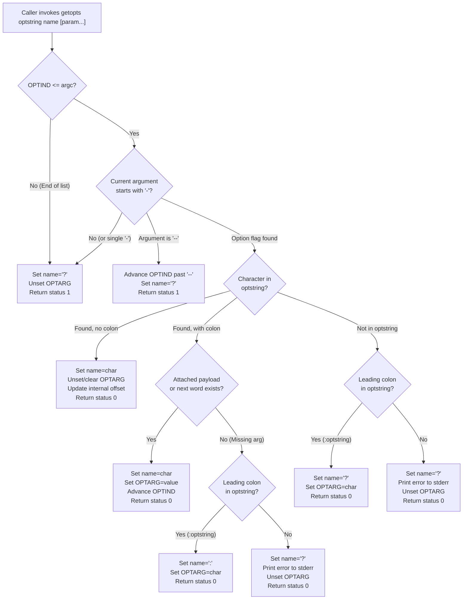

# The getopts Builtin

> [!summary] Claim
> The `getopts` intrinsic utility parses command-line options and option-arguments inside the shell process, with no `fork` or `execve`, advancing an internal parameter cursor and state variables to eliminate the quoting vulnerabilities and fork overhead of external option parsers.

Part of [The POSIX Shell Language](README.md) in [Shell and Unix Engineering](../README.md).

## TL;DR

- Mechanism: `getopts` evaluates positional parameters or explicit operand strings sequentially, populating a user variable, `OPTARG`, and advancing the index variable `OPTIND`.
- Rule: Prefix `optstring` with a colon `:` to suppress shell diagnostic stderr messages and enable silent program-controlled error handling.
- Trap: `OPTIND` and internal parser offsets persist across function calls; re-parsing a new argument vector requires explicitly resetting `OPTIND=1`.
- Portability fact: When clustered short options are parsed, `OPTIND` semantics diverge across shells until argument boundaries are crossed, with Yash exposing sub-argument offsets like `1:2`.
- When not to use it: Use a manual `while [ "$#" -gt 0 ]` loop or graduate to a compiled CLI binary when your utility requires GNU-style long options (`--option=value`).

## Mental model



The option parser executes an in-memory state machine against the target parameter vector.
On each invocation, `getopts` inspects the argument at index `OPTIND`.
If the argument does not begin with `-`, or equals a lone `-`, option scanning terminates immediately with exit status 1 (the lone `-` rule is stated for XSH `getopt()`; the XCU `getopts` page does not state it, and every matrix shell except Posh follows it).
If the argument is `--`, `getopts` consumes the delimiter, advances `OPTIND` to the subsequent argument, and terminates option processing with exit status 1.
When an option flag matches a character in `optstring`, the shell sets the target variable to that character.
If that option character is followed by a colon in `optstring`, `getopts` consumes either the attached tail of the current argument or the entirety of the next positional parameter into `OPTARG`.
Unrecognized options and missing option-arguments do not trigger non-zero exit codes; instead, `getopts` returns exit status 0 and flags the condition using `name`, `OPTARG`, and optional diagnostic stderr output depending on whether a leading colon activates silent mode.
Those are the POSIX rules; measured in the shell matrix, Zsh 5.9 deviates in three places: end of options leaves `name` unchanged instead of setting `?`, end of options leaves `OPTARG` unchanged instead of unsetting it (Dash also leaves `OPTARG` unchanged there), and a loud-mode error leaves `OPTARG` empty instead of unset.
The lab tests `end of options: status 1, name is ? except in zsh, OPTARG unchanged in dash and zsh` and `loud mode: unknown option and missing argument set name to ? and clear OPTARG, status 0` assert these values per shell.

## How it works

The `getopts` utility is required by POSIX.1-2024 to be an intrinsic utility `(POSIX.1-2024 XCU 3, getopts, APPLICATION USAGE; XCU 1.7 Intrinsic Utilities)`.
Because it affects the current shell execution environment, it is generally provided as a regular built-in `(POSIX.1-2024 XCU 3, getopts, APPLICATION USAGE)`.
Option parsing executes inside the shell process with no `fork` or `execve`; measured with `strace` on Debian 13 `(as of 2026-11)`, a successful call added zero system calls in Dash, Bash 5.2, Ksh93u+m, Mksh, and BusyBox ash, and three `rt_sigprocmask` calls in Zsh 5.9.
Reporting one diagnostic to standard error in loud error mode costs one `write(2)` on file descriptor 2, measured once per shell in those shells and Posh.

### Internal Parser State Machine

Option parsing requires tracking two coordinate axes: the current element index within the parameter list, and the character offset within that element.
The element index is exposed to shell scripts via the special variable `OPTIND`.
When the shell is first invoked, `OPTIND` is initialized to 1 `(POSIX.1-2024 XCU 3, getopts)`.
The character offset within an argument word (used when handling clustered short flags such as `-xvf`) is managed as private internal state:
- In GNU Bash, `sh_optind` stores the parameter index, while the static variables `nextchar` and `sh_charindex` track the position within the word `(bash-5.3 builtins/getopt.c, sh_getopt)`; `sh_badopt` only flags a bad option.
- In Dash, `shellparam.optind` holds the current argument index, while `shellparam.optoff` tracks byte offset within the current word `(dash-0.5.12 src/options.c, getoptscmd)`.
- In Zsh, `zoptind` tracks the argument index, while `optcind` holds the character index `(zsh-5.9 Src/builtin.c, bin_getopts)`.
- In Yash, the shell encodes both coordinates directly into `OPTIND` using colon notation such as `1:2` during intermediate clustered states `(yash-2.58.1 variable.c, getopts_builtin and set_optind)`.

Under POSIX.1-2024 Issue 8 (Austin Group Defect 1784), `OPTIND` is guaranteed to be an integer only when an option that takes an option-argument is parsed, or when `getopts` reports end of options `(POSIX.1-2024 XCU 3, getopts)`.
In all other cases, including any option without an argument and not only clustered ones, the value of `OPTIND` is unspecified, provided it encodes the information the next `getopts` invocation needs to resume parsing.

### Loud Mode versus Silent Mode

The first character of `optstring` controls diagnostic error reporting:

1. Loud mode (default, no leading colon):
When an invalid option character is encountered, `getopts` writes a diagnostic message identifying `$0` and the invalid character to standard error.
It sets `name` to `?`, unsets `OPTARG`, and returns exit status 0.
When an option requiring an argument lacks one, `getopts` writes a missing-argument diagnostic to standard error, sets `name` to `?`, unsets `OPTARG`, and returns exit status 0.
Bash and BusyBox ash honor a non-standard variable `OPTERR=0` to suppress these messages, but Dash, Ksh93, Mksh, Posh, Yash, and Zsh ignore it, and POSIX replaced it with the leading colon `(POSIX.1-2024 XCU 3, getopts, RATIONALE)`.

2. Silent mode (leading colon, e.g., `:a:b:c`):
When an invalid option is encountered, `getopts` produces no output on standard error.
It sets `name` to `?`, places the offending option character into `OPTARG`, and returns exit status 0.
When an option lacks a required argument, `getopts` produces no output on standard error.
It sets `name` to `:`, places the option character that lacked an argument into `OPTARG`, and returns exit status 0.

### Exit Status Semantics

POSIX.1-2024 Issue 8 (Austin Group Defect 367) strictly separates end-of-options from execution failure:
- Exit status `0`: An option was found, or an option syntax error was reported via `name` and `OPTARG`.
- Exit status `1`: End of options was encountered (end of parameter list, non-option argument, or `--` delimiter).
- Exit status `>1`: A fatal execution error occurred within `getopts` itself (for example, attempting to assign to a readonly variable `name`).

## Numbers and limits

| Metric | Measured / Sourced Value | Shell / Platform | Source |
| :--- | :--- | :--- | :--- |
| Parsing throughput | ~285,700 calls/sec (0.70s / 200k calls, loop overhead included) | GNU Bash 5.3.15 (macOS Apple Silicon) | Measured by hand on the matrix macOS host, 3 runs, not part of the lab `(as of 2026-11)` |
| External `getopt(1)` throughput | ~571 calls/sec (1.75s / 1k calls in command substitution) | `/usr/bin/getopt` (BSD) under Bash 5.3.15 (macOS host) | Measured by hand on the matrix macOS host, 3 runs, not part of the lab `(as of 2026-11)` |
| Throughput speedup | ~500x faster (in-process builtin vs fork/exec) | macOS host | Ratio of the two rows above `(as of 2026-11)` |
| System calls per successful call | 0 in Dash, Bash 5.2, Ksh93u+m, Mksh, BusyBox ash; 3 `rt_sigprocmask` in Zsh 5.9 | Debian 13 | Measured with `strace` against a loop without `getopts` `(as of 2026-11)` |
| System calls on stderr error | 1 (`write(2)` to file descriptor 2) | Dash, Bash 5.2, Ksh93u+m, Mksh, Posh, Zsh 5.9, BusyBox ash | Measured with `strace` `(as of 2026-11)`; the diagnostic itself is required by `(POSIX.1-2024 XCU 3, getopts, STDERR)` |
| `OPTIND` string buffer capacity | 16 bytes (the source comment budgets 14 digits; the digit loop can write 15 plus the NUL) | GNU Bash 5.3 `numval[16]` | `(bash-5.3 builtins/getopts.def, dogetopts)` |
| Initial value of `OPTIND` | `1` | All conforming shells | `(POSIX.1-2024 XCU 3, getopts)` |
| Permitted option character length | One alphanumeric character from the portable character set ("should") | POSIX utility guidelines | `(POSIX.1-2024 XBD 12.2, Guideline 3)` |
| Exit code on end-of-options | `1` | All conforming shells | `(POSIX.1-2024 XCU 3, getopts)` |
| Exit code on readonly `name` | `2` | Bash 5.3, Dash 0.5.12, Ksh93, Yash | Measured in the lab; POSIX requires only `>1` (Austin Group Defect 367) `(as of 2026-11)` |

## Portability

| Behavior | POSIX.1-2024 sh | macOS Bash 3.2 | GNU Bash 5.3 | Dash 0.5.12 | Zsh 5.9 native | Zsh (`--emulate sh`) | Ksh93u+m 1.0.10 | Mksh R59 | Yash 2.58.1 | BusyBox 1.37 ash | Posh 0.14.1 |
| :--- | :--- | :--- | :--- | :--- | :--- | :--- | :--- | :--- | :--- | :--- | :--- |
| Intermediate clustered `OPTIND` | Unspecified | `1` | `1` | `2` | `1` | `1` | `1` | `2` | `1:2` | `2` | `1` |
| `OPTARG` on flag without arg | Unset | Unset | Unset | `""` (empty) | `""` (empty) | `""` (empty) | Unset | Unset | Unset | `""` (empty) | Unset |
| Function entry `OPTIND` scope | Shared; nested use unspecified | Shared global | Shared global | Variable shared; cursor saved per call | Localized to `1` | Shared global | Shared global | Shared global | Shared global | Variable shared; cursor saved per call | Shared global |
| Exit code on readonly `name` | `>1` (Defect 367) | `1` | `2` | `2` | Fatal abort | Fatal abort | `2` | `2` | `2` | `2` | `1` |
| Missing arg in silent mode | `name=":"` | `name=":"` | `name=":"` | `name=":"` | `name=":"` | `name=":"` | `name=":"` | `name=":"` | `name=":"` | `name=":"` | `name="?"` |
| Single dash `-` operand | Ends options (XSH `getopt()`; XCU `getopts` is silent) | Ends options | Ends options | Ends options | Ends options | Ends options | Ends options | Ends options | Ends options | Ends options | Skips dash |
| `unset OPTIND` behavior | Unspecified | Next call restarts at 1 | Next call restarts at 1 | Fatal error, status 2 | Stays unset; cursor continues | Stays unset; cursor continues | Stays unset; cursor continues | Unset ignored; cursor continues | Next call fails, status 2 | Next call restarts at 1 | Unset ignored; cursor continues |
| `+` option support (`+v`) | Ends options; `+` in `optstring` unspecified | Operand | Operand | Operand | Option (`+v`) | Option (`+v`) | Operand; option if `optstring` has leading `+` | Option (`+v`) | Operand | Operand | Operand |
| `OPTERR` variable support | Non-standard | Supported | Supported | Ignored | Ignored | Ignored | Ignored | Ignored | Ignored | Supported | Ignored |

The lab asserts the rows of this table per shell in these tests: `unset OPTIND: restart, continue, fail, or abort depending on the shell`, `+v is an option only in mksh and zsh, and in ksh93 with a leading + in optstring`, `OPTERR=0 silences diagnostics in Bash and BusyBox ash only`, `parser cursor: dash, busybox, posh, and native zsh keep the caller's mid-cluster position across a call`, and the existing clustered-option, `OPTARG`, readonly-name, and single-dash tests.
The 2012 ksh93u+ that macOS ships differs from ksh93u+m 1.0.10 in the assignment-prefix row; the lab asserts both.
The system-call counts and throughput figures above were measured by hand and are not asserted by the lab.

## Worked example

The following script implements standard POSIX option parsing from the accompanying [lab](../labs/03-the-getopts-builtin/):

```sh
#!/bin/sh
# parse_options.sh - Robust POSIX option parsing with getopts.

set -eu

verbose=0
filename=""
output=""

usage() {
  printf 'Usage: %s [-v] [-f file] [-o output] [--] [operands...]\n' "$0" >&2
}

# The leading colon enables silent error handling.
while getopts ":vf:o:" opt; do
  case "$opt" in
    v)
      verbose=$((verbose + 1))
      ;;
    f)
      filename="$OPTARG"
      ;;
    o)
      output="$OPTARG"
      ;;
    :)
      printf '%s: error: option -%c requires an argument\n' "$0" "$OPTARG" >&2
      usage
      exit 2
      ;;
    \?)
      printf '%s: error: unknown option -%c\n' "$0" "$OPTARG" >&2
      usage
      exit 2
      ;;
    *)
      printf '%s: internal error processing option -%c\n' "$0" "$opt" >&2
      exit 2
      ;;
  esac
done

shift "$((OPTIND - 1))"

printf 'verbose=%d\n' "$verbose"
printf 'file=%s\n' "$filename"
printf 'output=%s\n' "$output"
printf 'operands=%d\n' "$#"

for arg in "$@"; do
  printf 'arg: %s\n' "$arg"
done
```

Executing this script with separate option-arguments and trailing operands (the lab also covers attached arguments and `--`):

```bash
$ ./parse_options.sh -v -f config.json -o bundle.tar alpha beta
```

Expected output:

```text
verbose=1
file=config.json
output=bundle.tar
operands=2
arg: alpha
arg: beta
```

The lab test `exact worked example: separate options and operands print the documented output` asserts this output byte for byte.

Executing with an invalid flag `-z`:

```bash
$ ./parse_options.sh -z
```

Expected output on stderr with exit code 2 (native Zsh prints `Usage: usage ...` on the second line, because `$0` inside a function is the function name there unless `--emulate sh` is used):

```text
./parse_options.sh: error: unknown option -z
Usage: ./parse_options.sh [-v] [-f file] [-o output] [--] [operands...]
```

The lab test `exact worked example: invalid flag prints the documented diagnostics and exits 2` asserts this output byte for byte, including the native Zsh difference.

## Pitfalls

> [!warning] The Function Scope Collision
> Trigger: Calling `getopts` inside a shell function while the calling script or another function is also iterating with `getopts`.
> Symptom: Outer loop prematurely terminates or skips arguments because `OPTIND` is a shared global shell parameter; POSIX leaves the results unspecified `(POSIX.1-2024 XCU 3, getopts, APPLICATION USAGE)`.
> Fix: Run the nested loop in a subshell, `( OPTIND=1; while getopts ...; done )`, which kept the caller's cursor in every matrix shell except Posh, where the caller's next parse fails; variables it sets are lost, and the nested loop itself misread its arguments under Posh, native Zsh, and `zsh --emulate sh` when the caller stopped mid-cluster (lab test `nested-loop fix: a subshell keeps the caller's cursor except in posh`).
> `local OPTIND=1` with `local OPTARG` is not portable, measured with the caller stopped mid-cluster: it works in Bash 4.4 and later, Yash, and native Zsh; it restarts the caller's parse in Bash 3.2, Mksh, and `zsh --emulate sh`; it drops the rest of the caller's cluster in Dash 0.5.12, BusyBox ash, and Posh; and Ksh93 has no `local`, where `function f { typeset OPTIND=1 OPTARG; ... }` works (also in Mksh).
> The lab test `nested-loop fix: local OPTIND=1 works only in Bash 4.4+, yash, and native zsh; typeset in a ksh function works in ksh93 and mksh` asserts each shell.
> Reference: Dash's mishandling of `local OPTIND` on function return is described in Herbert Xu's commit `c4a9b31b9b4b0adc6e0ad9352126fc4bea0bc2a7` (19 May 2024).

> [!warning] The Re-invocation OPTIND Reset Trap
> Trigger: Invoking `getopts` a second time in a script or loop without explicitly executing `OPTIND=1`.
> Symptom: The second option loop does not execute at all when `OPTIND` already exceeds `$#`, and starts at a stale index otherwise.
> Fix: Always reset `OPTIND=1` immediately before entering a new option parsing loop.
> Reference: Documented in `(POSIX.1-2024 XCU 3, getopts, DESCRIPTION)`.

> [!warning] The Unset OPTIND Fatal Error in Dash
> Trigger: Executing `unset OPTIND` in scripts running under Dash 0.5.12 or Debian Almquist Shell.
> Symptom: Dash aborts script execution immediately with exit code 2: `Illegal number:`.
> Fix: Never unset `OPTIND`; assign `OPTIND=1` to reset parsing state.
> Reference: Fixed upstream in Dash commit `c4a9b31b9b4b` by removing unchecked `number(value)` invocation in `getoptsreset`; the lab test `unset OPTIND: restart, continue, fail, or abort depending on the shell` asserts the abort on Dash 0.5.12.

> [!warning] The Posh Missing-Argument Variable Corruption
> Trigger: Parsing a missing option argument under `posh 0.14.1` with silent mode `:optstring`.
> Symptom: Posh assigns `name` to `?` instead of `:`, preventing scripts from distinguishing unknown options from missing arguments.
> Fix: Posh sets `name="?"` and puts the character in `OPTARG` for both conditions, so test whether `OPTARG` is a character declared with a colon in `optstring`: if it is, the argument is missing.
> Reference: lab tests `silent mode: unknown option and missing argument set name and OPTARG, status 0` and `OPTARG classifier separates missing argument from unknown option in every shell`.

> [!warning] The External getopt Command Injection Flaw
> Trigger: Using external `getopt(1)` with `eval set -- "$(getopt ...)"` to handle long options.
> Symptom: Arguments containing shell metacharacters (`$(rm -rf /)`, backticks, spaces) are evaluated as shell code, leading to arbitrary command execution.
> Fix: Refuse `eval set --` unless the call is the quoting form `getopt -o ab: -- "$@"` (measured safe in util-linux 2.41.5 and BusyBox 1.37; lab test `external getopt: the -o quoting form is safe on util-linux and BusyBox, not on BSD getopt`), use `getopts` for standard short options, or parse GNU long options with a pure-shell parameter expansion loop.
> Reference: util-linux `getopt(1)` documents that its first synopsis form and `-u` give unquoted output, and the macOS `getopt(1)` BUGS section says metacharacters will not survive; measured, `$(touch pwned)` executed under the short form of both and of BusyBox (lab test `external getopt: the unquoted short form lets a command substitution in an argument run, on every flavor`).

> [!warning] The Single-Line Assignment Prefix Trap
> Trigger: Writing `OPTIND=1 getopts "ab" opt "$@"` as a single command.
> Symptom: Results vary, measured from `OPTIND=5` with `-v`: Dash, Mksh, Posh, BusyBox ash, and Zsh parse `-v` and then `OPTIND` reverts to `5`; Bash 5.3 and Yash parse it and keep the new value (`2`, `1:2`); macOS `/bin/sh` (Bash 3.2) and Ksh93u+m return 1 without parsing it.
> Fix: Put the assignment on its own statement separated by a semicolon: `OPTIND=1; getopts ...`.
> Reference: POSIX.1-2024 XCU 2.9.1.2 Variable Assignments; lab test `assignment prefix OPTIND=1 getopts: per-shell result from OPTIND=5`.

## Security and robustness

### Elimination of Eval Injections

The historic System V `getopt(1)` utility required re-parsing its output through the shell, and POSIX chose `getopts` over it because `getopts` handles option-arguments containing blanks `(POSIX.1-2024 XCU 3, getopts, RATIONALE)`:

```sh
# INSECURE: vulnerable to arbitrary command execution on malicious input
eval set -- "$(getopt ab: "$@")"
```

If an attacker supplies an argument such as `; reboot;`, or values with spaces and single quotes, external `getopt` implementations that lack defensive quoting emit code fragments that `eval` executes directly; that includes this exact short form on util-linux, which quotes only when called with `-o`.
The intrinsic `getopts` builtin eliminates `eval` entirely.
Arguments are retrieved directly from the shell parameter array and placed into `$OPTARG` verbatim without word splitting, pathname expansion, or recursive evaluation.

### Option Injection Guarding

When a shell script accepts arbitrary user filenames and forwards them to downstream utilities, filenames starting with `-` can be interpreted by downstream tools as command-line flags (option injection).
Always terminate option scanning with `--` when invoking external utilities:

```sh
# Safe forwarding: guarantees $file is treated as an operand
cat -- "$file"
```

Within `getopts` itself, `--` is handled automatically: `getopts` detects `--`, advances `OPTIND` to the index of the next operand, and exits with status 1.

### Dash-Prefixed Option Arguments

If an option expects an argument, `getopts` treats the next parameter as that argument even if it starts with `-` or `--`.
For example, if the invocation is `mycmd -f -v` where `-f` requires an argument:
`getopts` sets `opt="f"` and `OPTARG="-v"`.
It does not treat `-v` as an option.
Robust scripts must validate that `$OPTARG` conforms to expected types (e.g., non-empty, matching numeric patterns, or pointing to existing files) before downstream processing.

## The principal's view

Command-line option parsing is the primary user boundary of a Unix system.
A principal engineer enforces three architectural invariants across shell toolchains:

1. Never use external `getopt(1)` in production shell scripts:
The portability differences between BSD `getopt`, macOS `getopt`, BusyBox `getopt`, and GNU `getopt` are severe.
BSD and macOS `getopt` cannot handle spaces or empty strings: measured, `-b 'a b' ''` comes back as ` -b a b -- ` (lab test `external getopt: BSD and unquoted forms cannot carry a word with a space or an empty word`).
GNU `getopt` quotes only in its `-o` form and requires `eval`, introducing security surface.
POSIX `getopts` is intrinsic, universally available, fast, and secure.

2. Short options belong in POSIX `getopts`; long options belong in a higher-level language:
If a tool requires a sophisticated CLI with GNU-style long options (`--config=file`), subcommands (`git commit`), and structured help output, writing an ad-hoc 300-line shell loop is a maintenance liability.
Implement such CLIs in Go, Rust, or Python using libraries like `clap` or `cobra`.
Reserve shell `getopts` for infrastructure wrappers, bootstrap scripts, and operating system init hooks where zero external dependencies are mandatory.

3. Always enforce silent mode and explicit exit codes:
Never let the shell print uncontrolled default diagnostic messages to stderr.
Always use `:optstring`, inspect `\?` and `:`, write structured error messages identifying `$0`, and exit with code 2 on syntax errors conforming to standard Unix conventions.

## Interview questions

> [!question] L5: What is the purpose of a leading colon in the `optstring` argument of `getopts`?
>
> > [!success]- Answer
> > A leading colon in `optstring` enables silent error handling mode.
> > In silent mode, `getopts` suppresses automatic error diagnostic messages on standard error.
> > It signals an unrecognized option by setting the variable to `?` and storing the offending character in `OPTARG`.
> > It signals a missing option-argument by setting the variable to `:` and storing the option character in `OPTARG`.
> >
> > Follow-up: What does `getopts` return as its exit status when an invalid option is encountered in silent mode?

> [!question] L5: Why must a script execute `shift "$((OPTIND - 1))"` after completing a `getopts` loop?
>
> > [!success]- Answer
> > `OPTIND` stores the parameter list index of the first non-option positional parameter.
> > Shifting by `OPTIND - 1` discards all parsed options and their arguments from `"$@"`.
> > After the shift, `$1` immediately refers to the first non-option operand, allowing standard positional parameter handling.
> >
> > Follow-up: What is the value of `OPTIND` when a script is invoked with zero arguments?

> [!question] L6: Predict the output: What does the following script print across POSIX shells?
>
> ```sh
> #!/bin/sh
> set -- -a -b
> parse() {
>   while getopts "ab" opt; do
>     printf 'func:%s ' "$opt"
>   done
> }
> parse "$@"
> while getopts "ab" opt; do
>   printf 'main:%s ' "$opt"
> done
> printf 'done\n'
> ```
>
> > [!success]- Answer
> > Bash, Ksh93, Mksh, Posh, Yash, and `zsh --emulate sh` print `func:a func:b done`.
> > Dash, BusyBox ash, and native Zsh print `func:a func:b main:a main:b done`, because they save the parser cursor per function call.
> > POSIX leaves the result unspecified when a shell and its functions both use `getopts`.
> > In the first group, `OPTIND` is a shared global shell parameter.
> > The `parse` function increments `OPTIND` until all positional parameters are consumed.
> > When the main loop starts, `OPTIND` is already 3, so the outer `while` condition fails immediately without printing `main:`.
> > Without the `"$@"`, `parse` would see its own empty positional parameters and every shell would print `main:a main:b done`.
> > The lab test `interview question: a function and the main loop share one parser except in dash, busybox, native zsh` asserts both variants per shell.
> >
> > Follow-up: How do you fix this function so that the outer loop still executes correctly?

> [!question] L6: Debug this script: Why does this script fail when run on Dash or macOS `/bin/sh`?
>
> ```sh
> #!/bin/sh
> reset_and_parse() {
>   OPTIND=1 getopts "v" opt "$@"
>   echo "opt=$opt OPTIND=$OPTIND"
> }
> OPTIND=5
> reset_and_parse -v
> ```
>
> > [!success]- Answer
> > POSIX XCU 2.9.1.2 says an assignment prefix on a regular built-in does not affect the current execution environment, so the reset is unreliable.
> > In Dash the temporary `OPTIND=1` applies only during `getopts`: it prints `opt=v OPTIND=5`, and later parsing sees an index exceeding `$#`.
> > macOS `/bin/sh` (Bash 3.2) does not apply the prefix to parsing at all: `getopts` returns 1 and it prints `opt=? OPTIND=2`.
> > Other shells differ again: Bash 5.3 prints `opt=v OPTIND=2`, and Ksh93u+m prints `opt=? OPTIND=5`.
> > The fix is to separate the assignment onto its own statement: `OPTIND=1; getopts "v" opt "$@"`.
> > The lab test `interview question: OPTIND=1 getopts inside a function prints the documented results` asserts each shell's output.
> >
> > Follow-up: How do assignment prefixes behave differently on special built-in utilities like `eval` or `exec`?

> [!question] L6: How does `getopts` handle option-arguments that begin with a hyphen, such as `-f -v`?
>
> > [!success]- Answer
> > If an option requires an argument, `getopts` consumes the next token unconditionally, even if that token starts with `-` or `--`.
> > In `-f -v`, `-v` is assigned directly to `OPTARG` as the argument to `-f`.
> > It is never parsed as a flag `-v`.
> >
> > Follow-up: How does `getopts` behave if `-f --` is passed when `-f` takes an argument?

> [!question] L7: Explain how GNU Bash, Dash, Zsh, and Yash internally manage parsing state for clustered short options like `-xvf`.
>
> > [!success]- Answer
> > Clustered options require tracking both the word index in `argv` and the character offset within that word.
> > GNU Bash stores the argument index in `sh_optind` and maintains sub-word offsets in the internal static variables `nextchar` and `sh_charindex`.
> > Dash stores the word index in `shellparam.optind` and tracks byte offsets in `shellparam.optoff`.
> > Zsh tracks word position in `zoptind` and character position in `optcind`.
> > Yash encodes both coordinates directly into the user-visible `OPTIND` parameter using colon notation such as `1:2`.
> >
> > Follow-up: What change did POSIX.1-2024 Issue 8 make to the formal specification of `OPTIND` regarding clustered options?

> [!question] L7: Why did Austin Group Defect 367 change the exit status specification of `getopts` in POSIX.1-2024?
>
> > [!success]- Answer
> > Previously, `getopts` was specified to return a value greater than 0 both when options terminated normally and when an internal processing error occurred.
> > This made it impossible for scripts to distinguish between clean completion and fatal assignment errors such as a readonly variable.
> > Defect 367 mandated that end-of-options returns exit status 1, while internal processing errors return exit status greater than 1.
> >
> > Follow-up: How does Bash 3.2 diverge from Bash 5.3 on this requirement when `name` is marked readonly?

> [!question] L7: Compare the security profile of `getopts` with `util-linux` GNU `getopt` when parsing untrusted input.
>
> > [!success]- Answer
> > `getopts` is an intrinsic shell builtin that reads parameters directly from shell memory arrays and assigns directly to variables without evaluation.
> > GNU `getopt` is an external binary that outputs formatted strings intended to be parsed using `eval set -- "$output"`.
> > If a non-GNU `getopt` is used, or util-linux `getopt` is called without `-o`, or if variable expansions inside `eval` are improperly quoted, arbitrary shell command execution occurs.
> > `getopts` completely avoids the `eval` system sink, making option parsing immune to command injection.
> >
> > Follow-up: How can a pure POSIX shell script parse long options safely without invoking `eval`?

## Related

Prerequisites:
- [[printf-versus-echo]]

Next:
- [[The-eval-Builtin]]

See also:
- [[Special-Built-ins-versus-Utilities]]
- [[Functions-and-Scope]]
- [[Simple-Commands-and-Assignment-Prefixes]]
- [[Field-Splitting-and-IFS]]
- [[Special-Parameters]]
- [[POSIX-2024-Changes]]

## Further reading

- [POSIX.1-2024 getopts specification](https://pubs.opengroup.org/onlinepubs/9799919799/utilities/getopts.html) - Official standard definition of syntax, environment variables, and exit status requirements.
- [Austin Group Defect 1784](https://www.austingroupbugs.net/view.php?id=1784) - Rationale for loosening intermediate `OPTIND` values to permit Yash-style sub-argument encoding.
- [Austin Group Defect 367](https://www.austingroupbugs.net/view.php?id=367) - Clarification requiring exit status greater than 1 for internal `getopts` processing errors.
- [GNU Bash getopts implementation (builtins/getopts.def)](https://git.savannah.gnu.org/cgit/bash.git/plain/builtins/getopts.def) - Primary source code illustrating `sh_optind` management and `OPTERR` error handling.
- [Debian Almquist Shell (Dash) options.c](https://git.kernel.org/pub/scm/utils/dash/dash.git/plain/src/options.c) - Primary C source code demonstrating `shellparam.optoff` offset handling and the `getoptsreset` hook.
- [Zsh builtin.c (bin_getopts)](https://raw.githubusercontent.com/zsh-users/zsh/master/Src/builtin.c) - Source code showing the `zoptind` and `optcind` character index state machine; the function-level localization is in `Src/exec.c`, `doshfunc`.
