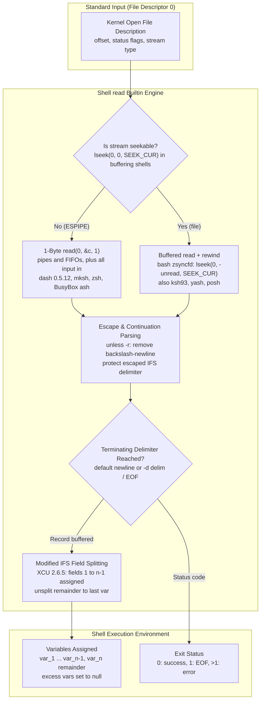

# The read Builtin

> [!summary] Claim
> `read` is the POSIX shell's only native streaming input mechanism, reading a single delimiter-bounded record from standard input into shell variables by unbuffered byte-by-byte or buffer-synced kernel `read` calls, followed by an in-memory pass of IFS-driven field splitting.

Part of [The POSIX Shell Language](README.md) in [Shell and Unix Engineering](../README.md).

## TL;DR

- Mechanism: `read` consumes bytes from file descriptor 0 up to a delimiter (default newline), using 1-byte `read(2)` calls on pipes and, in dash 0.5.12, mksh, zsh, and BusyBox ash, on regular files too, while bash, ksh93, yash, and posh block-read seekable files and rewind with `lseek(2)` (traced on Linux, as of 2026-11), stripping line continuations unless `-r` is given, then partitions the payload across variable operands using a modified field splitting algorithm.
- Rule: always invoke `IFS= read -r line || [ -n "$line" ]` to prevent backslash interpretation, protect leading and trailing IFS whitespace, and avoid silently dropping the final line of an input stream that lacks a terminating delimiter.
- Trap: in pipelines (`cat file | while read -r line; do ...; done`), POSIX allows each command to execute in a separate subshell, causing all variable assignments and side effects inside the loop to vanish upon loop termination in bash, dash, ash, and mksh.
- Portability: POSIX.1-2024 standardized `-d delim` (Issue 8), but dash (through 0.5.13.5), posh 0.14.1, and yash before 2.59 (as of 2026-11) reject `-d` with an invalid-option error, and yash 2.59 and later accept `-d` but treat `-d ''` as no delimiter, reading to EOF with status 1 (measured at 2.61, lab test 11); omitting variable names defaults to assigning `$REPLY` in bash, zsh, ksh93, mksh, and BusyBox ash, whereas dash, posh, and yash reject bare `read` with a missing-operand error.
- When not to use it: for high-throughput streams or structured records larger than a few megabytes, shell `while read` loops incur millions of system calls and interpreter evaluations; replace them with `awk`, `sed`, `jq`, or compiled tools.

## Mental model



Input arrives on file descriptor 0 and is examined by the shell's input subsystem.
On a non-seekable pipe or FIFO, a shell must not consume past the record boundary or it steals input from subsequent commands, so every shell in the matrix issues single-byte `read(2)` system calls there, and only ksh93u+m on its own socket pipelines does better (strace in the shell matrix, as of 2026-11); dash 0.5.13.5, which is not in the matrix, also avoids single-byte reads on pipes (see below).
On a seekable regular file, bash, ksh93, yash, and posh issue block reads and move the kernel file offset back via `lseek(2)` once the terminating delimiter is located, while dash 0.5.12, mksh, zsh, and BusyBox ash still read one byte at a time (same traces).
If `-r` is omitted, backslashes escape following characters and backslash-newline sequences trigger continuation line ingestion.
Once the logical line is buffered in memory, the terminating delimiter is stripped, and the string is partitioned across the supplied variable operands according to `$IFS`.
The first `n - 1` variables receive individual split fields, and the final variable receives the unsplit remainder stripped only of leading and trailing IFS whitespace.

## How it works

**System call dispatch and the unbuffered stream dilemma.**
At the system call boundary, `read` operates on file descriptor 0 (POSIX.1-2024 XCU read).
Standard Unix user-space I/O libraries buffer input in blocks: an `fgets` loop reads 4096-byte blocks under glibc 2.41 and 1024-byte blocks under musl 1.2 (strace on Debian 13 and Alpine 3.22), and gawk reads 4096 bytes where mawk reads 262144.
If a shell buffered input from a pipeline, a compound command like `read -r line; cat` would cause `read` to consume a whole block (4096 bytes under glibc `stdio`) from the pipe, leaving `cat` stranded with missing data because pipes cannot be rewound (`lseek(2)` returns `ESPIPE`).
Consequently, some shells implement two read paths depending on whether file descriptor 0 is seekable, and others read one byte at a time everywhere.
In GNU bash, `read_builtin` classifies the input (`builtins/read.def`): `unbuffered_read` becomes 1 when input is a pipe, or when input is a terminal and `-n` or `-d` is in use (`((nchars > 0 || delim != '\n') && input_is_tty) || input_is_pipe`), and bash then calls `zread` (`lib/sh/zread.c`) with a length of 1 for every single byte.
A plain `read` from a terminal stays on the buffered path, which is safe because a canonical-mode terminal `read` returns at most one line however many bytes are requested (POSIX.1-2024 XBD 11.1.6).
When reading from a regular seekable file, bash leaves `unbuffered_read = 0` and calls `zreadc`, which fills a `ZBUFSIZ` (4096-byte) internal buffer; once the terminating delimiter is found, bash calls `zsyncfd(fd)` to calculate unconsumed bytes `off = lused - lind` and executes `lseek(fd, -off, SEEK_CUR)` to sync the kernel file offset.
In dash 0.5.12 (`src/miscbltin.c`, `readcmd`), the loop calls `read(0, &c, 1)` unconditionally, on files and pipes alike (source at tag `v0.5.12`, confirmed by strace).
Later dash changed this: in v0.5.13.5 (as of 2026-11) `readcmd` retrieves characters via `pgetc()` (`src/input.c`), `input_init()` records seekability with `lseek(0, 0, SEEK_CUR) + 1`, seekable input is buffered and rewound with `lseek`, and other non-terminal input goes through `stdin_tee()`, which uses `tee(2)` where available with a 1-byte fallback.
A build of the 0.5.13.5 release tarball, traced on Alpine, confirms this: on a file it issues `lseek(0, 0, SEEK_CUR)`, one 1024-byte `read`, and a relative `lseek` that rewinds the unconsumed bytes, and on a pipe `lseek` fails with `ESPIPE`, `tee(2)` peeks 1024 bytes, and `read` then takes only the bytes consumed so far (128 for two 64-byte records).
In zsh 5.9 (`Src/builtin.c`, `bin_read`), mksh R59 (`funcs.c`, `c_read`), and BusyBox 1.37 ash (`shell/shell_common.c`, `shell_builtin_read`), the traces show one-byte reads on both files and pipes.
yash 2.58.1 (1024 bytes) and posh 0.14.1 (512 bytes) block-read a file and rewind with a relative `lseek`, and read one byte at a time from a pipe.
In ksh93u+m 1.0.10 (`src/cmd/ksh93/bltins/read.c`, `b_read` and `sh_readline`), Sfio manages the stream: a file gets one 65536-byte read and an absolute `lseek(0, 101, SEEK_SET)` for a 101-byte record, a true pipe gets one failed `recvfrom` with `MSG_PEEK` and then 1-byte reads, and ksh93's own socket-based pipeline gets a 65536-byte `MSG_PEEK` followed by a `read` of exactly the record length.

**Specification and Austin Group requirements.**
The `read` utility is specified in POSIX.1-2024 XCU Chapter 3 (`read`).
Because `read` directly modifies the caller execution environment, POSIX requires it to be an intrinsic utility (POSIX.1-2024 XCU 1.7, Austin Group Defect 854).
Calling `(read foo)`, `nohup read ...`, or `find . -exec read ... \;` invokes `read` in a subshell or separate process environment, leaving the caller shell variables unaltered (POSIX.1-2024 XCU read, DESCRIPTION and RATIONALE).
In POSIX.1-2024 Issue 8, several foundational defects were resolved:
- Austin Group Defect 243 standardized the `-d delim` option and relaxed the requirement that standard input be a text file, allowing input that does not terminate in a newline.
- Austin Group Defect 367 required `read` to distinguish between detecting EOF (exit status 1) and an operational error (exit status greater than 1).
- Austin Group Defect 1778 clarified the exact modifications applied to the field splitting algorithm of [[Field-Splitting-and-IFS|POSIX.1-2024 XCU 2.6.5]].
- Austin Group Defect 1779 clarified how an error in setting a variable (e.g. assigning to a `readonly` variable) affects the other operands: variables named earlier are set, and it is unspecified whether variables named later are set.

**Escape characters and line continuation.**
If `-r` is not specified, backslash acts as an escape character (POSIX.1-2024 XCU read).
An unescaped backslash preceding a newline causes `read` to interpret the sequence as line continuation: both the backslash and the newline are stripped from the input stream before field splitting, and `read` continues ingesting bytes.
If standard input is a terminal and the shell is interactive, `read` issues the prompt defined in `PS2` to standard error upon encountering backslash-newline.
An unescaped backslash before any other byte preserves the literal value of that byte, protecting it from being recognized as an IFS delimiter during field splitting.
All other unescaped backslash characters are removed after field splitting is completed.
When `-r` is specified, backslashes have no special syntactic meaning and are treated as literal characters.
POSIX.1-2024 notes a key implementation divergence when `-d delim` is used without `-r`: some shells treat `\<delim>` as a line continuation, while others continue treating only `\<newline>` as line continuation; conforming applications must always pass `-r` when specifying `-d`.

**The modified field splitting algorithm.**
Once a delimiter-bounded logical line is read into memory, the terminating delimiter is removed.
If `IFS` is set to an empty string (`IFS=`), field splitting is skipped entirely: the entire line is assigned verbatim to the first `var` operand, and any subsequent `var` operands are set to the empty string (POSIX.1-2024 XCU read).
If `IFS` is unset or set to a non-empty string, a modified version of [[Field-Splitting-and-IFS|XCU 2.6.5 Field Splitting]] executes:
1. The logical line is treated as an initial field produced by expansions, where backslash-escaped bytes behave as quoted expansions and all other bytes behave as unquoted expansions.
2. The splitting loop ceases when either the input is empty or `n` fields have been generated, where `n` equals one less than the number of `var` operands.
3. The remaining input is returned to `read` unsplit: it is preserved verbatim, except that any leading or trailing IFS whitespace is stripped.
4. If more `var` operands remain than generated fields, each unprocessed variable is assigned an empty string.
5. If only a single `var` operand is provided on the command line, `n = 0`: the modified field splitting algorithm produces zero split fields and returns the entire input line, stripped only of leading and trailing IFS whitespace, directly to that variable.
6. Variables are processed in left-to-right operand order; if a variable name is duplicated (e.g. `read x x`), the last assignment made remains in effect.

**Error handling and readonly variables.**
If an error occurs while assigning to any variable (such as attempting to assign to a variable marked `readonly`), POSIX.1-2024 XCU read specifies that `read` must return an exit status greater than 1 (Austin Group Defect 367).
Variables named before the failing variable must retain their assigned values (Austin Group Defect 1779).
The standard leaves it unspecified whether the shell halts immediately or continues assigning to variables named later in the argument list (Austin Group Defect 1779).
In GNU bash 5.3+, dash 0.5.12, mksh R59, and BusyBox 1.37 ash, the shell returns exit status 2, retains assignments made prior to the readonly variable, and ceases processing, leaving subsequent variables unaltered.
In GNU bash 4.2 through 5.2 (measured at 4.2, 4.3, 4.4, 5.0, 5.1, and 5.2), `read` also halts assignment and leaves subsequent variables unaltered, but returns exit status 1 (`EXECUTION_FAILURE` in `builtins/read.def`), diverging from the POSIX.1-2024 requirement for status greater than 1.
The bash 4.2 `CHANGES` file records the change: "Fixed a bug that caused the read builtin to not return failure if an attempt is made to assign to a readonly variable."
In GNU bash 3.2 through 4.1 (measured at 3.2, 4.0, and 4.1), `read` returns exit status 0 and continues assigning to subsequent variables.
In ksh93 (`src/cmd/ksh93/bltins/read.c`, `b_read`) and yash 2.58.1 (`variable.c`, `read_builtin`), the shell emits an error diagnostic, returns exit status 1, and continues assigning values to subsequent variables.
yash 2.59 and later return 2 for this error but still assign the later variables (NEWS for 2.59 and `variable.c` at tag 2.61; measured on a build of the 2.61 release, lab test 14).
posh 0.14.1 returns 1 and halts assignment, leaving later variables unaltered (measured in the shell matrix).
In zsh (`Src/builtin.c`, `bin_read`), assigning to a readonly variable is treated as a fatal execution error that aborts the script.

## Numbers and limits

| Parameter / Metric | Value | Constraint / Standard | Source |
|---|---|---|---|
| Syscall chunk size on pipes | 1 byte (ksh93u+m socket pipelines: `MSG_PEEK`, then a read of the record length) | Keeps bytes after the delimiter for the next reader | strace in the shell matrix, bash `read.def` |
| Syscall chunk size on regular files | 1 byte in dash 0.5.12, mksh, zsh, BusyBox; 128 in bash 3.2; 512 in posh; 1024 in yash 2.58.1; 4096 in bash 5.2 and 5.3; 65536 in ksh93u+m | Block-reading shells rewind with `lseek` | strace in the shell matrix, bash `lib/sh/zread.c` (`ZBUFSIZ`) |
| Syscall count for 1 MiB stream on pipe | >= 1,048,576 (total `read` calls traced: 1,048,582 in bash 5.2.37, 1,048,578 in dash 0.5.12) | One `read(2)` call per byte, each a user/kernel mode switch | strace in the shell matrix |
| Default record delimiter | ASCII 0x0A (`\n`) | Hardcoded default line terminator | POSIX.1-2024 XCU read |
| Null record delimiter (`-d ''`) | ASCII 0x00 (`\0`) | NUL-delimited records for pathname ingestion; yash 2.61 instead reads to EOF with status 1 and stops the value at the first NUL | POSIX.1-2024 XCU read (Defect 243), lab test 11 |
| Standard input NUL byte handling | Dropped, truncated, or kept, by shell | Input shall not contain NUL unless `-d ''` specified | POSIX.1-2024 XCU read STDIN, lab test 19 |
| Default `IFS` whitespace set | Space, Tab, Newline | `0x20`, `0x09`, `0x0A` | POSIX.1-2024 XCU 2.5.3 |
| Exit status on delimiter match | `0` | Successful line completion | POSIX.1-2024 XCU read |
| Exit status on EOF | `1` | Partial record or empty stream | POSIX.1-2024 XCU read (Defect 367) |
| Exit status on assignment error | `> 1` (`2` in bash 5.3+, dash, mksh, BusyBox; `1` in bash 4.2-5.2, ksh93, yash 2.58.1, posh; `0` in bash 3.2-4.1) | Readonly or invalid identifier | POSIX.1-2024 XCU read (Defect 367), shell matrix measurement |
| Exit status on missing operands | `2` (dash, yash 2.58.1; `4` in yash 2.61, measured on a build of its release), `1` (posh), `0` (bash/zsh/ksh/mksh/busybox) | Missing-operand error vs REPLY assignment extension | POSIX.1-2024 XCU read, shell matrix measurement |
| Maximum line buffer length | Unbounded until allocation fails | Dynamically reallocated virtual memory | bash `xrealloc`, dash `stackblock` |

## Portability

| Shell / Environment | `-d delim` Option | `-d ''` (NUL Delim) | Bare `read` (No Args) | Readonly Var Failure | Pipeline Subshell Isolation | Untrusted Var Command Exec |
|---|---|---|---|---|---|---|
| POSIX.1-2024 sh | Supported (Issue 8) | Supported (Issue 8) | `var...` required by synopsis | Status > 1 (Issue 8) | Unspecified (subshell allowed) | Identifiers only (no arrays) |
| macOS bash 3.2 | Supported | Supported | Sets `REPLY` (status 0) | Status 0 (assigns later vars) | Subshell (`pipe=0`) | Vulnerable via `arr[...]` |
| bash 4.0 and 4.1 | Supported | Supported | Sets `REPLY` (status 0) | Status 0 (assigns later vars) | Subshell (`pipe=0`) | Vulnerable via `arr[...]` |
| bash 4.2 to 5.2 | Supported | Supported | Sets `REPLY` (status 0) | Status 1 (halts assign) | Subshell (`pipe=0`) | Vulnerable via `arr[...]` |
| Current bash (5.3) | Supported | Supported | Sets `REPLY` (status 0) | Status 2 (halts assign) | Subshell (`pipe=0`) | Vulnerable via `arr[...]` |
| zsh (native 5.9) | Supported | Supported | Sets `REPLY` (status 0) | Fatal error (aborts script) | Current shell (`pipe=3`) | Vulnerable via `arr[...]` |
| zsh (`--emulate sh`) | Supported | Supported | Sets `REPLY` (status 0) | Fatal error (aborts script) | Subshell (`pipe=0`) | Vulnerable via `arr[...]` |
| dash (0.5.12) | Error (status 2) | Error (status 2) | Error (`arg count`, status 2) | Status 2 (halts assign) | Subshell (`pipe=0`) | Immune (validates identifier) |
| ksh93 (93u+ 2012) | Supported | NUL dropped (reads to newline or EOF) | Sets `REPLY` (status 0) | Status 1 (assigns later vars) | Current shell (`pipe=3`) | Error (`arithmetic syntax`) |
| ksh93 (93u+m 1.0.10) | Supported | Supported | Sets `REPLY` (status 0) | Status 1 (assigns later vars) | Current shell (`pipe=3`) | Error (`arithmetic syntax`) |
| mksh (R59) | Supported | Supported | Sets `REPLY` (status 0) | Status 2 (halts assign) | Subshell (`pipe=0`) | Vulnerable via `arr[...]` |
| yash (2.58.1) | Error (status 2; supported from 2.59) | Error (status 2; from 2.59 no delimiter, reads to EOF with status 1, measured at 2.61) | Error (status 2) | Status 1 (assigns later vars; status 2 from 2.59, measured at 2.61) | Subshell (`pipe=0`) | Immune (assigns a literal name such as `a[1]`, no evaluation) |
| posh (0.14.1) | Error (invalid opt, status 1) | Error (invalid opt, status 1) | Error (missing argument, status 1) | Status 1 (halts assign) | Subshell (`pipe=0`) | Vulnerable via `arr[...]` |
| BusyBox ash (1.37) | Supported | Supported | Sets `REPLY` (status 0) | Status 2 (halts assign) | Subshell (`pipe=0`) | Immune (validates identifier) |

## Worked example

The test script below from the [lab](../labs/03-the-read-builtin/) exercises field splitting, escape handling, delimiter matching, EOF detection, stream handoff, and assignment failures:

```sh
#!/bin/sh
# read-probes.sh: exercise read builtin behaviors across shell implementations.

set -e

mode=${1:-}
shift || true

case "$mode" in
  split)
    read -r v1 v2 v3
    printf 'v1=[%s] v2=[%s] v3=[%s]\n' "$v1" "$v2" "$v3"
    ;;
  raw-vs-escape)
    # shellcheck disable=SC2162 # intentionally testing unescaped read without -r
    read e1 e2
    read -r r1 r2
    printf 'esc=[%s|%s] raw=[%s|%s]\n' "$e1" "$e2" "$r1" "$r2"
    ;;
  delim)
    delim=${1:-:}
    st=0
    # shellcheck disable=SC2248,SC3045 # delim is single-character option argument; -d standardized in POSIX.1-2024
    read -d "$delim" -r v1 || st=$?
    printf 'delim=[%s] status=[%d]\n' "$v1" "$st"
    ;;
  eof-loop)
    while IFS= read -r line || [ -n "$line" ]; do
      printf 'LINE:[%s]\n' "$line"
    done
    ;;
  naive-loop)
    while IFS= read -r line; do
      printf 'LINE:[%s]\n' "$line"
    done
    ;;
  readonly-assign)
    set +e
    readonly ro=fixed
    a=orig
    b=orig
    read -r a ro b 2>/dev/null
    st=$?
    set -e
    printf 'st=%d a=%s ro=%s b=%s\n' "$st" "$a" "$ro" "$b"
    ;;
  stream-handoff)
    read -r first
    printf 'FIRST:[%s]\n' "$first"
    cat
    ;;
  *)
    # shellcheck disable=SC2248 # mode in error diagnostic
    printf 'read-probes: unknown mode: %s\n' "$mode" >&2
    exit 64
    ;;
esac
```

Test 13 feeds a regular file, so it exercises the rewind or one-byte file path; test 17 feeds the same lines through a pipe, which is the case that proves a shell does not over-read.
Tests 18 and 19 prove the injection column of the Portability table and the NUL byte handling in Security and robustness.
Tests 10 to 12, 14, 15, 18, and 19 carry one asserted value per shell family, so each shell-specific cell of the Portability table is proven by a test that fails if the cell is wrong.
When evaluated under the lab harness across the shell matrix, the test suite reports this TAP output:

```text
1..19
ok 1 read splits into fields, trims outer IFS whitespace, and preserves remainder
ok 2 read assigns empty string to excess variable operands when fields are fewer
ok 3 read without -r interprets backslash as escape and line continuation
ok 4 read without -r joins lines on backslash-newline continuation
ok 5 read with IFS empty preserves all leading and trailing whitespace
ok 6 read with duplicate variable operands retains the last assignment
ok 7 read detects EOF on input lacking trailing newline, returning status 1 with partial line
ok 8 read returns status 1 and empties variables on immediate EOF
ok 9 robust while-read loop processes final record lacking newline, unlike naive loop
ok 10 read -d delim splits on custom single-byte delimiter or reports unsupported
ok 11 read -d '' processes null-delimited records
ok 12 read without operand sets REPLY in bash, zsh, ksh, mksh, busybox but errors in dash, posh, yash
ok 13 read unbuffered stream handoff does not consume past the newline
ok 14 readonly variable error in read returns status > 1 or fails per implementation
ok 15 pipeline subshell trap isolates variable updates in subshell-based shells
ok 16 read-probes returns status 64 on unknown mode
ok 17 read hands the rest of a pipe to the next reader without over-reading
ok 18 read evaluates an array subscript inside a variable operand only in some shells
ok 19 read handles an embedded NUL byte in default newline mode per shell
```

## Pitfalls

> [!warning] The unhandled EOF record drop
> Trigger: using `while read -r line; do ...; done < file` on an input stream where the final line lacks a terminating newline character.
> Symptom: `read` ingests the trailing characters into `$line` but encounters EOF, causing it to return exit status 1; the `while` test evaluates status 1 as false and terminates immediately, silently skipping processing of the final record.
> Fix: check whether `$line` is non-empty upon loop termination using `while IFS= read -r line || [ -n "$line" ]; do ...; done`.

> [!warning] The pipeline subshell black hole
> Trigger: feeding a `while read` loop through an upstream pipe, such as `count=0; find . | while read -r path; do count=$((count + 1)); done; echo "$count"`.
> Symptom: in bash, dash, and mksh, each pipeline stage executes inside a separate subshell execution environment; variable modifications inside the loop occur in child memory and vanish when the subshell terminates, printing `0`.
> Fix: redirect input into the loop directly (`while read -r path; do ...; done < <(find .)` in bash/zsh/ksh, or `{ while read -r path; do ...; done; echo "$count"; } < file` in POSIX sh).

> [!warning] Mutilated paths and regexes via missing -r
> Trigger: invoking `read line` without `-r` on inputs containing backslash characters, such as Windows pathnames (`C:\Users\foo`), LaTeX documents, or regular expressions.
> Symptom: unescaped backslashes are interpreted as escape operators and deleted; if a line ends in a backslash, it merges with the following line via line continuation.
> Fix: always pass `-r` (`read -r line`) unless backslash continuation is explicitly required by the format specification.

> [!warning] Field boundary corruption via default IFS whitespace trimming
> Trigger: reading lines into a single variable using `read -r line` with default `$IFS`.
> Symptom: POSIX modified field splitting removes all leading and trailing IFS whitespace (spaces and tabs), destroying indentation in source code, configuration files, or fixed-width columns.
> Fix: clear `IFS` in the simple command prefix: `IFS= read -r line`.

> [!warning] Arbitrary command execution via array subscript injection
> Trigger: passing an untrusted variable name dynamically to `read`, such as `read "$col_name" < file`.
> Symptom: in GNU bash, zsh, mksh, and posh, `read` evaluates array subscript expressions within variable names as arithmetic contexts; an input containing `arr[$(reboot)]` triggers arbitrary command execution during variable binding (lab test 18).
> Fix: validate that variable names match strict POSIX identifier regexes (`^[a-zA-Z_][a-zA-Z0-9_]*$`) before passing them as operands to `read`.

> [!warning] Non-portable delimiter options across POSIX shells
> Trigger: invoking `read -d delim` or `read -d ''` in scripts that run under `/bin/sh` or target lightweight shells such as dash, posh, or yash (as of 2026-11).
> Symptom: dash and yash before 2.59 reject `-d` as an invalid option with exit status 2, and posh with exit status 1; `read` assigns nothing, and the script continues unless `set -e` or a status check stops it.
> Yash 2.59 and later accept `-d` but treat `-d ''` as no delimiter: `read` runs to EOF with status 1 and the value stops at the first NUL, so `while IFS= read -r -d '' file` over `find -print0` output runs its body zero times and reports no error (measured at 2.61, lab test 11).
> Fix: restrict `read -d` to scripts with an explicit bash, ksh, or zsh shebang (ksh93u+ 2012 still drops NUL under `-d ''`), or use external stream filters like `find -exec` or `xargs -0` when targeting portable POSIX `/bin/sh`.

> [!warning] Readonly variable assignment disguised as EOF
> Trigger: reading into a variable that is marked `readonly` (or a shell-defined constant) inside a `while read` loop under GNU bash 4.2 through 5.2, ksh93, posh, or yash before 2.59.
> Symptom: these shells return exit status 1 instead of status 2 on assignment failure, mimicking end-of-file; the loop terminates prematurely without triggering error handlers or processing remaining records.
> Fix: ensure variables passed as operands to `read` are never marked `readonly`, or verify exit statuses and error conditions explicitly.

## Security and robustness

**Dynamic variable name injection.**
The operand syntax for `read` specifies variable names (`var...`).
In shells supporting array indexing, such as GNU bash, zsh, mksh, and posh, variable assignment logic passes the operand string through internal name parsing.
In bash, `read_builtin` (`builtins/read.def`) accepts an operand that passes `valid_identifier` or `valid_array_reference(varname, vflags)`, and `bind_read_variable` hands it to `builtin_bind_variable`.
When an array reference is encountered, bash processes the index inside brackets as an arithmetic expansion.
Because arithmetic expansions evaluate embedded command substitutions `$(...)` and backticks, an attacker who controls the variable name operand can execute arbitrary shell commands (lab test 18, run on bash 3.2 through 5.3).
This belongs to the family of arithmetic context injections and is a different mechanism from CVE-2014-6271 ([NVD](https://nvd.nist.gov/vuln/detail/CVE-2014-6271)), where bash executed trailing strings after function definitions in environment variable values.
Defensive code must never synthesize `read` variable operands from untrusted input files, header rows, or external network requests without asserting `case "$var" in '' | [!a-zA-Z_]* | *[!a-zA-Z0-9_]*) exit 1 ;; esac`.

**Denial of service via delimiter absence.**
`read` allocates heap memory dynamically as it ingests bytes until it encounters the terminating delimiter or EOF.
If standard input is connected to an infinite or high-volume stream lacking delimiters (such as `yes | tr -d '\n'` or a long newline-free binary dump), `read` continues allocating memory until allocation fails or the operating system kernel out-of-memory (OOM) killer ends the shell process.
`/dev/urandom` does not qualify, because its output contains newline bytes, and a hanging socket stream blocks `read` rather than growing the buffer.
Under `ulimit -v 200000` in the shell matrix, bash, mksh, and posh exit with an allocation diagnostic, dash and zsh die with `SIGSEGV`, BusyBox ash was still running at a 30 second timeout, and ksh93u+m returned status 0 with an empty variable.
Robust scripts processing untrusted streams must bound maximum input size by pre-filtering with `head -c "$MAX_BYTES"` or using timeout and character count constraints (`read -t timeout -n count` where supported).

**NUL byte poisoning and pathname truncation.**
POSIX standard input for `read` explicitly forbids NUL (`\0`) bytes unless the `-d ''` option is provided (POSIX.1-2024 XCU read STDIN).
When standard input contains embedded NUL bytes and default newline delimiting is in effect, shell implementations exhibit divergent behavior:
GNU bash 4.3 and later, dash (0.5.12 and 0.5.13.5), mksh, ksh93, posh, and BusyBox ash silently drop NUL bytes from the input stream and keep the rest of the line, while bash 3.2 through 4.2 and yash (2.58.1 and 2.61) truncate the value at the first NUL (lab test 19).
In contrast, zsh preserves internal NUL bytes within parameter storage.
If an application attempts to process filenames generated by `find . -print` using `read -r file`, any filename containing an embedded newline will be split into multiple partial filenames.
If an attacker crafts a filename containing newlines, subsequent file operations (e.g. `rm "$file"`) may target unintended parent or sibling paths.
Pathname processing must always pair `find . -print0` with `while IFS= read -r -d '' file; do ...; done` on shells that split on NUL under `-d ''` (bash, zsh, mksh, BusyBox ash, and ksh93u+m in lab test 11, but not yash or ksh93u+ 2012), or delegate to `find -exec` or `xargs -0`.

## The principal's view

Staff and principal engineers treat the shell `read` builtin as a tool of last resort for batch data processing.
While `read` is indispensable for interactive command prompts, processing small configuration files, and coordinating control loops, using `while read` to parse large data files is an architectural anti-pattern.
The root issue is mechanical sympathy: because `read` on a pipe cannot buffer without stealing input from subsequent pipeline commands, nearly every byte read over a pipe triggers an individual `read(2)` system call.
Reading a 100 MiB log file through a pipe in a shell `while read` loop incurs more than 100,000,000 system calls, switching between user space and kernel space millions of times while the interpreter parses syntax, allocates strings, and executes variable assignments.
In the shell matrix, 10 MiB of 64-byte lines through a pipe took about 1.5 s in bash 5.2.37 and 1.3 s in dash 0.5.12 with a counter in the loop, against about 0.004 s in mawk and 0.012 s in gawk counting records, because their I/O is block-buffered (traced at 262144 bytes in mawk and 4096 bytes in gawk) and record splitting runs in compiled loops.
`sed`, `perl`, Python, and Go programs avoid the per-byte system call for the same reason.

When shell scripting is strictly required for data streaming, distinguished engineers adhere to four rules:
1. Stream transformation belongs in dedicated streaming filters: use `awk` for tabular record manipulation, `sed` for pattern substitution, `cut` for fixed delimiters, and `jq` for JSON payloads.
2. If `read` must be used, enforce the canonical defensive invocation: `IFS= read -r line || [ -n "$line" ]`.
3. Never feed a `while read` loop through an upstream pipe when loop variables must survive into the surrounding script; use redirection from a file or process substitution.
4. Never assume `-d` or bare `read` into `$REPLY` is universal across `/bin/sh` environments: dash, posh, and yash before 2.59 reject `-d` as an illegal option, yash 2.59 and later accept `-d` but treat `-d ''` as no delimiter, and dash, posh, and yash reject bare `read` without operands.

## Interview questions

> [!question] L5: Why does `printf "alpha\nbeta" | while read -r line; do echo "$line"; done` print only `alpha`?
>
> > [!success]- Answer
> > The second line `beta` is terminated by end-of-file rather than a newline character.
> > When `read` encounters EOF after reading `beta`, it sets the variable `line=beta` but returns an exit status of 1 as mandated by POSIX.
> > The `while` loop checks the return status of `read`, evaluates status 1 as failure, and terminates without executing the loop body for `beta`.
> > The correct idiom is `while IFS= read -r line || [ -n "$line" ]; do echo "$line"; done`.
> >
> > Follow-up: What would `read` return if the input were completely empty (0 bytes)?

> [!question] L5: What is the exact output of `printf '  one   two   three  \n' | { read -r a b; printf 'a=[%s] b=[%s]' "$a" "$b"; }` under a POSIX-conforming shell?
>
> > [!success]- Answer
> > The output is `a=[one] b=[two   three]`.
> > The modified field splitting algorithm in `read` removes leading IFS whitespace before assigning `one` to the first variable `a`.
> > It then splits across subsequent IFS whitespace to assign the remainder to the final variable `b`.
> > The remainder assigned to the last variable has its trailing IFS whitespace stripped, but all internal whitespace between `two` and `three` is preserved intact.
> >
> > Follow-up: How would you preserve both leading and trailing whitespace on the entire line?

> [!question] L6: Why must a shell issue 1-byte `read(2)` system calls when `read` executes against a pipe?
>
> > [!success]- Answer
> > User-space block buffering (4096-byte blocks under glibc `stdio`) would consume data past the terminating delimiter.
> > Because pipes and FIFOs are non-seekable streams, the shell cannot rewind the kernel file offset using `lseek(2)`; a canonical-mode terminal is safe for a different reason, since its `read` returns at most one line.
> > Any bytes buffered ahead into the shell's memory would be lost to subsequent commands (such as `cat` or another utility) executed in the same script.
> > To ensure strict stream handoff without data loss, the shell must read byte-by-byte until it detects the delimiter.
> >
> > Follow-up: How does GNU bash optimize `read` when reading from a regular disk file?

> [!question] L6: How did POSIX.1-2024 Issue 8 tighten the exit status contract for `read`, and what defect addressed this?
>
> > [!success]- Answer
> > Earlier POSIX editions allowed any non-zero exit status when EOF was reached or an error occurred.
> > Austin Group Defect 367 standardized distinct return values: exactly 0 on successful delimiter detection, exactly 1 on EOF detection, and strictly greater than 1 on error.
> > Austin Group Defect 1779 further clarified that after a failed assignment (such as a readonly variable) earlier variables are set and later ones are unspecified.
> > In GNU bash 5.3+, dash 0.5.12, mksh R59, and BusyBox ash, readonly assignment errors return status 2.
> > In GNU bash 4.2 through 5.2, ksh93, posh, and yash 2.58.1 (as of 2026-11), they return status 1, while bash 3.2 through 4.1 return status 0.
> >
> > Follow-up: How does legacy macOS bash 3.2 diverge from this specification?

> [!question] L6: Why does `count=0; printf "a\nb\nc\n" | while read -r line; do count=$((count + 1)); done; echo "$count"` print `0` in bash but `3` in native zsh?
>
> > [!success]- Answer
> > POSIX specifies that each element of a pipeline may execute in a subshell environment.
> > In GNU bash, dash, and mksh, the entire `while read` loop runs in a forked subshell child process, so changes to `count` are lost when the subshell exits.
> > In native zsh and ksh93, the shell optimizes pipelines by executing the rightmost stage in the parent shell process itself, allowing variable mutations to persist.
> > Portable POSIX scripts must avoid piping into loops when state must persist, using redirection or command groupings instead.
> >
> > Follow-up: What shell option allows modern bash to execute the last pipeline stage in the parent shell?

> [!question] L7: Explain how an untrusted header column in a dynamic CSV reader can lead to remote code execution in GNU bash without `eval`.
>
> > [!success]- Answer
> > If a script dynamically reads column names into variable operands, such as `IFS=, read -r col1 col2 < headers.csv; read -r "$col1" "$col2" < data.csv`, the variable operands are expanded by the shell.
> > In GNU bash, zsh, mksh, and posh, variable names containing brackets are treated as array assignments.
> > Bash evaluates array subscripts inside brackets as arithmetic expressions.
> > An attacker supplying `target[$(reboot)]` causes bash's variable binding logic to evaluate the embedded command substitution, executing arbitrary commands with the privileges of the script runner.
> >
> > Follow-up: What regex validation must be enforced on variable operands before passing them to `read`?

> [!question] L7: How does `read -d ''` allow safe processing of arbitrary Unix pathnames, and what portability hazard exists if `-r` is omitted?
>
> > [!success]- Answer
> > A Unix filename can contain any byte except NUL (`\0`) and forward slash (`/`), and a pathname any byte except NUL, meaning filenames can legally contain newlines.
> > `read -d ''` sets the record delimiter to ASCII NUL, matching the output of `find -print0` and preventing newlines from breaking pathnames across records.
> > If `-r` is omitted, POSIX notes that implementations disagree on whether `\<NUL>` or `\<newline>` triggers line continuation.
> > Furthermore, any backslashes in legitimate paths (such as Windows shares or escape sequences) are stripped unless `-r` is explicitly passed.
> >
> > Follow-up: Which common POSIX shells completely lack support for the `-d` option? (dash and posh as of 2026-11, and yash before 2.59; yash 2.59 and later accept the option, but `-d ''` does not split on NUL there).

> [!question] L7+: Design a resilient shell stream processor for untrusted network input that protects against denial of service, whitespace corruption, and unhandled EOF records.
>
> > [!success]- Answer
> > The processor must bound maximum line length to prevent heap exhaustion by wrapping input through a byte-limiting utility or using timeout options where available.
> > It must enforce `IFS= read -r -d "$delim" record || [ -n "$record" ]` to preserve whitespace, prevent escape mangling, and process trailing records lacking delimiters.
> > Variable names must be hardcoded literals rather than dynamic strings to eliminate arithmetic subscript injection.
> > If execution occurs inside a pipeline, the loop must receive input via file descriptor redirection rather than an upstream pipe to ensure state persistence and error code propagation.
> >
> > Follow-up: What metric would you monitor to decide when a shell streaming loop must be rewritten in a compiled language?

## Related

Prerequisites: [[Subshells-and-the-Execution-Environment]]

Next: [[The-test-Builtin]]

See also: [[Field-Splitting-and-IFS]], [[Simple-Commands-and-Assignment-Prefixes]], [[Special-Built-ins-versus-Utilities]], [[Pipelines-and-And-Or-Lists]], [[Redirection-Order-and-Semantics]], [[Descriptor-Duplication-and-Closing]], [[POSIX-2024-Changes]]

## Further reading

- [POSIX.1-2024 XCU read](https://pubs.opengroup.org/onlinepubs/9799919799/utilities/read.html): the normative IEEE Std 1003.1-2024 specification defining synopsis, operands, `-d` delimiter handling, and exit status requirements.
- [POSIX.1-2024 XCU 2.6.5 Field Splitting](https://pubs.opengroup.org/onlinepubs/9799919799/utilities/V3_chap02.html#tag_19_06_05): the standard algorithm governing whitespace removal and field partitioning referenced by `read`.
- [GNU bash read.def](https://raw.githubusercontent.com/mirror/bash/master/builtins/read.def): implementation source code demonstrating `read_builtin`, unbuffered system call selection, and array subscript evaluation.
- [dash miscbltin.c and input.c](https://git.kernel.org/pub/scm/utils/dash/dash.git/plain/src/miscbltin.c): minimal POSIX Almquist shell implementation detailing `readcmd`, stack strings, and character retrieval via `pgetc()` (current source; 0.5.12 used `read(0, &c, 1)`).
- [Austin Group Defect 367](https://austingroupbugs.net/view.php?id=367): committee resolution mandating exit status 1 for EOF detection and greater than 1 for errors.
- [Austin Group Defect 1779](https://austingroupbugs.net/view.php?id=1779): committee resolution defining how an error in setting a readonly variable affects variables named before and after it.
- [BusyBox shell_common.c](https://raw.githubusercontent.com/mirror/busybox/master/shell/shell_common.c): source implementation of `shell_builtin_read` documenting the fallback assignment to `REPLY` when variable operands are omitted.
- [yash variable.c](https://raw.githubusercontent.com/magicant/yash/2.58.1/variable.c): source implementation of `read_builtin` demonstrating the missing-operand error and continued variable assignment on readonly conflicts.
- [Linux read(2) Man Page](https://man7.org/linux/man-pages/man2/read.2.html): kernel interface specification documenting stream offsets, non-blocking behavior, and EOF byte return semantics.
