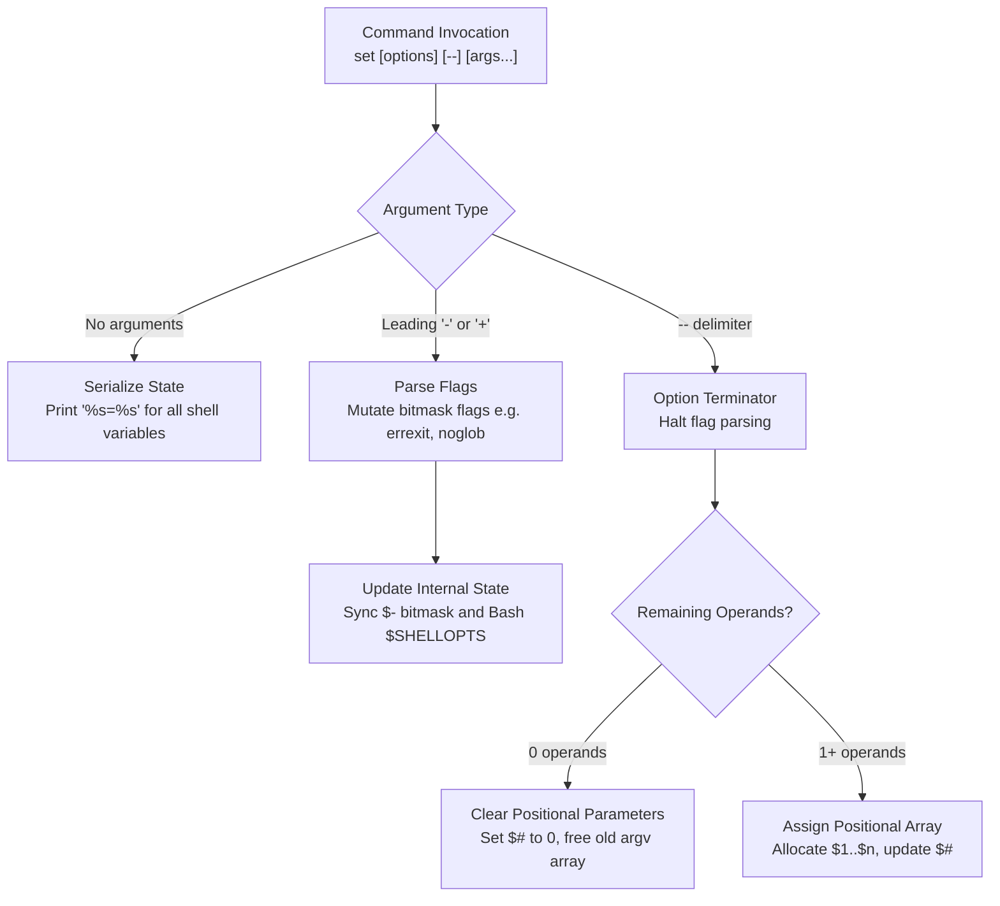

# The set Builtin and Shell Options

> [!summary] Claim
> The `set` special built-in modifies internal shell execution flags, alters the positional parameter array (`$1`..`$n`), or serializes shell variable state without forking a child process.

Part of [The POSIX Shell Language](README.md) in [Shell and Unix Engineering](../README.md).

## TL;DR

- Mechanism: `set` directly mutates internal shell bitmask flags and the positional parameter array without creating a subshell or invoking `execve(2)`.
- Rule: Always terminate option parsing with `--` when assigning positional parameters (write `set -- "$@"` or `set -- "$var"`, never bare `set "$var"`).
- Trap: Unquoted empty expansions in `set $var` execute bare `set`, dumping every shell variable to standard output (plus every function definition in native Bash).
- Portability fact: `set -o pipefail` is standardized in POSIX.1-2024 Issue 8, supported in modern Bash, Zsh, ksh93, mksh, BusyBox ash, Yash, and Dash 0.5.13+ (Debian backports it into its 0.5.12-12 package), but absent in upstream Dash 0.5.12 and earlier (measured on Alpine dash 0.5.12, macOS `/bin/dash`, and Ubuntu 24.04 0.5.12-6ubuntu5) and in Posh; special built-in error fatal exits, bare `set` dumps, and `set +o` restoration diverge across BusyBox ash, native Yash, and Posh (as of 2026-11).
- When not to use it: Do not rely on `set -e` as a substitute for structured error handling in complex control-flow scripts or functions invoked within conditional contexts.

## Mental model



The `set` built-in acts as a dual-purpose control interface that inspects or mutates shell execution state within the current process.
When called without operands or flags, `set` reads the internal symbol table and dumps all defined shell variables to standard output in collation sequence.
When supplied with arguments starting with `-` or `+`, `set` toggles execution bitmasks such as `errexit`, `nounset`, and `noglob`, dynamically updating the special parameter `$-` and, in Bash, the `SHELLOPTS` shell variable.
When the special delimiter `--` is encountered, the option parser terminates immediately.
If no arguments follow `--`, the shell frees the active positional parameter array and resets the parameter count `$#` to zero.
If additional operands follow `--`, the shell allocates a fresh positional parameter array, assigning `$1` through `$n` in sequential order while updating `$#`.

## How it works

The `set` command is specified in POSIX.1-2024 as a Special Built-In utility `(POSIX.1-2024 XCU 2.15, set)`.
Because it is a special built-in, `set` operates directly inside the current process memory space without invoking `fork(2)` or `execve(2)`.
The system calls `set` itself triggers are `write(2)` during variable serialization dumps or tracing output (`xtrace`), whatever the allocator requests when positional parameters are replaced, and terminal process-group system calls like `setpgid(2)` and `tcsetpgrp(2)` when job control (`-m` / `monitor`) is initialized on an interactive terminal `(dash jobs.c, setjobctl)`.

Under `(POSIX.1-2024 XCU 2.15)`, special built-in utilities exhibit two foundational properties that separate them from regular utilities:
First, preceding variable assignments persist in the current shell execution environment.
In conforming POSIX implementations, executing `VAR=value set --` causes `VAR` to retain `value` in the calling shell environment after `set` finishes.
Regular utilities and built-ins discard prefix assignments after the utility completes.
Second, an error during option parsing or execution in a non-interactive shell causes the shell process to abort immediately `(POSIX.1-2024 XCU 2.8.1)`.
For example, supplying an unrecognized option such as `set -o invalid_name` causes conforming shells to exit with a non-zero status rather than continuing script execution.
However, in native GNU Bash, native Yash, and BusyBox ash `(shell/ash.c, setcmd)`, an invalid `set -o` name does not abort a non-interactive shell by default.
Bash 4.4 and later abort under `bash --posix`, and Yash aborts under `yash --posix` or `set -o posixly-correct`.
BusyBox ash has no such mode, and bash 3.2 (including macOS `/bin/sh`) still continues after an unknown `-o` name in POSIX mode, although it aborts on an unknown letter such as `set -Z`, as measured in the shell matrix.
The lab tests `special built-in fatal error in non-interactive shell aborts execution under POSIX conformance` and `special built-in unknown option letter: POSIX shells and bash in POSIX mode abort, native bash and yash continue` assert the exit status of every matrix shell, with bash split by POSIX mode and major version.

Option parsing in `set` processes tokens sequentially until a non-flag word or the `--` delimiter is reached.
A leading `-` turns an option on (enables the feature), whereas a leading `+` turns an option off (disables the feature).
The special parameter `$-` dynamically reflects all currently active single-letter options formatted as an unseparated string of characters.
The long-form syntax `set -o <name>` and `set +o <name>` maps textual names to internal bitmask flags.
Calling `set -o` without an option name prints current settings in an unspecified human-readable format.
Calling `set +o` without an option name emits executable `set` commands that reproduce the shell's active option state when re-evaluated via `eval`.
Most shells output a sequence of `set +o` and `set -o` statements that fully reproduce both enabled and disabled states.
In Posh 0.14.1 (as of 2026-11), `set +o` emits only `set` followed by `-o <option>` for enabled options and omits disabled options `(posh 0.14.1 misc.c, printoptions)`, which prevents `eval` from restoring options that were subsequently enabled.
The lab test `set +o round-trip restores -f -u -C -a except in posh, which omits disabled options` asserts the round trip for `-f`, `-u`, `-C`, and `-a` in every matrix shell.

In GNU Bash, `set` is implemented in `(bash-5.3 set.def, set_builtin)`.
When the argument list is empty (`list == 0`), `set_builtin` executes `print_all_shell_variables()`, which iterates over the variable hash table and prints variable bindings.
Outside POSIX mode, Bash also serializes all defined shell functions during this dump; `print_all_shell_variables()` skips them when `posixly_correct` is set (PASC Interpretation 202, per its source comment).
When arguments are provided, `set_builtin` parses flags using `internal_getopt()` and `change_flag()` in `(bash-5.3 flags.c, change_flag)`.
Long-form options route to `(bash-5.3 set.def, set_minus_o_option)`, which performs a lookup against `o_options[]` and updates internal variables including `exit_immediately_on_error` (`-e`), `unbound_vars_is_error` (`-u`), and `pipefail_opt`.
Toggling any flag triggers `set_shellopts()`, which rebuilds the colon-separated `SHELLOPTS` shell variable string.
When positional arguments are assigned, `(bash-5.3 builtins/common.c, remember_args)` frees and re-copies the strings in the fixed `dollar_vars[1..9]` slots, stores any further arguments in the `rest_of_args` word list, and synchronizes the parameter count `posparam_count` behind `$#`.

In Dash, `set` is implemented in `(dash options.c, setcmd)`.
If `argc == 1`, `setcmd` delegates to `showvars(nullstr, 0, VUNSET)` to write sorted variable bindings to standard output.
When arguments are present, `setcmd` enters the `INTOFF` critical section, which defers interrupt handling (it does not change the signal mask) to protect heap memory structures from corruption during manipulation.
It calls `options(0)` to process flags and then calls `optschanged()` to synchronize the state.
If the argument pointer points to remaining operands, `setcmd` calls `(dash options.c, setparam)`; for `set --` with no operands, `options()` makes that same call itself.
The `setparam()` function calculates the number of positional parameters `nparam`, allocates a new pointer array using `ckmalloc((nparam + 1) * sizeof *ap)`, and duplicates each string with `savestr()`.
It then calls `freeparam(&shellparam)` to free the previously allocated parameter strings and array, assigns the new array to `shellparam.p`, sets `shellparam.nparam = nparam`, and resets both `shellparam.optind = 1` and `shellparam.optoff = -1`.
Finally, `setcmd` leaves the critical section via `INTON` and returns status 0.

POSIX.1-2024 standardized `set -o pipefail` `(POSIX.1-2024 XCU 2.15, set)` via [Austin Group Defect 789](https://www.austingroupbugs.net/view.php?id=789) (tagged `issue8`).
In a multi-stage pipeline without `pipefail`, the return code of the pipeline is determined entirely by the exit status of the rightmost command.
Under `pipefail`, the pipeline exit status becomes the exit code of the last (rightmost) command to fail with a non-zero exit status, or zero if all commands succeed.

## Numbers and limits

| Metric / Limit | Value | Source / Method | Implication |
|---|---|---|---|
| POSIX standard single-letter options | 12 (`-a`, `-b`, `-C`, `-e`, `-f`, `-h`, `-m`, `-n`, `-o`, `-u`, `-v`, `-x`) | `(POSIX.1-2024 XCU 2.15)` | Portable scripts must restrict single-letter flags to this normative set. |
| POSIX standard `-o` option names | 14 (`allexport`, `errexit`, `ignoreeof`, `monitor`, `noclobber`, `noglob`, `noexec`, `nolog`, `notify`, `nounset`, `pipefail`, `verbose`, `vi`, `xtrace`) | `(POSIX.1-2024 XCU 2.15)` | Portable scripts can rely on `pipefail` as a standard `-o` option across Issue 8 shells. |
| Supported options in Dash | Upstream 0.5.12: 17 (`NOPTS 17`); upstream 0.5.13: 18 (adds `pipefail`); Debian 0.5.12-12: 19 (adds `pipefail` and `privileged` by patch) | `(dash src/options.h, NOPTS)` in the release tarballs; 17 and 19 also measured in the shell matrix via `set -o` | Dash maintains a minimal static table; unknown `-o` options trigger fatal errors. |
| Supported options in GNU Bash 5.3 | 27 options | Measured in the shell matrix via `set +o \| wc -l` | Bash provides extra options including `braceexpand`, `errtrace`, and `functrace`. |
| Supported options in Zsh 5.9 | 185 options | Measured in the shell matrix via `set +o \| wc -l` | Zsh maintains a vast internal option catalog; portability scripts must isolate Zsh options. |
| Supported options in ksh93u+m 1.0.10 | 38 options (macOS ksh93u+ 2012: 33 output lines, including a header) | Measured in the shell matrix via `set -o \| wc -l`, minus the header line | ksh93 provides extended Korn options like `trackall`, `pipefail`, and `multiline`. |
| Supported options in Yash 2.58.1 | 45 options | Measured in the shell matrix via `set -o \| wc -l` (as of 2026-11) | Yash provides extended interactive and POSIX options such as `posixly-correct` and `clobber`. |
| Supported options in BusyBox 1.37.0 ash | 14 options | Measured in the shell matrix via `set -o \| wc -l` (as of 2026-11) | BusyBox ash implements a compact subset of POSIX and Almquist options. |
| Supported options in Posh 0.14.1 | 11 options | Measured in the shell matrix via `set -o` (as of 2026-11) | Posh exposes no `pipefail`, `monitor`, `notify`, or `vi` option. |
| Unbraced positional parameter limit | 9 parameters (`$1`..`$9`) | `(POSIX.1-2024 XCU 2.5.1, 2.6.2)` | Writing `$10` evaluates as `$1` followed by literal `0` in POSIX shells; `${10}` is required. |
| Positional parameter capacity | No POSIX limit; bounded by available memory | 100,000 parameters, asserted by the lab test `set -- accepts 100000 positional parameters` in every matrix shell | Parameter arrays reside on the heap; capacity is capped by available RAM and pointer limits. |
| Linux kernel `PIPE_BUF` atomic write limit | 4096 bytes | `(Linux man-pages pipe(7))`; `getconf PIPE_BUF /` measured in the shell matrix | Writes `<= PIPE_BUF` do not interleave; relevant to upstream pipeline producers under `pipefail`. |
| macOS Darwin `PIPE_BUF` atomic write limit | 512 bytes | `getconf PIPE_BUF /` measured on the macOS host | Lower threshold for pipe write atomicity; larger writes may interleave (`EPIPE` comes from a closed read end, not from buffer size). |

## Portability

| Feature / Behavior | POSIX.1-2024 sh | macOS bash 3.2 | current bash 5.3 | zsh (native) | zsh (--emulate sh) | dash | ksh93 | mksh | yash | posh | BusyBox ash |
|---|---|---|---|---|---|---|---|---|---|---|---|
| `set -o pipefail` | Supported | Supported | Supported | Supported | Supported | Supported (>=0.5.13; Debian 0.5.12-12 by patch; not upstream 0.5.12) | Supported | Supported | Supported | Unsupported | Supported |
| Prefix assignment persistence (`V=1 set --`) | Persists | Scoped to call | Scoped (Persists in `--posix`) | Scoped to call | Persists | Persists | Persists | Persists | Persists | Persists | Persists |
| Fatal exit on invalid `-o` option | Fatal abort | Continues (also in `--posix`) | Continues (Fatal in `--posix`) | Fatal abort | Fatal abort | Fatal abort | Fatal abort | Fatal abort | Continues (Fatal in `--posix`) | Fatal abort | Continues (non-conforming) |
| `set --` clears `$#` to 0 | Yes | Yes | Yes | Yes | Yes | Yes | Yes | Yes | Yes | Yes | Yes |
| Bare `set` output format | `name=value` | `name=value` + functions | `name=value` + functions | `name=value` | `name=value` | `name=value` | `name=value` | `name=value` | `name=value` | `name` only (no values) | `name=value` |
| Obsolescent `set -` clears `-x` and `-v` | Unspecified | Yes | Yes | No (Keeps tracing) | Yes | Yes | Yes | Yes | No (Sets `$1` to `-`) | No (Keeps tracing) | Yes |
| `set +o` save-restore round-trip | Restores all options | Restores all options | Restores all options | Restores all options | Restores all options | Restores all options | Restores all options | Restores all options | Restores all options | Incomplete (omits disabled options) | Restores all options |
| `set -u` with empty `"$@"` | Allowed (Status 0) | Allowed (Status 0) | Allowed (Status 0) | Allowed (Status 0) | Allowed (Status 0) | Allowed (Status 0) | Allowed (Status 0) | Allowed (Status 0) | Allowed (Status 0) | Aborts (`@` not set) | Allowed (Status 0) |
| Multi-digit `$10` evaluation | `$1` then `0` (`a0`) | `$1` then `0` (`a0`) | `$1` then `0` (`a0`) | 10th arg (`j`) | `$1` then `0` (`a0`) | `$1` then `0` (`a0`) | `$1` then `0` (`a0`) | `$1` then `0` (`a0`) | `$1` then `0` (`a0`) | `$1` then `0` (`a0`) | `$1` then `0` (`a0`) |
| `set -f` option meaning | `noglob` | `noglob` | `noglob` | `norcs` | `noglob` | `noglob` | `noglob` | `noglob` | `noglob` | `noglob` | `noglob` |
| `set +o` reinput format | Executable `set` | Multi-line `set +/-o` | Multi-line `set +/-o` | Multi-line `set +/-o` | Multi-line `set +/-o` | Multi-line `set +/-o` | Single-line `set --...` | Single-line `set -o .reset -o ...` | Multi-line `set +/-o` | Single-line `set [-o name...]` | Multi-line `set +/-o` |

The lab asserts an exact value per shell, rather than either outcome, for the rows on `set -o pipefail`, prefix assignment, invalid `-o` options, `set --`, the `set +o` round-trip, `set -u` with empty `"$@"`, and `$10`.
Three rows are asserted only in part: bare `set` for `name=value` versus name only, not the functions Bash appends; obsolescent `set -` for whether `-x` and `-v` stay on, not the value of `$1` in Yash; and `set -f` for whether pathname expansion stops, not the `norcs` meaning in native Zsh.
The `set +o` reinput format row has no lab assertion.
The test `set -o pipefail propagates upstream pipeline failure` pins dash by package (Debian 0.5.12-12 supports `pipefail`; Alpine 0.5.12, macOS `/bin/dash`, and Ubuntu 24.04 0.5.12-6ubuntu5 do not), cross-checks the result against what `set -o` lists, and fails on a dash build outside that table.
The test `probe.sh assignment: preceding variable assignment persists on special built-in in POSIX mode` splits bash by POSIX mode, and the test `set -u fails on unset variable but permits empty positional parameters in conforming shells` pins the Posh abort.

## Worked example

The test script in the [lab](../labs/03-the-set-builtin-and-shell-options/) demonstrates parameter assignment, flag toggling, option restoration via `set +o`, and prefix assignment persistence:

```sh
#!/bin/sh
# probe.sh - probe set builtin options and positional parameter behavior
# Usage: probe.sh <mode> [args...]

set -e

mode=${1:-}
shift || true

case "$mode" in
  params)
    # Demonstrate positional parameter replacement and clearing with set --
    set -- "$@"
    printf 'count=%d\n' "$#"
    if [ "$#" -gt 0 ]; then
      printf 'first=%s\n' "$1"
    fi
    # Clear all positional parameters
    set --
    printf 'cleared_count=%d\n' "$#"
    # Assign parameters that begin with hyphens safely
    set -- -a -b --long-flag
    printf 'hyphen_count=%d\n' "$#"
    printf 'hyphen_first=%s\n' "$1"
    ;;

  glob-toggle)
    # Demonstrate toggling -f (noglob) on and off
    target_dir=$1
    # shellcheck disable=SC2086,SC2248 # intentional pathname expansion to test globbing
    set -- "$target_dir"/*
    printf 'glob_on_count=%d\n' "$#"
    # Turn off pathname expansion
    set -f
    # shellcheck disable=SC2086,SC2248 # intentional expansion under set -f
    set -- "$target_dir"/*
    printf 'glob_off_count=%d\n' "$#"
    printf 'glob_off_literal=%s\n' "$1"
    # Re-enable pathname expansion
    set +f
    # shellcheck disable=SC2086,SC2248 # intentional expansion under set +f
    set -- "$target_dir"/*
    printf 'glob_restored_count=%d\n' "$#"
    ;;

  save-restore)
    # Demonstrate saving option state via set +o and restoring via eval
    saved=$(set +o)
    set -f
    case "$-" in
      *f*) printf 'during_mutation=f_present\n' ;;
      *) printf 'during_mutation=f_absent\n' ;;
    esac
    eval "$saved"
    case "$-" in
      *f*) printf 'after_restore=f_present\n' ;;
      *) printf 'after_restore=f_absent\n' ;;
    esac
    ;;

  assignment)
    # Demonstrate preceding variable assignment on special built-in
    unset PERSISTED_VAR
    PERSISTED_VAR=persisted_val set --
    printf 'persisted_var=%s\n' "${PERSISTED_VAR:-unset}"
    ;;

  *)
    printf 'unknown mode: %s\n' "$mode" >&2
    exit 1
    ;;
esac
```

Executing each probe mode in the test harness prints the following output:

```text
$ ./probe.sh params apple banana cherry
count=3
first=apple
cleared_count=0
hyphen_count=3
hyphen_first=-a

$ mkdir scratch && touch scratch/alpha.txt scratch/beta.txt
$ ./probe.sh glob-toggle scratch
glob_on_count=2
glob_off_count=1
glob_off_literal=scratch/*
glob_restored_count=2

$ ./probe.sh save-restore
during_mutation=f_present
after_restore=f_absent

$ ./probe.sh assignment
persisted_var=persisted_val
```

Under `posh` 0.14.1 (as of 2026-11), `after_restore` reports `f_present` because its `set +o` outputs only currently enabled options and omits disabled options.
The output above is `/bin/sh` on a conforming shell: native Zsh prints `glob_off_count=2` because its `-f` means `NO_RCS`, and native Bash and native Zsh print `persisted_var=unset`.

## Pitfalls

> [!warning] Incomplete Option Restoration via `set +o` in Posh 0.14.1
> Trigger: Executing `saved=$(set +o); set -f; eval "$saved"` in `posh` 0.14.1 (as of 2026-11).
> Symptom: Pathname expansion remains disabled (`f_present`), because `set +o` in `posh` emits only `set -o <name>` for currently enabled options and omits disabled options, leaving newly set options active after `eval`.
> Fix: In scripts requiring portability to `posh`, capture and restore individual single-letter flags using `case "$-" in *f*) ...` or explicitly disable temporary options with `set +f`.

> [!warning] Silent Continuation on Invalid Special Built-in Options in BusyBox Ash and Native Yash
> Trigger: Misspelling or passing an invalid option to `set -o` in a non-interactive script executed by BusyBox ash or native Yash (as of 2026-11).
> Symptom: POSIX.1-2024 XCU 2.8.1 mandates that a non-interactive shell must immediately abort upon a special built-in error; however, BusyBox ash (`shell/ash.c, setcmd`) and native Yash print a stderr diagnostic and continue executing subsequent commands with the option ignored.
> Fix: Test options prior to execution, run Yash in standard mode via `yash --posix` or `set -o posixly-correct`, or append explicit status checks: `set -o pipefail || exit 1`.

> [!warning] Variable Value Omission in Bare `set` under Posh 0.14.1
> Trigger: Invoking bare `set` to dump and inspect defined variables in `posh` 0.14.1 (as of 2026-11).
> Symptom: Instead of standard POSIX `name=value` format `(POSIX.1-2024 XCU 2.15, set)`, `posh` outputs only variable identifier names without values or equals signs, breaking serialization parsers.
> Fix: Use standard utilities like `env` or `printenv` or explicit variable parameter expansions when variable values are required.

> [!warning] The Unquoted Empty Variable Trap (`set $var`)
> Trigger: Running `set $var` when `var=""` or expands to an empty word list after field splitting.
> Symptom: The command receives zero arguments, triggering the bare `set` branch which serializes and dumps every shell variable and function definition to standard output.
> Fix: Always supply the `--` delimiter to protect parameter assignment: `set -- "$var"` when assigning a single parameter, or `set -- $var` if word splitting is required.

> [!warning] Hyphen-Prefixed Positional Parameters (`set "$var"`)
> Trigger: Running `set "$var"` without `--` when `var` holds a string beginning with `-` or `+`, such as `-e` or `-x`.
> Symptom: The shell interprets the parameter value as an option flag, silently altering internal execution state instead of assigning `$1`.
> Fix: Precede all positional parameter assignments with the end-of-options delimiter: `set -- "$var"`.

> [!warning] Broken Pipelines from `SIGPIPE` under `pipefail` (Exit 141)
> Trigger: Enabling `set -o pipefail` in pipelines where an upstream generator writes to a fast-exiting downstream filter (for example, `yes | head -n 1`).
> Symptom: When `head` reads its first line and exits, the pipe's read end closes, causing `yes` to receive `SIGPIPE` (signal 13) on its subsequent write and exit with status 141 (`128 + 13`); `pipefail` bubbles this 141 exit code to the caller, causing the entire pipeline to fail.
> The value is shell-dependent: 141 in Bash, Dash (builds with `pipefail`), mksh, BusyBox ash, and Zsh, 397 in Yash, and 1 or 269 in ksh93u+m, whose socket pipelines race between a connection-reset error in the writer (1) and `SIGPIPE` (`256 + 13`), while macOS ksh93u+ 2012 reports 13.
> The lab test `pipefail status when an upstream writer dies of SIGPIPE (yes | head -n 1)` asserts each value and accepts either ksh93u+m outcome.
> Fix: Avoid `pipefail` for pipelines with early-terminating consumers, or absorb the expected status in the upstream stage with an explicit filter such as `{ yes || [ "$?" -eq 141 ]; } | head -n 1`, adjusting the value for Yash and ksh93.

> [!warning] Privilege Escalation via Inherited `SHELLOPTS` and `PS4` (CVE-2016-7543)
> Trigger: Invoking Bash scripts in privileged or setuid environments where untrusted callers control environment variables, specifically `SHELLOPTS=xtrace` and `PS4='$(evil_command)'`.
> Symptom: In Bash versions prior to 4.4, a shell running as root imported `xtrace` from `SHELLOPTS` and `PS4` from the environment, then expanded the malicious command substitution inside `PS4` while tracing, resulting in local root privilege escalation `(NVD CVE-2016-7543)`.
> Fix: Upgrade to Bash 4.4 or later, purge `SHELLOPTS`, `BASHOPTS`, and `PS4` from the environment in privileged wrappers, and start the shell as `bash -p` (privileged mode), because `SHELLOPTS` is imported at startup `(bash-5.3 shell.c, shell_initialize)` and a later `set -p` is too late to stop it.

> [!warning] Irreversible Syntax Check Lockout (`set -n`)
> Trigger: Placing `set -n` (`noexec`) inside an executing shell script with the expectation of later resuming execution via `set +n`.
> Symptom: The shell parses all subsequent lines without executing them; because commands are disabled, the subsequent `set +n` command is never executed, and the shell reads to end of file and exits with status 0, so the failure is silent (the lab test `set -n in a script file silently skips every later line, including set +n, and exits 0` asserts this for a multi-line script in every matrix shell).
> Interactive shells may ignore the option `(POSIX.1-2024 XCU 2.15, set)`, and on one `sh -c` line mksh, Posh, and Yash ran the remaining commands.
> Fix: Use `sh -n script.sh` from an external terminal or build harness to perform static syntax checks rather than embedding `set -n` in script source code.

> [!warning] Non-Conforming Abort on Empty `"$@"` in Posh under `set -u`
> Trigger: Executing a script with `set -u` under `posh` 0.14.1 when no positional parameters are passed.
> Symptom: Posh terminates with `@: parameter not set` `(posh 0.14.1 eval.c, varsub)`, violating POSIX.1-2024 XCU 2.15 which explicitly exempts `@` and `*` from nounset enforcement.
> Fix: Use the POSIX compatibility expansion `${1+"$@"}` in scripts requiring portability to Debian Posh.

## Security and robustness

The canonical defensive header for modern Unix shell scripts is often written as `set -euo pipefail`.
This idiom combines `errexit` (`-e`), `nounset` (`-u`), and `pipefail` (`-o pipefail`) to detect failures early.
However, engineers must understand the specific boundaries and failure modes of each flag to maintain robust pipelines.

The `set -e` flag exits immediately when a command fails, but it contains major specification exceptions `(POSIX.1-2024 XCU 2.15, set)`.
Specifically, `errexit` is completely disabled inside any function or command substitution executed within an `if`, `elif`, `while`, or `until` conditional test, as well as in a pipeline beginning with `!` and on any command preceding `||` or `&&` in an AND-OR list.
Detailed coverage of these inheritance and masking rules is documented in [[errexit-Semantics-and-Exceptions]].
Engineers should write explicit status checks `cmd || handle_error "$?"` rather than relying on `set -e` for mission-critical operations.

The `set -u` (`nounset`) flag halts execution if an unset parameter is expanded, preventing accidental destructive operations like `rm -rf "$TARGET_DIR/"` when `TARGET_DIR` is accidentally undefined.
When working with optional variables under `set -u`, use parameter expansion defaults like `"${OPTIONAL_VAR:-default}"` or check variable definition before access; see [[Null-versus-Unset]] for expansion mechanics.

Shell options propagate across execution boundaries in unexpected ways.
When a script executes `(set -e; some_subshell_work)`, changes to options remain strictly localized to the subshell process and do not affect the parent shell; see [[Subshells-and-the-Execution-Environment]].
Conversely, shell functions run inside the caller execution environment, meaning any `set` invocation inside a function directly mutates the caller option state; see [[Functions-and-Scope]].
To safely modify shell options within a function, engineers must capture the existing state and restore it upon exit:

```sh
safe_operation() {
  # No local: POSIX does not specify it, and ksh93 reports "local: not found"
  restore_options=$(set +o)
  set -f -u
  # Perform operations requiring glob disabling and nounset
  eval "$restore_options"
}
```

In Bash, restricted shell mode (`set -r` or invoking `rbash`; Dash, mksh, and Zsh reject `set -r`, as measured in the shell matrix) restricts path traversal, directory changes (`cd`), and output redirection.
Once enabled, `set +r` is permanently rejected as an invalid option.
However, restricted shell mode is not an isolation sandbox; historical flaws like `CVE-2019-9924` in `(NVD CVE-2019-9924)` demonstrated that a writable internal associative array (`BASH_CMDS`, before Bash 4.4-beta2) allowed attackers to bypass command search restrictions and escape restricted mode.

## The principal's view

Staff-plus engineers treat `set` as an operational contract rather than syntactic sugar.
The `set -euo pipefail` boilerplate is standard for short linear build scripts, Continuous Integration tasks, and deterministic deployments.
It enforces fail-fast semantics and prevents silent progression after missing files or failed downloads.

However, experienced engineers recognize the trade-offs of this strict mode.
First, `set -e` introduces brittle control flow, masking errors inside functions called within conditionals while abruptly terminating scripts on benign non-zero statuses like `grep` returning 1 on zero matches.
Second, `set -o pipefail` conflicts with classic Unix pipeline streaming where downstream tools exit early and send `SIGPIPE` to upstream producers.
Third, `set -u` requires defensive default expansion syntax that can clutter complex scripts.
Fourth, option error propagation and restoration diverge across minimal userland shells: BusyBox ash and native Yash do not abort on invalid `set -o` options, and Posh 0.14.1 omits disabled options from `set +o` dumps (as of 2026-11).

When a shell script expands beyond 200 lines, requires complex trap hierarchies, performs asynchronous job orchestration, or needs robust structured error handling, the principal engineer halts script growth.
Shell scripts lack structured exception handling, compile-time type verification, and isolated scoping.
At that threshold, the engineering trade-off favors rewriting the utility in Go, Rust, or Python, where error handling is explicit, memory safety is enforced, and testing infrastructure is native.

## Interview questions

> [!question] L5: What happens when running `set $var` versus `set -- $var` when `var` is empty, and what happens if `var="-x"`?
>
> > [!success]- Answer
> > When `var` is empty, unquoted `set $var` expands to zero arguments, causing the shell to execute bare `set` and dump all defined shell variables to standard output.
> > Running `set -- $var` passes the `--` delimiter followed by zero operands, which safely unsets all positional parameters and sets `$#` to zero without emitting variable dumps.
> > When `var="-x"`, running `set $var` treats the value as an option flag, enabling xtrace tracing mode in the shell.
> > Running `set -- $var` uses the `--` delimiter to terminate option processing, safely assigning `-x` to positional parameter `$1`.
> >
> > Follow-up: Why is `set -- "$var"` preferred over `set -- $var` when assigning a single parameter?

> [!question] L5: Why does `$10` evaluate differently in POSIX sh versus native Zsh after executing `set -- a b c d e f g h i j`?
>
> > [!success]- Answer
> > In POSIX.1-2024 shell grammar, an unbraced parameter expansion `$10` is parsed as parameter `$1` followed by the literal character `0`.
> > Because `$1` is `a`, POSIX shells expand `$10` to `a0`, requiring `${10}` with braces to reference the tenth parameter.
> > Native Zsh does not adhere to POSIX parameter parsing rules by default and treats `$10` as a reference to the tenth positional parameter `j`.
> > Running Zsh in POSIX mode via `zsh --emulate sh` restores standard POSIX behavior, expanding `$10` to `a0`.
> >
> > Follow-up: What parameter expansion syntax is universally portable across all shells to access positional parameters beyond 9?

> [!question] L6: Predict the output of this script and explain the mechanism:
> ```sh
> set -e
> check_service() {
>   false
>   echo "service alive"
> }
> check_service || echo "service down"
> ```
>
> > [!success]- Answer
> > The script outputs `service alive` and does not print `service down`.
> > Under POSIX.1-2024 XCU 2.15, the `set -e` (`errexit`) setting is ignored when executing any command that is part of an AND-OR list other than the last.
> > Because `check_service` is the first command in the OR-list `check_service || echo "service down"`, `errexit` is suppressed across the entire function body during its execution.
> > When `false` executes inside `check_service`, the shell does not abort, allowing execution to proceed to `echo "service alive"`, which returns status 0 and satisfies the OR-list.
> >
> > Follow-up: How would you refactor `check_service` to ensure failures inside the function trigger error handling without being masked by the OR-list?

> [!question] L6: How does the special built-in classification of `set` affect prefix variable assignments like `VAR=1 set -- a b` compared to `VAR=1 echo a b`?
>
> > [!success]- Answer
> > Under POSIX.1-2024 XCU 2.15, variable assignments preceding a special built-in utility persist in the calling execution environment after the command finishes.
> > In conforming shells like Dash, ksh93, and Bash in POSIX mode, `VAR=1 set -- a b` leaves `VAR=1` defined in the shell environment.
> > Regular built-ins and external commands like `echo` evaluate preceding assignments only within a temporary environment scoped to that specific command execution.
> > In native Bash and native Zsh, built-ins default to non-POSIX scoping where preceding assignments do not persist in the caller.
> >
> > Follow-up: Name three other POSIX special built-ins that share this prefix assignment persistence behavior.

> [!question] L6: Debug this pipeline script that intermittently exits with code 141 in Continuous Integration despite all data processing completing successfully:
> ```sh
> #!/bin/sh
> set -euo pipefail
> generate_large_stream | head -n 5
> echo "Processing complete"
> ```
>
> > [!success]- Answer
> > The failure occurs because `head -n 5` reads five lines and immediately closes its standard input file descriptor.
> > When `generate_large_stream` attempts its next `write(2)` call to the closed pipe, the kernel sends a `SIGPIPE` signal (signal 13) to the process.
> > The generator terminates with exit status 141 (`128 + 13`) in Bash, Dash, mksh, and Zsh; Yash reports 397 for the same stage.
> > Because `set -o pipefail` is active, the pipeline takes the non-zero exit status of the failed generator stage rather than the exit status 0 of `head`, causing the script to abort under `set -e`.
> > The fix is to handle `SIGPIPE` explicitly in the generator, or disable `pipefail` for bounded pipeline stages where early reader termination is expected.
> >
> > Follow-up: Why does this failure happen intermittently in CI runners but rarely in local testing?

> [!question] L6: How can a shell library function temporarily enable `set -f` and guarantee caller option settings are restored upon return, even if the caller already had `set -f` enabled?
>
> > [!success]- Answer
> > The function should capture the complete option state at invocation time by running `restore=$(set +o)`.
> > The `set +o` command outputs executable `set -o` and `set +o` commands that represent the exact active configuration.
> > The function then enables `set -f` to perform its pathname-safe processing.
> > Before returning, the function executes `eval "$restore"`, which re-evaluates the captured commands and restores the original option state.
> > This approach avoids checking `$-` with brittle substring logic and safely handles arbitrary option combinations.
> > In `posh` 0.14.1 (as of 2026-11), `set +o` emits only currently enabled options without explicit `+o` instructions for disabled options, requiring manual single-letter flag restoration.
> >
> > Follow-up: What happens if `eval "$restore"` is bypassed due to an unhandled exit or signal inside the function?

> [!question] L7+: How did option propagation enable privilege escalation in setuid contexts under CVE-2016-7543 involving GNU Bash, `SHELLOPTS`, and `PS4`?
>
> > [!success]- Answer
> > In GNU Bash versions prior to 4.4, a shell running as root imported `SHELLOPTS` and `PS4` from its environment at startup.
> > When `SHELLOPTS` contained `xtrace`, such a shell automatically initialized in command tracing mode.
> > During trace output formatting, Bash performs parameter expansion and command substitution on the prompt variable `PS4`.
> > In setuid or privileged execution wrappers, an unprivileged user could set `SHELLOPTS=xtrace` and `PS4='$(malicious_command)'` in the environment before launching the binary.
> > The privileged Bash process expanded `PS4` when tracing its first command, executing the command substitution with root permissions.
> > The vulnerability was resolved in Bash 4.4: "Shells running as root no longer inherit PS4 from the environment" (Bash `CHANGES`), so `(bash-5.3 variables.c, initialize_shell_variables)` rebinds `PS4` to `+ ` when the effective uid is 0.
> >
> > Follow-up: How does Bash privileged mode (`set -p`) alter option and environment processing to mitigate this attack surface?

> [!question] L7+: In POSIX.1-2024, what is the precise semantic distinction between error consequences in a special built-in like `set` versus a regular built-in like `kill` during non-interactive script execution?
>
> > [!success]- Answer
> > POSIX.1-2024 XCU 2.8.1 and XCU 2.15 divide shell errors into distinct consequence classes based on whether the command is a special built-in, a regular built-in, or an external utility.
> > For a special built-in such as `set`, any syntax error or option error in a non-interactive shell must cause the shell process to exit with a non-zero status, unless it was invoked through the `command` utility.
> > For a regular built-in such as `kill` or `read`, an error must write a diagnostic message to standard error, but the non-interactive shell must not abort and must continue executing subsequent commands.
> > In GNU Bash, this fatal abort behavior for special built-ins is enabled only when Bash is operating in POSIX mode (`--posix` or `set -o posix`), and bash 3.2 still continues after an unknown `set -o` name even there (measured in the shell matrix).
> > In default native mode, GNU Bash treats special built-in errors as non-fatal, printing a diagnostic and continuing script execution.
> > Similarly, native Yash and BusyBox ash (`shell/ash.c, setcmd`) diverge from POSIX by continuing execution on invalid `set` options in non-interactive scripts (as of 2026-11).
> >
> > Follow-up: Why does POSIX require implementations to treat special built-in errors as fatal aborts while prohibiting it for regular built-ins?

## Related

Prerequisites: [[The-exec-Builtin]]

Next: [[POSIX-2024-Changes]]

See also: [[Special-Built-ins-versus-Utilities]], [[Special-Parameters]], [[Parameter-Expansion]], [[Null-versus-Unset]], [[Field-Splitting-and-IFS]], [[Pathname-Expansion]], [[Pipelines-and-And-Or-Lists]], [[errexit-Semantics-and-Exceptions]], [[Functions-and-Scope]], [[Subshells-and-the-Execution-Environment]]

## Further reading

- [POSIX.1-2024 Shell Command Language (Special Built-In Utilities: set)](https://pubs.opengroup.org/onlinepubs/9799919799/utilities/V3_chap02.html#set): Normative specification for option flags, parameter assignment, serialization format, and error abort consequences.
- [POSIX.1-2024 Shell Command Language (Special Parameters: $- and $#)](https://pubs.opengroup.org/onlinepubs/9799919799/utilities/V3_chap02.html#tag_19_05_02): Specification for dynamic flag bitmask representation and parameter counting.
- [GNU Bash Source: builtins/set.def](https://cgit.git.savannah.gnu.org/cgit/bash.git/plain/builtins/set.def?h=bash-5.3): Primary implementation of `set_builtin`, `set_minus_o_option`, and variable dumping in Bash.
- [GNU Bash Source: flags.c](https://cgit.git.savannah.gnu.org/cgit/bash.git/plain/flags.c?h=bash-5.3): Core internal function `change_flag` and the flag variables behind shell options.
- [Dash Source: src/options.c](https://git.kernel.org/pub/scm/utils/dash/dash.git/plain/src/options.c): Almquist shell option parsing loop, `setparam` array memory management, and signal isolation macros.
- [BusyBox Source: shell/ash.c](https://raw.githubusercontent.com/mirror/busybox/master/shell/ash.c): Almquist derivative option processing loop (`setcmd`) returning non-zero status without raising fatal exceptions.
- [Debian Bug Tracking System: posh Package](https://bugs.debian.org/cgi-bin/pkgreport.cgi?pkg=posh): Bug tracker for the `posh` package.
- [National Vulnerability Database: CVE-2016-7543](https://nvd.nist.gov/vuln/detail/CVE-2016-7543): Vulnerability analysis of `SHELLOPTS` option inheritance and `PS4` command execution in privileged contexts.
- [National Vulnerability Database: CVE-2019-9924](https://nvd.nist.gov/vuln/detail/CVE-2019-9924): Vulnerability record for the restricted shell (`rbash` / `set -r`) escape via internal command table manipulation.
