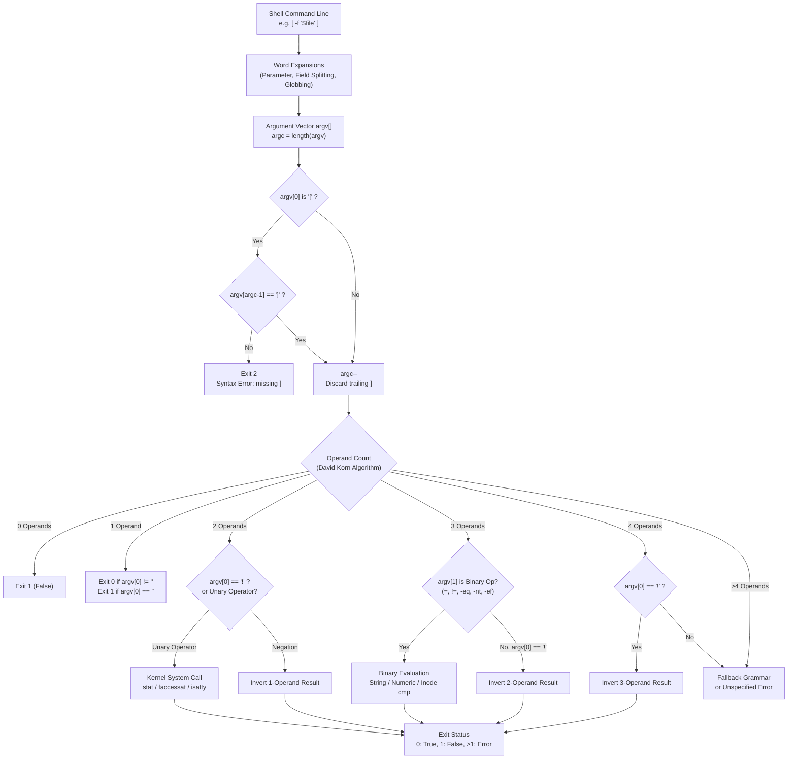

# The test Builtin

> [!summary] Claim
> The `test` utility and its bracket alias `[` evaluate expressions by executing deterministic argument-count dispatch for up to 4 operands, returning status 0 for true, 1 for false, and 2 for syntax errors, querying kernel metadata directly without process forks in standard shells.

Part of [The POSIX Shell Language](README.md) in [Shell and Unix Engineering](../README.md).

## TL;DR

- Mechanism: Evaluates positional arguments using a deterministic 0-argument to 4-argument state machine, issuing direct `stat(2)`, `lstat(2)`, `faccessat(2)`, and `isatty(3)` system calls.
- Rule: Always double-quote every variable expansion and command substitution inside `[` to prevent word splitting and pathname expansion from mutating the operand count.
- Trap: Unquoted empty or unset variables collapse during field splitting, causing `[ -n $unset ]` to evaluate as a 1-argument test of the literal string `"-n"` that always returns status 0.
- Portability fact: POSIX.1-2024 standardized `-ef`, `-nt`, `-ot`, `>`, and `<` while dropping obsolescent `-a`, `-o`, `(`, and `)`, but native zsh and posh reject `>` and `<` inside `[` (status 2), posh also rejects `-ef`, `-nt`, and `-ot`, and ksh93u+ 2012 rejects `<` because of an operator table ordering defect fixed in ksh93u+m (as of 2026-11).
- When not to use it: Avoid `test` for complex logical conjunctions (use shell `&&` and `||` lists instead), arithmetic beyond basic integers, or atomic filesystem state checks.

## Mental model



Words undergo shell expansions before the `test` or `[` utility ever inspects its arguments.
When invoked as `[`, the utility verifies that the final element in `argv` is `]` and strips it from the evaluation set.
The remaining operands enter David Korn's deterministic argument-count parser, which resolves expressions of 0 to 4 operands without lexical ambiguity.
Unary file primaries trigger direct kernel system calls such as `stat(2)` or `faccessat(2)`, binary string operators compare memory buffers directly, and numeric operators parse decimal integers.
The utility communicates the final truth value entirely through its process exit status: 0 represents true, 1 represents false, and values greater than 1 represent errors such as a syntax error.

## How it works

The `test` utility is specified in (POSIX.1-2024 test).
Under (POSIX.1-2024 XCU 1.6), any standard utility, `test` included, may be implemented as a regular built-in utility; POSIX does not require it.
Every shell in the matrix provides `test` and `[` as built-in commands to eliminate the performance overhead of invoking `/bin/test` or `/bin/[` via `fork(2)` and `execve(2)`, though yash runs its built-in only when the external command is found on `PATH` (a substitutive built-in, measured in the shell matrix).
POSIX requires that `test` and `[` also be reachable through the `exec` family, whether or not they are built in, so that utilities like `find(1)` or `xargs(1)` can execute them (POSIX.1-2024 XCU 1.6).

POSIX allows `test` and `[` to be a single linked utility that examines the basename of `argv[0]` to choose its behavior; dash inspects `*argv[0]` in `testcmd`, and coreutils branches on its `test_mode`.
In the `[` form, the utility enforces that the final positional argument is `]`.
In GNU coreutils (coreutils src/test.c, main) and Dash (dash src/bltin/test.c, testcmd), the evaluator decrements `argc` to remove the bracket token.
If the closing bracket is absent, the utility emits a diagnostic to standard error and immediately exits with status 2.

### Deterministic argument-count dispatch

Historical Unix implementations of `test` used standard recursive descent parsers with fixed operator precedence, the `oexpr` and `aexpr` grammar still visible in the source comments of dash and posh.
Because operators like `=`, `-f`, `!`, and `(` can also appear as literal file names or string operands, historical scripts suffered from catastrophic parsing ambiguities.
To eliminate this ambiguity, David Korn designed a deterministic argument-count algorithm adopted into POSIX.2 and retained in (POSIX.1-2024 test); coreutils `posixtest` is commented "an implementation of a Posix.2 proposal by David Korn" (coreutils src/test.c).
The algorithm examines the count of operands passed to the utility (excluding the closing `]` of `[`):

1. 0 operands: Exits with status 1 (false).
2. 1 operand: Exits with status 0 (true) if the argument is not the null string; otherwise exits with status 1.
   Standard options like `--help` or `--version` are treated as literal strings and evaluate to true, except that GNU `/usr/bin/[ --help`, with no closing bracket, prints its usage as POSIX allows (coreutils src/test.c, main).
3. 2 operands: If `$1` is `!`, the utility exits true if `$2` is null, and false if `$2` is not null.
   If `$1` is a recognized unary primary, the utility evaluates that primary against `$2`.
   Otherwise, the result is unspecified.
4. 3 operands: If `$2` is a recognized binary primary, the utility performs the binary comparison between `$1` and `$3`.
   If `$1` is `!`, the utility negates the 2-operand test of `$2` and `$3`.
   Otherwise, the result is unspecified.
5. 4 operands: If `$1` is `!`, the utility negates the 3-operand test of `$2`, `$3`, and `$4`.
   Otherwise, the result is unspecified.
6. Greater than 4 operands: The result is unspecified by POSIX.
   Implementations fall back to recursive descent parsing or exit with a syntax error.

In (POSIX.1-2024 test), Austin Group Defect 1330 formally removed the obsolescent `-a` (logical AND) and `-o` (logical OR) binary primaries, along with the `(` and `)` grouping operators.
Austin Group Defect 375 simultaneously added `pathname1 -ef pathname2`, `pathname1 -nt pathname2`, `pathname1 -ot pathname2`, `s1 > s2`, and `s1 < s2` to the standard.

### System call mapping

The `test` utility maps its primaries directly to kernel system calls:

- Existence and file types (`-e`, `-f`, `-d`, `-b`, `-c`, `-p`, `-S`, `-s`, `-u`, `-g`, `-k`): The utility invokes `stat(2)` (or `fstatat(2)`).
  If the pathname cannot be resolved, for example `stat(2)` fails with `ENOENT` or `ENOTDIR`, the test returns false (POSIX.1-2024 test).
  For `-f`, the kernel mode bits are checked via `S_ISREG(st.st_mode)`.
  For `-d`, `S_ISDIR(st.st_mode)` is checked.
  For `-s`, the utility checks `st.st_size > 0`.
- Symbolic links (`-h`, `-L`): The utility invokes `lstat(2)` (or `fstatat(..., AT_SYMLINK_NOFOLLOW)`).
  The primary evaluates to true if `S_ISLNK(st.st_mode)` is true.
  All other file primaries follow symlinks.
- Access permissions (`-r`, `-w`, `-x`): The `test` page defers to (POSIX.1-2024 XCU 1.1.1.4), but the rule that matters is (POSIX.1-2024 XBD 4.7 File Access Permissions), whose file classes are defined by the effective user ID, effective group ID, and supplementary groups of the process (POSIX.1-2024 XBD 3).
  Standard `access(2)` checks real credentials and cannot be used in setuid or capability-elevated environments.
  Implementations invoke `faccessat(AT_FDCWD, path, mode, AT_EACCESS)` (dash src/bltin/test.c, where available) or `euidaccess(3)` (coreutils src/test.c).
  For root (EUID 0), read and write permissions return true unless another mechanism denies access, and execute permission on a file returns true if and only if at least one execute permission bit is set (POSIX.1-2024 XBD 4.7).
  In the shell matrix on Debian, root saw `-r` and `-w` true on a mode `0000` file, `-x` false on it and true on mode `0100`, and `-w` false (status 1) under a read-only root filesystem.
- Device and inode identity (`-ef`): The utility calls `stat(2)` on both paths and returns true if `st1.st_dev == st2.st_dev` and `st1.st_ino == st2.st_ino`.
  In shells that do not implement it in `[`, such as posh, `-ef` is unrecognized and causes an error with exit status 2.
- Timestamps (`-nt`, `-ot`): The utility calls `stat(2)` on both files and compares modification timestamps (`st_mtim.tv_sec` and `st_mtim.tv_nsec`).
  Under POSIX.1-2024, `f1 -nt f2` is true if `f1` exists and `f2` does not, while `f1 -ot f2` is true if `f2` exists and `f1` does not.
  Older policy shells like posh reject `-nt` and `-ot` with exit status 2.
- File descriptors (`-t`): The utility converts the operand to an integer file descriptor and invokes `isatty(3)`, which on Linux with glibc issues `ioctl(fd, TCGETS, ...)` (strace on Debian 13 showed `ioctl(0, TCGETS, ...)` for `[ -t 0 ]` in dash, coreutils `test`, and Bash).
- String operations (`=`, `!=`, `>`, `<`): Operates in process memory using `strcmp(3)` for identity and `strcoll(3)` for the locale-aware collation order POSIX requires (dash src/bltin/test.c, coreutils src/test.c).
  Bash outside POSIX mode sorts `test` and `[` operands by ASCII order instead (Bash Reference Manual).
  While POSIX.1-2024 standardizes `>` and `<`, native zsh and posh reject both inside `[` with syntax errors (exit status 2), and ksh93u+ 2012 rejects `<` (status 2) because `shtab_testops` lists `<` after `=`, while `sh_locate` stops scanning at the first entry whose first character sorts above the operator; ksh93u+m added `<` to `test` on 2021-11-13 (ksh93u+m NEWS).
- Integer operations (`-eq`, `-ne`, `-gt`, `-ge`, `-lt`, `-le`): Parses operands as signed decimal integers, for example with dash's internal `atomax10()`, while coreutils compares decimal strings with `strintcmp` and has no width limit (coreutils src/test.c).
  Operands with leading zeros are treated strictly as base 10 under POSIX (POSIX.1-2024 XBD 12.1), though posh routes operands through its arithmetic evaluator (`evaluate()` in posh c_test.c) and erroneously interprets leading zeros as octal (as of 2026-11).
  ksh93 likewise parses operands with `sh_arith()` and evaluates them in floating point (`Sfdouble_t`) (ksh93 bltins/test.c).

## Numbers and limits

| Property | Value | Source / Measurement |
| :--- | :--- | :--- |
| Disambiguated operand count | 0 to 4 operands | (POSIX.1-2024 test) section tag_20_121_05 |
| Minimum integer range | Numerals 0 to 2,147,483,647 recognized; values equivalent to C `signed long` | (POSIX.1-2024 XBD 12.1) and (POSIX.1-2024 XCU 1.1.2.1); neither requires 64 bits |
| Largest integer without error | 9,223,372,036,854,775,807 (`2^63 - 1`) | Measured in Bash, Dash, BusyBox, Yash; coreutils has no limit, Debian and Alpine mksh wrap modulo `2^32` (`[ 4294967296 -eq 0 ]` is true), and macOS ksh93u+ 2012 loses precision (as of 2026-11) |
| Integer base in `test -eq` | Strict decimal (base 10) | `[ 010 -eq 10 ]` succeeds in lab matrix except posh, which uses octal (as of 2026-11) |
| 64-bit integer overflow (`2^63`) | Exit >1 (status 2) or wrapped (status 0) | Status 2 in Bash, Dash, BusyBox, Yash; status 0 in ksh93, Zsh, mksh, posh, and coreutils, which compares exactly (as of 2026-11) |
| Standard exit status: True | 0 | (POSIX.1-2024 test) EXIT STATUS |
| Standard exit status: False | 1 | (POSIX.1-2024 test) EXIT STATUS |
| Standard exit status: Error | >1 (typically 2 in shells) | Measured across Bash, Dash, Zsh, coreutils (status 2) |
| Builtin call latency | ~3.8 microseconds | Measured: 100,000 iterations of `[ -f /etc/passwd ]` in Bash 5.3.15 on macOS arm64, three runs, ~4.9 microseconds per loop minus ~1.1 for an empty loop (as of 2026-11) |
| External binary fork latency | ~2.0 milliseconds | Measured: 1,000 iterations of `/bin/[ -f /etc/passwd ]` on the same host, three runs (as of 2026-11) |
| Builtin speedup over fork | ~510x | Ratio of measured external fork/exec to net builtin call; host-specific |
| Timestamp resolution | 1 nanosecond (`struct timespec`) | Linux/macOS kernels; measured with a 0.6 second gap, Dash and Bash 3.2 on macOS and BusyBox ash on Debian compare whole seconds (as of 2026-11) |

## Portability

The table below reflects behavior measured across the shell matrix and primary source audits (as of 2026-11).

| Feature / Primary | POSIX.1-2024 | Bash 3.2 / 5.3 | Dash | Zsh (native / sh) | ksh93 (2012 / u+m) | mksh | yash | posh | BusyBox ash | Coreutils test(1) |
| :--- | :--- | :--- | :--- | :--- | :--- | :--- | :--- | :--- | :--- | :--- |
| Builtin availability | Optional regular | Builtin | Builtin | Builtin | Builtin | Builtin | Substitutive builtin (needs `PATH`) | Builtin | Builtin | Standalone binary |
| Missing `]` on `[` | Application error; >1 is the error range | Exit 2 | Exit 2 | Exit 2 | Exit 2 | Exit 2 | Exit 2 | Exit 2 | Exit 2 | Exit 2 |
| `[ -n $unset ]` unquoted | Exit 0 (true) | Exit 0 | Exit 0 | Exit 0 | Exit 0 | Exit 0 | Exit 0 | Exit 0 | Exit 0 | Exit 0 |
| `[ = foo ]` unquoted | Unspecified (2 arguments, `=` is not unary) | Exit 2 | Exit 2 | Exit 2 | Exit 2 | Exit 2 | Exit 2 | Exit 2 | Exit 2 | Exit 2 |
| String `\>` comparison | Required | Exit 0 | Exit 0 | Exit 2 (syntax error) | Exit 0 | Exit 0 | Exit 0 | Exit 2 (syntax error) | Exit 0 | Exit 0 |
| String `\<` comparison | Required | Exit 0 | Exit 0 | Exit 2 (syntax error) | Exit 2 (2012) / Exit 0 (u+m) | Exit 0 | Exit 0 | Exit 2 (syntax error) | Exit 0 | Exit 0 |
| Hard link `-ef` | Required | Exit 0 | Exit 0 | Exit 0 | Exit 0 | Exit 0 | Exit 0 | Exit 2 (unsupported) | Exit 0 | Exit 0 |
| Timestamp `-nt` / `-ot` | Required | Exit 0 | Exit 0 | Exit 0 | Exit 0 | Exit 0 | Exit 0 | Exit 2 (unsupported) | Exit 0 | Exit 0 |
| Obsolescent 5-arg `-o` conflict | Removed (unspecified) | Exit 2 (syntax error) | Exit 2 (syntax error) | Exit 2 (syntax error) | Evaluates (status 1) | Exit 2 (syntax error) | Evaluates (status 1) | Evaluates (status 1) | Exit 2 (syntax error) | Exit 2 (syntax error) |
| Leading-zero `010 -eq 10` | True (decimal) | True (status 0) | True (status 0) | True (status 0) | True (status 0) | True (status 0) | True (status 0) | False (status 1; octal) | True (status 0) | True (status 0) |
| Empty string `"" -eq 0` | Invalid integer | Exit 2 (error) | Exit 2 (error) | Evaluates as 0 (status 0) | Evaluates as 0 (status 0) | Evaluates as 0 (status 0) | Exit 2 (error) | Exit 2 (error) | Exit 2 (error) | Exit 2 (error) |
| 64-bit overflow (`2^63`) | Not specified | Exit 2 (error) | Exit 2 (error) | Truncates to 18 digits (status 0) | Floating point, inexact (status 0) | Wraps modulo `2^32` (status 0) | Exit 2 (error) | Wraps (status 0) | Exit 2 (error) | Exact, arbitrary precision (status 0) |
| Extension `-v` (is set) | Not specified | Status 2 on 3.2; supported since Bash 4.2 | Not supported | Supported | Supported | Supported | Not supported | Not supported | Not supported | Not supported |

## Worked example

The test script below is drawn from the test suite in [lab](../labs/03-the-test-builtin/).
It inspects argument count dispatch, highlights the unquoted variable trap, and executes POSIX.1-2024 filesystem primaries.

```sh
#!/bin/sh
# test_probe.sh: probe test and [ builtin mechanisms and edge cases.
# Usage: test_probe.sh <mode> [args...]
# Modes:
#   arg-count        Test 0, 1, 2, 3, 4 argument evaluation
#   unquoted-pitfall Demonstrate unquoted variable collapse with -n and =
#   file-ops <dir>   Test POSIX.1-2024 -ef, -nt, and -ot primaries in <dir>

set -eu

mode="${1:-}"

case "$mode" in
  arg-count)
    # 0 arguments: test exits 1 (false)
    test && zero=0 || zero=$?
    # 1 argument: non-empty string is true, empty string is false
    test "nonempty" && one_true=0 || one_true=$?
    test "" && one_false=0 || one_false=$?
    # 2 arguments: unary primary vs negation
    test ! "" && two_neg=0 || two_neg=$?
    test -n "val" && two_unary=0 || two_unary=$?
    # 3 arguments: binary primary takes precedence over unary
    test "(" = "(" && three_bin=0 || three_bin=$?
    test "!" = "!" && three_excl=0 || three_excl=$?
    # 4 arguments: leading ! negates 3-argument evaluation
    test ! "(" = "(" && four_neg=0 || four_neg=$?

    printf '0-arg=%d\n' "$zero"
    printf '1-arg-nonempty=%d 1-arg-empty=%d\n' "$one_true" "$one_false"
    printf '2-arg-neg=%d 2-arg-unary=%d\n' "$two_neg" "$two_unary"
    printf '3-arg-paren=%d 3-arg-excl=%d\n' "$three_bin" "$three_excl"
    printf '4-arg-neg=%d\n' "$four_neg"
    ;;

  unquoted-pitfall)
    # Unquoted empty variable: field splitting produces zero fields, test sees 1 argument ("-n")
    empty_var=""
    # shellcheck disable=SC2070,SC2086,SC2248 # intentional unquoted expansion to demonstrate the bug
    if [ -n $empty_var ]; then
      unquoted_res="bug: empty evaluated true"
    else
      unquoted_res="safe: empty evaluated false"
    fi

    # Quoted empty variable: produces empty string field, test sees 2 arguments ("-n", "")
    if [ -n "$empty_var" ]; then
      quoted_res="bug: empty evaluated true"
    else
      quoted_res="safe: empty evaluated false"
    fi

    printf 'unquoted: %s\n' "$unquoted_res"
    printf 'quoted: %s\n' "$quoted_res"
    ;;

  file-ops)
    dir="${2:-}"
    if [ -z "$dir" ] || [ ! -d "$dir" ]; then
      printf 'Error: directory required for file-ops\n' >&2
      exit 2
    fi

    file1="$dir/file1"
    file2="$dir/file2"
    file1_hard="$dir/file1_hard"

    touch "$file1"
    ln "$file1" "$file1_hard"
    # Delay to ensure distinct mtime across filesystem resolutions
    sleep 1
    touch "$file2"

    [ "$file1" -ef "$file1_hard" ] 2>/dev/null && ef_res="same_inode" || ef_res="different"
    [ "$file2" -nt "$file1" ] 2>/dev/null && nt_res="newer" || nt_res="not_newer"
    [ "$file1" -ot "$file2" ] 2>/dev/null && ot_res="older" || ot_res="not_older"

    printf 'ef=%s nt=%s ot=%s\n' "$ef_res" "$nt_res" "$ot_res"
    ;;

  *)
    printf 'Usage: %s {arg-count|unquoted-pitfall|file-ops <dir>}\n' "$0" >&2
    exit 2
    ;;
esac
```

Executing the probe modes produces the following deterministic output:

```text
$ ./test_probe.sh arg-count
0-arg=1
1-arg-nonempty=0 1-arg-empty=1
2-arg-neg=0 2-arg-unary=0
3-arg-paren=0 3-arg-excl=0
4-arg-neg=1

$ ./test_probe.sh unquoted-pitfall
unquoted: bug: empty evaluated true
quoted: safe: empty evaluated false

$ ./test_probe.sh file-ops /tmp/scratch
ef=same_inode nt=newer ot=older
```

On shells that implement these three primaries (Bash, Dash, Zsh, ksh93, mksh, BusyBox, Yash), `file-ops` reports `ef=same_inode nt=newer ot=older`.
On legacy policy shells like posh where `-ef`, `-nt`, and `-ot` are unsupported, the commands fail with exit status 2 and the probe reports `ef=different nt=not_newer ot=not_older`.

The `test_builtin.bats` suite in the same directory holds 24 tests and asserts the measured cells above per shell family, not only the true direction of each primary.
Argument-count dispatch is covered by `probe arg-count executes 0 through 4 argument POSIX rules`, `0 operands to test and [ exit 1 (false)`, `1 operand evaluates string non-emptiness and ignores options`, `2 operands evaluate unary primaries and negation`, `3 operands prioritize binary operator over operator-like operands`, and `4 operands negate 3-operand evaluation when first operand is !`.
String ordering is covered by `string comparison with > is ordered and differs across shell families` and `string comparison with < is ordered and differs across shell families`, each of which also asserts the reversed and equal operands.
Integer limits are covered by `integer operands: 2^63 - 1 compares exactly except in ksh93u+ 2012`, `integer operands: 2^63 overflow is an error, a wrap, or a float depending on the shell`, and `integer operands: 2^32 wraps only in mksh and 2^64 wraps only in mksh and posh`.
File primaries are covered by `probe file-ops verifies -ef -nt and -ot primaries` and `-nt -ot and -ef answer false for the opposite direction and for identical files`.
Leading-zero integers and the obsolescent `-o` form are covered by `integer comparison treats numbers as decimal not octal` and `obsolescent -o operator in 5 arguments diverges across shell families`.
Quoting and error statuses are covered by `probe unquoted-pitfall demonstrates unquoted -n failure`, `missing closing bracket on [ produces error exit status 2`, `unquoted empty variable before binary operator exits 2`, and `POSIX.1-2024 hard link comparison with -ef`.
Operand-position and extension rows are covered by `an operator in operand position: [ = foo ] is an error, a lone ] or -n or ! is a 1-operand string test`, `the -- delimiter is not special: test -- x has 2 operands and is an error`, `an empty operand to -eq is an error in Bash, Dash, BusyBox, Yash and posh, and 0 elsewhere`, `the -v extension: supported from Bash 4.2, in Zsh, ksh93 and mksh, and an error elsewhere`, and `operator injection: an unquoted value splits into operands, except in native zsh`.

## Pitfalls

> [!warning] Argument count collapse on unquoted empty variables
> Trigger: Writing `[ -n $var ]` without double quotes when `$var` is empty or unset.
> Symptom: The parameter expansion undergoes [[Field-Splitting-and-IFS]] and disappears entirely, leaving `[ -n ]`.
> The 1-operand rule executes, testing whether the string `"-n"` is non-empty.
> The expression always evaluates to true (status 0), silently bypassing conditional safeguards.
> Fix: Always enclose variables in double quotes: `[ -n "$var" ]`.
> ShellCheck flags this violation under SC2070 and SC2086.

> [!warning] Operator injection from hyphenated user input
> Trigger: Comparing an unquoted variable whose value is empty or contains operator-like words, such as `var="-f x"`.
> Symptom: Writing `[ $var = "target" ]` with `var="-f x"` becomes `[ -f x = target ]`, which has 4 operands and fails with status 2 in every matrix shell except ksh93 and native zsh (status 1; native zsh does not split an unquoted expansion, so the value stays one operand), and an empty value becomes `[ = target ]`, which fails with status 2.
> A value of exactly `-f` is harmless here: `[ -f = target ]` still has 3 operands, so `=` wins and the result is a plain false (status 1).
> Fix: Double-quote both operands `[ "$var" = "target" ]` so that the 3-operand rule deterministically treats `"$var"` as the left operand of `=`.
> On legacy pre-POSIX shells, use the prefix idiom `[ "X$var" = "Xtarget" ]`.

> [!warning] Grammatical ambiguity in obsolescent `-a` and `-o` operators
> Trigger: Combining conditional expressions using internal logical operators: `test -d "$1" -o -d "$2"`.
> Symptom: If `$1` evaluates to `=`, parser divergence across shell implementations produces contradictory outcomes.
> Shells whose parsers prefer a binary primary in the second position (Bash, Dash, BusyBox, mksh, Zsh) match `"-d" = "-o"` as a string comparison and fail on the trailing tokens with exit status 2.
> Shells that take `-d` as unary first here (ksh93, Yash, posh) parse `-o` as logical OR, evaluate both directory tests as false when neither path exists, and exit status 1.
> Fix: Never use `-a` or `-o` inside `test`.
> Use shell logical list operators as specified in [[Pipelines-and-And-Or-Lists]]: `[ -d "$1" ] || [ -d "$2" ]`.
> Austin Group Defect 1330 removed `-a` and `-o` from POSIX.1-2024, and ShellCheck flags them under SC2166.

> [!warning] Accidental file truncation via unquoted `<` and `>`
> Trigger: Writing `[ "$str1" < "$str2" ]` without escaping or quoting the angle brackets.
> Symptom: The shell interprets `<` and `>` as I/O redirection operators as covered in [[Redirection-Order-and-Semantics]].
> With `>`, the shell immediately opens and truncates the file named `$str2` for writing, passing only `$str1` to `[`, which then reports true for any non-empty `$str1`.
> With `<`, the shell opens `$str2` for reading instead, so nothing is truncated, and the command fails if that file does not exist.
> Fix: Escape the operator with a backslash `[ "$str1" \< "$str2" ]` or quote it `[ "$str1" '<' "$str2" ]`.
> Note that native zsh and posh reject `<` and `>` inside `[` with a syntax error (status 2) even when quoted or escaped, and ksh93u+ 2012 rejects `<` because of an operator table ordering defect fixed in ksh93u+m (as of 2026-11).

> [!warning] Octal interpretation of leading-zero integers in posh
> Trigger: Comparing numeric variables formatted with leading zeros, such as `[ "$month" -eq 10 ]` where `month="010"`, under posh.
> Symptom: POSIX requires `test` integer operators (`-eq`, `-ne`, `-gt`, `-ge`, `-lt`, `-le`) to parse operands strictly as signed decimal numbers.
> Posh evaluates integer operands using its internal arithmetic evaluator, which interprets numbers with leading zeros as octal.
> The comparison `[ 010 -eq 10 ]` returns false (exit status 1), while `[ 010 -eq 8 ]` returns true (status 0).
> Operands with invalid octal digits like `08` or `09` fail with `bad number` (status 2).
> Fix: Normalize numeric strings by stripping leading zeros with `n=${num#"${num%%[!0]*}"}`, then use `"${n:-0}"` because an all-zero input strips to empty; this works in every matrix shell.
> Do not use `printf '%d' "$num"` for this: it prints 8 for `010` and fails on `08` in Bash, Dash, mksh, Yash, posh, and BusyBox.

> [!warning] Unimplemented POSIX.1-2024 primaries in legacy and policy shells
> Trigger: Using `-ef`, `-nt`, `-ot`, `<`, or `>` in environments running legacy or policy shells such as posh (Policy-compliant Ordinary SHell).
> Symptom: Posh aims for compliance with Debian Policy, whose baseline is POSIX.1-2017, and omits these POSIX.1-2024 primaries from `[`, aborting with exit status 2: `[: -ef: unexpected operator/operand`.
> Similarly, native zsh rejects `<` and `>` inside `[`, and ksh93u+ 2012 rejects `<` (status 2).
> Fix: In environments that may execute under posh or older shells, verify primary support before use or fall back to external tools.
> For hard link detection, compare device and inode numbers using GNU `stat -c '%d:%i' "$f1"`, BSD `stat -f '%d:%i' "$f1"`, or `ls -i`.
> For timestamp comparisons, compare modification timestamps via `stat(1)`.

> [!warning] Time-of-check to time-of-use (TOCTOU) file race
> Trigger: Testing file existence before reading or modifying it: `if [ -f "$cfg" ]; then cat "$cfg"; fi`.
> Symptom: An adversary or background job unlinks, replaces, or alters symlinks targeting `$cfg` between the execution of `test` and `cat`.
> The script operates on untrusted file contents or crashes with an unhandled `ENOENT`.
> Fix: Do not test before acting.
> Open the file directly and handle potential errors atomically, or use atomic creation primitives like `set -C` (`noclobber`), `ln`, or `mkdir`.

> [!warning] Superuser privilege false-positives with `-r` and `-w`
> Trigger: Running permission checks `[ -r "$path" ]` or `[ -w "$path" ]` within scripts executing under root privileges (EUID 0).
> Symptom: Under (POSIX.1-2024 XBD 4.7), a process with appropriate privileges is granted read and write access unless an additional mechanism denies it, such as a read-only mount.
> The test returns true even when file permissions are set to `0000`, obscuring whether unprivileged service accounts can access the path.
> Fix: Do not use `test` as root to verify unprivileged file access.
> Drop privileges via `su` or `setpriv`, or inspect mode bits directly with `stat(1)`.

## Security and robustness

The `test` utility operates strictly on expanded words passed into its process or builtin argument vector.
It does not parse raw shell syntax, meaning that standard shell metacharacters like `;`, `&`, and `|` cannot be injected through an expanded variable into `test`.
However, argument injection remains a primary vector for logic bypasses and syntax crashes.

### Defending against argument injection

Because `test` dispatches based on operand count, any variable expansion that yields zero words or multiple words corrupts the parser state machine.
Unquoted expansions allow attackers to inject additional operands by supplying strings containing spaces, tabs, or newlines, as defined by `$IFS` in [[Field-Splitting-and-IFS]].
For example, in `[ $input = "yes" ]`, if `input` is supplied as `yes -o 1 -eq 1 -o x`, an unquoted expansion injects an alternative condition that forces the expression to evaluate to true in every matrix shell except native zsh, which does not split an unquoted expansion and so reports status 1.
Strict double-quoting `[ "$input" = "yes" ]` ensures that the argument count remains exactly 3, forcing the evaluator to treat the entire injected string as a single literal operand.

Unlike utilities following POSIX Utility Syntax Guidelines, `test` explicitly does not support the `--` end-of-options delimiter under (POSIX.1-2024 test).
Passing `--` to `test` is treated as a literal string operand, so `test -- "$filename"` has 2 operands with no unary primary, which POSIX leaves unspecified and every matrix shell rejects with status 2:

```sh
test -- "$filename"
# Two operands, and -- is not a unary primary: "$filename" is never tested, and the command fails with status 2
```

To safely test variables that may start with a hyphen without triggering unary primary interpretation, write three-operand comparisons `[ "$var" = "$target" ]` where the operator occupies the middle position.

### Arithmetic injection vectors in shell extensions

GNU Bash 4.2 added the non-standard `-v` primary to test whether a variable is set, and Bash 4.3 extended it to array references (Bash NEWS).
When an array subscript is passed to `test -v` or `[[ -v ... ]]`, Bash expands the subscript, within an internal arithmetic context for indexed arrays.
Because that expansion performs nested command substitution, passing untrusted input to `-v` causes arbitrary code execution even when the parameter is enclosed in double quotes:

```bash
# Lethal vulnerability: measured executing in Bash 4.3, 4.4, 5.1, 5.2, and 5.3 (not in 4.2)
untrusted_input='arr[$(reboot)]'
test -v "$untrusted_input"
# Bash expands the array index, executing $(reboot), even if arr is undeclared
```

Scripts must validate variable names against strict alphanumeric identifiers (`^[a-zA-Z_][a-zA-Z0-9_]*$`) before passing them to `-v`, or avoid `-v` entirely in favor of POSIX parameter expansions like `${var+x}` as documented in [[Null-versus-Unset]].

## The principal's view

Staff-plus engineers view `test` and `[` as foundational primitives whose simplicity is deceptive.
The utility has survived nearly fifty years, since Version 7 AT&T UNIX (macOS `test(1)` HISTORY), because it provides a uniform exit-status bridge between filesystem state and shell control-flow constructs like `if`, `while`, and `until`.
However, because it is an ordinary command rather than a special parsing form, it suffers from the impedance mismatch between shell expansion rules and language grammar.

When designing infrastructure scripts and systems software:

1. Standardize on `[` for POSIX baseline scripts: In portable POSIX scripts (such as Docker entrypoints, distribution packaging hooks, and cloud-init bootstrap sequences), use `[` with obsessive quoting.
   Enforce ShellCheck in CI pipelines with optional rules `quote-safe-variables` (SC2248) and `check-extra-masked-returns` (SC2312) enabled.
2. Ban `-a`, `-o`, and parentheses: Mandate that compound predicates use shell short-circuit operators `[ cond1 ] && [ cond2 ]` or `[ cond1 ] || [ cond2 ]`.
   This guarantees well-defined precedence, prevents argument parsing collisions, and aligns with the formal removal of `-a` and `-o` in POSIX.1-2024.
   In the shell matrix, 5-argument expressions with `-o` diverge sharply: ksh93, Yash, and posh evaluate them with operator precedence (returning status 1), while Bash, Dash, BusyBox, mksh, and Zsh abort with status 2 syntax errors because they read `-d = -o` as a string comparison.
3. Account for newly standardized primaries across minimal environments: Although POSIX.1-2024 standardized `-ef`, `-nt`, `-ot`, `<`, and `>`, they are not universally present in legacy or policy-testing shells like posh, and native Zsh refuses `<` and `>` in `[`.
   Write portable fallback logic or verify the shell matrix before deploying them in multi-distribution container images.
4. Adopt `[[ ... ]]` when targeting Bash or Zsh environments: When portability to pure POSIX shells like Dash is not required, use the shell keyword conditional `[[ ... ]]`.
   Because `[[` is handled by the shell grammar parser rather than an argument vector evaluator, word splitting and pathname expansion are automatically disabled on variables, eliminating the entire class of argument-count collapse bugs.
5. Graduate to general-purpose languages: If conditional logic requires regular expression parsing, floating-point math, complex string manipulation, or atomic filesystem state synchronization, abandon shell scripting immediately.
   A ten-line Go or Rust CLI compiled to a single static binary provides type safety, memory safety, and guaranteed immunity to shell parsing exploits.

## Interview questions

> [!question] L5: What does the command `unset v; [ -n $v ] && echo true || echo false` output, and what is the underlying mechanism?
>
> > [!success]- Answer
> > The command outputs `true`.
> > Because `$v` is unset and unquoted, the shell expands it to zero words during field splitting.
> > The `[` command receives only two arguments, `-n` and `]`, leaving exactly one operand: `"-n"`.
> > Under the POSIX 1-operand rule, `test` evaluates whether the operand is non-empty.
> > Since `"-n"` is a non-null string, the expression returns status 0 (true).
> >
> > Follow-up: How do you fix the check so it correctly reports false for unset or empty variables?

> [!question] L5: Why does `[` require a closing `]` argument while `test` rejects it?
>
> > [!success]- Answer
> > Both commands are typically links or builtins pointing to the same evaluation logic in the shell.
> > The evaluator inspects `argv[0]` to determine its operating mode.
> > When invoked as `[`, it conforms to bracket syntax by mandating that its final argument is `]`, removing it before evaluation.
> > When invoked as `test`, it does not expect a bracket, so a trailing `]` is an ordinary operand: `test ]` and `test -n ]` are true (status 0), while `test a = b ]` is an error (status 2 in the matrix, except ksh93, which returns status 1).
> >
> > Follow-up: Does `[` conform to the POSIX Utility Syntax Guidelines regarding options?

> [!question] L6: Predict the output: Given two distinct empty files `a` and `b`, predict the exit status of `[ a -ef b ]` and `[ a -ef a ]`.
>
> > [!success]- Answer
> > On POSIX.1-2024 conforming shells, `[ a -ef b ]` returns exit status 1 and `[ a -ef a ]` returns exit status 0.
> > The `-ef` primary invokes `stat(2)` on both arguments and compares `st_dev` and `st_ino`.
> > Two distinct directory entries reference different inodes unless linked via `ln(1)`, causing `-ef` to return false.
> > On legacy policy shells like posh where `-ef` is not implemented, both commands fail with exit status 2.
> >
> > Follow-up: What system calls are made if one of the targets is a dangling symbolic link?

> [!question] L6: Debug this script: Identify the critical defect in `if [ $user = "admin" -a -w /etc/config ]; then cat /etc/config; fi`.
>
> > [!success]- Answer
> > The script contains three major bugs: unquoted `$user`, use of the removed `-a` operator, and a TOCTOU race condition.
> > If `$user` is unset or empty, the command collapses to `[ = "admin" ... ]`, throwing a syntax error.
> > If `$user` is `-f` or `=`, the seven operands rely on unspecified parsing: most matrix shells read a string comparison and return status 1, while posh fails with status 2 on `-f`.
> > The permission check creates a race condition because file permissions or symlink targets can change before `cat` executes.
> >
> > Follow-up: How should this check be rewritten using modern POSIX-compliant shell constructs?

> [!question] L6: Explain how POSIX.1-2024 resolves the ambiguity in `[ "!" = "!" ]`.
>
> > [!success]- Answer
> > The expression contains exactly three operands: `"!"`, `"="`, and `"!"`.
> > POSIX specifies that for 3 operands, if `$2` is a recognized binary primary, the binary comparison between `$1` and `$3` must take precedence.
> > Because `=` is a binary primary, `test` evaluates whether `"!"` equals `"!"` and returns status 0 (true).
> >
> > Follow-up: What happens if the expression is negated as `[ ! "!" = "!" ]`?

> [!question] L6: Why does `test -w "$file"` return status 0 when run as root, even if the file mode is `0444`?
>
> > [!success]- Answer
> > Under POSIX XBD 4.7, file access tests reflect whether the calling process is granted permission.
> > When the effective user ID is 0 (the superuser), write access is granted by the kernel to any file unless mounted on a read-only filesystem.
> > The utility invokes `faccessat(..., W_OK, AT_EACCESS)`, or dash's fallback `test_access` inspects `st_mode` in conjunction with the effective user ID.
> > The test therefore accurately reports that the root process has permission to overwrite the file.
> >
> > Follow-up: Under what condition does `test -x "$file"` return false for root on a non-directory file?

> [!question] L7+: How does command substitution injection occur inside `test -v` in Bash 4.3+, and why does double-quoting fail to mitigate it?
>
> > [!success]- Answer
> > Bash's `-v` primary supports checking elements of associative and indexed arrays using subscript syntax `var[subscript]`.
> > Bash processes indexed array subscripts using its internal arithmetic evaluator and expands associative array keys as words.
> > Both paths execute nested command substitutions `$(...)` before resolving the variable state, as measured in Bash 4.4 through 5.3.
> > Quoting the argument preserves the string into the `-v` handler, which then expands the inner subscript, executing the payload.
> >
> > Follow-up: What architectural layer in the shell should have sanitized or rejected the token to prevent this vulnerability?

> [!question] L7+: Compare the execution cost, parser architecture, and failure modes of `[ -f "$file" ]`, `[[ -f "$file" ]]`, and `/bin/[ -f "$file" ]`.
>
> > [!success]- Answer
> > `[ -f "$file" ]` runs as a builtin utility where arguments undergo standard word expansion and field splitting before entering an argument-count evaluator.
> > `[[ -f "$file" ]]` is a shell grammar keyword where the parser reads tokens directly without field splitting or globbing, preventing operand count collapse.
> > `/bin/[ -f "$file" ]` forces `fork(2)` and `execve(2)` of an external binary, introducing kernel process creation overhead of about 2 milliseconds per call on the measured macOS host.
> > Builtin `[` fails if variables contain spaces and are unquoted, while `[[` remains immune to unquoted whitespace splitting.
> >
> > Follow-up: How does the shell search path affect `/bin/[` compared to the builtin command?

## Related

Prerequisites: [[The-read-Builtin]]

Next: [[printf-versus-echo]]

See also: [[Field-Splitting-and-IFS]], [[Quoting-Backslash-Single-and-Double]], [[Pipelines-and-And-Or-Lists]], [[POSIX-2024-Changes]], [[Special-Built-ins-versus-Utilities]], [[Command-Search-and-PATH]], [[Redirection-Order-and-Semantics]], [[Arithmetic-Expansion]], [[Null-versus-Unset]]

## Further reading

- [The Open Group Base Specifications Issue 8: test utility](https://pubs.opengroup.org/onlinepubs/9799919799/utilities/test.html): The authoritative POSIX.1-2024 specification defining the 0-operand to 4-operand dispatch algorithm and standard primaries.
- [The Open Group Base Specifications Issue 8: Built-In Utilities](https://pubs.opengroup.org/onlinepubs/9799919799/utilities/V3_chap01.html): Specifies regular built-in utility semantics and filesystem binary accessibility requirements under XCU 1.6.
- [GNU coreutils test.c implementation](https://raw.githubusercontent.com/coreutils/coreutils/master/src/test.c): Production C implementation of David Korn's POSIX.2 disambiguation parser and kernel system call dispatch.
- [dash bltin/test.c implementation](https://git.kernel.org/pub/scm/utils/dash/dash.git/plain/src/bltin/test.c): Minimalist Almquist shell implementation demonstrating POSIX argument dispatch and `faccessat(2)` integration.
- [ksh93 bltins/test.c implementation](https://github.com/ksh93/ksh/blob/master/src/cmd/ksh93/bltins/test.c): KornShell implementation demonstrating recursive descent operator precedence and table-driven binary operators.
- [posh c_test.c implementation](https://sources.debian.org/src/posh/latest/c_test.c/): Policy-compliant Ordinary SHell test implementation highlighting legacy POSIX operator boundaries and arithmetic integer evaluation.
- [mksh funcs.c implementation](https://github.com/MirBSD/mksh/blob/master/funcs.c): MirBSD Korn Shell source containing `c_test` and its operator table, including the `-v` extension.
