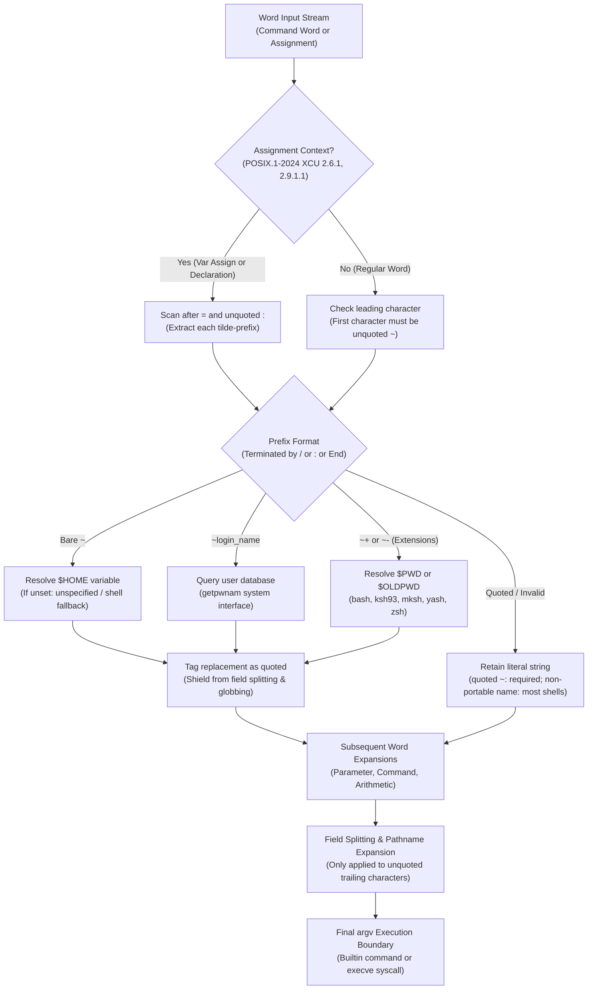

# Tilde Expansion

> [!summary] Claim
> Tilde expansion is the initial shell word expansion phase that translates unquoted leading tilde prefixes and colon-delimited assignment values into canonical user directory paths via the `HOME` variable or system user database lookups while treating the expanded replacement text as if quoted.

Part of [The POSIX Shell Language](README.md) in [Shell and Unix Engineering](../README.md).

## TL;DR

- Mechanism: The shell identifies an unquoted tilde prefix at the beginning of a word or following an unquoted equals sign or colon in an assignment, substituting the value of `$HOME` or querying the system user database via `getpwnam()` before any other word expansions run.
- Rule: The pathname that replaces a tilde prefix is treated as if quoted, shielding the expanded string from subsequent field splitting and pathname expansion, though trailing characters in the word remain eligible for regular expansion.
- Trap: Double-quoting suppresses tilde expansion completely, causing default parameter expansions like `"${PATH:-~/bin}"` or scripts with `dir="~/data"` to store literal tilde paths that fail when accessed directly by system calls like `open(2)` or `execve(2)`.
- Portability: Standardized in POSIX.1-2024 `(POSIX.1-2024 XCU 2.6.1)`; unquoted `~` with `HOME=""` produces one empty field under POSIX.1-2024 (Austin Group Defect 1632) in modern bash and native zsh, but zero fields in bash 3.2, zsh in sh emulation, dash, and ksh93, while directory stack extensions `~+` and `~-` are supported in bash, ksh93, mksh, yash, and zsh.
- When not to use it: Avoid tilde expansion in automated shell scripts, continuous integration pipelines, and systems programming, preferring explicit parameter expansions like `"$HOME"` or `"${XDG_CONFIG_HOME:-$HOME/.config}"` to eliminate lexical ambiguities and directory database lookups.

## Mental model



The shell parses incoming tokens and determines whether the current word appears in an assignment context or as a standard command word under POSIX.1-2024 sections 2.6.1 and 2.9.1.1.
For standard words, only an unquoted leading tilde triggers prefix extraction, whereas assignment words permit multiple tilde prefixes immediately following the initial equals sign and any subsequent unquoted colon delimiters.
The extracted prefix is classified into a bare tilde, a named user login, or a shell extension prefix like `~+`.
Bare tildes resolve against the current value of the `HOME` variable, named users trigger a `getpwnam(3)` query against the system user database, and unsupported or invalid prefixes remain untouched as literal text in most shells (POSIX leaves a prefix that is not a portable login name unspecified, and `ksh93` and native `zsh` expand some of them).
Crucially, the resolved replacement pathname is tagged internally as quoted text, preventing the directory string from being split into multiple fields or expanded as a wildcard pattern.
Finally, the resulting token proceeds through parameter expansion, command substitution, arithmetic expansion, and quote removal before reaching the execution boundary.

## How it works

The POSIX specification defines tilde expansion in `(POSIX.1-2024 XCU 2.6.1)` as the first expansion step in word processing.
According to `(POSIX.1-2024 XCU 2.6)`, the expansions performed for a given word occur in strict sequential order: tilde expansion, parameter expansion, command substitution, and arithmetic expansion, beginning to end.
A tilde-prefix consists of an unquoted `<tilde>` character at the beginning of a word, followed by all characters preceding the first unquoted `<slash>`, or all characters in the word if there is no `<slash>`.
If the initial tilde is quoted, there is no tilde-prefix and tilde expansion does not occur.
If a later character in the tilde-prefix is quoted (`~"root"`, `~r\oot`, `~""`), or the prefix contains `$`, the characters after the tilde do not form a portable login name and the result is unspecified `(POSIX.1-2024 XCU 2.6.1)`, a clarification from [Austin Group Defect 1172](https://www.austingroupbugs.net/view.php?id=1172); most shells leave such a word literal, while `ksh93` and native `zsh` unquote the prefix and expand it (measured in the shell matrix).

POSIX.1-2024 section 2.6.1 explicitly details assignment contexts:
In an assignment `(POSIX.1-2024 XBD 4.26)`, multiple tilde-prefixes can be used: one at the beginning of the word following the `<equals-sign>`, and one following any unquoted `<colon>`, or both.
A tilde-prefix in an assignment is terminated by the first unquoted `<colon>` or `<slash>`, or the end of the assignment word.
Under `(POSIX.1-2024 XCU 2.9.1.1)`, when a command name is recognized as a declaration utility (POSIX names `export` and `readonly`; shells treat extensions such as `typeset` and `local` the same way, per [Austin Group Defect 351](https://www.austingroupbugs.net/view.php?id=351)), subsequent words that match the syntax of variable assignments are expanded using assignment rules, enabling colon-separated tilde expansion.
For ordinary command operands (for example `make LIBDIR=~chet/lib`), the word is subject only to regular expansion, meaning tilde expansion only triggers if the entire word begins with a leading tilde `(POSIX.1-2024 XCU C.2.6.1)`.

The resolution of a valid tilde-prefix follows two distinct paths:
1. Bare tilde (`~`): if the tilde-prefix consists of only the `<tilde>` character, it is replaced by the value of the variable `HOME`.
If `HOME` is unset, POSIX leaves the results unspecified.
[Austin Group Defect 1632](https://www.austingroupbugs.net/view.php?id=1632) added an explicit rule for empty values: if the word being expanded consists of only `<tilde>` and `HOME` is set to the null string, expansion produces an empty field (one argument `""`) rather than zero fields.
2. Named user (`~login_name`): the characters following the `<tilde>` must form a portable login name, as described for the `LOGNAME` variable `(POSIX.1-2024 XBD 8.3)`; otherwise the result is unspecified.
The shell queries the user database as if by calling `getpwnam()` defined in the System Interfaces volume `(POSIX.1-2024 XSH getpwnam)`.
If the system recognizes the login name, the tilde-prefix is replaced by the initial working directory associated with that user.
If the login name is unrecognized, POSIX leaves the result unspecified.

A critical requirement of POSIX.1-2024 section 2.6.1 governs quoting semantics:
The pathname that replaces the tilde-prefix is treated as if quoted to prevent it from being altered by field splitting `(POSIX.1-2024 XCU 2.6.5)` and pathname expansion `(POSIX.1-2024 XCU 2.6.6)`.
If a home directory path contains spaces (for example `/Users/Jane Doe`), the expanded path remains a single atomic field.
However, any characters in the word following the tilde-prefix retain their normal quoting status.
In `~/src/*.c`, the prefix `~` expands as if quoted, while `*.c` remains unquoted and undergoes pathname expansion during step 3 of word processing.
Additionally, if a `<slash>` follows the tilde-prefix and the expanded pathname ends with a `<slash>`, POSIX recommends that the trailing `<slash>` from the pathname should be omitted to avoid generating double slashes (a "should" added by Defect 1632, with a note that a future version may make it mandatory).
Measured in the shell matrix, only `mksh` follows the recommendation: with `HOME=/tmp/`, `~/a` gives `/tmp/a` in `mksh` and `/tmp//a` in every other shell.

Under the hood, system implementations interact with C library interfaces and the operating system kernel.
When resolving a username, shells invoke `getpwnam()` or its reentrant counterpart `getpwnam_r(3)`.
In traditional Unix environments, this involves calling `open(2)` on `/etc/passwd`, reading entries with `read(2)`, and closing the descriptor with `close(2)`.
On modern Linux systems with GNU C Library (`glibc`), `getpwnam()` consults the Name Service Switch configuration in `/etc/nsswitch.conf`.
Depending on configured modules (`files`, `systemd`, `sss`, `ldap`), `glibc` opens local Unix domain sockets via `socket(AF_UNIX, SOCK_STREAM, 0)` and communicates with local daemons like `systemd-userdbd` or `sssd`, or establishes network sockets to LDAP and Active Directory controllers.
On macOS, `getpwnam()` in Apple's Libinfo calls `si_user_byname()` on the search module, which can consult the `cache`, `file`, and `ds` modules; the `ds` module sends a `getpwnam` request over an XPC pipe to the `opendirectoryd` job, which `opendirectoryd(8)` describes as the way macOS accesses users and groups `(apple-oss-distributions/Libinfo lookup.subproj/libinfo.c, si_module.c, ds_module.c; man 8 opendirectoryd)`.
The suggested initial buffer size for reentrant password lookups is retrieved via `sysconf(_SC_GETPW_R_SIZE_MAX)`, which may return -1 when there is no fixed limit `(POSIX.1-2024 XSH getpwnam)`; measured with the lab's `tilde-inspect --limits`, it returns 1024 on glibc (Debian 13), -1 on musl (Alpine 3.22), and 4096 on macOS.

In GNU Bash, tilde expansion is orchestrated across several internal source modules.
When parsing tokens in `(bash-5.3 subst.c, expand_word_internal)`, the shell encounters a word starting with `~` and evaluates whether tilde expansion is permitted.
It calls `bash_tilde_expand()` in `(bash-5.3 general.c, bash_tilde_expand)`.
This wrapper uses its `assign_p` argument to select the extra prefixes recognized inside assignment words (`tilde_additional_prefixes`), checks the word with `unquoted_tilde_word()`, invokes `tilde_expand()` in the Readline tilde module `(bash-5.3 lib/tilde/tilde.c, tilde_expand)`, and then runs `QUIT` to act on any pending interrupt (read in the bash-5.3 release tarball).
The library function `tilde_find_prefix()` locates the prefix boundary, while `tilde_expand_word()` resolves the string.
`tilde_expand_word()` reads `HOME` through `sh_get_env_value("HOME")`, which bash defines in `variables.c` as `get_string_value()` on the shell variable, and when `HOME` is unset it calls `sh_get_home_dir()`, which returns the home directory that `get_current_user_info()` in `shell.c` obtained from `getpwuid()`.
A bash linked against an external Readline library can resolve `sh_get_env_value` differently: measured in the shell matrix, the Nix-built bash 5.3.15 on the macOS host expands `~` from the `HOME` it was started with and ignores a later in-script `HOME=` assignment or `unset HOME`.
In Debian `dash`, tilde expansion is implemented in `(dash-0.5.12 src/expand.c, exptilde)`.
The function scans the prefix, gives up and leaves the word literal when it meets a quoted character, reads `HOME` with `lookupvar()`, or invokes `getpwnam()` through its `getpwhome()` helper, before appending the resulting string to the shell output stack.
In `zsh`, `(zsh-5.9 Src/subst.c, filesub)` and `filesubstr()` implement filename and tilde substitutions, handling directory stack extensions and colon-separated paths.
In BusyBox ash, `(busybox shell/ash.c, exptilde)` evaluates tilde tokens using internal expansion flags `EXP_TILDE`, `EXP_VARTILDE`, and `EXP_VARTILDE2` (checked against the current BusyBox source, not the 1.37.0 tag).

## Numbers and limits

The following table documents quantitative specifications, implementation limits, and boundary behaviors of tilde expansion measured across the shell matrix and primary standards (as of 2026-10).

| Metric / Boundary Case | POSIX.1-2024 Specification | GNU bash 5.3 | macOS /bin/bash 3.2.57 | Zsh 5.9 | ksh93u+ / ksh93u+m | MirBSD mksh R59 | BusyBox ash 1.37 | Sourced / Lab Measured |
| :--- | :--- | :--- | :--- | :--- | :--- | :--- | :--- | :--- |
| Login name limit (`LOGIN_NAME_MAX`, bytes including the null) | Minimum 9 (`_POSIX_LOGIN_NAME_MAX`) `(POSIX.1-2024 XBD limits.h)` | 256 (glibc and musl) | 255 (macOS) | 256 / 255 | 256 / 255 | 256 / 255 | 256 / 255 | `(POSIX.1-2024 XBD limits.h)` / measured by hand with `getconf LOGIN_NAME_MAX` (a libc value, not a shell one) |
| Buffer size (`_SC_GETPW_R_SIZE_MAX`) | Suggested size, or -1 if no hard limit `(POSIX.1-2024 XSH getpwnam)` | 1024 (glibc), -1 (musl) | 4096 (macOS) | Host libc value | Host libc value | Host libc value | Host libc value | `(POSIX.1-2024 XSH getpwnam)` / measured by hand with `tilde-inspect --limits` (no lab test asserts it) |
| Unset `HOME` (`unset HOME; echo ~`) | Unspecified `(POSIX.1-2024 XCU 2.6.1)` | Fallback to `getpwuid()->pw_dir` | Fallback to `getpwuid()->pw_dir` | Expands to empty string `""` | Login name (93u+) / home dir (93u+m) | Literal `~` | Literal `~` | Lab measured across matrix |
| Null `HOME` field count (`HOME=""; set -- ~`) | Produces 1 empty field `(POSIX.1-2024 XCU 2.6.1)`, from Defect 1632 | 1 field (`$#=1`, `argv[0]=""`) | 0 fields (`$#=0`) | 1 field (0 fields in sh emulation) | 0 fields (`$#=0`) | 0 fields (`$#=0`) | 0 fields (`$#=0`) | `(POSIX.1-2024 XCU 2.6.1)` / Lab measured |
| Spaced `HOME` field count (`HOME="a b"; set -- ~`) | Treated as if quoted (1 field) `(POSIX.1-2024 XCU 2.6.1)` | 1 field (`$#=1`) | 1 field (`$#=1`) | 1 field (`$#=1`) | 1 field (`$#=1`) | 1 field (`$#=1`) | 1 field (`$#=1`) | `(POSIX.1-2024 XCU 2.6.1)` / Lab measured |
| Unknown login name (`echo ~nosuchuser`) | Unspecified `(POSIX.1-2024 XCU 2.6.1)` | Preserves literal `~nosuchuser` (exit 0) | Preserves literal `~nosuchuser` (exit 0) | Fatal error: `no such user` (exit 1) | Preserves literal `~nosuchuser` (exit 0) | Preserves literal `~nosuchuser` (exit 0) | Preserves literal `~nosuchuser` (exit 0) | `(POSIX.1-2024 XCU C.2.6.1)` / Lab measured |
| Directory stack `~+` / `~-` | Unspecified `(POSIX.1-2024 XCU C.2.6.1)` | Expands `$PWD` / `$OLDPWD` | Expands `$PWD` / `$OLDPWD` | Expands `$PWD` / `$OLDPWD` | Expands `$PWD` / `$OLDPWD` | Expands `$PWD` / `$OLDPWD` | Unsupported (literal `~+` / `~-`) | `(POSIX.1-2024 XCU C.2.6.1)` / Lab measured |
| Quoted prefix characters (`~""`, `~"root"`) | Not a portable login name, so unspecified `(POSIX.1-2024 XCU 2.6.1)` | Suppressed (literal `~` / `~root`) | Suppressed (literal `~` / `~root`) | Unquotes prefix (literal in sh emulation) | Unquotes prefix (expands path) | Suppressed (literal `~` / `~root`) | Suppressed (literal `~` / `~root`) | `(POSIX.1-2024 XCU 2.6.1)` / Lab measured |
| Dynamic login variable (`u=root; echo ~$u`) | `~$u` is not a portable login name, so unspecified `(POSIX.1-2024 XCU 2.6.1)` | Literal `~root` | Literal `~root` | Expands to `/var/root` or `/root` | Expands to `/var/root` or `/root` | Literal `~root` | Literal `~root` | `(POSIX.1-2024 XCU 2.6.1)` / Lab measured |
| Colon in assignment (`a=~/a:~root/b`) | Supported after `=` and unquoted `:` `(POSIX.1-2024 XCU 2.6.1)` | Expands both tilde prefixes | Expands both tilde prefixes | Expands both tilde prefixes | Expands both tilde prefixes | Expands both tilde prefixes | Expands both tilde prefixes | `(POSIX.1-2024 XCU 2.6.1)` / Lab measured |
| Assignment operand (`cmd PATH=~/a:~root/b`) | Regular expansion only (no colon tildes) `(POSIX.1-2024 XCU 2.9.1.1)` | Expands assignment (magic equals) | Expands assignment (magic equals) | Literal `PATH=~/a:~root/b` | Literal `PATH=~/a:~root/b` | Expands after `=` only (no colon tildes) | Literal `PATH=~/a:~root/b` | `(POSIX.1-2024 XCU 2.9.1.1)` / Lab measured |
| Trailing slash consolidation (`HOME="/tmp/"; echo ~/a`) | Trailing slash should be omitted `(POSIX.1-2024 XCU 2.6.1)` | Preserves slash (`/tmp//a`) | Preserves slash (`/tmp//a`) | Preserves slash (`/tmp//a`) | Preserves slash (`/tmp//a`) | Omits slash (`/tmp/a`) | Preserves slash (`/tmp//a`) | `(POSIX.1-2024 XCU 2.6.1)` / measured by hand in the shell matrix (no lab test asserts it) |

Debian `dash` 0.5.12, `posh` 0.14.1, BusyBox ash 1.37.0, `mksh` R59, and `yash` 2.58.1 leave unset `HOME` as a literal `~` string, whereas `dash`, `posh`, and BusyBox ash do not implement directory stack extensions `~+` or `~-`.
Under `bash --posix`, GNU Bash 5.x preserves `PATH=~/a:~root/b` literally when passed to ordinary utilities, while legacy bash 3.2 and 4.4 in POSIX mode expand the colon-separated tilde but preserve the initial tilde.
In `mksh`, ordinary command operands with assignment syntax expand the leading tilde after `=` but preserve any subsequent colon-separated tilde prefixes.
In `posh` 0.14.1, declaration utilities like `export` and `readonly` do not trigger assignment tilde expansion, leaving `export PATH=~/bin:~root/bin` unexpanded.
In `yash` 2.58.1, tilde expansion is performed inside the default word of double-quoted parameter expansion `${v:-~}`, whereas all other shells leave the tilde unexpanded.

## Portability

The matrix below reflects empirical verification across real shell binaries under the test harness.
While POSIX.1-2024 standardizes basic tilde expansion, divergence emerges around empty variables, error handling, syntax extensions, and assignment contexts.

| Shell / Target Environment | Bare `~` Expansion | Unset `HOME` Behavior | Null `HOME` (`$#`) | Unknown User `~user` | Stack `~+` / `~-` | Quoted Prefix `~"root"` | Expansion Order `~$u` | Command Operand `cmd A=~/b` |
| :--- | :--- | :--- | :--- | :--- | :--- | :--- | :--- | :--- |
| POSIX.1-2024 `sh` | Expands `$HOME` `(POSIX.1-2024 XCU 2.6.1)` | Unspecified | 1 empty field `(POSIX.1-2024 XCU 2.6.1)` | Unspecified | Unspecified | Unspecified (not a portable login name) `(POSIX.1-2024 XCU 2.6.1)` | Unspecified (not a portable login name) `(POSIX.1-2024 XCU 2.6.1)` | Literal `A=~/b` `(POSIX.1-2024 XCU 2.9.1.1)` |
| macOS `/bin/bash` 3.2.57 | Expands `$HOME` | `getpwuid()` fallback | 0 fields | Literal `~user` | Expands `$PWD` / `$OLDPWD` | No expansion | Literal `~root` | Expands `A=$HOME/b` (POSIX mode, as `/bin/sh`: literal after `=`, but a tilde after `:` still expands) |
| GNU bash 5.3.15 | Expands `$HOME` | `getpwuid()` fallback | 1 empty field | Literal `~user` | Expands `$PWD` / `$OLDPWD` | No expansion | Literal `~root` | Expands `A=$HOME/b` (literal in POSIX mode) |
| Zsh 5.9.2 (native) | Expands `$HOME` | Empty string `""` | 1 empty field | Error (exit 1) | Expands `$PWD` / `$OLDPWD` | Unquotes and expands | Expands to root's home | Literal `A=~/b` |
| Zsh 5.9.2 (`--emulate sh`) | Expands `$HOME` | Empty string `""` | 0 fields | Literal `~user` | Expands `$PWD` / `$OLDPWD` | No expansion (literal `~root`) | Literal `~root` | Literal `A=~/b` |
| Debian `dash` 0.5.12 | Expands `$HOME` | Literal `~` | 0 fields | Literal `~user` | Unsupported (literal) | No expansion | Literal `~root` | Literal `A=~/b` |
| Debian `posh` 0.14.1 | Expands `$HOME` | Literal `~` | 0 fields | Literal `~user` | Unsupported (literal) | No expansion | Literal `~root` | Literal `A=~/b` (`export` also literal) |
| AT&T `ksh93` (93u+ / 93u+m) | Expands `$HOME` | Login name (93u+) / home dir (93u+m) | 0 fields | Literal `~user` | Expands `$PWD` / `$OLDPWD` | Unquotes and expands | Expands to root's home | Literal `A=~/b` |
| MirBSD `mksh` R59 | Expands `$HOME` | Literal `~` | 0 fields | Literal `~user` | Expands `$PWD` / `$OLDPWD` | No expansion | Literal `~root` | Expands after `=` only (no colon tildes) |
| Yash 2.58.1 | Expands `$HOME` | Literal `~` | 0 fields | Literal `~user` | Expands `$PWD` / `$OLDPWD` (literal in POSIX mode) | No expansion | Literal `~root` | Literal `A=~/b` (expands in `"${v:-~}"`) |
| BusyBox ash 1.37.0 | Expands `$HOME` | Literal `~` | 0 fields | Literal `~user` | Unsupported (literal) | No expansion | Literal `~root` | Literal `A=~/b` |

## Worked example

The script below is the lab's probe, `tilde-probe.sh`, reproduced verbatim from the [lab](../labs/03-tilde-expansion/).
The lab's bats tests run it across distinct probe modes, using the compiled C helper `tilde-inspect` to verify argument boundaries, string lengths, and environment interactions.

```sh
#!/bin/sh
# tilde-probe.sh: probe POSIX.1-2024 tilde expansion semantics and shell divergences.
# Used by the Tilde-Expansion lab to verify POSIX compliance and implementation limits.
# shellcheck disable=SC2248 # Explicitly testing unquoted tilde behavior

set -eu

mode="${1:-help}"
shift || true

case "$mode" in
  basic-home)
    # Tests unquoted ~ expansion to HOME
    HOME="${1:-/test/home}"
    # shellcheck disable=SC2088 # Tilde expansion is under test
    printf 'home=<%s>\n' ~
    ;;

  whitespace-home)
    # Tests that expanded HOME is treated as if quoted (no field splitting)
    dump="$1"
    HOME="dir with spaces"
    # shellcheck disable=SC2086,SC2088 # Testing unquoted tilde argument passing
    "$dump" --dump-args ~
    ;;

  unset-home)
    # Tests ~ expansion when HOME is unset
    unset HOME || true
    # shellcheck disable=SC2088 # Testing unset HOME expansion
    printf '<%s>\n' ~
    ;;

  user-lookup)
    # Tests lookup of root user directory
    # shellcheck disable=SC2088 # User lookup under test
    printf 'root=<%s>\n' ~root
    ;;

  unknown-user)
    # Tests unrecognized login name handling
    # shellcheck disable=SC2088 # Testing unknown user behavior
    printf 'unknown=<%s>\n' ~nosuchuser99999
    ;;

  dir-stack)
    # Tests ~+ and ~- directory stack extensions
    dir_a="$1"
    dir_b="$2"
    cd "$dir_a"
    cd "$dir_b"
    # shellcheck disable=SC2088 # Testing ~+ and ~- extensions
    printf 'pwd=<%s> oldpwd=<%s>\n' ~+ ~-
    ;;

  quoted-prefix)
    # Tests quoting within or before tilde prefix
    # shellcheck disable=SC1001,SC2088 # Escaped characters and tildes are under test
    printf 'backslash=<%s> double=<%s> single=<%s> empty_double=<%s> quoted_user=<%s> escaped_char=<%s>\n' \
      \~ "~" '~' ~"" ~"root" ~r\oot
    ;;

  expansion-order)
    # Tests tilde expansion relative to parameter expansion (tilde runs first)
    u="root"
    # shellcheck disable=SC2088 # Testing order: tilde before variable expansion
    printf 'var=<%s>\n' ~$u
    ;;

  assignment-colon)
    # Tests assignment context and colon-separated tilde prefixes
    HOME="/mock/home"
    # shellcheck disable=SC2088 # Testing assignment tilde expansion
    a=~/bin:~root/bin
    b=:~
    # shellcheck disable=SC1001 # Escaped colon is under test
    c=foo\:~
    d="foo:":~
    printf 'a=<%s> b=<%s> c=<%s> d=<%s>\n' "$a" "$b" "$c" "$d"
    ;;

  command-operand)
    # Tests assignment syntax in command operand vs declaration utility
    HOME="/mock/home"
    # Normal command operand: not an assignment
    # shellcheck disable=SC2088 # Testing lack of expansion in operand
    printf 'operand=<%s>\n' PATH=~/bin:~root/bin
    # Declaration utility: treated as assignment
    # shellcheck disable=SC2088 # Testing declaration utility expansion
    export FOO=~/bin:~root/bin
    printf 'export=<%s>\n' "$FOO"
    ;;

  pe-default)
    # Tests tilde expansion in unquoted vs double-quoted parameter expansion default
    HOME="/mock/home"
    unset v || true
    # shellcheck disable=SC2086,SC2088 # Unquoted parameter expansion default is explicitly under test
    printf 'unquoted=<%s> quoted=<%s>\n' ${v:-~} "${v:-~}"
    ;;

  redirection)
    # Tests tilde expansion in redirection targets
    target_dir="$1"
    HOME="$target_dir"
    # shellcheck disable=SC2088 # Testing tilde in redirection
    printf 'ok\n' >~/probe.out
    if [ -f "$target_dir/probe.out" ]; then
      printf 'redirect=ok\n'
    else
      printf 'redirect=fail\n'
    fi
    ;;

  *)
    printf 'Usage: %s <mode> [args...]\n' "$0" >&2
    exit 1
    ;;
esac
```

Captured in the Alpine matrix image with bash 5.3.20 (`/opt/shells/bash-5.3`, run here as `bash`, native mode), as user `lab` (passwd home `/home/lab`) with `HOME=/mock/home` exported and `/tmp/a`, `/tmp/b`, and `/tmp/test_dir` created beforehand, the probe script produces these outputs:

```text
$ bash ./tilde-probe.sh basic-home /mock/home
home=</mock/home>
$ bash ./tilde-probe.sh whitespace-home ./tilde-inspect
argc=1
argv[0]: len=15 <dir with spaces>
$ bash ./tilde-probe.sh unset-home
</home/lab>
$ bash ./tilde-probe.sh user-lookup
root=</root>
$ bash ./tilde-probe.sh unknown-user
unknown=<~nosuchuser99999>
$ bash ./tilde-probe.sh dir-stack /tmp/a /tmp/b
pwd=</tmp/b> oldpwd=</tmp/a>
$ bash ./tilde-probe.sh quoted-prefix
backslash=<~> double=<~> single=<~> empty_double=<~> quoted_user=<~root> escaped_char=<~root>
$ bash ./tilde-probe.sh expansion-order
var=<~root>
$ bash ./tilde-probe.sh assignment-colon
a=</mock/home/bin:/root/bin> b=<:/mock/home> c=<foo:~> d=<foo::/mock/home>
$ bash ./tilde-probe.sh command-operand
operand=<PATH=/mock/home/bin:/root/bin>
export=</mock/home/bin:/root/bin>
$ bash ./tilde-probe.sh pe-default
unquoted=</mock/home> quoted=<~>
$ bash ./tilde-probe.sh redirection /tmp/test_dir
redirect=ok
```

When evaluated under Debian `dash` 0.5.12 in the Debian matrix image with the same setup, the outputs show the literal fallbacks and the absence of GNU Bash extensions:

```text
$ dash ./tilde-probe.sh unset-home
<~>
$ dash ./tilde-probe.sh dir-stack /tmp/a /tmp/b
pwd=<~+> oldpwd=<~->
$ dash ./tilde-probe.sh command-operand
operand=<PATH=~/bin:~root/bin>
export=</mock/home/bin:/root/bin>
```

## Pitfalls

> [!warning] The double-quoted tilde expansion suppression trap
> Trigger: Wrapping a path containing a leading tilde in double quotes, such as `config_dir="~/.config/app"`.
> Symptom: The `<tilde>` character is quoted, suppressing tilde expansion completely.
> The variable stores the literal string `~/.config/app`.
> When passed to system calls like `open(2)`, `stat(2)`, or standard utilities, the kernel searches for a literal directory named `~` in the current working directory, failing with `ENOENT` or creating corrupt local directory trees.
> Fix: Assign the variable unquoted (`config_dir=~/.config/app`) or explicitly reference the parameter (`config_dir="$HOME/.config/app"`).

> [!warning] The double-quoted parameter expansion default trap
> Trigger: Specifying a fallback path using `~` inside double-quoted parameter expansion, such as `target_dir="${1:-~/backup}"`.
> Symptom: In `"${1:-~/backup}"`, the double quotes envelop the entire parameter expansion word.
> Under `(POSIX.1-2024 XCU 2.6.2)`, word expansions performed on default expressions inherit the quoting context.
> The `<tilde>` is treated as quoted, producing the literal string `~/backup` when `$1` is null or unset.
> Fix: Use an explicit parameter reference inside the quotes (`target_dir="${1:-$HOME/backup}"`) or perform the expansion unquoted (`target_dir=${1:-~/backup}`).

> [!warning] The command argument assignment divergence trap
> Trigger: Passing assignment-style arguments to non-declaration utilities, such as `make PREFIX=~/local` or `rsync -av SRC=~/data:~root/data dest:`.
> Symptom: In GNU Bash in native mode, `magic_equal_subst` automatically performs tilde expansion on every tilde prefix following an unquoted equals sign or colon.
> In strictly conforming POSIX shells (`dash`, `posh`, `yash`, `zsh`, and `bash` 5.x under `set -o posix`), operands following regular command names only undergo leading-tilde expansion `(POSIX.1-2024 XCU 2.9.1.1)`.
> In `mksh`, the shell expands a tilde immediately following the equals sign (`PREFIX=$HOME/local`), but leaves any colon-separated tilde prefixes unexpanded.
> In legacy `bash` 3.2 and 4.4 under POSIX mode, the shell preserves the leading tilde after `=` but erroneously expands the tilde after subsequent colons.
> On non-bash systems, passing assignment operands to utilities causes build targets or synchronization jobs to receive unexpanded literal tildes.
> Fix: Expand variables explicitly using shell parameter expansion: `make PREFIX="$HOME/local"`.

> [!warning] The dynamic login name expansion order trap
> Trigger: Attempting to dynamically select a user home directory by variable interpolation, such as `user="alice"; path=~$user/docs`.
> Symptom: Tilde expansion runs before parameter expansion in step 1 of word processing `(POSIX.1-2024 XCU 2.6)`.
> When tilde expansion executes, the prefix is `$user`, which is not a portable login name, so POSIX leaves the result unspecified `(POSIX.1-2024 XCU 2.6.1)`.
> In most shells, tilde expansion leaves the word unchanged, and parameter expansion subsequently expands `$user`, resulting in the literal string `~alice/docs`.
> Although `ksh93` and native `zsh` evaluate the variable dynamically (measured in the shell matrix), scripts running under `dash`, `bash`, `mksh`, `yash`, `posh`, or BusyBox ash fail.
> Fix: Query the user database deterministically using `getent passwd "$user"` or Python/Perl helpers, or assign the home directory via an explicit parameter.

> [!warning] The unset HOME literal tilde deletion hazard
> Trigger: Executing scripts where `HOME` has been stripped from the environment (`env -i script.sh`) that run cleanup commands like `rm -rf ~/*`.
> Symptom: In `dash`, `posh`, `busybox`, `mksh`, and `yash`, an unset `HOME` causes `~` to remain unexpanded as a literal `~`.
> If a local directory named `~` exists in the working directory, the command unexpectedly purges the contents of that directory.
> In `bash` and `ksh93u+m`, the shell falls back to `getpwuid(getuid())` and deletes files in the actual user home directory.
> In `zsh`, `~` with unset `HOME` expands to an empty string, transforming `~/*` into `/*` and risking total system deletion.
> Fix: Enforce parameter validation using parameter expansion error assertions: `: "${HOME:?HOME must be set}"`.

> [!warning] The Yash double-quoted parameter expansion default divergence
> Trigger: Specifying a fallback path containing `~` inside double-quoted parameter expansion under Yash, such as `target="${1:-~}"` or `"${config:-~/app.conf}"`.
> Symptom: While POSIX shells (`bash`, `dash`, `ksh93`, `mksh`, `busybox`, `zsh`) treat the double-quoted fallback word as quoted and preserve literal `~`, Yash evaluates unquoted tilde prefixes inside `${v:-word}` even when the surrounding expansion is double-quoted.
> The expression expands to the full home directory path under Yash, creating portability discrepancies when scripts rely on quotes to inhibit tilde expansion.
> Fix: Quote the tilde character explicitly within the parameter expansion default (`"${1:-"~"}"`) or use explicit parameter expansion (`"${1:-$HOME}"`).

> [!warning] The posh non-declaration utility export trap
> Trigger: Using `export` or `readonly` with assignment syntax relying on tilde expansion under Debian `posh` 0.14.1, such as `export PATH=~/bin:~root/bin`.
> Symptom: Under POSIX.1-2024 section 2.9.1.1, declaration utilities treat arguments formatted as variable assignments using assignment rules, expanding tildes after `=` and `:`.
> Debian `posh` 0.14.1 does not implement declaration utility argument parsing, treating arguments to `export` as ordinary command operands and leaving both tilde prefixes unexpanded (`PATH=~/bin:~root/bin`).
> Fix: Separate the variable assignment from the declaration command: `PATH=~/bin:~root/bin; export PATH`.

> [!warning] The root directory double-slash resolution trap
> Trigger: Running a script under a user account whose home directory is `/` (such as `root` in certain containers or chroot environments), using `path=~/bin`.
> Symptom: `~` expands to `/`, resulting in the concatenated string `//bin`.
> Under `(POSIX.1-2024 XBD 4.16)` (Pathname Resolution), a pathname that begins with two successive slashes may be interpreted in an implementation-defined manner (such as network shares in Cygwin or special domain paths in Apollo Domain/OS), and the rationale in `(POSIX.1-2024 XCU C.2.6.1)` tells administrators on such systems not to give users a home directory of `/` or `//`.
> Of the measured shells only `mksh` drops the trailing slash of the home directory itself, as the "should" in `(POSIX.1-2024 XCU 2.6.1)` recommends.
> Fix: Strip a trailing slash before joining (`h=${HOME%/}; path="$h/bin"`), which turns a home of `/` into `/bin`; do not strip the leading `//` with `${path#//}`, which leaves the relative path `bin`.

> [!warning] The glibc tilde expansion buffer overflow and memory corruption (CVE-2026-6791, CVE-2020-1752)
> Trigger: Passing user-controlled, untrusted strings beginning with `~username` to C library functions that perform tilde expansion (such as `wordexp(3)` or `glob(3)`).
> Symptom: In `glibc` `wordexp()`, the internal `parse_tilde` function copies the user name onto the thread stack with `strndupa` and no bounds check, so a name thousands of characters long exhausts the stack and can trigger a stack clash (CVE-2026-6791, published by NVD 2026-08-10; Sourceware bug 34091 still had status NEW when checked, as of 2026-10).
> In `glibc` `glob()`, tilde expansion of a path that starts with `~` and a valid user name had a use-after-free, introduced in glibc 2.14 and fixed in 2.32, that NVD rates as potentially leading to arbitrary code execution by a local attacker (CVE-2020-1752).
> Fix: Avoid passing raw untrusted network input into `wordexp()` or `glob()`; validate username lengths against `LOGIN_NAME_MAX` prior to processing.

> [!warning] The LDAP/NSS synchronous network lookup denial-of-service
> Trigger: Evaluating tilde expressions with arbitrary or nonexistent user names in high-throughput loops, such as parsing server logs with `~${log_user}`.
> Symptom: For every distinct username, the shell executes `getpwnam()`.
> In enterprise environments configured with LDAP, SSSD, or Active Directory via `/etc/nsswitch.conf`, each failed lookup issues synchronous network RPC requests and DNS queries, freezing shell execution for multiple seconds per record.
> Fix: Never use tilde expansion for user lookup in data processing scripts; cache user home directories locally or query a local map.

## Security and robustness

Tilde expansion represents a unique attack surface at the intersection of lexical parsing, operating system user databases, and filesystem namespace resolution.
Because tilde expansion occurs before parameter expansion and quote removal, developers often assume it behaves identically to parameter expansion (`$HOME`).
However, several architectural differences introduce distinct security risks.

The most prominent vulnerability pattern stems from improper quoting when assigning or passing paths.
When a script assigns `DIR="~/data"`, the literal character `~` is stored in the variable.
If that variable is subsequently used in an unquoted context (`cd $DIR`), the shell performs field splitting and globbing, but does not perform tilde expansion, because tilde expansion occurs only during initial word expansion before variable values are substituted.
If the developer attempts to resolve this by passing the variable through `eval` (`eval "cd $DIR"`), any unescaped metacharacters, semicolons, or command substitutions embedded in `$DIR` execute as arbitrary code.
Passing user-controlled directory strings through `eval` to achieve tilde expansion constitutes an OS command injection vulnerability (CWE-78).

A secondary security vulnerability involves directory spoofing in untrusted working directories.
If a script relies on tilde expansion in an environment where `HOME` has been unset or cleared by a restricted execution environment, shells like `dash` and `posh` leave `~` unexpanded.
An attacker with write access to the working directory can create a directory named `~` (`mkdir ./~`).
Any subsequent command like `cat ~/config` or `rm -rf ~/cache` operates on the attacker-controlled local directory rather than the user's real profile, leading to privilege escalation, configuration hijacking, or data loss.

In distributed enterprise environments, tilde expansion on named users (`~user`) interacts directly with network authentication systems.
Because `getpwnam(3)` must resolve names through the NSS switch architecture, supplying malformed or attacker-controlled user names can trigger denial-of-service conditions.
A script that parses untrusted input and evaluates `~${input_user}` can be stalled indefinitely by LDAP query timeouts, socket exhaustion in local NSS daemons (`sssd` or `nscd`), or stack exhaustion vulnerabilities in libc expansion functions like `wordexp(3)` (CVE-2026-6791).

To ensure production robustness:
1. Never use `~` in unattended scripts or infrastructure software; use `"$HOME"` or `"${XDG_CONFIG_HOME:-$HOME/.config}"`.
2. Always double-quote variable expansions containing pathnames (`"$target_dir"`).
3. Validate that `HOME` is non-empty before relying on default paths (`: "${HOME:?HOME must be set}"`).
4. Avoid using `eval` to force expansion of tilde characters in user input.

## The principal's view

From the perspective of a principal systems engineer, tilde expansion is an interactive convenience feature that should never be permitted in production shell code.
The construct exists to minimize keystrokes at an interactive terminal prompt, where a human operator can visually inspect and verify the expanded command line.
In automated systems, deployment manifests, daemon wrappers, and CI/CD pipelines, tilde expansion introduces non-deterministic behavior, subtle quoting hazards, and hidden dependencies on the local user database.

The core trade-off of tilde expansion is brevity versus determinism.
Writing `~/bin` saves four keystrokes compared to `"$HOME/bin"`, but introduces critical failure modes:
1. Lexical fragility: placing quotes around the expression (`"~/bin"`) silently alters the semantics from path resolution to literal character assignment.
2. Portability divergence: shells differ fundamentally on how they handle unset `HOME` variables (literal `~` in `dash`, `posh`, `busybox`, `mksh`, and `yash`; home directory in `bash` and `ksh93u+m`; login name in `ksh93u+` 2012; empty string in `zsh`), null `HOME` fields under Defect 1632, double-quoted parameter expansion defaults in `yash`, declaration utilities in `posh`, and command arguments (`magic_equal_subst` in `bash`, leading equals only in `mksh`).
3. Network latency and reliability: resolving `~user` introduces synchronous external I/O across the NSS switch stack, creating points of failure in containerized or network-degraded environments.

ShellCheck SC2088 ("Tilde does not expand in quotes") catches only the quoted-tilde trap from the first Pitfall, such as `"~/bin"`; it does not flag an unquoted `~/bin`.
To forbid tilde prefixes in non-interactive scripts, add a custom check, such as a CI grep for a `~` at the start of a word or a code review rule.
When user directory paths are required, reference standard environment variables explicitly:
```sh
# Correct, deterministic, and portable
readonly APP_DIR="${HOME:?HOME variable is required}/.local/share/app"
readonly BIN_DIR="${XDG_BIN_HOME:-$HOME/.local/bin}"
```
If a system must resolve arbitrary user home directories programmatically, avoid delegating the task to the shell.
Implement the lookup in a memory-safe compiled language using reentrant POSIX system interfaces like `getpwnam_r(3)`, properly bounding buffer allocations against `sysconf(_SC_GETPW_R_SIZE_MAX)` and validating error codes.

## Interview questions

> [!question] L5: Explain the difference in shell behavior between writing `cd ~`, `cd "~"`, and `cd \~`.
>
> > [!success]- Answer
> > In `cd ~`, the `<tilde>` character is unquoted and located at the beginning of the word, triggering tilde expansion under POSIX.1-2024 section 2.6.1 and expanding to the value of `$HOME`.
> > In `cd "~"`, the tilde is enclosed in double quotes, which suppresses tilde expansion and passes the literal character `~` to the `cd` utility.
> > In `cd \~`, the backslash escapes the tilde, which suppresses tilde expansion, and quote removal subsequently strips the backslash to pass the literal character `~`.
> > As a result, both `cd "~"` and `cd \~` attempt to change directory to a literal subdirectory named `~` in the current working directory.
> >
> > Follow-up: What happens if `HOME` is set to `/tmp` and you run `cd ~/subdir` versus `cd "~/subdir"`?

> [!question] L5: Predict the output of the following script across POSIX-conforming shells when `v` is unset and `HOME="/home/user"`.
> ```sh
> unset v
> printf '<%s> <%s>\n' ${v:-~} "${v:-~}"
> ```
>
> > [!success]- Answer
> > In standard POSIX shells (`bash`, `dash`, `ksh93`, `mksh`, `busybox`, and `zsh`), the script prints `</home/user> <~>`.
> > In `${v:-~}`, the parameter expansion default word `~` is unquoted and undergoes tilde expansion, replacing the tilde with `/home/user`.
> > In `"${v:-~}"`, the entire parameter expansion is enclosed in double quotes, meaning the default word `~` is treated as quoted under POSIX.1-2024 section 2.6.2.
> > Because quoted characters suppress tilde expansion, conforming shells evaluate the second expression to the literal character `~`.
> > In Yash 2.58.1, tilde expansion diverges: Yash performs tilde expansion inside the default word of double-quoted parameter expansions, printing `</home/user> </home/user>`.
> >
> > Follow-up: Why does writing `PATH="${PATH:-~/bin}"` frequently cause unexpected command search failures?

> [!question] L6: Debug this deployment automation script where customer servers running Debian dash corrupt the working directory instead of cleaning the user cache.
> ```sh
> #!/bin/sh
> env -i ./cleanup.sh
> # Inside cleanup.sh:
> rm -rf ~/*
> ```
>
> > [!success]- Answer
> > The parent script invokes `cleanup.sh` using `env -i`, which clears the entire environment and leaves `HOME` unset.
> > Under POSIX.1-2024 section 2.6.1, the result of tilde expansion when `HOME` is unset is explicitly unspecified.
> > In Debian `dash`, `posh`, BusyBox ash, `mksh`, and `yash`, the shell does not fall back to the password database and leaves `~` unexpanded as a literal string.
> > The word `~/*` is then globbed relative to the working directory: if a literal directory named `~` exists, it expands to the files inside `./~` and `rm` deletes them; otherwise the pattern matches nothing, stays literal, and `rm -rf` silently does nothing.
> > In `zsh`, `~` with unset `HOME` expands to an empty string, transforming `~/*` into `/*` and risking total root filesystem deletion.
> > The fix is to ensure `HOME` is preserved or explicitly validated at the top of `cleanup.sh` using `: "${HOME:?HOME must be set}"`.
> >
> > Follow-up: How does GNU Bash behave differently from `dash` when `HOME` is unset during tilde expansion?

> [!question] L6: Why does `u="root"; echo ~$u` fail to expand root's home directory in `bash` and `dash`, whereas `eval echo ~$u` succeeds?
>
> > [!success]- Answer
> > In POSIX.1-2024 section 2.6, word expansions occur in strict sequence: tilde expansion executes before parameter expansion.
> > When the shell processes `~$u`, the tilde-prefix is `$u`, which is not a portable login name, so POSIX.1-2024 section 2.6.1 leaves the result unspecified (it lists `~$var` as an example).
> > In `bash` and `dash`, tilde expansion leaves the prefix unchanged, and parameter expansion subsequently expands `$u` to `root`, producing the literal string `~root`.
> > When using `eval echo ~$u`, the shell executes an initial expansion pass where `$u` becomes `root`, generating the string `echo ~root`.
> > The `eval` utility then reparses and executes this string in a second complete expansion pass, where `~root` is recognized as a valid tilde prefix and expanded to `/var/root` or `/root`.
> >
> > Follow-up: Why is using `eval` to force tilde expansion considered a severe security anti-pattern?

> [!question] L6: Describe how Austin Group Defect 1632 changed the POSIX.1-2024 specification regarding the expansion of bare `~` when `HOME=""`, and how real shells diverge.
>
> > [!success]- Answer
> > Before POSIX.1-2024, section 2.6 required that an empty field produced by the complete expansion of a word be deleted unless the original word contained single-quote or double-quote characters, so an unquoted bare `~` with a null `HOME` produced zero fields, just like an unquoted null variable.
> > Austin Group Defect 1123 deleted that general rule from section 2.6 (empty-field removal is now a property of field splitting), and Defect 1632 added an explicit sentence to section 2.6.1: if the word being expanded consists of only `<tilde>` and `HOME` is set to the null string, it produces an empty field (one argument `""`) rather than zero fields.
> > Measured in the shell matrix, in GNU Bash 4.4 and later (the oldest 4.x release measured) and native Zsh, `HOME=""; set -- ~` produces `$#=1` with an empty string argument.
> > In Zsh in sh emulation mode (`zsh --emulate sh`), as well as historical shells like macOS `/bin/bash` 3.2, Debian `dash` 0.5.12, `mksh`, BusyBox ash, and AT&T `ksh93`, the expansion produces zero fields (`$#=0`).
> >
> > Follow-up: What system call error occurs if `HOME=""` and a script executes `cd ~` in a POSIX.1-2024 conforming shell?

> [!question] L6: In the command `printf '%s\n' PATH=~/bin:~root/bin`, explain why GNU Bash in native mode expands both tildes, whereas `dash`, `ksh93`, `zsh`, and `bash --posix` leave the word completely unexpanded.
>
> > [!success]- Answer
> > Under POSIX.1-2024 section 2.9.1.1, words following a command name that is not a declaration utility are command arguments and undergo regular expansion only.
> > In regular expansion, tilde expansion only applies if the word begins with an unquoted tilde, which `PATH=...` does not.
> > Conforming shells like `dash`, `ksh93`, `zsh`, and `bash` 5.x under POSIX mode leave operands of ordinary commands completely unexpanded.
> > GNU Bash in native mode includes an interactive convenience feature known as `magic_equal_subst`, which automatically applies assignment tilde expansion rules to any word containing an unquoted equals sign.
> > In `mksh`, ksh88 compatibility expands the initial tilde after `=` (`PATH=$HOME/bin:~root/bin`) but leaves the colon-separated tilde literal.
> > Legacy `bash` 3.2 and 4.4 in POSIX mode fail to expand the initial tilde after `=` but expand the tilde after subsequent colons (`PATH=~/bin:/root/bin` on Linux, measured in the shell matrix).
> >
> > Follow-up: If the command were `export PATH=~/bin:~root/bin`, would Debian posh 0.14.1 perform tilde expansion?

> [!question] L7: Trace the execution of `echo ~alice/docs` down to the system call boundary on a Linux system using NSS LDAP, and identify the failure modes in a high-concurrency daemon.
>
> > [!success]- Answer
> > The shell identifies `~alice` as a named tilde prefix and invokes the C library interface `getpwnam("alice")`.
> > The C library reads `/etc/nsswitch.conf`, identifies the `passwd: files sss` directive, and opens a Unix domain socket to the `sssd` daemon.
> > If the entry is not cached locally, `sssd` initiates a synchronous network socket connection to an LDAP or Active Directory domain controller over port 389 or 636.
> > In a high-concurrency daemon or tight shell loop, each lookup blocks the execution thread awaiting network round-trips and directory server authentication.
> > If the network connection stalls or the LDAP server experiences load shedding, shell execution hangs, leading to pipeline stalls, health check timeouts, and cascading process failure.
> >
> > Follow-up: How does macOS resolve `~username` differently at the system call layer?

> [!question] L7+: Analyze the root cause and exploitation mechanism of `glibc` CVE-2020-1752 and CVE-2026-6791 in tilde expansion routines.
>
> > [!success]- Answer
> > In CVE-2020-1752, `glibc`'s `glob()` function mishandled memory during tilde expansion of paths that start with `~` followed by a valid user name, a use-after-free introduced in glibc 2.14 and fixed in 2.32.
> > NVD describes the exploit as a local attacker crafting such a path so that, when `glob()` processes it, a freed buffer is used again, potentially leading to arbitrary code execution.
> > The glibc fix commit (Sourceware bug 25414, `posix/glob.c`) states the mechanism: the value of `end_name` points into the value of `dirname`, so `dirname` must not be deallocated before the last use of `end_name`; the fix reorders the deallocation.
> > In CVE-2026-6791 (Sourceware bug 34091), the internal `parse_tilde` function of `wordexp()` copies the user name after the tilde onto the thread stack with `strndupa()`, sized by the input length with no bounds check.
> > An attacker who controls the string passed to `wordexp()` can supply a user name thousands of characters long, exhaust the thread stack, and trigger a stack clash, corrupting adjacent memory or crashing the process (NVD, published 2026-08-10).
> >
> > Follow-up: How do modern shells like GNU Bash prevent stack exhaustion when extracting login names in `lib/tilde/tilde.c`?

## Related

Prerequisites: [[Expansion-Order]]

Next: [[Parameter-Expansion]]

See also:
- [[Reading-the-POSIX-Standard]]
- [[Token-Recognition]]
- [[Quoting-Backslash-Single-and-Double]]
- [[Simple-Commands-and-Assignment-Prefixes]]
- [[Field-Splitting-and-IFS]]
- [[Pathname-Expansion]]
- [[Quote-Removal]]
- [[POSIX-2024-Changes]]

## Further reading

- [POSIX.1-2024 XCU 2.6.1 Tilde Expansion](https://pubs.opengroup.org/onlinepubs/9799919799/utilities/V3_chap02.html#tag_19_06_01): The authoritative formal specification defining tilde prefixes, assignment contexts, and quoting semantics.
- [POSIX.1-2024 XCU C.2.6.1 Rationale](https://pubs.opengroup.org/onlinepubs/9799919799/xrat/V4_xcu_chap01.html#tag_23_02_06_01): The historical design rationale detailing why assignment exceptions, colon rules, and `make` operand restrictions were selected.
- [POSIX.1-2024 XSH getpwnam](https://pubs.opengroup.org/onlinepubs/9799919799/functions/getpwnam.html): The standard C system interface specification for retrieving user database entries and buffer size metrics.
- [Austin Group Defect 1632](https://www.austingroupbugs.net/view.php?id=1632): Formal defect report adding the empty-field rule for a bare tilde under a null `HOME` and the trailing-slash recommendation.
- [GNU Bash Source: lib/tilde/tilde.c](https://git.savannah.gnu.org/cgit/bash.git/tree/lib/tilde/tilde.c): Primary source implementation of tilde prefix detection, directory resolution, and Readline integration.
- [dash Source: src/expand.c](https://git.kernel.org/pub/scm/utils/dash/dash.git/tree/src/expand.c): Almquist shell implementation illustrating minimal POSIX tilde parsing and stack buffer allocation.
- [NVD CVE-2020-1752 Detail](https://nvd.nist.gov/vuln/detail/CVE-2020-1752): National Vulnerability Database advisory detailing the use-after-free vulnerability in `glibc` tilde expansion.
- [GNU C Library Bug 34091 / CVE-2026-6791](https://sourceware.org/bugzilla/show_bug.cgi?id=34091): Primary defect tracking stack allocation vulnerability in `wordexp` tilde parsing.
- [Yash Shell Source](https://github.com/magicant/yash): POSIX-compliant shell implementation with modern interactive features and parameter expansion evaluation.
- [AT&T ksh93u+m Source](https://github.com/ksh93/ksh): Modern development fork of AT&T KornShell 93 fixing historical bugs in unset HOME handling and POSIX conformance.
