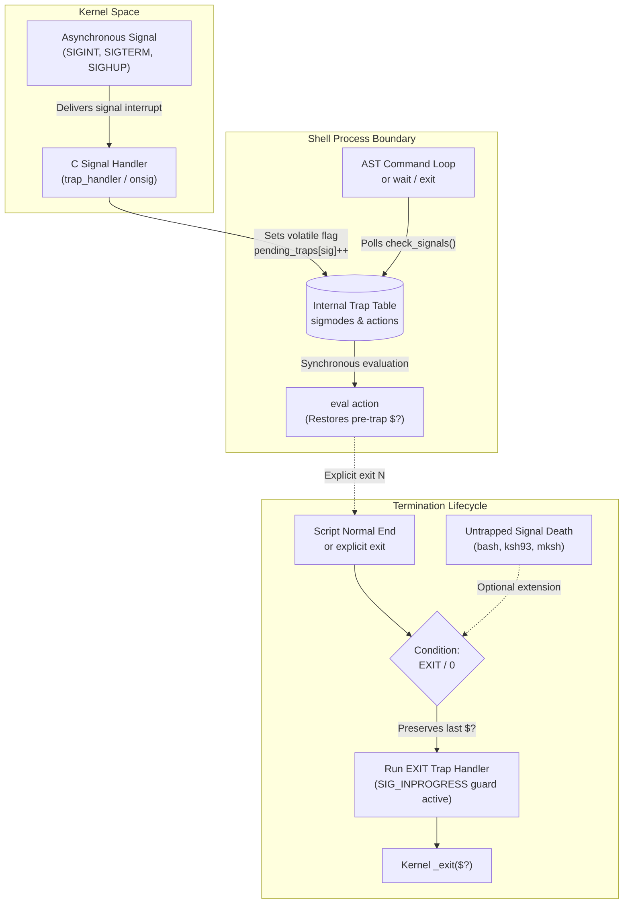

# Traps and EXIT

> [!summary] Claim
> The shell defers asynchronous kernel signal delivery into synchronous abstract-syntax-tree execution boundaries via the `trap` special built-in, where the pseudo-condition `EXIT` runs lifecycle cleanup on normal termination, and only optionally on death by an untrapped signal, while preserving the prior exit status unless explicitly overridden.

Part of [The POSIX Shell Language](README.md) in [Shell and Unix Engineering](../README.md).

## TL;DR

- Mechanism: the shell registers kernel signal handlers via `sigaction(2)` that set internal pending flags, executing the associated `eval action` strings synchronously at command boundaries or upon termination (POSIX.1-2024 XCU 2.12, 2.15).
- Rule: always enclose trap actions in single quotes (`trap 'cleanup' EXIT`) so parameter and command expansions evaluate lazily at invocation time rather than eagerly at registration time.
- Trap: in dash, BusyBox ash, yash, posh, and zsh, an untrapped terminating signal like `SIGTERM` aborts the shell immediately without running the `EXIT` trap, leaking scratch directories unless `TERM`, `INT`, and `HUP` are explicitly trapped and forwarded to `exit`.
- Portability: POSIX.1-2024 standardized `trap -p [condition...]` (Austin Group Defects 1211 and 1212), implemented in bash and yash in the reusable format and in ksh93 as the raw action only, while dash, mksh, posh, and BusyBox ash reject `-p` as an invalid option and zsh prints nothing with status 0 (measured in the shell matrix, as of 2026-11).
- When not to use it: avoid complex trap chains for nested multi-resource orchestration; use Go or Rust where lexical scopes, `defer`, RAII destructors, and cancellation contexts prevent global callback clobbering.

## Mental model



When an asynchronous signal arrives from the kernel, the shell's low-level C signal handler intercepts it and merely records a pending flag in the internal signal state table to honor async-signal safety.
The shell runtime polls these pending flags at command boundaries and safe execution checkpoints, evaluating the registered trap action string through the internal `eval` interpreter while preserving the prior command exit status.
Upon normal shell completion or an explicit `exit` invocation, the runtime invokes the registered `EXIT` pseudo-trap handler in an environment identical to the final command state before passing the final exit code to `_exit(2)`.

## How it works

### The specification

POSIX.1-2024 specifies signal handling and the `trap` utility across sections 2.12, 2.13, and 2.15 `(POSIX.1-2024 XCU 2.12, 2.13, 2.15)`.
Section 2.15 defines `trap` as a special built-in utility conforming to the standard syntax:
```
trap n [condition...]
trap -p [condition...]
trap [action condition...]
```
The operand evaluation rules govern condition parsing:
If the `-p` option is omitted and the first operand is an unsigned decimal integer, the shell treats all operands as conditions and resets each to its default value `(POSIX.1-2024 XCU 2.15)`.
While bash, dash, ksh93, mksh, yash, BusyBox ash, and zsh conform to this rule, posh 0.14.1 misparses the integer operand as an action string and aborts with `posh: trap: no signals specified` (as of 2026-11).
Otherwise, if operands are present, the first operand is the action and the remaining operands are conditions.
An action consisting of a single dash (`-`) resets each specified condition to its implementation default.
An action consisting of an empty string (`""`) causes the shell to ignore each specified condition whenever it arises.
Any other action is read and executed by the shell as if by `eval action` when the condition occurs `(POSIX.1-2024 XCU 2.15)`.

POSIX.1-2024 section 2.15 strictly specifies exit status preservation:
"The value of `$?` after the trap action completes shall be the value it had before the trap action was executed."
The same page specifies the execution environment for termination, and Austin Group Defect 1029 settled the "trap action" wording of both this sentence and the `$?` sentence above:
"The environment in which the shell executes a trap action on EXIT shall be identical to the environment immediately after the last command executed before the trap action on EXIT was executed."
If commands inside the trap action succeed or fail, the shell restores `$?` to the exit status of the command executed immediately prior to entering the trap.
However, if the action explicitly executes an `exit` command, the argument passed to `exit` overrides the final status.

The `EXIT` condition (also designated by numeric operand `0`) occurs whenever the shell terminates normally.
Austin Group Defect 621 clarified abnormal termination semantics:
"The EXIT condition shall occur when the shell terminates normally (exits), and may occur when the shell terminates abnormally as a result of delivery of a signal (other than SIGKILL) whose trap action is the default."
Because signal-induced `EXIT` trap execution is optional, shells diverge: bash, ksh93, and mksh execute the `EXIT` trap when killed by an untrapped terminating signal, whereas dash, zsh, yash, posh, and BusyBox ash terminate immediately without running `EXIT`.
However, in mksh, an untrapped signal or a forwarded signal exiting via an `EXIT` trap replaces the process exit status with the status of the last command in the trap action (0 after `true`, 1 after `false`, measured in the shell matrix), because `unwind()` in `main.c` calls `runtrap(&sigtraps[ksh_SIGEXIT], trap_nested == 1)` with `trap_nested` already raised, so `runtrap()` in `histrap.c` skips restoring `trap_exstat` (as of 2026-11).

Condition names must be specified as symbolic names without the `SIG` prefix (such as `INT`, `QUIT`, `TERM`, `HUP`, `EXIT`), matching the signal names in `<signal.h>`.
POSIX specifies that accepting names with the `SIG` prefix or case-insensitive matching is an extension.
POSIX.1-2024 standardized the `-p` option (Austin Group Defects 1211 and 1212) to print existing traps in reusable format (`trap -- %s %s ...\n`), though dash, mksh, posh, and BusyBox ash reject `-p` as an invalid option (measured in the shell matrix, as of 2026-11).
Without operands or the `-p` option, `trap` outputs only conditions that are not in their default state.

Section 2.12 dictates signal execution timing `(POSIX.1-2024 XCU 2.12)`:
When a trapped signal is received while the shell is waiting for a foreground external command, the trap action does not execute until the foreground command completes.
Conversely, when the shell is waiting for asynchronous background commands via the `wait` built-in utility, receipt of a trapped signal causes `wait` to return immediately with an exit status greater than 128, immediately after which the trap action executes.

Section 2.13 governs subshell inheritance `(POSIX.1-2024 XCU 2.13)`:
Upon entry to a subshell environment, traps that are not set to ignore are reset to their default actions.
POSIX grants an explicit lexical exemption on the `trap` page of section 2.15: in a command substitution containing only a single `trap` command (`$(trap)` or `` `trap` ``), implementations need not alter the traps.
The result is not optional: a `trap` listing in a subshell, with no `trap` command with operands run since entry, shall contain the commands associated with each condition immediately before the subshell was entered, so `$(trap)` must report the parent's traps either way.
Bash and ksh93 report parent traps from `$(trap)`, as do yash and BusyBox ash, which clear the traps but print a remembered copy, while dash 0.5.12, zsh, mksh, and posh reset traps on subshell entry and return an empty string, which does not conform (as of 2026-11).
Signals ignored upon entry to a non-interactive shell cannot be trapped or reset, ensuring process wrappers like `nohup` maintain signal immunity across descendant scripts.

### Kernel mechanisms and system calls

At the operating system level, signals are delivered asynchronously by the kernel to the process execution context.
When a script executes `trap action condition`, the shell invokes the `sigaction(2)` system call to install a C-level signal handler for the specified signal number (simplified sketch, not any one shell's source):
```c
struct sigaction sa;
sa.sa_handler = trap_handler;
sigemptyset(&sa.sa_mask);
sa.sa_flags = 0;
sigaction(signo, &sa, &old_sa);
```
Under Unix signal architecture, the C signal handler executes on the current thread stack or an alternate signal stack (`sigaltstack(2)`).
Standard POSIX Async-Signal-Safety constraints strictly forbid calling non-reentrant functions inside a signal handler `(POSIX.1-2024 XSH 2.4.3)`.
Calling memory allocators (`malloc`, `free`), parser routines, abstract syntax tree interpreters, or child process fork machinery from inside a signal handler invokes undefined behavior and risks process deadlock.

To maintain async-signal safety, shells implement deferred execution.
The C signal handler updates only minimal, volatile state (simplified from `set_trap_state()` in bash `trap.c`; dash `onsig()` sets `gotsig[signo - 1]` and `pending_sig` instead):
```c
/* Low-level signal handler */
void trap_handler(int sig) {
  pending_traps[sig]++;
  catch_flag = 1;
}
```
The shell runtime checks these flags synchronously during the main execution loop, specifically inside command evaluation loops, before reading new commands, and upon the completion of child processes via `waitpid(2)`.
When the shell detects a pending trap, it invokes internal evaluation routines in the main process context where heap allocation and AST evaluation are safe.

During external foreground command execution, the shell parent process is blocked waiting for the child, modelled here as a blocking `waitpid(pid, &status, 0)` system call (zsh instead suspends in `signal_suspend()`).
If a signal arrives, the kernel interrupts `waitpid(2)`, returning `-1` with `errno == EINTR`.
Because POSIX requires foreground commands to run to completion before trap execution, the shell records the signal arrival, restarts `waitpid(2)`, and defers the trap action until the child process terminates.
When using the `wait` built-in utility to wait for asynchronous jobs, the shell handles `EINTR` by abandoning the wait loop, setting the exit status to `128 + signo`, and immediately executing the trap handler.

When a process is terminated by an unhandled signal, the kernel records termination in the wait status word.
The macros `WIFSIGNALED(status)` evaluates to true and `WTERMSIG(status)` yields the signal number.
When a script catches a signal, performs cleanup, and calls `exit 130`, the process terminates via `exit_group(2)` on Linux.
In this case, `WIFEXITED(status)` evaluates to true and `WEXITSTATUS(status)` yields 130.
This distinction governs Wait and Cooperative Exit (WCE) across parent shells and build tools like `make`.
If `WIFSIGNALED` is false, calling tools cannot distinguish user interruption from normal execution failure, failing to abort build pipelines.
To terminate cooperatively, the script must restore the default handler and signal itself:
```sh
trap - INT
kill -s INT "$$"
```

### Implementation internals

In GNU bash, trap mechanisms are divided between `trap.c` and `builtins/trap.def` `(bash-5.3 trap.c)`.
The helper `_run_trap_internal(sig, tag)` runs special traps such as `ERR`, `DEBUG`, and `RETURN`, while ordinary signal traps go through `run_pending_traps()`:
```c
/* bash-5.3 trap.c: _run_trap_internal (abridged) */
trap_saved_exit_value = last_command_exit_value;
if ((sigmodes[sig] & SIG_TRAPPED) && ((sigmodes[sig] & SIG_INPROGRESS) == 0)) {
  sigmodes[sig] |= SIG_INPROGRESS;
  trap_command = savestring(trap_list[sig]);
  save_parser_state(&pstate);
  temporary_env = 0; /* traps run without temporary env */
  parse_and_execute(trap_command, tag, flags);
  restore_parser_state(&pstate);
  sigmodes[sig] &= ~SIG_INPROGRESS;
}
```
The `SIG_INPROGRESS` bit prevents re-entry into those special traps and the `EXIT` trap, but it does not guard ordinary signal traps: `run_pending_traps()` permits recursion, bounded only by `evalnest_max`, and an action that re-signals its own shell nested in bash when measured in the shell matrix.
The termination trap is handled by `run_exit_trap()` in `trap.c` `(bash-5.3 trap.c, run_exit_trap)`.
Bash captures `last_command_exit_value`, executes the trap string via `parse_and_execute`, and returns `trap_saved_exit_value` unless an explicit `exit` or `ERREXIT` condition alters the return code.

In dash, trap handling is implemented in `src/trap.c` `(dash src/trap.c)`.
When the shell exits, `exitshell()` coordinates the `EXIT` trap:
```c
/* dash src/trap.c: exitshell (abridged) */
savestatus = exitstatus;
if ((p = trap[0])) {
  trap[0] = NULL;
  evalskip = 0;
  evalstring(p, 0);
  evalskip = SKIPFUNCDEF;
}
_exit(exitstatus);
```
Dash zeros `trap[0]` before evaluating the trap string to prevent infinite recursion if `exit` is called within the handler.
Signal trap execution in dash occurs inside `dotrap()` `(dash src/trap.c, dotrap)`.
Dash iterates over `gotsig`, evaluates the registered action via `evalstring()`, and explicitly enforces POSIX compliance by restoring `exitstatus = status`.
In `clear_traps()` `(dash src/trap.c, clear_traps)`, dash 0.5.13 and later uses `issimplecmd(n, TRAPCMD->name)` to check whether a subshell command substitution consists solely of `trap`, preserving the parent trap table only under exact lexical match; the v0.5.12 source has no `issimplecmd`, consistent with the empty `$(trap)` measured from dash 0.5.12 in the shell matrix.

In zsh, signal traps are managed in `Src/signals.c` `(zsh Src/signals.c)`.
Signal delivery triggers `zhandler(sig)`, which records `last_signal` and, when queueing is enabled, appends the signal to `signal_queue`.
The dispatcher `dotrap(sig)` calls `dotrapargs()`, which runs a `TRAP*` function through `doshfunc()` or a `trap` string through `execode()`.
Zsh differs from POSIX in function scoping: in native zsh mode, setting `trap action EXIT` inside a function defines a local function exit trap, executing when the function returns.
Enabling POSIX emulation (`emulate sh` or `zsh --emulate sh`) restores POSIX semantics, binding `trap ... EXIT` to the global shell process lifecycle.

In KornShell (ksh93), signal handling is centralized in `src/cmd/ksh93/sh/fault.c` `(ksh93 fault.c, sh_fault)`.
Ksh93 distinguishes between POSIX function definitions (`name() { ... }`) and Korn-style function definitions (`function name { ... }`).
In a Korn-style function, traps declared inside the function are lexically scoped to the function execution frame and are cleared upon function exit.
Ksh93 also diverges in interrupted wait behavior: when `wait` is interrupted by a trapped signal, `job_wait()` in `sh/jobs.c` sets `sh.exitval = 1`, returning 1 rather than the standard `128 + signo`.

## Numbers and limits

| Metric / Parameter | Value / Limit | Scope / System | Source / Verification |
|---|---|---|---|
| Signal table size (`NSIG`, one past the highest signal on Linux) | 32 (macOS) / 65 (glibc and musl) | libc `signal.h` | Measured with a C probe on macOS, Debian, and Alpine (as of 2026-11) |
| Numeric signal conditions (XSI only) | 7 signals (1, 2, 3, 6, 9, 14, 15) | POSIX XSI option | POSIX.1-2024 XCU 2.15 |
| Standard signal exit status | `> 128` required; `128 + signo` in most shells | POSIX conforming shells | POSIX.1-2024 XCU 2.8.2 |
| ksh93 signal exit base | 256 (`256 + signo`) | ksh93 runtime | Measured in lab matrix |
| yash signal exit base | 384 (`384 + signo`) | yash runtime | Measured in lab matrix |
| Interrupted `wait` status (standard) | `> 128` (`128 + signo`) | bash, dash, zsh, mksh, busybox | POSIX.1-2024 XCU 2.12 |
| Interrupted `wait` status (ksh93) | 1 (`exitval = 1`) | ksh93 runtime | ksh93 `sh/jobs.c` `job_wait` / lab |
| Interrupted `wait` status (yash) | `> 384` (`384 + signo`) | yash runtime | Measured in lab matrix |
| Action re-signalling its own shell | Nested: bash, dash, mksh, posh, BusyBox ash; sequential: zsh, yash; dropped: ksh93u+m | `kill -USR1 $$` inside a `USR1` action | Measured in the shell matrix (as of 2026-11) |
| `BATS_TEST_TIMEOUT` per-test limit | 60 s | Test harness | Lab harness setting (as of 2026-11) |
| Async list signal override | `SIGINT`/`SIGQUIT` -> `SIG_IGN` | Background without job control | POSIX.1-2024 XCU 2.12 |
| Signal exit status in mksh under nested EXIT trap | Status of the action's last command, 0 in the lab (bug: `trap_nested > 1`) | mksh R59 | Measured in lab matrix (as of 2026-11) |
| Reset condition with integer in posh | Rejected (`trap: no signals specified`) | posh 0.14.1 | Measured in lab matrix (as of 2026-11) |

## Portability

| Feature / Behavior | POSIX sh | macOS bash 3.2 | Current bash 5.3 | zsh (native) | zsh (`--emulate sh`) | dash | ksh93 | mksh | yash | posh | BusyBox ash |
|---|---|---|---|---|---|---|---|---|---|---|---|
| `trap -p [condition]` | Yes (2024) | Yes | Yes | No (silent 0) | No (silent 0) | No (Illegal opt) | Yes (raw) | No (unknown opt) | Yes | No (invalid opt) | No (illegal opt) |
| `SIG`-prefixed names (`SIGINT`) | Optional | Yes | Yes | Yes | Yes | No (bad trap) | Yes | Yes | Yes | No (bad signal) | Yes |
| Lowercase signal names (`int`) | Optional | Yes | Yes | No (undefined) | No (undefined) | Yes | Yes | Yes | Yes | No (bad signal) | Yes |
| Numeric condition `0` for `EXIT` | Yes | Yes | Yes | Yes | Yes | Yes | Yes | Yes | Yes | Yes | Yes |
| Reset via integer (`trap 0`) | Yes | Yes | Yes | Yes | Yes | Yes | Yes | Yes | Yes | No (no signals specified) | Yes |
| Untrapped `SIGTERM` fires `EXIT` trap | Optional | Yes | Yes | No | No | No | Yes | Yes (action's last status) | No | No | No |
| `$(trap)` reports parent traps | Required | Yes | Yes | No (empty) | No (empty) | No (empty, 0.5.12) | Yes | No (empty) | Yes | No (empty) | Yes |
| Forwarded signal exit status preserved | Yes | Yes | Yes | Yes | Yes | Yes | Yes | No (action's last status) | Yes | Yes | Yes |
| Ignored-on-entry signal immutable | Yes | Yes | Yes | No (resets) | No (resets) | Yes | Yes | Yes | Yes | Yes | Yes |
| `trap ... EXIT` in POSIX function | Global | Global | Global | Local (function) | Global | Global | Global | Global | Global | Global | Global |
| `trap ... EXIT` in `function f` | n/a | Global | Global | Local (function) | Global | n/a | Local (function) | Global | Global | n/a | Global |
| Interrupted `wait` exit status | `> 128` | `128 + signo` | `128 + signo` | `128 + signo` | `128 + signo` | `128 + signo` | 1 | `128 + signo` | `384 + signo` | `128 + signo` | `128 + signo` |
| Pseudo-signal `ERR` | No | Yes | Yes | Yes (`ZERR`) | Yes (`ZERR`) | No | Yes | Yes | No | No | Yes |
| Pseudo-signal `RETURN` | No | Yes | Yes | No | No | No | No | No | No | No | No |

The lab proves these rows with the bats tests `trap -p`, `lowercase signal names`, `numeric condition 0 names EXIT in every shell`, `ERR pseudo-signal`, `RETURN pseudo-signal: accepted only by bash`, `EXIT trap set in a POSIX function`, and `EXIT trap set in a ksh-style function`, each asserting the measured outcome per shell family.

## Worked example

The test script below demonstrates trap and `EXIT` mechanics one mode at a time: atomic temporary directory creation with `EXIT` cleanup, exit status preservation, an `exit` override, subshell trap isolation, and one forwarded signal.
It is a probe, not a cleanup template: `exit-clean` sets no signal traps, so an untrapped `SIGTERM` leaks its directory in dash, zsh, yash, posh, and BusyBox ash, `sig-forward` forwards only `TERM`, and no trap runs on `SIGKILL`; production scripts also trap `TERM`, `INT`, and `HUP`, as the pitfall below shows.
The complete executable lab and bats test suite are located in the [lab](../labs/03-traps-and-exit/).

```sh
#!/bin/sh
# trap-probe: mechanism probes for traps and EXIT lifecycle.
# Usage: trap-probe.sh exit-clean DIR
#        trap-probe.sh exit-status
#        trap-probe.sh exit-override
#        trap-probe.sh subshell-trap
#        trap-probe.sh subshell-reset
#        trap-probe.sh sig-forward DIR

mode=${1:?mode}

case $mode in
  exit-clean)
    base_dir=${2:?dir}
    scratch_dir=$(mktemp -d "$base_dir/probe.XXXXXX") || exit 1

    # shellcheck disable=SC2317 # invoked by shell trap upon exit
    cleanup() {
      rm -rf "$scratch_dir"
      printf 'cleaned\n'
    }
    trap cleanup EXIT

    marker="$scratch_dir/marker.txt"
    printf 'active\n' >"$marker"
    m_exists=1
    if [ -f "$marker" ]; then
      m_exists=0
    fi

    printf 'created=%s marker=%d\n' "$scratch_dir" "$m_exists"
    ;;

  exit-status)
    # Verify that the exit status of the script is preserved across an EXIT trap
    # even when commands inside the trap succeed or fail (POSIX.1-2024 XCU 2.15).
    # shellcheck disable=SC2317 # invoked by shell trap upon exit
    cleanup() {
      rc=$?
      # Commands executed in trap alter $? locally
      true
      echo "trap-seen-rc=$rc"
    }
    trap cleanup EXIT

    # Execute a failing command as the terminal action
    # shellcheck disable=SC2015
    false || (exit 42)
    ;;

  exit-override)
    # Verify that an explicit exit command inside the EXIT trap overrides
    # the process exit status.
    # shellcheck disable=SC2317 # invoked by shell trap upon exit
    cleanup() {
      exit 77
    }
    trap cleanup EXIT

    (exit 0)
    ;;

  subshell-trap)
    # Verify subshell trap clearance and independent subshell EXIT trap lifecycle.
    # POSIX.1-2024 XCU 2.13: traps that are not ignored are reset to default on subshell entry.
    # shellcheck disable=SC2317 # invoked by shell trap upon exit
    parent_cleanup() {
      printf 'parent-exit\n'
    }
    trap parent_cleanup EXIT

    (
      # Subshell sets its own EXIT trap
      # shellcheck disable=SC2317,SC2329 # invoked by subshell trap upon exit
      sub_cleanup() {
        printf 'subshell-exit\n'
      }
      trap sub_cleanup EXIT
      printf 'subshell-running\n'
    )

    printf 'parent-continuing\n'
    ;;

  subshell-reset)
    # Verify that a subshell resets the parent's traps instead of inheriting them.
    # POSIX.1-2024 XCU 2.13: traps that are not ignored are reset to default on subshell entry.
    # The subshells set no trap of their own, so the only way one can survive SIGUSR1, print
    # parent-usr1, or print parent-exit on a normal exit is by inheriting the parent's traps.
    # shellcheck disable=SC2317 # invoked by shell trap upon exit
    parent_cleanup() {
      printf 'parent-exit\n'
    }
    trap parent_cleanup EXIT
    trap 'printf "parent-usr1\n"' USR1

    # The subshell runs in the background so that ksh93 forks a real process for it (its foreground
    # subshells share the parent's PID); the child shell then signals its parent, the subshell.
    # shellcheck disable=SC2016 # expanded by the child shell
    (
      /bin/sh -c 'kill -USR1 "$PPID"'
      printf 'subshell-survived\n'
    ) &
    wait "$!"
    printf 'sub-status=%s\n' "$?"

    # A subshell that exits normally must not run the parent EXIT action either.
    (
      printf 'subshell-normal\n'
    )
    printf 'parent-continuing\n'
    ;;

  sig-forward)
    base_dir=${2:?dir}
    scratch_dir=$(mktemp -d "$base_dir/probe.XXXXXX") || exit 1

    # shellcheck disable=SC2317 # invoked by shell trap upon exit
    cleanup() {
      rm -rf "$scratch_dir"
      printf 'signal-cleaned\n'
    }
    trap cleanup EXIT
    trap 'exit 143' TERM

    # Background process sends SIGTERM to the script after a delay
    (
      sleep 0.5
      kill -TERM "$$"
    ) &

    # Wait for the signal to be delivered
    sleep 2
    ;;

  *)
    printf 'unknown mode: %s\n' "$mode" >&2
    exit 2
    ;;
esac
```

Running the probe modes produces the following outputs, deterministic except for the random `probe.XXXXXX` suffix; `sig-forward` exits 0 instead of 143 under mksh, as the pitfall below explains.
The `subshell-reset` run is shown for bash 5.2 on Linux, where `sub-status=138` is `128 + 10` for `SIGUSR1` (macOS signal numbering gives 158), and some shells also print a job-death diagnostic on standard error:

```
$ ./trap-probe.sh exit-clean "$TMPDIR"
created=/tmp/probe.XXXXXX marker=0
cleaned
$ echo $?
0

$ ./trap-probe.sh exit-status
trap-seen-rc=42
$ echo $?
42

$ ./trap-probe.sh exit-override
$ echo $?
77

$ ./trap-probe.sh subshell-trap
subshell-running
subshell-exit
parent-continuing
parent-exit
$ echo $?
0

$ ./trap-probe.sh subshell-reset
sub-status=138
subshell-normal
parent-continuing
parent-exit
$ echo $?
0

$ ./trap-probe.sh sig-forward "$TMPDIR"
signal-cleaned
$ echo $?
143
```

## Pitfalls

> [!warning] Premature variable expansion in trap declarations
> Trigger: registering a trap with double quotes containing variables not yet initialized, such as `trap "rm -rf $scratch_dir" EXIT` prior to allocating `scratch_dir=$(mktemp -d)`.
> Symptom: variable expansion occurs at registration time when `scratch_dir` is null, so the action becomes `rm -rf` with no operand, a silent no-op that leaks the directory; the variant `trap "rm -rf $scratch_dir/*" EXIT` becomes `rm -rf /*` and risks recursive deletion from the root.
> Fix: enclose trap actions in single quotes (`trap 'rm -rf "$scratch_dir"' EXIT`) so parameter expansion evaluates lazily inside `eval action` when the trap triggers.
> Primary source: ShellCheck SC2064 (https://www.shellcheck.net/wiki/SC2064).

> [!warning] Leaking scratch resources on untrapped signals in dash and zsh
> Trigger: relying solely on `trap cleanup EXIT` in scripts executed under dash, BusyBox ash, yash, posh, or zsh without trapping terminating signals.
> Symptom: when killed by `SIGTERM` or `SIGINT` (such as orchestrator pod preemption), the shell aborts immediately without running `EXIT`, stranding temporary directories and lockfiles on disk.
> As PID 1 in a container, the kernel drops signals the shell has no handler for (`pid_namespaces(7)`), so `docker stop` waits out its grace period and ends the shell with `SIGKILL`, still without `EXIT` (status 137 measured with dash in the shell matrix image).
> Fix: explicitly intercept terminating signals and forward them to `exit`: `trap cleanup EXIT; trap 'exit 143' TERM; trap 'exit 130' INT; trap 'exit 129' HUP`.
> Primary source: POSIX.1-2024 XCU 2.15; Austin Group Defect 621.

> [!warning] Breaking build pipeline cancellation by exiting with normal status on SIGINT
> Trigger: catching `SIGINT` to remove files and exiting with `exit 1` or `exit 130` rather than terminating via signal delivery.
> Symptom: the operating system sets `WIFEXITED(status)` instead of `WIFSIGNALED(status)` in the parent wait status word; outer loops in WCE shells such as bash treat the failure as an ordinary command error rather than an interrupt, failing to abort batch jobs (measured on a pseudo-terminal).
> GNU Make 3.81 on macOS reports a recipe that ends with `exit 130` as an ordinary failure (`Error 130`) and one whose process dies of `SIGINT` as `Interrupt: 2` (measured, as of 2026-11).
> Fix: restore default signal disposition and signal the current process directly: `trap - INT; kill -s INT "$$"`.
> Primary source: Martin Cracauer, "Proper handling of SIGINT/SIGQUIT" (https://www.cons.org/cracauer/sigint.html).

> [!warning] Silently missing traps from non-portable `SIG`-prefixed signal names
> Trigger: defining traps using `SIG`-prefixed names such as `trap cleanup SIGINT SIGTERM`.
> Symptom: dash and posh print a diagnostic (`trap: SIGINT: bad trap` in dash, `bad signal SIGINT, not setting trap` in posh), return status 1, and continue without installing the trap, as POSIX requires for invalid names, so cleanup never runs; under `set -e` the script stops at that line (measured in the shell matrix).
> Fix: write standard symbolic signal names without the `SIG` prefix: `trap cleanup INT TERM EXIT`.
> Primary source: POSIX.1-2024 XCU 2.15; dash `src/trap.c` `decode_signal`.

> [!warning] Library trap stomping from global shell scope
> Trigger: helper functions or sourced library scripts defining `trap action EXIT` without saving or chaining previously registered traps.
> Symptom: outer caller traps are overwritten and erased without diagnostic warning, preventing parent script cleanup routines from executing.
> Fix: isolate sub-tasks within explicit subshells `( trap sub_cleanup EXIT; run_task )`, or read existing traps via `trap -p EXIT`, where the shell supports it (see Portability), to implement chained execution handlers.
> Primary source: GNU bash manual section 4.1 (Bourne Shell Builtins, `trap`); POSIX.1-2024 XCU 2.15.

> [!warning] Foreground utility execution stalling signal trap handling
> Trigger: expecting an asynchronous signal trap handler to run immediately while an external foreground command (such as `sleep 60` or `curl`) is active.
> Symptom: trap action execution is blocked until the foreground command finishes, because POSIX shells do not execute traps during foreground utility execution unless using `wait`.
> Fix: spawn long-running operations in the background with `&` and synchronize using the `wait` built-in, which returns immediately upon receiving a trapped signal.
> Primary source: POSIX.1-2024 XCU 2.12; GNU bash `trap.c` `trap_handler`.

> [!warning] Silent exit status clobbering on forwarded signals in mksh
> Trigger: trapping a terminating signal and calling `exit 143` to trigger an `EXIT` cleanup trap in `mksh`.
> Symptom: while the `EXIT` trap executes, `mksh` unwinding clobbers the exit status with the return code of the last command in the trap handler, terminating with exit status 0 after a successful cleanup command and masking process failure.
> Fix: explicitly pass the target exit code to `exit "$code"` as the terminal statement of the `EXIT` trap handler under `mksh` rather than relying on automatic status preservation.
> Primary source: MirBSD `mksh` `histrap.c` `runtrap` and `main.c` `unwind` (as of 2026-11).

> [!warning] Abort on unsigned decimal condition reset in posh
> Trigger: using `trap 0` or numeric signal numbers to reset conditions to their default actions in `posh`.
> Symptom: `posh` misinterprets the numeric condition as an action argument without conditions, printing `posh: trap: no signals specified` and aborting with non-zero exit status.
> Fix: write explicit dash syntax to reset condition defaults across all shells: `trap - 0` or `trap - EXIT`.
> Primary source: POSIX.1-2024 XCU 2.15; measured under `posh` 0.14.1 in the shell matrix (as of 2026-11).

## Security and robustness

Temporary file creation and lifecycle management represent a primary attack surface in shell engineering.
Hardcoded paths in shared writable directories (`/tmp/job.tmp`) expose scripts to symlink attacks and race conditions.
CWE-379 ("Creation of Temporary File in Directory with Insecure Permissions", https://cwe.mitre.org/data/definitions/379.html) names the case where other users can determine that the file exists or otherwise access it; the older CWE-377 ("Insecure Temporary File") is deprecated by MITRE and must not be used for mapping (as of 2026-11).
Robust scripts must allocate directories using `mktemp -d` with strict `0700` permissions and immediately bind deletion to the `EXIT` trap before creating child assets.

Signal re-entrancy must be guarded against race conditions.
If a trap handler performs operations that trigger additional signals or calls commands that fail under `set -e`, shells differ: same-signal re-entry nests in bash, dash, mksh, posh, and BusyBox ash, runs sequentially in zsh and yash, and is dropped in ksh93u+m (measured in the shell matrix).
The `EXIT` trap is guarded by internal state (such as `SIG_INPROGRESS` in bash or zeroing `trap[0]` in dash) that suppresses re-running it, but ordinary signal traps in the nesting shells have no such guard.
Cleanup routines must be idempotent, and `rm -rf "$scratch_dir"` already is, because it succeeds on a path that no longer exists, which keeps multi-signal invocation safe.

Inherited signal dispositions cross `exec` boundaries, but scripts should not treat them as a privilege control.
Under POSIX.1-2024 section 2.15, non-interactive shells cannot alter or reset signals that were ignored upon shell entry.
This specification requirement preserves dispositions such as the ignored `SIGHUP` under `nohup` across descendant scripts, but it is a shell rule rather than a security boundary: zsh does not honor it (measured in the shell matrix), and any non-shell program can call `sigaction(2)` to reset an inherited disposition.

## The principal's view

From an architectural perspective, the POSIX shell trap mechanism is a global, single-slot mutable callback system designed in an era preceding structured exceptions and lexical resource scopes.
Because shells lack lexical destructors, object lifetimes, and composable error handlers, engineers rely on `trap ... EXIT` as an ad-hoc destructor pattern.
In small, self-contained automation scripts, this pattern provides high leverage, enabling clean resource reclamation across normal completions and trapped signals with minimal code.

However, the architecture breaks down as script size and operational complexity grow.
Because traps occupy a flat global namespace, independent components, sourced libraries, and nested functions routinely overwrite each other's cleanup hooks without compiler warnings or runtime protections.
Furthermore, asynchronous signal delivery combined with deferred synchronous AST evaluation creates subtle race windows during foreground process execution and job control transitions.

When a pipeline requires managing multiple distinct external resources (such as distributed lock leases, database transaction rollbacks, temporary cloud infrastructure, and background daemon lifecycles), shell traps become an active reliability liability.
Implementation bugs such as mksh silently clobbering forwarded signal statuses or posh failing on standard numeric condition resets further amplify production risks.
Staff engineers mandate migrating such workloads to systems languages such as Go or Rust.
These platforms provide language-level deterministic resource management via `defer`, RAII destructors, structured concurrency channels, and explicit context cancellation, eliminating global state manipulation and platform signal divergences entirely.

## Interview questions

> [!question] L5: Why should variables inside a `trap` command string almost always be enclosed in single quotes rather than double quotes?
>
> > [!success]- Answer
> > Double quotes cause parameter expansion to evaluate eagerly when the `trap` command is registered rather than when the trap fires.
> > If the target variable has not yet been assigned or changes later, the trap executes with an empty or stale string, potentially running `rm -rf ` or missing the resource.
> > Single quotes preserve the literal variable expression, allowing `eval action` to expand the variable lazily at the moment the condition occurs.
> >
> > Follow-up: What happens if the variable contains spaces or glob characters when the trap executes?

> [!question] L5: What will the following script output, and what is its exit status?
> ```sh
> trap 'echo "trap-status=$?"' EXIT
> false
> ```
>
> > [!success]- Answer
> > The script outputs `trap-status=1` and exits with status 1.
> > POSIX requires that the environment immediately after the last command is preserved when entering the EXIT trap, so `$?` reflects the failure of `false`.
> > Because the EXIT trap executes `echo` without an explicit `exit` command, the shell restores the exit status from before the trap, terminating with 1.
> >
> > Follow-up: How would the behavior change if the trap action ended with `exit 0`?

> [!question] L6: Predict the output and behavior of running the script below under `dash` versus `bash` when sent an external `SIGTERM`:
> ```sh
> trap 'echo cleaned' EXIT
> sleep 10
> ```
>
> > [!success]- Answer
> > Under `bash`, the shell catches the terminating signal, executes the `EXIT` trap, prints `cleaned`, and terminates with status 143.
> > Under `dash`, the untrapped `SIGTERM` terminates the shell immediately without running the `EXIT` trap, printing nothing and terminating with status 143.
> > POSIX states that the EXIT trap occurs on normal exit and only optionally on signal termination, making reliance on bare `EXIT` traps unportable.
> >
> > Follow-up: How do you modify the script so that `cleaned` is guaranteed to print across all POSIX shells?

> [!question] L6: Debug this script: why does pressing `Ctrl-C` fail to terminate an outer build loop running `while :; do ./build.sh; done` under bash?
> ```sh
> #!/bin/sh
> tmp=$(mktemp -d)
> trap 'rm -rf "$tmp"; exit 130' INT
> ./run-step
> ```
>
> > [!success]- Answer
> > The script catches `SIGINT` and terminates via `exit 130`, which sets `WIFEXITED` to true and `WIFSIGNALED` to false in the operating system process status.
> > The parent bash's Wait and Cooperative Exit (WCE) logic checks whether the child process died from a signal; since `WIFSIGNALED` is false, the parent assumes the child handled the interrupt and continues the loop.
> > Measured on a pseudo-terminal, macOS bash 3.2 starts another iteration after `exit 130` and stops after the self-kill, while dash stops in both cases because it takes the `SIGINT` itself.
> > To fix it, the script must restore the default disposition and kill itself with `SIGINT`: `trap - INT; rm -rf "$tmp"; kill -s INT "$$"`.
> >
> > Follow-up: How does this interact with `make` and terminal process groups?

> [!question] L6: What happens to registered signal and EXIT traps when a script enters a subshell via `( ... )`?
>
> > [!success]- Answer
> > Under POSIX.1-2024 XCU 2.13, entering a subshell environment resets all traps that are not set to ignore back to their default actions.
> > The parent shell's `EXIT` trap is cleared in the subshell, so it does not execute when the subshell terminates.
> > If the subshell defines its own `EXIT` trap, that trap executes within the subshell process when the subshell finishes, leaving the parent trap intact.
> >
> > Follow-up: Does `$(trap)` inside a command substitution output the parent shell's traps?

> [!question] L7: Why can a POSIX shell not execute a trap command directly inside the operating system signal handler function?
>
> > [!success]- Answer
> > Operating system signal handlers execute asynchronously on an interrupted stack frame, where POSIX Async-Signal-Safety rules strictly apply.
> > Evaluating a shell trap requires memory allocation, string tokenization, AST evaluation, and process spawning, none of which are async-signal safe.
> > The shell's C signal handler merely sets volatile flags and increments counters, deferring synchronous AST evaluation to safe checkpoints in the execution loop.
> >
> > Follow-up: How does this deferred execution architecture affect foreground external commands versus the `wait` built-in utility?

> [!question] L7: How does function-level scoping of `trap ... EXIT` differ between native `zsh`, `zsh --emulate sh`, and `ksh93`?
>
> > [!success]- Answer
> > In native `zsh`, `trap ... EXIT` executed inside a function binds locally to the function scope, executing when the function returns rather than when the script exits.
> > In `zsh --emulate sh`, zsh conforms to POSIX, making `trap ... EXIT` inside a function global to the entire script lifecycle.
> > In `ksh93`, traps defined inside `function f { ... }` (Korn syntax) are function-local, while traps inside `f() { ... }` (POSIX syntax) are global script traps.
> >
> > Follow-up: How do you design a portable shell function that guarantees cleanup without clobbering caller traps?

> [!question] L7: When a non-interactive background worker launched with `nohup ./worker.sh &` contains `trap 'echo caught' HUP`, what happens when `SIGHUP` is delivered to the process?
>
> > [!success]- Answer
> > `nohup` launches the process with `SIGHUP` set to `SIG_IGN` in the kernel signal disposition.
> > POSIX.1-2024 XCU 2.15 mandates that signals ignored upon entry to a non-interactive shell cannot be trapped or reset.
> > The shell silently ignores the trap command, the handler is never installed, and the worker process ignores `SIGHUP`; zsh is a measured exception and does run the handler.
> >
> > Follow-up: Why does the POSIX standard prohibit non-interactive shells from overriding inherited ignored signals?

## Related

Prerequisites: [[errexit-Semantics-and-Exceptions]]

Next: [[Subshells-and-the-Execution-Environment]]

See also: [[Signals-Dispositions-Masks-and-Delivery]], [[Exit-Status-and-Wait-Status]], [[Special-Built-ins-versus-Utilities]], [[Compound-Commands]], [[Functions-and-Scope]]

## Further reading

- [POSIX.1-2024 XCU Chapter 2: Shell Command Language](https://pubs.opengroup.org/onlinepubs/9799919799/utilities/V3_chap02.html): Official specification governing signal delivery (2.12), subshell environments (2.13), and the `trap` special built-in utility (2.15).
- [GNU Bash Source: trap.c](https://ftpmirror.gnu.org/bash/bash-5.3.tar.gz): Primary implementation reference for `run_exit_trap`, `_run_trap_internal`, signal handler re-entrancy guards, and `$?` preservation.
- [dash Source: src/trap.c](https://git.kernel.org/pub/scm/utils/dash/dash.git/plain/src/trap.c): Primary minimalist implementation reference illustrating `dotrap`, `exitshell`, and lexical subshell command substitution inspection.
- [Martin Cracauer: Proper handling of SIGINT/SIGQUIT](https://www.cons.org/cracauer/sigint.html): The seminal Unix systems architecture essay analyzing Wait and Cooperative Exit (WCE) versus immediate signal termination.
- [Austin Group Defect 621: Ambiguous requirements for trap on EXIT](https://www.austingroupbugs.net/view.php?id=621): POSIX defect resolution establishing that EXIT traps occur on normal exit and optionally on signal delivery.
- [Austin Group Defects 1211 ("trap" with no args) and 1212 (Enhance trap command)](https://www.austingroupbugs.net/view.php?id=1211): POSIX defects standardizing reusable trap output and distinguishing default state filtering.
- [MirBSD mksh Source: histrap.c](https://github.com/mirabilos/mksh-cvs2git): Source reference for trap evaluation, nested trap handling, and exit status preservation.
- [posh Source: trap.c](https://salsa.debian.org/clint/posh): Minimalist Debian policy shell source; its `trap.c` holds the signal table management.
