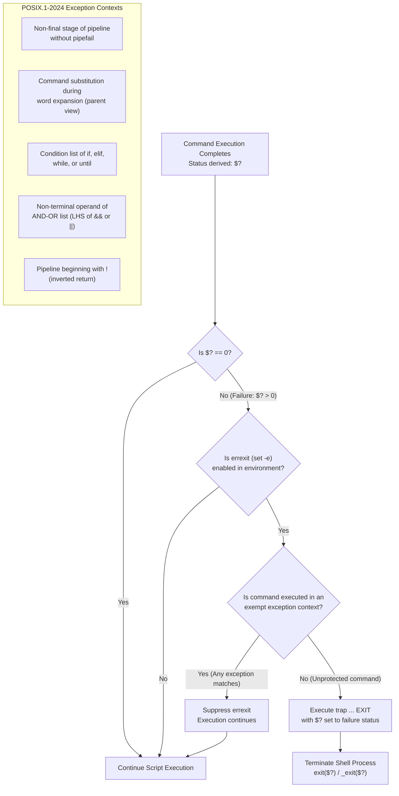

# errexit Semantics and Its Exceptions

> [!summary] Claim
> Under `set -e` (`errexit`), the shell immediately terminates when any command fails, except when the command is an uninspected pipeline stage, a command substitution during word expansion, the condition of an `if`, `while`, or `until` compound list, an inverted pipeline beginning with `!`, or any non-terminal operand of an AND-OR list.

Part of [The POSIX Shell Language](README.md) in [Shell and Unix Engineering](../README.md).

## TL;DR

- Mechanism: the shell inspects the exit status of each executed command or pipeline and invokes `exit(exitstatus)` unless an internal flag suppresses error checking (POSIX.1-2024 XCU 2.15).
- Rule: never use `set -e` as a substitute for explicit error handling in shell functions or complex pipelines.
- Trap: command substitutions inside utility declarations such as `local var=$(cmd)` or `export var=$(cmd)` mask non-zero exit statuses because the declaring utility itself returns zero.
- Portability: POSIX.1-2024 applies `set -e` to each subshell environment separately, and Austin Group Defect 1150 added the normative `set -e; echo $(false; echo one) two` example, but native GNU Bash requires `shopt -s inherit_errexit` or `set -o posix` to behave this way.
- When not to use it: avoid relying on `set -e` for transactional workflows, complex resource cleanup, or systems programming; write explicit conditionals in shell or migrate to Go or Rust.

## Mental model



When a command completes, the shell evaluates whether its integer exit status is greater than zero.
If the status is zero or if `set -e` is disabled in the execution environment, execution proceeds normally to the next instruction.
When a non-zero status occurs under `set -e`, the shell traverses its abstract syntax tree execution flags to determine whether the command was invoked inside an exempt exception context.
These exceptions include intermediate pipeline stages without `pipefail`, command substitutions during word expansion, condition tests in `if` or loop constructs, non-terminal operands of `&&` and `||` lists, and inverted pipelines beginning with `!`.
If any exception rule matches, the failure is suppressed and control flow continues; otherwise, the shell fires its registered `EXIT` trap while preserving the failure status, and terminates the execution environment via `exit(2)`.

## How it works

### The specification

POSIX.1-2024 specifies the `set` special built-in utility and its `-e` (`errexit`) option in section 2.15 `(POSIX.1-2024 XCU 2.15)`.
When `-e` is on, when any command fails (for any of the reasons listed in section 2.8.1 Consequences of Shell Errors or by returning an exit status greater than zero), the shell immediately shall exit, as if by executing the `exit` special built-in utility with no arguments, with three normative exceptions `(POSIX.1-2024 XCU 2.15)`:

1. The failure of any individual command in a multi-command pipeline, or of any subshell environments in which command substitution was performed during word expansion, shall not cause the shell to exit `(POSIX.1-2024 XCU 2.15)`.
Only the failure of the pipeline itself shall be considered `(POSIX.1-2024 XCU 2.15)`.
2. The `-e` setting shall be ignored when executing the compound list following the `while`, `until`, `if`, or `elif` reserved word, a pipeline beginning with the `!` reserved word, or any command of an AND-OR list other than the last `(POSIX.1-2024 XCU 2.15)`.
3. If the exit status of a compound command other than a subshell command was the result of a failure while `-e` was being ignored, then `-e` shall not apply to this command `(POSIX.1-2024 XCU 2.15)`.

POSIX.1-2024 mandates that these requirements apply to the shell environment and each subshell environment separately `(POSIX.1-2024 XCU 2.15)`.
For example, in `set -e; (false; echo one) | cat; echo two`, the `false` command causes the subshell to exit without executing `echo one`; however, `echo two` is executed because the exit status of the pipeline `(false; echo one) | cat` is zero `(POSIX.1-2024 XCU 2.15)`.
In `set -e; echo $(false; echo one) two`, the `false` command causes the subshell in which the command substitution is performed to exit without executing `echo one`; the exit status of the subshell is ignored by the parent shell, which then executes the word-expanded command `echo two` `(POSIX.1-2024 XCU 2.15)`.

The interaction between command substitutions and exit status was clarified by Austin Group Defect 1150, titled "exit status of command substitution not properly specified" `(Austin Group Defect 1150)`.
Under section 2.9.1.3 (Commands with no Command Name), if a simple command has no command name but contains a command substitution, the command shall complete with the exit status of the command substitution whose exit status was the last to be obtained `(POSIX.1-2024 XCU 2.9.1.3)`.
Therefore, in a bare assignment `var=$(false)`, the simple command itself exits with non-zero status, which triggers `set -e` in the parent shell `(POSIX.1-2024 XCU 2.9.1.3)`.
Conversely, when a command word exists, as in `export var=$(false)` or `echo $(false)`, the exit status is that of `export` or `echo`, which succeeds with status 0 and completely masks the subshell failure; the APPLICATION USAGE of `export` gives this exact case `(POSIX.1-2024 XCU 2.15 export)`.
Under section 2.5.2, `$?` expands to the decimal exit status of the pipeline executed from the current shell execution environment, not a subshell environment, that most recently terminated (or, in an interactive job-control shell, optionally stopped) `(POSIX.1-2024 XCU 2.5.2)`.

Under section 2.8.1 (Consequences of Shell Errors), specific errors cause the shell to exit regardless of `-e` `(POSIX.1-2024 XCU 2.8.1)`.
In a non-interactive shell, shell language syntax errors, special built-in utility errors, redirection errors on special built-in utilities, variable assignment errors, and expansion errors mandate shell termination `(POSIX.1-2024 XCU 2.8.1)`.
A redirection error on any other utility, on a compound command, or on a function execution shall not exit a non-interactive shell, and command not found may exit it `(POSIX.1-2024 XCU 2.8.1)`.
So without `-e`, `cat </nonexistent/x; echo a` prints `a` in every shell in the matrix, and `: </nonexistent/x; echo a` aborts except in bash outside POSIX mode, native zsh, and yash (measured in the shell matrix, as of 2026-11; lab tests `redirection error on a utility, compound command, or function call does not exit the shell` and `redirection error on a special built-in exits a non-interactive shell except in bash, native zsh, and yash`).
The abort status is 2 in dash and 1 in zsh in `sh` emulation, ksh93, mksh, BusyBox ash, posh, and bash in POSIX mode (same test).
A command that is not found has status 127, and a command that is found but is not an executable utility has status 126 `(POSIX.1-2024 XCU 2.8.2)`; those failures are then subject to `set -e` evaluation `(POSIX.1-2024 XCU 2.15)`.

### The implementation mechanics

In GNU Bash (`execute_cmd.c`), the `set -e` option is represented by the global integer `exit_immediately_on_error` and the flag `errexit_flag`, which is defined in `flags.c` `(bash 5.3 execute_cmd.c and flags.c)`.
The shell abstract syntax tree node contains a `flags` bitmask with the flag `CMD_IGNORE_RETURN` `(bash execute_cmd.c, execute_command_internal)`.
When `execute_command_internal()` executes a command, it computes local variable `ignore_return = (command->flags & CMD_IGNORE_RETURN) != 0` `(bash execute_cmd.c, execute_command_internal)`.
In conditional constructs (`if`, `while`, `until`), the condition subtree is marked with `CMD_IGNORE_RETURN` `(bash execute_cmd.c, execute_if_command)`.
In AND-OR connections (`execute_connection()`), the left-hand command node `first` has `CMD_IGNORE_RETURN` set, while `second` inherits the surrounding command flags `(bash execute_cmd.c, execute_connection)`.
When a shell function is executed (`execute_function()`), it inherits the caller node's `CMD_IGNORE_RETURN` flag, causing all commands inside the function body to run with `ignore_return = 1` when the function is called inside an `if` test or on the left-hand side of `||` `(bash execute_cmd.c, execute_function)`.

When a command terminates with non-zero status `exec_result`, `execute_command_internal()` checks `(bash execute_cmd.c, execute_command_internal)`:
```c
if (ignore_return == 0 && invert == 0 &&
    ((posixly_correct && interactive == 0 && special_builtin_failed) ||
     (exit_immediately_on_error && pipe_in == NO_PIPE && pipe_out == NO_PIPE && exec_result != EXECUTION_SUCCESS)))
  {
    last_command_exit_value = exec_result;
    run_pending_traps ();
    if (exit_immediately_on_error && signal_is_trapped (0) &&
        unwind_protect_tag_on_stack ("saved-redirects"))
      run_unwind_frame ("saved-redirects");
    jump_to_top_level (ERREXIT);
  }
```
The condition `pipe_in == NO_PIPE && pipe_out == NO_PIPE` implements Exception 1 by ignoring intermediate pipeline stages unless `set -o pipefail` derives a failing pipeline exit status `(bash execute_cmd.c, execute_command_internal)`.
The call `jump_to_top_level(ERREXIT)` bypasses normal execution unwinding via `longjmp(3)` to the shell main loop, which executes registered `EXIT` traps and exits `(bash execute_cmd.c, execute_command_internal)`.
In command substitutions (`subst.c`, `command_substitute()`), Bash 3.2 sets `exit_immediately_on_error = 0` in the child unless `posixly_correct` is set, and Bash 5.3 calls `change_flag ('e', FLAG_OFF)` unless `inherit_errexit` is set `(bash 3.2 and 5.3 subst.c, command_substitute)`.
Bash 4.4 introduced `shopt -s inherit_errexit` to preserve `-e` across command substitutions, which is enabled automatically when POSIX mode (`set -o posix`) is enabled `(bash 5.3 CHANGES and bashref.texi)`.

In `dash` (`src/eval.c`), `set -e` is represented by the global variable `eflag` `(dash src/eval.c, evaltree)`.
Execution state is controlled by the flag `EV_TESTED` passed into `evaltree(union node *n, int flags)` `(dash src/eval.c, evaltree)`.
In `NIF`, `evaltree` invokes the condition test with `flags = EV_TESTED`: `status = evaltree(n->nif.test, EV_TESTED)` `(dash src/eval.c, evaltree)`.
In `NAND` and `NOR`, the first operand is evaluated with `EV_TESTED`: `status = evaltree(n->nbinary.ch1, (flags | ((isor >> 1) - 1)) & EV_TESTED)` `(dash src/eval.c, evaltree)`.
At the completion of `evaltree()`, `dash` evaluates error termination `(dash src/eval.c, evaltree)`:
```c
if (eflag && (~flags & checkexit) && status)
  goto exexit;
if (flags & EV_EXIT) {
exexit:
  exraise(EXEND);
}
```
When `flags & EV_TESTED` is non-zero, `~flags & checkexit` evaluates to 0, which prevents jumping to `exexit` and allows execution to continue `(dash src/eval.c, evaltree)`.
If error termination triggers, `exraise(EXEND)` calls `longjmp(3)` to the exception handler, invoking `exit(exitstatus)` `(dash src/error.c, exraise)`.

In `zsh` (`Src/exec.c`), `set -e` sets option `opts[ERREXIT]`, read through `isset(ERREXIT)` `(zsh Src/exec.c, execlist)`.
The shell maintains an integer `noerrexit`, a bitmask of `NOERREXIT_EXIT` and `NOERREXIT_RETURN` rather than a counter, which `execlist()` sets for the commands before `&&` and `||` and after `!`, and restores afterwards `(zsh Src/exec.c, execlist)`.
At the end of each sublist, when `lastval` is non-zero and `this_noerrexit` is clear, `execlist()` computes `errexit = (isset(ERREXIT) || ...) && !(noerrexit & NOERREXIT_EXIT)`, then runs the `EXIT` trap and calls `realexit()` or `_realexit()` `(zsh Src/exec.c, execlist)`.
When a shell function's final statement is an inverted pipeline (`! true`), zsh 5.9 sets `this_noerrexit = 1` for it in `execlist()` and the caller survives (measured in the shell matrix on zsh 5.9 and 5.9.2), whereas exception 3 names only compound commands and a function call is a simple command, so a plain reading of POSIX requires an exit `(zsh 5.9 Src/exec.c, execlist)`.
The flag leaks out of the function's list to the caller's check because `doshfunc()` resets `this_noerrexit` only inside `if (retflag)`, that is, when the function was forced to return `(zsh 5.9 Src/exec.c, doshfunc)`.
A body that ends in `! cmd` therefore hands `this_noerrexit = 1` to the caller's `execlist()`, while an explicit `return` after the inverted command sets `retflag` and the caller exits (measured in the shell matrix; lab test `explicit return restores errexit after an inverted last command in a function`).
Current zsh master resets `this_noerrexit = 0` at the end of every `execlist()` `(zsh master Src/exec.c)`, and the master `README` lists the `ERR_EXIT` refinement toward POSIX-2017 among the incompatibilities of the next release `(zsh master README)`.
A zsh built from the master archive of 2026-11-01 (version string `5.9.999.3-test`, `ChangeLog` head dated 2026-10-25) exits with status 1 on `set -e; f() { ! true; }; f; echo a` and prints nothing, so zsh master no longer shows the leak (measured in the Debian image).

### The kernel and system call boundary

When a command fails under active `errexit`, the shell terminates its process environment via system call `exit(2)` or `_exit(2)` (or `exit_group(2)` on Linux).
If the failing command was an external executable, the shell obtained its termination status through `waitpid(2)` or `waitid(2)`.
Only the least significant 8 bits of the value passed to `exit(2)` (`status & 0377`) are available from `wait()` and `waitpid()`; the full value is available from `waitid()` `(POSIX.1-2024 XSH _Exit)`.
If the command was terminated by an unhandled signal `N`, POSIX specifies that the shell derives an exit status greater than 128 `(POSIX.1-2024 XCU 2.8.2)`.
Most implementations set exit status to `128 + N`, ksh93 sets `256 + N`, and yash sets `384 + N` (measured in the shell matrix, as of 2026-11).
Before invoking `exit(2)`, the shell executes any trap registered for the condition `EXIT` (signal 0) `(POSIX.1-2024 XCU 2.15 exit)`.
`set -e` exits as if by `exit` with no arguments, which uses the current value of `$?`, so `$?` inside the `EXIT` trap action reflects the status of the command that triggered `errexit` `(POSIX.1-2024 XCU 2.15 exit)`; every shell in the matrix prints that status.

## Numbers and limits

| Metric / Dimension | Limit / Value | Standard / Source | Practical Consequence |
|---|---|---|---|
| Exit status integer width | 8 bits (0-255) | POSIX.1-2024 XSH `_Exit` | Only `status & 0377` reaches `wait()` and `waitpid()`; `waitid()` receives the full value. |
| Uncaught signal status offset | 128 + N | Common practice; POSIX.1-2024 XCU 2.8.2 requires only a value greater than 128 | Signal 9 produces exit status 137 in bash, dash, and zsh. |
| ksh93 signal status offset | 256 + N | ksh93 implementation | Signal 9 produces exit status 265 in ksh93. |
| yash signal status offset | 384 + N | yash implementation | Signal 9 produces exit status 393 in yash. |
| Austin Group Defect 1150 | Accepted 2018-12-13; interpretation approved 2019-02-11 | Austin Group Bug Tracker | Added failed command substitutions to exception 1 and added the `echo $(false; echo one) two` example. |
| Austin Group Defect 789 | Accepted 2019-10-03; applied 2020-06-12 | Austin Group Bug Tracker | Standardized `set -o pipefail` in POSIX.1-2024. |
| Bash `inherit_errexit` addition | Bash 4.4 (2016-09-15) | GNU Bash `NEWS`; ftp.gnu.org release date | Native Bash before 4.4 always cleared `errexit` in `$(...)`; POSIX mode already kept it (measured on Bash 3.2 and 4.4). |
| Debian dash `pipefail` backport | dash 0.5.12-7 (2024-05-17) | Debian changelog | Debian dash 0.5.12-12 supports `pipefail`; Alpine dash 0.5.12-r3 and macOS `/bin/dash` reject it (measured, as of 2026-11). |
| ksh93 pipefail errexit fix | ksh93u+m `NEWS` entry 2020-09-30; first tagged in 1.0.0-beta.1 (2021-05), 1.0.0 is 2022-08-01 | ksh93u+m `NEWS`; GitHub releases | ksh93u+ 2012 ignored upstream `pipefail` errors under `set -e`. |
| POSIX.1-2024 release date | 2024-06 (Issue 8) | IEEE Std 1003.1-2024 | Formal standardization of `pipefail` and Defect 1150 exceptions. |
| BusyBox ash command substitution errexit | `eflag = 0` in `evalbackcmd` | BusyBox `shell/ash.c` | Subshell command substitutions do not inherit `set -e`, outputting partial results (as of 2026-11). |
| GNU Bash 3.2 bare subshell errexit | Fixed in Bash 4.0 `CHANGES` item `l`, bash-4.0-release section (2009-02-20) | GNU Bash `CHANGES` | Vanilla Bash 3.2 ignored non-zero exits of compound subshells under `set -e` (measured on 3.2.57). |
| posh 0.14.1 function inverted return | `XERROK` leak | posh `exec.c` | Non-zero exit from function ending in `! true` is suppressed in caller (as of 2026-11). |

All values sourced from primary specifications or confirmed in the shell matrix unless marked (as of 2026-11).

## Portability

The table below documents observable behavior across shells confirmed by the lab matrix and by direct runs of each expression on the matrix shells (as of 2026-11).
The `set -o posix` row is asserted per shell family by the lab test `set -o posix with errexit: command substitution keeps -e, or the option is rejected`.
The posh result for `false || false` is asserted by `last operand of an OR list triggers errexit except in posh`.

| Feature / Expression | POSIX.1-2024 | macOS bash 3.2 | current bash (5.3) | zsh (native) | zsh (`--emulate sh`) | dash (Debian) | ksh93u+ 2012 | ksh93u+m | mksh | yash | posh 0.14.1 | BusyBox ash |
|---|---|---|---|---|---|---|---|---|---|---|---|---|
| `false; echo a` under `-e` | Exits on `false` | Exits on `false` | Exits on `false` | Exits on `false` | Exits on `false` | Exits on `false` | Exits on `false` | Exits on `false` | Exits on `false` | Exits on `false` | Exits on `false` | Exits on `false` |
| `false && true; echo a` | Prints `a` | Prints `a` | Prints `a` | Prints `a` | Prints `a` | Prints `a` | Prints `a` | Prints `a` | Prints `a` | Prints `a` | Prints `a` | Prints `a` |
| `true && false; echo a` | Exits on `false` | Exits on `false` | Exits on `false` | Exits on `false` | Exits on `false` | Exits on `false` | Exits on `false` | Exits on `false` | Exits on `false` | Exits on `false` | Prints `a` (bug) | Exits on `false` |
| `f() { false; }; if f; then` | `-e` suppressed in `f` | `-e` suppressed in `f` | `-e` suppressed in `f` | `-e` suppressed in `f` | `-e` suppressed in `f` | `-e` suppressed in `f` | `-e` suppressed in `f` | `-e` suppressed in `f` | `-e` suppressed in `f` | `-e` suppressed in `f` | `-e` suppressed in `f` | `-e` suppressed in `f` |
| `f() { false; }; f \|\| true` | `-e` suppressed in `f` | `-e` suppressed in `f` | `-e` suppressed in `f` | `-e` suppressed in `f` | `-e` suppressed in `f` | `-e` suppressed in `f` | `-e` suppressed in `f` | `-e` suppressed in `f` | `-e` suppressed in `f` | `-e` suppressed in `f` | `-e` suppressed in `f` | `-e` suppressed in `f` |
| `x=$(false); echo a` | Exits on `false` | Exits on `false` | Exits on `false` | Exits on `false` | Exits on `false` | Exits on `false` | Exits on `false` | Exits on `false` | Exits on `false` | Exits on `false` | Exits on `false` | Exits on `false` |
| `export x=$(false); echo a` | Prints `a` (status 0) | Prints `a` (status 0) | Prints `a` (status 0) | Prints `a` (status 0) | Prints `a` (status 0) | Prints `a` (status 0) | Prints `a` (status 0) | Prints `a` (status 0) | Prints `a` (status 0) | Prints `a` (status 0) | Prints `a` (status 0) | Prints `a` (status 0) |
| `echo $(false; echo 1) 2` | Prints `2` | Prints `1 2` | Prints `1 2` | Prints `2` | Prints `2` | Prints `2` | Prints `2` | Prints `2` | Prints `2` | Prints `2` | Prints `2` | Prints `1 2` (bug) |
| `set -o posix; set -e; echo $(false; echo 1) 2` | Option not specified | Prints `2` | Prints `2` | Rejected, status 1 | Rejected, status 1 | Rejected, status 2 | Rejected, status 2 | Prints `2` | Prints `2` | Prints `2` | Rejected, status 1 | Option rejected but continues, prints `1 2` |
| `false \| true; echo a` | Prints `a` | Prints `a` | Prints `a` | Prints `a` | Prints `a` | Prints `a` | Prints `a` | Prints `a` | Prints `a` | Prints `a` | Prints `a` | Prints `a` |
| `false \| true` under `pipefail` | Exits 1 | Exits 1 | Exits 1 | Exits 1 | Exits 1 | Exits 1 | Prints `a` (bug) | Exits 1 | Exits 1 | Exits 1 | Unsupported | Exits 1 |
| `! true; echo a` | Prints `a` | Prints `a` | Prints `a` | Prints `a` | Prints `a` | Prints `a` | Prints `a` | Prints `a` | Prints `a` | Prints `a` | Prints `a` | Prints `a` |
| `f() { ! true; }; f; echo a` | Exits 1 | Exits 1 | Exits 1 | Prints `a` (differs) | Prints `a` (differs) | Exits 1 | Exits 1 | Exits 1 | Exits 1 | Exits 1 | Prints `a` (bug) | Exits 1 |
| `(exit 7); echo a` under `-e` | Exits 7 | Exits 7 (patched) | Exits 7 | Exits 7 | Exits 7 | Exits 7 | Exits 7 | Exits 7 | Exits 7 | Exits 7 | Exits 7 | Exits 7 |
| `trap 'echo $?' EXIT; false` | Prints `1` | Prints `1` | Prints `1` | Prints `1` | Prints `1` | Prints `1` | Prints `1` | Prints `1` | Prints `1` | Prints `1` | Prints `1` | Prints `1` |

In unpatched vanilla GNU Bash 3.2.57 (prior to Bash 4.0), `(exit 7); echo a` prints `a` (status 0) because subshell compound commands did not trigger parent `errexit`; macOS Bash 3.2 and Bash 4.0+ trigger immediate exit (measured in the shell matrix), and Apple's `execute_cmd.c` carries the added check that upstream 3.2 lacks.
The lab test `bare subshell failure triggers parent errexit except in upstream Bash 3.2` asserts status 0 and output `unreached` on the upstream 3.2.57 build and status 7 on Apple's build, which it tells apart by `MACHTYPE` (`aarch64-unknown-linux-musl` in the Alpine image, `arm64-apple-darwin26` on the macOS host).
The dash column is Debian's patched build; Alpine dash 0.5.12-r3 and macOS `/bin/dash` reject `set -o pipefail` with status 2.
The posh `AND-OR` result also covers `false || false; echo a`, which prints `a`, and its source passes `XERROK` to both operands in `execute()` `(posh 0.14.1 exec.c)`.

## Worked example

The test script below is the complete probe from the lab suite at [lab](../labs/03-errexit-semantics-and-exceptions/).
It executes mechanism probes that evaluate how `errexit` and its exception rules behave across different shell execution contexts:

```sh
#!/bin/sh
# errexit-probe: mechanism probes for set -e (errexit) semantics and exceptions.
# Conforms to POSIX.1-2024 XCU 2.15 (set) and related execution environment rules.
# Usage: errexit-probe.sh andor
#        errexit-probe.sh fn_cond
#        errexit-probe.sh cmdsub_assign
#        errexit-probe.sh cmdsub_inherit
#        errexit-probe.sh pipe_pipefail
#        errexit-probe.sh subshell_pipe
#        errexit-probe.sh fn_invert
#        errexit-probe.sh trap_exit

mode=${1:?mode}

case $mode in
  andor)
    # Exception 2: -e is ignored for any command in an AND-OR list other than the last.
    # Non-terminal operand: false && true ignores -e for false; true is skipped; shell survives.
    # shellcheck disable=SC2015 # intentional test of set -e on and-or list
    out_nonterm=$(
      set -e
      false && true
      printf 'survived'
    )
    st_nonterm=$?

    # Terminal operand: true && false must cause set -e to trigger on false (the last command).
    # posh 0.14.1 diverges by suppressing set -e across all operands (pdksh XERROK bug).
    # shellcheck disable=SC2015 # intentional test of set -e on and-or list
    out_term=$(
      set -e
      true && false
      printf 'survived'
    )
    st_term=$?

    printf 'nonterm_st=%d nonterm_out=%s term_st=%d term_out=%s\n' \
      "$st_nonterm" "${out_nonterm:-empty}" "$st_term" "${out_term:-empty}"
    ;;

  fn_cond)
    # Exception 2: -e is ignored when executing a compound list following if/while/until or on LHS of ||.
    # When a function is invoked in these contexts, -e is suppressed for commands inside the function.
    fn_if=$(
      set -e
      inner() {
        false
        printf 'reached'
      }
      # shellcheck disable=SC2310 # intentional probe of set -e suppression inside function in if condition
      if inner; then
        printf ' branch'
      fi
    )

    fn_or=$(
      set -e
      inner() {
        false
        printf 'reached'
      }
      # shellcheck disable=SC2310 # intentional probe of set -e suppression inside function in || condition
      inner || true
    )

    printf 'if=%s or=%s\n' "$fn_if" "$fn_or"
    ;;

  cmdsub_assign)
    # POSIX.1-2024 XCU 2.9.1:
    # In bare assignment (no command word), exit status is that of the last command substitution.
    # Under set -e, status > 0 causes immediate shell exit.
    # In utility declarations (export, readonly, local), the command word is the utility.
    # The utility returns 0, masking the command substitution failure (SC2155).
    out_bare=$(
      set -e
      # shellcheck disable=SC2030,SC2034 # x is intentionally assigned in subshell to probe status
      x=$(exit 42)
      printf 'survived'
    )
    st_bare=$?

    out_export=$(
      set -e
      # shellcheck disable=SC2031,SC2155 # intentional probe of declaration return masking in subshell
      export x="$(exit 42)"
      printf 'survived'
    )
    st_export=$?

    printf 'bare_st=%d bare_out=%s export_st=%d export_out=%s\n' \
      "$st_bare" "${out_bare:-empty}" "$st_export" "${out_export:-empty}"
    ;;

  cmdsub_inherit)
    # POSIX.1-2024 XCU 2.15 example (Austin Group Defect 1150):
    # set -e; echo $(false; echo one) two
    # In POSIX conforming shells, command substitution subshell inherits set -e.
    # false causes the subshell to exit without executing echo one; word expands to "two".
    # In native bash (non-posix mode) and BusyBox ash, set -e is disabled in command substitutions,
    # resulting in "one two" unless shopt -s inherit_errexit is enabled in bash.
    # shellcheck disable=SC2312 # intentional probe of command substitution errexit inheritance
    out_inherit=$(
      set -e
      printf '%s\n' "$(
        false
        printf 'one '
      )two"
    )
    st_inherit=$?

    printf 'inherit_st=%d inherit_out=%s\n' "$st_inherit" "$out_inherit"
    ;;

  pipe_pipefail)
    # Exception 1: failure of individual command in multi-command pipeline does not trigger set -e.
    # Under default semantics, pipeline status is that of the last stage.
    # Under set -o pipefail (POSIX.1-2024), pipeline status is the rightmost non-zero stage.
    # shellcheck disable=SC2312 # intentional probe of pipeline status
    out_default=$(
      set -e
      false | true
      printf 'survived'
    )
    st_default=$?

    # Feature-detect set -o pipefail
    # shellcheck disable=SC3040 # pipefail is feature-detected
    if (set -o pipefail 2>/dev/null); then
      # shellcheck disable=SC3040 # pipefail is feature-detected
      out_pipefail=$(
        set -e
        set -o pipefail
        # shellcheck disable=SC2312 # intentional probe of pipeline status
        false | true
        printf 'survived'
      )
      st_pipefail=$?
    else
      out_pipefail="unsupported"
      st_pipefail=-1
    fi

    printf 'def_st=%d def_out=%s pf_st=%d pf_out=%s\n' \
      "$st_default" "${out_default:-empty}" "$st_pipefail" "${out_pipefail:-empty}"
    ;;

  subshell_pipe)
    # POSIX.1-2024 XCU 2.15 example:
    # set -e; (false; echo one) | cat; echo two
    # false causes the subshell to exit without executing echo one.
    # However, echo two is executed because the exit status of the pipeline is zero.
    # shellcheck disable=SC2312 # intentional probe of subshell pipeline
    out=$(
      set -e
      (
        false
        printf 'one\n'
      ) | cat
      printf 'two\n'
    )
    printf 'subshell_pipe=%s\n' "$out"
    ;;

  fn_invert)
    # Exception 2: pipeline beginning with ! ignores -e.
    # When a function executes ! true, the ! pipeline succeeds in running without aborting inside.
    # But when the function returns 1, the caller's simple command f has status 1.
    # In bash, dash, ksh93, mksh, yash, busybox: simple command f triggers set -e (exits 1).
    # In zsh and posh: set -e is suppressed on the function return, surviving.
    out_invert=$(
      set -e
      f() {
        ! true
      }
      f
      printf 'survived'
    )
    st_invert=$?

    printf 'invert_st=%d invert_out=%s\n' "$st_invert" "${out_invert:-empty}"
    ;;

  trap_exit)
    # POSIX.1-2024 XCU 2.15:
    # When set -e causes the shell to exit, it executes the exit special built-in utility
    # with no arguments, preserving the exit status and executing the EXIT trap.
    out_trap=$(
      set -e
      trap 'printf "trap=%d\n" "$?"' EXIT
      false
      printf 'survived\n'
    )
    st_trap=$?

    printf 'trap_st=%d trap_out=%s\n' "$st_trap" "$out_trap"
    ;;

  *)
    printf 'unknown mode: %s\n' "$mode" >&2
    exit 1
    ;;
esac
```

When run under Debian's `dash` 0.5.12-12, which is `/bin/sh` on the matrix's Debian image, the probe script produces the following output:

```
$ /bin/sh errexit-probe.sh andor
nonterm_st=0 nonterm_out=survived term_st=1 term_out=empty

$ /bin/sh errexit-probe.sh fn_cond
if=reached branch or=reached

$ /bin/sh errexit-probe.sh cmdsub_assign
bare_st=42 bare_out=empty export_st=0 export_out=survived

$ /bin/sh errexit-probe.sh cmdsub_inherit
inherit_st=0 inherit_out=two

$ /bin/sh errexit-probe.sh pipe_pipefail
def_st=0 def_out=survived pf_st=1 pf_out=empty

$ /bin/sh errexit-probe.sh subshell_pipe
subshell_pipe=two

$ /bin/sh errexit-probe.sh fn_invert
invert_st=1 invert_out=empty

$ /bin/sh errexit-probe.sh trap_exit
trap_st=1 trap_out=trap=1
```

Under Alpine dash and macOS `/bin/dash`, which have no `pipefail`, `pipe_pipefail` outputs `def_st=0 def_out=survived pf_st=-1 pf_out=unsupported`.
Under native GNU Bash without POSIX mode and under BusyBox ash, `cmdsub_inherit` outputs `inherit_st=0 inherit_out=one two` because both shells disable `errexit` in command substitutions by default (GNU Bash requires `inherit_errexit` or POSIX mode; BusyBox ash clears `eflag` in `evalbackcmd`).
Under `zsh` and `posh 0.14.1`, `fn_invert` outputs `invert_st=0 invert_out=survived` because both shells preserve inverted status suppression across function call boundaries.

## Pitfalls

> [!warning] Masked Exit Codes in Utility Declarations (SC2155)
> **Trigger:** Writing `local var=$(cmd)` or `export var=$(cmd)` where `cmd` fails with a non-zero exit code.
> **Symptom:** The script fails to abort under `set -e`, quietly setting `var` to an empty string and continuing execution with corrupt state.
> **Fix:** Separate variable declaration from assignment: declare the variable first with `local var` or `export var`, then assign it on a separate line with `var=$(cmd)`.
> **Citation:** ShellCheck diagnostic SC2155; POSIX.1-2024 XCU 2.15 `export` APPLICATION USAGE, which gives `export X=$(false)` as this exact case.

> [!warning] The Function-in-Condition errexit Suppression Trap
> **Trigger:** Calling a complex function inside an `if` test, `while` condition, or the left-hand side of an `||` operator (for example `if run_migration; then` or `backup_data || handle_error`).
> **Symptom:** Every internal command inside `run_migration` executes with `set -e` completely disabled, allowing errors to cascade silently without halting the function.
> **Fix:** Execute the function in a standalone statement and inspect its exit code explicitly, for example `set +e; (set -e; run_migration); st=$?; set -e`; `(run_migration) || handle_error` does not help, because the subshell is still on the left of `||` and `run_migration` keeps running after a failure (measured in the shell matrix; lab test `wrapping a function in a subshell on the left of || keeps errexit off; the set +e capture idiom keeps it on`).
> **Citation:** Greg Wooledge, BashFAQ/105 ("Why doesn't set -e (or set -o errexit, or trap ERR) do what I expected?"); Austin Group Defects 52 and 537 (537 asked for functions to keep `-e` and was rejected).

> [!warning] Silent Upstream Pipeline Corruption Without pipefail
> **Trigger:** Executing a multi-stage pipeline under `set -e` without enabling `set -o pipefail` (for example `mysqldump db | gzip > backup.sql.gz`).
> **Symptom:** If `mysqldump` crashes or fails authentication, `gzip` compresses empty standard input and exits with 0; `set -e` sees only the zero exit code of `gzip`, leaving a valid 20-byte gzip file with no data and no error.
> **Fix:** Enable `set -o pipefail` in all scripts using `set -e`, and assign command substitutions before passing them as arguments to other utilities (ShellCheck SC2312).
> **Citation:** Cloudflare, "PIPEFAIL: How a missing shell option slowed Cloudflare down" (published 2022-03-08, on the incident of 2021-12-16); Austin Group Defect 789.

> [!warning] Command Substitution Subshell Leaks in Native Bash and BusyBox Ash
> **Trigger:** Relying on `set -e` inside command substitutions `$(failing_cmd)` in GNU Bash without enabling `inherit_errexit` or POSIX mode, or in BusyBox ash.
> **Symptom:** Commands failing inside `$(...)` do not terminate the subshell, producing partial stdout and executing subsequent statements within the substitution.
> **Fix:** Execute `shopt -s inherit_errexit` or `set -o posix` in Bash; in BusyBox ash, explicitly check command exit status inside or after the substitution because `ash.c` explicitly clears `eflag` in `evalbackcmd`.
> **Citation:** Bash Reference Manual (`inherit_errexit` and Bash POSIX Mode); Austin Group Defect 1150; BusyBox source `shell/ash.c`.

> [!warning] Subshell Exit Status Ignored in Vanilla GNU Bash 3.2
> **Trigger:** Running a failing parenthesized subshell `(exit 1)` or compound list under `set -e` on unpatched GNU Bash 3.2.
> **Symptom:** The parent shell does not exit, continuing execution into subsequent commands despite the subshell returning non-zero exit status.
> **Fix:** Append an explicit exit handler to the subshell: `(command) || exit $?`, or upgrade to Bash 4.0+ where subshell failure triggers `errexit`.
> **Citation:** GNU Bash `CHANGES` file item `l` for Bash 4.0; Austin Group Defect 52.

> [!warning] Inverted Pipeline Function Returns in zsh and posh 0.14.1
> **Trigger:** Calling a shell function whose last executed command is an inverted pipeline `! cmd` under `set -e` in `zsh` or `posh`.
> **Symptom:** When the function returns status 1 from `! true`, the caller's simple command suppresses `errexit` and execution continues silently.
> **Fix:** Avoid terminating functions with `!`, or explicitly verify the function's exit status at the call site: `f || exit $?`.
> **Citation:** zsh 5.9 source `Src/exec.c` (`this_noerrexit`); posh source `exec.c` (`XERROK`, `xerrok`).

> [!warning] The grep and expr Zero-Value Abort Fallacy
> **Trigger:** Invoking utilities that use exit code 1 to signify non-error boolean false (such as `grep -q pattern file` when no line matches, or `expr "$count" + 0` when the result is 0) under `set -e`.
> **Symptom:** The script unexpectedly terminates immediately on valid, expected application conditions.
> **Fix:** Guard expected non-zero returns explicitly using `grep -q pattern file || [ $? -eq 1 ]`, or use native shell arithmetic `$((count + 0))` instead of `expr`.
> **Citation:** Debian Policy Manual Section 10.4, which tells scripts to use `set -e` or check every exit status.

## Security and robustness

Relying on `set -e` as a primary safety mechanism introduces severe security vulnerabilities in deployment scripts and automation runners.
When a script assumes `set -e` guarantees fail-fast execution, developers omit explicit return code verification on security-critical commands.
For example, consider directory navigation followed by bulk deletion:
```sh
set -e
cd "$BUILD_DIR"
rm -rf ./*
```
If `cd "$BUILD_DIR"` is evaluated in a context where `set -e` is suppressed (such as within a setup function called on the left-hand side of `||`), a failure to change directory does not abort the script.
The subsequent `rm -rf ./*` command executes in whatever directory the script was already in, recursively deleting critical system or repository assets.

Similarly, integrity verification checks frequently evaluate within command substitutions:
```sh
set -e
computed_hash=$(sha256sum "$artifact" | cut -d' ' -f1)
[ "$computed_hash" = "$trusted_hash" ]
```
If `sha256sum` fails due to a missing binary or corrupted path, `cut` still executes on empty input and exits with status 0.
Without `pipefail`, the pipeline status is 0, `$computed_hash` becomes an empty string, and if `$trusted_hash` is also empty or unset without `set -u`, the validation check evaluates to true and execution continues into an unverified deployment.

To establish genuine robustness, production scripts must combine four orthogonal guardrails:
1. `set -e` (`errexit`): abort on unhandled simple command failures.
2. `set -u` (`nounset`): abort immediately on references to uninitialized variables.
3. `set -o pipefail`: propagate upstream failures through pipelines to the terminal stage.
4. Explicit assertion guards: replace implicit `set -e` assumptions with explicit boolean checks:
```sh
target_dir="${1:?target directory required}"
cd "$target_dir" || {
  printf 'Failed to change directory to %s\n' "$target_dir" >&2
  exit 1
}
```

## The principal's view

At staff and principal engineering levels, `set -e` is recognized as an incomplete heuristic from early Unix history rather than a modern exception handling framework.
The fundamental flaw of `set -e` is that the Unix process model overloads integer exit codes for two mutually exclusive semantics: operational errors (such as missing files, network drops, or out-of-memory states) and normal boolean query results (such as `grep` finding zero matches, or `diff` detecting file changes).
Because the shell cannot distinguish between a boolean negative and an operational catastrophe, it must implement an elaborate matrix of syntactic exceptions.
These exceptions create invisible behavioral cliffs: wrapping a function in an `if` statement or an `&&` chain fundamentally alters the execution semantics of every command inside that function.
Real-world container and fleet matrices reveal that `set -e` is not even uniform across standard shells.
BusyBox ash in Alpine containers disables `errexit` inside command substitutions just like native GNU Bash, posh and zsh leak inverted pipeline suppression across function returns, and vanilla Bash 3.2 completely ignores subshell failures.
Relying on `set -e` across heterogeneous environments creates an illusion of safety that fails under subtle portability boundaries.

When designing infrastructure automation, build pipelines, and production tooling, follow these architectural principles:
1. For small, linear shell scripts (under 50 lines), use `set -eu` and `set -o pipefail`, but treat `set -e` only as a secondary safety net to catch forgotten typos.
2. Never rely on `set -e` inside shell libraries or reusable utility functions; functions must explicitly handle errors, log diagnostics to stderr, and return distinct exit codes.
3. When automation logic requires state machine rollback, structured data manipulation, transactional guarantees, or complex cleanup handlers, migrate off the shell entirely.
Implement the service in Go, Python, or Rust, where static type systems, explicit error types, deferred cleanup hooks (`defer`), and deterministic control flow eliminate the syntactic ambiguities inherent in shell interpreters.

## Interview questions

> [!question] L5: Explain why `export var=$(false)` does not cause a shell running under `set -e` to exit, whereas `var=$(false)` does.
>
> > [!success]- Answer
> > Under POSIX.1-2024 XCU 2.9.1, when a simple command contains no command words, the command's exit status is the exit status of the last command substitution performed during word expansion.
> > In `var=$(false)`, there is no command word, so the simple command takes the non-zero status of `false`, causing `set -e` to trigger immediately.
> > In `export var=$(false)`, the word `export` is a command word naming a declaration utility.
> > The command substitution `$(false)` expands during argument processing, but the simple command's exit status is determined by the `export` utility itself, which succeeds with status 0 and completely masks the substitution failure.
> >
> > Follow-up: How do you rewrite `local` or `export` variable assignments to prevent masking failures under `set -e`?

> [!question] L6: Predict the exact output of this script across POSIX shells, and explain the underlying mechanism:
> ```sh
> set -e
> check() {
>   false
>   echo "inside"
> }
> if check; then
>   echo "branch"
> fi
> echo "done"
> ```
>
> > [!success]- Answer
> > The script prints `inside`, followed by `branch`, followed by `done`.
> > Under POSIX.1-2024 XCU 2.15 Exception 2, `set -e` is ignored when executing the compound list following the `if` reserved word.
> > Because `check` is invoked as the condition list of `if`, the shell propagates the ignore-errexit execution flag into the function environment.
> > The `false` command inside `check` fails, but `set -e` is suppressed, allowing execution to proceed to `echo "inside"`.
> > Because `echo "inside"` returns exit status 0, the function `check` exits with status 0, satisfying the `if` condition and executing `echo "branch"`.
> >
> > Follow-up: How would you structure this check if `check` must abort on internal failures while allowing the caller to branch on its deliberate outcome?

> [!question] L6: What did Austin Group Defect 1150 standardize regarding command substitutions under `set -e`, and how does native GNU Bash differ from POSIX mode?
>
> > [!success]- Answer
> > Austin Group Defect 1150 is about the exit status of command substitution; it added the example in which `set -e; echo $(false; echo one) two` exits the substitution's subshell on `false`, consistent with the rule that `-e` applies to each subshell environment separately.
> > The defect also added to exception 1 that the failure of a subshell performing command substitution during word expansion does not cause the parent shell to exit.
> > In POSIX conforming shells (such as `dash`, `zsh`, and `bash --posix`), `echo $(false; echo one) two` prints `two` because the subshell exits on `false`.
> > In native GNU Bash, `set -e` is historically cleared inside command substitutions by default, so it prints `one two` unless `shopt -s inherit_errexit` or `set -o posix` is enabled.
> > BusyBox ash also clears `eflag` in `evalbackcmd` (`shell/ash.c`), printing `one two` even under `set -e`.
> >
> > Follow-up: What is the exit status of `echo $(exit 42)` in POSIX shells?

> [!question] L6: In the pipeline `false | true` executed under `set -e`, why does the shell survive by default, and what happens when `set -o pipefail` is enabled?
>
> > [!success]- Answer
> > Under POSIX.1-2024 XCU 2.15 Exception 1, the failure of an individual command in a multi-command pipeline shall not cause the shell to exit; only the failure of the pipeline itself is considered.
> > By default, the exit status of a pipeline is the exit status of its last command, so `false | true` derives exit status 0 from `true` and the shell continues.
> > When `set -o pipefail` is enabled (standardized in POSIX.1-2024 XCU 2.15 via Austin Group Defect 789), the pipeline status is that of the rightmost command with a non-zero exit status, or zero if all commands succeeded.
> > Under `pipefail`, `false | true` derives exit status 1 from `false`, which triggers `set -e` and terminates the shell.
> >
> > Follow-up: Why does macOS `/bin/ksh` (ksh93u+ 2012) fail to exit on `false | true` even when `set -o pipefail` is set?

> [!question] L7: Debug this deployment script: identify the failure modes that allow corrupted deployments under `set -e`:
> ```sh
> #!/bin/sh
> set -e
> prepare_release() {
>   local bundle_url=$(curl -fsSL https://internal/bundle.tar.gz | tar -tz | head -n1)
>   fetch_payload "$bundle_url"
> }
> if prepare_release; then
>   deploy_artifacts
> fi
> ```
>
> > [!success]- Answer
> > The script contains three compounding failure modes that neutralize `set -e`.
> > First, calling `prepare_release` inside `if` suppresses `set -e` across all commands within `prepare_release`, so any failure inside will not abort the function.
> > Second, `local bundle_url=$(...)` masks any non-zero exit status from the pipeline because `local` returns exit status 0.
> > Third, the pipeline `curl ... | tar ... | head ...` lacks `pipefail`, so if `curl` fails with a network or HTTP error, `head` still returns 0 on an empty pipe, allowing `deploy_artifacts` to execute with invalid parameters.
> >
> > Follow-up: Refactor this code to achieve deterministic fail-fast semantics across POSIX shells.

> [!question] L7: Explain POSIX.1-2024 Exception 3 for `set -e`: "If the exit status of a compound command other than a subshell command was the result of a failure while -e was being ignored, then -e shall not apply to this command."
>
> > [!success]- Answer
> > When a compound command (such as `{ list; }`, a loop, or an `if` block) executes in a context where `-e` is active, commands inside it might run in an exempt context where `-e` is ignored (for example, on the left-hand side of `||`).
> > If the compound command's final exit status is non-zero as a result of a failure inside that exempt context, the shell must not treat the compound command's resulting non-zero status as an unhandled error.
> > For example, in `set -e; { false && true; }; echo a`, the failure of `false` occurs where `-e` is ignored and the group's status is 1, yet `a` is printed (measured in the shell matrix; lab test `exception 3: a compound command whose status came from an ignored failure does not trigger errexit`, which also covers `if` and `for`).
> > By contrast, `set -e; (false && true); echo a` exits with status 1 in every matrix shell except vanilla Bash 3.2 (lab test `exception 3 excludes a subshell command: its ignored failure still exits the parent`).
> > Subshell commands `( list )` are explicitly excluded from this exception, so the parent treats a failing subshell's status like that of any other failed command.
> > In vanilla GNU Bash 3.2, subshell compound commands failed to trigger parent `errexit`, which was corrected in Bash 4.0 (item `l` of `CHANGES`) to conform to POSIX consensus.
> >
> > Follow-up: How does `dash` implement this distinction in `src/eval.c` using `EV_TESTED`?

> [!question] L7: How does GNU Bash propagate the suppression of `errexit` across the Abstract Syntax Tree, and what is the function of `jump_to_top_level(ERREXIT)`?
>
> > [!success]- Answer
> > GNU Bash uses the bitmask flag `CMD_IGNORE_RETURN` on `COMMAND` struct nodes in `execute_cmd.c`.
> > When traversing control structures (`if`, `while`, `until`, `&&`, `||`, and pipelines inverted with `!`), Bash attaches `CMD_IGNORE_RETURN` to the condition or left-hand nodes before calling `execute_command_internal()`.
> > When a command finishes with non-zero exit status, `execute_command_internal()` checks whether `CMD_IGNORE_RETURN` is unset, `pipe_in` and `pipe_out` are `NO_PIPE`, and `exit_immediately_on_error` is active.
> > If all conditions are met, Bash stores `last_command_exit_value`, runs pending traps, unwinds the saved redirections when an `EXIT` trap is set, and executes `jump_to_top_level(ERREXIT)`.
> > `jump_to_top_level()` uses `longjmp(3)` to restore the top-level execution buffer, triggering shell termination while invoking registered `EXIT` traps.
> >
> > Follow-up: Why must Bash run `run_unwind_frame("saved-redirects")` before executing the `EXIT` trap on an `errexit` abort?

> [!question] L7+: Analyze how `trap ... ERR` interacts with `set -e` in GNU Bash, why `ERR` traps are not standardized by POSIX, and what happens when `set -E` (`errtrace`) is omitted.
>
> > [!success]- Answer
> > The `ERR` trap is an extension in the KornShell, GNU Bash, and zsh that executes an action whenever a command returns a non-zero exit status.
> > The Bash Reference Manual says it obeys the same conditions as `errexit`: Bash suppresses `ERR` trap execution when a command fails inside an `if` condition, while loop test, or non-terminal branch of an AND-OR list.
> > POSIX does not standardize `trap ... ERR`: the `trap` RATIONALE says the KornShell's `ERR` trap "is allowable as an extension, but was not mandated, as other shells have not used it" `(POSIX.1-2024 XCU 2.15 trap)`.
> > By default in Bash, functions, command substitutions, and subshells do not inherit the `ERR` trap disposition; if a command fails inside a function, the outer `ERR` trap will not fire unless `set -E` (`set -o errtrace`) is explicitly enabled.
> >
> > Follow-up: If a script sets both `set -e` and a trap on `ERR`, which handler executes first when a command fails?

## Related

Prerequisites: [[Functions-and-Scope]]

Next: [[Traps-and-EXIT]]

See also: [[Robust-Shell-Scripting-and-ShellCheck]], [[Drill-Command-Line-Quoting-and-Signal-Trap-Race]]

## Further reading

- [POSIX.1-2024 Shell Command Language (XCU Chapter 2)](https://pubs.opengroup.org/onlinepubs/9799919799/utilities/V3_chap02.html): the normative specification for `set -e`, pipeline exit status, and execution environments.
- [Austin Group Defect 1150](https://www.austingroupbugs.net/view.php?id=1150): the formal defect report specifying command substitution exit status and adding the `set -e` command substitution example.
- [Austin Group Defect 789](https://www.austingroupbugs.net/view.php?id=789): the formal defect report standardizing `set -o pipefail` in POSIX Issue 8.
- [GNU Bash Source: execute_cmd.c](https://git.savannah.gnu.org/cgit/bash.git/tree/execute_cmd.c): primary source implementation of AST flags, `exit_immediately_on_error`, and `jump_to_top_level(ERREXIT)`.
- [GNU Bash 5.3 release tarball](https://ftp.gnu.org/gnu/bash/bash-5.3.tar.gz): contains `CHANGES`, whose Bash 4.0 item `l` records the `errexit` change to reflect the consensus of the Posix working group.
- [dash Source: src/eval.c](https://git.kernel.org/pub/scm/utils/dash/dash.git/tree/src/eval.c): primary source implementation of `evaltree`, `eflag`, and `EV_TESTED` exception passing.
- [BusyBox Source: shell/ash.c](https://git.busybox.net/busybox/tree/shell/ash.c): primary source implementation of `evalbackcmd` and `eflag` error suppression in command substitutions.
- [posh Source: exec.c](https://sources.debian.org/src/posh/0.14.1/exec.c/): primary source implementation of `execute` and `XERROK` flag handling across function calls.
- [Greg Wooledge's BashFAQ/105](https://mywiki.wooledge.org/BashFAQ/105): authoritative technical analysis of `set -e` edge cases, false assumptions, and structural defects.
- [ShellCheck SC2155 Wiki](https://www.shellcheck.net/wiki/SC2155): documentation of masked return values in `export`, `local`, and `readonly` variable declarations.
- [Debian Policy Manual Section 10.4](https://www.debian.org/doc/debian-policy/ch-files.html#s-scripts): current guidance that scripts use `set -e` or check the exit status of every command.
