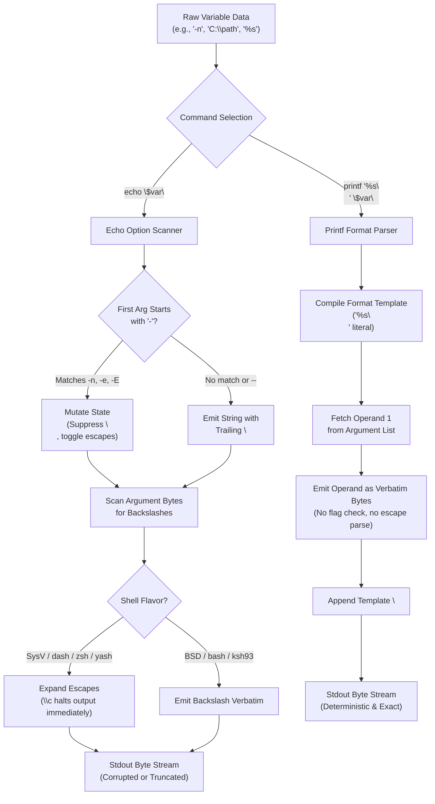

# printf versus echo

> [!summary] Claim
> POSIX `echo` is fundamentally unportable for arbitrary data because leading hyphen operands and backslash escape characters trigger implementation-defined flag parsing and string truncation, whereas `printf` decouples the invariant formatting specification from variable data operands to guarantee deterministic, byte-exact output across all conforming shells.

Part of [The POSIX Shell Language](README.md) in [Shell and Unix Engineering](../README.md).

## TL;DR

- Mechanism: `echo` conflates command-line options and payload data into a single argument vector where leading hyphens trigger implementation-defined flag parsing (`POSIX.1-2024 XCU echo`), while `printf` enforces a strict two-stage contract separating the formatting template operand from variable data arguments (`POSIX.1-2024 XCU printf`).
- Rule: Always use `printf '%s\n' "$var"` for line-terminated arbitrary data, `printf '%s' "$var"` to suppress trailing newlines, and `printf '%b\n' "$var"` only when backslash escapes must be interpreted explicitly.
- Trap: Passing an untrusted variable directly as the format string in `printf "$var"` creates format string injection vulnerabilities where `% d` converts missing arguments to zero, while `printf "$1" "$2"` with `$1` set to `-vNAME` in `bash` and ksh93u+m silently overwrites the caller variable `NAME`, and `zsh`, which takes `-v` only as a separate word, needs `printf "$1" "$2" "$3"` for the same overwrite (the `printf-v` lab test).
- Portability fact: `echo -n` is an unstandardized BSD extension that fails silently when printing the literal string `-n` under `bash`, `ksh93`, `zsh`, and `busybox`, while `echo` in `dash`, native `zsh`, `yash`, and macOS `/bin/sh` interprets System V escape sequences by default such as `\c` which truncates output.
- When not to use it: Never use `echo` for variable data, user inputs, file paths, or cryptographic keys; reserve `echo` exclusively for static, hard-coded string literals containing no leading hyphens or backslashes (`echo "Done."`), or replace shell-level formatting with a structured systems language when serializing complex binary or nested records.

## Mental model



The execution graph exposes why `echo` fails to guarantee deterministic output across Unix environments.
When untrusted data enters `echo`, the shell passes the entire argument vector into an option scanner that checks whether the leading operand begins with a hyphen.
If the payload matches `-n`, `-e`, `-E`, or combinations thereof, the utility alters its internal printing state rather than outputting the payload data.
Even when operands survive option inspection, `echo` delegates character emission to shell-specific output engines where System V shells, `dash`, `yash`, and native `zsh` aggressively expand backslash escapes and halt on `\c`, while BSD shells and standard `bash` print backslashes verbatim.
In contrast, `printf` routes execution through an explicit template compiler where format controls remain strictly separated from argument values.
The format string dictates conversion semantics, consuming positional operands through `%s` without inspecting leading hyphens or scanning for backslashes, ensuring byte-exact delivery down to the operating system write buffer.

## How it works

### The POSIX.1-2024 specification

The Unix output landscape was fractured during the Unix wars between the Version 7 / BSD line and the AT&T System V line.
BSD `echo` supported the `-n` option to suppress trailing newlines and treated all backslashes as literal characters.
System V `echo` prohibited options entirely, treated `-n` as literal text, and scanned all operands for escape sequences, using `\c` to suppress the trailing newline and discard all subsequent output.
Because historical applications depended irreconcilably on both behaviors, the POSIX committee could not standardize either without breaking millions of lines of existing shell scripts.

In POSIX.1-2024, the specification for `echo` formalizes this incompatibility `(POSIX.1-2024 XCU echo)`:
1. "The `echo` utility shall not recognize the `--` argument in the manner specified by Guideline 10 of XBD 12.2 Utility Syntax Guidelines; `--` shall be recognized as a string operand."
2. "Implementations shall not support any options."
3. "If the first operand consists of a `-` followed by one or more characters from the set `{'e', 'E', 'n'}`, or if any of the operands contain a `<backslash>` character, the results are implementation-defined."
4. On XSI-conformant systems (the Single UNIX Specification extension), `echo` must treat `-e`, `-E`, and `-n` as literal strings, but must recognize escape sequences including `\a`, `\b`, `\c`, `\f`, `\n`, `\r`, `\t`, `\v`, `\\`, and `\0num`.

Austin Group Defect 1222 in Issue 8 added `-e` and `-E` alongside `-n` as triggering implementation-defined behavior on non-XSI systems.
The standard explicitly warns applications:
"Conforming applications that wish to do prompting without `<newline>` characters or that could possibly be expecting to echo a string consisting of a `-` followed by one or more characters from the set `{'e', 'E', 'n'}` should use the `printf` utility." `(POSIX.1-2024 XCU echo RATIONALE)`.

POSIX solved the output dilemma by introducing `printf`, modelled on Ninth Edition Research Unix `(POSIX.1-2024 XCU printf RATIONALE)`.
`printf format [argument...]` establishes rigid rules, numbered here as the list items of its EXTENDED DESCRIPTION:
- Opening paragraph: The first operand is always the format operand, used as the format string described in XBD 5 File Format Notation.
- Rule 7: The `%b` conversion specifier explicitly processes backslash escape sequences in the corresponding argument operand, including `\c` which halts further processing.
- Rule 9: For each conversion specification that consumes an argument, the next argument operand is evaluated, or the nth for a `%n$` specification; if the format consumes no arguments but operands are present, the results are unspecified.
- Rule 10: The format operand shall be reused as often as necessary to satisfy the argument operands.
- Rule 11: If an argument operand does not exist, unnumbered string conversions (`%s`, `%b`, `%c`) evaluate as null strings and every other unnumbered conversion (`%d`, `%i`, `%o`, `%u`, `%x`) evaluates as zero; a missing operand for a numbered `%n$` conversion should produce a diagnostic and a non-zero exit status, but may behave the same way.
- Rule 12: An invalid conversion specification beginning with `%` results in unspecified behavior.

### Shell engine implementation mechanics

Shells implement `echo` and `printf` as built-in utilities to eliminate process creation overhead, which command search permits but does not require `(POSIX.1-2024 XCU 2.9.1.4)`.
mksh and posh have no `printf` builtin, so `printf` there runs the system utility: coreutils on Debian and the BusyBox applet on Alpine, as the diagnostics in the shell matrix show, and mksh compiles `c_printf` only under `MKSH_PRINTF_BUILTIN` `(mksh funcs.c)`.
The `builtin-lookup` lab test shows it: with `PATH` pointing at a nonexistent directory, `printf` exits 127 in mksh and posh while `echo` still runs.
yash goes further: `echo` and `printf` are registered as `BI_SUBSTITUTIVE` built-ins, which "work on behalf of external commands found in PATH", so with that `PATH` both exit 127 `(yash builtin.c; yash manual, Built-in commands)`.
The internal mechanics reveal why their runtime characteristics diverge.

```
+-------------------------------------------------------------------------------+
| Builtin In-Memory Fast Path (echo / printf)                                  |
|                                                                               |
| Shell AST Evaluation -> Builtin Dispatch Table -> In-Memory String Formatting |
|                                                -> Shell I/O Buffer (stdio)    |
|                                                -> write(1, buf, len)          |
+-------------------------------------------------------------------------------+

+-------------------------------------------------------------------------------+
| External Utility Path (/bin/echo / /usr/bin/printf)                           |
|                                                                               |
| posix_spawn() / fork() -> execve("/bin/echo", argv, envp)                    |
|                        -> Kernel ELF / Mach-O Loader                         |
|                        -> Dynamic Linker (dyld / ld-linux.so)                 |
|                        -> CRT Startup (__libc_start_main)                    |
|                        -> write(1, buf, len)                                 |
|                        -> exit_group(0)                                       |
|                        -> Parent wait4(pid, &status)                         |
+-------------------------------------------------------------------------------+
```

In GNU Bash, builtins are defined in `.def` files compiled into C functions:
- `builtins/echo.def` implements `echo_builtin(WORD_LIST *list)`.
It parses leading arguments starting with `-` in a loop (simplified excerpt):
```c
for (; list && (temp = list->word->word) && *temp == '-'; list = list->next) {
  // validates chars in VALID_ECHO_OPTIONS ("neE")
  // sets do_v9 (escapes) and display_return (newline)
}
```
If `shopt -s xpg_echo` is enabled, Bash sets `do_v9 = 1` by default, forcing System V escape expansion.
Upstream skips option parsing only when `posixly_correct && xpg_echo` both hold, so `bash-5.3 --posix` still treats `-n` as an option.
Apple's bash 3.2 differs: its POSIX mode prints `-n` literally and expands escapes even though `shopt xpg_echo` reports off, as the POSIX-mode arms of the `leading-dash` and `escapes` lab tests show.
- `builtins/printf.def` implements `printf_builtin(WORD_LIST *list)`.
Bash parses options with `internal_getopt(list, "v:")`, supporting `-v var` to redirect formatted text into a shell variable.
It then isolates `format = list->word->word`, advances `list`, and formats subsequent arguments.

In Dash (`dash-0.5.12`), both utilities reside in `src/bltin/printf.c`:
- `echocmd(int argc, char **argv)` checks only `argv[1]` for `"-n"`.
It does not loop over subsequent options:
```c
if (*++argv && equal(*argv, "-n")) {
  argv++;
  lastfmt = "%s";
}
```
Every argument is then processed by `print_escape_str(fmt, NULL, NULL, s ?: nullstr)` `(dash-0.5.12 src/bltin/printf.c, echocmd)`.
Because Dash passes every argument through `conv_escape_str`, Dash `echo` unconditionally expands backslash sequences.
If `\c` is encountered, `conv_escape_str` sets `c = ch = 0x100`, which immediately halts further output `(dash-0.5.12 src/bltin/printf.c, conv_escape_str)`.
- `printfcmd(int argc, char **argv)` invokes `nextopt(nullstr)` `(dash-0.5.12 src/bltin/printf.c, printfcmd)`.
This strips an optional `--` option delimiter, rejects any other option (`printf: Illegal option -v`), assigns `format = *argv`, and iterates over the remaining arguments from `gargv = ++argv`.
`%b` and `echo` both go through `print_escape_str`, which writes with `out1mem(p, total)` into Dash's output buffer.

In Zsh (`zsh-5.9`), both utilities share `bin_print(char *name, char **args, Options ops, int func)` in `Src/builtin.c` `(zsh-5.9 Src/builtin.c, bin_print)`:
- `echo` is registered with `BINF_SKIPINVALID`, skipping invalid options and checking the `BSDECHO` option.
In native Zsh, `BSDECHO` is disabled by default, causing `echo` to interpret backslashes.
In `zsh --emulate sh`, Zsh enables `BSDECHO`, disabling backslash expansion by default.
- At function exit, Zsh executes the `CLOSE_CLEANLY(fout)` macro:
```c
#define CLOSE_CLEANLY(FOUT) \
    (IS_MSTREAM(FOUT) ? CLOSE_MSTREAM(FOUT) == 0 : \
     ((FOUT == stdout) ? (fflush(FOUT) == 0 || errno == EBADF) : \
      (fclose(FOUT) == 0)))
```
When standard output is closed (`1>&-`), `fflush(stdout)` fails with `EBADF`.
Zsh explicitly ignores `errno == EBADF` on `stdout` and returns status 0 `(zsh-5.9 Src/builtin.c, CLOSE_CLEANLY)`, although it still writes `write error: bad file descriptor` to standard error (the `closed-fd-stderr` lab test).

In BusyBox (behavior measured on 1.37.0, source read from the master mirror as of 2026-11), `coreutils/echo.c` implements `echo_main(int argc, char **argv)` `(busybox coreutils/echo.c, echo_main)`:
If `CONFIG_FEATURE_FANCY_ECHO` is enabled, BusyBox loops over `arg[0] == '-'` and parses `neE`.
BusyBox bypasses `stdio`: `echo_main` builds the output in one buffer and sends it with `full_write(STDOUT_FILENO, ...)`, and on a failed write it calls `bb_simple_perror_msg(bb_msg_write_error)` and returns 1, so `echo` on a closed standard output prints `write error: Bad file descriptor`.
The file also holds a `writev(2)` variant of `echo_main`, but only behind `#ifdef VERSION_WITH_WRITEV`, which the file never defines.
`printf_main` instead returns 1 without any message when `fcntl(1, F_GETFL)` fails, which is why BusyBox `printf` is silent on a closed standard output (`busybox coreutils/echo.c`, `coreutils/printf.c`; the `closed-fd-stderr` lab test).
In `coreutils/printf.c`, when an argument operand is missing, `print_formatted` passes an empty string `""` to `print_direc`; for numeric conversions (`%d`, `%i`, `%o`, `%u`, `%x`), `multiconvert` then rejects it through `conv_strtoll` or `conv_strtoull`, writing `<applet>: invalid number ''` to standard error, printing zero, and leaving exit status 1 through `conv_err` `(busybox coreutils/printf.c, print_formatted, multiconvert)`.

In Yash (`yash-2.58.1`), built-in `echo` defaults to `ECHO_STYLE=SYSV` (or `XSI`).
In this mode, `echo` supports no options at all, treating `-n` and `-e` as literal string operands while unconditionally expanding backslash escape sequences and halting output upon encountering `\c`.

In MirBSD Korn Shell (behavior measured on R59, source read from master as of 2026-11), `funcs.c` implements `c_print(const char **wp)` `(mksh funcs.c, c_print)`.
When expanding escape sequences, encountering `\c` sets `po.nl = Nee` to suppress the trailing newline but continues iterating over the remaining characters in the operand (`/* AT&T brain damage */ continue;`), printing subsequent characters rather than terminating immediately.

In GNU Coreutils (behavior measured on 9.7, source read from master as of 2026-11), `src/echo.c` implements the external `echo` utility `(coreutils src/echo.c, main)`:
Coreutils inspects the `POSIXLY_CORRECT` environment variable.
Without `POSIXLY_CORRECT`, standalone `echo` responds to `--help` and `--version` when passed as single arguments.
When `POSIXLY_CORRECT` is set, Coreutils disables `--help` and `--version`, and only permits options when the first operand is `-n` and `DEFAULT_ECHO_TO_XPG` is false.

## Numbers and limits

| Parameter / Limit | POSIX.1-2024 Specification | Linux / Glibc Baseline | macOS Baseline | Lab Measurement (as of 2026-11) | Primary Source |
| :--- | :--- | :--- | :--- | :--- | :--- |
| Builtin `echo` call latency | Unspecified (implementation fast path) | Debian container: bash ~2 us, dash ~1 us | bash 3.2: 4.6-8.6 us; dash: 3.2 us | Not timed by the lab; by hand, 10,000 calls to `/dev/null`, 3 runs, loop included | Measured by hand on the shell matrix hosts (as of 2026-11) |
| Builtin `printf` call latency | Unspecified (implementation fast path) | Debian container: bash ~2 us, dash ~1 us | bash 3.2: 5.2-12.8 us; dash: 3.3 us | Not timed by the lab; by hand, 10,000 calls to `/dev/null`, 3 runs, loop included | Measured by hand on the shell matrix hosts (as of 2026-11) |
| External `/bin/echo` latency | Unspecified (`fork` + `execve` boundary) | Debian container: bash 188-224 us, dash 145-156 us (~100x builtin) | bash 3.2: 1,729-1,919 us; dash: 1,762-2,250 us (~300x builtin) | Not timed by the lab; by hand, 500 calls to `/dev/null`, 3 runs, loop included | Measured by hand on the shell matrix hosts (as of 2026-11) |
| `ARG_MAX` argument ceiling | Minimum `{_POSIX_ARG_MAX}` = 4096 bytes | 2,097,152 bytes (`_SC_ARG_MAX`) | 1,048,576 bytes (`_SC_ARG_MAX`) | Builtins bypass `ARG_MAX`; external commands fail with `E2BIG` (measured by hand: 10 MiB operand in Debian bash) | `getconf ARG_MAX` on both hosts, XBD `<limits.h>`, `sysconf(3)`, [[Program-Startup-argv-envp-and-ARG_MAX\|ARG_MAX]] |
| Single argument limit (`MAX_ARG_STRLEN`) | Unspecified | 131,072 bytes (32 pages on Linux) | Not enforced separately from `ARG_MAX` | Builtin `printf` formats 10 MiB strings in RAM; Debian `/bin/echo` takes a 131,071-byte operand and fails with `E2BIG` at 131,072; macOS `/bin/echo` takes 500,000 bytes (all by hand) | Linux `include/uapi/linux/binfmts.h` |
| Numbered conversion limit (`{NL_ARGMAX}`) | Minimum 9 (range set by XCU printf rule 8) | 4,096 (`getconf NL_ARGMAX`) | 9 (`NL_ARGMAX` in `<limits.h>`) | The `positional` lab test: `%2$s` and `%4096$s` (with 4,096 operands) work in zsh, ksh93, and yash, and in posh and Debian mksh because they run coreutils 9.7 `printf`; bash 3.2 to 5.3, dash, BusyBox, and Alpine mksh (the BusyBox applet) reject `%n$` | POSIX.1-2024 XBD 14 `<limits.h>`, glibc `bits/xopen_lim.h` |
| Octal byte limit in `%b` (`\0ddd`) | 0 to 3 octal digits following `0` (`\0`..`\0377`) | Maximum value 255 (`0xFF`) | Maximum value 255 (`0xFF`) | The `octal` lab test: `printf '%b' '\0101x\0377'` emits bytes `41 78 ff` in all 25 shells of the matrix | POSIX.1-2024 XCU printf rule 7 |
| Format with no conversions but operands present | Unspecified behavior (`rule 9`) | Discards extra arguments; coreutils 9.7 adds a stderr warning | Builtins discard extra arguments; `/usr/bin/printf` prints `printf: missing format character` and exits 1 | The `extra-operands` and `external` lab tests: `printf 'hi\n' a b c` prints `hi\n` once in every builtin and in `/usr/bin/printf`; only coreutils (also what posh and Debian mksh run) adds `warning: ignoring excess arguments`, and macOS `/usr/bin/printf` also reports `missing format character` and exits 1 | POSIX.1-2024 XCU printf rule 9 |
| Missing string operand default | Evaluates as null string `""` (`rule 11`) | Evaluates as `""` | Evaluates as `""` | `printf '<%s>'` produces `<>` | POSIX.1-2024 XCU printf rule 11 |
| Missing integer operand default | Evaluates as zero `0` (`rule 11`) | Evaluates as `0` | Evaluates as `0` | Evaluates to `0`; BusyBox ash and mksh on Alpine (whose `printf` is the BusyBox applet) emit `<applet>: invalid number ''` to stderr and exit 1 | POSIX.1-2024 XCU printf rule 11 |
| Exit status on write error (`EBADF`) | Must be >0 (`XCU echo`, `XCU printf`) | Status 1 (`dash`, `bash`, `ksh93`, `busybox`) | Status 1 (`bash`, `dash`, `ksh93`) | Status 0 in `zsh` and `zsh-sh` (`CLOSE_CLEANLY`) | The `closed-fd` lab test; `/bin/echo` also exits 1 (the `external` test) |

## Portability

The table below documents observable behavior across POSIX shells and standalone utilities.
Every shell row is confirmed by the lab matrix.
The two standalone utility rows are measured by the `external` lab test on Debian, Alpine, and macOS, and the POSIX row comes from the specification.
The `printf` columns of the `/bin/echo` rows describe `/usr/bin/printf`.
`Swallows flag (empty)` means no output at all, and `Swallows flag (newline only)` means a bare newline.
The `printf` columns for mksh and posh describe the system `printf` they run, not a builtin.

| Shell / Utility | `echo "$var"` (`var="-n"`) | `echo "$var"` (`var="-e"`) | `echo -- "$var"` | `echo 'a\nb'` Default | `echo 'a\cb'` Default | `echo -n "-n"` Output | `printf '%s\n' "$var"` | `printf '%b\n' "$var"` | `printf -- foo` Delimiter | `(exec 1>&-; echo)` Exit Status |
| :--- | :--- | :--- | :--- | :--- | :--- | :--- | :--- | :--- | :--- | :--- |
| **POSIX.1-2024 sh** | Implementation-defined | Implementation-defined | Prints `-- <var>` | Impl-defined (XSI: multiline) | Impl-defined (XSI: halts) | Impl-defined | Guaranteed safe | Expands escapes | Discards `--` (XCU 1.4) | >0 on error |
| **macOS bash 3.2 (/bin/bash)** | Swallows flag (empty) | Swallows flag (newline only) | Prints `-- <var>` | Literal `a\nb` | Literal `a\cb` | Swallows both (empty) | Exact output | Expands escapes | Swallows `--` | 1 |
| **macOS sh (/bin/sh bash 3.2)** | Prints `-n\n` (posix) | Prints `-e\n` (posix) | Prints `-- <var>` | Multiline `a\nb` (posix) | Halts output (`a`) | Prints `-n -n\n` | Exact output | Expands escapes | Swallows `--` | 1 |
| **Current bash (5.3)** | Swallows flag (empty) | Swallows flag (newline only) | Prints `-- <var>` | Literal `a\nb` | Literal `a\cb` | Swallows both (empty) | Exact output | Expands escapes | Swallows `--` | 1 |
| **zsh (native 5.9)** | Swallows flag (empty) | Swallows flag (newline only) | Prints `-- <var>` | Multiline `a\nb` | Halts output (`a`) | Swallows both (empty) | Exact output | Expands escapes | Swallows `--` | 0 (`CLOSE_CLEANLY`) |
| **zsh (`--emulate sh`)** | Swallows flag (empty) | Swallows flag (newline only) | Prints `-- <var>` | Literal `a\nb` | Literal `a\cb` | Swallows both (empty) | Exact output | Expands escapes | Swallows `--` | 0 (`CLOSE_CLEANLY`) |
| **dash (0.5.12)** | Swallows flag (empty) | Prints `-e\n` | Prints `-- <var>` | Multiline `a\nb` | Halts output (`a`) | Prints `-n` | Exact output | Expands escapes | Swallows `--` | 1 |
| **ksh93 (93u+m / 2012)** | Swallows flag (empty) | Swallows flag (newline only) | Prints `-- <var>` | Literal `a\nb` | Literal `a\cb` | Swallows both (empty) | Exact output | Expands escapes | Swallows `--` | 1 |
| **mksh (R59)** | Swallows flag (empty) | Swallows flag (newline only) | Prints `-- <var>` | Multiline `a\nb` | Prints `ab` (no halt) | Swallows both (empty) | Exact output | Expands escapes | Swallows `--` | 1 |
| **posh (0.14.1)** | Swallows flag (empty) | Prints `-e\n` | Prints `-- <var>` | Multiline `a\nb` | Prints `ab` (no halt) | Swallows both (empty) | Exact output | Expands escapes | Swallows `--` | 1 |
| **yash (2.58.1)** | Prints `-n\n` (SYSV) | Prints `-e\n` (SYSV) | Prints `-- <var>` | Multiline `a\nb` | Halts output (`a`) | Prints `-n -n\n` | Exact output | Expands escapes | Swallows `--` | 1 |
| **BusyBox ash (1.37.0)** | Swallows flag (empty) | Swallows flag (newline only) | Prints `-- <var>` | Literal `a\nb` | Literal `a\cb` | Swallows both (empty) | Exact output | Expands escapes | Swallows `--` | 1 |
| **GNU coreutils echo** | Swallows flag (empty) | Swallows flag (newline only) | Prints `-- <var>` | Literal `a\nb` | Literal `a\cb` | Swallows both (empty) | Exact output | Expands escapes | Swallows `--` | 1 |
| **BSD / macOS /bin/echo** | Swallows flag (empty) | Prints `-e\n` | Prints `-- <var>` | Literal `a\nb` | Halts output (`a`) | Prints `-n` | Exact output | Expands escapes | Swallows `--` | 1 |

## Worked example

The test script from [lab](../labs/03-printf-versus-echo/) measures option parsing, escape sequences, newline suppression, format recycling, and error reporting across every shell family.
Below is the real executable probe script `printf-echo-probe.sh`:

```sh
#!/bin/sh
# printf-echo-probe.sh: probe behavioral divergences between echo and printf
# across leading-dash arguments, backslash escapes, newline suppression,
# format string reuse, closed descriptor errors, format injection, the -v option,
# space-flag conversions, numbered conversions, extra operands, and external utilities.
set -u

mode=${1:-leading-dash}
if [ "$#" -gt 0 ]; then
  shift
fi

fmt_token() {
  case ${1} in
    *"
")
      # Replace trailing newline with literal \n marker for single-line output
      printf '%s\\n' "${1%
}"
      ;;
    "")
      printf 'EMPTY'
      ;;
    *)
      printf '%s' "${1}"
      ;;
  esac
}

# show_nl TEXT: print TEXT with every newline written as <NL>, so a result fits on one line.
show_nl() {
  _rest=$1
  _acc=
  while [ -n "${_rest}" ]; do
    _rest_tail=${_rest#?}
    _ch=${_rest%"${_rest_tail}"}
    _rest=${_rest_tail}
    case ${_ch} in
      "
") _acc="${_acc}<NL>" ;;
      *) _acc="${_acc}${_ch}" ;;
    esac
  done
  printf '%s' "${_acc}"
}

# classify_err TEXT: name the kind of diagnostic: none, bad-fd, io-error, or other.
classify_err() {
  case $1 in
    "") printf 'none' ;;
    *"ad file descriptor"*) printf 'bad-fd' ;;
    *"I/O error"*) printf 'io-error' ;;
    *) printf 'other' ;;
  esac
}

# inject_v FORMAT ARG ARG: the vulnerable helper `printf "$1" "$2" "$3"`, with all output discarded.
inject_v() {
  # shellcheck disable=SC2059 # intentional: demonstrate format string injection
  printf "$1" "$2" "$3" >/dev/null 2>&1
}

case ${mode} in
  leading-dash)
    v_n="-n"
    v_e="-e"
    v_opt="--"

    raw_echo_n=$(
      echo "${v_n}"
      printf 'X'
    )
    out_echo_n=${raw_echo_n%X}

    raw_printf_n=$(
      printf '%s\n' "${v_n}"
      printf 'X'
    )
    out_printf_n=${raw_printf_n%X}

    raw_echo_e=$(
      echo "${v_e}"
      printf 'X'
    )
    out_echo_e=${raw_echo_e%X}

    raw_printf_e=$(
      printf '%s\n' "${v_e}"
      printf 'X'
    )
    out_printf_e=${raw_printf_e%X}

    raw_echo_dd=$(
      echo -- "${v_opt}"
      printf 'X'
    )
    out_echo_dd=${raw_echo_dd%X}

    raw_printf_dd=$(
      printf '%s\n' "${v_opt}"
      printf 'X'
    )
    out_printf_dd=${raw_printf_dd%X}

    tok_echo_n=$(fmt_token "${out_echo_n}")
    tok_printf_n=$(fmt_token "${out_printf_n}")
    tok_echo_e=$(fmt_token "${out_echo_e}")
    tok_printf_e=$(fmt_token "${out_printf_e}")
    tok_echo_dd=$(fmt_token "${out_echo_dd}")
    tok_printf_dd=$(fmt_token "${out_printf_dd}")

    printf 'echo_n=%s printf_n=%s echo_e=%s printf_e=%s echo_dd=%s printf_dd=%s\n' \
      "${tok_echo_n}" "${tok_printf_n}" "${tok_echo_e}" "${tok_printf_e}" "${tok_echo_dd}" "${tok_printf_dd}"
    ;;

  escapes)
    v_nl='a\nb'
    v_c='a\cb'

    raw_echo_nl=$(
      echo "${v_nl}"
      printf 'X'
    )
    out_echo_nl=${raw_echo_nl%X}
    body_echo_nl=${out_echo_nl%
}

    raw_printf_s_nl=$(
      printf '%s\n' "${v_nl}"
      printf 'X'
    )
    out_printf_s_nl=${raw_printf_s_nl%X}

    raw_printf_b_nl=$(
      printf '%b\n' "${v_nl}"
      printf 'X'
    )
    out_printf_b_nl=${raw_printf_b_nl%X}
    body_printf_b_nl=${out_printf_b_nl%
}

    raw_echo_c=$(
      echo "${v_c}"
      printf 'X'
    )
    out_echo_c=${raw_echo_c%X}

    raw_printf_s_c=$(
      printf '%s\n' "${v_c}"
      printf 'X'
    )
    out_printf_s_c=${raw_printf_s_c%X}

    raw_printf_b_c=$(
      printf '%b\n' "${v_c}"
      printf 'X'
    )
    out_printf_b_c=${raw_printf_b_c%X}

    # Does echo expand \n into a multiline body?
    echo_nl_multi=no
    case ${body_echo_nl} in
      *"
"*) echo_nl_multi=yes ;;
      *) echo_nl_multi=no ;;
    esac

    # Does printf %s keep \n as literal two bytes?
    printf_s_literal=no
    if [ "${out_printf_s_nl}" = "a\\nb
" ]; then
      printf_s_literal=yes
    fi

    # Does printf %b expand \n into a multiline body?
    printf_b_multi=no
    case ${body_printf_b_nl} in
      *"
"*) printf_b_multi=yes ;;
      *) printf_b_multi=no ;;
    esac

    # Did \c halt output at 'a' without trailing newline?
    echo_c_halted=no
    if [ "${out_echo_c}" = "a" ]; then
      echo_c_halted=yes
    fi

    printf_b_c_halted=no
    if [ "${out_printf_b_c}" = "a" ]; then
      printf_b_c_halted=yes
    fi

    printf_s_c_literal=no
    if [ "${out_printf_s_c}" = "a\\cb
" ]; then
      printf_s_c_literal=yes
    fi

    printf 'echo_nl_multi=%s printf_s_literal=%s printf_b_multi=%s echo_c_halted=%s printf_b_c_halted=%s printf_s_c_literal=%s\n' \
      "${echo_nl_multi}" "${printf_s_literal}" "${printf_b_multi}" "${echo_c_halted}" "${printf_b_c_halted}" "${printf_s_c_literal}"
    ;;

  suppress-newline)
    v_n="-n"

    # Attempt to print '-n' without a newline using echo -n
    # shellcheck disable=SC3037 # intentional: test non-portable echo -n behavior
    raw_echo_nonl=$(
      echo -n "${v_n}"
      printf 'X'
    )
    out_echo_nonl=${raw_echo_nonl%X}

    # Attempt to print '-n' without a newline using printf '%s'
    raw_printf_nonl=$(
      printf '%s' "${v_n}"
      printf 'X'
    )
    out_printf_nonl=${raw_printf_nonl%X}

    tok_echo_nonl=$(fmt_token "${out_echo_nonl}")
    tok_printf_nonl=$(fmt_token "${out_printf_nonl}")

    printf 'echo_nonl=%s printf_nonl=%s\n' "${tok_echo_nonl}" "${tok_printf_nonl}"
    ;;

  reuse)
    # Format recycling with matching arguments
    r_multi=$(printf '<%s>' alpha beta gamma)

    # Format recycling with odd argument count: missing argument converts to null string
    # shellcheck disable=SC2183 # intentional: verify POSIX format reuse with missing operand
    r_pair=$(printf '<%s,%s>' 1 2 3)

    # Missing arguments for all conversion specifiers
    # shellcheck disable=SC2183 # intentional: verify POSIX default operand conversion
    r_empty=$(printf '<%s><%d>')

    printf 'multi=%s pair=%s empty=%s\n' \
      "${r_multi}" "${r_pair}" "${r_empty}"
    ;;

  closed-fd)
    # Test error reporting when stdout is closed
    # shellcheck disable=SC2312 # intentional: capture subshell exit status
    (
      exec 1>&-
      echo "payload" 2>/dev/null
    )
    s_echo=$?

    # shellcheck disable=SC2312 # intentional: capture subshell exit status
    (
      exec 1>&-
      printf '%s\n' "payload" 2>/dev/null
    )
    s_printf=$?

    printf 'echo_status=%d printf_status=%d\n' "${s_echo}" "${s_printf}"
    ;;

  format-injection)
    v_spec="100% discount"
    # shellcheck disable=SC2059 # intentional: demonstrate format string injection
    raw_vuln=$(printf "${v_spec}\n" 2>&1)
    raw_safe=$(printf '%s\n' "${v_spec}")

    v_missing="user: %s"
    # shellcheck disable=SC2059 # intentional: demonstrate format string injection
    raw_missing=$(printf "${v_missing}\n" 2>&1)

    printf 'vuln=[%s] safe=[%s] missing=[%s]\n' \
      "${raw_vuln}" "${raw_safe}" "${raw_missing}"
    ;;

  printf-v)
    # A variable format operand that begins with -v: does it assign a shell variable?
    NAME=orig
    inject_v -vNAME value x
    v_joined=${NAME}

    NAME=orig
    inject_v -v NAME value
    v_split=${NAME}

    # No format operand remains after -v NAME, so this is a usage error where -v exists.
    NAME=orig
    # shellcheck disable=SC3045 # intentional: probe the non-POSIX -v option
    printf -v NAME >/dev/null 2>&1
    v_bare_rc=$?
    v_bare_name=${NAME}
    v_bare=ok
    if [ "${v_bare_rc}" -ne 0 ]; then
      v_bare=fail
    fi

    printf 'joined=%s split=%s bare=%s bare_name=%s\n' \
      "${v_joined}" "${v_split}" "${v_bare}" "${v_bare_name}"
    ;;

  percent-off)
    # "50% off" as a format: "% o" is the octal conversion with the space flag and a missing operand.
    v_off="50% off"
    # shellcheck disable=SC2059 # intentional: demonstrate format string injection
    raw_off=$(
      printf "${v_off}" 2>/dev/null
      printf 'X'
    )
    out_off=${raw_off%X}
    # shellcheck disable=SC2059 # intentional: demonstrate format string injection
    printf "${v_off}" >/dev/null 2>&1
    s_off=$?
    tok_off=$(show_nl "${out_off}")
    printf 'out=[%s] status=%d\n' "${tok_off}" "${s_off}"
    ;;

  positional)
    # Numbered conversions (%n$) are optional in POSIX.1-2024: does this printf accept them?
    # shellcheck disable=SC2016 # intentional: %2$s is a numbered conversion, not a shell expansion
    raw_pos=$(
      printf '%2$s %1$s\n' a b 2>/dev/null
      printf 'X'
    )
    out_pos=${raw_pos%X}
    p_pair=reject
    if [ "${out_pos}" = "b a
" ]; then
      p_pair=accept
    fi

    # The 4096th operand, the NL_ARGMAX value on Linux glibc.
    set -- v1
    p_i=1
    while [ "${p_i}" -lt 4096 ]; do
      p_i=$((p_i + 1))
      set -- "$@" "v${p_i}"
    done
    # shellcheck disable=SC2016 # intentional: %4096$s is a numbered conversion, not a shell expansion
    raw_big=$(
      printf '%4096$s\n' "$@" 2>/dev/null
      printf 'X'
    )
    out_big=${raw_big%X}
    p_big=reject
    if [ "${out_big}" = "v4096
" ]; then
      p_big=accept
    fi
    printf 'pair=%s big=%s\n' "${p_pair}" "${p_big}"
    ;;

  closed-fd-stderr)
    # What a failed write to a closed stdout says on stderr (the status is covered by closed-fd).
    err_echo=$(
      (
        exec 1>&-
        echo payload
      ) 2>&1
    )
    err_printf=$(
      (
        exec 1>&-
        printf '%s\n' payload
      ) 2>&1
    )
    tok_err_echo=$(classify_err "${err_echo}")
    tok_err_printf=$(classify_err "${err_printf}")
    printf 'echo_err=%s printf_err=%s\n' "${tok_err_echo}" "${tok_err_printf}"
    ;;

  extra-operands)
    # A format with no conversions but with operands present: unspecified by POSIX.1-2024 rule 9.
    # shellcheck disable=SC2182 # intentional: operands with no conversion in the format
    raw_extra=$(
      printf 'hi\n' a b c 2>/dev/null
      printf 'X'
    )
    out_extra=${raw_extra%X}
    # shellcheck disable=SC2182 # intentional: operands with no conversion in the format
    err_extra=$(printf 'hi\n' a b c 2>&1 >/dev/null)
    warn=no
    if [ -n "${err_extra}" ]; then
      warn=yes
    fi
    tok_extra=$(show_nl "${out_extra}")
    printf 'out=[%s] stderr=%s\n' "${tok_extra}" "${warn}"
    ;;

  octal)
    # %b reads \0ddd as an octal byte (zero plus up to three digits): 'A', 'x', then 0xFF.
    oct_hex=$(printf '%b' '\0101x\0377' | od -An -tx1 | tr -d ' \n')
    printf 'octal=%s\n' "${oct_hex}"
    ;;

  external)
    # /bin/echo and /usr/bin/printf are separate programs: the shell under test does not change them.
    if [ ! -x /bin/echo ] || [ ! -x /usr/bin/printf ]; then
      printf 'unavailable\n'
      exit 0
    fi
    ext_run() {
      _raw=$(
        /bin/echo "$@" 2>/dev/null
        printf 'X'
      )
      show_nl "${_raw%X}"
    }
    x_n=$(ext_run -n)
    x_e=$(ext_run -e)
    x_dd=$(ext_run -- x)
    x_nl=$(ext_run 'a\nb')
    x_c=$(ext_run 'a\cb')
    x_nn=$(ext_run -n -n)
    raw_xp=$(
      /usr/bin/printf 'hi\n' a b c 2>/dev/null
      printf 'X'
    )
    x_p=$(show_nl "${raw_xp%X}")
    x_p_err=$(/usr/bin/printf 'hi\n' a b c 2>&1 >/dev/null)
    x_p_warn=no
    if [ -n "${x_p_err}" ]; then
      x_p_warn=yes
    fi
    # shellcheck disable=SC2182 # intentional: operands with no conversion in the format
    x_p_rc=0
    # shellcheck disable=SC2320 # the $? is that of the /usr/bin/printf on the same line
    /usr/bin/printf 'hi\n' a b c >/dev/null 2>&1 || x_p_rc=$?
    raw_xs=$(
      /usr/bin/printf '%s\n' -n 2>/dev/null
      printf 'X'
    )
    x_ps=$(show_nl "${raw_xs%X}")
    raw_xb=$(
      /usr/bin/printf '%b\n' 'a\nb' 2>/dev/null
      printf 'X'
    )
    x_pb=$(show_nl "${raw_xb%X}")
    raw_xd=$(
      /usr/bin/printf -- 'foo\n' 2>/dev/null
      printf 'X'
    )
    x_pd=$(show_nl "${raw_xd%X}")
    x_closed=0
    (
      exec 1>&-
      /bin/echo payload
    ) 2>/dev/null || x_closed=$?
    printf 'n=[%s] e=[%s] dd=[%s] nl=[%s] c=[%s] nn=[%s] closed_status=%d\n' \
      "${x_n}" "${x_e}" "${x_dd}" "${x_nl}" "${x_c}" "${x_nn}" "${x_closed}"
    printf 'extra=[%s] extra_stderr=%s extra_status=%d s=[%s] b=[%s] dd=[%s]\n' \
      "${x_p}" "${x_p_warn}" "${x_p_rc}" "${x_ps}" "${x_pb}" "${x_pd}"
    ;;

  *)
    printf 'usage: %s [leading-dash|escapes|suppress-newline|reuse|closed-fd|format-injection|octal|printf-v|percent-off|positional|closed-fd-stderr|extra-operands|external]\n' "$0" >&2
    exit 2
    ;;
esac
```

When executed under GNU Bash 5.3, the lab script produces the following verified output:

```
$ ./printf-echo-probe.sh leading-dash
echo_n=EMPTY printf_n=-n\n echo_e=\n printf_e=-e\n echo_dd=-- --\n printf_dd=--\n

$ ./printf-echo-probe.sh escapes
echo_nl_multi=no printf_s_literal=yes printf_b_multi=yes echo_c_halted=no printf_b_c_halted=yes printf_s_c_literal=yes

$ ./printf-echo-probe.sh suppress-newline
echo_nonl=EMPTY printf_nonl=-n

$ ./printf-echo-probe.sh reuse
multi=<alpha><beta><gamma> pair=<1,2><3,> empty=<><0>

$ ./printf-echo-probe.sh closed-fd
echo_status=1 printf_status=1

$ ./printf-echo-probe.sh format-injection
vuln=[100 0iscount] safe=[100% discount] missing=[user: ]

$ ./printf-echo-probe.sh octal
octal=4178ff

$ ./printf-echo-probe.sh printf-v
joined=value split=value bare=fail bare_name=orig

$ ./printf-echo-probe.sh percent-off
out=[500ff] status=0

$ ./printf-echo-probe.sh positional
pair=reject big=reject

$ ./printf-echo-probe.sh closed-fd-stderr
echo_err=bad-fd printf_err=bad-fd

$ ./printf-echo-probe.sh extra-operands
out=[hi<NL>] stderr=no

$ ./printf-echo-probe.sh external
n=[] e=[-e<NL>] dd=[-- x<NL>] nl=[a\nb<NL>] c=[a] nn=[-n] closed_status=1
extra=[hi<NL>] extra_stderr=yes extra_status=1 s=[-n<NL>] b=[a<NL>b<NL>] dd=[foo<NL>]
```

When the same script executes under Debian `dash` (`dash-0.5.12`), `leading-dash` prints `echo_e=-e\n` instead of `echo_e=\n`, `escapes` reports `echo_nl_multi=yes echo_c_halted=yes`, and `suppress-newline` prints `echo_nonl=-n`.
Under macOS `/bin/sh` (bash 3.2 in POSIX mode) and `yash` (2.58.1 with `ECHO_STYLE=SYSV`), `leading-dash` prints `echo_n=-n\n echo_e=-e\n`, `escapes` reports `echo_nl_multi=yes echo_c_halted=yes`, and `suppress-newline` prints `echo_nonl=-n -n\n`.
Under `mksh` (R59) and `posh` (0.14.1), `escapes` reports `echo_nl_multi=yes echo_c_halted=no` because `\c` suppresses trailing newlines without halting output of subsequent characters.
Under `busybox` (1.37.0) and under `mksh` on Alpine, whose `printf` is the BusyBox applet, missing numeric operands in `reuse` and `format-injection` emit an `invalid number ''` diagnostic to standard error while still evaluating to zero.
Under `zsh` and `zsh-sh`, `closed-fd` reports `echo_status=0 printf_status=0` because `CLOSE_CLEANLY` ignores `EBADF` on standard output.
Under `zsh`, `printf-v` reports `joined=orig split=value`, under `dash` and `yash` `joined=orig split=orig`, and under `bash` and ksh93u+m `joined=value split=value`.
Only `ksh93` reports `out=[50 0ff]` for `percent-off`, and only zsh, ksh93, yash, and the shells that run coreutils `printf` (posh and Debian mksh) report `pair=accept big=accept` for `positional`.
The `external` output above comes from macOS.
On Debian, `/bin/echo` is coreutils and reports `e=[<NL>] c=[a\cb<NL>] nn=[]`, `extra_stderr=yes`, and `extra_status=0`; on Alpine it is the BusyBox applet and differs only in `extra_stderr=no`.
The bats file has fifteen tests: `leading-dash`, `escapes`, `suppress-newline`, `reuse`, `closed-fd`, `format-injection`, `option-terminator`, `printf-v`, `percent-off`, `positional`, `closed-fd-stderr`, `extra-operands`, `external`, `builtin-lookup`, and `octal`.
All fifteen pass under every shell of the matrix on the macOS host, the Debian image, and the Alpine image.
`option-terminator` and `builtin-lookup` run inline code; the other thirteen run a probe mode.
Across all shells, `printf '%s\n'` data formatting remains 100% invariant.

## Pitfalls

> [!warning] Option injection with `echo "$var"`
> - Trigger: An unvalidated variable starting with a dash (e.g. `var="-n"`, `var="-e"`, or `var="-E"`) is printed using `echo "$var"`.
> - Symptom: The variable content is swallowed as an option flag; `echo` prints nothing or toggles escape interpretation, corrupting downstream pipelines.
> - Fix: Replace `echo "$var"` with `printf '%s\n' "$var"`.
> - Real constraint: Debian Policy Manual 10.4 lets `/bin/sh` scripts assume that `echo -n`, if built in, generates no newline, and mksh marks its BSD `echo` path `Debian Policy 10.4 compliant` `(mksh funcs.c)`.
> That guarantee is the opposite of the XSI requirement, so a script written to it prints `-n` literally on macOS `/bin/sh` and yash.

> [!warning] Backslash truncation via `\c` in System V, Dash, and Native Zsh
> - Trigger: Passing strings containing backslashes (such as Windows file paths `C:\count\name` or regex patterns `\s+`) to `echo "$path"` on Dash, Yash, macOS `/bin/sh`, or native Zsh.
> - Symptom: The sequence `\c` triggers System V newline suppression and immediately discards all subsequent characters and arguments; `\n` inserts unexpected line breaks.
> In `mksh` and `posh`, `\c` suppresses trailing newlines but does not halt argument traversal, emitting `ab` instead of `a`.
> - Fix: Use `printf '%s\n' "$path"` to preserve backslashes verbatim.

> [!warning] Stderr diagnostic on missing numeric operands in BusyBox, including mksh on Alpine
> - Trigger: Running `printf` with format strings containing numeric conversion specifications (`%d`, `%i`, `%o`, `%u`, `%x`) where operands are missing or injected (such as `% d` in `printf "$var"` with `var="100% discount"`), under BusyBox ash or under mksh on Alpine, which has no `printf` builtin and runs the BusyBox applet.
> - Symptom: Rather than evaluating missing numeric operands as if a zero argument were supplied, as POSIX.1-2024 XCU printf rule 11 mandates, BusyBox supplies an empty string `""` to its numeric parser, writing `sh: invalid number ''`, `ash: invalid number ''`, or `printf: invalid number ''` to standard error, printing `0`, and exiting 1.
> In pipelines where standard error is redirected to standard output (`2>&1`), the diagnostic message corrupts data payloads.
> - Fix: Always pass explicit arguments matching every conversion specification, or sanitize numeric operands before formatting: `printf '%d\n' "${count:-0}"`.

> [!warning] Format string injection in `printf "$var"`
> - Trigger: Passing untrusted user input directly as the first operand: `printf "$msg"`.
> - Symptom: Conversion specifiers such as `%s`, `%d`, or `% ` inside `$msg` consume missing arguments or trigger conversions; an input of `100% discount` parses `% d` and outputs `100 0iscount`.
> In severe cases, extreme precision specifiers like `%.999999999f` cause excessive CPU time and memory allocation leading to Denial of Service (DoS) (CWE-134); output scales with the precision, and `%.1000000f` emitted 1,000,002 bytes in Debian bash when measured by hand.
> - Fix: Never pass variable data as the format template; write `printf '%s\n' "$msg"`.

> [!warning] Variable overwrite via `printf "$1" "$2"` with `-v` in Bash and Zsh
> - Trigger: A helper function accepts a format or message in `$1` and writes `printf "$1" "$2"`, where `$1` is user-controlled and supplied as `"-vNAME"`, or writes `printf "$1" "$2" "$3"` with the operands supplied as `"-v" "NAME" "value"`.
> - Symptom: Bash and ksh93u+m parse `-vNAME` as an option directing the format in `$2` into the shell variable `NAME`, overwriting internal script state and creating remote variable poisoning vulnerabilities (CWE-88).
> Zsh accepts only the separated three-operand form, and `printf -v NAME` with no format operand fails with a usage error in all three and leaves `NAME` unchanged; dash, yash, BusyBox, mksh, posh, and macOS ksh93u+ 2012 do not assign (the `printf-v` lab test).
> - Fix: Hard-code the format operand: `printf '%s\n' "$1"`.

> [!warning] Spurious empty record when `"$@"` is empty
> - Trigger: Iterating over positional parameters with `printf '<%s>\n' "$@"` when `$#` is zero.
> - Symptom: POSIX.1-2024 XCU printf rule 11 mandates that when an unnumbered conversion specification lacks an argument, `%s` evaluates as an empty string.
> The utility prints `<>` instead of zero lines, injecting phantom records into data processing pipelines.
> - Fix: Guard the call: `[ "$#" -gt 0 ] && printf '<%s>\n' "$@"`.

> [!warning] Silent write failures in Zsh on closed file descriptors
> - Trigger: Executing `echo` or `printf` when standard output is closed (`>&-`) under native Zsh or `zsh --emulate sh`.
> - Symptom: Zsh's `CLOSE_CLEANLY` macro in `Src/builtin.c` explicitly ignores `errno == EBADF` on `stdout`, printing `write error: bad file descriptor` to standard error but returning exit status 0, which masks write failures in scripts relying on `set -e` (the `closed-fd` and `closed-fd-stderr` lab tests).
> - Fix: Explicitly verify target descriptors before writing, or redirect to `/dev/null` rather than closing descriptors completely.

## Security and robustness

Output generation in shell scripts represents a significant attack surface for option injection and format string manipulation.
Shell scripts run at system boundaries, handling untrusted filenames, network requests, HTTP headers, and user identities.

```
Untrusted Input: "-vtarget" "value", or "%s %d"
                       |
                       v
         +------------------------------+
         | Vulnerable: printf "$1" "$2" |
         +------------------------------+
                       |
       +---------------+---------------+
       |                               |
       v                               v
[Option Parsing]              [Format Evaluation]
Swallows '-vtarget'           Parses '%s %d'
Overwrites $target variable   Consumes operands, then defaults
Silent State Poisoning        Malformed Output
```

### Argument injection (CWE-88)

When an attacker controls the first operand of `echo`, they control option parsing.
If an application generates files via `echo "$filename" >> manifest.txt`, an attacker creating a file named `-n` causes `echo` to output nothing, omitting the file from the manifest.
Because POSIX specifies that `echo` does not accept `--` as an option delimiter `(POSIX.1-2024 XCU echo)`, there is no escaping mechanism:
`echo -- "$filename"` prints `-- -n`, corrupting the data stream.
By contrast, `printf '%s\n' "$filename"` treats `'%s\n'` as the invariant format operand.
`$filename` is consumed exclusively as an argument operand, ensuring leading hyphens are never evaluated as options.

### Format string vulnerabilities (CWE-134)

Shell `printf` implementations contain format parsing engines.
Passing a variable format string (`printf "$input"`) introduces classic format string bugs:
1. Argument corruption: If `$input` contains `%s %s`, `printf` attempts to consume subsequent arguments.
If none exist, rule 11 supplies empty strings, silently altering the output structure.
Unlike C `printf`, it reads only its operand list, not the stack, so the damage is to the output rather than a memory disclosure.
2. Space flag numeric corruption: If `$input` contains `50% off`, `printf` interprets `% o` as octal conversion with a space flag, producing `500ff` in bash, dash, zsh, yash, and coreutils, and `50 0ff` in ksh93; BusyBox, and mksh on Alpine, print `500ff` but exit 1 because the missing operand is an invalid number (the `percent-off` lab test).
3. Resource exhaustion: Unbounded field widths (`%999999999s`) or precision flags force the shell's formatting engine to allocate memory buffers or emit millions of padding spaces, consuming CPU cycles and disk space.

### Defensive coding rules

1. Invariant format string:
   The first operand to `printf` must always be a single-quoted string literal.
   ```sh
   # WRONG: Vulnerable to format injection and flag parsing
   printf "${user_data}"
   printf "${user_data}\n"

   # RIGHT: Secure against all inputs
   printf '%s\n' "${user_data}"
   ```

2. Safe newline suppression:
   Never use `echo -n` or `echo "...\c"`.
   ```sh
   # WRONG: Non-portable, broken on -n
   echo -n "Enter password: "

   # RIGHT: Portable across all POSIX platforms
   printf '%s' "Enter password: "
   ```

3. Null-safe parameter expansion:
   Always protect array and positional expansions against zero-length sets:
   ```sh
   # Emits an empty line if $# is 0
   printf '%s\n' "$@"

   # Emits nothing if $# is 0
   [ "$#" -gt 0 ] && printf '%s\n' "$@"
   ```

## The principal's view

To a principal engineer, the choice between `printf` and `echo` is an absolute architectural rule:
`echo` is deprecated for all programmatic data output across production infrastructure.
The existence of `echo` in modern shell scripts is technical debt inherited from 1970s Unix implementations that failed to agree on command-line ergonomics.

The rule in production codebases is simple:
1. Static messages with no variables, hyphens, or backslashes may use `echo`:
   `echo "Service started successfully."`
2. Every output statement containing a parameter expansion, command substitution, user input, or external data must use `printf`:
   `printf 'Processing record: %s\n' "${record_id}"`
3. Every script enforcing newline suppression must use `printf '%s'`.
4. Automated linters (such as ShellCheck SC3037, which fires under a `sh` shebang, and SC2059, both confirmed on ShellCheck 0.11.0) must be configured in CI gates to reject `echo -n`, `echo -e`, and variable `printf` format strings.

When scripts exceed 500 lines or begin parsing complex binary records, escape sequences, or multi-dimensional data structures, the team should abandon shell script entirely.
Languages such as Go, Python, or Rust provide type-safe, buffered I/O streams with explicit error handling, avoiding the quoting and argument injection traps inherent in string-concatenated shell architectures.

## Interview questions

> [!question] L5: Why does POSIX.1-2024 declare the behavior of `echo -n` and `echo` with backslashes implementation-defined, and what is the standard replacement?
>
> > [!success]- Answer
> > Historical Unix implementations diverged irreconcilably during the Unix wars between BSD which supported `-n` to suppress newlines and System V which banned options and parsed backslash escape sequences like `\c`.
> > Because standardizing either variant would break countless existing scripts, POSIX declared leading hyphens followed by `n`, `e`, or `E` and all backslashes implementation-defined.
> > POSIX standardized `printf` based on Ninth Edition Unix as the replacement, providing deterministic formatting separated from data operands.
> >
> > Follow-up: Why does `echo --` not resolve option ambiguity in the way it does for utilities adhering to Utility Syntax Guideline 10?

> [!question] L5: Predict the exact output of running `echo -n "-n"` versus `printf '%s' "-n"` under GNU Bash, Dash, and Yash.
>
> > [!success]- Answer
> > Under standard GNU Bash, `echo -n "-n"` loops over options and parses both arguments as `-n` flags, printing nothing.
> > Under Dash, `echocmd` checks only `argv[1]` for `-n`, so the second `"-n"` is treated as an operand and printed without a newline as `-n`.
> > Under strictly POSIX-conforming shells such as Yash or macOS `/bin/sh` (bash 3.2 in POSIX mode), options are not recognized, so both arguments are printed as operands separated by a space with a newline: `-n -n\n`.
> > Under all shells, `printf '%s' "-n"` treats `'%s'` as the format template and outputs `-n` without a trailing newline.
> >
> > Follow-up: How can an application print the literal string `--` using `printf` without triggering option terminator parsing?

> [!question] L6: Debug this script: identify three critical vulnerabilities in the logging wrapper `log() { echo "$1" "$2"; }`.
>
> > [!success]- Answer
> > If `$1` is `-n`, `echo` parses it as an option flag in Bash, Dash, and Zsh, dropping the label and suppressing the trailing newline.
> > If `$2` contains Windows file paths or regex patterns with backslashes, System V shells and Dash expand escape sequences, where `\c` silently discards the remainder of the log message.
> > If `$1` is `-e` or `-E`, shells like Bash and Zsh alter their escape parsing state and drop the label rather than logging the literal string.
> > Wrapping the label as `echo "[$1] $2"` removes both option cases, because the operand then starts with `[`, but leaves the backslash case.
> > The robust fix is `log() { printf '%s %s\n' "$1" "$2"; }`.
> >
> > Follow-up: How would you modify the logging wrapper if `$2` contained multi-line payloads that must be indented?

> [!question] L6: How does POSIX `printf` handle format string recycling and missing operands when argument counts do not align with conversion specifications?
>
> > [!success]- Answer
> > POSIX.1-2024 XCU printf rule 10 specifies that the format operand is reused repeatedly until all supplied argument operands have been consumed.
> > Rule 11 specifies that if conversion specifications remain in the final reused format pass without matching arguments, missing string conversions evaluate as empty strings and missing numeric conversions evaluate as zero.
> > However, implementations diverge on diagnostic reporting: while bash, dash, ksh93, yash, and zsh evaluate missing numeric operands as zero silently, BusyBox ash and mksh on Alpine (which runs the BusyBox `printf` applet) pass an empty string to the numeric conversion parser, emitting `<applet>: invalid number ''` to standard error while still outputting `0`, and exit 1.
> > When zero arguments are supplied after the format operand, `printf` executes the format string once, converting unnumbered specifications to their default empty or zero values.
> >
> > Follow-up: What unexpected side effect occurs when executing `printf '<%s>\n' "$@"` in a script where `$#` is zero?

> [!question] L6: Explain how passing untrusted input directly as the first operand of `printf` enables argument injection and arbitrary variable overwrite in Bash, ksh93u+m, and Zsh.
>
> > [!success]- Answer
> > If an untrusted first operand begins with `-v`, Bash, ksh93u+m, and Zsh parse it as an option indicating that formatted output should be stored in a shell variable rather than printed to standard output.
> > In Bash and ksh93u+m, `printf "$1" "$2"` with `-vNAME` and `value` assigns `value` to `NAME`; Zsh needs the separated form `printf "$1" "$2" "$3"` with `-v`, `NAME`, and `value`, and `printf -v NAME` alone is a usage error, allowing attackers to overwrite internal script state only when a format operand remains.
> > Even without `-v`, conversion specifiers such as `% d` or `%s` in the variable trigger format string corruption or cause `printf` to consume unrelated subsequent arguments.
> >
> > Follow-up: What ShellCheck lint rule detects variable format operands in `printf`?

> [!question] L7: Trace the exact execution path and system call differences between builtin `printf` and external `/bin/echo` in a high-throughput shell loop.
>
> > [!success]- Answer
> > A builtin `printf` executes entirely within the shell process memory space, resolving the builtin function pointer and writing formatted bytes to internal buffers before invoking `write(2)`.
> > An external `/bin/echo` forces the shell to call `posix_spawn(2)` or `fork(2)` followed by `execve(2)`, incurring kernel binary loading, dynamic linker execution, and libc initialization before exiting.
> > Hand measurements (as of 2026-11, output to `/dev/null`, loop included) show builtin `printf` in bash costs about 5 microseconds per call on macOS and about 2 in a Debian container, whereas external `/bin/echo` costs about 1,800 and about 200 microseconds, a penalty of roughly 300x and 100x.
> >
> > Follow-up: How does write buffering interact with `PIPE_BUF` write atomicity when multiple processes write to standard output concurrently?

> [!question] L7: Why does writing to a closed file descriptor `(exec 1>&-; echo "test")` report exit status 1 in Dash and Bash, but exit status 0 in Zsh?
>
> > [!success]- Answer
> > In Dash, Bash, ksh93, and BusyBox, builtin write operations detect `EBADF` during `write(2)` or `fflush(3)` and set the utility exit status to 1; Dash, Bash, yash, and BusyBox `echo` also report the error on standard error, while ksh93 and BusyBox `printf` stay silent (the `closed-fd-stderr` lab test).
> > In Zsh, the `CLOSE_CLEANLY` macro in `Src/builtin.c` explicitly checks `errno == EBADF` on `stdout` and treats it as a clean close to accommodate closed descriptor redirections.
> > Consequently, Zsh still prints `write error: bad file descriptor` to standard error but returns status 0, preventing scripts running under `set -e` from detecting broken write descriptors.
> >
> > Follow-up: How can a pipeline writer detect `EPIPE` when standard output is closed downstream without relying on shell builtin return codes?

> [!question] L7+: Why did the POSIX committee decide to create a new utility `printf` based on Ninth Edition Unix rather than standardizing an option flag on `echo`?
>
> > [!success]- Answer
> > Adding an option flag like `-E` or `--` to `echo` would break existing System V applications that treated `-E` or `--` as literal string payloads to be printed.
> > Conversely, standardizing System V escape behavior would break BSD scripts that relied on backslashes surviving unchanged in output streams.
> > By adopting Ninth Edition Unix `printf`, POSIX introduced an unambiguous utility that cleanly separated the formatting specification from data operands, establishing a portable foundation without breaking backward compatibility.
> >
> > Follow-up: How does the design principle of separating format specification from data operands reflect the wider Unix philosophy of composable tools?

## Related

Prerequisites: [[The-test-Builtin]]

Next: [[The-getopts-Builtin]]

See also: [[Reading-the-POSIX-Standard]], [[Token-Recognition]], [[Quoting-Backslash-Single-and-Double]], [[Command-Search-and-PATH]], [[Special-Built-ins-versus-Utilities]], [[Descriptor-Duplication-and-Closing]], [[PIPE_BUF-and-Write-Atomicity]], [[Exit-Status-and-Wait-Status]], [[POSIX-2024-Changes]]

## Further reading

- [POSIX.1-2024 echo specification](https://pubs.opengroup.org/onlinepubs/9799919799/utilities/echo.html): The normative Open Group standard defining the syntax, options prohibition, and implementation-defined edge cases of `echo`.
- [POSIX.1-2024 printf specification](https://pubs.opengroup.org/onlinepubs/9799919799/utilities/printf.html): The normative Open Group standard detailing format operands, conversion specifiers, format recycling, and operand defaults.
- [POSIX.1-2024 Utility Syntax Guidelines](https://pubs.opengroup.org/onlinepubs/9799919799/basedefs/V1_chap12.html): The foundational guidelines governing option delimiters, operands, and why `echo` explicitly rejects Guideline 10 (`--`).
- [Dash printf and echo source](https://git.kernel.org/pub/scm/utils/dash/dash.git/plain/src/bltin/printf.c): Herbert Xu's minimal C implementation showing `echocmd`, `printfcmd`, and `conv_escape_str` in `dash-0.5.12`.
- [Zsh builtin implementation](https://raw.githubusercontent.com/zsh-users/zsh/master/Src/builtin.c): Zsh source showing `bin_print`, `BSDECHO` handling, and the `CLOSE_CLEANLY` macro in `Src/builtin.c`.
- [MirBSD Korn Shell funcs.c](https://raw.githubusercontent.com/MirBSD/mksh/master/funcs.c): MirOS `mksh` source showing `c_print` option compromise between BSD, System V, and Debian Policy 10.4.
- [BusyBox echo implementation](https://raw.githubusercontent.com/mirror/busybox/master/coreutils/echo.c): Manuel Novoa III's size-optimized `echo` implementation showing `CONFIG_FEATURE_FANCY_ECHO` and the `full_write` error path.
- [Yash echo built-in documentation](https://magicant.github.io/yash/doc/_echo.html): The manual for Yet Another Shell describing the `ECHO_STYLE` variable and default System V / XSI echo semantics.
- [GNU Coreutils echo source](https://raw.githubusercontent.com/coreutils/coreutils/master/src/echo.c): Brian Fox and Chet Ramey's standalone `echo` implementation showing `POSIXLY_CORRECT` option gating.
- [Debian Policy Manual Section 10.4](https://www.debian.org/doc/debian-policy/ch-files.html): The Debian operating system standard letting `/bin/sh` scripts assume POSIX.1-2017 plus a built-in `echo -n` that generates no newline.
