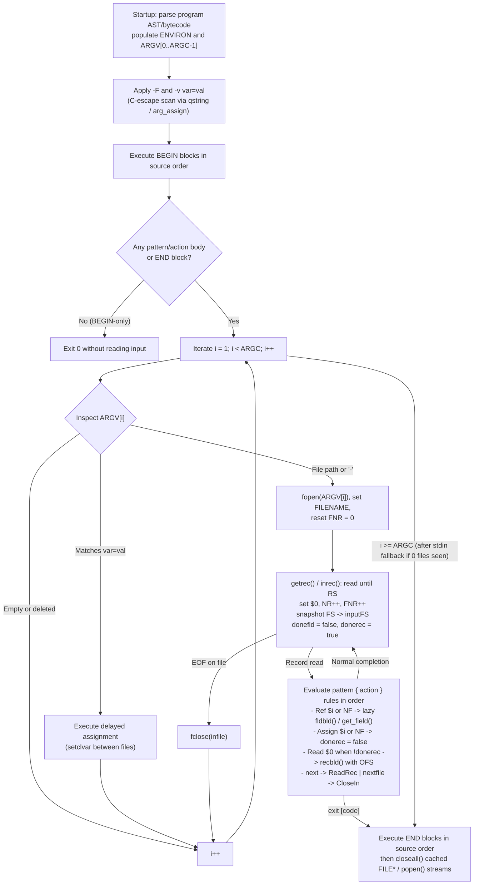

# The awk Language

> [!summary] Claim
> `awk` is a data-driven stream-processing language whose runtime iterates over `RS`-delimited records across `ARGV`, lazily splits `$0` into `$1..$NF` using the `FS` snapshot captured when the record was read, and dispatches comparisons through a dual-typed scalar cell (`NUM`, `STR`, and the input-tainted `STRNUM` numeric-string state).

Part of [Regular Expressions and Text Processing](README.md) in [Shell and Unix Engineering](../README.md).

## TL;DR

- **Mechanism**: After executing `-v` assignments and `BEGIN` blocks, `awk` iterates `ARGV[1..ARGC-1]`, reading `RS`-delimited records into `$0` and lazily splitting `$1..$NF` via `FS` only when a pattern or action evaluates a field or `NF` (`POSIX.1-2024 XCU Chapter 4 awk`; `onetrueawk` `lib.c`, `getrec` and `fldbld`; `gawk-5.4.1` `field.c`, `get_field`).
- **Rule**: Pass untrusted shell strings via `ENVIRON["VAR"]` or `ARGV` (deleting the `ARGV` slot in `BEGIN`), guard every `getline` call with `(getline var < file) > 0`, and call `close(expr)` on dynamically opened files and pipelines (`POSIX.1-2024 XCU Chapter 4 awk`: APPLICATION USAGE for `ENVIRON` and `ARGV`; Input/Output and General Functions for the `getline` return values and `close`).
- **Trap**: External inputs (`$0..$NF`, `ARGV`, `ENVIRON`, `split()`, `getline`, `-v`) that parse as numbers carry the numeric-string (`STRNUM`) attribute, causing `$1 == $2` to compare as 64-bit IEEE 754 `double` where `"0e12" == "0e99"` and `"9007199254740992" == "9007199254740993"` both evaluate to `1` (`true`) unless forced to string context via `$1 "" == $2 ""` (`POSIX.1-2024 XCU Chapter 4 awk, Expressions in awk`).
- **Portability fact**: Passing a literal `<newline>` inside `-v var=val` aborts with a syntax error in BSD/macOS `onetrueawk` (`tran.c`, `qstring`) and `gawk --posix`, whereas default `gawk` (`main.c`, `arg_assign`) permits newlines in `-v` but compiles values matching `@/.../` into a typed regular expression (`as of 2026-10`).
- **When not to use it**: Do not use `awk` for nested recursive grammars (JSON, YAML, HTML), binary streams containing `NUL` bytes, exact 64-bit integer arithmetic above `2^53`, or multi-hundred-line state machines where `[[Python-as-a-Shell-Companion]]` provides explicit types and structured error handling.

## Mental model



When `awk` starts, it compiles the entire program before opening any input file, applies `-F` and `-v` assignments (interpreting C-style backslash escapes), and executes all `BEGIN` blocks in source order (`POSIX.1-2024 XCU Chapter 4 awk, Overall Program Structure`; `onetrueawk` `run.c`, `program`).
If the program consists solely of `BEGIN` actions (with no pattern-action body and no `END` block), `awk` exits immediately without reading `stdin` or any file operands (`POSIX.1-2024 XCU Chapter 4 awk, Special Patterns`).
Otherwise, `awk` steps an internal index `i` from `1` to `ARGC - 1`: it skips empty or deleted `ARGV[i]` entries, evaluates operands matching `^[A-Za-z_][A-Za-z0-9_]*=` as inline variable assignments at that exact point between files, and opens remaining operands as input streams (falling back to `stdin` with `FILENAME = "-"` if the loop reaches `ARGC` without having opened a single file operand).
For each record terminated by `RS`, `getrec()` (`onetrueawk` `lib.c`) or `inrec()` (`gawk-5.4.1` `io.c`) populates `$0`, increments `NR` and `FNR`, snapshots the current `FS` value, and marks the field table invalid (`donefld = false`) without splitting `$0`.
As each rule is evaluated in source order, referencing `$1..$NF` or `NF` triggers lazy field splitting (`fldbld()` or `get_field()`), whereas assigning to `$1..$NF` or `NF` marks `$0` invalid (`donerec = false`) so `$0` is only rebuilt with `OFS` (`recbld()` or `rebuild_record()`) if `$0` is subsequently read or before `OFS` itself is modified.

## How it works

### Program lifecycle, `ARGV` state machine, and system calls

At process startup, `awk` populates `ENVIRON` from `envp` and copies non-option command-line arguments into `ARGV[1..ARGC-1]` with the utility name in `ARGV[0]` (`onetrueawk` `tran.c`, `arginit` and `envinit`; `gawk-5.4.1` `main.c`, `init_args`).
Options `-F sepstring` and `-v var=value` are evaluated before the first `BEGIN` block runs (`POSIX.1-2024 XCU Chapter 4 awk, OPTIONS`).
In contrast, assignment operands of the form `var=value` placed *after* the program text sit in `ARGV[1..ARGC-1]` and are evaluated lazily inside the file-opening loop (`onetrueawk` `lib.c`, `initgetrec` and `getrec` calling `isclvar` and `setclvar`; `BusyBox` `editors/awk.c`, `next_input_file` calling `try_to_assign`).
Consequently, a post-program operand `stage=file1` is invisible inside `BEGIN`; it takes effect only when the `ARGV` cursor reaches that slot before opening the next file.

Inside `BEGIN`, a script can inspect and mutate `ARGV` and `ARGC` to control which files `awk` opens (`POSIX.1-2024 XCU Chapter 4 awk, Variables and Special Variables`).
Setting `ARGV[i] = ""` or executing `delete ARGV[i]` causes the `ARGV` loop to skip slot `i` without opening a file.
If all `ARGV[1..ARGC-1]` slots are either deleted, set to `""`, or consumed as `var=value` assignments, and no actual file operand was ever processed, POSIX.1-2024 Issue 8 (Austin Group Defects 974 and 1451) requires `awk` to set `FILENAME = "-"` and read `stdin` (`onetrueawk` `lib.c`, `initgetrec`).
Wait-free `BEGIN`-only execution is also strictly specified: if a program has only `BEGIN` rules, `onetrueawk` (`run.c`, `program`) checks `if (a[1] || a[2])` and skips `getrec()` entirely, whereas a program containing `END { print NR }` (even with no body rules) reads every input file to `EOF` so `NR`, `FNR`, `NF`, and `$0` reflect the final record.

### Record splitting (`RS`) and lazy field splitting (`FS`, `$0`, `$1..$NF`, `OFS`)

By default, `RS` is `"\n"`, and `readrec()` (`onetrueawk` `lib.c`) or `get_a_record()` (`gawk-5.4.1` `io.c`) reads buffered chunks via `read(2)` / `getc(3)` up to the next `<newline>`, storing the line without its terminator in `$0`.
POSIX.1-2024 defines three `RS` regimes (`POSIX.1-2024 XCU Chapter 4 awk, Variables and Special Variables`):
1. **Single character (`RS = c`)**: records are delimited by the single byte/character `c`.
2. **Empty string (`RS = ""`, paragraph mode)**: `awk` discards leading blank lines, treats any sequence of two or more consecutive `<newline>` characters (`\n\n+`) as a single record separator, and forces `<newline>` to always act as a field separator in addition to `FS` in POSIX-conforming implementations (`onetrueawk` `lib.c`, `readrec` and `fldbld`; `gawk-5.4.1` `field.c`; `BusyBox` `editors/awk.c`, `awk_split`).
   In contrast, `mawk` (`mawk(1)` Section 12 "Multi-line records" and the COMPATIBILITY section) explicitly diverges from POSIX: it treats `<newline>` as whitespace only under default `FS = " "`, and ignores `<newline>` during field splitting when `FS` is customized (such as `FS = ":"`), leaving embedded newlines inside fields (documented intentional divergence; the man page says "mawk does not support this convention"; the behavior persists under `mawk -W posix` on `mawk 1.3.4 20250131`; not found in the changelog as of 2026-10).
3. **Multi-character string (`length(RS) > 1`)**: left unspecified by POSIX.1-2024 to permit regex extensions; `gawk` (`io.c`, `rsrescan`), `mawk` (`field.c`, `set_rs_shadow` selecting `SEP_RE`; `fin.c`), `onetrueawk` (`lib.c`, `readrec` calling `fnematch`), and `BusyBox awk` (`editors/awk.c`, `mk_splitter` compiling any `RS` longer than one character with `mk_re_node`) all interpret multi-character `RS` as an unanchored Extended Regular Expression (`[[BRE-ERE-and-PCRE]]`); verified with `RS = "XY"` and `RS = "[0-9]+"` on `mawk 1.3.4 20250131`, `gawk 5.2.1`, `original-awk 20250116`, macOS `awk 20200816`, and `BusyBox 1.37.0`, while `gawk --posix` uses only `RS[0]`.

When a record is read into `$0`, `awk` does *not* immediately split it into fields.
Instead, `onetrueawk` (`lib.c`, `getrec`) sets `donefld = false`, `donerec = true`, and calls `savefs()` to copy the current `FS` into `inputFS`, while `gawk-5.4.1` (`field.c`, `set_record` calling `purge_record`) sets `NF = -1`, `parse_high_water = 0`, `field0_valid = true`, and re-saves `save_FS` when `FS` was assigned since the last record (`resave_fs`).
Saving `FS` at record-read time satisfies the POSIX requirement that field splitting uses the `FS` value that was current when the record was read, even if an action modifies `FS` before referencing `$1` (`POSIX.1-2024 XCU Chapter 4 awk, Overall Program Structure`).
While `onetrueawk` (`lib.c`, `fldbld`) splits all fields `$1..$NF` at once on the first reference to any field or `NF`, `gawk-5.4.1` (`field.c`, `get_field`) splits fields *incrementally*: referencing `$2` parses only fields `1` and `2` (`parse_high_water = 2`) and records the resume pointer in `parse_extent`, avoiding scanning the remainder of wide lines unless a higher field or `NF` (`get_field(UNLIMITED - 1, NULL)`) is evaluated.

Field splitting follows four distinct algorithms depending on `FS` (`POSIX.1-2024 XCU Chapter 4 awk, Regular Expressions`; `onetrueawk` `lib.c`, `fldbld`; `gawk-5.4.1` `field.c`; `BusyBox` `editors/awk.c`, `awk_split`):
- **Default single space (`FS == " "`)**: Leading and trailing `<blank>` (`' '`, `'\t'`) and `<newline>` characters are stripped from `$0`, and fields are delimited by runs of one or more `<blank>` or `<newline>` characters.
- **Single non-space character (`length(FS) == 1 && FS != " "`)**: Leading and trailing occurrences are *not* stripped; every single occurrence of `FS` (plus `<newline>` if `RS == ""` in POSIX `awk`, `gawk`, `onetrueawk`, and `BusyBox awk`, but omitting `<newline>` in `mawk`) creates a field boundary, so `":a::b:"` with `FS = ":"` produces `NF = 5` with `$1 = ""`, `$2 = "a"`, `$3 = ""`, `$4 = "b"`, and `$5 = ""`.
  When `RS == ""` under `mawk`, `\n` is not added to single-character delimiters, so multi-line records retain embedded newlines in `$i`.
- **Extended Regular Expression (`length(FS) > 1`)**: Each non-empty substring matching the ERE delimits fields (updated in POSIX.1-2024 Issue 8 via Austin Group Defect 1468 so EREs that can match the empty string, like `" *"`, still advance and match non-empty delimiter runs; `BusyBox` `editors/awk.c`, `regexec1_nonempty`).
- **Empty string (`FS == ""`)**: Unspecified in POSIX, but splits each character (or byte in `mawk` and `BusyBox awk`) into its own field (`NF == length($0)`).
In all four modes, an empty input record (`$0 == ""`) produces `NF = 0`.

Coherence between `$0` and `$1..$NF` is bidirectional and lazy:
- **Field or `NF` assignment (`$i = val` or `NF = n`)**: Marks `$0` dirty (`donerec = false` in `onetrueawk` `tran.c:setsval`; `field0_valid = false` in `gawk-5.4.1` `field.c:invalidate_field0`; `BusyBox` `editors/awk.c:handle_special` rebuilds `$0` eagerly).
  Increasing `NF` or assigning to `$(NF + k)` creates intervening empty fields (`""`); decreasing `NF` truncates fields beyond the new `NF` (`onetrueawk` `lib.c`, `setlastfld`).
  When `$0` is next evaluated, `recbld()` (`onetrueawk` `lib.c`) or `rebuild_record()` (`gawk-5.4.1` `field.c`) joins `$1..$NF` with `OFS`.
  Crucially, per POSIX PASC Interpretation 1003.2-1992 #107 (`SD5-XCU-ERN-73`), `$0` must be recomputed using the value of `OFS` that was current when the field was assigned: if a script executes `$1 = $1; OFS = ":"`, both `onetrueawk` (`tran.c`, `setsval` and `setfval` branching on `vp == ofsloc` and then running `if (!donerec) recbld();`) and `gawk-5.4.1` (`eval.c`, `set_OFS` checking `if (!field0_valid) rebuild_record();`) immediately materialize `$0` using the *old* `OFS` before storing the new `OFS`!
- **Record assignment (`$0 = val`)**: Immediately invalidates all fields (`donefld = false` / `NF = -1`) and snapshots the *current* `FS`, so the next reference to `$1` or `NF` re-splits the new `$0` using the current `FS`.

### Dual-typed scalars, numeric strings (`STRNUM`), and comparison dispatch

Every scalar variable, array element, or field is stored in a value cell containing both an IEEE 754 `double` and a heap or buffer-backed string pointer, alongside type flags (`struct Cell` with `fval`, `sval`, `tval` in `onetrueawk` `awk.h`; `NODE` with `fltnum`, `stptr`, `flags` in `gawk-5.4.1` `awk.h`).
POSIX.1-2024 (`Expressions in awk`) distinguishes four runtime value states:
1. **Uninitialized (`NUM | STR` with `fval = 0.0`, `sval = ""` in `onetrueawk` `tran.c:syminit`; `Nnull_string` in `gawk-5.4.1` `awk.h`)**: Evaluates to `0` in numeric context and `""` in string context; uniquely satisfies both `u == 0` and `u == ""`.
2. **Pure numeric (`NUM` in `onetrueawk`; `NUMBER | NUMCUR` in `gawk`)**: Produced by numeric literals (`42`) and arithmetic operators (`+`, `-`, `*`, `/`, `%`, `^`, `++`, `--`).
3. **Pure string (`STR` in `onetrueawk`; `STRING | STRCUR` in `gawk`)**: Produced by string literals (`"010"`), string concatenation (`a ""`), `sprintf()`, `substr()`, `tolower()`, and `toupper()`.
4. **Numeric string (`STRNUM`: `NUM | STR` set via `is_number()` in `onetrueawk` `lib.c`; `USER_INPUT` flag in `gawk-5.4.1` `awk.h`; `VF_USER` in `BusyBox` `editors/awk.c`)**: Assigned *only* when a string originates from an external source (fields `$0..$NF`, `getline` targets, `FILENAME`, `ARGV` elements, `ENVIRON` elements, `split()` output array elements, `-v` or `ARGV` command-line assignments, or assignment from another numeric-string variable) *and* its entire content (ignoring leading and trailing whitespace) parses as a valid floating-point number via `strtod(3)` (`POSIX.1-2024 XCU Chapter 4 awk, Expressions in awk`, Defect 1395).

Relational comparisons (`<`, `<=`, `==`, `!=`, `>=`, `>`) inspect the operand types (`onetrueawk` `run.c`, `relop`; `gawk-5.4.1` `eval.c`, `cmp_nodes`):
- If both operands are numeric, if one is numeric and the other is a numeric string (`STRNUM`) or uninitialized, or if *both* operands are numeric strings (clarified as mandatory in `POSIX.1-2024` Issue 8 via Austin Group Defect 1198), `awk` compares their 64-bit `double` values numerically.
- Otherwise, `awk` converts both operands to strings (`CONVFMT`, default `"%.6g"`) and compares them as strings: `==` and `!=` test exact byte equality (`strcmp` / `memcmp`, POSIX.1-2024 Issue 8 Defect 1070), while `<`, `<=`, `>`, and `>=` use `LC_COLLATE` collation order in `POSIX.1-2024` (`strcoll` in `gawk --posix` `eval.c:posix_compare`, though `onetrueawk` `run.c:relop` and default `gawk` use byte order; see `[[Locale-and-LC_ALL]]`).

Number-to-string conversion uses two distinct format variables:
- `CONVFMT` (default `"%.6g"`) governs internal conversions (string concatenation, array subscripting, regex matching, and string relational comparisons).
- `OFMT` (default `"%.6g"`) governs only `print` statements (`POSIX.1-2024 XCU Chapter 4 awk, Output Statements`).
Exact integers always convert as `"%d"` (`"%.30g"` in `onetrueawk` `tran.c:get_str_val`; integral-value fast path in `gawk-5.4.1` `node.c:r_format_val` for values inside the `long` range).
To prevent a cached `OFMT` string from polluting a subsequent `CONVFMT` lookup (or vice versa), `onetrueawk` (`awk.h:CONVC` and `CONVO`) and `gawk-5.4.1` (`awk.h:CONVFMT_FMT` and `OFMT_FMT`, added in June 2026 per the `gawk-5.4.1` `ChangeLog` entry dated 2026-06-24) tag cached string representations with the format source and regenerate the string whenever the format mode or format string changes.

### Patterns, functions, and the open-stream table (`getline`, `print >`, `print |`, `close`)

Outside `BEGIN` and `END`, patterns take three forms (`POSIX.1-2024 XCU Chapter 4 awk, Patterns`):
- **Standalone ERE (`/ere/`)**: Shorthand for `$0 ~ /ere/`.
- **Boolean expression**: Any expression where numeric `!= 0` or non-numeric string `!= ""` matches (`onetrueawk` `run.c`).
  Because a string literal `"0"` is a pure string (`STR` without `NUM`) and is non-empty, `awk '"0"'` evaluates to **true** and prints every line, whereas a field `$1` containing `"0"` from input is a numeric string (`STRNUM` with numeric value `0.0`), so `awk '$1'` evaluates to **false**!
- **Range pattern (`pat1, pat2`)**: Matches all records starting when `pat1` evaluates to true and continuing inclusively through the next record where `pat2` evaluates to true (`BusyBox` `editors/awk.c`, `OC_TEST` toggling `OF_CHECKED`).
  If `pat1` and `pat2` both match on the same record, the range opens and closes on that single record.

User-defined functions (`function name(p1, p2,   local1, local2) { ... }`) pass scalars by value and arrays by reference (`POSIX.1-2024 XCU Chapter 4 awk, User-Defined Functions`; `onetrueawk` `run.c`, `call`).
The language has no local variable declaration keyword; every variable not listed in the function's parameter list has **global** scope across the entire program.
By convention, local variables are declared as extra trailing parameters separated by spaces in the function signature; omitted call arguments initialize to the uninitialized scalar (`0`/`""`) or empty array and are saved/restored across recursive calls on the call frame stack (`struct Frame` in `onetrueawk` `run.c`; `push_frame` in `gawk-5.4.1` `eval.c`).

Redirections in `print`, `printf`, and `getline` do not open and close files per statement; instead, `awk` caches open streams keyed by the exact string value of the target filename or command (`onetrueawk` `run.c`, `openfile` and `closefile`; `gawk-5.4.1` `io.c`, `redirect`):
- `print ... > fn`: If `fn` is not in the open-stream table, `awk` opens `fn` with `fopen(fn, "w")` (`O_WRONLY | O_CREAT | O_TRUNC`) and inserts it into the table; every subsequent `print > fn` or `print >> fn` with the identical string `fn` writes to the same open `FILE *` handle without re-truncating until `close(fn)` is called.
- `print ... | cmd` and `cmd | getline [var]`: Opens a pipe to `/bin/sh -c cmd` via `popen(cmd, "w")` or `popen(cmd, "r")` on first evaluation and reuses the open pipe stream on subsequent evaluations until `close(cmd)` calls `pclose(3)`.
- `getline` variants: Unredirected `getline` and `getline var` read from the current `ARGV` input file and increment both `NR` and `FNR`, whereas redirected `getline [var] < file` and `cmd | getline [var]` read from the cached stream without modifying `NR` or `FNR`.
  Forms without `var` overwrite `$0` and recompute `NF`; forms with `var` assign only to `var` and leave `$0` and `NF` unchanged.
  All six forms return `1` on success, `0` on `EOF`, and `-1` on error (`POSIX.1-2024 XCU Chapter 4 awk, Input/Output and General Functions`).

## Numbers and limits

| Metric or Limit | Value | Source and Date |
| :--- | :--- | :--- |
| Minimum guaranteed record length (`RS` any value) and `print` output length | `>= 2,048` bytes (`{LINE_MAX}` / `_POSIX2_LINE_MAX`) | `POSIX.1-2024 XCU Chapter 4 awk, INPUT FILES and Output Statements` (`as of 2026-10`) |
| Initial record buffer size (`RECSIZE` / `BUFFSZ`) | `8,192` bytes in `onetrueawk` (grows via `adjbuf`); `4,096` bytes in `mawk` (`SPRINTF_LIMIT / 2`, grows); dynamic `st_blksize` in `gawk` (falls back to `BUFSIZ`, overridable with `AWKBUFSIZE`) | `onetrueawk` `awk.h` (`RECSIZE`), `mawk` `sizes.h` (`BUFFSZ`, non-MSDOS builds), `gawk-5.4.1` `posix/gawkmisc.c` (`optimal_bufsize`, called from `io.c`) (`as of 2026-10`) |
| Maximum fields per record (`NF`) | `16,777,215` (`0xffffff`) hard cap in `BusyBox awk`; `LONG_MAX` in `gawk`; bounded only by the `int` field counter `nfields` and memory in `onetrueawk` (no explicit cap; starts at `MAXFLD = 2` and doubles) | `BusyBox` `editors/awk.c` (`fsrealloc`), `gawk-5.4.1` `field.c` (`UNLIMITED`), `onetrueawk` `lib.c` (`growfldtab`) (`as of 2026-10`) |
| Initial field bank size in `mawk` (`FBANK_SZ`) | `1,024` fields (`1 << FB_SHIFT` where `FB_SHIFT = 10`) | `mawk` `sizes.h` (`FBANK_SZ`) (`as of 2026-10`) |
| Scalar floating-point precision (`Awkfloat` / `AWKNUM` = IEEE 754 `double`) | `53` significand bits (`15-17` decimal digits); exact integer limit `2^53 = 9,007,199,254,740,992` | `onetrueawk` `awk.h`, `gawk-5.4.1` `awk.h`, and proven by `[lab](../labs/07-awk-language/)` Phase 3 (`9007199254740992 == 9007199254740993` is `1`) |
| Default float-to-string precision (`CONVFMT` and `OFMT`) | `"%.6g"` (`6` significant digits; exact integers format as `"%d"`) | `POSIX.1-2024 XCU Chapter 4 awk, Variables and Special Variables` (`as of 2026-10`) |
| Function call arguments + local parameters (`NARGS`) | `50` (`ncall + ndef <= 50`) hard limit in `onetrueawk`; dynamic stack frame in `gawk` | `onetrueawk` `run.c` (`call`, `#define NARGS 50`), `gawk-5.4.1` `eval.c` (`push_frame`) (`as of 2026-10`) |
| ERE interval repetition count `{m,n}` | `255` (`_POSIX2_RE_DUP_MAX`) | `POSIX.1-2024 XBD 9.4`, `onetrueawk` `FIXES` (`Apr 26, 2026` cap at `255`), `getconf RE_DUP_MAX` prints `255` on macOS (`as of 2026-10`) |
| Initial hash table buckets and rehash threshold | `50` buckets (`NSYMTAB`), rehash at `2x` load (`FULLTAB = 2`) by `4x` (`GROWTAB = 4`) in `onetrueawk`; `53` / `199` primes in `mawk` | `onetrueawk` `awk.h` and `tran.c` (`rehash`), `mawk` `sizes.h` (`HASH_PRIME`, `A_HASH_PRIME`) (`as of 2026-10`) |
| Concurrent open `print` / `getline` redirections (`files[]`) | Bounded by OS `RLIMIT_NOFILE` (`{OPEN_MAX}`); `onetrueawk` grows `files[]` in chunks of `FOPEN_MAX` (`20` on macOS, `_stdio.h`) | `onetrueawk` `run.c` (`openfile`), `gawk-5.4.1` `io.c` (`redirect`) (`as of 2026-10`) |
| Paragraph mode (`RS = ""`) field count on `\n\na:b\nc:d\n\ne:f\n\n` with `FS = ":"` | `NF = 4` in `gawk`, `onetrueawk`, `BusyBox awk`; `NF = 3` in `mawk` (`$2 = "b\nc"`) | `POSIX.1-2024 XCU Chapter 4 awk, Variables and Special Variables`, `mawk(1)` Section 12, proven by `[lab](../labs/07-awk-language/)` on `mawk 1.3.4 20250131`, `gawk 5.2.1`, `original-awk 20250116`, `BusyBox 1.37.0`, and macOS `awk 20200816` (`as of 2026-10`) |

## Portability

| Environment / Implementation | Shell / CLI Invocation & `-v` Behavior | Field & Record Splitting (`FS = ""`, `RS = ""`, Multi-Char `RS`) | `POSIX.1-2024` Issue 8 Features (`nextfile`, `fflush()`, `delete arr`, `length(arr)`) | Hex Strings (`"0x10"`) in Input Data & Locale Collation (`<`, `>`) |
| :--- | :--- | :--- | :--- | :--- |
| **POSIX.1-2024 (`sh` + `awk` spec)** | Unquoted `$opts` splits on `IFS`; `-v` expands C escapes and forbids literal `<newline>` (`POSIX.1-2024 XCU Chapter 4 awk`: OPERANDS treats the value as a `STRING` token, and Lexical Conventions say "A <newline> shall not occur within a string constant"). | `FS = ""` and multi-char `RS` are unspecified (`POSIX.1-2024 XCU Chapter 4 awk`, Regular Expressions and Variables and Special Variables); `RS = ""` mandates `<newline>` is always an additional field separator regardless of `FS` (`POSIX.1-2024 XCU Chapter 4 awk`). | All four required by `POSIX.1-2024` Issue 8 (Defects 544, 607, 634, 1136, 1566). | Hex support in `strtod()` is optional (Defect 1395); `==` uses byte identity (Defect 1070), `<` uses `LC_COLLATE`. |
| **macOS `bash 3.2` & current `bash 5.x`** | Splits unquoted `$opts` on `IFS` (proven by `[lab](../labs/07-awk-language/)` on `bash 3.2.57`, `4.4.23`, `5.1.16`, `5.2.37`, `5.3.15`, and `5.3.20`); supports `$'...'` ANSI-C quoting for passing control chars (Bash Reference Manual, ANSI-C Quoting; not exercised by the lab). | Delegates to host `awk` utility. | Delegates to host `awk` utility. | Delegates to host `awk` utility; `LC_ALL=C` recommended on command environment. |
| **`zsh` (native)** | Does **not** word-split unquoted `$opts` (`NO_SH_WORD_SPLIT`), passing `"-F : -v tag=ok"` as a single `-F` argument (proven by `[lab](../labs/07-awk-language/)`); a word starting with `=` triggers command-path expansion (`EQUALS`, on by default; `zshoptions(1)`). | Delegates to host `awk` utility. | Delegates to host `awk` utility. | Delegates to host `awk` utility. |
| **`zsh --emulate sh`, `dash`, `ksh93`, `mksh`, `yash`, `posh`, `BusyBox ash`** | Splits unquoted `$opts` on `IFS` (proven by `[lab](../labs/07-awk-language/)`); note `dash` and `posh` lack `$'...'` prior to POSIX.1-2024 adoption (`dash 0.5.12` and `posh 0.14.1` print `$'a'` literally, checked in the Debian matrix image as of 2026-10). | Delegates to host `awk` utility. | Delegates to host `awk` utility. | Delegates to host `awk` utility. |
| **GNU `gawk 5.4.1`** | Default mode permits literal `<newline>` in `-v` (`main.c:arg_assign`) and compiles `-v x='@/.../'` as a typed regex; `--posix` rejects `<newline>` in `-v` with "POSIX does not allow physical newlines in string values" (source in `gawk-5.4.1`; behavior checked on Debian `gawk 5.2.1`). | `FS = ""` splits into multibyte characters (`field.c:null_parse_field`); multi-char `RS` is an ERE; `RS = ""` treats `<newline>` as field separator regardless of `FS`. | Supports `nextfile`, `fflush()`, `delete arr`, and `length(arr)` (`gawk-5.4.1` `eval.c`, `builtin.c`). | Ignores `"0x10"` hex in input by default (`"0x10" + 0 == 0`) unless `--posix` or `--non-decimal-data` is set (`node.c:r_force_number`; all three modes checked on `gawk 5.2.1`); `<` uses byte order unless `--posix` (`eval.c:cmp_nodes` calling `posix_compare`, which uses `strcoll`). |
| **BSD / macOS One True Awk (`20200816` - `20260426`)** | Rejects literal `<newline>` in `-v` with `SYNTAX("newline in string")` (`tran.c:qstring`). | `FS = ""` splits UTF-8 characters (`lib.c:fldbld`); multi-char `RS` is an ERE (`lib.c:readrec`); `RS = ""` treats `<newline>` as field separator regardless of `FS` (proven in `[lab](../labs/07-awk-language/)`). | Supports `nextfile`, `fflush()`, `delete arr`, and `length(arr)` (checked directly on macOS `awk 20200816` and Debian `original-awk 20250116`; the `[lab](../labs/07-awk-language/)` does not exercise these). | Version-dependent: macOS `awk 20200816` parses input `"0x10"` as numeric string `16` via `strtod()`, but releases after `FIXES.1e` `December 8, 2020` ("Disallow hex data") reject it in `lib.c:is_valid_number`, so `"0x10" + 0 == 0` on `original-awk 20250116`; `<` always uses `strcmp()` byte order (`run.c:relop`). |
| **`mawk 1.3.4` (`2024` - `2026`)** | Expands C escapes in `-v`; allows `<newline>` in `-v` (`init.c`). | `FS = ""` splits into single bytes; multi-char `RS` is an ERE (`field.c:set_rs_shadow`, `SEP_RE`; `SEP_MLR` in `field.h` is the `RS = ""` mode); `RS = ""` ignores `<newline>` when `FS` is custom, embedding newlines in fields, even under `-W posix` (`mawk(1)` Section 12 and COMPATIBILITY; not found in the changelog as of 2026-10; proven in `[lab](../labs/07-awk-language/)` on `mawk 1.3.4 20250131`). | Supports `nextfile`, `fflush()`, `delete arr`, and `length(arr)` (`bi_funct.c:bi_alength`). | Rejects hex input by default (`"0x10" + 0 == 0`); `--posix` (alias of `-W posix`) *allows* hexadecimal, `inf`, and `nan` (`mawk(1)` OPTIONS; `CHANGES` `20241212`; checked on `mawk 1.3.4 20250131`); `<` uses `memcmp()` byte order. |
| **`BusyBox awk 1.37.0`** | Expands escapes via `unescape_string_in_place()` (`editors/awk.c:try_to_assign`); accepts a literal `<newline>` in `-v` (checked on Alpine and Debian `1.37.0`). | `FS = ""` splits into single bytes (`editors/awk.c:awk_split`); multi-char `RS` is compiled as an ERE (`editors/awk.c:mk_splitter`, checked with `RS = "XY"` and `RS = "[0-9]+"`); `RS = ""` treats `<newline>` as field separator regardless of `FS` (proven in `[lab](../labs/07-awk-language/)`). | Supports `nextfile`, `fflush()`, `delete arr`, and `length(arr)` (`editors/awk.c`; checked on `1.37.0`). | Uses `strtod()` for numeric strings, so input `"0x10"` is numeric `16` (checked on `1.37.0`); `tolower`/`toupper` are ASCII-only (`editors/awk.c`, `B_lo` / `B_up` case). |
| **`uutils coreutils`** | Not applicable: `awk` is outside GNU coreutils and is not implemented in `uutils/coreutils` (`README.md`, `as of 2026-10`). | Use `gawk`, `onetrueawk`, or `mawk` on systems with `uutils` coreutils. | Not applicable. | Not applicable. |

See `[[awk-Implementations]]` for bytecode VM and regex engine architectural differences across `gawk`, `mawk`, `onetrueawk`, and `BusyBox awk`.

## Worked example

The [lab](../labs/07-awk-language/) (`awk-language.sh` and `test.bats`) verifies the four core mechanisms of the `awk` language across shells:
1. Execution ordering across `-v`, `BEGIN`, inter-file `ARGV` assignments, `exit`, and `END`.
2. The three standard `FS` modes (`" "`, single-char `":"`, and ERE `"[:,]+"`) plus lazy `$0` reconstruction and `OFS` assignment ordering (`SD5-XCU-ERN-73`).
3. Numeric-string (`STRNUM`) comparison rules on leading-zero strings (`010` vs `10`), scientific-notation hex lookalikes (`0e12` vs `0e99`), 64-bit integers exceeding `2^53` (`9007199254740992` vs `9007199254740993`), and the uninitialized variable value.
4. Escape-free string passing via `ENVIRON` versus `-v` and explicit `getline` tri-state status checking (`1`, `0`, `-1`).

```sh
#!/bin/sh
# Demonstrate the POSIX awk execution lifecycle, field splitting and lazy $0
# reconstruction, numeric-string (STRNUM) comparison rules, and safe I/O.
set -eu

workdir=${1:-}
cleanup_dir=""
if [ -z "$workdir" ]; then
  workdir=$(mktemp -d "${TMPDIR:-/tmp}/awk-lab.XXXXXX")
  cleanup_dir=$workdir
  trap 'rm -rf "$cleanup_dir"' EXIT INT TERM
fi

mkdir -p "$workdir"
printf 'alpha 10\nbeta 20\n' >"$workdir/f1.txt"
printf 'gamma 30\ndelta 40\n' >"$workdir/f2.txt"

printf '=== 1. Execution lifecycle and ARGV timing ===\n'
# shellcheck disable=SC2016 # single-quoted awk program expands inside awk
awk -v stage=pre_begin '
  BEGIN {
    printf "BEGIN: stage=%s NR=%d FNR=%d\n", stage, NR, FNR
  }
  {
    printf "BODY: stage=%s file=%s NR=%d FNR=%d $1=%s\n",
      stage, (FNR == NR ? "f1" : "f2"), NR, FNR, $1
    if (NR == 3) {
      exit 0
    }
  }
  END {
    printf "END: stage=%s NR=%d FNR=%d\n", stage, NR, FNR
  }
' stage=file1 "$workdir/f1.txt" stage=file2 "$workdir/f2.txt" stage=pre_end

# shellcheck disable=SC2016 # literal $0 in section header
printf '=== 2. FS modes and lazy $0 / OFS coherence ===\n'
# shellcheck disable=SC2016 # single-quoted awk program expands inside awk
printf '  a   b  \n' | awk '{ printf "FS_space: NF=%d $1=<%s> $2=<%s>\n", NF, $1, $2 }'
# shellcheck disable=SC2016 # single-quoted awk program expands inside awk
printf ':a::b:\n' | awk -F : '{ printf "FS_char: NF=%d $1=<%s> $2=<%s> $4=<%s> $5=<%s>\n", NF, $1, $2, $4, $5 }'
# shellcheck disable=SC2016 # single-quoted awk program expands inside awk
printf ':a,:b\n' | awk -F '[:,]+' '{ printf "FS_ere: NF=%d $1=<%s> $2=<%s> $3=<%s>\n", NF, $1, $2, $3 }'
# shellcheck disable=SC2016 # single-quoted awk program expands inside awk
printf 'a b c\n' | awk '{ OFS = "|"; print "no_touch:", $0 }'
# shellcheck disable=SC2016 # single-quoted awk program expands inside awk
printf 'a b c\n' | awk '{ $1 = $1; OFS = "|"; print "ofs_after:", $0 }'
# shellcheck disable=SC2016 # single-quoted awk program expands inside awk
printf 'a b c\n' | awk '{ OFS = "|"; $1 = $1; print "ofs_before:", $0 }'

printf '=== 3. Numeric strings (STRNUM) and IEEE 754 limits ===\n'
# shellcheck disable=SC2016 # single-quoted awk program expands inside awk
printf '010 10\n0e12 0e99\n9007199254740992 9007199254740993\n' | awk '
  {
    printf "pair=<%s,%s> num_eq=%d str_eq=%d\n",
      $1, $2, ($1 == $2), ($1 "" == $2 "")
  }
  END {
    printf "uninit: u_eq_0=%d u_eq_empty=%d zero_eq_empty=%d\n",
      (u == 0), (u == ""), ("0" == "")
  }
'

printf '=== 4. Safe parameter passing and getline status ===\n'
raw_val='a\nb'
# shellcheck disable=SC2016 # single-quoted awk program expands inside awk
VAL=$raw_val awk -v v="$raw_val" '
  BEGIN {
    printf "dash_v_len=%d env_len=%d env_val=<%s>\n",
      length(v), length(ENVIRON["VAL"]), ENVIRON["VAL"]
  }
'
# shellcheck disable=SC2016 # single-quoted awk program expands inside awk
awk -v ok="$workdir/f1.txt" -v missing="$workdir/no-such-file.txt" '
  BEGIN {
    r1 = (getline line < ok)
    close(ok)
    r2 = (getline line < missing)
    printf "getline_ok=%d line=<%s> getline_missing=%d\n", r1, line, r2
  }
'
```

Expected output from `./labs/07-awk-language/awk-language.sh`:

```text
=== 1. Execution lifecycle and ARGV timing ===
BEGIN: stage=pre_begin NR=0 FNR=0
BODY: stage=file1 file=f1 NR=1 FNR=1 $1=alpha
BODY: stage=file1 file=f1 NR=2 FNR=2 $1=beta
BODY: stage=file2 file=f2 NR=3 FNR=1 $1=gamma
END: stage=file2 NR=3 FNR=1
=== 2. FS modes and lazy $0 / OFS coherence ===
FS_space: NF=2 $1=<a> $2=<b>
FS_char: NF=5 $1=<> $2=<a> $4=<b> $5=<>
FS_ere: NF=3 $1=<> $2=<a> $3=<b>
no_touch:|a b c
ofs_after:|a b c
ofs_before:|a|b|c
=== 3. Numeric strings (STRNUM) and IEEE 754 limits ===
pair=<010,10> num_eq=1 str_eq=0
pair=<0e12,0e99> num_eq=1 str_eq=0
pair=<9007199254740992,9007199254740993> num_eq=1 str_eq=0
uninit: u_eq_0=1 u_eq_empty=1 zero_eq_empty=0
=== 4. Safe parameter passing and getline status ===
dash_v_len=3 env_len=4 env_val=<a\nb>
getline_ok=1 line=<alpha 10> getline_missing=-1
```

Notice in Phase 1 that `exit 0` on `NR == 3` immediately abandons `f2.txt` before reading line 2 (`delta 40`) and before evaluating the trailing `stage=pre_end` operand in `ARGV`, yet still executes the `END` block with `stage=file2`, `NR=3`, and `FNR=1`.

## Pitfalls

> [!warning] Infinite loop on unhandled `getline` `-1` error return
> - **Trigger**: Writing `while (getline line < file)` without testing whether the return value is strictly greater than zero.
> - **Symptom**: When `file` does not exist, lacks read permissions, or is a directory, `getline` returns `-1`; because `-1` is non-zero, `awk` evaluates `-1` as **true** in a boolean context (`POSIX.1-2024 XCU Chapter 4 awk, Expressions in awk` and `Input/Output and General Functions`), spinning forever at 100% CPU with `line` retaining its previous value.
>   In `gawk <= 5.4.0`, failed redirected `getline` calls in `io.c` (`do_getline_redir`) also triggered a heap use-after-free by dereferencing `redir_exp` after freeing it (`CVE-2026-40467`, published 2026-07-13; fixed by gawk commit `a2d18c74`, "Don't DEREF redir_exp too early", dated 2026-04-03, and first released in `gawk 5.4.1` on 2026-07-08).
> - **Fix**: Always write `while ((rc = (getline line < file)) > 0)` and check `if (rc < 0)` to log or abort on I/O errors, then call `close(file)`.

> [!warning] Silent numeric-string (`STRNUM`) collisions on hex hashes, leading zeros, and 64-bit IDs
> - **Trigger**: Comparing input fields or `ARGV`/`ENVIRON` values directly with `==` or `!=` (such as `$1 == prev` or `$1 == $2`) when processing git commit prefixes (`0e12` vs `0e99`), zero-padded identifiers (`010` vs `10`), or 64-bit Snowflake/database IDs above `2^53` (`9007199254740992` vs `9007199254740993`).
> - **Symptom**: Because external inputs matching `strtod(3)` receive the `STRNUM` attribute (`NUM | STR` in `onetrueawk` `lib.c:fldbld`; `USER_INPUT` in `gawk-5.4.1` `field.c`), `awk` performs a 64-bit IEEE 754 `double` comparison (`POSIX.1-2024 XCU Chapter 4 awk, Expressions in awk`, Defect 1198), equating `"0e12"` and `"0e99"` (`0.0 == 0.0`) and rounding both `9007199254740992` and `9007199254740993` to `9007199254740992.0`.
> - **Fix**: Force string comparison on at least one operand by concatenating the null string: `$1 "" == $2 ""`.

> [!warning] File descriptor exhaustion from unclosed dynamic `print` or `getline` redirections
> - **Trigger**: Redirecting output or input to a dynamic filename or command per record, such as `{ print $0 > ("out/" $1 ".log") }` or `{ ("date -d " $1) | getline ts }`, without calling `close()`.
> - **Symptom**: `awk` keeps every redirected file and pipeline open in its internal stream table (`files[]` in `onetrueawk` `run.c:openfile`; the `red_head` linked list in `gawk-5.4.1` `io.c:redirect_string`) until program termination or an explicit `close(expr)` with the exact same string.
>   When distinct keys exceed the process descriptor limit (`RLIMIT_NOFILE`) or stdio `FILE` limit, `onetrueawk` aborts with a fatal write/open error (`run.c:openfile`) or `popen()` fails with `EMFILE`.
> - **Fix**: Call `close(cmd)` immediately after reading from a one-shot pipeline, or sort records by key before `awk` and call `close(prev_file)` whenever the shard key changes.

> [!warning] Assigning `OFS` after modifying a field leaves `$0` with the old separator
> - **Trigger**: Writing `{ OFS = ":"; print $0 }` without assigning to a field, or writing `{ $1 = $1; OFS = ":"; print $0 }` with `OFS` assigned *after* `$1 = $1`.
> - **Symptom**: `$0` prints with its original whitespace instead of `":"`.
>   Without a field assignment, `donerec` / `field0_valid` remains `true` and `$0` is never rebuilt; if `$1 = $1` runs first (`donerec = false`) and `OFS = ":"` runs second, `onetrueawk` (`tran.c`, `setsval`) and `gawk-5.4.1` (`eval.c`, `set_OFS`) immediately call `recbld()` / `rebuild_record()` using the *previous* `OFS` before updating `OFS`, as required by POSIX PASC Interpretation 1003.2-1992 #107 (`SD5-XCU-ERN-73`).
> - **Fix**: Set `OFS = ":"` inside `BEGIN` (or strictly *before* assigning `$1 = $1`).

> [!warning] Use-after-free and heap corruption on dynamic field reallocation and large substitutions
> - **Trigger**: Evaluating expressions where the right-hand side reallocates the field table or mutates a variable while the left-hand side holds a raw pointer into that table (`$5 = $$5 = $0` or `$444 $44444`), or running `sub()`/`gsub()` with multi-megabyte replacements on 32-bit builds.
> - **Symptom**: In `BusyBox awk <= 1.36.1`, `fsrealloc()` moved `Fields[]` via `xrealloc()` during right-hand-side evaluation in `evaluate()`, leaving `L.v` pointing to freed heap memory (BusyBox commit `5dcc443dba03`, 2023-05-26, which added the `old_Fields_ptr` guard and is titled "fix use-after-realloc (CVE-2021-42380)"; the CVE record itself, published 2021-11-15, names `clrvar` and versions before `1.34.0`).
>   Separate `BusyBox 1.36.1` use-after-free bugs in `evaluate()` (`CVE-2023-42364`) and `copyvar()` (`CVE-2023-42365`), both published 2023-11-27, were fixed by commit `0256e00a9d07` ("awk: fix precedence of = relative to ==", 2023-05-30), which Yocto ships as the fix for both.
>   In `gawk <= 5.4.0`, `do_sub()` in `builtin.c` had integer overflows in result-buffer size arithmetic that could overwrite heap metadata (`CVE-2026-40468`, fixed by commit `062f2f25` making `sofar` a `size_t`; `CVE-2026-40469` on 32-bit builds, fixed by commit `ae1b2d50`; both published 2026-07-13).
>   In `onetrueawk` releases before `20240728`, `delete ARGV` and `fnematch()` buffer growth (`adjbuf`) caused use-after-free crashes (`onetrueawk` `FIXES`, `Mar 10, 2024` and `May 4, 2024`; the `May 4, 2024` fix first shipped in tag `20240728`).
> - **Fix**: Upgrade to `gawk >= 5.4.1`, `BusyBox >= 1.37.0`, and `onetrueawk >= 20240728`, and avoid nested self-referential field assignments (`$i = $(expr)`).

> [!warning] Silent paragraph-mode field corruption across Debian/Ubuntu mawk and POSIX awks
> - **Trigger**: Setting `RS = ""` (paragraph mode) together with a custom single-character or regular expression field separator (such as `awk -F : 'BEGIN { RS = "" }'`) to parse multi-line records.
> - **Symptom**: In POSIX-conforming implementations (`gawk`, `onetrueawk`, `BusyBox awk`), `<newline>` is always treated as an additional field separator (`POSIX.1-2024 XCU Chapter 4 awk, Variables and Special Variables`), splitting lines into separate fields (`NF = 4` for `\n\na:b\nc:d\n\n`).
>   In `mawk` (the default `/usr/bin/awk` on Debian and Ubuntu; `/usr/bin/awk` resolves to `/usr/bin/mawk` in Debian 13 trixie as of 2026-10), `<newline>` is treated as whitespace only when `FS = " "`.
>   When `FS` is customized (such as `FS = ":"`), `mawk` splits strictly on `FS` alone, embedding literal newlines inside fields (`$2` becomes `"b\nc"` and `NF = 3`) (`mawk(1)` Section 12 "Multi-line records" and the COMPATIBILITY section, a documented intentional divergence that persists under `mawk -W posix` on `mawk 1.3.4 20250131`; not found in the changelog as of 2026-10).
> - **Fix**: To parse multi-line delimited records portably across all `awk` implementations including `mawk`, include `\n` explicitly in `FS` as a single-character bracket expression (`FS = "[\n:]"`), or normalize records before passing them to `awk`.
>   Avoid `FS = "[:\n]+"`: the `+` merges adjacent delimiters, so `a::b` yields 2 fields instead of the 3 (`a`, empty, `b`) that POSIX paragraph mode produces.

## Security and robustness

Treating `awk` as a safe filter requires defending three distinct trust boundaries between the calling shell, the `awk` command-line parser, and the `awk` runtime:

1. **`ARGV` assignment and `-` filename injection**:
   In POSIX `awk` (`POSIX.1-2024 XCU Chapter 4 awk, OPERANDS`), `var=value` is an **operand** processed during the runtime `ARGV` loop, not an option processed by `getopt(3)`.
   Passing `--` before the program text (`awk -- '{ print $0 }' "$@"`) stops option parsing, but does *not* stop `awk` from interpreting an attacker-controlled filename like `ORS=injected` or `FS=.` in `"$@"` as a runtime variable assignment, or `-` as `stdin`!
   To neutralize `ARGV` operand injection portably, prefix relative file operands with `./` (`for f in "$@"; do ... "./$f"; done`) as recommended by `POSIX.1-2024 XCU Chapter 4 awk, APPLICATION USAGE`, or in GNU `gawk` use `-E progfile` (`--exec`), which sets `disallow_var_assigns = true` in `main.c` so that `arg_assign` refuses command-line `var=value` operands.

2. **Code and escape injection in shell-to-`awk` parameter passing**:
   Never interpolate shell variables into the `awk` program string (`awk "\$1 == \"$user\""`), which grants immediate arbitrary command execution via `system()` or `| getline`.
   Even `-v var="$user"` is not byte-transparent: `-v` processes C backslash escapes (`\n`, `\t`, `\ddd`), fails with a fatal syntax error if `$user` contains a literal `<newline>` in BSD `onetrueawk` (`tran.c:qstring`) or `gawk --posix`, and in default `gawk` (`main.c:arg_assign`) compiles any value matching `@/.../` into a typed regular expression (aborting the process if the interior is not a valid ERE, such as `@/[/`).
   Pass arbitrary untrusted strings through `ENVIRON` (`VAL="$user" awk 'BEGIN { v = ENVIRON["VAL"] "" } ...'`) or through `ARGV` consumed and deleted in `BEGIN` (`awk 'BEGIN { v = ARGV[1] ""; delete ARGV[1] } ...' "$user"`).

3. **Shell command injection via `system()`, `print | cmd`, and `cmd | getline`**:
   Every `system(expr)`, `print ... | expr`, and `expr | getline` call passes `expr` directly to `/bin/sh -c` via `system(3)` or `popen(3)`.
   Constructing `expr` from input fields (`system("ls " $1)`) is a textbook shell command injection vulnerability.
   Furthermore, in default GNU `gawk` (`io.c`, `redirect_string`), passing an attacker-controlled filename beginning with `/inet/`, `/inet4/`, or `/inet6/` to `getline < file` or `print > file` opens a live TCP or UDP socket!
   When running `gawk` on untrusted data or user-supplied rules, pass `--sandbox` to disable `system()`, every input redirection with `getline` and output redirection with `print` and `printf` (files, pipes, and therefore `/inet/` special files; `io.c:redirect_string` aborts with "redirection not allowed in sandbox mode"), dynamic extensions (`@load`), and additions of new file names to `ARGV` (GNU Awk User's Guide, Options).

## The principal's view

A staff-plus engineer views `awk` as a specialized, zero-dependency **columnar stream reactor** occupying the exact architectural slot between single-pass regex filters (`[[grep-in-Depth]]`, `[[sed-Pattern-and-Hold-Space]]`, `[[tr-cut-and-paste]]`) and general-purpose runtimes (`[[Perl-One-Liners]]`, `[[Python-as-a-Shell-Companion]]`).
Its enduring advantage is that the `BEGIN` -> `RS`/`FS` record-field loop -> `END` lifecycle eliminates boilerplate file-opening, buffering, and line-splitting code while running in `< 5` ms startup latency on every POSIX base image, initramfs, and container (measured: median `1.85` ms for `awk 'BEGIN{}'` with macOS `awk 20200816` over 200 runs, as of 2026-10).

The engineering trade-off hinges on **implicitness vs. invariants**:
- **Stay in `awk`** when the input is line- or paragraph-oriented text with flat delimiter- or regex-separated columns, the logic fits in `< 50` lines of pattern-action rules or associative-array aggregations (`[[awk-Associative-Arrays-and-Idioms]]`), and streaming throughput with zero external runtime dependencies is the primary constraint.
  When deploying across heterogeneous Linux environments, remember that default `awk` on Debian and Ubuntu is `mawk`, which violates POSIX `RS = ""` paragraph mode by failing to split fields on newlines when `FS` is custom: either standardize on `gawk` or specify `FS = "[\n:]"` explicitly (not `[:\n]+`, which merges adjacent delimiters and drops empty fields).
- **Step down to `cut`, `tr`, or `grep`** when delimiters are single literal bytes (such as `:` or `\t`) and no arithmetic, field reordering, or state across lines is needed; `LC_ALL=C cut -d: -f1` avoids `awk`'s ERE field-splitting and `STRNUM` inspection overhead entirely.
- **Step up to `[[Python-as-a-Shell-Companion]]` (or Rust/Go)** the moment any of four boundaries is crossed:
  1. The data format has nested or quoted escaping rules (JSON, YAML, XML, or RFC 4180 CSV with embedded newlines where POSIX `awk` lacks a parser).
  2. Identifiers or counters are 64-bit integers (`> 2^53`) or hex strings where `STRNUM` coercion risks silent data corruption.
  3. The script requires structured error handling, network calls, or safe subprocess execution via `execve(2)` argument vectors (`subprocess.run([...])`) rather than `awk`'s `/bin/sh -c` `popen(3)` strings.
  4. The program grows beyond a single screen of rules and requires unit-testable modules with lexical local scope rather than space-padded parameter lists.

## Interview questions

> [!question] L5: Predict the exact output of the following three commands on input `a b c`: (1) `printf 'a b c\n' | awk '{ OFS = ":"; print $0 }'`, (2) `printf 'a b c\n' | awk '{ $1 = $1; OFS = ":"; print $0 }'`, and (3) `printf 'a b c\n' | awk '{ OFS = ":"; $1 = $1; print $0 }'`.
>
> > [!success]- Answer
> > Command (1) prints `a b c`, command (2) prints `a b c`, and only command (3) prints `a:b:c`.
> > In command (1), no field or `NF` is assigned to, so `$0` remains valid (`donerec = true` in `onetrueawk` `lib.c`; `field0_valid = true` in `gawk` `field.c`) and is printed verbatim without reconstruction.
> > In command (2), assigning `$1 = $1` marks `$0` dirty (`donerec = false`), but when `OFS = ":"` executes next, POSIX PASC Interpretation 1003.2-1992 #107 (`SD5-XCU-ERN-73`) requires `$0` to reflect the `OFS` that was current at the time of the field assignment, so `setsval()` (`onetrueawk` `tran.c`) and `set_OFS()` (`gawk` `eval.c`) immediately rebuild `$0` using the old `" "` before updating `OFS` to `":"`.
> > In command (3), `OFS` is already `":"` when `$1 = $1` invalidates `$0`, so `recbld()` / `rebuild_record()` joins `$1..$NF` with `":"` when `print $0` evaluates `$0`.
> >
> > Follow-up: What does `printf '  a   b  \n' | awk '{ NF = NF; print "<" $0 ">" }'` print, and why?

> [!question] L5: How do `-v var=val` options and post-program `var=val` operands differ in execution timing, and when would you intentionally use the post-program operand form?
>
> > [!success]- Answer
> > Options passed via `-v var=val` are evaluated before any `BEGIN` action runs, whereas `var=val` operands placed after the program text sit in `ARGV[1..ARGC-1]` and are evaluated only when the file-processing loop reaches that index after `BEGIN` completes (`POSIX.1-2024 XCU Chapter 4 awk, OPTIONS and OPERANDS`).
> > Consequently, a variable set via a post-program `var=val` operand is uninitialized (`0`/`""`) inside `BEGIN`, unless there are no file operands and `getline` is called after `BEGIN`.
> > You intentionally use post-program `var=val` operands when processing multiple input files that require different variable settings between files, such as `awk '{ ... }' mode=baseline base.log mode=canary canary.log`.
> >
> > Follow-up: What happens if a program has only a `BEGIN` block and you pass `var=val` as a post-program operand?

> [!question] L6: Why does `printf '0e12 0e99\n9007199254740992 9007199254740993\n' | awk '{ print ($1 == $2) }'` print `1` for both lines, and why does `awk 'BEGIN { print ("010" == "10") }'` print `0`?
>
> > [!success]- Answer
> > Input fields `$1` and `$2` come from an external source, so `awk` tests them with `strtod(3)` and tags them as `numeric strings` (`STRNUM`, `POSIX.1-2024 XCU Chapter 4 awk, Expressions in awk`).
> > When both operands of `==` are numeric strings, POSIX.1-2024 (Austin Group Defect 1198) mandates a numeric comparison as 64-bit IEEE 754 `double`.
> > On line 1, `"0e12"` (`0 x 10^12`) and `"0e99"` (`0 x 10^99`) both convert to `0.0`, so `0.0 == 0.0` is `1`.
> > On line 2, `9007199254740992` (`2^53`) and `9007199254740993` (`2^53 + 1`) exceed the 53-bit significand of IEEE 754 `double`, so both round to `9007199254740992.0` and compare equal (`1`).
> > In `BEGIN { print ("010" == "10") }`, `"010"` and `"10"` are lexical `STRING` tokens in source code rather than external inputs, so neither is a numeric string and `==` performs an exact byte comparison (`strcmp("010", "10") != 0`), printing `0`.
> >
> > Follow-up: How do you force `$1` and `$2` to be compared byte-for-byte as strings without modifying the input?

> [!question] L6: Debug this production script that enriches log lines with a lookup file and shards output by service name, but intermittently hangs at 100% CPU during deploys and crashes with `too many open files` under high cardinality:
> ```awk
> {
>   while (getline rule < "/etc/app/rules.conf") {
>     if ($1 == rule) matched = 1
>   }
>   if (matched) print $0 > ("/var/log/shards/" $2 ".log")
> }
> ```
>
> > [!success]- Answer
> > This script has four distinct bugs:
> > First, `while (getline rule < "/etc/app/rules.conf")` does not check for `> 0`; if `/etc/app/rules.conf` is temporarily missing or unreadable during an non-atomic deploy, `getline` returns `-1`, which is truthy in `awk`, causing an infinite 100% CPU loop (`POSIX.1-2024 XCU Chapter 4 awk, Input/Output and General Functions`).
> > Second, `/etc/app/rules.conf` is never closed with `close("/etc/app/rules.conf")`, so after record 1 reads it to `EOF` (`0`), every subsequent record immediately reads `EOF` (`0`) without re-reading the file (and `rules.conf` should be loaded once into an associative array in `BEGIN` instead of re-read per record).
> > Third, `matched` is a global variable that is never reset to `0` between records, so once a single record matches, every subsequent record is treated as matched.
> > Fourth, `print $0 > ("/var/log/shards/" $2 ".log")` caches an open `FILE *` descriptor for every unique `$2` value in `files[]` (`onetrueawk` `run.c:openfile`), exhausting `RLIMIT_NOFILE` when `$2` has high cardinality (and fails to sanitize `/` or `..` in `$2`).
> >
> > Follow-up: If you call `close("/var/log/shards/" $2 ".log")` after every `print >`, what bug does that introduce on the second line for the same `$2`?

> [!question] L6: Contrast the four `FS` field-splitting modes (`" "`, single character `c`, multi-character ERE, and `""`), and explain what happens to field splitting when `RS` is set to `""`.
>
> > [!success]- Answer
> > When `FS` is the default single space `" "`, `awk` strips leading and trailing `<blank>` (`' '`, `'\t'`) and `<newline>` characters from `$0` and splits fields on runs of one or more `<blank>` or `<newline>` characters (`POSIX.1-2024 XCU Chapter 4 awk, Regular Expressions`).
> > When `FS` is any other single character `c` (such as `":"`), `awk` does not strip leading or trailing delimiters, and every single occurrence of `c` creates a field boundary (yielding empty fields `""` between adjacent delimiters and at the ends).
> > When `FS` is longer than one character, `awk` compiles it as an ERE and splits on each non-empty matching substring (Austin Group Defect 1468).
> > When `FS` is `""` (an extension in `gawk`, `onetrueawk`, `mawk`, and `BusyBox awk`), `awk` splits each character (or byte) into a separate field.
> > When `RS` is set to `""` (paragraph mode), `<newline>` is always treated as an additional field separator regardless of the value of `FS` under POSIX.1-2024 and in conforming implementations (`gawk`, `onetrueawk`, `BusyBox awk`) (`POSIX.1-2024 XCU Chapter 4 awk, Variables and Special Variables`).
> > However, `mawk` (the default `awk` on Debian and Ubuntu) explicitly diverges from POSIX: it treats `<newline>` as a field separator only when `FS = " "`, and ignores `<newline>` when `FS` is customized (such as `FS = ":"`), embedding newlines inside fields (`mawk(1)` Section 12 "Multi-line records" and the COMPATIBILITY section, a documented intentional divergence that persists under `mawk -W posix` on `mawk 1.3.4 20250131`; not found in the changelog as of 2026-10).
> >
> > Follow-up: For an empty input line (`$0 == ""`), what is the value of `NF` under `FS = " "` versus `FS = ":"`?

> [!question] L6: How does variable scoping work in `awk` user-defined functions, and what subtle bug occurs when a recursive function iterates over an array with `for (k in arr)`?
>
> > [!success]- Answer
> > In `awk`, only formal parameters declared in a function's parameter list have local scope; every other variable referenced or assigned inside the function body is a global variable shared across the entire program (`POSIX.1-2024 XCU Chapter 4 awk, User-Defined Functions`).
> > Scalar parameters are passed by value, while array parameters are passed by reference.
> > If a recursive function writes `for (k in arr)` without listing `k` as an extra local parameter in the function header (`function walk(arr,   k)`), `k` is a single global variable; when a recursive call returns, the inner loop has overwritten `k` (and in `BusyBox awk` `editors/awk.c`, attached/reset the `walker_list` on `k`), corrupting the outer loop's iteration state.
> >
> > Follow-up: What limit does `onetrueawk` enforce on the combined number of call arguments and extra local parameters in a function call?

> [!question] L7+: Compare how `onetrueawk` (`lib.c`, `fldbld`) and GNU `gawk` (`field.c`, `get_field`) implement lazy field splitting, and explain how this affects the throughput of `awk '/ERROR/ { print $1 }'` versus `awk '$1 == "INFO" { next } /ERROR/ { print $1 }'` on 150-column log lines.
>
> > [!success]- Answer
> > Both implementations defer field splitting when `getrec()` / `inrec()` reads a record into `$0`: `onetrueawk` sets `donefld = false` and `gawk` sets `NF = -1` and `parse_high_water = 0`.
> > In `awk '/ERROR/ { print $1 }'`, the pattern `/ERROR/` matches directly against `$0` without referencing any `$i` (`i >= 1`) or `NF`, so records that do not match `/ERROR/` incur zero field-splitting work in both implementations.
> > When a record does reference a field (such as `$1` in `$1 == "INFO"`), `onetrueawk` calls `fldbld()`, which scans the entire record and splits all 150 fields (`$1..$150`) at once (`donefld = true`).
> > In contrast, `gawk` (`field.c`, `get_field`) parses fields incrementally up to the requested index: evaluating `$1` calls `parse_field(1, &parse_extent, ...)`, splitting only field 1 (`parse_high_water = 1`) and saving the byte offset in `parse_extent`, leaving fields `$2..$150` unparsed unless a higher field or `NF` is later evaluated.
> >
> > Follow-up: Why does changing `$1 == "INFO"` to `/^INFO /` restore zero-split fast-path filtering even in `onetrueawk`?

> [!question] L7+: An engineer writes a shell wrapper `awk -- -v pat="$user_pat" '$0 ~ pat { print FILENAME ":" $0 }' "$@"` to search user-supplied files for a user-supplied pattern. Identify four distinct bugs or security vulnerabilities in this command and show the hardened replacement.
>
> > [!success]- Answer
> > First, placing `--` before `-v pat="$user_pat"` causes `getopt(3)` to stop option scanning at `--` (`POSIX.1-2024 XBD 12.2`, Guideline 10), so `-v` becomes the `awk` program text (a valid pattern, unary minus applied to the uninitialized variable `v`, which is always false), `pat="$user_pat"` becomes an assignment operand, and the intended program text becomes a file operand, so every implementation fails trying to open it (macOS prints `can't open file $0 ~ pat ...`; checked on macOS `awk 20200816`, `mawk`, `gawk`, `original-awk`, and `BusyBox awk`).
> > Second, even with `-v pat="$user_pat" --`, `-v` expands C escape sequences, aborts with a syntax error in BSD `onetrueawk` (`tran.c:qstring`) and `gawk --posix` if `$user_pat` contains a literal `<newline>`, and in default `gawk` (`main.c:arg_assign`) compiles `@/.../` into a typed regex.
> > Third, `--` does not prevent post-program operands in `"$@"` matching `^[A-Za-z_][A-Za-z0-9_]*=` from executing as runtime variable assignments (`setclvar` / `arg_assign`) between files, or `-` from reading `stdin`.
> > Fourth, if `"$@"` is empty (`$# -eq 0`), `awk` silently reads `stdin`, and if `"$@"` contains filenames with invalid multibyte sequences in a UTF-8 locale, ERE matching behavior is undefined (`POSIX.1-2024 XCU Chapter 4 awk, APPLICATION USAGE`).
> > The hardened replacement passes `pat` via `ENVIRON`, forces `LC_ALL=C` when appropriate, and prefixes relative paths in `"$@"` with `./`; `--` must precede the program text, because a `--` placed after it is an ordinary file operand that every tested implementation fails to open:
> > ```sh
> > for f in "$@"; do
> >   case $f in
> >     /* | ./* | ../*) set -- "$@" "$f" ;;
> >     *) set -- "$@" "./$f" ;;
> >   esac
> >   shift
> > done
> > LC_ALL=C PAT=$user_pat awk -- '
> >   BEGIN { pat = ENVIRON["PAT"] "" }
> >   $0 ~ pat { print FILENAME ":" $0 }
> > ' "$@"
> > ```
> >
> > Follow-up: If `$user_pat` is intended to be a literal substring rather than an ERE, what `awk` built-in function should replace `$0 ~ pat`?

## Related

Prerequisites: [[sed-In-Place-Editing-Portability]]

Next: [[awk-Associative-Arrays-and-Idioms]]

See also: [[awk-Implementations]], [[BRE-ERE-and-PCRE]], [[POSIX-Leftmost-Longest-Matching]], [[Regex-Engines-NFA-DFA-and-Backtracking]], [[ReDoS]], [[grep-in-Depth]], [[sed-Pattern-and-Hold-Space]], [[sed-Addresses-and-Branching]], [[Perl-One-Liners]], [[Python-as-a-Shell-Companion]], [[tr-cut-and-paste]], [[join-and-comm]], [[column-fold-and-fmt]], [[Locale-and-LC_ALL]], [[Unicode-and-UTF-8-in-Text-Tools]], [[Sed-and-Awk-Stream-Processing]]

## Further reading

- [POSIX.1-2024 XCU Chapter 4: `awk`](https://pubs.opengroup.org/onlinepubs/9799919799/utilities/awk.html) - Normative specification for `awk` grammar, `STRNUM` numeric strings, `FS`/`RS` splitting, `ARGV` operand evaluation, and Issue 8 additions (`nextfile`, `fflush()`, `delete array`, `length(array)`).
- [One True Awk (`onetrueawk`) source repository (`awk.h`, `lib.c`, `tran.c`, `run.c`, `FIXES`)](https://raw.githubusercontent.com/onetrueawk/awk/master/run.c) - Brian Kernighan's reference implementation powering macOS and BSD `awk`, showing `Cell` flags (`NUM`, `STR`, `CONVC`, `CONVO`), `fldbld()`/`recbld()`, and `openfile()` stream caching.
- [GNU Awk (`gawk`) 5.4.1 source archive (`awk.h`, `field.c`, `eval.c`, `io.c`, `main.c`)](https://mirrors.kernel.org/gnu/gawk/gawk-5.4.1.tar.xz) - Production implementation demonstrating incremental field splitting (`get_field`), `USER_INPUT` strnum tracking, `set_OFS()`, and `arg_assign()`.
- [The GNU Awk User's Guide](https://www.gnu.org/software/gawk/manual/gawk.html) - Maintainer reference by Arnold D. Robbins detailing POSIX vs. GNU extensions, `--sandbox`, typed regexes, and MPFR arbitrary-precision arithmetic.
- [mawk(1) man page and source](https://invisible-island.net/mawk/manpage/mawk.html) - Maintainer documentation by Mike Brennan and Thomas Dickey explaining multi-line record handling (Section 12), regex RS, and POSIX compatibility divergences (COMPATIBILITY section).
- [BusyBox `editors/awk.c` source](https://raw.githubusercontent.com/mirror/busybox/master/editors/awk.c) - Single-file embedded `awk` implementation illustrating `split_f0()`, `handle_special()`, and the `old_Fields_ptr` relocation guard in `evaluate()`.
