# Command Injection

> [!summary] Claim
> Command injection occurs when untrusted byte sequences cross an evaluation boundary where the shell parser re-tokenizes input into control operators and command words, subverting the intended execution graph.

Part of [Shell Security](README.md) in [Shell and Unix Engineering](../README.md).

## TL;DR

- Mechanism: Untrusted data is concatenated into a secondary parser input stream where metacharacters are recognized as command delimiters, pipelines, substitutions, or assignments.
- Rule: Separate code from data by passing untrusted strings exclusively as positional parameters in `argv` rather than interpolating them into command strings.
- Trap: Arithmetic expansion `$(( ... ))` and dynamic variable dereferences evaluate embedded expressions and array subscripts, enabling command execution without `eval` or semicolons.
- Portability fact: While dash, yash, BusyBox ash, and modern ksh93u+m abort on arithmetic array subscripts without code execution, bash, zsh, mksh, posh, and legacy AT&T ksh93u+ execute command substitutions embedded in array indices during arithmetic evaluation (lab matrix, 2026-10).
- When not to use it: Never rely on ad-hoc regex escaping or blacklist filtering to sanitize input destined for a shell parser; use parameterized `execve` interfaces or dedicated domain parsers instead.

## Mental model

```mermaid
flowchart TD
  subgraph Vuln["Vulnerable Path: In-Band String Concatenation"]
    A["Untrusted Input<br/>(e.g., 'data; id')"] --> B["String Concatenation<br/>('sh -c ... $input')"]
    B --> C["Shell Lexer &amp; Parser<br/>(yyparse / parse_and_execute)"]
    C --> D["AST Split into Multiple Commands<br/>(Command 1: 'data', Command 2: 'id')"]
    D --> E["Arbitrary Execution<br/>(execve / privileged shell)"]
  end

  subgraph Safe["Hardened Path: Out-of-Band Parameter Passing"]
    F["Untrusted Input<br/>(e.g., 'data; id')"] --> G["POSIX argv Vector<br/>('sh -c ...' sh '$1')"]
    G --> H["Kernel execve / Shell Positional Param<br/>(Passed directly to $1 without re-lexing)"]
    H --> I["Isolated Parameter Expansion<br/>(Evaluated strictly as raw data)"]
    I --> J["Single Command Execution<br/>(Target utility receives literal byte string)"]
  end
```



In the vulnerable path, user input containing shell metacharacters is concatenated directly into a command string before passing to the shell parser.
The lexical analyzer treats metacharacters such as semicolons, ampersands, and backticks as structural tokens rather than data literals, partitioning the string into multiple distinct abstract syntax tree nodes that execute with the ambient privileges of the shell process.
In the hardened path, the command template is parsed once with static variable placeholders, while untrusted payloads are transferred out-of-band via the operating system argument vector (`argv`).
Because parameter expansion occurs after token recognition, the shell preserves the payload as a single atomic data string, preventing the lexer from recognizing embedded control operators or generating additional execution branches.

## How it works

The Unix shell is not a compiled runtime with static types; it is a macro processor where source code and runtime data share the same textual medium.
Command injection arises from the conflation of the command channel with the data channel.
To understand how an injection payload gains execution control, one must trace the execution path across POSIX evaluation phases, the kernel system call boundary, and internal shell implementations.

### 1. The POSIX Lexical and Expansion Pipeline

Under the POSIX shell grammar (POSIX.1-2024 XCU 2.3 Token Recognition), the shell converts an incoming character stream into tokens delimited by unquoted operator characters (`|`, `&`, `;`, `<`, `>`, `(`, `)`), unquoted `<blank>` characters (`<space>` and `<tab>`), and `<newline>`.
When untrusted data is concatenated into a raw script before the lexical phase, characters like `;` or `\n` immediately split the command into sequential AND-OR lists (POSIX.1-2024 XCU 2.9.3 Lists, 2.9.3.2 Sequential AND-OR Lists).

Once commands are partitioned into words, the shell performs word expansions in the order defined by POSIX.1-2024 XCU 2.6, where the first four expansions form a single step performed beginning to end across the word rather than four sequential passes:
1. Tilde Expansion (XCU 2.6.1)
2. Parameter Expansion (XCU 2.6.2)
3. Command Substitution (XCU 2.6.3)
4. Arithmetic Expansion (XCU 2.6.4)
5. Field Splitting (XCU 2.6.5)
6. Pathname Expansion (XCU 2.6.6)
7. Quote Removal (XCU 2.6.7)

Crucially, standard parameter expansion (XCU 2.6.2) does NOT re-tokenize control operators.
If variable `payload` contains `; id`, expanding `"$payload"` produces a single field containing the literal bytes `; id`.
The semicolon is treated as a regular data byte because token recognition completed before parameter expansion commenced.
Command injection occurs when an untrusted string is explicitly resubmitted to a secondary lexical analysis pass.

### 2. The Kernel Boundary: `execve(2)` vs `system(3)` and `popen(3)`

At the kernel level, the primary mechanism for executing binaries is `execve(2)` (POSIX.1-2024 XSH execve):

```c
int execve(const char *pathname, char *const argv[], char *const envp[]);
```

The Linux and POSIX kernel interfaces never parse shell metacharacters.
The kernel creates a new address space, copies the null-terminated strings referenced by `argv` and `envp` onto the new stack, and transfers execution to the ELF interpreter or executable entry point.
In this native model, argument boundaries are preserved by memory pointers, making command injection mathematically impossible at the kernel boundary.

Vulnerabilities arise when software invokes standard library convenience wrappers such as `system(3)` or `popen(3)` (POSIX.1-2024 XSH system, popen):

```c
/* POSIX.1-2024 system(3) implementation specification (popen(3) uses the same execl form) */
execl(<shell path>, "sh", "-c", "--", command, (char *)0);
```

Both `system(3)` and `popen(3)` spawn an intermediate `/bin/sh` process with the `-c` flag.
The string argument is delivered to the shell parser, converting what should have been passive data into active executable tokens.

### 3. Implementation Internals: GNU Bash, Dash, and Zsh

In GNU Bash, command strings passed to `bash -c` (via `run_one_command()` in `shell.c`) or `eval` are routed to `parse_and_execute()` in `builtins/evalstring.c` (bash 5.3 source).
This function wraps the input in a string input stream with `with_input_from_string()`, invokes the bison parser `yyparse()` through `parse_command()`, builds an abstract syntax tree of `COMMAND *` structs, and calls `execute_command()` in `execute_cmd.c`.
When an attacker supplies a string like `alpha; rm -rf /`, `yyparse()` produces two separate commands joined by a sequential connector.

Dash (Debian Almquist Shell) implements a lighter mechanism.
In `src/eval.c`, `evalstring()` parses the command string one command at a time using `parsecmd()` and executes each syntax tree node via `evaltree()`.
Because dash avoids compiling bash's extensive feature set, its parser surface is smaller, yet its lexical handling of `;`, `&`, and `|` conforms identically to the POSIX tokenization specification.

In Zsh, inline commands are handed to `execstring()` in `Src/exec.c` (for `zsh -c`, from `Src/init.c` as `execstring(cmd, 0, 1, "cmdarg")`).
Zsh converts the string into compiled wordcode lists via `parse_string()` and runs them through `execode()`, which invokes `execlist()`.

### 4. Secondary Injection Surfaces: Arithmetic and Dynamic Indirection

Command injection is not limited to `eval` and `sh -c`.
Modern shells provide secondary evaluation engines that inadvertently expose command execution primitives:

#### A. Arithmetic Expansion (`$(( ... ))`)
POSIX specifies that arithmetic expressions follow ISO C syntax rules and that a bare variable name `x` holding a valid integer constant yields the same value as `$x`, so no `$` prefix is required (POSIX.1-2024 XCU 2.6.4).
The same section lets a shell recognize expressions beyond those listed as an extension, and requires the expansion to fail with a diagnostic when "the contents of a shell variable used in the expression are not recognized by the shell" (POSIX.1-2024 XCU 2.6.4).
In GNU Bash (`expr.c`, `evalexp()`) and Zsh (`Src/math.c`, `matheval()`), expressions are evaluated recursively.
If an arithmetic operand evaluates to a string resembling an assignment or array expression, the shell resolves it dynamically.
When Bash encounters an array subscript such as `arr[$(id)0]` in a variable value, `expr_streval()` in `expr.c` resolves the reference and `array_expand_index()` in `arrayfunc.c` expands the subscript with `expand_arith_string()` in `subst.c`, whose word expansion reaches `command_substitute()`, which forks a subshell with `make_child()` to execute the embedded command substitution before arithmetic evaluation completes (bash 5.3 source).
In legacy AT&T `ksh93u+` (as preserved on macOS `/bin/ksh`, `Version AJM 93u+ 2012-08-01`), array subscripts in recursive arithmetic evaluation also execute embedded command substitutions.
In modern `ksh93u+m`, the project "Fixed an arbitrary command execution vulnerability that occurred when parsing the subscripts of arrays within arithmetic commands and expansion" (ksh93u+m `NEWS`, entry dated 2021-03-04, before the 1.0.0 release), so through 1.0.10 (as of 2026-10) `arr[$(id)0]` reaches the arithmetic expression parser (`src/cmd/ksh93/sh/arith.c`) as literal text and triggers an immediate arithmetic syntax error (`rc=1`) without subshell execution.
In dash and yash, array syntax is unsupported and a variable whose value is not an integer constant triggers an immediate error (`Illegal number` in dash, `is not a valid number` in yash 2.58.1).
BusyBox ash 1.37.0 evaluates variable values recursively (`a=41` is assigned) but has no arrays, so an array subscript fails with `arithmetic syntax error` before any substitution runs (lab matrix, 2026-10).

#### B. Korn-Derived Test Expressions (`test` and `[`)
In `mksh`, `posh`, and legacy AT&T `ksh93u+`, the integer comparison operators (`-eq`, `-ne`, `-lt`, `-le`, `-gt`, `-ge`) evaluate their operands inside the shell arithmetic engine.
Passing an unvalidated variable to `[ "$metric" -eq 0 ]` allows an attacker to inject array subscripts with command substitutions, achieving code execution through a standard conditional statement in those shells.
In modern `ksh93u+m` (1.0+ as of 2026-10), evaluating `[ "$metric" -eq 0 ]` with an array subscript containing an unquoted command substitution triggers an arithmetic syntax error and terminates the test with exit status 2 without executing the command (lab matrix, ksh93u+m 1.0.10).
Bash, zsh, dash, yash, and BusyBox ash do not evaluate `-eq` operands as expressions and reject the operand as a non-integer.

#### C. Variable Indirection via `read`
When `read -r "$target"` receives a variable name containing an array subscript, GNU Bash (`builtins/read.def`, `read_builtin()`), Zsh, mksh, and posh process the subscript expression (lab matrix, 2026-10).
If an attacker controls the variable name passed to `read`, supplying `a[$(id)0]` triggers command substitution during the assignment phase.
In both legacy `ksh93u+` and modern `ksh93u+m`, `read -r "$target"` rejects array subscripts containing command substitutions with an arithmetic syntax error (lab matrix, 2026-10).

## Numbers and limits

| Metric / Parameter | Value | Source / Determination | Impact on Command Injection |
|---|---|---|---|
| POSIX minimal `_POSIX_ARG_MAX` | 4,096 bytes | POSIX.1-2024 `<limits.h>` | Minimum combined size of `argv` and `envp` guaranteed across all POSIX systems. |
| POSIX minimal `_POSIX2_LINE_MAX` | 2,048 bytes | POSIX.1-2024 `<limits.h>` | Minimum line length supported by utilities; limits single-line injection payloads. |
| Linux `MAX_ARG_STRLEN` | 131,072 bytes (128 KiB) | Linux kernel `include/uapi/linux/binfmts.h` | Maximum size of an individual argument string (`32 * PAGE_SIZE` on 4 KiB architectures). |
| Linux `ARG_MAX` default | 2,097,152 bytes (2 MiB) with the default 8 MiB `RLIMIT_STACK` | Linux `fs/exec.c`, `min(_STK_LIM / 4 * 3, rlim_stack.rlim_cur / 4)`; `getconf ARG_MAX` on Debian 13 with `ulimit -s` 8192 (as of 2026-10) | Maximum combined storage for command arguments and environment variables on Linux. |
| macOS `ARG_MAX` | 1,048,576 bytes (1 MiB) | Tested via `getconf ARG_MAX` on macOS 27.2 (as of 2026-10) | Upper bound on argument vector size when passing bulk parameters out-of-band. |
| Exit code: Command not found | 127 | POSIX.1-2024 XCU 2.8.2 and 2.9.1.4 | Standard shell exit status when an injected command binary does not exist. |
| Exit code: Command not executable | 126 | POSIX.1-2024 XCU 2.8.2 | Standard shell exit status when an injected command lacks execute permissions. |
| Dash arithmetic syntax failure | Exit status 2 | Lab run under dash 0.5.12 (lab verified, 2026-10) | Dash terminates immediately on invalid integer strings without executing commands. |
| ksh93u+m arithmetic syntax failure | Exit status 1 (math) / 2 (test) | Lab run under ksh93u+m 1.0.10 (lab verified, 2026-10) | ksh93u+m aborts arithmetic subscript command substitution with an arithmetic syntax error without subshell execution. |
| Subshell overhead in math injection | 1 fork / execution | bash 5.3 `subst.c`: `command_substitute()` calls `make_child()` once (as of 2026-10) | Subshell created by `command_substitute()` to resolve array subscript payload. |

## Portability

The table below documents behavioral differences across major shell families when processing untrusted inputs across different syntactic contexts, verified by the lab test suite and by direct runs of the lab script under each shell (host macOS, Alpine 3.22, and Debian 13 containers, 2026-10); the POSIX row cites POSIX.1-2024 instead.

| Shell Family / Implementation | Metacharacters in Unquoted `sh -c` | Parameter Isolation via `sh -c '...' sh "$1"` | Recursive Assignment in `$((metric + 1))` | Subscript Execution in `$((a[$(cmd)0]))` | Subscript Execution in `[ "$m" -eq 0 ]` | Subscript Execution in `read -r "$var"` |
|---|---|---|---|---|---|---|
| POSIX sh (Standard Specification) | Injects command | Safe (passed in `argv`) | Extension; must fail if the shell does not recognize the variable contents (XCU 2.6.4) | Unspecified (arrays not in POSIX) | Rejected (requires integer) | Rejected (requires POSIX Name) |
| macOS bash 3.2.57 | Injects command | Safe (isolated in `$1`) | Executes assignment (`a=41`) | Executes `cmd` in subshell | Rejected (`integer expression expected`) | Executes `cmd` in subshell |
| Current GNU bash 5.3 | Injects command | Safe (isolated in `$1`) | Executes assignment (`a=41`) | Executes `cmd` in subshell | Rejected (`integer expected`) | Executes `cmd` in subshell |
| Zsh 5.9 (native mode) | Injects command | Safe (isolated in `$1`) | Executes assignment (`a=41`) | Executes `cmd` in subshell | Rejected (`integer expression expected`) | Executes `cmd` (range error) |
| Zsh 5.9 (`--emulate sh`) | Injects command | Safe (isolated in `$1`) | Executes assignment (`a=41`) | Executes `cmd` in subshell | Rejected (`integer expression expected`) | Executes `cmd` in subshell |
| Dash 0.5.12 | Injects command | Safe (isolated in `$1`) | Syntax error (`Illegal number`) | Syntax error (`Illegal number`) | Syntax error (`Illegal number`) | Error (`bad variable name`) |
| Yash 2.58.1 | Injects command | Safe (isolated in `$1`) | Error (`not a valid number`) | Error (`not a valid number`) | Rejected (`not a valid integer`) | Ignored / No execution (rc 0) |
| AT&amp;T ksh93u+ (legacy, macOS /bin/ksh) | Injects command | Safe (isolated in `$1`) | Executes assignment (`a=41`) | Executes `cmd` in subshell | Executes `cmd` in subshell | Arithmetic syntax error |
| Debian ksh93u+m 1.0.10 | Injects command | Safe (isolated in `$1`) | Executes assignment (`a=41`) | Arithmetic syntax error (rc 1) | Arithmetic syntax error (rc 2) | Arithmetic syntax error |
| MirBSD mksh R59 | Injects command | Safe (isolated in `$1`) | Executes assignment (`a=41`) | Executes `cmd` in subshell | Executes `cmd` in subshell | Executes `cmd` in subshell |
| Debian posh 0.14.1 | Injects command | Safe (isolated in `$1`) | Executes assignment (`a=41`) | Executes `cmd` in subshell | Executes `cmd` in subshell | Executes `cmd` in subshell |
| BusyBox 1.37.0 ash | Injects command | Safe (isolated in `$1`) | Executes assignment (`a=41`) | Syntax error (no arrays) | Rejected (`bad number` or `out of range`, no math in `[`) | Error (`bad variable name`) |

## Worked example

The test script `audit-dispatch.sh` from the [lab](../labs/17-command-injection/) implements both vulnerable dispatcher patterns and hardened, parameterized counterparts.

```sh
#!/bin/sh
# Lab 17: Command Injection surfaces and hardened dispatch patterns.
set -eu

mode=${1:-help}
shift || true

case $mode in
  vuln-subshell)
    # Anti-pattern: concatenating untrusted data into a sh -c command string.
    payload=${1:-}
    sh -c "printf 'record:%s\n' $payload"
    ;;

  safe-argv)
    # Hardened: pass untrusted data in argv ($1), never inside the code string.
    payload=${1:-}
    # shellcheck disable=SC2016 # $1 belongs to the inner shell
    sh -c 'printf "record:%s\n" "$1"' sh "$payload"
    ;;

  quote-boundary)
    # Demonstrates that ordinary parameter expansion does not re-tokenize ; or $().
    payload=${1:-}
    printf 'quoted:%s\n' "$payload"
    ;;

  vuln-arith)
    # Anti-pattern: evaluating unvalidated input in an arithmetic context.
    a=0
    metric=${1:-0}
    val=$((metric + 1))
    printf 'val:%s a:%s\n' "$val" "$a"
    ;;

  safe-arith)
    # Hardened: restrict to ASCII decimal digits before arithmetic expansion.
    a=0
    metric=${1:-}
    case $metric in
      '' | *[!0-9]*)
        printf 'error:invalid integer\n' >&2
        exit 2
        ;;
      *)
        ;;
    esac
    val=$((metric + 1))
    printf 'val:%s a:%s\n' "$val" "$a"
    ;;

  vuln-test-eq)
    # Anti-pattern: passing unvalidated input to test -eq (evaluates math in Korn family).
    a=0
    metric=${1:-0}
    [ "$metric" -eq 0 ]
    printf 'zero a:%s\n' "$a"
    ;;

  vuln-indirection)
    # Anti-pattern: passing an unvalidated variable name to read.
    a=0
    target=${1:-}
    val=${2:-data}
    printf '%s\n' "$val" | {
      # shellcheck disable=SC2229 # intentional dynamic target variable name under test
      read -r "$target"
      printf 'a:%s\n' "$a"
    }
    ;;

  safe-indirection)
    # Hardened: validate POSIX Name (XBD 3.216) before dynamic assignment.
    a=0
    target=${1:-}
    val=${2:-data}
    case $target in
      '' | [!a-zA-Z_]* | *[!a-zA-Z0-9_]*)
        printf 'error:invalid identifier\n' >&2
        exit 2
        ;;
      *)
        ;;
    esac
    out=""
    printf '%s\n' "$val" | {
      # shellcheck disable=SC2229 # validated dynamic variable name
      read -r "$target"
      eval "out=\${$target}"
      printf '%s:%s\n' "$target" "$out"
    }
    ;;

  *)
    printf 'usage: %s MODE [ARGS...]\n' "$0" >&2
    exit 64
    ;;
esac
```

When executing `vuln-subshell` with an injected command sequence, the inner shell spawns a second command:

```console
$ ./audit-dispatch.sh vuln-subshell 'alpha; printf "PWNED_%s\n" "SUBSHELL"'
record:alpha
PWNED_SUBSHELL
```

Executing `safe-argv` with the identical input forces the inner shell to interpret the payload strictly as an argument to `printf`:

```console
$ ./audit-dispatch.sh safe-argv 'alpha; printf "PWNED_%s\n" "SUBSHELL"'
record:alpha; printf "PWNED_%s\n" "SUBSHELL"
```

Executing `vuln-arith` under GNU Bash evaluates the embedded assignment or subscript command substitution:

```console
$ bash ./audit-dispatch.sh vuln-arith 'a=41'
val:42 a:41
$ bash ./audit-dispatch.sh vuln-arith 'a[$(printf "PWNED_ARITH\n" >&2)0]'
PWNED_ARITH
val:1 a:0
```

Under modern `ksh93u+m` (1.0+), the arithmetic parser treats `$` inside variable subscripts as an invalid operator, aborting with exit status 1 without command execution (the diagnostic echoes the subscript with the backslash already removed):

```console
$ ksh93 ./audit-dispatch.sh vuln-arith 'a[$(printf "PWNED_ARITH\n" >&2)0]'
./audit-dispatch.sh: line 32: $(printf "PWNED_ARITHn" >&2)0: arithmetic syntax error
```

Executing `safe-arith` rejects any payload that fails the ASCII digit filter, terminating before entering the arithmetic engine:

```console
$ ./audit-dispatch.sh safe-arith 'a=41'
error:invalid integer
```

## Pitfalls

> [!warning] Concatenating Untrusted Input into Remote Shell Commands (CVE-2020-15778)
> Trigger: Passing unsanitized destination paths or filenames into `scp` or remote `ssh` command invocations.
> Symptom: Arbitrary command execution on the target host via backticks or semicolons interpreted by the remote login shell.
> Fix: Avoid the legacy scp/rcp protocol in favor of `sftp`, or of OpenSSH 9.0+ `scp`, which uses the SFTP protocol by default and no longer expands remote filenames through the remote shell (OpenSSH 9.0 release notes, 2022-04-08; `scp -O` restores the legacy protocol); if invoking remote commands over `ssh`, transfer dynamic arguments over `stdin` or pass them as positional parameters to a remote `sh -s` invocation.
> Incident: OpenSSH `scp.c:toremote` command execution flaw in OpenSSH through 8.3p1, demonstrated with backticks in the destination argument; NVD tags it disputed because the vendor declined to add validation that could break existing workflows (CVE-2020-15778, NVD).

> [!warning] Delegate and Format Shell Escapes in Processing Pipelines (CVE-2016-3714)
> Trigger: Invoking external utilities (such as ImageMagick delegates or document processors) that interpolate filenames directly into `system()` or `popen()` strings.
> Symptom: Remote code execution when processing filenames or embedded URLs containing a double quote followed by a pipe character `|` or other shell control operators (for example `https://example.com";|ls "-la` reaching the `%M` parameter of the `https` delegate, which ImageMagick runs through `system()`, per imagetragick.com).
> Fix: Restrict utility delegate policies (e.g., `policy.xml` disabling the `EPHEMERAL`, `URL`, `HTTPS`, `MVG`, and `MSL` coders), validate input paths against strict alphanumeric whitelists, or invoke external conversion binaries directly via `execve` argument vectors.
> Incident: ImageMagick "ImageTragick" delegate vulnerability in the EPHEMERAL, HTTPS, MVG, MSL, TEXT, SHOW, WIN, and PLT coders, fixed in 6.9.3-10 and 7.0.1-1 (CVE-2016-3714, NVD).

> [!warning] Arithmetic Expansion with Unsanitized Variables
> Trigger: Passing unvalidated environment or user variables directly into arithmetic evaluations `$((var))` or `let`.
> Symptom: State corruption via recursive variable assignment or command execution via array subscript expansion in Bash, Zsh, mksh, posh, and legacy AT&T ksh93u+.
> Fix: Validate that the variable consists exclusively of ASCII decimal digits using `case $var in '' | *[!0-9]*) exit 2 ;; *) ;; esac` before evaluating arithmetic expressions.
> Incident: GNU Bash arithmetic recursive expansion in `expr.c:evalexp` and array subscript evaluation in `arrayfunc.c:array_expand_index` through `subst.c:expand_arith_string` (bash 5.3 source).

> [!warning] KornShell Arithmetic Divergence Across Releases (ksh93u+ vs ksh93u+m)
> Trigger: Running scripts that evaluate unvalidated variables in arithmetic expressions or integer test comparisons under differing KornShell releases.
> Symptom: Under legacy AT&T ksh93u+ (such as macOS `/bin/ksh`), array subscripts with command substitutions `a[$(cmd)0]` fork a subshell and execute commands; under modern ksh93u+m (version 1.0+ on Debian and modern Linux), the arithmetic parser rejects `$` inside subscripts with an arithmetic syntax error (`rc=1` in `$(( ... ))`, `rc=2` in `[`), aborting execution without invoking the command.
> Fix: Never assume identical arithmetic evaluation semantics across KornShell implementations; enforce strict integer validation using `case $var in '' | *[!0-9]*) exit 2 ;; *) ;; esac` before entering arithmetic expansion or conditional comparisons.
> Incident: ksh93u+m `NEWS` entry dated 2021-03-04, "Fixed an arbitrary command execution vulnerability that occurred when parsing the subscripts of arrays within arithmetic commands and expansion", which legacy AT&T ksh93u+ 2012-08-01 never received (as of 2026-10).

> [!warning] Dynamic Variable Binding in `read` and Indirection
> Trigger: Permitting untrusted user input to dictate variable names passed to `read -r "$varname"` or `printf -v "$varname"`.
> Symptom: Execution of arbitrary commands embedded in array subscripts in Bash, Zsh, mksh, and posh (`varname='arr[$(id)0]'`).
> Fix: Validate candidate identifiers against the POSIX Name specification (POSIX.1-2024 XBD 3.216) using `case $var in '' | [!a-zA-Z_]* | *[!a-zA-Z0-9_]*) exit 2 ;; *) ;; esac`.
> Incident: Bash dynamic variable binding evaluation in `builtins/read.def:read_builtin`.

## Security and robustness

Hardening scripts against command injection requires strict adherence to architectural isolation principles rather than character blacklisting.

### 1. The Out-of-Band Parameter Passing Pattern

When an intermediate shell must be invoked (for instance, when wrapping a complex script with `sh -c` or executing a command inside a container), never interpolate data into the script body.
Pass untrusted variables as arguments to the shell:

```sh
# Vulnerable: In-band string interpolation
sh -c "process_record $untrusted_input"

# Hardened: Out-of-band argument vector passing
# shellcheck disable=SC2016 # $1 is expanded by the inner shell, not the caller
sh -c 'process_record "$1"' sh "$untrusted_input"
```

In this pattern:
- The command string `'process_record "$1"'` is a static, immutable single-quoted string parsed exactly once.
- The second argument (`sh`) populates `$0` inside the subshell environment.
- The third argument (`$untrusted_input`) populates `$1`.
- The inner shell expands `"$1"` during parameter expansion, where no tokenization of `;`, `&`, `|`, or `$(...)` can occur.

When processing lists of items (such as filenames or search terms), pass them in bulk via the positional parameters:

```sh
# shellcheck disable=SC2016 # Positional parameters belong to the inner subshell
sh -c 'for item do process_file "$item"; done' sh "$@"
```

### 2. POSIX Name and Identifier Validation

Whenever variable names or identifiers are determined dynamically, the input must be verified against the POSIX definition of a *Name* (POSIX.1-2024 XBD 3.216: a word consisting solely of underscores, digits, and alphabetics from the portable character set, whose first character is not a digit).

```sh
validate_posix_name() {
  case $1 in
    '' | [!a-zA-Z_]* | *[!a-zA-Z0-9_]*)
      printf 'security error: invalid identifier: %s\n' "$1" >&2
      return 1
      ;;
    *)
      return 0
      ;;
  esac
}
```

Applying this check before calling `read -r "$target"` or performing variable assignment neutralizes array subscript command execution.

### 3. Strict Integer Whitelisting

Because arithmetic contexts in Korn-derived and GNU shells parse variable contents as nested mathematical expressions, variables participating in `$(( ... ))`, `let`, `(( ... ))`, or `test -eq` must be validated:

```sh
validate_integer() {
  case $1 in
    '' | *[!0-9]*)
      printf 'security error: invalid integer: %s\n' "$1" >&2
      return 1
      ;;
    *)
      return 0
      ;;
  esac
}
```

For signed integers, allow an optional leading minus or plus sign:

```sh
validate_signed_integer() {
  case $1 in
    '' | - | + | *[!0-9+-]* | ?*[+-]*)
      printf 'security error: invalid signed integer: %s\n' "$1" >&2
      return 1
      ;;
    *)
      return 0
      ;;
  esac
}
```

### 4. Direct Process Invocation without a Shell

In high-level languages (Python, Go, Rust, C), never use shell execution wrappers to invoke external utilities.
Use parameterized system call interfaces:

```python
# Vulnerable Python pattern
import os
os.system(f"convert {user_path} thumbnail.png")  # Spawns /bin/sh -c

# Hardened Python pattern
import subprocess
subprocess.run(["convert", user_path, "thumbnail.png"], check=True)  # Direct execve
```

In compiled C, invoke `fork(2)` and `execve(2)` or `posix_spawnp(3)` directly, bypassing `system(3)` and `popen(3)`.

## The principal's view

Command injection is not an input sanitization failure; it is an architectural flaw caused by crossing security boundaries without protocol isolation.
When an engineer asks to implement a regex sanitization function or character escaping routine for shell input, a distinguished engineer rejects the design.
Attempting to neutralize shell metacharacters through string escaping is an intractable problem because the interpretation of quotes, backslashes, tildes, glob characters, and parameter expansions changes across shell modes, POSIX compliance flags, and locale byte boundaries.
Even within a single shell family, divergence between releases-such as legacy AT&T `ksh93u+` executing arbitrary commands in arithmetic array subscripts while modern `ksh93u+m` fails with an arithmetic syntax error-proves that relying on ambient shell parser behavior for safety is a fatal assumption.
A principal engineer enforces protocol-level data isolation via parameter vectors (`argv`) because lexical parsing invariants cannot be guaranteed across operating systems, containers, or shell versions.

The architectural decision must follow strict boundaries:
1. **Zero String Concatenation into Interpreters**: In CI pipelines, system daemons, and administrative tooling, dynamic string concatenation into `eval`, `sh -c`, `system()`, and SSH remote strings must be blocked by automated linters.
2. **Migration Threshold**: When a shell script begins handling unauthenticated network inputs, complex JSON payloads, or dynamic identifier lookups, it has outgrown the domain of the shell.
The script must be rewritten in a memory-safe, compiled, or typed language (such as Go, Rust, or Python) where execution APIs enforce discrete `argv` arrays at compile time.
3. **Defense-in-Depth Enforcement**: Where shell wrappers are unavoidable, scripts must run under strict sandboxing (`[[Sandboxing-Scripts]]`) with reduced capabilities (`[[Dropping-Privileges]]`), read-only root filesystems, and restricted path environments (`[[PATH-Hijacking]]`).

The trade-off is development velocity versus catastrophic blast radius.
Shell allows rapid prototyping of process pipelines, but its fundamental design-treating all data as prospective code by default-makes the verification of security boundaries nearly impossible once scripts reach significant complexity.

## Interview questions

> [!question] L5: Why does `sh -c "echo $1" sh "$val"` execute code if `$val` contains `$(id)`, whereas `sh -c 'echo "$1"' sh "$val"` does not?
>
> > [!success]- Answer
> > In the first command, double quotes allow the outer calling shell to expand `$1` prior to spawning the child shell process.
> > If `$val` contains `$(id)`, the outer shell interpolates the string into the command operand, forcing the inner shell to parse and execute `$(id)` during its initial lexical scan.
> > In the second command, single quotes prevent parameter expansion in the outer shell, delivering the literal string `'echo "$1"'` as code.
> > The inner shell parses the command with a static parameter reference and receives `$val` out-of-band in its own argument vector, expanding it safely without re-tokenization.
> >
> > Follow-up: What value must be passed in `$0` when invoking `sh -c 'code' <arg0> <arg1>`?

> [!question] L5: Predict the output and exit status of running this snippet under `dash` versus `bash`: `metric='a=41'; val=$((metric + 1)); echo "val=$val a=$a"`.
>
> > [!success]- Answer
> > Under `dash`, the script prints `dash: 1: Illegal number: a=41` to standard error and terminates with exit status 2 because dash rejects non-numeric variable contents in arithmetic expansion.
> > Under `bash`, the script outputs `val=42 a=41` with exit status 0 because GNU Bash recursively evaluates arithmetic operands as assignment expressions.
> > The inner assignment mutates variable `a` to 41 and resolves the expression to 42.
> >
> > Follow-up: How would you make this arithmetic expansion safe across all POSIX shells?

> [!question] L6: Debug this script: identify every command injection surface and provide the hardened rewrite:
> ```sh
> #!/bin/sh
> run_query() {
>   table=$1
>   id=$2
>   eval "count=\$(sqlite3 app.db 'SELECT count(*) FROM $table WHERE id=$id')"
>   echo "Matches: $count"
> }
> ```
>
> > [!success]- Answer
> > The function contains three critical injection vulnerabilities: `eval` re-parses the entire string, the `$table` variable is concatenated into shell code, and `$id` is concatenated into both shell code and SQL.
> > An attacker supplying an `$id` of `1; reboot` executes commands at the shell level, while supplying `1 UNION SELECT ...` achieves SQL injection.
> > The `eval` wrapper is completely redundant and must be eliminated.
> > To harden the function, validate `$table` against a strict whitelist of known table names, validate `$id` as an ASCII integer, and pass parameters to `sqlite3` without `eval`.
> >
> > Follow-up: How do you prevent argument injection if the database filename itself comes from a configuration variable?

> [!question] L6: How can arithmetic expansion `$((expr))` lead to command execution in GNU Bash without using the `eval` builtin or semicolons?
>
> > [!success]- Answer
> > GNU Bash allows array references inside arithmetic expressions, and array subscripts are evaluated dynamically through `subst.c:expand_arith_string()`.
> > If an unvalidated variable contains an array reference like `a[$(id)0]`, Bash parses the brackets and triggers `command_substitute()`.
> > This spawns a subshell that executes the command substitution before arithmetic evaluation completes.
> > The injection requires only a standard arithmetic context like `val=$((untrusted_var + 1))` without any explicit shell control operators.
> >
> > Follow-up: Does setting `set -f` (noglob) mitigate this vulnerability?

> [!question] L6: Why is `[ "$count" -eq 0 ]` vulnerable to command injection under legacy `ksh93` and `mksh`, but safe against command injection under `bash` and `dash`?
>
> > [!success]- Answer
> > In `mksh`, `posh`, and legacy AT&T `ksh93u+`, the built-in `[` utility evaluates integer comparison operands using the full shell arithmetic evaluation engine.
> > If `$count` contains an array subscript with embedded command substitutions, the arithmetic engine executes the command.
> > In `bash` and `dash`, `[` strictly expects an integer string literal and aborts with an error (`integer expected` in bash 5.3, `integer expression expected` in bash 3.2 through 5.2, or `Illegal number` in dash) and exit status 2 without evaluating arithmetic expressions.
> > In modern `ksh93u+m` (1.0+), the arithmetic parser rejects unquoted command substitutions in variable array subscripts with an arithmetic syntax error, avoiding command execution but failing the test with exit status 2.
> > To guarantee safety across all shells, either validate `$count` with a `case` pattern before comparison or use string equality `[ "$count" = 0 ]`.
> >
> > Follow-up: How does modern `ksh93u+m` differ from legacy AT&T `ksh93u+` when evaluating array subscripts in arithmetic contexts?

> [!question] L7: Walk through the Linux kernel data structures and system calls during an `execve(2)` invocation to explain why native argument vectors cannot suffer from shell command injection.
>
> > [!success]- Answer
> > In Linux, `execve(2)` calls `do_execveat_common()` in `fs/exec.c`, which initializes a `struct linux_binprm` container.
> > The kernel walks the user-space `char *const argv[]` array and copies each referenced string into pages at the top of the new process stack (obtained through `get_arg_page()`) via `copy_strings()`, bounded by `valid_arg_len()` against `MAX_ARG_STRLEN`.
> > Arguments exist in kernel memory as discrete, null-terminated byte sequences separated by explicit pointer offsets on the new process stack.
> > The kernel binary handler reads `argv` strictly as data arguments to pass to the new program without executing any lexical parsing, tokenizing, or substitution.
> > Command injection is purely a software-level parser defect occurring in user-space interpreters when data bytes are fed into a grammar lexer.
> >
> > Follow-up: What kernel resource limit constrains the maximum size of a single argument string in `argv`?

> [!question] L7: In a setuid-root binary or privileged daemon that must invoke a shell script helper, explain how command injection can occur even if the arguments contain no whitespace or semicolons.
>
> > [!success]- Answer
> > Command injection can occur through alternative control characters such as newlines (`\n`), carriage returns (`\r`), backticks, or dollar-parentheses command substitutions `$(...)`.
> > Furthermore, if the script utilizes arithmetic evaluation or variable indirection, payloads like `a[$(id)0]` contain no whitespace or semicolons yet trigger subshell execution.
> > Beyond command syntax, metacharacters like `<` or `>` can redirect standard file descriptors, truncating critical system files or exfiltrating data.
> > If arguments begin with hyphens, argument injection (`[[Argument-Injection-and-Double-Dash]]`) can alter utility behavior, such as passing `-e` or `--exec` flags to underlying interpreters.
> >
> > Follow-up: How does dropping privileges (`[[Dropping-Privileges]]`) before invoking external helpers mitigate the blast radius?

> [!question] L7: Explain why regex sanitization or backslash-escaping routines (such as PHP `escapeshellcmd` or ad-hoc sed scripts) are fundamentally flawed for securing shell inputs.
>
> > [!success]- Answer
> > Shell parsing is context-sensitive; the interpretation of an escaped character depends on whether it appears unquoted, in double quotes, in single quotes, in backticks, or in arithmetic expressions.
> > A backslash inside double quotes escapes only `$`, `` ` ``, `"`, `\`, and newline, whereas outside quotes it escapes every metacharacter (POSIX.1-2024 XCU 2.2.1 Escape Character (Backslash) and 2.2.3 Double-Quotes).
> > Furthermore, escaping metacharacters does not prevent argument injection where an attacker supplies a string like `--checkpoint-action=exec=sh` that contains no shell control characters.
> >
> > Follow-up: How does POSIX `sh -c` parameter binding provide provable separation of code and data?

## Related

Prerequisites: [[Shell-Threat-Model]]

Next: [[eval-and-sh-c]]

See also: [[Argument-Injection-and-Double-Dash]], [[Hostile-Filenames]], [[PATH-Hijacking]], [[IFS-Attacks]], [[BASH_ENV-and-ENV]], [[Shellshock]], [[Temporary-File-Attacks]], [[sudo-and-sudoers]], [[Dropping-Privileges]], [[Secrets-in-argv-env-and-History]], [[Piped-Installers]], [[Supply-Chain-Pinning-and-Verification]], [[xz-Utils-Backdoor]], [[Restricted-Shells]], [[Sandboxing-Scripts]]

## Further reading

- IEEE Std 1003.1-2024 (POSIX.1-2024), Shell and Utilities (XCU) Chapter 2: The authoritative standard defining token recognition, expansion order, and command execution semantics.
- Linux Programmer's Manual, `execve(2)`: Details kernel-level process creation, memory layouts, `ARG_MAX`, and `MAX_ARG_STRLEN` constraints.
- Linux Programmer's Manual, `system(3)`: Documents the libc wrapper mechanism invoking `/bin/sh -c` and its associated security implications.
- GNU Bash Reference Manual and Source Code (`subst.c`, `builtins/evalstring.c`): Primary source implementation of Bash word expansion, arithmetic evaluation, and string parsing.
- Herbert Xu, Debian Almquist Shell (`eval.c`, `expand.c`): Source reference for POSIX-minimalist lexical parsing and lightweight evaluation.
- Martijn Dekker et al., ksh93u+m repository (https://github.com/ksh93/ksh): Maintained KornShell tree documenting arithmetic parser fixes and security boundary enforcement across releases.
- NIST National Vulnerability Database, CVE-2020-15778: Analysis of command injection vulnerabilities in legacy OpenSSH `scp` command construction.
- NIST National Vulnerability Database, CVE-2016-3714 (ImageTragick): Case study of delegate-based command injection through external process execution.
- David A. Wheeler, Secure Programming HOWTO: Canonical guidance on architectural separation of data and command channels in Unix systems.
