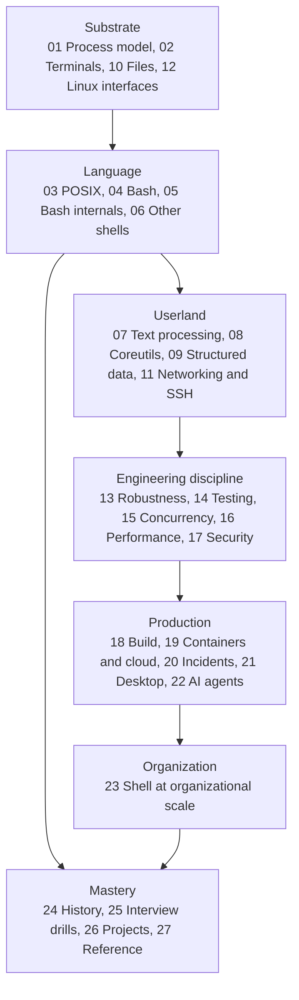

# Shell and Unix Engineering

An atomic-notes knowledge base for the shell, the Unix process model beneath it, the userland around it, and every context it runs in, from the system call to the organization.
The bar is the level of an engineer who could maintain a shell, review any script that runs in production, set shell standards for a large organization, and teach the Unix process model from first principles.
For any command line, the notes let you explain what the terminal, the parser, every expansion stage, the kernel, and each utility do, predict its behavior under bash, zsh, dash, ksh, and BusyBox on GNU and BSD userlands, and prove it with a lab.

> [!summary] How to use this section
> Pick a folder, read its notes in the folder's Learning order, and run each note's lab.
> Every note links its prerequisite and the next note, so you can also walk the graph from any starting point.

## Concept map

The map is the dependency order between groups of folders, not a runtime dependency.
Inside a folder, the Learning order list in its README is the order to read.

## Folders

| Folder | Notes | What it covers |
|---|---:|---|
| [01 The Unix Process Model](01-Unix-Process-Model/README.md) | 18 | fork, exec, posix_spawn, descriptors, pipes, signals, sessions, /proc, limits |
| [02 Terminals and Job Control](02-Terminals-and-Job-Control/README.md) | 13 | Line discipline, termios, ptys, escape sequences, job control, readline, tmux, expect |
| [03 The POSIX Shell Language](03-POSIX-Shell-Language/README.md) | 36 | POSIX.1-2024 grammar, quoting, expansion order, redirection, built-ins, errexit, traps |
| [04 Bash](04-Bash/README.md) | 24 | Arrays, transformations, namerefs, shopt, process substitution, error handling, versions |
| [05 Bash Internals](05-Bash-Internals/README.md) | 12 | The parser, subst.c, execute_cmd.c, jobs and traps, debugging bash, writing a shell |
| [06 Zsh, Ksh, Dash, and Other Shells](06-Zsh-Ksh-Dash-and-Other-Shells/README.md) | 20 | What runs where, zsh, dash, posh and yash, ksh93, mksh, BusyBox, PowerShell, Windows shells |
| [07 Regular Expressions and Text Processing](07-Regex-and-Text-Processing/README.md) | 19 | Regex flavors and engines, ReDoS, grep, ripgrep, sed, awk, Perl and Python one-liners, locale |
| [08 Coreutils and the Userland](08-Coreutils-and-the-Userland/README.md) | 25 | GNU, BSD, BusyBox, uutils, find, xargs, sort, buffering, archives, compression, rsync |
| [09 Structured Data and HTTP](09-Structured-Data-and-HTTP/README.md) | 13 | jq, YAML, XML, CSV, Miller, sqlite3, DuckDB, curl |
| [10 Files, Filesystems, and Permissions](10-Files-Filesystems-and-Permissions/README.md) | 11 | Inodes, permissions, ACLs, setuid, atomic rename and fsync, mounts, inotify, path races |
| [11 Networking and SSH from the Shell](11-Networking-and-SSH/README.md) | 13 | ip and ss, DNS, TLS debugging, netcat and socat, tcpdump, SSH in depth, fleet fan-out |
| [12 Linux System Interfaces](12-Linux-System-Interfaces/README.md) | 11 | strace, namespaces, cgroups v2, capabilities, seccomp, init systems, sysctl |
| [13 Robust Scripting](13-Robust-Scripting/README.md) | 15 | Strict mode critique, cleanup, idempotency, atomic writes, locking, retries, CLI design |
| [14 Testing and Static Analysis](14-Testing-and-Static-Analysis/README.md) | 13 | ShellCheck, shfmt, bats-core, ShellSpec, mocking, golden tests, coverage, staff review |
| [15 Concurrency and Scheduling](15-Concurrency-and-Scheduling/README.md) | 13 | Background jobs, job pools, GNU parallel, races, signal propagation, cron, timers, launchd |
| [16 Performance of Shell Programs](16-Performance/README.md) | 9 | A measured cost model, pipelines at scale, shell versus Python versus compiled tools |
| [17 Shell Security](17-Security/README.md) | 18 | Injection, hostile filenames, environment attacks, Shellshock, sudo, secrets, xz-utils |
| [18 Build, Packaging, and Bootstrap](18-Build-Packaging-and-Bootstrap/README.md) | 9 | Make recipes, autoconf, Nix builders, package hooks, installer design |
| [19 Containers, CI, and Cloud](19-Containers-CI-and-Cloud/README.md) | 12 | Dockerfile forms, PID 1, entrypoints, kubectl, CI shells, AWS CLI, gcloud, cloud-init |
| [20 Observability and Incident Response](20-Observability-and-Incident-Response/README.md) | 15 | The sixty-second analysis, ps, lsof, ss, strace, perf, bpftrace, logs, CPU isolation |
| [21 Interactive Environment and Dotfiles](21-Interactive-Environment-and-Dotfiles/README.md) | 12 | Startup files, PATH, prompts, completions, history, fzf, direnv, dotfiles |
| [22 Shell and AI Agents](22-Shell-and-AI-Agents/README.md) | 6 | How agents run shell, quoting across tools, guards, sandboxes, agent-friendly commands |
| [23 Shell at Organizational Scale](23-Shell-at-Organizational-Scale/README.md) | 7 | Estate inventory, standards and lint rollout, golden paths, migrations, ownership |
| [24 History and Primary Sources](24-History-and-Primary-Sources/README.md) | 9 | Thompson, Bourne, csh, ksh, POSIX, rc, the Unix papers, modern shell design |
| [25 Interview Drills](25-Interview-Drills/README.md) | 8 | What happens on Enter, predict-the-output, debug-this-script, design drills, the staff bar |
| [26 Projects](26-Projects/README.md) | 5 | A POSIX-subset shell in C, a production CLI, a legacy rescue, a data pipeline, an upstream fix |
| [27 Reference](27-Reference/README.md) | 10 | Glossary, portability and userland maps, limits, cheat sheets, reading list, study plan |

## Paths by track

- SDE (L4-L6): 01, 03, 04, 07, 08, 13, 14, 17, then 25.
- Low-latency and quant developer: add 02, 12, 15, 16, and 20, and treat the performance labs as mandatory.
- Cloud and platform: 01, 03, 10, 11, 12, 13, 15, 17, 18, 19, and 20, alongside [Cloud AI Engineering](../17-Cloud-AI-Engineering/README.md).
- AI engineering: 03, 13, 17, and 22, alongside the [Agentic Harness](../13-Agentic-AI/Agentic-Harness/README.md).
- Distinguished and principal: everything, with particular weight on 05 (the source), 23 (organizational scale), 24 (primary sources), and at least two projects.

## How the notes are verified

Shell behavior is checkable on any machine, so these notes check it.
Every worked example is a lab under [labs/](labs/README.md) with a bats test, ShellCheck and shfmt clean.
Portability claims are proven by running the lab under every shell in the matrix: the host (macOS bash 3.2, current bash, zsh native and as sh, dash, ksh93) and two container images that add bash 3.2, 4.4, 5.1, 5.2, and 5.3, BusyBox ash, mksh, yash, posh, and ksh93u+m on Alpine and Debian.
Each note is drafted from primary sources and then fact-checked by an independent reviewer before it is marked `solid`; [STYLE.md](STYLE.md) is the contract.
`python3 tools/check_shell_labs.py` gates the labs in CI on every change.

## Conventions

One concept per note, hyphenated file names, unique across the vault, so a bare `[[Field-Splitting-and-IFS]]` link resolves.
Every note ends with Related links (`Prerequisites:`, `Next:`, `See also:`) and primary-source further reading.
Shell syntax in prose is always in backticks, because Obsidian renders text between two dollar signs as math.

## Related in this vault

- [Operating Systems](../01-CS-Foundations/Operating-Systems/README.md) for the kernel theory under folders 01 and 12.
- [Performance Engineering](../12-Performance-Engineering/README.md) for the profiling under folders 16 and 20.
- [Security and Cryptography](../11-Security-And-Cryptography/README.md) for the context of folder 17.
- [Low-Latency Systems](../14-Low-Latency-Systems/00%20Home.md) for the CPU isolation and jitter work behind folder 20.
- [Programming Languages](../02-Programming-Languages/README.md) for the languages a script graduates to.
